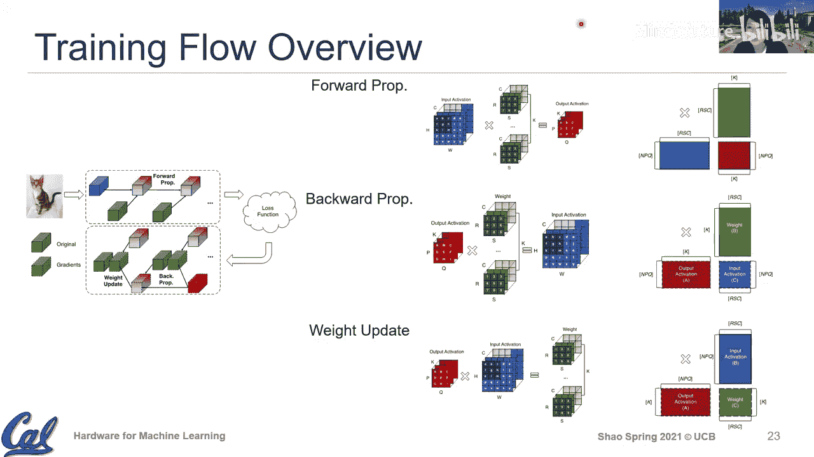

# 【加州大学伯克利】机器学习硬件技术课程 ｜ UC Berkeley ｜ EE 290 ｜ 2021 p15 P15 Lecture 18 Training -BV1XfM4zKETU_p15-

嗯。

Okay good afternoon everyone， welcome to EE290-2 hardware for machine learning。

 hope you all had a great spring break last week， got a chance to relax and spend time with your family and friends。

😊，So now back to our main topic today we have covered quite a few different topics with machine learning especially from hardware perspective。

 different operations， different primitives and different potential interesting optimizations and also changes from architecture point of view One thing we haven't talked too much maybe you already notice from some of our guest recurs that when they try to support both training and inference in their hardware there are some of the updates there and most of time we talk spend most of the time talking about precision but you may also start wondering what are the primitives when we spend quite a time talking about primitives in machine learning is our primitive enough what actually needed to cover training So today we're going to have a discussion on what kind of operations are relevant when we think about the training flow and how how we can actually either retarget our inference。

duct besides the precision differences， what are the fundamental primitives and how we use the existing hardware template like things that we have done in lab two with a systemy a array based architecture。

 whether they can also be used to support training in an efficient manner so today we're going to talk a little bit more about training。

 what is the underlying primitives and what are the operators there and you may actually realize in the end is actually very similar to inference。

 but with some very key differences which may have a very significant impact especially performance tuning and optimization。

So before we get there since we are talking about different operators and even before the lecture。

 we talk about our guest lecture this past Monday， like from San Barnovava talking about how they actually do their mapping to their architecture and we look at the research work that they have done it's a very interesting and the flexible architecture that can do not only machine learning applications but also other type of operators there so we've also covered from time to time some of the interesting efforts either here at the Berkeley or elsewhere to actually think about how we approach hardware problem or more specifically or more generally actually system problem in general in a lot of time I think your folks may notice that Berkeley have this kind of research center mode where faculty is a different background actually trying to work together。

What we can improve what we can do to improve the system efficiency。

 especially from a cross layer effort one of the I think most one of the most recent and also very important。

Part of the effort is from the part lab where at the beginning of the part lab。

 I think this is more maybe 1015 years ago，  early 2000 where where people actually start start thinking about parallel computing which is also very important I think you see the trend right like all single core and then parallel computing now we get to the more specialized and specific computing here so around the time when people and folks are started thinking about parallel computing there was a huge effort actually here at Berkeley where facultyult is a different background not only just architecture fulties but also application and and system and algorithms fulties actually work together to think about how we can actually approach parallel computing from a cross point of view and some of the discussions back then it's actually very similar to some of the discussion that we have these days when we think about。

Make specific computing。So back then and the parallel computing。

 one of the challenges or one of the opportunities depends how I look at it is actually there are all the different applications right。

 like there are a lot of exciting applications and almost all of them hopefully can want to actually benefit from the parallel hardware。

 the multicore hardware that the hardware vendors are producing start starting from 2000 So back then and one of the problem challenges actually how do we approach this right we cannot exhaust the implement all the different applications find out all the different algorithms and see how those algorithm actually。

😊，Can be mapped onto parallel hardware。So back then， there's a very important tech report。

From the par lab， this tech report is actually widely cited。

 still I think has been cited like thousand times at this time at this point and still being read almost all the time and even in some of our research discussion we still bring up this tech report from time to time So one of the earlier efforts of the power lab is really thinking about how do we actually approach this problem。

 given there's so many different applications and so many different algorithms and we're interested in how things can be actually mapped to the parallel hardware and how we improve the parallel hardware to support those different applications so back then one of the major effort especially at the beginning of the par lab is to think about whether we can actually instead of talking about this large number of applications which have actually fairly complex behaviors whether we can actually break down those applications to see some of the。

Most company used kernels and those kernels even across applications。

 they may actually share across applications and they may actually have different we may actually can create a taxonomy of those kernels and they may have different or similar behaviors。

 instead of going through all the different applications we can actually go through those kernels which could be a more scalable way especially for system designers to think about the implications those of those kernels and then think about what is the architecture requirement especially for parallel architecture。

 which was a focus back， so I think when it first started they folks actually involved in the parallel lab actually defined seven dwarfs where the seven dwarfs are basically the seven most company used kernels and then over time they actually added a field。

In the end so now I'm actually now sure what is maybe 13 looking at this this picture here。

 but they basically start with seven and then they added a few more dwarfs or tunnels that can be used and then looking at this kind of two dimensional。

Two dimensional space so we can see those kernels and then we can see double applications。

 so instead of going through those applications by looking at those kernels and then composing those kernels。

 then we can have a good feel of what's representative for those applications。

And if you look at actually back then machine learning is one of the driving applications。

 but this is actually even before deep learning days。

 but folks are mostly just thinking about the general machine learning kernels but even back then if you look at the dense dense matrix and sports matrix are basically one of the most important kernels in machine learning and also have it used for range of different applications and now these days。

 especially with the deep learning push， the linear general dense and sports linear algebra has become even more important there so you see in general like you have already seen quite a few different architectures is our in-house architecture or some from our guest speaker the architecture that they're building Of course they don't share all the details but for the detail that they share in general most of the time people have been basically building at this corner the dense matrix operation for machine learning which is actually。

Of the dwarfs and have actually very important implications even for today's architecture。

 for today's applications。😊，So with this， I guess I want to draw the parallel here like parallel this is also during the transition between like the single core single thread application and then transition to the multicore architecture and then we need to actually see how those applications can be potentially scale onto the multicore architecture so that start this kind of benchmarking effort to think about kernels and now 1520 years later。

 were visit the next wave where will remember the touring over lecture right from single multico now to specialization domain specific architecture。

 which is actually even more relying on applications So again。

 this kind of discussion still show up from time to time is what kind of applications we care and when we say applications。

 what kind of kernels weing so some of the kernels still showing up like the dense sports algebra still。

At the same time you may also see like for example graph traversal also become important FFP has always been there。

 so this kind of kernels is actually a more reasonable way especially for system and hardware designers to think about how to both understand those kernels and also see challenges or maybe limitations on the existing architecture and how to make things faster。

So since we are talking about domain specific computing。

 which is supposed to be the next shift after the parallel multicore push and also we are talking about a lot of the topic for this class is really application driven。

 I want to just draw I want to draw the analogy here。

 this kind of application driven approach definitely very important for domain specific architecture。

 but we also have a very similar discussion back to the parallel computing days and see how we can approach different applications。

Okay so back so part lab day is very exciting and then let's back to our topic so I mentioned earlier so over the course of the semester we have talked about a range of different topics related to hardware for machine learning from the core primitives and then think about how we actually realize that in both hardware and also compiler the mapping part right now after a range of guest lectures you see basically those two things are always very important even when they structure their team it's always of course you need to have a hardware team but at the same time having a compiler team and depending on which phase you are I think I mentioned earlier。

 typically early days you want to have aem a very good hardware team first but then when you actually move on to the process and the move on。

 especially when the chip becomes become available having a very strong compiler team it' also very important。

 especially if the architecture is actually fairly flexible。

We also talk about some of the co design opportunities the people the type of things you are approaching are exploring and a lot of work actually really in thinking about the data transform mechanism and also sparsity there。

There are range different operators we talk about like element wide operation there and typically those operation have actually lower compute density。

 so a lot of optimization for those operators basically move those compute units close to close to either eRA or memory even in memory sometimes even storage to actually get things faster here。

So for today we're going to actually get a little get some experience with another part of the operators actually showing up in training。

 we'll do a quick recap of training flow we discussed this very。

 very on maybe in the first couple lectures of this semester。

 we'll just do a quick recap what we mean there and then we'll talk about the key kernels and the terminology people are using and what are the similarities and also differences compared the way we have been thinking about about inference for the for the past few months。

Here。So training flow recaps we already machine learning algorithm we already mentioned discussed early on in this semester right so again this class largely focus on deep learning。

 but deep learning is really depends how to look at it but can be actually categorized as a subset of the machine learning algorithm here。

 but in general I think about machine learning algorithm。

 it typically require what we said those like three components and we need to actually learn from experience for a specific task and then we also need to have a particular performance measure so that we know how well we are doing with this particular task and this feedback。

 this performance measure what we used as a feedback for us to improve our algorithm based on our training data and then to actually better get a better model our machine learning model in general to do this day。

So those are almost always three components associated with ending machine learning algorithm。

So we also talk about for almost all the machine learning algorithm we need to have those components first we need to have a data set this is basically what we are learning from right this is actually our experience most of the time for computer vision we are using this image in that data set and then for different applications we actually also need to collect the different data set I was recently watched a keynote from from Andrew L who actually give talk on I think MLl dev or DevO these days and he was basically saying the data preprocessing the data preparing for the data is actually even more important than doing the model itself so data should actually take like 80% of your time to actually think about whether your data whether you have enough data whether your data is actually labeled correctly compared to actually spend a lot of time actually tu in and doing fine tune in the model there so data is actually very。

Important for a lot of academic research， we're mostly just using the standard data set。

 but especially we'll get to actually more applied machine learning and also very specific field right different area like for example doing some like medical imaging or some kind of defect detection you really need to collect a high quality model data that could actually improve the deployment productivity very significantly so the data set is actually very important when you think about machine learning pipeline here。

So first is data sets very important， we mostly just take for granted because we have the standard machine learning data set。

 but again， in real deployment， especially for your specific use cases having a very clean and reliable data set is actually very important。

😊，And then we talk about performance pressure， we need to know how good and how well our model is performing so far so we need to actually have a cost function sometimes we call loss function just see how how many prediction that we made it actually match the label data expected outcome and how many times we actually made the wrong prediction and that will be used to give us feedback to fine tune our model here So then the task is basically the model that we're building right so again back to and example。

 80% of time should actually be building up the data and 20% the time should actually be building building the model here So those are basically the standard component that we talked so far our'll skip this one is is just as the example using as a single simple example for the near regression what is the data set the data we have is basically housing prices with different area and then we use the mean square error as our cost。

To see how what is our predictive compared to our predictive value。

 how much well compared to the ground truth， how much we're off with our predicted value here and the model itself is pretty simple linear and direction model and for in the deep learning context lot time we're doing deep neural network based model here and then we're using gradient descent to actually update the model based on our loss function feedback here。

So those are the typical component so here is what we trying to compare。

 especially for today's lecture for training and inference so so far most our discussion been focusing on inference right so for inference we just need our data and our model and that sometimes you also see this just a forward pass right we take the input。

 we go through our model and then make our prediction here but for training is actually the one which require all the different components that we discuss so far and we need our data here again this is our training data instead of the real-time data that coming in and with our training data we still do our forward pass。

 make our prediction but then we actually use our class function to see how much error that we are producing here and then by going through the optimization method we are actually updating doing this backward pass to updating to update our model finding our model so that we can actually improve。

Our model based on the data that we have seen。 So the training passes have both forward and backward。

 So so far we have been mostly focusing on the inference， which mostly focusing on the forward pass。

 So for today's lecture， we're going to talk a little bit more of what kind of computation involved in the backward pass again。

 similar to the way we approach the forward pass well be mostly thinking about the computational primitive right what are the fundamental。

 you may hear people use a lot of fancy terminologies to talk about backward pass and a different gradient updates。

 but here in our context since we context since we are very close to hardware So we are actually more interested in really thinking about what are the different primitives。

There and how they are actually whether they are actually similar or different from the primitives。

 like remember the DN primitive doesnt talk about how they are similar or different from the primitives that we discussed in our inference past。

So with that， I'll skip this。For now and and get to this point so this is basically again a more detailed version of the training pipeline here again you see the forward pass then calculate the last function and the backwards backward pass here right so again we use let's in today's discussion we also use the similar color scheme that we have been using youll recall we always use green to represent weight and the blue to represent input and the red to represent an output。

And here I use a combination of blue and the red because it is the output of the previous layer and then it becomes the input of the next layer right so again。

 bring is weight， blue is input， red is output and this kind of next phase basically is the input output depends on which layer that we are looking at。

😊，Here because we also need to actually update weights。

 I remember we have this loss function based on the loss function。

 we actually need to calculate the delta weight that we actually need to add it to the original weight and then they are like different factors there like learning rate。

 momentum all those actually will modulate how much updates that we're doing to our weight。

 so we'll ignore that but we basically the backward path we're doing the weight update so here we' are using the dash volume here to represent the gradients here So in the backward path we basically have two operations that we need to do the first is you may hear people talking about backward propagation iss basically propagate the gradients from the output to the input because we actually have typically have deep layers right so we need to actually propagate the updates the gradients actually not only for the current layer but also to the。

Yes layer and also the layer， even the layer before that。

So the backward propagation is actually described in the past where we take the output gradients and then generate the input gradient。

 so this is the backward propag pass the bottom arrow that arrow that I'm highlighting here。

And another component is a weight update pass we talk about that given and gradient we know actually how the error that we are predicting and so far so we want to modulate that by updating our weights so that we can do a better prediction next time so we are actually also generating this weight gradient that will be added to the original weight so that we can actually update the weights So the forward path we basically always just generate the output but for backward path they are actually two separate computation going on one is what here what we call backward proag again get from the output gradient。

 this red volume here and then generate another I guess blue volume。

 blue or red volume but basically into input gradient so that we're getting the backward prop we are propagating the gradients from layer to layer so this is actually between input and output。

But another part of updates that people we doing in the training part is actually update our weight。

 so we're actually changing the green the green volume here because we actually need to change the weight so that's updated ways can better predict。

The expected outcome next slide， so there are actually Tuesday whichs going on in the training in the backward pass。

 both backwards gradient propagation， but also weight update。So before I move on any questions。

 comments， anything you want to share so far。Okay， great， again， if you have any questions。

 feel free to either use the chat window or just unmute yourself directly。😊，So again。

 so far we have been mostly focusing on the forward pass and even that already very a lot of complexity。

 especially when you hear from our guest speakers when they actually need to deploy things in hardware they already talking about all the complexity here so now quite a few actually hardware actually moving to training as well actually remember infringia one of our first guest lecture。

 they do they do infringia for inference， they still mostly talking about the infringia during the guest lecture。

 but their next generation is actually for training called training or something but they also actually start covering training and similar to Googles Ten processing unit the first generation is actually TPUV1 is dedicated for training and then V2 and V3 they actually also get to dedicated for inference and V2 and V3 they also get to the training space so this is very very natural。

Progress there and you will see in a minute why it actually makes sense and second typically it doesn't actually require changing your architecture dramatically besides the precision requirements like B flow 16 was invented as part of the TPU moving to training there。

 but this is a very natural progression initially start doing inference and then they realize the delta between inference and training is not that significant and then typically people will also start including including training in actually in what they offer。

So that's the pipeline here， so will in today's discussion will be mostly basically break down the computation involved in that propag and with updates again two separate paths and see what are similarities and differences compared to the forward paths that we have been discussing so far。

So before we talk about there get there some logistic of the course。

 so first congratulations everyone， were officially halfway I guess more than halfway through the semester at this point all the labs are done readings are done we will not have more readings this moving forward but we do actually if you notice at the beginning of the lecture before we start especially before we start recording we'll do some discussion either related to guest lectures or or papers。

 important papers or interesting research directions we'll do that if we are interested feel free to participate that before we start the lecture there so everything's done for a project proposal is also done a good job everyone who have submitted proposal I'm very excited about many of the proposals and looking forward to see how they actually realized in the rest of the semester so we are almost done at this point。

😊，We just need to actually all of us just need to execute our plan that layout in our project proposal and moving forward。

 we basically have a couple more components， we'll have two more checkpoints。

 two checkpoints as we asked you to specify in your project proposal。

 we'll talk about how we plan to do checkpoint one in a minute。

And then we'll have presentation and the final report and that will basically contribute to the rest of the grading for the project so we're almost there hopefully you also have been moving towards your the goal that you set for for the project and we'll talk a little bit more about checkpoint so next week it's our checkpoint the first checkpoint so we are doing this kind of two weekek s here so here is a link to sign it's a basic spreadsheet that we use our office hours。

 both my office hour and eighths office hour so feel free to to reserve a slot there we have roughly I think 15 minutes per team we'll also post this on PSI you don't have the link here it just reserve the slot there so that either I or A is able to actually see the progress that you have made。

And so far I also mentioned like checkpoints like 5% of the great you could just show up look actually give you 5% so make sure you show up right it's effort based this is just really important to make sure you are on track right and specifically for the checkpoint we expect two or three slides you don't need to have a lot of slides but you need to have a couple slides showing your current progress so what should be included in the in those slides。

So first we like to see a diagram representing your hardware or software design and how things actually fit into the overall goal of your project so our projects are fairly diverse。

 different students have very different projects， some are more hardware focused。

 some are more software focus， some some of the projects actually more tailored towards hardware software codesign all of those are fine but we like to see a diagram overall just specifying what are the different components actually involved in your project and what are the components that you think either you already have that by some of the existing work or things that you are planning to do by basically either building or developing those components so we're expecting a highlevel diagram to make sure that you know the overall overall direction of your project。

And then the second part is basically naturally it' a checkpoint right compare with what you have proposed in your project proposal。

 what are the things that you have done since the project proposal。

 which is by the time we do the checkpoint should be roughly two weeks ago right what's your progress in the past two weeks and it's okay after two weeks you realize that your proposal was too ambitious or you actually need to adjust because things have changed once you start doing things you need to actually change things that actually need to be different from your or plan that's also fine but let us know so that we know you are changing things because you have seen more you realize more so what are the things that you plan to change that's actually different from your project。

Pro proposal， so nothing too complex mostly just over overview of your project and what you have done so far and you need to make any changes。

 what kind of changes you need to do。So does that make sense any any questions or comments you have about a project？

Our checkpoint in general。That clear。Okay， I was always clear。 If not。

 feel free to again stop by our office hours or just send us email or us on Piaza。 either it's fine。

 we're always there and trying to help you and work with you together together so let us know how things goes and and you can find this link on slide It's already posted on the course website or we'll also post a version on Pazza so you can see the link and I'm looking forward to seeing all of you next week and see your awesome progress that awesome progress that you have made towards your project。

😊，So that's a project and then just a little bit more two more components so a checkpoint one we'll do another checkpoint2 again two weeks after checkpoint1 and then two weeks after that we'll do the project presentation and project report so that's tenatively be our current place this will be in the reading week and we'll do the first day。

 the Monday of the reading week during the project presentation again we're expecting roughly maybe even 15 minutes presentation with Q&A after the presentation and then by the end of the reading week basically the Friday we'll do the final report will be the final report deadline here so we're expecting a project report reading lot text feel free to use overly for that and doesn' need to be long we just set a marks number of pages just less than eight pages。

documentcument what you have done what you learned in this process and most of the project that we have seen so far require fairly decent amount of development and engineering so in that case for the code that you implemented it please provide the link to your code repository so that we can also examine the code implementation so we'll have more details later but that's a rough timeline in case you are wondering closing are laid out for for the next for the rest of the semester so checkpoint one next week。

 two more weeks checkpoint2 and then two more weeks basically two more weeks that will be project presentation and reports so we're doing this two week spring so that again end the goal is to help you to spread out the work so that you can get something done and get also get partial credits along the way instead of push everything towards the end。

Any questions， comments？Or you added the timeline you have some conflict with the timeline。

 also feel free to reach out to us we are fairly flexible again those are a tentative timeline based on our current schedule。

Okay。see Xing Yu is wondering is the project presentation public to the entire class so that we can see what other yes。

 yes， the project presentation is actually open and we recommend and strongly recommend well basically have maybe two or three hour block and so feel free to join the presentation is actually really fun last time last year I havent a good time。

 a good time actually just going through all the presentations and and seeing what people have done So it will be public and for all the students。

 of course you have to be there during your your slot。

 but we strongly encourage you to also be there to see other students presentation and what they have done because many of the projects actually quite different So we have like very handszone FTG project we have a project that is actually preparing for the competition but then we also have like super system C or super algorithm project It' like very。

different there so if you're interested feel free to join just get a sense what other type of exciting things are going on yes so everyone should have the link you will know your specific slot but will strongly recommend you to also participate other slot and also ask ask questions ask tough questions to your fellow students so we can have a fun discussion so good questions senior so everyone is welcome should be a fun project party。

😊，Other there questions or things that you want to do or want to see？Okay。

 well if anything comes to mind， feel free to share with us we are looking for fun things to do so new things to do also to make this more more interactive but this should be fun and don't don't stress about it oh there's a lot of work but this is also part of a very open ended project and and really depends on how much you want to do right so this should be a fun process and where again here to help you to achieve your so use this as an opportunity to。

To push yourself a little bit more and see what we can do by the end of semester。Okay。

 so with that again if you have any questions about the project。

 feel free to reach out to the teaching staff either individually or use PA。

 we are happy to assist you in any of our capacities。Okay， so with that， we talk about the kernels。

Involved in the training， again， we have the board propagation， which is the same。

As what we have discussed in the inference pass and two more things actually coming up is actually the backward propagation。

 this is really how again， you remember the horizontal backward line we drew earlier。

 this is how output gradients can be propagated to the input gradients and will get output and then we're updating the input gradient another part the backward training。

 the backward pass is actually doing the weight update。

 So it's not only just the backward propagation sometimes we always only think about the gradients propagation but also another part is actually updating the weights updating the tensor so that we can actually change the weights to have a better prediction next time。

 So both components are involved in the in the training。

 So overall three kernels as we listed here one is something were already fairly familiar with and we'll be focusing on the other two in today's discussion。

So I'll skip this again， those color scheme， weight， grain weight。Blue input activation。

 red output and the mix is basically input and output and the dashft tensor dash kernel here is four gradient。

So again， let's just do a quick recap with the forward publication。

 the upper pass that we have seen earlier right so this is the past that we are very familiar with you have spent quite a lot of time in either your La2 and lap3 red trying to do this it's basically take the blue input and then we come with our weight and weights of Rs is weight height and the width and see the input channel k is output channel and then we get a red output activation of also depths K K output channels and also the height and the width of the images are using we're using P and the Q。

For today's discussion， we won't actually spend more time on the rest of the dimensions。

 but one thing very importantly is to highlight which dimension is actually being reduced here。

 So here what I mean what I mean by reduced is you can either think about which dimension actually disappear in the output or which dimension actually need to be accumulated。

 So if you remember when we do our systolic array， right in lab2。

 the dimension that need to be accumulated actually need to go go through go through vertically right we're doing accumulate over time。

 and that's how we actually the dimension actually being reduced。

 So the dimension that need to be reduced or the reduction dimension is the dimension that need to be doing the multiply and accumulated need to be accumulated over time。

 And once they are all accumulated， those dimensions basically disappear。 So that's why those are。

Basically easy way to an easy way to tell， which is a reduction dimension and just to see which dimension actually disappear in the output。

So again for the forward propagation， as we discussed earlier we're accumulating along the R and the kernel height and S the kernel width and the C dimension right so we're accumulating R as C dimension that's why we don't see any of R C in our output so the dimension actually being reduced is R as and the C here so those are the dimension is actually being reduced so you may notice that one thing the reason that I want to highlight here is that's actually very important that's a key difference with the different kernels that we're going to discuss today and so the rest of dimension is actually pretty consistent but one thing in particular thats actually different is which dimension actually being reduced and I find it actually very easy for me to have the mental model to see what are the similarities and difference what's really being done in this particular computation。

So again， going forward， again， we're reducing we're accumulating along our S and C height width of the kernel and the depth of the input channel and those dimensions disappear in our output activation。

 so they are also they are the reduction dimension in the computation and for folks who have a more compiler background if you see a lot of。

And compiler work in deep learning， they also have a very special attention for the reduction dimension in general。

Okay， so that's the forward propagation and one thing we mentioned briefly in the when we talk about primitives is actually how we potentially could actually convert convolution to gem through inputcal there。

 and this is basically by duplicating input activation so that we can convert convolution operation into a matrix multiply operation and the and the duplication factor is basically R and S here because we are actually duplicating。

Both the height and the height and width of the kernel。

 the height and the width of the width kernel here。

 so that's the aim to call is basically trying to convert convolution to gem and then see how we can actually by duplicating the data we can actually perform gem operation directly instead doing a convolution operation we'll see actually the reverse of that column to image today trying to actually reconstruct the original image after the matrix multiply computation so we see we have seen the m to call in the past this in todays discussion you will also see the call to image or column to image as part of the parameteritive here。

So again， this might be a more intuitive way to visualize a reduction dimension if we use this kind of matrix multiply representation again we're using the color consistently green is weight and blue is input activation and red is output right one thing in particular to focus here is RSC is a reduction dimension and then we remember the way we do low data into the systolic array and we actually want to make sure the data the corresponding data along the column of the weight and along the rows of the input activation can actually meet at the right timest so that we can actually。

AAcc accumulate them correctly right， so here and which dimension is being accumulated here is the RSC dimension here。

😊，So that's a reduction dimension， so focus on this this the dimension here。

 basically the roll dimension of the input A and also the column here of the input B。So first。

 like we mentioned， there are two parts right， let's take a look at the first part。

 the first part is what we talk with backward was mentioned backward propagation right。

 so we have the output gradient， so this is basically the gradient propagation we have the output gradient What we want to get is the input gradient so that we know how the gradient is actually propagate through layers right so this is a horizontal line that we have seen before we get a dashed output gradient and we want to see how we can actually propagate this gradient to the previous layer so that we can also update previous layer correctly。

So we are focusing on the back propag here， this is the horizontalarrow that we have seen earlier。

So again if you think about whats actually being done here。

 our input actually becomes the red tensor here become our output gradient here and our output is actually our input the blue tensor that we have seen before right because we're propfagating the gradient from output to input so now it's basically those two are actually swapped right so output become input and input become output so we still use the input and output as the way we describe input and output in the forward pass for consistency that we know what we talk about but now the relative input and output is basically swapped we're taking the red tensor。

 the dashed output activation gradient as the input and we actually want to generate the blue tensor which is the gradient of the input activation。

Here，So again， everything else is actually the same。 again， instead of going through the computation。

 which can be a little bit a little bit tedious that's what one thing I find is actually very useful to have a mental model to think about what's going on is again。

 to think about which dimension is actually being reduced or which dimension actually disappear in this computation。

 So one thing we'll see actually this， instead of doing RC reduction。

 what's actually being reduced is actually the K dimension， we're actually reducing the K dimension。

 So that's why the K dimension is actually not showing up in our in our output。

 We'll see another example again， in the matrix representation。 Maybe that's actually a bit clear。

Here， so what's really happening here is， so again， this is our forward propagation。

 The reason is the forward propagation just look at this reduction dimension。 right。

 we're reducing along the RSC here。 So now for backward propagation。

 What's happening here is that were actually reduced B reduction along the K dimension。

 That's why is the K is actually not part of the input activation here。 And again， you will recall。

 again， we're talking about the horizontal line。 So the input is the red tensor。

 input A is the red tensor。 The output gradient。 We still have our weight asB。

 And then the new output is actually the gradient of our of our input activation here。

So for this backward propagation， what's happening here is that we are actually doing reduction along the K dimension so the output channel。

 which is part of the output activation， is actually not part of the input activation。So to do that。

 one thing you see a lot， especially if you look at the deep learning framework。

 either Pyth or sensor RRT or onx， you will see actually a lot of transpose operation showing up in backward path So transpose operation we'll see the first one here。

 we'll see another one actually in a minute It's basically we actually got the reduction dimension actually changed so we actually need to transpose some of the matrix so that we can still do the reduction correctly。

So here for our weight matrix， so before like our row dimension is RSC and our column dimension is k right but now were actually reducing instead of RSC we are actually reducing our k dimension here so it here we're doing a transpose of our weight here so you may see a pre transpose operation in some of the framework implementation。

 the goal there is basically so that we can reduce。

Reduce this new K dimension instead R RSC dimension。

 So we have a transpose of green ten transpose of weight so that K dimension can be reduced here。

And then again， after case is reduced， we get our input activation here similar to the input activation we have seen before。

 it's RSC， one dimension is RSC， another dimension is NPQ。

 we have the same dimension as we have before right RSC times NPQ and here is where we can do the column to image。

 remember the input column， is to duplicate by afactorial Rs and then by doing column to image we remove that duplication factor and then we can reconstruct our input activation in the original format。

So again， this backward propagation we swap， the key difference here is actually we swap the input and output and by doing this swap。

 now the dimension actually disappear is a k dimension so that will be the reduction dimension and then to do this reduction one operation that you see in a lot of machine learning framework or even in hardware is doing this transposing that we can transpose the weight and then we can reduce the K dimension to do this multiplication and then we have talked about so two things showing up is when this transpose operator。

 another is this column to image operators that we can reconstruct the original in the original image shape。

 but other than that it's still a matrix multiply and then its the only thing difference here is reduction dimension changes from RSC to K so that we don't have the K in the output。

Does it make sense， any questions？Okay。This may seem a little bit abstract and also also try to basically highlight the key differences sometimes if you look at those AI frameworks。

 they may actually have sometimes they also have their own implementation but in general if you look at especially when this typically they call this DX or the because it's actually the ingredients so Dx is basically our gradient are into the activation this dashed blue kernel here blue matrix here so we want to calculate this typically two things are involved well let say three things are involved is a transposing operation so that we can transpose the weight。

そ走走。Where K dimension become the new dimension that can be reduced so I can steal a maximum operation to actually calculate the input activation。

 And finally， this is depends on framework。 But if they want to reconstruct the original tensor they also need to do a column to image to actually get the original tensor。

 So again， the core computation is still there。 so that's why it's not a big。

Big push for those AI hardware companies from doing an inference trip to a training trip。

 but definitely there are a lot of data transformation and data layout need to be considered to make sure both so far we're mostly just making sure the functionality functional correct there could also be other performance tuning because the dimensions are different a lot of time the performance is actually highly dependent on the matrix dimensions so that could also add more pressure on the performance tuning but overall still core operation is still a max but with the transpose and potentially column to image so that we can have the right data format again for the horizontal backward propag。

Questions， comments。Okay， again， feel free to share your thoughts on the chat in the chat window or send us an email if you have anything anything coming up。

 So we talk about the backward pro。 And next we're going to talk about the other parts。

 So this is the eal pass to actually go back to the green test right。

 So now we need to actually update our weights。 We need to calculate what's the So sometimes you see Dw in the in the framework。

 So that's basically trying to calculate the gradient of the weights here。

 So we are talking about this。The diagonal pass here trying to generate with a weight。

So as the name suggests we actually the output will be weights now right So instead so so far we have so far is always we see the input。

 Now this is the time actually weights become become the output and the input actually become again。

 the output gradient， we look at this one might be easier。

 So the output activation gradient and then combined with the input activation and to see what is the weight actually need to be generated。

The D weights， the gradient are the weights。And we generated。Again， one thing to remember。

 at least again， my mental model that I find useful for this kind of thing is all we look at what actually being reduced。

 So one thing definitely disappear is P Q dimension。 Basically the image。

 you can also think about H and W or P Q， I like to think in P Q。

 the PQ as basically the heightened the width of the image。

 So now that before we talk about R RSC is the original input forward pass that is a reduction dimension for backward propagation K is the reduction dimension。

 So now for weight update P and Q is actually the reduction dimension。

So how does that work if you look at this matrix multiply example as it's a little bit more intuitive。

😊，So in this case， our input activation actually stay let's same right right。

 remember it's RSC and NPQ， sorry input but instead actually putting this here in our forward propagation as input A we actually move this to B an input B for consistency here So what's actually changing here again。

 the reduction dimension is here， Pq or N right this is basically a is the back sides here。

 so all of those dimensions actually disappear， So this dimension should actually stay here because this is what we see as a reduction dimension。

So another input so we talk about input B is the input activation。

 another input is actually the output activation again the gradients from the output here。

 So one one dimension is NPQ as we mentioned this is a reduction dimension and the other dimension is K right then compared to how output activation is F used in backward propagation that we discussed before is also NPQ and the K。

 but this is another transpose operation here because now last time with say K is the reduction dimension right So now it's actually not K anymore now this this dimension is become NPQ So that's why you see a lot of transpose operation in those framework because even just for the gradients depends on whether it's actually used for propagation or weight update the reduction dimension is actually also different here。

 So we have another transpose here。So again， this dimension actually disappeared。

 It's still a matrix multiplier。 Everything is the same。 We're really doing some。

 We're really just doing data and prepro here。 right。

 so after we actually lay out the data in the right format and figure out which is a reduction dimension。

 So here， MPQ is a reduction dimension， they disappear here。And then we get our weight again。

 it's the same RSC and K weight here。 so so that's why first to summarize so two things actually changed here one is the NPQ becomes the reduction dimension we start from RSC here RSC reduction dimension and then we move to K in backward propagation and then weight update NPQ becomes a reduction dimension here and then。

So that's the first thing。 And the second thing for output activation。

 how it's used in either backward publication or with updates。

 they are actually using different format。 So there's another transse operation here but overall it is still a matrix multiplication so we can still if you think about the the systematic array that we build in our lab too right so the way data is layout is actually different now so far we're mostly talking about data layout right but then once you start once the data is actually prepared is start obligating just make sure you have the right precision we didn't actually get to precision this discussion but we have seen quite a few talk actually about precision so far right so making sure you have the right precision to support。

Support training and then we basically still do the standard systolic accumulation systolic broadcast just accumulation dimensions become different here and then that's how we actually get our dashed weight updates so this is the EC path of doing the weight updates here。

So that's the key key difference here and one thing you may notice the reduction dimension actually changes。

 especially we're talking about earlier parts of the images where image is actually fairly big and then the PMQ is can be also fairly significant and then once we get to later part of the image when PMQ actually much smaller and then the reduction dimension also gets very gets much smaller which is actually the opposite of the way we think about forward propagation because it turn typically where we're talking about RSC and the input channel gets deeper actually in later layers and the first layers like input channels only three so the dimensions also matters so far we're mostly just using those those letters the represent dimensions but the values of those letters also matters and when you calculate your utilization of the where the performance as。

Especially the mapping， the tiing operation， a lot of time is actually dependent dependent on those on those on the sizes。

 also those dimensions。 So it basically give more pressure in terms of performance to me The the core operation is quite similar。

 the matrix multiply that we talked before so far， most of our discussion is actually very centered around。

Data transformation， preparing the data in the right format and maybe even some post processing to get the data in the right format later。

 But then once we have all those different dimensions。

 all of those actually need to be part of the performance tuning pipeline to actually get to see hopefully get reasonable performance in the end。

 we definitely have more parameters involved and also more data preproces and maybe even data post processing actually involved。

 even though the core computation doesn't change。 So first it's not that's why it's not a big push for a lot of the hardware companies shifting from inference to training。

 at least for the standard training pipeline that we're talking about today。 But second。

 definitely more support needed for doing pre and post processing especially data transformation and second。

 maybe even more pressure on the compiler and to actually make sure that we can generate。

Performment kernel for all the different shapes that were evaluating for for training so we have more shapes that we need to hear about with training。

So that's basically the weight update。 So quick recap。 So we talk about the training flow right。

 we start with this simple example again， take the input doing the forward propagation again our color skin blue is the input red is the output。

Greray is the weight。I this consistently and it's mixed is basically its input to the previous layer and sorry it's output to the previous layer and input to the current layer right so forward is fairly straightforward take the input and weight generate the output and then moving forward our discussion stay is actually for the second half of the picture here taking the gradients here and there has two there are two tasks the first is actually propagating those gradients from the current layer to the previous layer so that's what we call backward propagation the second part is actually generating the dashed gradient tensor for weight so that the grain tensor here so that we can actually update the tensor。

So this is another more， again we are very focused on the primitives here since this is still more hardware class。

 so we are focused on the primitive， it's a little bit at least when I first look at a lot of the deep learning framework it' a little bit confusing just look at their different like notations to represent different computations I personally again I mentioned earlier finding it actually a lot easier just to think about which dimension actually being reduced and then using this kind of more metrics of thinking about the reduction dimension it's actually a lot easier to see the similarities and differences and to know what people are really talking about when they talk about the computation complexity here。

So if focus on the again， the reduction dimension here for the forward propagation。

 this is one that we're very familiar with right so it's RSC and RSC that's being reduced to get the output backwards propagation is actually the other way K dimension is actually being being reduced to get the input activation the input activation doesn't have the K dimension and with that one thing you notice that there involved a transpose operation for the grain weight here because instead RSC being reduced we're reducing the K dimension。

So that's backward proag。 And again， the second part。

 Another part of this is weight update to generate the weight gradient here。 So again， in this case。

 P andq are actually the reduction dimension because P and Q don't show up in your weight So the weight independent of the image size。

 which is also very intuitive。 So that's why I find the reduction dimension is lot easier we're talking about updating weight。

 we're generating the weight right and P and theq， the image dimension are not supposed to show up in the weight。

 So they are being reduced and then once you figure that up。

 you actually know at least know which dimension， this reduction dimension should be right P and the Q and then we have RC for input at the other dimension and K of the other dimension。

 And then once thing you notice here compared to the backward propag。

 even just for upward activation this dash gradient here。

 we're doing another transpose there because the reduction dimension is different。

 And now we're getting our weight here so。SoThose are basic different computation involved here。

 I guess two major takeaways， the first we mentioned earlier is not a big huge push from inference to training。

 the core computation is still the same and again we talk about different precision as not part of today's discussion but precision definitely play a very important factor but you may see why so many companies actually transition to training very quickly。

There， but second， there are definitely more operations involved。

 especially with pre and pulse processing。 We talk about how actually need to be transpose transposed to actually get to the right reduction dimension again。

 you are more software background you look at those different framework we see a lot of transpose operation there and some framework actually explicitly say the reduction dimension so that also useful so that can also so a lot of the new work is actually making sure the data is in the right format so we can feeds the data to the hardware to the compute unit in the right format we can do the to the reduction correctly so that's a lot of the work involved there I guess more from more from the hardware perspective another in terms of more work involved is more just because all of the dimension is actually changed right so when we talk about matrix multiply is actually very sensitive to。

and right K is a reduction dimension M is a size of image dimension。

 So now we are actually getting more different。MK combination is basic reduction dimension and parallel dimension combination so with that it requires a lot more performance to like tiring basically the tiling style optimization that we mentioned in our lab3。

 all of those are actually also become very important to get good utilization for our hardware even the final hardware steel mid metric multiplication。

 but then we are dealing with more dimensions and different combination of dimensions there。

So this is basically the overall flow for training again。

 I think we I mentioned earlier on this class， it's actually very similar so now you see how people actually move from inference hardware to training hardware。

 but then definitely we have a little bit more creative and pulse processing going on and also more dimension。

 more more different combinations of different dimensions need to be considered when we do any kind of performance tuning here。

😊，So so that's the different components of training like we talk about the core kernels again。

 the first kernel is the same the major differences are the the two new kernels that we introduce today and those two new kernels again is actually full similar patterns and I would also recommend you instead of trying to remember all the different company different people have different ways of doing this some people also introducing like I mentioned like DwDx and then write equations out it's another way to do that which is also fine if you find that more intuitive。

 I generally find just really just thinking about which dimensions actually disappeared。

 which dimension is actually being reduced， that's a very easy way to actually see the similarities and differences across the different kernels。

So with that that's a discussion we have today great to see all of you here and if you have any questions we I be around four of your longer so feel free to ask any questions after your class and good luck with everything hopefully you enjoy the beautiful weather these days a beautiful spring and enjoy the rest of the week and I'll see you again next week take care everyone bye。

😊。

