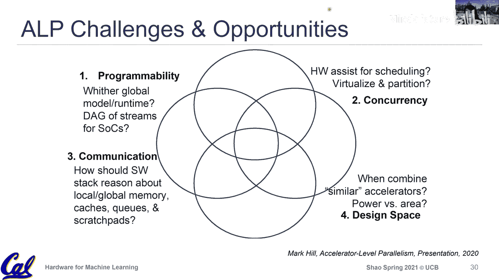

# 【加州大学伯克利】机器学习硬件技术课程 ｜ UC Berkeley ｜ EE 290 ｜ 2021 p16 P16 Lecture 19 Accelerator-Level Parallelism -BV1XfM4zKETU_p16-

Okay， good morning。 good afternoon， everyone。 welcomelcome to EE290 hardware for machine learning today we are going to have our 19th lecture of this semester。

 specifically so far we have been talking about individual Is and individual accelerator designs and also different I portfolios。

 a company has been actually building especially related to our preclass discussion that like different technology development that has been going on these days。

 today we are going to take a different perspective since we have been so focused on individual accelerators。

 individual accelerators， especially in the context of machine learning。

 Now we are going to zoom out a little bit to see at more a system level how those individual IP block actually interact with the rest of the system and what kind of potential advantages or opportunities that we may observe actually by moving things by actually both deploying。

😊，Domain specific architectures by building all the different specialized Is。

 but also by assembling those Is together at the system level and especially with recent trend。

 we definitely see a lot of companies， both hardware and software companies are not only comfortable or。

Selfcontain with their individual I development。 They are definitely very interested in get to the system level so that they can actually create a chip level ecosystem。

 So what are the opportunities there， how they are actually similar or different from some of the traditional architecture topics that we have been discussing either in this class or in your general architecture classes that you have seen before。

 So with that today's discussion will be mostly focusing on。

 what we call accelerator level parallelism。 So this is a very， very recent topic， I would say。

 and Mark Hill is actually the person who coined this term will actually talk a lot about Mark's very recent both papers and also presentations in really pushing people thinking about accelerator level parallelism。

 especially in the context of hardware development， more specifically architecture development。😊。

Als the past four or five decades by leveraging different level of parallelism。

So with us since we're talking about the architectural development， right。

 different level of parallelism， we are going to focus in on the accelerator parallelism today。

 We'll have more details。 We discuss very briefly preclass in our chat。

 but we'll actually discuss more in more depth later throughout the lecture in thinking about what are a challenges and opportunities there。

 but this is actually can be fit into the speaker context of the way architects actually leveraging parallelism in hardware development from like individual will see later like bit level bit level parallelism to actually add more bits so that we can process more computation in in hardware all the way to instruction level parallelism。

 threat level parallelism or data and data level parallelism and then with the recent interest in accelerator level parallelism since we're talking about this。

 I think one of the most。😊，Familiar， at least terminology， right， a lot of architecture。

 if you take like general architecture class or advanced architecture class。

 the one term ILP instruction level parallelism will show up very frequently。 right。

 This is almost like one of the most important ideas in hardware design in general。

 and how we actually explore instruction level parallelism。

 especially from as a hardware mechanism has been actually very important and dominate a lot of research in the past。

5 or six decades in thinking about especially improving general purpose processor development。

 We don't see a lot of discussion these days， especially in a more researching context。

 but it is still a very important important focus of hardware design in general and every year when you see product announcement even now。

 a lot of the benchmarking evaluation is's really more focusing on the multicore benchmarking multi corere comparison。

 but we still see some of the single third performance and how things actually have improved and a lot of that actually evolved instruction level parallelism there。

 So with instruction level parallel， a lot of things like one thing you might be very familiar with is a Tama algorithm that are covered in especially in advanced computer architecture class these days is a very important underlying hardware mechanism to actually hide this complexity from programmer。

 but be able to。😊，expose improved instruction level parallelism there。

 So that's also similar to some of the guidelines these days or at least discussion these days when we approach these people called the accelerator level parallelism。

 What is the software hardware boundary and how we can maybe hide some complexities but also have important hardware mechanism to improve efficiency there。

 So with that， we'll discuss again， more focus on the accelerator level parallelism through some of the Mark Hill's recent talks and and papers。

 but again， don't take it like isolated this is something grand new。

 very different from the way we explore architecture mechanism。 In fact。

 this is actually part of the natural extension in really thinking about the granularity that we are looking at and the way hardware software can be pered in a consistent manner。

So with that， let's get started。 So again， we have talked about again。

 mostly from a single IP point of view， see whether I can see the chat。领到。Okay。

 now it's back so with mostly thinking from a single IP point of view how we attribute design and don' understand different parametersters。

 we also talk about training last time those are different kernels that will be implemented on today's accelerator and special specifically machine learning accelerators and also some of the compilation mapping complexities there So today as I mentioned earlier。

 we're going to zoom out instead of looking at individual Is。

 but mostly thinking about how those Is will be interacting with each other。So with that again。

 the focus is accelerator level parallelism， We'll actually do a brief recap of different ways people look at parallelism。

 like we mentioned like instruction level parallelism is also a very important component there and then we'll discuss why it is actually really important in SOC design。

 especially mobile SOC， we mentioned SOC is really starting appearing in the mobile market and we see at least more discussions and envision more adaptations of this style style integrating different IP component and also data center level。

 we'll also discuss some of the open challenges what are important some of those related to the hardware software peer boundary。

Discussion， but also some of them also related to the way we think about think about hardware。

 whether they are actually individual I Ps or there are some shared resources。

 We also need to that also need to be carefully designed and architected。So as I mentioned。

 this is a fairly new topic and a lot of discussions are related to this new direction really envisioned by Mark Hill and VJ Read。

 where they through their work at Google and more recently at Microsoft are really interested in thinking about how we can leverage all those different heterogeneous accelerators at SOC and to really explore the SOC level or accelerator level parallelism。

 so if you want to do a deeper dive of those topics。

 I have some pointers there and if you search Mark Hill's his personal website。

 he also have a lot more resources there， so I strongly recommend you if you are interested take a look at some of the Mark's on writing and understand his thought from this perspective。

So with that just a quick recap， many of you have seen this this chart many times at this point。

 we keep seeing this， I think basically trying to look at in the past， say。

 five or six decades and trying to understand what are the challenges and how are performance really improved over the past decades right。

 So one thing for sure， which is already very impressive is the way。

The number of transistors has been actually skating quite health so depends on who you are talking to what theyre understanding about is about Moores law。

 right we may imorized ending or not ending or slowing down or what else。

 But we throw away don't really worried about the specifics of Moores law。

 but really focus on particular context， really just thinking about the number of transistors that we can fit actually on a single on a single SoOC from the mobile market all the way to the data center。

 This part has been actually growing quite steadily and it's pretty impressive just in terms if we think about even mobile SoOC right we have been looking at Apple's SoOC di photoss。

 generational di photoss and also from other vendors like Nvidia and other companies also release your die photoss It's fairly impressive just how many transistors are being used and how many different components are actually being integrated on a fairly small。

On a fairly small chip so while transistor is actually increasing fairly steady B and we're definitely building bigger and the more complex chip these days and we'll talk more one of the complexities actually coming from。

 we have more cores these days I mentioned earlier it's almost very standard when we compare benchmarking performance where benchmarking multi corere performance when we actually compare desktop or even laptop processors that we want to buy these days and another besides the number of cores are are increasing and also the heterogeneity of those cores right especially in the mobile market is almost become standard to have what people call big big little I think a couple years ago。

 there's also big medium little just all the different categories there but in general。

 the high performance cores and or high efficiency cores So those are also heterogeneity of the core also become more diverse so we'll talk about number。

Like more transistors， more core， more heterogeneous across different courses and another thing we have been discussing in the past few weeks is really how dog very slow different Is are right machine learning Is become actually almost a standard it takes a fairly significant amount of un chippped area these days for machine learning and we talk about other video processing in ESPs and everyone is actually especially with the machine learning push and maybe also with the golden stage Golden Aio computer architecture push by our touring word awardees and then people are just like the mental model or people feel it's actually a lot easier to build and deploy specialized IP blocks。

 especially when they see a need it's not a huge hurdle to say oh you're now supposed to build IP blocks you need to stay in general purpose now it's like。

If we see the need， especially if I'm actually building a vertically integrated market that I know my application will be running。

 I have a lot to actually gain by actually deploying specialized Is these days So besides more cores more diversity of different cores。

 we also see more accelerators and more diversity of those accelerators partially all of those actually thanks to the increasing number transistors we're getting there。

 So the cores getting more complex but and at the same time that actually contributing to more more core sorry the hardware。

 the SOC is getting more complex and then we're getting more cores more diversity of the cores and also more diversity of accelerators。

Another thing we are seeing， I think we also hinted earlier right so even these days we're looking at the really multicore performance accelerator performance but have a less attention in general to single threat performance which involved also with the frequency discussions Well it's still going up I think the recent Intel core actually get even the steady state can actually get to 5 gigahHtz。

 which is pretty impressive， so we still see this growing。

 but it's not as aggressive as we've seen before and for the main performance improvement。

 it's not really focusing on single threat performance anymore and a lot of application we're really thinking it's like whether they can benefit either from the parallel on the multicore performance or from specialized IP these days。

So with that， what were the implications actually moving forward。

 Another chart that you may also observed before is to compare the performance。

 what are the sources of performance gain from again across generations of architectures right so we talk about the whole dinner skating and Moores law。

 all of those actually by introducing generations of new devices that contribute to the performance gain at the same time there's also a lot of changes in the architecture space we talk especially regarding instruction level parallelialism and also this multicore push。

 all of those also contribute to the game right so in general like we see half and have again depends on how you look at it。

 but both architecture and technology have actually been playing a very significant role in general to advance hardware performance and especially with a slowdown of Moores law and within。

Dner skating the general consensus is that， okay， we need to keep pushing the technology scalingating。

 At the same time， we need to really thinking about how architecture or how the system level components can continually improve the performance without fully rely on the on the on the underlying technology。

 So in today's discussion。Well not touching too much on the technology front， we do reserve one week。

 not next week， but the week after we're talking about some of the technology involved in both enabling machine learning architecture。

 but also in general， hardware advancement in general。

 but in today's lecture we're mostly thinking about the architecture changes and how accelerator level parallelism can be fit into can be categorized as one of the potential means to improve architecture performance。

So just a quick recap， I think many of you have seen this different version of these slides in really thinking about the core ideas in computer architecture。

 Many of those are actually very important， you still see those principles showing up from time to time in particular in both today's discussion and also in a lot of especially new ideas and the way people think about ideas is actually related to parallelism and how hardware specifically architectures are actually leveraging parallelism to improve the performance。

 So that will also be the focus of our discussion today。 Again。

 all of those are very important you will see those showing up from time to time。

 even in the context of special accelerators but in today's context。

Here is where we are operating at， were already thinking about the parallelism angle。

So this is really from Mark's a start in really thinking about how we can summarize the generations of computer architecture development specifically。

Focusing on the parallelism angle。 And we talk about how important parallelism is。 And yeah。

 this nice way of actually laying out。The architecture advancement start from the fine levels in actually getting more what we call bit level parallelism than to actually the highest level where markets advocating in thinking about accelerator level of parallelism。

 So we'll actually go through some of the the size basically see the trend and see and also thinking about how things have changed and what are the takeaway that we can really benefit from this general trend as we're entering the so called air of accelerator level parallelism。

So the first part is bit level parallelism this is generally fairly easy to think about it。

 especially when we think about how we can still transition from like lower lower bit wayss to higher bit ways so that we can actually process more information in parallel in particular we're talking about ISA changes right so one of the most transitions when we think about ISA is actually from 30 to bit IA to 64 bit IA so that we can process more things in parallel so this is a very intuitive but still very important especially when we look at the generation the computer architectures and how that has changed so the first thing we're going to briefly look at it is look at is bit level parallelism here。

So I'm not going to spend too much time there and this can be both discussed in the architecture like we talk about the ISA changes。

 but even in the underlying implementation， the digital circuit。

 many of you did the multiplier design last while in your digital logic design classes a very naive way of doing multiplier designs basically doing this shift and end processing like one bit at a time。

 but then there are a range of multiplier decisions and in general we won't get into the specifics there。

 but in general a lot of especially active development in multiplier or in arimetic unit is how we can actually leverage parallelism and also modularities to improve improve the performance。

One thing is actually interesting is that when we think about bit levelve parallelism is basically as we're actually getting to wider bits。

 we can operate a more bits in parallel。 one thing really interesting is that recent trend。

 you may also notice at beginning of the class， we notice a lot of we notice that a lot of hardware software calledd development is very centered around this kind lower process quantization there right So this is like the reverse push of of doing bit level parallelism is like。

 oh， even there are a lot of opportunities to bit levelve parallelism。

 a lot of little bits are actually not contributing to the final outcomes。

 So instead of using those higher precision or asthmas。

 Why don't we actually to the lower precision there so that we can actually get better efficiency and then we can do explore either data level parallelism that we mentioned earlier。

 maybe even accelerate level parallelism with those saved resources。😊，Area。

So one thing interesting here is that were actually doing the reverse trend of bit level parallelism to actually get more。

 get more efficiency there。 So some， some interesting observation。

 we think about bit level parallelism。😊，So another part related。

 we already talked about this before right so any computer architecture general computer system or computer architecture class very core topic is how we can actually explore instruction level parallelism either in order processing or without of order processing a lot of discussion with with speculation and those are actually one of the most important innovations or categories of innovations in computer architecture and that also the whole push with instruction level parallelism is really beautiful in a sense with the。

Strong push， especially from hardware designers， in the sense that they want to hide all the complexities from the abstraction。

 they are very they're enforcing I say an abstraction very faithfully and they don't want to break it and by actually adding a lot of hardware complexities in in almost magical way whenever I look at these generations of LP research and also deployment all those complexity involved。

 it's really super I'm always very impressed with just the creativity and also this kind of faithfully enforcing this kind of level of abstract abstractions from the hardware vendors in general and specifically hardware designers so that we don't need to actually expose those complexities to software。

 So everything is completely hidden in hardware， despite all those complexities。 well。

Back to this again， when we actually talk about some of the more recent challenges in hardware design。

 it's get to the point is whether we can still constrain ourselves by faithfully executing those abstraction and the bigger question is that what the abstractions are and then if there is。

 let's say if there is abstraction， whether we can actually still contain those abstractions。

 contain all the complexities in the hardware or we really need to actually open up a little bit。

 so that we can manage our complexity and also expose more opportunities in the in the software there。

 but this is a very beautiful line of hardware design， especially when we look at the past 50。

60 years of hardware research just the general push to instruction level parallelism and the amazing efforts people put together to hide this complexity by。

Implementing very complex hardware to hide this complexity from software is very。

 very impressive there， and that really contribute to a significant part of both modern and general hardware research。

 hardware deployment in the past half a century really， so we wouldn't get to this again。

 this is like a lot of complexities there in really thinking about ILPs。

 but it's really the core in some sense a core and also the foundation of architecture or hardware research in general。

 at the same time， the question constantly we really need to ask ourselves。

 especially as we're actually diverging from ILP， even at TL you we' talk about threat levelve parallelism is whether we can still really faithfully enforce those super clean and simplify hardware software apps。

Not exposing anything to the software or at some point， we actually need to give up。 And in general。

 after ILP things that we'll be discussing later， after LLP is a general trend that we actually realize that we need to open up。

 We just open up more and more from threat level paralleluralism to data parallelism and also way to acceleration level paralleluralism。

 we see this shift there that we cannot limit or constrain everything under this very rigid I and we really need to open up more more both interfaces and also more complexity so that we can still get things done。

 but let the software actually get more involved。So a good example is a threat level parallelism with multiprocesors or multicore。

 we'll see that in a minute。 I wouldn't actually differentiate this between multiproces or multicore for now because in general。

 they're actually really leveraging threat level parallelism if you look at the trend。

 there definitely initially when we think about threat level parallelism is mostly want to actually hide the long latency operations。

 So it's more from actually hiding the latency there to get a little bit more work done and then with later push。

 it's really just trying to actually not necessarily really hiding the latency but really getting more performance benefit as single threat performance wouldn't improve and this is the only way to improve performance right before it's like oh。

 there's a niche opportunity we can hide some latency now this has especially this days we mentioned earlier right。

We compare the processor performance these days， Multicore become almost like threat level parallelism or multicore almost become a standard。

 We're really evaluating multicore performance this。

 this become one of the major ingredients of the performance growth for even for today's today's hardware So start from bit level parallelism instruction parallelism。

 and then we get to threat level parallelism here。 So in general， again。

 this is not new idea we have parallelism it's a very important idea embedded in the hardware design industry right so in general that we want to run multiple multiple threads in parallel and now we also talk about more responsibilities are keeping uploaded to be exposed and also being uploaded to software here。

 So software now these days instead of having this very nice。

 almost too good to be true abstractstructions that you just generate instructions and everything。

All the exploringing exploring parallelism is actually being handled by hardware once we actually get to the threat levelvel parallel software is actually has more both responsibilities and also more。

 software need to actively partition the threats， synchronized threads manage how this supposed to communicate with each other and how much communication is really involved so that we can actually leverage this parallel hardware resources to improve performance。

 So here I mentioned like very impressive deployment with instruction level parallelism but over time when we look at more recent deployment is generally involved actually exposing more information to software and software need to actually get involved with how things are managed this is related to the general purpose architecture development if you look at things that we covered in this class in thinking about designing accelerators specifically machine learning accelerator and also from our guest speakers there are hardware。

Components but there is a very important software component。 So after instruction level parallelism。

 this becomes the general trend is that hardware designers cannot just have it not necessarily have it but cannot hide everything we need to actually be more collaborative and we need to expose things to do software and with a third levelvel parallelism。

 we actually definitely see that showing up。 and another with software like Mer pointed this out and I certainly agree is the way we think about software management。

 it also with this kind of bifurcation in the sense that we need sometimes I think in some of our terminology we call like lowleve software programmers we basically need like expert programmers to interact with the low level hardware lowlevel system layers we actually really interact with the hardware and understand how things can be programmed while other users。

It really just leveraging those those either framework or the infrastructure those expert programmers have built This become even more obvious with especially the machine learning push with all those frameworks being developed from both apmia or larger large companies these days these kind of two layers are expert programmers really building up libraries or runtime systems so we can interact with all the different hardware。

 but then there are users who have who just call the APIs and and those two layers are actually designed very differently with very different goals。

 lower layers， they trying to actually maximizing performance but upper layers。

 the layers that are actually interacting with with end users is really trying to make the APIs interface as simple as possible。

 So we also see that actually showing up these days with。Not only in the TLB。

 third level parallel context， but also in the accelerator context。

So that's a threat level parallelism before I move on any questions or comments。From anyone。

For some reason I couldn't see the chat box today， I'm transition to a different desktop。

 so if you have any questions feel free to just unmute yourself and share your thoughts。😊，Yeah。

And I'll see whether I can bring my chat box back。Okay， threat level parallelism。 so next。

We're going to briefly also talk about GPSus and the way people call it data our vector engines。

 We also mentioned the new arm API。 And I say also discuss the vector engine there。 Okay so。

 and a good example of using the data level parallelism is basically the vector vector engines and also the GPU development there。

 So we're also going to talk about。Today's， I guess， not necessary accelerator system。

 but at least a CPU plus GPU system， it can be discreteate GPUs。Or it can also be integrated GPUs。

 especially from Intel or AMD these days， so that we can leverage in both multipo parallelism。

 but also data level parallelism from GPU here。So here is basically this is again a very natural trend。

 especially from bit level， I see this is more maybe more more tightly coupled with the bit level parallelism we're talking about I talk about how we can leveraging parallelism inside each individual piece of data and this is how about actually leveraging parallelism across different data elements here so very representative case is basically the vector vector unit to actually trying to get more parallelism。

To get more parallel the or more throughput for this data parallel applications and also with GPUs。

 this is another very successful examples again started from graphic processing and at this point these days it's not only just for graphics anymore a lot of general purpose applications can actually benefit it can be benefited actually from this kind of parallel processors these days and I was reading the news the other day。

 apparently I think Ptor originally only has a and GPU backend and then now they are also developing AMD GPU backend so again these kind of parallel processors is actually very beneficial in general for a range of applications and especially trying to explore as a natural extension so after we get we talk about with a narrower bits right so each bit they actually narrower but then you could actually explore。

Each piece of data is actually narrow， but then the data level parallelism still exists because we need to actually process all those data in parallel right so that's become a natural next step to actually leveraging that parallelism。

One thing to highlight is again， this bifurcation， the way we can actually interact with the system it seems at least in in the bigger trend。

 the way we think about LP is a hardware designer set up this zone that okay This is an abstraction。

 I'll do my magic in this zone， but everything outside this zone。

 everyone outside this zone doesn't need to be aware of the complexity looks like we're making this zone bigger the way I think about this is instead just constrain it to be a hardware only zone。

 So now we're basically it's not all hardware only zone is a hardware plus lowlevel software component or or framework component in the sense that the end user still uses in a fairly abstract way。

 they invoke an layer。 they change those layers together。

 they have they're way of using that but the zone that we actually circle out instead。

Hardware only is become hardware and some low level software or framework only in the sense that framework designers can can also change it。

 how this particular high level operations can be mapped onto hardware。

 and they also manage a fair amount of complexities in terms of parallelism。

 synchronization communication， right， All of those supposed to be urgent。

Taking care of by by hardware only nowa these days it's become actually handled increasingly by。

By by expert programmers these days， right So another way to look at this is just a bigger zone or enlarged zone that is not hardware。

 only it has both hardware component and some system component。 And with this。

 I think you can actually categorize a lot of the recent development in the similar fashion。

 not only the multi corere multi threads the GPU push， but also the accelerator push。

 I mentioned multiple times like today's accelerator startup。

 they start it with a core hardware designers then they realize they really need to hire compiler person。

 right that's basically part of the process making this circle。

 making this zone bigger because they still want to have this kind of easy to use APIs for the end users but to actually manage this hardware efficiently。

 they also need this kind of system or system layers to manage the hardware here。

So that's basically the general trend of how generations of architectures are really leveraging parallelism right I mentioned earlier we start from like super fine the level parallelism and all the way to actually get threat level parallelism and also data level parallelism here so as as we're actually getting more like to the modern architectures。

 we basically move up the stack or maybe not necessarily like but at least move up the granularity really thinking about how we can actually leverage those parallelism to build more efficient system and this become even more important as what more highlighted here。

 the end of data scaling and also the slowdown or more slow。

 we talk about the technology and the architecture component right so we cannot get a lot of technology benefit。

 especially from single thread。Hardware， and then maybe the original push is to leverage multi core architecture。

 so that's original push。 And then even when multi core actually hit this this performance and also efficiency efficiency wall。

 And then the next the next step that actually happening， especially after。

I would say after 2010 around 2010 is people start realizing that there need to be a lot more As right So after 2010 and Google's TU deployment is really 20 I think 2017 when they announced it So they probably start around 2014。

 2015。 so especially after 2010 and then we are transitioning from this multicore especially in the market not only in research。

 but in the deployment with this kind of more specialized architectures。

 it's basic growing more again， we are more focusing on the architecture space。

 they are also important innovation in the technology space。

 but I like to actually organize in a way for the architecture space。

 you see this kind of push for coarser granularity and that also kind of related with pushing for more growth inside architecture alone without relying on technology and and inside architecture alone general。

It's just getting more and more parallelism so that can we can leverage to improve the performance and getting accelerator into the picture is really part of that trend and that also adds more complexity in this granularity that we're going to that were talking about so far and we're going to talk more next。

So before we get there， any questions or comments？😊。

Or things that came to your mind that you would like to share。그。Yeah。Okay， great。

 Well if you have anything， feel feel let me know or I'll also be around after the class。

 so we can also chat a little bit more。 So from the on the logistic site。

 like Abe shared meet best review or survey with with a class。

 So use that as an opportunity to tell your experience。 So far。

 many of you actually wrote very thoughtful thoughtful like surveys and feedback。

 and I truly appreciate。 That's actually very very useful in in the way we actually understand the complexities and also interact with in a virtual world with with students from everywhere。

 It's a new experience。 we definitely learn a lot from it。

 and hopefully we can actually get into a more inper interaction very soon。 and we are hopeful。

 but also your experience things that youre looking you're looking forward so。😊。

Like we call it mid semestermester survey， but feel free to write any thoughts now we're approaching the end not exactly yet。

 but we're approaching the end of semester any thoughts that you think can be useful or just came to your mind right just share with us we have a fairly small class and like to this to be more more interactive and unfortunately we don't have those like casual like hallway conversation anymore but use this opportunity to share your feedback and if you like feel free to just send me an email to share share feedback or stop by my office hour those are all ways that we are looking forward to have more interactions with you and and were definitely helping this can be not only just a traditional class with a lot of very standard information but also a class with a lot of things going on but we use both the regular lecture time I like to share with。

With you like my perspectives， but also with the guest lectures to see what our speakers think and how can we actually share and get a sense of their perspectives to this very fastchan industry。

 So yeah let us know in all the ways either from the survey or just talk to me directly talk to us the teaching staff directly during the office hours or just send us an email。

 all of those are ways that we we're open to hear from you。 I won't do。

 I already did a version of this in last lecture。 I believe the breakdown and the checkpoint and we're doing checkpoint this week。

 So those are the same the same guideline。 I'm not changing anything。 there's a quick reminder。

 I think most of you， all of you have already signed up for the slide。

 So Abe and I are looking forward to seeing your progress this week。

So those are the on the project front， any questions， comments。Yeah。Okay， great。 Again。

 on sounds hot。 Okay， okay， great。😊，So with that， let's see。

We talk about the history perspective of x level parallelism。 Now。

 let's transition to accelerate level parallelism and also some of the more recent challenges here。

 So again， I think the whole purpose we set this up is to say this is really a natural trend。

 right This is again， parallelism is a very important optimization in computer architecture and we are basically going coser and the cos because we have exhaust some of the lower level mechanism or those lower level mechanism are actually too expensive。

 We need to relax some of our controls to the higher level to at least to the software interface to actually make things still scale in an efficient manner and also getting more benefit without incurring a lot of cost。

So nowadays， I think the transition we're observing is not only just CPU and GPU。

 a lot of the this class is really to give you this perspective that it is actually possible to add individual I block。

 especially if you have a driving application， like machine learning is a very very important one。

 it has a huge market and everyone is actually convinced in general to see the potential and to see the use cases。

 right So machine learning is a example to drive that， but again。

 very important implication is this mindset change， that it is possible to add individual I there。

 So as we're actually adding more Is。 So today's system is actually getting more complex。

 it's not only just what we say all multi cores and adding another GPU in the mix。

 this is only part of the。Part of the component in the entire S OC。

 right sometimes people call the CPU complex， GP complex。

 And then we have a range of different accelerator complex on the S OC and to actually four different different functionalities before they were more fixed function accelerators or AsI people call As in the context。

 So that there are four specific functionalities。 I think now with this kind of closer closer integration with application or domain specific acceleration。

 We also see more flexible and programmable components。 But with the application focus。

So with that this， we like to see how what exactly changed with accelerator level parallel by adding all those accelerator components and in a foreseeable future。

 we'll actually be adding even more Is while to get more efficiencies and especially work with this kind of vertically integrated market where every major hardware vendors and software vendors are interested in developing their own silicon。

So many of you have seen this or different version of this before this is Apples a12 SOC in like two generation ago this year。

 a lot picture that you see will be the M1 SOC there again similarly we have different name for this but again even if we look at today's like M1 Apples SOC we also have like big core small core GPUs neural engine neural engine for machine learning applications and also a some shared resources and a range of other different IP blocks so this has been actually pretty consistent in the mobile SOC market and we talk about before today's class this kind of SOC development is showing up in not only hardware companies not only in the mobile companies we see more in the cloud providers who are actually more traditional software companies and they started developing individual Is and SOCs part of their。

Next step， very natural next steps， if they have their own IP portfolio for their key applications and they can also license all the different flavors。

 of course， from other vendors， it's very natural for them to actually go down this SOC path to design their own SOCs。

So with that， we'll still be more focusing on the mobile part， I think， as I mentioned earlier。

 the general trend is general general trend is not this is not only SOC discussion。

 we'll see actually in the mobile SOC discussion， well see actually more related discussion。

 if not only in the mobile context， but also in a data center context here。

So one challenge with mobile SOC is that it's a very important field but in general not most of the mobile SOC companies are super secretive。

 we don't have a lot of data about either their complexities or their behaviors that was definitely the issue especially 10 years ago when I actually started doing some kind of research is really hard to do mobile SOC even just understand the mobile SOC system。

 I think it's actually we're very lucky these days by actually being exposed with more data and more sharing from those SOC vendors。

 I think they also generally realize this is not a closed system they need to get more people involved from both hardware and software。

So one interesting characterization just think about SOC is really thinking about the divers of mobile SOC。

 especially in the mobile market right so we see actually see over the years。

 over years we see actually multiple all the different SOCs。

 hundreds of actually tens of or hundreds of different SOCs actually being introduced to the market there from all the different vendors here right。

 for example，Let's see like we have like。Apple Intel right Mar Marvel also disappeared and media tech so media tech and Qcomm are very dominating these days。

 especially in the in the Android market high end Qcomm over end media tech Media tech also ramping up their high end productions these days。

 So those are very like Androidcentric and then Apple has iOS centric and then Samsung and T So TI is very interesting。

 I think when I started my research around 2009 early 2010。

 like TI actually is the one who share more research。

 a lot of the SOC diagram that we were looking at back then is actually from T So it actually also very domin very significant from TI and then you see TI also exit the mobile SOC market。

 So now we don't see significant contribution from TI these days。 but in general。

 this is a very diverse market。we see all the different SOCs actually be introduced every year from all the different vendors and then we talk about from optimization or programming perspective so this is a paper from Facebook when they actually need to deploy their models or their application on edgeSOC and the challenges they are they facing is that it's really hard to optimize for all the like tens or hundreds of different SOCs there right so like to get to actually 95% coverage。

You actually need to reach more than actually cover more than 200 S O Cs there。

 which is basically impossible， impossible to actually think about deployment that you actually need to tailor your application there。

 So part partial this paper is also very interesting。 I strongly recommend everyone。

 if you have have time to read it。 This is also very interesting from their perspective and a lot of decision that they end up doing either more CPU or GPU focused optimization is mostly because there are so many S O Cs to optimize for。

 And each S OC have their individual I plug It's really hard to actually optimize all of them without actually getting。

Spending so much time just to understand each vendor's API right so then they actually end up doing most of their optimization processing on CPUU and GPU。

 even though those accelerators are present， so this kind of diversity just in thinking about how competitive we talk about mobile SOC is very competitive in general。

 but also just there's not allow standard interface that will also contribute to some of the challenges discussion that we'll do later。

And another case， I think also very important is is really use cases so I think it's actually getting better slightly better these days people are start developing benchmarking effort we have a talk coming up next week。

 so we' have a guest lecture from Google already posted on PA this Wednesday in talking about the TU development。

 but also the general trend of how science and the implications of actually doing neural network and and specialized hardware from Cliff Young very thoughtful engineer leader in really thinking about todays hardware development and then we'll have another guest lecture coming up next week in thinking of a benchmarking effort in machine learning accelerators very important but in general。

 I think the use cases or benchmarking is very important and traditionally we have been mostly focused on CPUs and GPUs。

In the S O C environment。 So I think this is actually doing part of the video recording。

That we do actually， especially with a zoom conferencing these days。

 we do actually a lot more frequently right so one the one of the characteristics here is that a lot of different Is actually being involved like we see the GPSUs。

 different ISP engines and DSP are actually involved in part of the processing right so this is really just a task and by executing this tasks like there are fairly amount of Is are actually being involved in executing those tasks and one thing very interesting and also in some sense alarming here is that when we actually need to communicate the data between different tasks as listed here that were actually still using DM as the main engine to do actually data sharing this is both work as act this way for simplicity because we don't really need to do any。

😊，data sharing across different Is or thinking about general mechanism to support those sharings。

 but also problematic in the sense that this can be fairly inefficient and we're loading a huge chunk of data actually between those different I blocks in a less efficient manner there So those use cases are also important and what are the different use cases involved again。

 this is more from a mobile SOC perspective but we actually move to the data center SoOC or other different deployment scenario。

 we may have different and we have different applications in mind we may have different use cases but in general for each of the use cases each of the use cases listed here typically there are multiple different accelerators are involved because these use cases each of the use cases listed here is really a task right and then。

Within this task， there are quite a few different things going on that every hardware engines。

 oh I need to actually we need to look at this horizontally for each of the tasks here different actually IP blocks are actually involved with do CP is always involved at general arbit arbitrating the different traffics but all those other accelerators may also be involved depends on the tasks right so those are really the concurrency Mark is actually talking about in thinking about accelerate level parallelism for each of these kind of course goinging tasks。

 all those different IP block could be homogeneous we're talking about different CPU cores。

 but most of the time heterogeneous with different IP blocks。

 they are actually involved in in processing there and then the natural question is how do we actually support this level concurency where multiple accelerators are working together they are not working independently for different。

Ts right they're working really together for a given task and different tasks may actually also share some of the accelerators here。

 how do we actually manage those resources efficiently and how do we actually explore this level of concurrency here So that's really centered around the accelerator level parallelism discussion。

So for like table like this， is there any general distinction between like what kind of CPU is being used for these workloads like a small CPU that's just driving the accelerator or like taking a bulk of the work or？

That's a good question， so this table is mostly actually derived from Google's SOC here that when Mark and the VJ will。

Working at Google， so here， at least in this particular context they actually mean the application processor。

 so that's actually the main CPU on the SOC doing doing the different arbitrationtime I thinkma that what you're implying like sometime there is also maybe a small microcontroller actually sit with some of the accelerators that those are actually also involved in the in the processing。

Yeah。Yeah， I think those are also also valid cases。

 I typically think those microcontrollers are more together like they need to be configured definitely。

 but they are part of the accelerator， but they have a more programmable controller instead of fixed FSM in the hardware。

 but for at least for this level we're talking about task here。

 the CPU getting involved is more the application processors。

 which is actually doing the main arbitration， not necessarily is a low level microcontrollers。

 which are all still useful， but I think they are more maybe in the same level or complexity as the FSM in in the accelerator there。

Good question there。 So again， I also mentioned earlier right you'll hear even for CPUs。

 there are like multiple different CPUs。 we talk about the big little or big medium data right although different classifications there。

 So that itself there is also some heterogeneous resource management going on there。

 how we actually use different different cores there。 So there are multiple levels of skill well。

 not necessarily scalingating， but complex is both within CPUs。

 but also across different accelerators。 All those need to be handled correctness still an important issue but to manage those concurrencies is very important in general for the associate discussion。

Or a good question。So I won't get into too much into here So this is another characterization。

 but mostly just say with so far we're mostly focusing on the performance。

 but the power is also important and different use cases have actually very different power profiles and also different use cases also have different QS budget right so how do we actually manage the quality of services for different services and how do we do some like onetime management so that we're not violating the QS budget。

 but we also get some of the application potentially can be collocated in an efficient manner。

 Those are also very very important。So with that， again。

 this is mostly thinking about concurrency in the mobile SOC。

 but this can be generalized to SOC development。In other area。

 either like different application domains or like at a different scale。

 So instead of very particular mobile， we talk about the low margin market nature of the mobile market。

 but also like for example， edge device edge cases like autonomous vehicles they have a much more relaxed power budget。

 but maybe have a harder thermal budget there， but also there are also there are also a lot of concurrencies existed there。

 So with that also briefly talk about some of the challenges right So this is an exciting way of thinking about concurrency and parallelism。

 but what are some of the challenges here。 So again， won't get into the details。

 but a lot of exciting applications these days and different application may require different things。

 So that really motivates the heterogeneity， both different core and different and different accelerators。

So we already talk about this earlier。 I'm not going to spend too much time this。

 but just maybe all repeat the message。 you remember the Z discussion。

 right So in general before most of the IP time is actually this kind of very specific hardware only zone。

 let's stay in this zone nothing actually being exposed， everything is is handled by by hardware。

 but basically after the LP， all those trends either threat level parallelism。

 data level parallelism or as we're doing this So O level。

 parallelism is generally get more even you see title here get more software involved saying， okay。

 I cannot just hardware cannot actually handle everything。 either just is impossible。

 Theres just very limited opportunities。 or it is too expensive。

 I cannot keep growing my hardware resources just to get like 1%。cent performance improvement。

 So at that point is really when we realize that we cannot keep pushing the LP。

 we need to relax this zone a little bit so that more software。

 especially expert programmers can actually be involved so that they can actually control some of the complexities。

 either related to to threat scheduling paralleling with could or open LP so that they open open C so that they can actually leveraging the parallel or the vector unit in hardware and now these days。

 we also need to think about you make this zone bigger， It's not only not only programming。

 homogeneous resources， a lot of the discussion here is related to homogeneous resources programming。

 It's heterogeneous resources and heterogeneity， not only in course， not only big little or medium。

 but also in different accelerators and all some of the accelerators also need to actually run。

Concurrently， so we make this zone even bigger， right。

 trying to actually encapsulate more complexities。 But that also become interesting in the sense that。

 okay， we make this one bigger at some point， there is still a smaller。

 They still need to some way to define where hardware ends where software starts and and how big this zone should be because it is too big。

 The software may also be able to actually capture everything。There。

 so a lot of questions that we're going to briefly discuss in the SOC or ALP challenges is related to where to draw the zone and what are the responsibilities in different region of the zone here。

😊，So what do we mean by that I'll skip this for now。

 but I think this is basically what I discussed earlier right so we talk from uni like single processor where nothing exactly visible and we keep going down this path of。

Mticcore heterogeneous cores and heterogeneous accelerators。 and in particular。

 especially today's SOC， everything actually had kind of isolated。

 I we talk about the Facebook's challenges actually deploying their optimization onto different S OCs because it's so fragmented every I providers have their own vendor library。

 their own component and it's really hard to actually have a general abstraction to capture all of those。

 So the hardware actually go down this path very quickly in some sense。

 I think one of the challenge here is that some of the discussions that's very important in terms of where the boundaries are between hardware and the software and how does the software actually manage the complexity that part haven't actually been caught up actually yet。

So some of the very general questions some more like foot For out this is actually from Mark's slide。

 I certainly agree with a lot of the complexities and I don't think we have good good solution yet。

 so I like to put it here that。😊，When you have time， again。

 a lot of discussion this semester is focusing on the individual Is。

 I need to I'd like to actually end， especially something for you to think about even after this class is how do we actually go beyond single Is to the SOC level。

So what are the challenges， first programmability I mentioned earlier， right。

 so the software need to actually take some control and those controls are typically related with resource management and scheduling right So how do we actually design a general software layer to handle those complexities is's always very important and sometimes again。

 whenever never get to this is sometimes technical Sometimestime it's also not necessarily political。

 but also this kind of vendor boundary that definitely exists in the software ecosystem。

 So how do we actually approach approach that。The second part is actually concurrency。

 We see that the hardware actually need to manage those concurrencies。

 And whenever even with we want to expose some of the scheduling options to software。

 we need to do some kind of monitoring in hardware so that we can expose that。

 and the hardware also need to expose some of the configurabilityities so that when software want to change something。

 a lot of time that software want to change something to actually make sure things can be improved。

 but there's not a lot things to change in hardware， Everything is fixed function。

 everything has FSM there running everything in a very fixed fashion， we cannot actually change that。

 right， So what kind of hardware flexibility actually need to be provided so that we can manage those resources efficiently。

Another thing is communication or resource sharing right so the cash is a very important way of sharing resources we talk about how things actually communicated explicitly in Dgram right so how do we actually share resources。

 how does the interconnect should how would the interconnect look like so that we can communicate efficiently。

 that's always very core to architecture in general right and then with this kind of accelerator SOC level parallelism。

 how do we actually manage that。And finally， this design space is a very traditional very center。

 hardware design or design automation problem。 This is a huge design space。 right。

 When we look at Gemini itself， it's a single I already have this large number of design alternatives。

 Now we're talking about the entire S O Cs And there has to be some S OC architects need to。

 who need to actually make the design decisions。 right。

 How do we predict the area of different S O C I so that they can work together， right。

 a lot of time， we are relying spreadsheet model actually to make that kind of very important decisions。

 So how do we really navigate this large design space to make sure things can actually work in in a collaborative fashion that we can contribute to a better performance。

 Okay， a very important。😊，Very natural question to ask， especially with more than SC designs。

 but again， for almost all those questions。😊，We don't have a lot of solution yet。So with that。

 I think I'll just leave you here with all the challenges again this is an opportunity with Zoom Mo from individual IP blog to the SOCs。

 I really like Mark's historical perspective so I also like to communicate his perspective with all of you here at the same time。

 even this class is more IP individual IP featured class but featured on individual IPs。

 but again the hardwares software prediction and the way they collaborate with each other already see some version of that and it's gonna to be even more important as we get into more SOC designs and SOC not only in the context mobile devices but also in other deployments scenario things are going to be even more important。

Okay with that this is the end of today's lecture it's great to see you all here again we're going to do more interactive discussion before class without recording so if you're interested feel feel to free to join and we are going to have a guest lecture from Google from Cliff Young ensuring his very every time I talk to him I learn a lot from him so I'm very looking forward to his thoughts in thinking about this whole generation of neural network both from algorithm perspective and also architecture implications so with that good to see you everyone and take care and I'll see you again this Wednesday bye。

😊。

