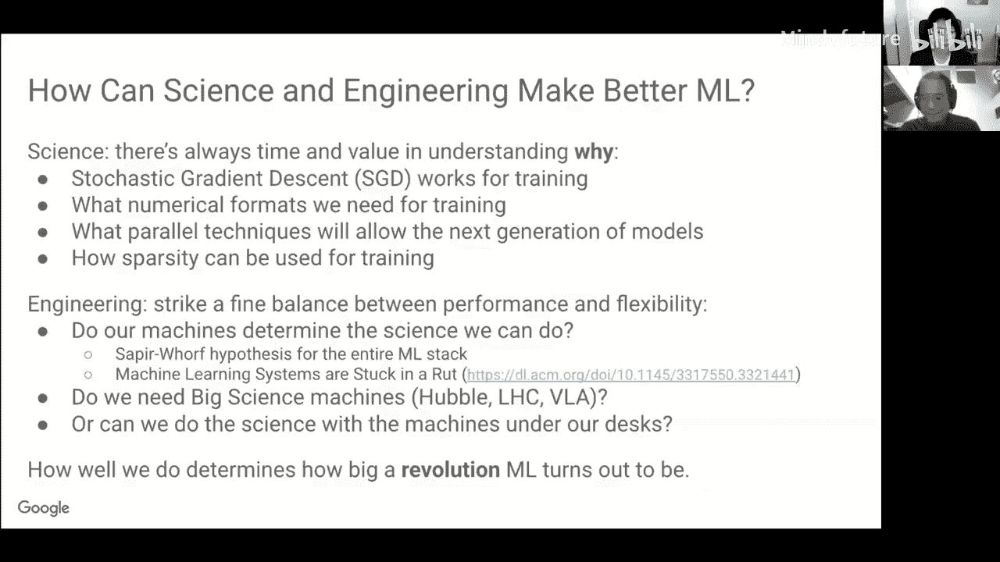

# 【加州大学伯克利】机器学习硬件技术课程 ｜ UC Berkeley ｜ EE 290 ｜ 2021 p17 P17 Lecture 20 Cliff Young, Science to Fuel Neural Nets and TPU Design -BV1XfM4zKETU_p17-

Okay， good afternoon everyone welcome to E290-2 hardware4 machine learning in today's lecture we have actually a guest picture from Google please Young to share with us some of the his thoughts in your network design and in particular TU design I mentioned this before every time I talk to police he has something really interesting and exciting to share so I'm looking forward to this conversation today and see what he has been thinking these days so please feel free to take it away。

😊。

Thank you， Sophia。 And thanks for inviting me back。 It's nice。

 nice to come back and have a slightly different talk about TPUs than I think I gave a year ago。

 This isn't exactly the usual TPU talk。 Like there are anchors to， hey， this is the machine we built。

 And here's just some interesting things about it， but。😊。

I was actually trying to act more like a scientist。

 I'm always a little dubious about computer science because any discipline that requires the explicit word science in its name is kind of dodgy。

 we're in the company of nutrition science and creation science as computer scientists and so。

A little sketchy there。I do feel like we're at an interesting point in this machine learning revolution。

 particularly where the science is trailing the engineering。 And I'll go into that in more depth。

 But I think the dialogue between what we call science and what we call engineering is actually fundamental to the the really deep progress we might make。

 both in building machines and in figuring out what this new machine learning technique can do for us。

 So that's sort of the theme of the thought of this talk。

 and I'll touch on a bunch of things that are kind of open questions or unanswered questions that I wish people would work on。

 in addition to things that we have partial answers for。So first of all who is this cliff person。

 yes I work at Google I'm perhaps most famous these days for like TPU design that's a thing on the right。

 but actually I think of myself as kind of the weird machine guy rather than the TPU guy in that I've been lucky to participate in the construction of two different special purpose computer architectures the one in the middle is more obscure atHR research I' built An supercomputers which do molecular dynamics and essentially nothing else for 10 years and the Anton project which started in 2003 was surprising because it showed that you could build a system that it was 1000 x faster than the national Las supercomputer running the optimizeized codes on that national lab supercomputer and that was。

Couner indicated for the time， if you think back to 2003。

 Intel had essentially won and beat everybody and the conventional wisdom on special purpose computing or domain specific architectures was don't bother。

The CPUs will come and destroy you because Moore's law is doubling performance every two years so that we could envision  a0x machine and build it in five years and because Moore's law was still working。

 have it deliver 100 X by the time it came up was surprising for its time required a really in- depthth co-design process all the way from algorithms to hardware that I've never actually done since in some ways TUs are much。

Much more hacky or much less systematic about how to solve the problem that goes to this science and engineering co design thing。

And anyway， and the first TPU is on the right， of course we have a sequence of them。

 some of which we've announced and so forth， but that's TPU V1 on the right which I joined Google and started to work on。

 and within a couple years we had them in data centers and during the third year we won the Algo match using them and came out to the world that Google had built its own hardware。

So back to the science a little bit， I don't know how many of you have seen the book on the right of this。

 the structure of scientific revolutions when I was in college。

 it was actually a pretty big deal in philosophy of science circles and it was talking about how science is done and the proposal hypothesis in Kne's book was that science has two modes in normal science mode。

 there's a set of known methods like gene sequencing and splicing and CRISPR sorts of things and the practitioners master those methods and deliver results within a given paradigm。

But every in a while science trips over something that's funny。

 like the speed of light is always constant， or if you think about the way that the cosmic background radiation works or sorry radiation throughout the night sky works。

 there should be infinite energy which doesn't add up and those gee that doesn't work cause a crisis and that crisis leads to revolution and a paradigm shift and so in Kene's。

 I think it was mostly talking about the quantum revolution， but science and computer design。

 how kind of move in these fits and starts and I think we are in the midst of a scientific revolution with machine learning。

Oh， can others not see the image Clph is referring to？I don't know。

 I can't see whether other people are seeing on their screens can you see my slide about the unreasonable effectiveness of deep learning。

To not the picture at you。 Oh no。 Oh， I so sorry。I wonder if none let me back up and go forward again so can you see my photo and the machines in this one for the first time now yes。

 okay， maybe it's an update thing maybe it's screen scrap thing so now can you see the okay。

Thank you for that update。Anyway， this machine learning thing is kind of fun because we keep on getting weird results out of it。

 surprisinglyly weird results like every year there's a new thing in the hit parade right it started in 2012 with Alexnet and beating the imagenet competition by a huge jump。

 but I have a list of things and the list is probably an incomplete and needs to be updated including stuff like playing Starcraft two years ago and G3 last year and robotic object picking which is the economically valuable one。

 I think some of my colleagues in brain robotics went from 60% fail to 30% fail in pick up a random object out of the box with a robotic arm which is。

you know a doubling inaccuracy right and maybe that's not what you need for like industrial automation。

 but from 60% fail to 30% fail is huge and not expected after decades of researching and robotics so。

呃。We have this gen， it's out of the bottle。It's mutating rapidly and that also is fun another observation as a computer architect is if your problem is static your life gets boring。

😊，There's a nice paper which I don't know if Sophfiia's made you read about the accelerator wall by David Wesoff and his student at Princeton at the time。

But they look at four different fields where special purpose accelerators were built and they concluded that the vast majority of the benefit。

iss due to Moore's law and a small amount of the benefit is due to architectural change that maybe most of the architectural benefits of a new accelerator class are achieved in the first to second generation and after that most of what you're doing is just mapping the bounty of Moore's law transistors。

To adapt your accelerator design to it， which kind of means that architects don't actually add that much in an area where your benchmark is known you know like graphics rendering is one of their benchmarks and that coin mining was another and so forth so the thing that keeps my hopes alive that my work will continue to be interesting to the rest of my career is that neural networks are mutating that we only got transformers four years ago and that the next model which might be giant or might be sparse in some way is just around the corner and each of those changes to what's going on means that I get to design a new machine or at least I got to worry about whether my existing machine just completely missed the ball and it's time to go do something else。

All right， let me through a little bit more about deep learning。

 I think deep learning is data driven decision making。

That in traditional computer science we have if some stored value do this else do that other thing and a lot of systems work is heuristic and horrible like a heuristic means I didn't really know what to do。

 but I came up with a rule of thumb that work 70% of the time so earliest deadline first or at least recently used or you know any number of these horrible three letter acronyms are part and parcel of the systems field and it's kind of like well。

 this takes no space so I can put this in and they'll do an okay job but I can't really do the right job。

If we have neural nets we can actually train them based on countless examples of the right job based on situational information and do a better job。

 so we could replace earliest deadline first with best for whatever my quality metric is we can replace all of this horrible set of heuristic stuff。

What's the economic value of better decision making right， If you're Google or Facebook today。

 we use that to show you better search results， right， like show you the thing you want， Great。

 or you know， to show you the ad you want if you want to be cynical about it。

 But general purpose higher quality decision making is the entire economy。Right？

If this technique turns out to generalize it's anything measurable， it's anything computable。

 we'll be able to improve with this general purpose better decision making so I feel like you I've drunk the Coate。

 I believe in the machine learning revolution， but it's not just surprising effectiveness。

 it's really we haven't yet figured out how to apply machine learning to general motortors。

 but when we do general motortors will build way better cars and the users of their cars will be way way better off。

Okay。So that's sort of the big picture now let's draw my problem about science versus and engineering and talk about how engineering。

 how we do it is way ahead of science and I will make a nice analogy to the industrial revolution so on the left is one of James Watt's early steam engines from around 1770 it's a great museum in London you can go see this this thing is like two people tall so that wheel is like know as big as bus it's a monster of industrial machinery and this is the basis of the first industrial revolution of steam power and so forth。

How long did it take？From having that incredibly useful thing， which we built factories around。

To understanding some of the fiscal behind it， well。

Lord Kelvin and the field of thermodynamics is on the order of 80 years later。By way of。

Doing the SAT style complicated analogy。I got my first TPU in 2015。

So how long is it going to be until somebody explains to me what's actually going on inside of a TPU with a new field of say。

 synthetic neurodynamics that says， well， you know。

 all those variables and weights that you're training or pushing around and they are adding up and multiplying in various different ways with the nonlinearity so that they don't collapse and so forth。

 how long until synthetic neurodynamics comes around， please don't make me wait until 2095？

RightLike how about how about we do the science now and explain what's going on because if we did the science now and explain what was going on。

 you could start building Toyota Priusees right away instead of waiting 300 years before it was time to build 250 years before it was time to build Toyota Priusees。

 why not go straight there because we understand what's going on in the complicated dynamics inside of these machines？

So that's the problem I'm posing with the thing I worry about， like are we doing enough science。

 are we just so busy building our steam machines that we are missing the possibility of electricity and we have no idea how incredibly inefficient our steam machines or steam engines are compared to what they might be if we're just a little bit better about it。

So。This is my biased view of the computer architecture revolution section one of the talk。

So I mentioned the Allen at breakthrough in 2012， which kind of cracks things open。

Through the IS VRC benchmark and and I will give huge credit to NviDdia that the GPGpU investment is what enabled this breakthrough I was actually a little surprised by the GPGU direction right I think it's pioneered in academia like crazy people tried to use GPs for general purpose things and wrote Shar and vertex code which against all recommendation it was horrible and sometimestime around 2008 andvidia said。

 all right we're changing the architecture refusing the Shar and vertex quos we've got this new language kudo which is based on Brook out of academia and you can now program these things new computations on them and they sacrificed a year of GPU performance right they're in this cutthroat battle to the death of A AndD to like do better rendering and they take a year off to make the machines more programmable so that they lose the benchmarks that year and worse yet like Jensen is taking his 4 billion a year graphics card market and he's going after the $1 billion a year high performance computing market and sorry no offense but like this is crazy like why would you go from the。

Big market to the small market。asideside from that it was super cool to program these machines in this way and the answer is that Jensen was a way better visionary than me and that he may not have known that something HPC like was going to change the world。

 but neural networks were waiting in the wings and people like Jeffrey H had been saying for 30 years that if only they got more computing power these things would take off they obviously worked。

And in 2012， they were finally right and the reason was thatsky could put two GPUs under his desk。

 buy them for  a000 bucks in NviDdia and unleash power unlike anything that previously been allowed。

 so prop to NVDdia for starting the revolution inside of Google we noticed we care about organizing all the world's information and making it easily accessible。

We said， wow that's a lot of floating point operations for second， so we said we need GPUs。

 we started buying GPUs hand over fist and installing them into our data centers and we also asked what else should we do because wow the GPUs are great。

 but they're also a little pricey they're like thousands of bucks per card and Google has more than10 machines so that's millions of dollars like right to start and it keeps on going up the more the price per card goes up and the more machines you want to install and when you get to Google scale suddenly it's billions of dollars in capital expenses so what else should we do。

We started the TPU project that led to TPV1， landed in data Center six years ago。

Disclosed to the world five years ago after the alphago results。

 we wrote a relatively detailed technical paper about it in 2017 and this is my you know TP1 in one slide summary it's you know we simplified the problem by making an inference only machine it's a 256 by 256 sstolic array matrix multiplier which means that there are 65536 AluUs on this chip which for its time was staggering actually I should say there's 64K max on this chip so depending on how you count there's 128k AU。

When you multiply its ridiculously bad clock rate by that 64K， you get 90ter operations per second。

 which was either 100 times of 30x what the CPUs or GPUs that the T could do。

Part of the trick is8 bit quantized arithmetic， but we changed our numerical representation and I'll come back to that later in the talk from floatinglo Point 32 bit。

 which Jim knows and loves to horrible8 bit integer arithmetic like I think like any ac used like the very first digital computers where all integer and the programmers had to deal with floating point。

 sorry fixed point math and the horrors thereof there's stories about the code they wrote。

Incredibly aggressive 15 month design schedule， I didn't believe we' be able to do that I was surprised。

 turns out that you can optimize for schedule if you' not if you're willing not to build a super fast super efficient park and in the paper we talked about six production applications but overall we got more than 10x in both performance and performance for what which is crazy that almost never happens in computer architecture part of that is specialization we focused down on this one subset problem but those jumps are rare and they're not sustainable like within a small number of years and V GPUs were in the same ballpark they saw the same trends as we did。

 we just happened to hit the market just a little bit earlier and and come out about it and maybe surprise people。

The other thing that I think is kind of fun is I think this was the world's first matrix machine like truly matrix machine you've heard a vector processors。

 but this really has a twodiional hardware structure in it me pause just a quick note don't see anything on the left not sure whether it's maybe just refresh maybe just refresh was he not just question just the timeline was so we talk about Alex 2012 and this is deployed 2015 the design 15 months ago so roughly 2013 is a timeframe that we start a developingPU2012 I joined summer of 2013 were talking about the project in particular around June May of 2013 there's FPJ prototyping that one engineer Jonathan Ross the founder of Rock was doing in his spare time in the evenings in New York City to show that he could build a sstolic ray for these things like year。

Before so Jonathan noticed like a year before the rest of us and that came to the attention of different people inside of Google and got propagated to the right spot and he got hired to Madison to join the team that actually was in the hardware design organization and so he was one of the first four hardware engineers I met when I joined in summer of 2013 so there is prework official project kickoff is sometime around November of 2013 and bring up in the data center is somewhere around February or March like first Sil is February or March of 2014 so the 15 month is from official project kickoff to having a landed thing in the data center running so。

There's always a little bit of concept phase to any project and we didn't measure the concept phase as part of that 1th claim that was the all right you said you're doing this we've allocated the capital and we put the heads on it go that's the 15 months that makes sense that's very impressive just like you mentioned earlier with an end project there was quite a lot of not necessarily convincing but a lot of discussion whether this is the right path to go do you also have like do also experience that when we push for the TPU effort in 20132014 timeframe in Google。

I think9 out of 10 engineers I met said this will never work why you're doing this and and one nice thing about the Google culture actually is that。

I can't stop you。This will never work I think it's going to fail yep you're right it's likely they will fail we still get a try and so that that possibility there I think is a really good thing it's something that many large companies lose and you know it's a calculated risk。

So how do you weigh that how do you choose such a high value bet There was really strong signal coming from the demand side like somewhere also around that 2012 2013 side。

1% of fleet cycles were going to matrix multiplication like 1% of the CPU cycles in the Google fleetleet were going to matrix multiplication。

 which was not。Was was a surprise right typically you know what's the top thing in your Google wide profile it's mem copypy because machines just spend all the time doing mem copy or meAT's number two and after that like it's proto above handling or something but but that matrix multiplication became 1% of cycles was a real warning bell right like we have the monitoring system it's like what is this routine gem what is wait wait we're multiplying matrices and it's 1% of all the cycles burnt in the fleet that's。

Why are we doing that right why are we spending all the power on that1% of that billion dollars a year is decent chunk of change to spend inside of a company like Google like what's that got to do with search？

First thing so demand size signal there's a signal there， but yeah yeah。

 I mean what do you do about the demand side is a thing right you could say we'll just keep serving out CPUs we have a hugely of CPUs。

 but that wasn't the choice let me dive back in because I'm enjoying the digressions but I should aim to get through the talk in the time do people is there also an end on time thing like do we have the full hour and a half or is it a have a flower we end that 330 PMm okay。

one row left right hour we're about 20 minutes good Okay so a little bit of high level architecture concept So what's a sytolic array。

 It's the two dimensionional generalization of a traditional onedimensional pipeline。

 So we love 1D pipelines from Henry Ford and from computer architecture classes probably you've all suffered under the five state risk pipeline as part of this class。

 So the 2D generalization looks like this。 can you see my animations and this is drawing。

 So I have a 2D grid of processing elements because everything in in a chip is a 2D grid But now I have these lovely antidiaagonal range awayfronts flowing through the systolic array。

 And if you land your matrix arguments in just the right places and stream them in just the right ways you can get this to do a perfectly numerically accurate。

😊，Matrix multiplication through this choreography and that is kind of the key we can throw harbor area and power at doing these calculations。

 One key thing about 1D pipelines is that they suffer bubbles and stalls。

 especially if you branch one nice thing about matrix multiplication is that it's completely laminar there's no bubbles or stalls or branches it's just this argument times out our argument if you line everything up you can do matrix multiplications until the cows come home and get 100% utilization out of this kind of array。

嗯。So this is kind of the heart of the compute parts of GPUV1。TPV2 changed problems。

 I mentioned TPV1 was an inference machine。Pictures drawing。

TPV2 is a training machine and that's a much harder more general problem。

 so we required floating point arithmetic because in some ways training is about。

Sumation of large amounts of small differences over time and then rescaling things。

There's also the chance that training changes algorithms drastically on us。

 like the inference that we thought we knew what we were calculating。

 but we were worried that because mutation in the field is a real thing that the training algorithms might flip overnight on us and we'd have to reprogram the machines。

 so we had to build a real computer， not a cutdown coprocessor for the second generation。

And training is a data parallel， massive data set kind of thing。

 so it wasn't sufficient to build a single chip coprocessor for the second generation training machine。

 we went fully parallel and built 256 level node parallel machines and later 1024 and 4096 scale machines。

So if you're a computer architect， there's three things you spend your money on。

 there's compute memory and network and TPV1 you can think of as being super heavy on compute and crappy on the networking and memory side of things like deliberately neglecting those in some ways TPV2 and its successors in the training machine space have to spend on all of those they need the computation because we' got a train they need the memory because we have to retain the weight values and we also have to keep temporary values around for back and they interconnect for the mass parallelism so we're actually there's no way to cheap out in building training machine you actually have to do all of these things at once and so it's a supercomputer with supercomputer prices。

嗯。We've also talked about TBV3。The slide has no text on it。

 the biggest difference between two and three is that we jump to water cooling which improves our density。

 just in terms of the number of units we can stack into a given rack in the data center。Yeah。

 there's stats out about it actually double the compute performance and。

Improved both networking and memory previous over the second generation。

 but not quite as big as some of the other chunks that we've made。嗯。

So what's going on in all of the world around deep learningccleerators。

 ideally Sophia has told you about some of her work and you've got other guest speakers。

 but everybody says there was a Cambriden explosion， that's true three years ago， $1。

5 billion were chasing you know tens of startups is probably over 100 startups now。

There's a lovely diversity of design points in this there's still a split between inference and training machines。

 I think that the inference market will fragment that there's just two different sizes and costs and power dissipation levels for inference like in your data center inference product you can burn 100 watts in your phone。

 100 watts would hurt。Like you know literally burn a hole in your pocket and they're always on things like nest internet of things devices your battery op and they have to sip microwatts。

 all of those are inference devices and so I think that means we're going to have to have all sorts of different architectures and different devices for different parts of the market。

Training has surprisingly conversion architectures， as I say here。

 there are some interesting and really weird startups out there。

 like you may have heard about Crebus machines with their way for scale compute and Graco machines with their particular this parallel thing。

 Myic is putting compute into flash memory， but if you look at everything else。

Like between Havana's training chip and NviDdia A 100s and Google TpUs and the Chinese entrants and I'm probably forgetting a few others。

 The Nirvana machine as well， they all have a dense compute time。

RightWith probably a sstolic rays on it， they all have HM next to that dense compute die in an expensive package。

 they all have proprietary interconnect of high bandwidth of some sort。

 although some of them use internetnet they just have like 12 ethernet ports connecting every chip to every other chip。

 but the point is that they have lots and lots of copper connecting all these things and so it's surprising that like five different teams。

 at least five different teams tackling the training problem came to essentially the same superficial level of technologies。

It is a really interesting oh I'm sorry， one other observation about training。

I kind of hope that we don't get splits in the training machine architecture。

 like that we don't end up with a convolutional training machine that's not the same as the language model training machine because if we get that split。

 then that breaks the possibility of knowledge sharing or crossdoma。

 general purposeness in our neural network models and that would be a loss。

 I think one of the things that we're tilting out with the neural network revolution is a general machine learning。

 computational method if we split our machines on the training side。

 we can't share data we can't share data nearly so easily and so that might be a reason to hope that training stays unified even if inference for economic reasons has to split。

嗯。And I guess I'm old enough that I remember that there was a great。

Explosion diversity in the 90s it was the time of the risk wars and was also the time of the mini super revolutions there were all sorts of really cool machines you could play with。

 especially if you went to grad school at that time and kick the tires on and so forth。

 but the scientific history thing is，What happened after the Canbririan explosion and the answer is a mass extinction event。

 so there's if you want to get technical there's the end or division extinction。

But life has both kangarin radiations where all sorts of new things get tried out and mass extinction events where or 95% of species die off because of some cataclysm。

 And I think computer architecture does exactly the same thing so AI has its AI winters but computer architecture also like we have periods where we're searching for the right answer and then we have periods where the right answer becomes apparent。

 maybe just before 2003 when I started working on an time。

 the right answer is a general purpose of CPU and everybody else was dead that's a narrowing a diversity So watch out for the cycle I guess is a thing super fun time to be an architect but look for the signs that it's converging and if it is converging。

 then maybe temporarily work on something else or find a different game to play because the explosions don't always last。

嗯。So。😊，Back to science what architecture questions might we develop scientific answers to not just engineering ones where yeah it works and works reasonably well。

 but why does it work well I would love to know how big our systolic array should be Google is kind of low on the planet and building really big ones like the first one 256 by 256 was maybe a little too big in TpUV1 We cut back to 128 by 128 and later TpU generations and that's a nice number we now have more of those arrays in one TPU So it's kind of a multiunit parallel going on above the 128 by 128 level but almost everybody else has chosen a smaller size like NviDdia depending on how you read their literature is either a4 by4 or 16 by 16。

Many of the startups are also tiny。 So what's right， I can't tell you。

 you look at the animal perf scores and Google and NviDdia are going at it and coming out about even on that per chip speed basis。

 So like there's not a right answer yet， but。If somebody were to write a paper saying this is the right number and here's why that would be a huge contribution。

嗯。What memory system is best for neural network training I mentioned convergence on the HBM side IBM has a really nice thing in their systems where their power nine CPUUs have Nd links effectively built into their memory so they can direct connect to GPU at the same speed the GPs connect to each other rather than having a tiny PC express straw from CPUU to accelerator and that means that the host memory in the IBM power chips is usable as backing store behind the HBM with the GPUs which is a capability that seems like it ought to let you do much bigger models than anybody else has but they haven't seen people do that on the IBM machines I wish I knew why like people are commissioning mega clusters of NviDdia GPUs and TUus to do giant language models I'll come back to that but they haven't leaned into the IBM host DRAM backing GP HBM I don't know why。

A bunch of the startups are making bets on estrm only， I'm little worried about that。

 some of them have good stories， but the thing is that estrM is all about speed and not about capacity。

And at least one dimension of the neural network revolution is about capacity。Okay。

 and maybe one more computer architectural science question。

You've probably heard about Mark Hill's three Cs for cache memory hierarchies。

 capacity conflict and compulsory misses and how they explain what you're doing with your cache I've seen no such equivalent thing for neural network member systems I wish there were。

Right you know， it's not exactly the same because we don't tend to build cache as we build scratch pads on top of our HBMs and we can substitute network for networked scratchpad memory for local scratchpad memory in certain ways。

😊，So it's not exactly the same thing， but that conceptual level of how to think about substitutability of these different pieces is missing in my field。

 so be lovely to have something that tells me about that and yeah let me switch sections for the networking bit so。

Networking， parallelization and networking in machine learning training。

 Soph has a class gotten much about like data versus model perils and have they already seen that in training stuff little Yeah。

 we' briefly talk about the data on model parallel。Okay。呃。Questions in the chat are great。

 and I can see them and figure out a good time to drop them in。 So if you want to drop now so。

 please go ahead。Actually， maybe I can just speak because so we to speak that type。

 so if you go to the previous slide。It's interesting that you only mentioned systolic career as the as a basic structure。

 And you mentioned in the previous slide that there's a solid convergence。 and it looks like oh。

 everyone is doing systolic career and the market has。Second证。

DoDo you foresee radiation again in different structures。

 maybe as hot field networks or other sites of neural networks come in。

 note that there's no applications that such。Well let's say I don't know。

state national networks are very good at or hop networks are very good at something like that。Yeah。

 radiation in the basic structure in the coming year， let's say five years。

So on the algorithmic side， it's really tough to guess。

So there are a bunch of nearby technologies that might or may not beat the current deep learning approach and supervised learning approach that are promising but have not yet demonstrated accuracy and make no mistake we're in this for the accuracy right so if you say。

 well my reservoir network has these really neat random configuration aspects to it and I can get within 2% or 5% of whatever the aisle are as the results are that's less interesting to us because we're not at a point where we're chasing efficiency。

 we're actually still chasing accuracy we're paying。

Exponential amounts for linear returns and accuracy right now。

There's a point where the returns in accuracy stop and then it becomes an efficiency race。

 but we're not there yet， and so the also ran or competing alternate algorithm technologies。

Are not interesting until they beat deep learning in accuracy。

When they do we have a horse race or when deep learning slows down and improving we have a horse race because now it's like okay this is as good as I can do。

 but I can't afford to put a GPT3 in my pocket so now what am I going to do to cost reduce it that's a really interesting question but that's different and so you know it might be that the right way to get the same functionality is G3 or as close as I can to G3 in my pocket is to use one of these alternate neural network techniques but that。

Proof remains to be seen。 I guess， and you can't。If you say， hey， my other technique。

 like people talk about analog and they talk about spiking neural networks。

 and they definitely have better energy characteristics。But that's efficiency， not accuracy。

 So if your starting proposition is worse accuracy， it's it's a nonstarter for the moment。

 may come back later， but that's kind of engineering。 So back to sytolic rays and sort of radiation。

 like there's two kinds of radiations。 I was talking about algorithmic radiation。

 like deep learning has a breakthrough。 And now reinforcement learning is getting some。

 some interest in there's Gs which aren't exactly reinforcement。

 Theres sorry aren't exactly supervised。Will we break with the solid race probably of course we will although like I don't have a good guess you know I have my own personal bet about it and why we will break with it because some other calculation turns out to be fundamental right so if you look at transformers which are the basis of G3 and BerRT they have this attention mechanism in them and the attention mechanism has a temporary variable that scales quadraically。

That quadratic scaling might be expensive and might not play well a stolic grays。

 maybe a different structure would be better for attention， although I haven't seen it yet。

If somebody invented it， the world might be to path to their door。Okay。

 I see so I think you agree that there's a convergence for now。 and it goes out and in。 there's a。

 you know， there are waves of radiation， there are waves of consolidation。

 They can both happen at the same time。Right that's sort of competitive marketplaces。

 right there were 30 GPU companies at some point now there are two。

Or maybe three because I tells them in that business too。Okay， I see， thanks。

 that was really interesting， thank you。Okay， so networking。Basically。

 there are two interesting ways to parallellyze。Ne training right now the easy way that we've mostly been on is called data parallel where you replicate your weights across the parallel nodes of the machine。

 you send independent examples to all the parallel nodes and then at the end of your training step you do what's called gradient update or weight update which is really an HPC all reduced Basically you take every machine kind of reasoned about what the update should be separately and then you add up all their updates together into one giant batch and redistribute around everybody so everybody gets a consistent copy of that same update across the whole machine that's data parallelism and so the nice thing is that it cuts the communication nicely basically the all reduce is only proportional to the size of the weights not worse model parallelism is starting to get applied right now because we're running out of data parallelism to use if you look at the study that I link by shallow at all they say you can get up to 100 or 200 weight batch or data parallelism and still train effectively before you hit the knee the curve but after that it gets harder or you even get to negative returns。

We're at 2004000 nodes in the machines we benchmarking or using in production today and at that point you have to go model perel。

 you have to like start slicing up your model into separate halves of the weight matrix means you're cutting a rich communication interface instead of a narrow one and that gets painful there are pipeline approaches to them I really do think this is the hard problem we're going to get there over time。

Yeah I guess it's hard to say exactly where things are going but we are definitely throwing hardware at the problem so here are TPU pods these are V2 and V3 pods with 256 compute nodes and 1024 compute nodes we have mentioned that we have 4096 compute nodes in some MLPf H runs I can't get a picture of that。

Actually the bottom picture is a synthetic picture there's no camera lens that does this shot they actually built a dolly rig and doied a camera across the like eight racks of the TpU and then synthesize this in post production to get this picture so you can there's no there's no actual way to get the picture below and if you if you look at Nvidia。

😊，Products their DJX superpods look a lot like HPBC clusters and they look like the pods that I just showed you。

 I just stole this picture off their website， but this is a lovely DgX system with 140 of these8 GPU boxes and ridiculous numbers of Infinib band links connecting them all together in a very flexible way There's a little bit of different networking philosophy between TpUs and GPUs TpUs are all linked at one level fabric every TpU can send a message to every other TpU directly using our tourist network GPpUus are two level So within an DgX box the8 GPpUus are closely linked by envylink but across DgX boxes use Infinibad and so there's。

Programmability mismatch there that maybe you use nickel in the box and use MPI across boxes or maybe you can use nickel for both of them。

You have to do sort of the local reduce and then the global reduce and then redistribute。

To currently make things work and that's okay， you can solve that problem once and then redistribute the software。

 whereas at least in the TPU ecosystem there's just one level to the network， which we pay for。

 but it has a different level of programability。嗯。Let's see so what does Cl think about the future of networking parallelization So question one I just sort of mentioned what's the level of your first level loss networking is it one node or eight nodes for 4096 nodes again GPUs are taking a different cut and we are going massively parallel in that first level network GPUs are stopping at8 or 16 for now and using a thin about above that Creebs has a pizza size chip。

So it's all on chipwis， no network agent or chip， they probably can network them or they're probably planning to network them for the second generation。

 but boy that's anar problem getting of cable into one of those wafers。Let's see。

 given them the need for model parallel training。Do you think interconnect will become more important。

 can you imagine hypercue connectivity becoming feasible for TpU？

Pods the same way they're used for anton so multiple things antons so far have not been hypercubes they haveve always been 3D torri because the physics problem is a 3D torus or it is a 3D box so the spatial parallelization in an anton machine is the same as the spatial simulation going on and so a 3D mesh actually sorry 3D metro torrus is actually the right thing in an anton machine not a hypercube not higher dimensional where the usual implication of hypercube I think for HPC is like seven dimensional so there's seven wires coming out of every node or something that。

So willing to connect become more important， I can't tell。

So it really depends on where the algorithms go because we actually know that you don't need these hounkken networks to train like to functionally train there's great research papers compressing the network there's like one bit training papers where instead of like sending the entire weight you send the bit or the descriptor that says which weight changed the most by how much and that's all you need to change it that like just slashes your bandwidth to zero and it still converges pretty well So you know it turns out basically what's the most。

What's the biggest changing weight in this round of the training and you actually have to reconcile the nodes and keep extra states to do it。

 but you can save the communication if you need to so you don't need the network。

You can substitute other resources like storage for the network and still train。

 but do we want to do that while we're still figuring the technology out we don't understand how training works no we don't right you could stop and spend 10 years building an efficient like slow network training machine during that 10 years the field will have moved on and discovered new things like Transformer2。

Which might be obsolete on your your like。Communication sipping machine。

 So that's that's kind of the danger as far as chasing the science goes。

 we we are spending on generality and power because we don't know which we'll need。嗯。

So will interconnect become more important。系。I think in the short term maybe it'll be an enabler right that you want everything to talk to everything else in the long term I think no。

 because our brains are not fully connected， our brains are local and they're the inspiration for this。

 they're in fact small world networks， they're incredibly densely locally connected and they have occasional long haul connections with exponentially decreasing frequency of those long haul connections。

That's eventually the right answer， but we don't know why。That's what right asked。

 we know biology works， we know we think。We've gotten this far by aping what our ape brains do。

 but that doesn't actually mean that because。We can see the structure of our brains we know how to build that engineering artifact in a way that works so right so I think I captured the long run thing in my slide in the long run we won't need high magic po scale networks because of those algorithm changes but I don't know how to make that the thing right now and right now。

You know， the brain team is inventing new networks。

 The last thing they want to find out is that they had the right network architecture。

 But because I cheaped out in the network for them and built them a compressing network。

 their thing didn't train， right， Don't， don't optimize that cost away cliff。

 Sp on that cost that the thing still trains。 And then once we have five years of using this。

 We'll figure out how to cost reduce it later。嗯。Right。

 this is a picture of Google data center that I love partially because of the artwork but also because it shows the scale of these things that's a warehouse scale computer and these days a pod is a significant fraction of that whole building right so we really are building supercomputers at supercomputer scale although June might say yeah that's not that big but we're approaching news those node counts where 10。

000 nodes is starting to be sort of the biggest machine National labs machines are in the 10000 node class we're only in order of magnitude off Oh no。

 not the picture one more time let's see back。Forward。

 I have to just like two step everything whatever now， okay。Anyway。

 I love that we paint art on the sides of some of our data centers and you know basically it's a true or three story building。

But you can see some tractors in front of it， so it's not a small building right。

 is that like half a stadium， half a small stadium， something like that？So。Okay。Next section。

Jims still here great。 So which way for floating point form that said， Jim。

 I don't know if you've seen these slides before， I hope。They're not entirely surprising， but。

So there's a bit of a tunnel war in the floating point format land。

 if you talk to our numerics friends and the HPC people who run at National Labs。

 a lot of them are asking for quad floating point hardware like twice as big as double because some of the condition numbers such that have in Quad helps。

You know I've drawn IEE floating point formats with menties and orange and exponents in gray and signed bits and was it just one signed bit。

 but like the HPC pull is up towards bigger formats。And of course。

 my HPC friends and my numerical friends have been upbraiding me for like what horrible thing did you do to the math in your TU is that they run these small floating point formats。

 right？GPUs have FP16， which is at least a compliant TPUs don't we invented brainfat and turns out to be great for training so we're using it because it's practically valuable because engineering not science。

 but brainfat works it's actually easier to use than FP16 for at least the training tasks we do now because FP16 you kind of got to do a little bit of rescaling to get things to fit into the smaller exponent。

 it's kind of halfway to some of the quantized arithetic problems they have not as bad as full quant is where completely managed scale factors yourself。

 but you still have to keep some things from overflowing in FP16 and that losscal paper it's incorporated into the libraries it's not going to kill you but it's there as and easier of you thing anyway the tug of war between bigger for HPC and smaller for MLL seems potentially contradictory。

We don't have double in our TPUs， will we ever get double in our TPUs， I kind of kind of wish we did。

 so what should we do？And an interesting thing is that doubles can help TPUs。

 they can help training this paper by Rohan Ne Neil and his co-authors second order optimization made practical talks about the shampoo preconditioner。

 which changes the slope of your gradient just a little bit based on second order analyses and trains to the same accuracy in half as many steps which is algorithmic efficiency right I'm building the building size machine。

Would I like to take two months or one month to train all of the things being you collected rather have trained in one month rather than two and so shampoo which requires doubles to work effectively maybe one of the tricks to get me there I still got to pay for the doubles I got to put the floating point hardware in and doubles are not cheap they're a huge amount of area in power so that closing that engineering loop is an interesting question that we have not completely resolved GPUs have doubles。

So we're jealous， but you know that that actually goes to their assault on HPC from the beginning。

 they've had doubles for ages and the fact that they are aiming to be the general purpose。

High performance at the same time， but easily programmable platform of reference。嗯。So。

One of the thing Abetch shouldn't seen in this paper。

 But there is really interesting promise in mixed precision algorithms。

 And I think it's it feels to me like it's a relatively new thing。

 But this paper from is it S 18 basically said， hey。

 now we got GPUs and they have double and they have float and they have half float。

 So why don't we take advantage of the ways in which we trade accuracy for performance and lean into that。

 So not just。😊，One precision like I think the standard HPBC code everything's in double and nobody wants to take a chance in flow like again。

 when I worked on molecular dynamics in 2003 it was considered a huge engineering task to take your double code and make it run in single position float and people still doubted the results in single position flow。

This paper 15 years later is saying。Use the precision that you have and play to the strength that you get way。

 way more flops out of these machines if you're willing to take one quarter of the space and maybe 1/16th of power in doing these operations。

So。I think that's really beautiful algorithmic hardware co design。

 the hardware has these capabilities， can we lean into it？If you're a computer engineer。

 I think the thing this pushes you to is do all the formats， right。

 like support the things because you might use them。

But of course the scientific question is do we really need all the formats like can I make the case to put double into my TPUs how do I say look put the double into the TPU at this cost and area and power and throw out the other stuff you would have had with that equivalent transistor budget to solve the problem so open question but I kind of love this like what's the factoring the factorization of neural network training into multilevel precision that if you can we had a good answer to that we could allocate the hardware appropriately and pay for only what we needed to in this efficient version of the machine。

You know， so so maybe that's a better steam engine。Okay。

 and so and I think like wrapping this section， there's a dialectic。

 So going back to philosophy of science and philosophers and so forth。

 Hegel has this nice formulation of the dialectic。 You have a thesis or a dominant paradigmtime。

 Something goes wrong and its antithesis encounters it and they clash So you might call that。

The quest for higher precision floating point versus neural networks use low precision floating point。

 and the answer is where you initially think because of the thesis anti clash that they'recon irreconcilable。

 but the synthesis that emerges from the clash is something that does the right thing for both is better than both。

 right？So use the right resolution for the job has got to be the answer pay for things at the right time and so we have these algorithms coming at us that are mixed precision so we probably should build mixed precision hardware and ideally we could build mixed precision hardware that is substitutable that like。

I found out recently that I'm too old and that most people don't know what the Voltron cartoon was。

 but Voltron was this cartoon or as a kid which had like five robots that assembled together into one big robot and so if you can build Vtron ALUs and your ALUs are simultaneously usable in one of different modes where like maybe they do one double operation or two float operations or four half floatat operations or whatnot that。

 NviDdia Tens course do exactly that。That's an incredibly scalable resource that lets you use a decent amount of the chip area on whichever of these things comes up in the mix。

So pushing back more beyond that flexible computer engineering。

 the science question I have is why can't a neural network learn how to carry mean they can learn all sort of other things。

 but it seems like，The neurons are so many bits wide so why can't it gang together two of them and use them in you know like the high order neuro and the low order neuron when they need more resolution。

 why do we as architects have to solve this， why don't the neural network people put this into the training algorithms and take it off of our hands and use the resolution when they need it but not use it otherwise don't know code is on question that might be really cool answer to that。

So I had a question that I postedd。Oh， sorry， move my mouse basic， one new message。

Any thoughts on poits， I'm not a fan， I'm with you not being a fan。Just one。

So I'm forgetting the And&y fellow who's is it Gunderkin， Gustson yeah， Gu。So。

I love reading Vva Cahan's ratts about floating point it's like。

 you know just lifts my spirit nobody can rentt the way he does。

 but I feel like part of what he cautions us about is the ways in which floating point can go wrong through bitter experience and I feel like。

Floating point is the devil we know extremely well we know the ways in which things fail。

 we know what to watch out for when we're writing codes or at least you know reasonably sophisticated practitioners know what to watch out for posits。

I think Gustin says posits are better in certain ranges and I'm willing to credit him that。

 what he doesn't know because he's not a numericist and he doesn't have the experience and he can't have the experience because he doesn't have a posit machine to play with is where the bitter experiences are going to come。

And I don't think。That he can anticipate the a priori。

 I think that you have to build a deposit machine and use it at scale to burn yourself on the ways in which they like。

You know might or might not suffer from massive cancellation just like floating point does if anything。

 what I worry about in the Po proposal is that there's some new unknown horror that makes them completely unusable that we haven't seen yet in the simulations that the deposit。

Advocates have have have done so far yes， to you the difference of samples I'm sorry second。

 they're good at cherry picking examples where they work very well。Right。

 and what I again going back to Takahan what I love is that he is good at finding examples where things are terrible despite your best intentions and I want that floating point format I want its own proponents to shoot holes in it and tell me exactly the ways in which it might go wrong so I know what to watch out for I don't want along where people assure everything's going be great until the plane crashes。

Right so。Okay， so sounds like we should go out for beer and like， you know。

 rant about depositits some more， but I think。In many ways， you agree。

 I'd love to hear actually back at you， I'd love to hear if they're different。

More detailed technical criticism mine is sort of a lack of experience criticism rather than the specific arithmetic or technical so so there's literature so the first proposal for this kind of variable precision was actually a problem in canuth volume2 which Augustton fails to cite and the first solution to the problem was I think published in 1971 so there's a very long history of people doing error analysis for variable precision arithmetic and what all the potholes are but yes。

O。I think I wrote a paper on it in 1987。I know where to look up things then。Yeah， well。

 and also like where's the battlefield for me， the battlefield is can I get IEE double precision into the teeth you like that's？

That's a hard engineering problem for us at Google because we're not building scientific computing machines。

 we're building neural network training machines And so like what's the call for double in neural network training shampoo is the first call for it。

 It's my intuition that shampoo is the first of a sequence of such algorithms and I'd much rather that those got discovered on GPU than on GPU but as saying Stan they're going to be discovered on GPU because GPUs have doubles and they have real numerical libraries and so forth。

Sorry， let me play a little bit more to this。 Like Rohan says Rohan's collaborators say that the way we solve shampoo on TPUs is also a clge that if only we had a decent eigensolve or library on the Tp。

 we could have just invoked and that would have like produced shampoo results。

 but as it was we had to discover that there is an iterative algorithm that approximates the or piece root of a matrix that you can do by just doing more matrix multiplications which we have hardware for and that observation required finding the right numerist inside of Google and then six months of implementation to actually rolled into productions that we can run shampoo on Tpus。

 And so it's possible through heroic。U and lucky combination， but you know。

 wouldn't you rather just have the eigens solvever and just use it？走。嗯。Anyway， stay tuned。

 I don't know whether TPUus will ever get doubles。Was that matrix that they needed to take a P root of symmetric or just general？

啊。It is something about the second order curvature of the gradient matrix。 So I will guess。

 not symmetric， but I honestly no， wait， that maybe to symmetric because the the side length of it is the set of all。

Weights in the original model。Yeah。Yes， Amir said it's symmetric， yeah。

 so there's better much easier algorithms for the symmetric case。い。嗯。Yeah。

 Rasmus Larsson and Siiraragaal have been extremely helpful in helping us do this inside of Google。

 So we have decent people。working on this sort of stuff， but it is。

Real floating point is not necessarily the business order， which is kind of flexing。Okay。

 let me move on to a different thing though was Sprssity。

 which I'm particularly personally keen on right now。So first order observation。

 there's too many darn kinds of sparsity， like you ask what people mean by sparsity and you ask N people you get endless plus one answers。

There's some things that work now right we can prune on the infant side like make some weight zero and accuracy pretty much doesn't matter or doesn't get effective negatively。

 We use dropout during training to make our networks more robust。

 There are structured sparsity techniques like mixture of experts which basically have routing or multiplexing distribution and there's work on attention because attention has quadratic scaling properties and people are sparsifying that there's really promising work in。

Graph neural networks， which I know less about， but graphs are sort of intrinsically sparse in a different way。

The thing we don't know is how to really use sparsity effectively in training there's a bunch of stuff that steals pages from classic HPC I think a lot of classic HPC involves structure like if you can find that your matrix is diagonal or if it's blocked or if it stripes in various different kinds of forms。

 you can exploit that in the code and just re stack your matrix in various ways that's kind of classic。

Unstructured is kind of the bigger bet that some of us are making in hardware NviDAs have this nice two out of four sparsity they also have compression of the memory system I think GP is pretty flexible in this way as well I think I mentioned the network routing in the mixtureer of experts case。

My personal cut on this is a paper last year at SC20 which Trevor Gail is lead author on where we looked at GPUs because they're more easy to program for this kind of sparse calculation and we observed that there's a gap between essentially CoDN and Co Sprse。

 so the libraries that are great at gem。On GPUs are dense and the libraries that are great at sparse methods。

 CSC and CSR representations have an efficiency range they run and where K Sprse kind of starts working well about 98% sparse。

 which you represent nonzes。Whereas our neural networks have this range between 71 and 98%。

 which is kind of where our working sparsity is that the dense stuff is becoming wasteful right 75% sparse with only one in four of your actual calculations is paying off for you。

 but the sparse libraries haven't taken off and Trevor's realization in this is that you can factor the sparse accesses and tile them just like you can tile the dense ones。

And so he rewrote a bunch of the sparse kernels to contain the sparse ugliness。

 And by the sparse ugliness， I mean， any given sparse algorithm has indexing or sosociivity or random lookups in it。

 And he transformed the sparseity so that it kind of fits inside of one thread in a GP workp。

 and that the axises from those threads in the GPU workp are locally bound to whatever the local memories of the GP are。

 And so while there is randomness or associivity in it， It's local randomness and associtivity in it。

 And that's something hardware can do。 you can do a local lookup on a single S of the GPU。

 You can't do that that same random lookup across all the pods， all the nodes in a pod。

 So that split， I think is a nice way of thinking about how we might make progress on the sparse problems。

 So I encourage you to look at that paper。😊，嗯。😊，So what's the opportunity？

And here we start getting into the stuff we don't know we know that brains are sprsely connected。

 we know that matrix multiplications are the opposite they're fully connected。

 which seems incredibly wasteful We can't keep on scaling that up forever We also know that back and SD are awful like。

Training Waymo Car is ridiculous numbers of training hours and I'm still not sure about it training my teenage daughter is 20 hours of driver's training time at which point we set or loose what's different about how humans learn we still don't know and I don't know if sparsity is actually the answer but the intuition is that HPBC has taken over many domains Sprsity has taken over many domains in HPBC things that started off dense we found sparse algorithms and then the world has shifted。

So the scientific question is can we make sparse training work because if we can we'll find better networks directly this seems really hard and the engineering question is are there sparse architectures that are worth building and that like。

Deal with the complaint that I just had， like where does your random access go。

 where are you squishing down the horrible associated structure in a way that actually still pays off architecturally。

When I read a new paper for an architecture conference it claims to attack sparsity。

 that's the first question I ask it's where's the lookup the where's the Associative park because it's in there somewhere you can't solve the sparse representation problem without it somewhere。

 so how do they factor it in a way that isn't half the area and half the power of the chip？

And I think I can speed up and leave a little bit more time at the end。

The scientific revolutions come from somebody tripping over gee that's funny。

 but what do you mean the speed of light is the same in all directions？

There are hints of that all over the neural network space， not just the sample ineffici of training。

Disttillation is my biggest example， like there's this homomorphism diagram where I start with my original model and I enlarge it。

 I give it more weights and then I can train it to great accuracy in it's em big in the form and then distillation basically uses the trained expanded model to train the smaller version of the model to an accuracy that is pretty good compared to the expanded model even though there's less information density information capacity in the train model。

 the thing that's weird about distillation though is that there's no direct path。

How come there's no direct path like what is with us that we don't have enough。

 you know the mummbo jumbo we don't actually know what's going on。

 the mummbo jumbo is we don't have enough degrees of freedom to directly train the smaller model and so it doesn't find as good an optimum。

But we don't know this this is voodoo not science， this is we know this longer three step path works and gets us to better accuracy so we use it in practice it isn't we know why it works right if you can find the direct path based on explaining why the longer path works。

You have made a huge breakthrough and this goes to like we should fix that。

 although very few people are working on fixing it， we found distillation。

 we're using it because it works， we haven't actually done the studies of you how ideal gases behave or how ideal neural networks train to help us understand whether or not the arrow that I have crossed out might begin to work。

啊。There are。Other examples of this feedback alignment is crazy。

 although it may be too small an example don't matter。

 but it turns out that you don't actually need to back crop through your own matrices。

 You can use completely random back direction matrices and still train。That blows my mind。

I don't know what that means you've heard about the lottery ticket hypothesis let me。😊。

Say it's like Michelangelo saying that the sculpture already has the statue in it。

 you just need to unearth it。The water ticket hypothesis basically says some subset of the random weights in your randomly initialized model are actually the ones you want to extract out and all that training is doing is setting those free I'm not sure I believe that but it is an interesting hypothesis。

And it's also really annoying to me that some factorizations of CNN's work， not all factorizations。

 but like。De to why separable convolutions work and inception changed a three by three convolution into a sequence of a one by three followed by three by one convolution and that works so why can I sometimes factor the matrices and other times I can't like what's fundamental I have no answers from any of my colleagues and this bothers the scientist in me who wants to know why like why can't we explain this and not again the engineering values is too valuable like we're all focused on the engineering let's build this let's ship it。

 let's like get the better speech recognition system going and not why is a speech recognition system working so well。

So one of the explanations missing。How might they change what we do the last piece of this is theres a space race in language language understanding you've probably heard about G3 maybe you've played with it it's awesome you can ask it to write you web pages and HTML you can ask it to compose paragraphs for you。

 you can ask it to serve as your shrink you can play dungeons Drs after a fashion with it although it's a little bit out to lunch on the D&D games so。

Part of what the space race is doing is playing to ever larger machines。

 G3 is a ridiculous number of grounders，175 billion。 You can't fit that on one machine。

 You've got to have a pod with the machines。 Only a few of us can afford pods with the machines。

 This is not a great way to do。Anything for every person on the planet it's a fine way to do science right it's kind of big science in the sense that the large Hadron collider or the Apollo missions were big science and there's a value to being the first to do these sorts of things but immediately after that we come back to the efficiency thing of can you cost reduceduce it like I really don't want every American to have a Saturn five that's a little bit environmentally disastrous and what would I do with it。

But there are cost- reducedd things that would be hugely valuable if I had a generalized personal assistant that could understand anything I said in English。

 that would be uncalculably economically valuable so that's part of you know what's the fastest or best way to AGI which people are tilting at I don't actually know whether we get to AGI tomorrow or like long after I've been dead。

 it seems so illdefined right now， but it is back in people's imaginations because some of the things that the neural networks are doing are so incredibly surprising compared to what we're capable of doing just a year before。

So wrapping up and doing okaym time。How can science and engineering make better and though I do feel like there's plenty of why left to do right STGD works when we just have some bad ideas about why it works。

 but what of it is needed I don't actually know what numerical formats might we use right what's below the 16 bit floor there's nice work for mental on IBM suggesting they can train an 8 bit float。

 there's attempts at training and block floating point which is essentially training an engineer is a little bit of garnish。

What parallel techniques will allow the next generation of models。

 are they sparse parallel techniques， are they fractionate things over the parts of a pod。

 do you route things over a pod， I don't know。嗯。😊，And coming back at it from the engineering side because most of what we're doing is engineering。

 we're building systems that actually do this work。I wonder， well。

 this is science engineering whether there's a superior wharf hypothesis for the entire ML stack so the superior Warf hypothesis is from linguistics and it basically says the structure of your language makes certain thoughts easier and certain thoughts harder to do and I think that's definitely the case for machine learning that if you can phrase your problem in terms of an Einstein summation or a tensor contraction。

 we get harder for you it'll be great and if the only way you can phrase your problem is in terms of string processing。

 sorry go find yourself a CPU and go 100 or 1 thousand slower。

There's a nice article by my colleagues， Michael Ishar and Paul Barr。

 I'm talking about the ways in which machines are stuck in aboutut。So。

Do we need the big science machines， are they the only way to make progress。

 I doubt that like people are too smart and the things are too open for it to be the case that only people with 10。

000 node pods can afford to do research in this field。

 it's got to be the case the machines under our desks are actually the most interesting machines because there's more of us。

There are more sharp people on the planet trying things on the machines under the desks probably we do so。

 so I hope that there will actually be a nice complement of revolutions under at the desk and relatively few that come from the big models I mean in some ways the big models are almost unconstructive right they show you you can build this completely uneconomic thing。

And it's possible and then you can that means you can go back and cost reduce it。

 but it doesn't show you a great way to mass produce it。

 it just shows you that something is is possible right going to the moon is not economically feasible。

We have shown it's possible that happened 50 years ago， but are we vacationing on the moon。

 no because the energy cost is ridiculous and the environmental damage is absurd and so like don't vacation on the moon that's a bad idea。

So what's the economically valuable， economically possible version of things that comes back to？

Orange here。And I think that's it， so last slide。Ssymmetric competition okay。

 so I didn't have more chat questions。Always a pleasure coming and talking to this audience。

 great questions along the way but let's。Let's go back to the audience。

 What else do people want to want to talk about？Yeah we do have a few more minutes yeah students feel free to share yourselves either through the chat window or'll mute yourself thank you Cliff for the very self provoking talk very interesting and bring different perspectives。

 especially both from both sides and engineering perspective very interesting。

So let's say Amir has a question， thank you very much for the insightful talk。

 do you see the future training algorithm use approximate computing。

 for instance arithmetic for a P16 could be inex which can help reduce the footprint of arithmetic logic。

What's your view about approximate computer？And you mean the narrowly architectural sense of approximate computing where you sort of bastardize your floating point。

 it's within1% of the right answer rather than the exact answer。嗯。I can't tell。

Because it might be that the noisiness that neural networks tolerate as part of stochastic gradient descent and the huge weight of examples doesn't matter。

 and it might be that the approximate computing that you choose induces a systematic bias in the calculations that borks your ability to train。

So in some sense， I feel like it depends on。The empirical proof。

 like build the approximate computing system and show that it trains。

 I'll believe that it trains or at least it trains in the example that you showed。

 but I won't necessarily believe that there'll be a thing where sorry that there won't be something later where your approximate computing system fails to train and the actual floating point thing trains successfully。

So I guess we have plenty of empirical examples where floating point works。For training。

 we have relatively few empirical examples where even integer training works。

Which is not even approximate， it's still pretty deterministic and seemingly accurate just within the error bounds。

I guess I'd love to see it， it requires not just the solution side。

 the computer engineer saying well， this is approximate it's within 5%， it's fine。

 it also requires validation on the neural network side right like Nips level validation like I trained AlexNe to equivalent to accuracy repeatedly。

So the burden proof is high。I think the energy efficiency things will force us to look at it over time。

 and I guess the question is which of the many different possible energy efficiency approaches will turn out to pay more like。

Before you went approximate， you might go to FP8 or int8 or in4。

 and that seems more practical because it doesn't take as many risks with the underlying technology。

对。Can I share anything about patterns in the sparse matrices you mentioned？Me personally。

 I mean so the。There's a vast literature just in the last six months on transformers and efficiency and transformers right so if you look at transformers they have attention and attention is a way of doing content addressable memory in neural network format。

 but basically you're saying you know suppose you have an input sequence and output sequence where the input sequence is like source words in English and the output sequence is like target words in French what you're saying is what's the correlation between the meaning of those words in the source and destination so look and the correspond and b and blue correspond and so forth so。

That correlation in the attention matrix is not random， right， or the appearance of that。

 if you go look up drawings of those attention matrices。

For languages with similar syntactic structure， they look like diagonals right because the grammatical structure is identical and you have local anti-diaagonal bits in those matrices because like French puts the adjectives before nouns in English servers or something like that。

So that's a pattern， that's structure right dials antiagonals we know presumably so what I was thinking of was you know。

 there's a lot of work where people have looked for the appearance of smaller dense blocks in species and then applying dense mat mo or whatever to those smaller dense blocks and that sort of thing。

Yeah I think Scott Gray at Open AI has been one of the biggest proponents of that there have been a number of papers with different size blocks you know like the usual suspects are two by twos and one by fours and four by ones and as you'd expect the larger your block size。

 the better amortization you get in the hardware limitation of the sparsity controls and the worse degradation of accuracy you get so it feels like the balance point people are hitting is like two by two blocks sparsity is reasonably good but anything up in the 16 element range like a four by four you start losing accuracy in ways that they're not currently。

Happy about。 So I feel like Black verity。Scott had a huge moment about three years ago when he released GP libraries for that。

 but I haven't seen a follow up paper saying we got it working。

 here's the way forward from a neural network perspective。

Have you seen the Big B version of like transformers or spars applied attention。

 Bigbird is really quite fun because it's exactly HPC lot style sparsity。

 they basically overlay three things， they have like a horizontal band， a vertical band。

 a diagonal band， and then some sprinkling of uniform random sparsity all added up together for the sensitivity regions in that kind of attention。

And so it seems like it's a nice mix of structured and unstructured。

But I don't know how much better it performs。 I think in many ways。

 people are starting to go after efficiency because。

Only by getting the efficiency can they get to the next larger neural network model right with the quadratic scaling of sequence length if you go from。

Sequence 10 to 10 that works for translation。But now， if you want to translate a whole paragraph。

 now you got to do 100 to 100 or a book， and it's 10000 to 10000。 that scaling just fails on us。Okay。

 thank you。So。One or two bs operations which are bandwidth bound and not compute bound there are a number of accelerators that are betting on bs one and two kinds of things there are number that are dot product machines or actually I haven't seen anybody claimed to be building a saxpe machine。

 but I think I've seen things that look saxpe like to me。

 forgetting if I squint at iris whether it looks more saxpe like than matrix multiplication like。

Did you guys。Get an irrisT E Y E RISS that's like the the most famous of the academic sceneccelerators Yeah。

 we read the IIS paper we read the irIS paper but we didn't do irris talk this year Yan is very busy with Paypal at this time。

Okay， fair enough。嗯。Band with bound and not compute bound。Yeah， I mean。

 and you're absolutely right about the surface area of volume trade offs。

 although you can patch that by building the right memory system。

RightSo read this out of the memory system is kind of a way of multiplying together or sorry not of stacking up your Xpss or dots or even outer products。

 There are outer product accelerators， by the way。In a way that conserve some of that bandwidth。

 right， So your bandwidth to main memory mono not is so bad。 your bandwidth。

 your bandwidth from the XP array or the outerpro array to its local memories might be quite high。

 But because of a local and small distance。 and maybe S Rams， they can serve that。So yeah。

 in some ways that's a religious argument in the computer architecture community。

m I guess I'm a fan of matrix multis。😊，But you know。

 kind of by luck I luck into let's do matrix multiplications。

 but I'm fully aware that you slice the matrix multiplication up and you get all these other things out of it right take your I think I learned the term like matrix multiplication。

 what's the 3D prism term。😊，Fluide， it's a term for a threeD p， three dimensional rectangular pr。

 basically depending on which way you slice it， whether you slice it into panes in various different directions or whether you slice it into rods in various different directions or whether you slice it into smaller blocks。

 that's all the parallelizations of that mu。嗯。So they're all kind of equivalent， right。

 it's just a question of what you take out in space and what you take out in time。

It may be a question about the sparse discussion Ka you mentioned earlier like you mentioned theres whenever we talk about sparse hardware where there's always this kind of intersection or interaction unit there that that actually overhead there。

 so what is a crossover point for you as an architect if you want to switch to us and sparse accelerator。

 what kind of overhead you feel like it's tolerable it's worth making the switch。

 what kind of overhead you feel like below the bar and not worth it。Yeah。嗯。

So I'll give you the general computer architecture answer and the sparsity answer they're different。

 the general computer architecture answer is two。Right so an out of machine is essentially viewed as twice as expensive as equivalent with in order machine and we are willing to pay that and out of order machines are a huge win over in order machines to the point where we just we take it out an area in power and say drop the out of core in wherever you can right there's still places where we put in order machines in but that factor of two overhead for the huge associative structures is really cheap for what an out of order core buys you as a computer architect。

For sparscity， I'm willing to pay more， but it depends on the sparsity I'm getting to。

So to justify 50% sparssity， the factor of two works。Right but I could justify。

A factor of 10 hardware overhead in terms of more index units and more lookup units and more power spent on it if I was above 90% sparsity the question is。

What sparsification algorithms or am I able to apply。

 How sparse can I get it to be at either inference time or training time so that I can rely on that。

 or can I rely on it if I can't rely on it， then sparsity is just a cost， right。

 And then I'm behind in some ways。 And so you know。

 like the depressing answer to this problem would be just do dense up until 99% sparsity right like you can't beat dense。

 right， That would be like Intel has won。 There's no way to get around this。

 There's no answer out of this box。 You know what the answer is。

Come back in 10 years and maybe it'll change。I'd be really bummed if the answer was just go dance。

 that's an uninteresting role to live in。Yeah， it could be interesting given whenve been thinking about sports architecture for the past。

 let's say five years and we haven't seen actually a lot of adoptions of sports architecture yet。

 I feel like where is。We crossover pulling that people feel like have enough motivation to make the switch credit to NviIDdia for putting it into the latest hardware right in some ways that's a that's a leading feature right。

Now that the harbor supports it， the incentive is there for the libraries to add support because then they can get that benefit because the harbor is there without the harbor we're stuck in chicken and eggland。

And you can make an initial push to actually see the benefit there。や。

People using tensors to compress neural networks do you see more acceleration opportunities Jim I need you to expand on that do you mean tensors in the physics sense of like higher so they're compressing neural network layers as you know products of tensors like tensor train and there's a whole bunch of different ones like that and so they're much smaller and the thing is that you can say okay I can just unfold a tensor and do a matrix multiply or a matrix spectrum multiply but the two obstacles there they're smaller which is good but that means you know you can't use a big systolic array for them necessarily and also they're not they're no longer necessarily in contiguous memory because it might be you know a slice or a three- dimensionmensional tensor and you have strides in both directions。

いep。😊，Okay， I see your question， I think the acceleration opportunities are huge and they play in the right direction if only we could find a solution we liked。

So what's easy for me to add right now， I still get twice as many transistors per Moore's law generation so I can do more compute relatively easily I'm going melt the chip so I got to cool it but we got liquid cooling and so at least there there are mitigations for that if I could play to compute I know how to add compute I do not have great ways of adding memory bandwidth。

RightLike I buy or we and TU and by the same HBM that everybody else in the planet uses and Vidia actually uses it better than us because they have a better memory controller team they get 10% more bandwidth out of the same chips as we do I'm sorry to admit So like the memory is commoditized The only dimensions of freedom I have are stick more memory stacks next to the machine and each additional memory stack I stick has a proportion actually a disproportionate nonlinear cost associated with it So you know TpUs2 and three or four HBM stack machines latest a100s or6 HBM stack machines is jump from four to6 is a huge bandwidth improvement which requires engineering heroism and cost to make it happen。

Now let's talk about the tensor compression that you're talking about。

 which in some sense is factorization， but it's not the obvious factorization。

 it's not just a chronicer product which is kind of informationally trivial it's maybe a little bit of skew with your Chroner product and a little bit of striding to mix things up so that you get a little more independence in your derived weights or derived tensor values。

If you get that to work， then you are trading memory bandwidth because now I've got factors rather than the whole area of the factored matrix or whichever way you can do matrix multiplication factors too so maybe it's to the three/ halves power regardless less IO sorry less memory or IO and more compute that is the direction I want to play to that's what I want to move to MTP so if that became the practice or alternatively if you could tell me what to put into my DNA engine to enable those experiments to happen in the next generation machine that's huge and that is the co-design direction we want to go in。

 please please。Push towards compute and away from memory because I'm out of ideas or memory that the physics aren't helping me on the memory side。

 the physics is helping me on the compute side。Okay， sounds like dense winds。た。うふ。😊。

I didn't say that。And I said dense with weird striding and weird skewing， right？

I guess it depends on which kinds of factorization people are using。

High level question I should probably make this the last one because I have another thing to jump to unfortunately。

If people want to send mail on Cliffy@google。com， so feel free to email questions as well。

Neuromorphology is inspiration， yes。Silicon based design on biology。

There's a continual thread of neuromorphically biologically inspired computing。

 the original perceptrons。4050 years ago are biologically inspired based on synaptic neuron firings the spiking neural networks are maybe the most biologically inspired things that we have now。

 but make no mistake current deep learning methods are biologically inspired just with a different abstraction models So we are cargo culting biology and you guys know about cargo culting and like Pacific Islanders were visited by World War Ii supply planes and then they built things that were airplane shaped out of bamboo hoping to get the airplanes to come back but like they didn't have internal combustion or metal So they were never going to build planes that flew。

 they were just building things that looked like So I wonder whether our current neural revolution is cargo culting it's biologically inspired we're getting to something useful it's not actually what's going on in brains and we won't know until we have successful artificial brains。

The inspiration is valuable， though， right the linear versus nonlinear connection parts of these things are irreducible right we can't just flatten the matrix multiplies and that is what gives us the depth in our neural networks。

 which is giving us abstraction So that inspiration。

 how is we came to it is it's worthwhile I guess I want to clarify Yeah。

 I just want to say that yeah， these are I guess you can derive them some  theories from biologicalta that's the only example of learning machines we have。

You call them machines， but why build computers like them？嗯。So if you call computer。

 why will computers like that？That's right。So that's the question more specific Yeah。

 I don't think it's a driving reason if you have a solution that works that goes a completely different direction you should right like if we。

If we took all of our inspiration from nature we would not have modern airplanes right we would have ornithopptters and ornithopptters the only ornithopptters that actually work are like little drone toys and they barely work right so the actual answer for human engineering to build heavier than our flight is to have internal combustion and jet fuel and metal fusologists and airfoils that are static right that is not biologically inspired or it's only vaguely biologically inspired in that there's lift。

But but our answer is completely different so we shouldn't be afraid to do something which is completely different from biology。

 but I think we are banging rocks together and so we are taking some of our inspiration from biology。

😊，Okay so we have probably two early in there and the other idea is I think looking at only humans maybe that's the idea because for example。

 I've talked to a lot of neuroscientists and a bunch of from connectomics as well。

 they say there's obviously a wide variety of neural networks。For example。

 so the ennce pos or octopus， they have the property that they have different parts of their body are essentially autonomous and so on do you think that's something maybe architects can look or is a too greenfield at this point？

Wait a。I don't know。You're absolutely right that nature uses neurons in completely weird ways like Oy have at least nine things you might call a brain。

 what is that right？Octopuses are also aliens。Right， like evolution a lot earlier。 That's true。

 technically， I， they're still using ourselves。 But but so in architect's point of view， is。

 is it something worth studying Should an architect take a course in those places right now。

 do you think this is a right time or because you have a lot of expertise in this field。

 you've seen the scenario change a lot over the last 15 or 20 years。

Right well given we're already out of time， I'm going to ask Cl to answer this question in one sentence and then we'll end there。

Okay。😊，I highly value the diverse courses I took because they have given me perspectives I would not otherwise have gotten as a computer architect。

 so I encourage you because of that， even though I have no opinion about whether any one course is particularly valuable。

Great let's end here a lot of open ended questions and a lot worth exploring and I learn Thank you so much Cliff for the very informative informativeative discussion and also very interesting talk a lot of things to think about in this broad area your networks and hardware design Thank you so much for coming Cliff and thank you everyone for joining the discussion while let's keep you touch。

😊，Pleasure to come thanks for the great discussion and questions I look forward to next time Minva。

Looking forward to yeah， great， thank you。喂。

