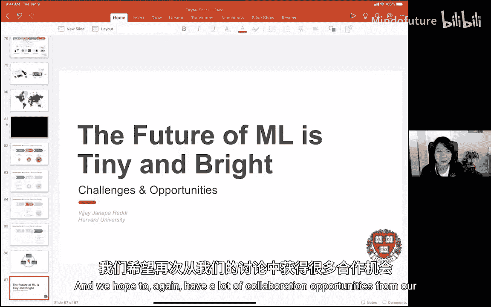

# 【加州大学伯克利】机器学习硬件技术课程 ｜ UC Berkeley ｜ EE 290 ｜ 2021 p18 P18 Lecture 21 Vijay Janapa Reddi, The Future of ML is Tiny and Bright -BV1XfM4zKETU_p18-

Okay and good afternoon everyone， Welcome to E292 hardware for machine learning Today is our honor to have VJ ready from Harvard and M Common VJ is a very close friend of mine he has been a mentor to me for many years and he's an associate professor at Harvard and also a funding member Ml common he has done a lot of very interesting work in resilient architecture。

 compiler optimization， runtime optimization and more recently he got interested into thinking really the broad picture of machine learning machine learning benchmarking machine learning education and how do we actually as a field to interact this broader hardware software codesign ecosystem So with that I'm really looking forward to see what VJ will share with us this time and VJ feel free to take it away Awe thank you Soia for having me here and hi folks。

😊，thanks for making the sign so i'm going to be giving a bit of an unconventional talk what do I mean by that so obviously like。

Originally I was just kind of planning and talking about tiny my part I'll tell you what it is and I'm going to know stick to that and I'll talk a lot about the details of that。

Which is a benchmark for machine learning。But more importantly。

 I have been lately thinking about like sort of where the field is going and how things are changing and like how do you not just just write the next paper or like answer the very next incremental question。

 but how do you think that community， you know， often when we're doing research and so forth。

 we get very buried into that narrow sort of like pinhole view of what we are seeing。But in reality。

 have learned that you can actually do much more if you work with the community to solve much bigger problems so I'm going to kind of hint a little bit of that so it's kind of a little unconventional in the traditional sense of what you might be expecting from hey。

 here's a problem that we solving this is what we're going on。

So generally I've learned that people like to know the individual talking stuff that I'll start off with a little bit of background with so I actually went to I did my undergrad at Santa Clara in the Bay Area and I did a master's at University of Colorado Boulder and I did my grad school actually my PhD at Harvard that's how I actually met SPphia。

Then I went to University of Texas at Austin， where as a faculty member for several years。

 and I took a sabbatical， worked at Google。And then finally。

 my wife decided that it was way too hot in Texas that we had to move back。

To the East Coast where she's from， so we're back here。Um， one of the things that over this journey。

 which is going to be important for the way you know I kind of think about stuff now and I'm going to be sharing that a little bit with you。

 I thought it would be nice to again to help you understand some of the projects I've done because that's effectively going to set the telescopal lens by which I'm actually going to be focusing on traditional。

So back when I was at Santa Clara， my first exposure research was really working on network of workstations network of workstations is something that actually grew out at Berkeley so you all should be very proud。

 which was basically this sort of periodtical sort of approach to how we should be doing supercomputing rather than build this you know big monolithic sort of。

these big monolithic sort of mainframes and supercomputers instead the goal was can we take these small little PCs or workstations that we have and you know create a whole collection of them and then try and solve some of the biggest grand problems and so specifically in this I work on you know what's called hypercued apologies where you want to schedule the network the communications in such a way that when you're using hypercube as a transport mechanism for thinking about point to point communications you can do it very effectively。

What I learned through this experience， here's the key note。

What I learned in this particular project is that tiny commodity systems。

Can have remarkably powerful impact in solving big problems Okay that's a key thing So when you think of this picture think of all these tiny little devices I'm not talking about your big TU pods and all these things right so that's the reason I'm mentioning this and I'll try and connect some of these lessons that I've learned over the past decade to try and get you to kind of see where I think the future is going。

听太没。Then when I was in Boulder and。Finish my PhD at Harvard， I mostly worked as Sophia mentioned。

 I worked on compilers and specifically I worked in what I call runtime or just in time compilers where you actually transparently introspect the execution of a system。

While the program is running， without the program ever know that it's actually being watched。

 and there are lots of very interesting applications， especially for hardware architects。

 because you want to be able to look at how the program is running in order to be able to design a future microprocessor better。

So that gets you into like this deep intuition about looking very carefully across the stack right so across the computing stack that you have across all these different layers which might be from hardware all the way up to your application level or your software level right you want to understand the interactions that happen。

That's the second point that I want to really focus on in this talk today and specifically I happen to apply this sort of introspection where you're looking at hardware software code design to solve something that's called the supply voltage or DIDT noise where you're seeing that the voltage inside a chip is typically very nice and stable that's an ideal world but in reality that's not the case your nominal supply voltage inside the chip is obviously changing。

If you're taking any circuits classes， this should not be a surprise。

What I specifically worked on from my research was understanding how this code design that I'm talking about up here actually ends up impacting sort of how you would actually design a microprocessor in terms of reliability and robustness。

 which is actually a very important topic。About 10 years ago and then I' got everyone got bored they werere like。

 all right， let's move on to the next thing。Back on track。

 key thing that I want you to focus on here is really about code design。

Or cutting through the layers R。Looking through。The layers of the computing stack。

Understanding of course design partners is actually then when I went to UT。

 I really worked on mobile computing edit a whole bunch of other stuff continuing on reliability and so quick。

 but one of the things that I really dug deep into was understanding how do you build energy efficient mobile devices。

Now， the point that I'm making on this particular slide is that when I looked at the community。

 this was back in 2010 or so when I looked at the research that was being done in the field。

 what I realized specifically in computer architecture was the vast amount of work that was being done was really being done with a tremendous amount of focus on data centers and largeca warehouse scale computing systems。

 just for traditional things， nothing I all related back then。But then I asked myself this question。

 I was like， well。Why is it that like mobile， which is really pervasive and it's back to these small little devices which I' was showing you with the network workstations。

 I was like there's so many billions of these devices but no one seems to really be doing research when the field is actually really moving remarkably fast in mobile computing。

So this got me to again， like understand sort of you know。Look at things very differently。

 that's something that I'll do and that's going to be pretty key to tiny amount today。

is looking at like where the rest of the world is kind of focusing on and I like to look focus on something that is getting missed up my approach to research is if I as a research scientist in this world don't look at the problem is there some possibility that if you know we might overlook something because everyone brings their own unique value added to this as I said here comes to interrupt this is nonmable interrupt so I have to handle this right now。

Yeah。I was not kidding when I said I will guarantee interrupts during the class talking about mobile computing systems right what I again learned is mobile is extremely complex again of course you have your very complicated system stack that you have to look through going all the way from the end user okay。

This is a bit different。Then looking at code design in the context of reliability。

 which I mentioned in the previous slide， because you're just looking at code that's running on a microprocessor here you're looking at user behavior and then you're looking at some chunk of code。

And then you。Haror underneath it。So of course there's this interplay that's happening all the way through the layers that's one and the second point that I did mention on this。

Is about like， you know， let's say there's a lot of focus on data centers versus， you know。

 commodity。Commodity systems， cheap systems， smartphones are relatively cheap systems and plus scale where you have a large number of these devices。

 what can you do？Okay， so， and then， you know， when I was at Google。

 I worked on stuff that's called M Perf， I'll talk a bit more about it。

I'll talk a little bit more about ML Commons， which is something that is a new thing in this space。

 specifically we work on machine learning benchmarks。Data sets， best practices。

 all of which I'll come to in really detail。But the key thing that I want to。

The reason I mentioned what I just mentioned earlier is important kind of be able to follow my thought process next。

When we're talking about network cohort stationations。

 it was about really looking at cheap commodity systems okay that was a fundamental argument that like Dave Patterson and others were doing at Berke it like these are really cheap systems compared to buying a cost in the imprint and if you can architecturally sort of if you can tie up all these cheap systems in a clever way then you can really unlock remarkable computing capability as well second is the aspect of really looking through the codesign which is going to be critical especially as we get into ML is going to be like really understanding the hardware and the software stackts and the application of requirements is extremely key instead of codesign piece。

And the third one is sort of building these tools，Like for example， when I'm talking about pin here。

 these are open source sort of like frameworks and tools that enable the others to actually build on top of you and that enables an ecosystem to actually thrive right so I'm going to touch on some of these kindsn of principles。

When I'm talking about where is ML going next right so as I was working on some of these projects。

I was asking myself like last year I was like， okay， where is you know。

 I know' going a lot of places right the actual correct answer to this is that Il is's everywhere and it's going everywhere。

But one particular area that I specifically thought was quite interesting is that like if you look at ML。

 specifically in the context of embedded systems and deep cultural low power systems。

 things that have to do with sensors， things that are interfacing in real time processing data then and there in place right has a remarkable amount of potential。

And so this is what I often like to call the future of machine learning is tiny and bright。

 it's one of the angles in which。Let me just define real quickly what do I specifically mean by tiny amount so tinyium amount is one of the fastest growing fields you haven't heard about it because it's one of those things that doesn't make a lot in release but it is actually growingmarkably fast because it enables a lot of different applications。

It's one of those things where。Because Kanimo is all about running things on really small microcontroller devices。

 I'm talking about things， you know， things that are extremely small in sense of like， you know。

 16 kilobytes of eM， which you probably never even dreamt of something in your class。

 you might even just say， oh 16 kilots Sm， I can do that。Right。

You're dealing with extremely resource constraining systems and so that means you need really interesting algorithm design along with the hardware embedded system design and whatever software you're going layer on top of it and you want to do this because you're trying to deal with on device sensor analytics this is not about ML where you're processing data by offloading things through the cloud or offloading things so a nice big By you know AGX system or something like that right and it's about doing things right at the sensor because that realtime loop is extremely extremely crucial。

And you want to do it with ultra low power consumption when I'm talking about low power consumption。

 I'm talking about less than a milliwat， I don't know what kind of power consumption systems you have all been dealing with。

But I'm talking about some things in the order like no one or less。

That's needed because we want to do Tyamo is all about running systems with ML on all the time。

 right？And the key hope is that ultimately we do this on battery power or energy harvesting devices where we can toss these things out and hopefully they're biodegradable so we don't have to worry about them this degrad attack so that's sort of like the general vision of tiny mouth。

Now you and I have probably interacted with these kinds of applications already right so for example。

 when you say okay Google and things like that you've got your device waking now right and it response to you now that key okay Google is sort of like you know an example instance of doing tiny keyword spotting or you know keyword applications。

If it's not that it's probably hey Siri on your phone right。

 its not that what I use at home Alexa all the time but these devices by and large。

 no matter how you kind of think about it， they're mostly kind of either featherered into the wall。

 which is very different from the tiny amount use case that I'm talking about where we're trying to get these devices to operate completely independently。

So our goal here is to kind of like pull that you know cord off from the wall right and really have these devices run for a long time now that sounds nice right and there are lots of reasons why you actually want to do this let's say for example。

 a really practical example。You have， let's say you have a like a camera in an office and you want to just do occupancy monitoring。

Right now like so that would mean what like you have a video stream that's coming in right on that camera device it's that processing that data and then you know maybe it does something like person detection is there a person in the camera or not sorry in the view or not because you can turn the lights on or you can turn the lights off I don't know do whatever you want to do。

It seems really simple So you might say like what， you don want I don't need any tiny M。

 I don't need know battery operated devices right？ Yeah。

 that's what geeks like you and I would probably say。

 The reason is because we don't typically think about the implications of trying to deploy ML into the real world we write our papers we answer fundamental questions and we do a really good job But when you actually think about deploying M into the real world it's much more complicated Now let me build on that example So for example。

 I have this camera I want to plug in right now if I want to plug this in into my office building let's just say this in the office building。

I first have to get permissions as me， whoever's owning or renting the space。

 I have to get building permissions。RightIn order to drill stuff into the wall and forth。

 then I have to get the electricians to actually do the rowing this is I'm serious。

 this is not something you know some mom and pops from a person you just can plug something anyway so then you need to get electrics you know then you need to actually get set the whole contract up then you actually have to get learn to finally getting the system to get the camera feed and plugging it。

The production pipeline to enable that very seemingly simple use case。

 which you and I probably do in our classrooms right is remarkably costly and inefficient in the real world。

Now if you really want to deploy ML everywhere as everybody keeps saying you need to be able to solve some of these production pipeline issues right timing amount is awesome for that。

 you know why， because you can take this you can literally if you manage the capability of that smart sensing。

 whatever the camera thing and you can do it on a tiny little battery power device and it's gonna to last for three years。

 five years， I will buy that thing and just stick it on the wall you don't need to get permissions。

 you don't need any sort of you know contracts and nothing no legalties so that is a very practical example as why you know even existing use cases。

Of stuff running on Ammate devices。Makes it so much more tempting for the real world deployments amount in the context of China amount。

 so you do want to enable you the capabilities， even existing capabilities。🤧Now。

 other really interesting examples to Tony and all would be like wildlife conservation is a big thing。

So for example。Imagine if you're trying to watch for poaching。

Right now you might set a panel hungry device， you know， it's running MLs， but in other words。

 you strap a camera device to a tree and it's got to detect coachesers。Okay。😊，Okay， great。

 so let's see how that works。So now I have like something like a jettson now or I have some sort of。

um， you know， age system that's sitting that consume like  ten0s of watts。

If I were to stick in a battery there， I can operate that thing with the cell， you know。

 with the solar cell because it just means much more power to run right so we're talking about。3。

 five，10 watts that's already a fair bit of power you had a relax so if you try and put a battery in well then you're going to be going every week out into the deep forest trying to replace hundreds of these devices。

So you cannot practically realize。The capabilities that we're all excited about that ML can give us right even in these kinds of important application use cases。

Taking existing use cases and kind of like， you know。

 enabling them has a remarkable amount capability， but you have to figure out how to cram all of that thing down。

So what it really comes down to is sort of like， you know， you got an embedded system。

RightA small little device that you're able to hold me in， so for example， what am I talking about？

So this is an embedded device right rhetoricically with them great right this is a small little adrenal microcontroller and it's got 256 kilobytes of sRAm it's got one megabyte of flash and then this is effectively got to be able to run some of the vision models and so forth and do that in real time in some cases right so that's the embedded system aspect you've got a lot of research constraints and then you're trying to run ML on top of it and that's really what China now is all about for our problem statement it's very simple the question is how do we actually enable this。

If we can enable it because we got to have motivating factors that and push us to actually enable it right。

 then we have massive opportunities across many different applications I like to tell my students in my classes to say。

Once you sit around and just as a fun exercise， look at all the devices that are around you。

And tell me about what you think your devices would be able to do if each and every single one of them was actually intelligent and capable。

I'm really lazy the first thing I want is to smart coffee machine where I don't have to push the button every morning I just want to be able to right as it sees me in the morning if it's like around536。

 I just wanted to turn on a coffee machine and just get going it's a very small example use case。

 but imagine like you know you're toaster you don't have to use touch right if it's an oven you just want to say bake 350 very simple there are very。

 very simple use cases that you want。Now those are all examples of tiny them out， right？Um。

 and they all have to be on ultra， you know， running on microcontrollers it costs like about 50 cents。

So and the other thing is obviously the power is extremely constrained。

Perhaps not in the toaster and the oven kind of cases because you could potentially plug them in。

 but even in those cases if you talk to LG， Samsung and so forth。

 they'll say like we don't want to tell people that you got to plug something into the wall in order to enable something so even in their case there's just like we'd rather just have people you know have things running about it。

All right so a quick question here like it's really interesting you make the connection with tiny ML and the N project network of well Ortation project I'm wondering whether you see tiny ML also have this network component where things are actually connected together to work on like some bigger task or the focus is really going to like the tiny any devices and making sure everything work there standal alone。

Yeah， so that's a great question。 The answer is yes。

 absolutely right Like the need to be able to connect and do over the network updates like over the error updates is clearly there。

 But I think the problems right now that the industry is still facing is just like can I just get this thing to work on a single device and do so in a scalable device which is actually the first box that I'm actually gonna touch on And once solve that problem as a community then I think the community will naturally move on to okay now how do I start actually orchestrating all of these things there are a lot of things around federated learning and so forth。

 I'm not interested in the research papers necessarily I'm talking about like how can the entire world youre actually solve problems that it's a little bit of a different goal right？

So I'm going to focus today's talk primarily around three core areas around Taama。

 hopefully at this point you should understand。Why I'm excited about tiny email。

 you can certainly ask me more questions or yeah， raise a hand or just kind of jump in and shoot the question。

But the first thing I'm want to talk about is like system infrastructure。

aroundund system infrastructure what is actually needed to enable tiny amount there are lots of pieces that need to happen I'm going to focus on what I think are actually two of the most important things that's going to involve an inference framework that can actually run the tiny models and then I'm going to talk about tiny amount perth which is the benchmarking aspect。

 both are kind of needed because this field is so young the talking about benchmarking without talking about the frameworks and support forth and application use cases doesn't really kind of tie things together。

So that's gonna to be the first thing I'll talk about and then I'll talk a little bit about like you know how do we again as a community kind of move things forward in this space given in such a young community。

 how do we sort of get people excited about this and how do we drive research on innovation a lot of stuff going on here but most of it is really kind of caught up in industry right now academic research is still not it's not really there yet at scale and I'll talk about mechanisms and we're all very clever people we all like to sit on ivory towers and claim about you know how AI is going to have big impact in the world and then don't do shit about it。

I said it because I actually take this very passionately。

 it's extremely important for you me not just like you know faculty members。

 for every single one of you individuals who are actually the next batch of people growing up。

 that you take a responsibility in understanding what it means to deal with the technology that is remarkably powerful and making sure that there's equity in this technology across the planet。

I'm not talking about just making sure， oh yeah， like， you know， sure， if you want， I'll。

 you know tell you about ML or something， it's about what do you proactively do in order to make sure the rest of the world globally is actually understanding what this technology is。

So I'm going to talk about education and outreach in this particular context because I think it's extremely important and you folks。

 if you're passionate about this， there are ways that you would actually enable it more so than the folks like us who are actually trying to do it。

 but it's going to take a long time。All right， so the first thing I' going to focus on before we get into the benchmarking aspect。

Is just being able to run ML on an embedded device。Seems very simple。Just engage with you all folks。

 how many of you have run Tensorflowlow model on a mobile device or on a computer server on your laptop？

Can they get a reaction， good， anythingt on me。Can I get a reaction from others， Sophia has done it。

We could also use what's the reaction。 Yeah， sum up。Well， most of you should。

 right we did some of the last， just like my class asking questions。😊，あんた。

so you've all used embedded frameworks and you've all used machine learning frameworks and maybe it's stensorflow。

 maybe it's Pytorch whatnot， right？By and large， I'll tell you for a fact that you've actually never really dealt with really building an infrastructure how many of you have actually built a framework？

You're all very excited about doing M out， have you ever built an inference engine or a training system？

I guaranteed much like in my class， much like me a while back to。

 is that many of us don't really deal with it。It's a handful of people that actually can deal with it that it's like compilers in the most world right like people write lots of applications。

 but very few people actually do compilers， you know。

 understand the architecture and so in the ML space there is a need if you want to be able to run tiny amount you first and foremost actually have to be able to build a library that can enable ML at a global scale。

When you talk about a global skill， what this means is that you get a lot of problems in trying to deal with embedded systems。

If you're not dealt with embedded systems before I guarantee you have no idea about the kind of issues that the ecosystem brings everything I've said so far about tiny amount is about low power and I've talked about very specialized use cases。

 what does this mean if it's a special if it's a specialized use case and I told you it's got to be ultra low power what are you going to do you're going to specialize in hell out of the system that's what I' would do if I was given this job。

Right you ask me for a low power， I'm an engineer， I will chop every single thing out of it and try and make it as lean and mean as possible in order to be able to get a executed task and that。

A completelyreaks havoc on the ecosystem。If you care more than a single embedded system。

 maybe you care about an embedded system that's outside of your company。

 or in that case you've got a serious problem of fragmentation， heterogeneous fragmentation at scale。

😡，So I'm going to talk a little bit about stuff on the hardware a little bit on the software and specifically what I'm doing in this talk is actually I'm introducing Tensorflowlow like Mi which is an inference library that we actually built okay now this is obviously it's Tensorlow so it's worth it you know I've done at Google with done the team that I work with。

And so let me try and explain because Sensflowlow is an open source project right it's got to run everything right by and large now typically when you're dealing with。

architectureecture any kind of architecture now a lot of people like to say oh。

 we're going into domain specific architectures and support in the computer architecture world okay。

 well then I like to often ask。How many variant processors do you really have in a production scale system。

 You've got a CPU， which pretty much is so damnn good that you can run on any version of CPU thanks to x 86 equal just one。

You've got a GPU。 They also done such a remarkable job in their software ecosystem that， yeah。

 pretty much most GPs run。 right， You'll run。 I'm not talking necessarily about perform code。

 but you'll run。Okay fine we've got PPs out there right the Google like to make a lot of noise about maybe you have a few other。

 you know MPs of， but in reality it's a very limited set of hardware architectures that we have at least today okay out on the field now when you talk about embedded systems。

This gets notoriously complicated。Now， the reason it gets very complicated is because you have a whole bunch of different kinds of microcontrollers。

 so let's just say CPUs I don't have a lot of slides on this。So I'm going to explain this。

 so let's say we talk about CPU so you might have a cortex M0 class microcontroller and you might have a cortex M3 class microcontroller。

 you have a cortex M4 microcontroll， you have a cortex M7 microcontroller and M 33 and million2。

Each one of these has fundamentally different ISA properties in other words。

 it's giving you additional functionality as you expand out the scopes you're able to maybe get an FU yeah。

 like when was the last time you ever worried whether whether a processor has an FU I bet you never even thought about it but in a microcontroller that is actually a very conscious decision it's almost like we're back in like the 1980s or something I that right because power efficiency is so key so what this means is that now when I design a model and Im trying to run it on a system I make a lot of assumptions about the exact deployment target。

Which means I might lose portability immediately so that's just in the CB realm right so the IA you can consider you might have。

Even within a single chip you will have differences in the ISA right and if you look at the chip vendornders you have pensilica DSPs。

 you have Qualm DSPs， you have synopsis microcontrollers。

 you have a whole range of arm microcontrollers right and so and now you got refi in the mix so there are lots of different solutions you have it's a very。

 very fragmented ecosystem。And the problem is that each one of those ends up having its own variant in the ISA when you're trying to run the code on them。

And it's not like traditional compilers where you're able to just kind of take some piece of code and just kind of run it because compiler systems are really mature and they're you know because you don't have the flexibility so the point is that the hardware here on this side ends up being really fragmented even within let's say even if we take pens ESP when you kind of open that up the whole variant of pensil ESP in there why again for the very reason that it's an embedded system so you optimize the hell out of the system for extreme efficiency。

So therefore， there is no guarantee now that if I compile a model that is capable of running on one microcontroller and I want to deploy it on another microcontroller。

 there's no guarantee it's actually going to work。Because you do that level of bare metal optimization。

Okay， so that that's one problem now let's say we go over to the resource controltrain side。

 let's talk about memory。So in ement microcontrollers， because again of power efficiency。

 your memory can be as little as 16 kilobytes。Which is really small。

 think about the smallest mobile net model you might have run。

 the thing is probably still in the other megabytes。😡， so all your quantization， your pruning。

 whatever， pick your favorite optimization， it is not going to get you close to where these models need to be。

And if you even talk about like you know， so this will be your eRAM。And you have your flash。

 which is like your storage right so that's in the order of like maybe one megabyte。

So it's still very， very small， in other words， you've not this one megabyte has got to have your library。

 the inference engine， which actually knows how to run your framework。

And the weight took the network。All packaged in into that 1 megabytz set。

 which is extremely limiting in terms of memory， so it kind of causes problems from that perspective。

 why am I rambling about this because this actually has implications on how you would design the inference framework。

And of course， power is human key。So Vi a quick question。

 Some students are wondering what are the key differences between TF light and Tf light micro is this like very specific。

 but just like those hardware group constraints are even more extreme in this cases Yeah they screen and now yeah。

 so I'm actually going to come back and summarize that I have just one summary slide and I'll point of paper that we just literally published on exactly the internal is that and why it's so specialized while maintaining the fragment So all I'm doing right now is just kind of setting up the。

trying to get you all to understand the fragmentation issues that we have to deal with in or build an inference framework。

 it's why that you can't just take traditional TF or TF or type and just kind of drop it and expecting oh yeah it's just on the processor no it's not you have to inherent understand the constraints of the system。

Then go to the software side of the world doing so there lots of missing features when was the last time you ever wondered is there memory allocation and virtual memory on this system？

She。When was the last time you one of that？You happily go out and you mall yourself or you knew yourself a little bit of memory you' like aha well that does not work in an embedded system。

 you do that， the developers are not going to take it。

 the reason is because when you introduce those kinds of dynamic memory allocation mechanisms what ends up happening is that you introduce fragmentation to the memory system。

When you introduce fragmentation into the memory system， unless you have a huge amount of memory。

 which， the fragmentation cannot easily be contained。When you are extremely constrained。

 see what happens when you extremely constrained down your memory availability。😡。

Trying to juggle fragmentation becomes extremely hard because you really don't have much room。

 There's not much room。 So that causes potential problems that your application might actually crash。

So developers， application developers are embedded systems who are trying to deploy models and them will first and foremost so。

Please don't do any dynamic memory allocation or anything。

 I need to know that you can run perfectly in a guaranteed way from the time you start if you fail you've got to fail immediately at the startup。

 don't ever fail midway。😡，Because the point of these embedded systems is you toss them out into the real world and you don't muck around with them。

So once you push it， it's kind of like larger unless you're doing over the air update。

 you don't really， you have to have guarantee that it will work for as long as it's needed， okay？

Because you can't easily log back in and change something and fix it it doesn't exist it's not like a smartphone that's all connected and so forth。

So this can cause some serious problems in terms of how you design the library so which means that your inference framework has to be able to guarantee that it'll never run a daily memory allocation problems。

 you also cannot make any library assumptions and say look I might have some OS support I'm going to rely on some sort of library support maybe some positive function。

 no you can't because that might work on one microcontroller and you won't have it in the rest of the entire ecosystem so how are you're going to build a common inference framework that can run a set of models across a very heterogeneous ecosystem that is the real problem。

Okay， so hopefully you understand this， I know it's a lot to kind of cover through， but。

I'll give you a pointer for TFF microcro which gets into a lot of the details and I strongly encourage you to read it because I really do believe that it will open up your mind to a whole set of new possibilities in doing optimizations。

So TF like micro is kind of designed in a very particular way its an interpreter based approach interpreters are typically good or bad here's a question how many of you think an interpreter is actually a good approach to building？

Anything in terms of compilation， do I compile or do I interpret？

What is the biggest problem that you have with an interpreter？Anyone。

I'm like totally harassrring your class I justs some comments in chat love didn see that thank you。😊。

Bad for efficiencies， slow， awesome， yeah， good， Thank you folks， that's good。So yeah。

 so normally when we talk about interpreters we tend to think they're really poor in their slope right like Python is inherent inherently slopepe we love it because it's dynamically type and so con our flexibility but it's poor in terms of performance and if you think about it in the context of an embedded system everything I've said should lend you to think my gosh an interpreter is a terrible way to actually design an inference framework because it's going to be very slow。

And if it's slow， it's going to heat up all the battery。

I'm going to tell you that GF micro engineered to actually be an interpreter based design。

 very counter the design。But the fundamental reason that you can actually use an interpreter。

 it opens up a really interesting possibility in ML is because every operation you do in an ML。

Once you make a function call into the ML off， it spends thousands of cycles in there。

So which means that the relative overhead of actually doing a parsing to get into the op is very minimal despite the overheads okay？

So TF uses an interpreter and the nice thing about such an interpreter design is that then you have a lot of flexibility because it's an interpreter。

 you don't compile the model into the executable。You can keep the executable literally as raw file right and so you can it allows updates over the error updates and so forth I don't have to push an entire volume there are many other reasons but effectively it gives you a lot of flexibility Another thing is that like across all of these kinds of different devices which have very different heays。

If you build an interpreter， it allows the hardware vendor to actually provide you the high performance libraries for their particular architecture you don't want。

Google or someone to sit there and write high performance kernel libraries for every single highly fragmented ISA out there in the embedded ecosystem。

😡，That is why I was rambling about the heterogeneity that you have。Instead。

 you want the hardware vendors to write it because that's scalable because they're building a hardware so they know they essay saying that out so you want them to say。

 giveive me a high performance off。😡，For this。And they write it and because it's an interpreter。

 you just make a call into it you're not compiling it all in right so it gives you a little bit of that flexibility so because of that you can actually cover a wide range of different emitive systems。

I encourage you to read this paper， we just publish this in MLlS， but you can just。You know。

 Google Tensorablete micro basically explains how we do it it's got a very small binary footprint because we don't use libraries or any kind of external support wide because we want it to be highly portable。

 we don't do any dynamic memory allocation for the very reason that we to actually we wanted to actually be flexible across systems so we don't rely on any dynamic memory allocation。

U we also don't compile in libraries because that libraries increase the overall executable size。

 you don't want that because you have very limited amount of flash and that's right so you want to keep the core binary as small as possible。

Again， you want to run on bare metal because you don't want to assume any our cost kind of support。

UmAnd the ultimate， if you follow all of these， what it really gets you is portability。

Across heterogeneous systems， which in the context timing one was extremely key。

 maybe don't believe we me go read the paper， we got bumpers trying to explain this。

And another unique thing that we talk about here is really just it's an interpreter。

It's not a compiler， which is very counter and you won't find interpreter based and systems out there in any of the hiring systems so I strongly and encourage going to learn about this。

So the first part is kind of like understanding that any questions I'm living in the chat。

 any questions about this？The system， I didn't get into the details because I I'm trying to cover a whole bunch of different topics。

One， course sorry， you can answer check questions first， but yeah， sure。

Go for it na I look at it Yeah one question about like the interpreted versus compiled but in some sense。

 like certain aspects of the transfer from like a tensorflow model that like very small in model that you had to turning into a micro model is going to be compiled right but like。

If I understanding correctly when you say interpreted。

 you mean that how the actual like you know execution of like the certain em models layers or operations that's not translated to the IA by Tensorflow that's translated to the IA by the compiler library so it's not fully like something like XLA would compile to like a TP or something like that it's not fully compiled it's just like。

Almost partially compiled， right？Yeah， you end up having to flash an executable down。

 but it's a question of how you use a tool chain。Right so if you want to write an inference framework。

 let me explain this quite carefully if you want to write。

An influence framework in an academic setting， I'm an academic。

 so I like to say this like if my students were writing something for， you know。

 I need to get some paper done。What do we do with to probably take an ST microcontroller or something a production grade system？

And they will have the tools for that and that's great， you can run it for that。

 but that's not going to help because now you can't run it on an Arduna。

Now I can't run it on an ESP platform， I can't run it on an esPra。Platform， right？

That's that real problem you really want to be able to address。

 it's this enabling the community to actually grow。

 if you want to enable tiny amount of really peripheral。

 you have to address this fundamental question why at the bear the bear metal？Okay。

 so it's basically like an abstraction layer that's in between the hardware manufacturers and their ISs and the。

Tenssorflow compil exactly and you want to be able to reuse another thing is that you want to be able to reuse highly mature optimizations that are coming in from the training flow。

You do not want to reinvent the whole wheel。😡，You want to be able to plug into all the optimizations that coming from the TF side into the TF light side。

 which is the converter right and then of course then we push that even further on the micro side because for their embedded system related kind of optimization like the ones that we're looking at here on the spot。

I thinking you。So what kind of then so what kind of stuff is in the hardware specific interface that the interpreterlies on so for example would be like what the op that you call right I have a comm well the comm op I provide a reference model。

I provided reference implementation from the Tenflow version。

 which is your standard crappy for loops。but that's a really low performing low performing regimen I'm sure that you've already covered that so what you really want is you want a high performance op that's provided by the vendor maybe it's a 10sica DSP okay I want that I want the best performing op that the hardware vendor gives me so that's one harder specifically but the interpreter folks that software framework folks don't have to worry about it。

Because theyre just going to make a transparent call right and if it doesn't exist well。

 it doesn't exist or you just use a crappy version that you get their default so you provide functionality。

嗯。Does TF micro understand all of the sun TF micro understand the distinction between main memory and scratch patternss is something for the library so the library designer handles this。

So like since we stream straight from flash， we don't necessarily love them in West round。

Just because you want to keep the footprint long。But does this mean that TFmic like assumes that the results are all in main memory after the end of an up like you can't like hold it today I mean you're dumping it you're dumping out all the intermediate values into the e so that's why in part you don't want to like hold any of the weight values around okay。

Okay， I also has a question up above about like op fusion。 if it's like interpreted。

 how do you guys handle that or do you do you like a prepas or or something， No。

 we don't do any fusion on the ops right now。 So I I begin there's plenty of stuff。

 One of the reasons， you know， I'm trying to talk to everybody in 15 years strong and talk to people is there's a lot to be done here。

ILike literally visual at the paper， but the project has been under， you know。

 as a moonshot for about two years。So there's a lot that can be done。

And there's also another paper that I encourage you if you're all interested especially because you're all at Bley there's stuff around Ri five support that we have right so we're trying to build out an open ecosystem that goes all the way from the framework side which we kind of solved loose sleepput right and then now we're trying to create an open source stack from the hardware side so this way it allows what hardware and software optimizations to be done and I can get more into that when we talk。

So I talked a little bit about the fundamental having an inference system okay so yeah you know I tend to put on a Google hand I'm kind of biased。

 but there are other frameworks just to kind of mentioned there's a lot of interest from TBBM so TBM is also looking into some of this stuff that I encourage arm is also looking into this stuff STM is also looking into but by and large the issue with a lot of these systems that they do compilation。

Okay， so they have a lot of the same issues that's not to say that they're bad it's just that we are providing an alternative way of doing it。

just want to say that Okay， so now let's say now you know we've got some more I'll start getting into what are some interesting models that we can have。

 you know now that we have a framework that can actually deal with the heterogeneous thing so we' can actually deploy these thing so I'm going to talk about tiny amount earth。

So tiny about proof the goal is now let's say， you know。

 hopefully at this point youre drunk my co leg to say that like wow。

 there's apparently in the embedded ecosystem that lots of different am hardware okay。

 well all right that's great from a。Application potential but now I get into this problem like how do I sort of compare all these different systems this is really no different than comparing any two smartphones or comparing any two server class inference systems training systems right so。

This is nothing really special， it's just that the nuances that I'll talk about today are in the context of the tiny amount space。

 but Ill talk a little bit about the I'll talk a little bit about the general principles that haven't heard about。

So the goal is we want to create a useful benchmark like spec benchmark or PPPCC if you've heard about them。

 right we want to create a useful benchmark for measuring ML inference performance。

And it's not just performance we also want to look at power which I'll talk about right so obviously it's extremely key because these are deeply emit systems so what you can take away from this particular section of it will be what are the workloads that tinyL people generally care about how do I benchmark ML systems that's the second thing that you learn a little bit about。

Yeah， let's get into that。So the general question not specific to tiny ML is broadly about this right。

 which is I want to compare ML systems， do you have a solution， I have a solution。

 both are doing something like keyword body。Keyword spoting here being， okay， Google。

That's a very specific task， right？嗯ん。So then if I have a task like that。

 then I want to ask this question of。Given a task， how do I know what's the right system from a performance。

 accuracy， you know efficiency sort of standpoint， that's our first question。And then let's say。

 you know， that's the first question， the second question is how do I want to compare this one system that I understand how to evaluate well with many other systems？

prettyty simple， it's not rocket science， but I'll open up the sort of the， you know。

 what's underneath the hood。So generally measuring ML performance art。

 this has got nothing to do with tinyML， this is just general one on one set of just you know benchmarking ML systems。

Right now this specific figure that I'm showing you here is not specific to tiny amount I'm trying to teach you something that is just a high level fundamental concept so Nml what do you have you have many different application use cases you have lots of different for each of those application use cases you might have different data sets and for those different data sets you might have different models that can ingest that and then do you know spell out some accuracies you can run this through many different frameworks Tens aflow Pi towards caM X stand paddle paddle know whatever pick your favorite PVM。

They have different graph formats。Graph format actually have impact， believe it or not。

 like you might think like well， it's an representation I just map things into this inter representation or if your intermediate representation between any performance format is not compatible then you actually have the potential to lose accuracy。

Then you have some compilers， then you have highly optimized libraries that you know run on very particular systems that ultimately run on hardware point Im making。

If I'm running something。There's bazillion different ways。I can end up getting performance。Okay。

 so that's the fundamental problem。It's not about just getting stuck one that alone we know is hard what's really hard is if someone comes to you and says hey。

 here's my performance for image classification and then stops there。

 you have no idea what that means。Prior to working on you， analyst system performance analysis。

 I was like， know， you're just running on a class desk and then it's all good that's how most of the academic community is running on。

But given how critical performances in these kinds of systems， you know。

 the industry is large and academics are large really pushed， you know。

 each one of these layers remarkably hard。So therefore you have this really complicated system stack that's really hard to make sense of okay。

 then the second thing you get into is the fact that even if you see you have an image classification well then immediately I need to know。

 okay， well what kind of data set you're using， what is your accuracy that you were shooting for when you're reporting this performance？

So there are lots of nuances that we can talk about。

So ultimately the point is that the cross product makes it really hard， so。

Measuring ML performance is really hard because this cost part is really huge and there are lots of questions like you know what you what quantization did you use right or did you do pruning or sparsity optimizations？

What is your accuracy？Right what's your so someone says throughput and generally right and someone wants to go after throughput I'm sure a lot of papers you'll read will say。

 okay what you know， I get Xterops for what Well yeah is thatterops for four bit operations or is that really FP 32 operations because that's you know volumely different right hass tremendously different aacies FP32 or 16 bit FP16 versus in 16 like or in8 and in4 you have very different accuracy So you have to kind of think about these issues So that's really where this whole need to kind of have a rigorous sort of scientific approach of understanding ML performance really comes in。

Yes。In other words， you should be asking people these questions system X is better or worse than system Y right so if Hassan says okay he's got system Y and I say I got system X and we've both built the exact same inference and math we come to Sofiia and we're trying to convince Sofiia that you know one of our systems is better well her questions have got to be some of these right well what's your which particular tasks are you talking about are you doing only vision tasks just because you do vision tasks doesn't mean you're also going to do well on language tasks right they' are different or worse yet on recommendation based models then what kind of models are you're running what data sets are using what batch size are you using that's critical a typical batch size when you really care about latency is going to be batch size of one is sort of like where ultimately you know the performance shows up in realtime kind of tasks。

If you're talking about offline doing things， maybe a bad size is really not as key。

Then you know what kind of quantization are you doing， right？

So there's lots of these different nuance problems we can get into。

So somehow you have to streamline some way of building a benchmark right because if we want to measure progress in systems。

 we have to have a ruler， we have to have some set of units or metrics like NIST。

NISist is an entire body that is scientifically dedicated by the government to do one job。

 come up with standards， that is their one job， why do we come up with standards？

Because we want to be able to speak the same language。

I want to know when you say some accuracy metric that the way you got the accuracy metric is the same as me in other words we use the same measuring ruler。

So if we can do that right so because we might establish them to core set of principles。

 then we can actually do effective measurements and if we can actually do effective measurements。

 then we can advance the field forward because we'll know which works better。

 which does not work better and that effectively is what you know ML Perf at large is all about。

And we'll talk about things in the context telling moment today。

If you can create a unified metric system， a set of rules for data， models and execution。

 then you can ensure comparability。Across hardware and software now that' the key okay。

 whenever we talk about if anyone comes to you and says my hardware is better because of Xy z reasons well don't trust them because software plays an extremely critical role so hard that ML hardware without the ML software is really bogu so it's always about the system today at least that's where we are。

And we need to standardize on a set of use cases and workloads。

So there are lots and lots of different applications of you of ML。

 so you might say hey you know what， I'm very excited about this and you know ability to do。

Let's say detection some sort of detection right Okay。

 I then you might say I get 99% accuracy that's awesome you know it's like wicked cool all right。

 now you might be wondering what is that 99% accuracy on。

Is that to tell me it's a cat versus a dog on my phone so my kid can't get anything but that's one thing I'll actually take even 50% I probably bet is enough right but is that if you were to deploy that now in an autonomous driving car or you were to deploy that in in the hospitals where you're detecting brain brain tumors and so forth are you sure you' gonna to be happy with 99% oh whoops 1% I killed your kid I killed your kid yeah。

 I will just lose it at that point。So the point I'm saying is somehow given that there's so many different use cases。

 you and I have to kind of figure out what are the standard set of metrics that we can all agree on right for the workloads is this a driving workloads。

 this a smartphone workload so somehow we have to drive that standarditization across a wide variety of use cases given that ML is being used so heavily。

And this allows us to effectively measure。Things with the rigorous method。

 and I'm going to talk about some of those details。

And really you want to build community consensus here， you don't want。

 since this is an academic environment， I'll say this。

Purely putting on my hat you don't want NVDR or Intel or pick your next major so vendor to come in and say or like Google to come in and say。

 yeah， like I really think that this is the benchmark and these should be the workloads。Well。

 that might be their customer base。 and that's why they're trying to push that。 Well。

 you've got to ensure that the entire industry moves forward， not Google and videodia who not， right。

 So then how do you drive the sort of consensus where everybody agrees， Okay。

 I will agree to that metric， I will agree that that is an important task。

 and I will agree that that's the way to run the machine learning model because the way you run a machine learning model on a smartphone is very different from how that exact same model can potentially be running on an autonomous car。

Okay。So， and what I'm going to talk about is sort of building this bridge between ML Perf。

 which establishes this sort of scientific rigor in understanding ML system performance with the unique needs of Taa。

Right so whats MP already I kind of mentioned this。

 which was like MP is all about building a community。

 It's a whole bunch of the industry coming together。

 but given that everybody's super excited about this。

 everybody knows that if they want to be able to make a pitch for you know talking about their hardware software。

 everybody has to be speaking the same language so it's a community driven M benchmark it's just a set of models with a clean set of rules really not rocket science There's a lot of nuance to it。

 but fundamentally that's all it is It's like if I was to get you all together and say hey。

 let's all try and agree that in order to do your final project right and get get the sign off from Sophia you all agree that okay it's going to be。

This is going to be the grading system right these are the exact deliverables for the project it's no different than that it's pretty much that but then you have to get that consensus across the industry and it's a whole bunch of companies coupled with lots of universities and actually should be really proud because empire EmmaPf should grew straight out of Berkeley。

AndDa Houseson was personally involved in inference， sorry in training。

 and I actually led the whole inference effort across many different systems that I'll talk about later。

What are the goals？One of our first goals is to enforce produce like reproducibility in the results。

There's lots of stats that are flown around well forget the stats。

 I'll tell you how important this has become reproducibility the MLL has become so critical that this year。

Nurope's has a special track dedicated for data sets。

And benchmarks I'm super sacked because I actually have a paper that I've been wondering about where to send from M Perf I'm like damn mean these M people never care about it so when I saw it actually just today and I was like yes。

 finally these people are on just scanningning the importance of reproducibility。Um。

 because you can have a great number， but really if you have a great number on some data set that no one cares about。

 okay， what do I mean by that？Typically if like you know let's say some major organizations is actually trying to write a benchmark paper。

 well they might really want to use their own internal data but and when it comes to research paper。

 they probably can't use an internal data why the Google uses an internal data someone else might say I have no idea what this data set is about so I have no idea what the accuracycy even means so guess what they will do they will use something like image which we all know is actually has got flaws in it every data oh have flaws in it but the point is that。

Then everybody's kind of not sure whether this number really means anything or not right so you want to enforce some sort of replicability on some sort of standardized。

Sorry yeah the representativeness or the workloads on some sort of standardized data set so you want to pick the right workloads too not just the data sets for but also the right models in other words I might be able to come up with the benchmark let's say you know in this particular class we all come up with the benchmark and you say okay we're all going to run。

嗯。Which ones I think， I'll just pick like tiny column。

 the one that we we put up as part of tensip like micro。

 which is just 16 kilobits well its accuracy is just 80% for keyword spotting。The application like。

 okay， Google，Yeah， well， that's terrible。You get a number on that， it doesn't even mean anything。

Because the aacies need to be around 95%， 97%。Because it's not totally roughly is straight the opposite so if let's say you benchmark this particular time call model。

 what does that really tell you， is that really telling us anything intelligent？

You know intelligent enough industry to be able to make big bets on which hardware to buy right so that's where the representativeness comes in other words if you benchmark something like Resonate 50 or something the result that the benchmark produces has to be useful in other words it has to give them an idea that ah。

If it is about， you know， it's getting 99% accuracy and it's getting XYz throughput。Okay。

 well that's interesting， yeah that because that workload is very close to what I actually want in the production so I can kind of get an idea about what I'm likely to de and I actually put it into my data center。

So that's why that representativeness is key。Encouraging innovation you want to push the industry forward this is not about just setting the lowest bar you actually want to set a high bar so you can push but you don't want to set the bar so high that it actually doesn't help people right industry needs to get meaningful data about it so how do you sort of pick the right laws。

And it's got to be fair and useful across the entire spectrum， everybody's got to benefit。

 you want to support both commercial and research， you and I got to be able to do benchmarking。

Because。We generate innovations， right， so that's kind of trickle in industry。嗯。

And you got to keep it affordable this is especially important in the context of training systems because you know if we just said hey industry is going to go ahead and train models。

 well they have ginomas data centers on unless they train models。

 you and I would never be able to write a paper that's competitive them。So the point is。

 you know so these are the general goals of ML PERf right and then you know how does MLPf go about doing this。

 we use large public data sets because again that's public dataset sets like image now and so forth。

 CocoA are broadly accessible。Then we create either training benchmarks or inference benchmarks。

 is a very specific suite of benchmarks that we provide。

And the goal is to identify what are the tasks that we care about image classification even today like you know is one of the hottest tasks right detection segmentation。

 all those kinds of tasks are actually hot how to be tremendous we have an advisory board who specializes in these different tasks so for example we have an automotive board at AM least time where their job is primarily to give us advice on well what are the kind of models they doing right are they doing sense offusion kind of models when they're actually deploying them and like you know in rainmo test line and so forth so we have an advisory board that advises us and then we take those as models。

Then we identify what are the scenarios that you wanted scenarios mean the way you take up how a model runs on a device can really be different if you're wanting things in a server。

 it'll typically be something like。It'll be something like you know it's a poison distribution right it's not like a back to back kind of influence request because it's a server it gets request in verse so you want to mimic that behavior in a real server because you're going to capture the system level capability use at that point but if it's on a phone you're not generating any kind of thing like all you're doing is you're interested in how long did that picture take from the time you click that button right so the latency is what you care about so the many different ways of kind of slicing and dicing this。

Then you want to have to set of clean rules right if I come to you and I say， hey。

 my performance is you know Xy z throughput and it's so much better than a science' performance well okay great。

 but are you using the same exact numerical formats right maybe he's using FP32 and no wonder his performance is crap but he's getting high accuracy but I'm actually using an N for my accuracy is completely crap。

So we need to speak the same set of things right so we define a clean set of rules across how do we do quantization。

 how do we do freetraining， how do we do pruning or you know do we actually allow pruning and spars the optimizations and what are the conditions where can the data reside before you actually start running the benchmark。

 does it reside in the closest caches that are next to be accelerator or does it actually reside in host side DRA where you actually want to pull it so you actually have to look at overall system components？

So there are lots of questions like this， there's a huge laundry list of them。

 but I'm just trying to talk about some pilot level examples。And then define metrics。

 do we only care about performance or do we also care about accuracy？ so in our case， yeah。

 so one is accuracy， only performance versus accuracy or and do you care about latency or do you care about throughput server systems care about latency bound throughput。

In other words， the yeah， they want to maximize the amount of inference， you know。

 for example they're able to solve yeah that's great。

 but if the latency of each one of them somehow ends up being like you know，One second。

 would you ever buy a system like that that doesn't make any sense。

So you need to have really short latency， but try and maximize throughput。

 but when you try and reduce the latency， what happens you're trying to push more if you complete resources to that one particular query。

 which means your throughput is going to start shrinking。

So it's this tug of war between latency and throughput so you need to think about that。

 so there are different metrics here so we have latency。You have two put。Then what's the accuracy。

 as I was saying earlier， I can make a model run really。

 really fast as long as you don't care about accuracy。But if you care about accuracy。

 well then I'm automatically going to have to sacrifice some amount of latency or to put brain。

 so there a whole set of metrics and we establish those kinds of metrics。And ultimately。

 everything is meant to be public， right？So you share things。So here's an example。

 I shamelessly just pull this off out of a paper that's we're actually going out。

 that's why you see this word proof here， so you can safely ignore that。

I's the point that I'm going to make。But let me explain what this is actually showing。

There's a whole bunch of data on this。So MLPRP is at this point gone through three different iterations。

Okay， so when we first started it， it was the version 05。

 we had a set of different tasks so you can see we only had a few tasks。But then since then。

 you can see that the task areas has increased。I'll talk about these different tests in a second。

 but you can see that the number of checkboxes increase which means the number of benchmarks is going on right and this is just going to continue expanding why because the different areas MLl is being used in many different areas right so you can see for example in the first iteration。

We didn't have commerce， we didn't have recommendation models。

 we only had you know just classic vision tasks and so forth。

So what are we doing in MLP that's a bigger caution as it pertains to telling ML。

 we define a set of different areas， we look through the different areas and try and identify what kind of tasks。

 image classification， detection， segment， machine running。

 sorry machine translation recommendation right so we determine what these tasks are。

 then we pick a reference model。In one particular format， maybe like KF like micro4 tiny enough。

So we have Pythtorch and Tf light models， then we pick a data set。

And then for each of those data sets， we agree in a quality target。

 that is some percentage of the FP 32。Okay， so there's a lot of detail here what I want you to take away from this particular slide。

Is。Typically when you're doing your optimizations， you want to know， hey， Li。

 is this optimization good or bad in support， right so you can use ML perf sort of as a roadmap to kind of help you identify what is it quality target that I have to hit and support？

sorry these when I exported to a PowerPoint it broke down but basically we have GiHub on Gitthub we have a whole set of rules I already kind of explained this a little to you。

 I was just going to show you the submission rule stock and the infant rule stock and the pictures here and here。

But they are in GiHub， but the key thing is that they have lots of detailed things I out。

And then I have a I was going to have a screenshot here which was basically showing you a table of all the results again if you go to mports。

org or mlcommons。org youll see all the results get published。

To this day we have actually like the last inference round that just happened had over 1。

800 submission results that just came out which is a huge corpus in just one run right so it means this it's got that rigor of fully reproducible results。

 you know exactly what targets are hitting， exactly what data sets are hitting。

 exactly what markets are running so it gives you this remarkable confidence in terms of what the hardware capable of。

And if you look at the systems， this is from B 0。5， it's an old graph。

The key thing is even in that one， we had a large number of results。At this point。

 it's over 60 different systems that are in house and if you look at inference performance differences。

 you know its own。It says 10，000 next year， that's just for the closed division as we call it。

 but it's on roughly on the order of five orders of magnitude difference for inference training is its own different beast。

 I don't I should do training so that's why I'm actually not talking about training to be candid。ピ。

All right， so that's hopefully at this point， you understand what ML purpose。

But and I'm talking about inference here okay so when I talk about ty about Perthn。

 I'm going to focus on inference because we're not very close to actually doing training on endcoin devices that's why I'm going to talk about inference I mean talk about inference is based on what I showed you there's a huge gamut right Most of the stuff that we're talking about is like it can be in data centers you can be an autonomous cars it could be security or surveillance kind of systems that are meant for our safety mobile devices and Io devices。

You cannot design a single monolithic benchmark that span vast spectrum。Again。

 on my phone getting an occasional mistake in saying a cat versus a dog or doing some kind of classification task。

I can tolerate that I don't need a massive model for it right I'm willing to tolerate that I will use a small 300 by 300 pixel image to feed into my neural network and that's going to be just fine。

😡，But I can't do that exact same thing right here versus here。

 I can't do that exact same thing on an autonomous scarf Think about this if you do a 300 by 300 small inference。

 you're more than likely to hit someone。You need to have high resolution data。

 high resolution input going into the network， which means your network is also going to be complicated why。

 because when you have high resolution images， you can see much more detail into the picture right you also want to be able to see far out。

 especially if they're an autonomous car right and you want to see a lot of detail So this means that the networks are going to be different but requirements are different and therefore you cannot build a single monolithic benchmark stance as extreme data。

So all that said， I'm obviously going to。Try and push into the unique characteristics that are going to emerge in the tiny old context。

So if you look at the tiny melt space you've got embedded systems and you've got machine running on embedded systems they're very classic benchmarks like coremark embassy UOP Mark and so forth these are traditional embedded systems they understand the confines of the benchmarks and so forth they understand the confines of the systems but they're really small and if you look at machine learning you know I just talked about MLPf there's John Bench from Stanford we did ML or Mo there's mobileI benchch but there's nothing really in the middle here。

And that's what're timing about purpose。Go back， tiny look Perf。

We want to design a set of benchmarks， you already know what a benchmark is at this point from MLP。

 it's no different。So how do we pick models in this particular case you don' you have to have some sort of principle where right so we look at how old are the models you don't want to pick models like Alexnet neither do you want to pick something like you know defic net。

 you have to pick something that's somewhere in the middle is the key point right independent of what the。

On a task gets。You need to have a rich variety of different kinds of networks because they exercise the hardware differently。

You don't want all complex models because in production use cases。

 you have simple models and you have complex models。

And you'll always want to have everything really comes down your data sets if you might have a model that has trained well on some kind of obscure data set。

 but it's not publicly available to you and me， well that's a short story。

So you need to have some guiding principles by which we go， and that's what we're talking about here。

Now， Father us to take that principle and kind of look at it in the contexts of tiny amount。

 we'll see。That everything in tinyny mouth， remember this。

 everything in tiny melt is fundamentally driven by sensors。

If anyone asked you if I were to quiz you right next week and I said。

 like what's the one thing that's remarkably unique about tiny ML compared to every other ML？😡。

The answer is sensors， it's really tied to sensors。

That's where the real time characteristics and everything come in because you can pump sensor data out in real time。

 just it's not feasible， just from bandwidth and Laency perspective。😡。

So you typically end up with something like sorry， something like an audio sensor， an image sensor。

 some sort of behavioral metric， you know， some sort of time series data kind of thing。

And there are lots of different use cases like in audio。

 you know we talked about audio wakeboards okay Google and so forth visual wakewoods or you know is something like is there a person in the picture then you can think of like you know if I'm using I am use。

 for instance I can do predictiveor maintenance is my sensor is my device likely to fail in the future。

And all of these also use many different methods they're not all AI like ML based they're they're not all deepding based methods right now。

 classic ML is actually very heavily used in tinyM。

 but increasingly the industry is saying that yeah we're also kind of moving towards deep learning。

And in there there are again data sets at this point。

 all I'm trying to say is this is very similar to exactly what I already talked about in MLPf。

 all we do is given this mass mix， given the approach of bringing the industry together。

 we have a way of distilling this down into this core set of few benchmarks that can be used to measure progress。

So just a quick time check， we have 10 minutes left， yeah perfect yeah。

So in the context of building benchmarks in。You know if you look at ML perth just again I was showing you the gamut right。

 if you look at the memory systems there， if you're talking about even the smallest system there is in the order of gigabytes。

 we're talking about things in the order of kiloytes of memory。

so that's the first problem that you have， you need to somehow come up with a very different methodology of just to benchmark these systems。

Then talk about power to these are old results， but if you look at DJx systems that it's like 6。

1 kilowatts of power consumption。Look at what the smallest state of the art systems do。

 it's about in the older micro， but what I'm trying to get to is that the fact that you in and trying and measure start showing up in the data。

Because you't measure it if you're not careful。喂。Again。

 you got to go through the same exact set of kind of questions。What is the definition of a benchmark。

 how do I select it， what are the right metrics and timing amount。

 how do I ensure that if if someone takes a model that I provide a reference and I reimplement it on my hardware。

 it's actually mathematically equivalent because they have one the exact same network。

What kind of optimizations do Iowaaw and how do we show the results？Okay， how do we do this。

 we bring the community together again， this large number of corporations involved in tiny Mel Perth。

And at this point， we basically landed on four benchmarks， keyword spotting， visual World wakewards。

Anomaly detection and tiny image classification， I'll talk about each one of these real quick。

So keyword spotting is about limited vocabulary， speech recognition。

 so OK Google and so forth that why be useful many different applications that are coming out with it。

 and it's about empowering consumer electronic devices with a little bit of intelligence。

 not full on ASR but just enough intelligence。The next one that's widely seen as being useful is visual weight words it's like a binary classifier is there some you want to detect some sort of example like a doorbell is a great example of this sort of a use case right when someone shows about the door right you want to be able to open the door or you take a picture and so forth so it's a very simple application use case I'll share the slides with Sophia so that like details about data sets and things like that which I bet like you're not familiar with and so that's what the slides will come in handy for but I'm not harping on it because it's just another data set。

Anomaly detection， which I mentioned earlier Time series is a very big application of tiny ML because you want to do things like predictive maintenance you want to detect whether the sound。

 this anomaly detection is based on sound so if a motor is going having a weird sound。

 then you likely know that it might be failing soon so use that to actually inform。People。

Sma little image classification task， it's a reson8 model so it's really， really small。

 but it's got only a few classes that's trying to classify。

 nothing really special because it's just a small network。

And so how do you sort of run this so we have tools that we build which are called runners and these runners are actually quite important because as I said。

 if you're trying to run something on an embedded device you ought to be very careful in how you architect the instrumentation。

 the fact that you observing it can actually change the behavior so performance is not so much of an issue but power is definitely an issue so we've been working with embassy。

It specializes in embedded systems are actually build these kinds of tools and these are all open source if you want to go and use them use them and my group is actually using them the write research papers too。

U then of course， we want to determine what are the rules we allow， you know。

 what kind of optimizations we allow， as that hinted earlier。

 quantization sparsity pruning retraining these， there's a huge list of these that we slice and dice very carefully for what's allowed and not allowed。

The exciting thing is that the benchmark submissions is actually going to come in on April 30th。

 so it's just like literally in about two weeks。And this is just the first version of the benchmark。

 you know， we'll continue to iterate and improve on it， which is classically， you know， benchmarks。

 these things are always continuously evolving。If you want to learn more details about tinymoprofene encourage。

 you're going to read this paper。This is a work in progress paper when we first put it。

 it was just about the vision of tiny amountcarf， now we're kind of looking at it more and from the perspective of actually how to how to be actually。

 you know what are the rules that we' actually arrived at？

All right so I'm going to go through real fast on this because that was sort of the core nugget and i'm just going to talk about how we're moving the needle forward as a community outside outside of those specific things so one of the key things that you want to do is you want to drive research and innovation in this tiny amount community and you also want to get into education and outreach and'll talk about those two。

So first foremost， if you're not familiar， you should definitely go check out this website。

 it just a tiny amount sumummit if you're interested in this space。

 is it what happens right in the Bay Area， there are 5。

000 registrations just for the event that happened in March。

 so this is an extremely fast growing thing it was only about 300 restrants like almost three years ago or something。

 so it's growing incredibly fast。Um while doing that。

 one of the things that we did was that we started research symposium because we felt like there was a real need to foster Tl research now。

 why is Tl research so unique because it's really the intersection right it's cross layer innovations that sits at the intersection of life。

Multiple different areas so it's embedded systems it's a little bit of machine learning it's a little bit of applications it's it's not like oh you just focus on your model it just doesn't work you have to then figure out how to climb the model that it's very it's an interdisciplinary community so we created this first research symposium。

In order to foster this that we have papers and so forth。

 we got people to focus on topics like data sets， what are the data sets and tinyL what are the tinyL applications what are tinyl specific algorithms if you actually go and look at tinyL algorithms are quite different from the ones that it's not like you just take the existing algorithms and scale now they're actually new algorithms people are coming up with specifically for the use case of the tiny amount。

So the whole bunch of different topics， and we encourage people to kind of come up with interdisciplinary aspects in this。

We put a big community and a community together so pointas there's actually a lot of interest in you look if you look up all these people they're all very well established researchers in the field。

 many of them are actually doing things around ARBR and so forth specifically with Tnymo it's got some really killer use cases so it was the first impression that we kicked off and that we had a whole bunch of papers so I encourage you to just go check out the tinyiummo website which is pretty key。

Last but not least， I just want to touch on this notion of education and outreach。

One of the things that we're doing is really focusing on widening access to applied amount okay。

 there's a really key message here in applied them by and large when you look at most of the work。

 let me just jump ahead。By and large， when you think of focus on this， okay。

 you when you think of machine learning。Youum and I would have probably spent a lot of time working on model design and training。

 that's where we spend most of the time。But if you ever wanted to really to apply to ML。

 what you really need to do is this end to end deployment。😡。

Going all the way from understanding your data， to collecting and knowing how to pre processces that data。

 which we sometimes do， but really the data collection has got some really important principles you have to get right。

😡，Then you go into training and designing a model training， then you depending on your needs。

Typically， this is actually done by one team。And then it's handed off to a deployment team。

Which means if you're not familiar with an embedded system。

 given all the stuff I was telling you earlier on。This becomes a serious problem。

 this is exactly what firsthand I'll tell you Google fixed when they try to deploy the thing because they use these model folks who were are like。

 oh yeah， we got this good K body model， they had no idea that it had to fit inside 16 kilobytes of memory。

So you get into these problems and then ultimately you how to deploy it and teach people how to do inferences。

When you do tiny ML it's awesome why because you can actually do the whole thing on this tiny little embeddedbed device you can close the full loop which is very。

 very exciting right so we designed this tiny ML course which has got you know it's on edX we kind of found design this course that's got multiple components that goes all the way from understanding fundamentals or ML to actually teaching people how to do this。

 we actually build a kit to actually make this globally accessible。

Right might not seem like rocket times but think about how many people you actually want to get across the world right so this is a map of like there were 35000 something people and it's only been about four months since we launched the course it's pretty amazing。

Um， point is that there's a lot of interest in this， but if we don't teach it。

 given that we know this then who else is going to teach this？

Because if you really look into it there's a shortage of teachers and people don't know how to do this stuff so it really falls in nuts while we're pushing all the super exciting research stuff like building tenscle like micro buildinging you know building the research symposiums and so forth。

 we also have a job you and I have a job in order to actually try and deliver this technology into the hands of people。

嗯。Actually， I' was going to show a quick。Video。嗯。It doesn't matter。

 I was just going to show video that where people actually in Navajo。

 we actually did a keyword poly model in Navajo， which was super exciting for people because they for the first time it becomes a very personalized thing because think about how many of you have ever trained in your network model in your own language。

What the premise is English。very rarely for many of us trained in different language why there's no data set so imagine time to teach them how to do data collection in their own world and so。

And another thing that's extremely important is because Kaina is so personable with respect to integration with our lives。

 it's very important to teach a human sense of AI design right so we also deeply integrated in ethics。

Into the courses so from the get go we actually teach our responsible AI and what does that mean when you have sensors。

 totally crazy world and sub Africa this totally crazy world。

 imagine like today we are talking about a passive reaction with sensors。In other words。

 we're trying to put marble so they can process the sensor data in touch。

 but imagine all of this happened， I'm sure it's going to happen and it's already already happening。

Two years from now， a malicious attack doesn't necessarily have to be。Dirreectening you。

In some capacity with your securityism， it could be maliciously manipulating your behavior without you ever knowing it。

So imagine an AI system that nose， for example， my watch says breathe or like stand up and all this stuff。

Right。😊，Imagine if these sensors were somehow hacked in a way that they were malicious to be kind of guiding you to do things that you had no idea that you were actually doing because you're only thinking about some microscopic view。

 right？So therefore we cover on some of these really interesting topics。

I know Ive covered a fair bit of ground today， but hopefully you all kind of get why I'm super psyched about this。

 the future of ML is tiny and bright one of the big vectors that I think is going to play a huge role and I talked a lot of details in intens light micro building ecosystemem。

And again， like these things I talked about are not from just like give you one point perspective。

 I'm trying to get you to think about if how do you support an ecosystem？

An ecosystem in terms of running the models， an ecosystem in terms of being able to talk the same language and being able to benchmark multiple different partners under the same contraint and an ecosystem where everybody is getting access to AI and support。

 right？So these are all a small pieces of just kind of working on the bigger puzzle， right？

I know there are definitely a lot of questions that I didn't quite get around to。

 but I'm happy to stick around if folks are interested。

Great well thank you so much VJ for the very informative discussion and especially sharing from your own perspective through into an AI education and deployment this is very very interesting and provide us a very different perspective we know I know we are over time VJ you could stick around for a couple more minutes maybe we can take a couple questions and for students who need to be feel free to go so yeah if you have any questions just feel free to unmute yourself and ask VJ directly。

😊，I have one of those more of a comment than a question。

 so I'll let other people ask before I go on my rant。

So I had a quick question for like ML Perf and tiny ML Perf and stuff。

 I see you know how you can run your workload after you've taped out your chip and everything and you have it in your hand。

But if you're in the academic community， they don't have like palladium or anything。

 and you're developing this accelerator before you're done with it。

What's the do you guys have like a process for like how people are expected to be like？

Doing that as they're going as as they're designing the system Yeah I'm really glad you asked that that's exactly what my my job at Google is right now is to help build that platform thatve obviously been doing us internally and we had a paper a while back to sign I don't know if you saw know but。

Which is unlike you where you're doing a risk by base。system on FPGA。

 so we want to just be able to build on that kind of a notion and you have a core processor。

 but you really want to get an SOC and I want to just get there。You know， disreatisfi poor。

 But if this is in an area that's just generally of interest for you folks， we should talk because。

Again， and as you can see， I'm much more interested in all of us building it because I think it's a community problem。

 it's not any one research group's problem because we probably build a single point solution。

 but that's a waste because you just wrote one paper and it's going to collect us。Yeah。😔，I see。😔。

One question I have was one thing about like the， I guess M before not ML Commons benchmarks。

 I know for at least on like the mobile HPC kind of been done。Like a。

Data center sizes is that they tend to be like predominantly dominated by because it's like。

Takes a lot of effort to kind of。Have they optimized that systems tend to be dominated by。

You know like industry kind of participants who kind of have the resources to do that I guess I had two participants question one。

 given what you said about kind of how heavily they optimized these embedded devices be need to be。

Do you think that like tiny male is going to become kind of follow that trend and the two。

Do you see in the future kind of， it seems like there's like two high level problems that like you addressed there's like physical resource constraints and talent constraints needed to kind of develop something on embeddedbed it takes a lot of manual time for each device of which you foresee as being like the larger problem in the future。

 I guess two questions。I'm always so bad with two questions。Okay， so I guess the first question is。

 do you think that like？Tinny ML Perf is going to kind of be mostly like industry sponsors going for that benchmark it seems like a lot of the EmL Perf and Em Commons benchmarks have been like almost exclusively industry。

Yeah， I'm glad you asked a question， it's a very good question。Yes。

 it has become like that and it's true you know be it's like you know back in the day when you were doing it when you first started it you you know kids you done you can you can nail all on this we'd often say like oh yeah we're very agile andlah blah blah blah right yeah that's I've heard this many times given that I've also worked on compilers over agile that I sort turned into mono Olympicm big blocks。

U，Because once you get once people are investing millions of dollars like every MLPf inference run is。

Millions of dollars that companies are putting in to get those numbers in。So。

It naturally ends up slowing down because it becomes very industry dominated。But this is also why。

 you know， we have ML Commons research， which I oversee。

 which is protected by bylaws and so forth in order to support research communities like us。

Because I part grew out the work that came in from Berkeley Harvard and then Stanford and then Google and Point。

 so it has academic roots in it。So while it will happen like Ta all Per， it's being led by us right。

 like it's actually being led by Harvard， but we work with industry。Right， and the reason is because。

It's very easy for us to be neutral， I don't really care if you you know someone's pushing them model I'm like I don't know I get feedback from everybody why because they can bicker about things with us being a neutral entity。

So。You have to again think that as like a multiple dimensions right， so one is yes。

 how do we protect？You know， the entity to have freedom in academic ways right。

 to explore new things so the ML Commons research， we're doing some wy things that have nothing to do with MR。

In fact one of the things that I'm trying to do is。

Get money for sponsor research which should go out you don't know hold me on this。

 but it should go out for professors like Soia what they should be applying to this。

Because we're trying to bring in things。And also while I talked a lot about benchmarks。

 benchmarks are all people， benchmarks， we're now working on benchmarks internally from a research perspective。

 like MLcom's research perspective， all of us are actually working on data sets now。

Because data engineering is an next big problem， right？So yes。

 while industry is going to run the benchmark stuff。

 there's more academic oriented stuff happening within ML Commons it it's not just news yet right it'll be another year before we come out and start talking about all this stuff that ML Commons is doing。

Does that answer your first question yeah I I guess like the second I'll modify like one slightly if you don't mind it seems like from a lot say kind of both。

Like resource constraint element and the huge amount of or not the。It seems like each。

Like tiny male use case because it's like more of a tail problem requires a lot of like manual effort to kind of heavily optimize that and so one thing I was curious do you like。

Do you foresee kind of like it seems like something where like。

Industry or like industry related research is going to be have a lot of like。

It seems hard for like what do you think is the path like academics to kind of get involved with like to do you think like independent academic research is going to be able to kind of like be active in that field given that it takes like a lot of like research5 year hours to do that？

Also a very good question。You spot on， your observation is right。But even in context， you can。

 you know， you can very quickly get。Clamed by industry stuff。

 but it's also a wonderful opportunity for academics。Seriously， it's a gold mine for academics。Why。

 okay， let me give you one example that we're working on。

Um so I talked about data set right data sets being really problematic okay。

 now typically when you're dealing with data sets， it's extremely hard to kind of do anything serious in an academic setting。

We have imagenet， yes， you know， that' that's a pushhe， of course。

 but how many other internets do we have？Okay， we have checks for and a few other ones。

But it's really hard because it's some you need massive amount of data。

 but in the context tiny out is really interesting so you can do interesting things let's say for example。

The question is like， how can I build a data engineering pipeline？

A data engineering pipeline is where。You don't want to。

 you no longer want to build individual data sets that is such an archaic thought， right。

 the process of manually everybody building their own data like what a ridiculous waste of time and effort and waste of expense。

What if we could build like today if you want to build let's say if you want to build up a web stack。

 you're not going to go reinvent the wheel， you know exactly what you're going to offer。

 it's going to be a lab stack it's like dead obvious you know the exact pieces you need to put together。

Given that data is really where we spend time， what are those data engineering stacks that we have？

He spend so much time on the models， but the models I think has reached we should。

 and we have spent time as a community。But I think we got to start focusing more on how to accelerate the time to actually get the model the data on which we can actually do the training。

Okay that needle is going to continue moving， but the big elephant in the room is really about how do we actually get that data。

 the time to actually get the data sh down the data engineering processes need to be improved it's a systems problem it's not an ML problem it's a systems problem。

So for example， one thing that we're doing is like in low resource languages。

Where you want to do keyword spoting right， how do you sort of。Make that happen faster。

 you don't necessarily want to have everyone go collect data sets， for example。

 like we have a project called 1 thousand words and thousand images。

 we want to enable the whole world to have you know keyword spot capability at the least because then you can make small little devices intelligent test lots of use cases。

Okay， well， do you go out and build 7，000 different data sets for all the 7000 different languages for all their use cases。

 that's not and that's never going to happen。It's just not， it's not feasible。

 who's going to sponsor that。Okay， so， but instead， think about this， think if you can。Say okay。

 I want to build a keywords button all here are my five keywords that I care about okay。

 then imagine trying to build something like a Google search engine for a data set。

I don't want to have static data sets anymore， I purely just don't want to see static data sets。😡。

I just want to see live dataset sets and imagine that you go to the website and you say here's the five keywords that I care about。

 you type them in and out a model at some point， how it's not like you give it a data it instead goes and searches。

4。For where those for where those words are with the transcriptions that are associated with it right the speech and transcriptions that are associated with it。

 it automatically searches it finds those words which might be in YouTube for instance。

 a lot of videos out there right as long as the licenses me maybe I'll clip those parts that are saying yes。

 no maybe whatever right。It automatically does that and then dynamically creates a data set on the fly。

And then trains them model on it。So what did that right and and then in fact。

 we just submitted a paper to inner speech on this where we actually show this pipe and then we say we create an embedding model。

Which is actually capable of just flying tuning with five shots。

For completing language this has never seen before， while maintaining really high accuracy。

Which is wicked sick I mean I couldn't have done this without you know folks who know linguistics stuff really well I it was a collaborative project but and with Google but you get the idea。

 you see what I'm saying like I'm trying to open you all kind of like think about problems that are totally different。

Where you again， you're bridging interesting application areas and trying to accelerate that without building manual data sets。

Right， I guess like my question is more important if it's taking too a shine。

 like feel feel let know space don't want to interrupt， but it seems like you're like。

That requires like really something like typical like if you have one GPU box you can do almost all modern ML research or at least attempt to do it right but if you want to kind of do work on embedded devices。

 you're kind of forced to do a lot of like at the moment a lot of like kind of like myization and stuff like that right and focus on that like you know a little of optimization which is like seems to be difficult to recognize。

I't say that done。Again， and the chronic are tiny them out because the research requirements are really small you're not training these massive models and you can train them really physically you know extremely fast I mean this is how we did the course。

 for instance， right is the exact thing。They literally train。A model。Right， for their own data set。

 their own speech， so they go out and we say don' the exercises， go pick your favorite。One word。

 five words， whatever you want to pick， we tell them to collect 30 to 40 samples of this。

And then we have them collective and it works because the data set is really confined generally。

It's a very specific application specific tax， you're not going after something like I trying to classify a thousand different classes。

So the problem is much more confined and therefore it's quite tractable。Thank you。

Interesting discussion let's end here a lot of cool project and interesting opportunities in this area and thanks VJ again for this very insightful discussion we really enjoyed it and we hope to again a lot of collaboration opportunities from our discussion let's keep in touch and looking forward to seeing you again very soon。

Awesome， thank you folks。Have a good one， thank you Sophia for having me Haan and good senior you。

Thanks， Regji bye。😊。