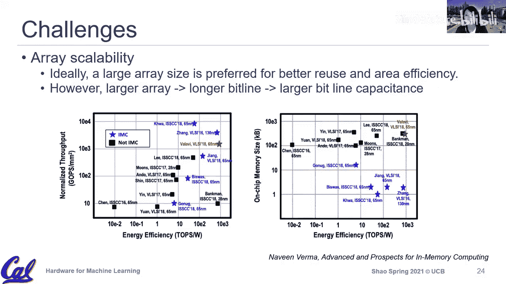

# 【加州大学伯克利】机器学习硬件技术课程 ｜ UC Berkeley ｜ EE 290 ｜ 2021 p19 P19 Lecture 22 Advanced Technology -BV1XfM4zKETU_p19-

recordinging。

Okay good afternoon everyone， welcome to Hard for Ma Learn and they were having our 22nd lecture almost the end of the semester。

 so great to have all of you with us throughout the journey is certainly a very fun journey for me and then learning a lot of new things and new topics throughout the semester and I hope you also get at least get some of that。

😊，So in today's lecture we are going to actually going deep。

 going down the stack a bit more and thinking about some of the opportunities people are leveraging with more advanced technologies for deep learning hardware。

 there has been actually a lot of exciting news in the startup space。

 actually when we think about deep learning hardware the recent recently， I think Sam Barnovava。

 we have a guest lecture a couple weeks ago， Sam Barnovava just announced their seriesD funding and I think they're evaluated six billion for something this time and the G I saw earlier today。

 another startup， also in the deep learning space， some of the team members actually like Cliff also mentioned a couple the G members。

 some of the team members actually from the Google's original TPU team。

 that's also a startup in the deep learning space， they also announced a recent a new series of funding。

So a lot of exciting startups actually in the deep learning space and one of the very interesting one also get a lot of courage and publicity in the past couple years is a ceus we also briefly talk about ceabus actually earlier this semester where this is actually really both interesting and very impressive in terms of startup in the space again using deep learning as a driving application those folks actually were able to make as what we have here the world largest chip so instead of actually dies break the wafers into smaller smaller dyes and fabric individual dyes So those folks actually build the first wafer scale processor again with deep learning as a driving application but it's very impressive So if you look at the picture here。

 this is basically almost as big as as a mouse pad here so。

Very impressive and deliver a lot of functionalities and input and also support a lot of un chip storage to avoid we mentioned that data movement is always one of the most challenging thing for accelerator design so they are able to actually have a lot of unche storage they were announced I think a couple years ago maybe 2019 if I remember if I remember correctly。

 and then they start shipping and some of their either the first generation or the second generation has actually been deployed in some of the national labs so a lot of actually continued interest and activities actually in this space and because machine learning we mentioned not only this company will see a couple actually analog computing company for machine learning in today's lecture and also mentioned a few of the digital and more architect oriented startups actually in this space because of this huge demand。

With machine learning， of course we can also see there are definitely some hype in a lot of those discussions。

 but the foundation is there is still a lot of demand to actually make the machine learning hardware faster and more efficient and all those demand not only translate to research activities but also translate to some of the startup and the commercialization activities and we see a lot of interesting angles either old or new ideas。

 some of ideas that we know already but because this driving application can actually attract so much talent and also so much investment we are actually seeing a lot of those ideas actually turn into hardware these days so it's again it's a really exciting time we already mentioned it's a very crowded space already but with that even considered we see a lot of exciting new technologies and。

Opportunities from those startups so keep an eye on those on those startups and a lot of time the exciting opportunities not only from big companies。

 but also it's very possible from foreign startups and maybe some of you will actually start some of those interesting endeavors in your in your career so exciting time and in today's discussion we will have talk about quite a lot of different ways of making machine learning faster or more efficient today we are going to focus on a more target targeted space and really leveraging the underlying circuit technology circuit or even device technologies to make things faster。

With that yeah， just a quick review so far， our discussion are mostly focused on the digital space since most of the architecture system today is actually in the digital space and whenever never think about digital hardware。

 while we need to think about what are the parametersitives， what are the building blocks。

 what are the optimizations and what are the software stack a lot of the discussion is still can still be translated into the analog space and and I mentioned that even for some of the analog startups that I talk to these days they have enough hardware designers。

 they are actually looking for folks who or even hardware designers actually understand the system and the software stack so that their hardware can be used So a lot of discussions are most can still be actually translated in the analog space。

 but the fundamental is actually what what what a Mac unit looks like and how we do actually computation in。

In an analog or in a Mexico way， so those will be the focus。

 but a lot of the discussion that we have seeing so far。

 these data reuse and also mapping and also primitives in deep learning those actually are still the same those principles still stay but what actually different is actually the underlying technology to execute certain functions。

So with that will just do a quick overview and we'll be focusing on a very specific category of computation here for machine learning specifically in memory computing。

 we'll talk about three commonly used technologies these days that both in the commercial space also in the research space where folks trying to leverage those technologies and to embed some of the computation there。

 but the general goal or goal is actually similar across all of those and we'll see in a minute but the general goal is basically try to bring data close to the compute as much as possible so that we can have we can deliver again。

 efficiency is very important so we can deliver efficient computation in the end。

So as I mentioned earlier， right， so one of the most important principles in even in our discussion in our earlier lecture is actually about data movement。

 right even in the digital space， we talk about data flow。

 a lot of data flow optimization is trying to reduce the data movement cost and we also talk about in more architecture discussion how we actually understand the different tradeoff and complexities of the push versus pool model。

 we think about the ring。This is still true， right。

 no matter what kind of technology that we're assuming in general。

Energy is is very dominated in by data movement and especially for this kind of data intensive operations and a lot of time the end goal to actually optimize any kind of compute substrate to make it to be more efficient is to move data as close to as close to our processor as possible to actually reduce the data movement and especially when we think about we also talk about contaminatation and a low precision computation and hardware right when the precision actually gets lower the compute actually gets a lot cheaper and the machine learning is also very interesting application。

 where we can actually use low precision to do a lot computation。

 which is also a very important factor， why people are thinking about analog computing in general is because the low precision is actually become a viable option but besides even that when the precision is actually low。

 the compute energy is actually。Also significantly lower that could actually make the memory cost even more pronounced because we're actually spending even more higher percentage of our energy with with data movement so overall the fundamental problem in general for not only for analog computing but also for digital computing whether we can actually reduce the data movement。

So what are the solutions so we have talked about the in the digital space or in the system space a lot of architecture。

 one of the most important architecture principles is actually locality right so how we can actually leverage locality to reduce data movement and in this context ho learning again we have a very straightforward very straightforward architecture right we have those like the pyramid style architecture like bigger D in the end and then smaller register on top and then by leveraging the data reuse and data locality we can actually fetch。

Like the frequently used data actually are closer to our compute and in particular for deploying you we talk about two type of reuse。

 temporal use， if a piece of data is actually used。

 it will be used again in the near future or spatial reuse。

 we talk about the broadcast network right trying to broadcast。

The data as much as possible we'll see in a minute those two types of reuse still exist so a lot of discussions in analog computing in memory computing the discussion we have so far is still there。

 but actually just in the with a different math design。

So what do we typically see you may hear this term a lot like processing in memory this is not a new idea again。

 like in general the perceived to actually putting compute as closed as possible to memory has never stopped in the past five or six decades the idea of processing in memory generations of engineers have actually tried really hard to make it make it feasible overall it hasn't been adapted we'll talk about some of the more fundamental technology reasons later scalability nonideity。

 all those reasons and a big part is that for general purpose computing precision is typically very important we don't see a lot of low precision hardware in general for general purpose computing but and also the programmability support all the different control flow and how we actually take advantage of data weuse。

So much diversity in applications it's really hard to actually make a case or pM。In general。

 but DNAA is a very interesting and also exciting example for hardware designers because so powerful it can solve a lot of problems and also not necessarily simple but so regular。

 a lot of the regularities actually make maybe some of the ideas that were not possible before for general purpose workloads become feasible for the learning because it's actually fairly regular we can leverage a lot of the deterministic behavior and also very air tolerancele。

 a lot of the challenge with actually。Processing in memory become less of the challenge in general for the end and these days。

 so that's why people startit revisiting those ideas to see whether we can actually leverage those ideas for deep learning computation。

So in general， the idea is fairly straightforward again we mentioned right we just want to try to try to bring compute as close to data as possible right so instead of like what we have typically we mentioned like we have memory hierarchy。

 we read data from buffers right either input activation buffer and then weight buffer。

And then do a compute and then store the partial sum right we have been talking about this template for a while。

 and now we actually get to the typical with processing in memory in some actually fairly similar to like our view of like waste stationary data flow you draw that analogy。

 So instead of actually fetching a data from both input and weights and bring those data to somewhere somewhere where the compute is done will just bring input fetch input to the weight buffer。

 And then the compute is actually done inside the weight buffer there。

 And then we get the accumulated result from from the memory。

 So here the memory is not only used to store the weight。 So that's why we say oh。

 this is actually similar to the waste stationary data flow。

 but the memory is also used to actually compute the result。

And typically this computation is actually done in an analog fashion we'll see some of the examples in a minute。

 but for any kind of process in inmeate technology for data you will see some kind of system or architectural diagram like this basically we store weight and the ways always stay there so there's also another question we'll see in a minute the scalability how much weight we can store how many application this can realistically。

Support but typically we we distribute weights here and then read the input activation and then if this computation is actually done in the analog fashion。

 we'll see a little bit have a little bit more details how this is actually done then we typically need to do digital to analog conversion for the input activation and then analog to digital conversion for the partial sum that's actually being accumulated and some of the research。

 more recent research also looking to realistically to actually get reasonable accuracy。

 what is the process needed for the deck and ADC part so that we can actually get reasonable accuracy for this kind of computing so in general again。

 at a very high level we we'll talk about different technologies to actually support that but it will always see some of the memory substrate that is used not only to store the data。

 but also to compute the data and also digital to analog conversion analog to digital conversion so most so the rest of the system。

Are still in digital most of the time， again， still in the digital space。

 but specifically is a part of actually being done。

In the analog space is actually the Mac and accumulation multiping accumulation part。

 which turn out to be actually fairly feasible to be done in the analog fashion So this is a general template to think about processing in memory especially in the analog fashion we'll see which is most of the case。

 I think whenever people do processing in memory this is actually done in the analog fashion。

 we'll see a couple examples how this is actually being done and and also why it is feasible and what are the challenges there。

 we'll have a guest lecture have more details later we'll have guest lecture next Monday。

 Brian Zimmer from the media he will share more his perspective again。

 there are opportunities well talk about some of those opportunities today。

 but also a lot of challenges associated with this type of processing we'll also see more in his discussion。

So a little bit more details if we zoom in to to this diagram here， we talk about okay。

 so input we still need to read the input memory， input activation memory。

 but what's actually what doesn't need to be moved is the weight right because the weight actually stay in memory and we actually do the computation also in memory so we don't need to actually move weight anymore but when input is actually moved。

 we talk about this part， we actually need to do the digital to analog conversion to actually convert the digital input to analog。

 but also we actually have a similar like we mentioned a spatial reuse the broadcast mechanism。

 we actually still have a similar broadcast mechanism again to leverage the reuse for input activation right across the columns to actually reuse the input activation。

And specifically basically through the wordline here and the accumulation we'll talk about how multiplication is done that technology dependent。

 but typically the accumulation is done is through actually bit and through basically we're adding current together based on the multiplied result and then the current actually being accumulated so instead of doing addition in the digital space where're exactly doing the addition in the analog space we're actually accumulating current on our bit and then the final current is actually being converted through the ADC well if we have through the ADC back to the partial sum and that will be used and after conversion tru it will be used for output activation So again the fundamental is the same we still leverage some of the reuse we'll talk about how multiply is done for accumulation most of the time we basically used。

In current edition through our bitline so that we can start acculating so another very important factor is what's a precision or accuracy that actually supported in our bit accumulation we talk about accumulation actually have a higher accuracy requirement even for like the low precision arithmetics we still have a decent accuracy requirement we actually combining both weights and inputs together so that's also one of the challenges in a lot of this kind of processing。

In memory proposal is actually related to accuracy and complexity of the dark and ADC design。

But again， most of the focus， even for those like startup proposals or research ideas is how we actually do this matchsh。

 but specifically multiply and accumulate in the analog space。

 but most of those designs still have like the rest of the computation and even for example other residual addition。

 other operators putting like all those still need to be done in most cases actually still in the digital space。

 we never appear analog computing hardware there's still some of the analog components and some of the digital components and for most of the the design that we have seen so far。

 the analog components only showed up for the Mac part。

So that's what some general patterns in the deep learning for DNA again。

 we talk about those already still input activation after the conversion delivereds through the word line and weight is actually stored in the storage elements and accumulation output partial sum is actually accumulated in our head。

 so those are the general we still use the same color here， so those are the general principle。

So before we talk about the specific technology， so this is some of you may have already seen that we use this way to actually categorize different memory types actually in in our digital logic class last semester so in general there are different ways actually building memory we just say earlier there is a memory array right we bring data bring compute to that memory array right but there is also different technologies that can be used depends on what is the size of the capacity of the memory the requirement of the memory and we could actually use different ways of building the memory here so there are different memory types and the specifically a lot of。

The discussion for processing in memory is related to memory that's for random accessors and in particular either non volatileat memory some of the commercial flashes available already some of the commercial startups in actually doing in memory processing with nonvol memory actually actually in this involved memory space we also talk about some of the most research work'm trying to think about whether there's startups in this space we definitely see a lot of startup actually using the flash based nonvolat memory for DNA processing will talk。

Well I'll mention when in our discussion， we'll also talk about some of the maybe more on the research side。

 those technologies actually using either SRM or DM based technology to actually support in memory computing in a minute。

Okay， so that's a quick overview next， as I mentioned mentioned earlier。

 we'll use the three driving examples to talk about how either non volatile memory or SRA or even D can actually be used for in memory a computing So before we move on any questions。

 comments or things that you want to share。Yeah。Okay， so this part。

 have you seen any other branches in that ray type tree。

Gett used like particularly forsake of these ML accelerators。

 anything in the serial or cam kind of right half of the slide。Yeah。

 that's a really good question then I was also trying to think about that while I was going through the tree。

 I think in general the zero access is too limited for for machine learning。

 but even it is regular that we mentioned earlier， but we cannot actually completely using using those structures to actually support all the addressing patterns those addressing patterns still very complex we still need some of the flexibility there so I haven't actually seen any serial access like five folds that are completely rely on fivefls to do to do in memory process I'm trying to think about whether there are some can based。

I don't。I don't have anything actually on top of my mind。

 but I can see people actually using because there is also a lot of research in using like this kind of lookup lookup table based method。

 because especially when the precision is actually extremely low。

 and then they're actually and then people basically say with the low precision is not only we don't need a lot of base to represent。

 especially weight， it's also there are just those like a few。

 a small number of ways are actually commonly used。

 the rest of weight are actually not very commonly used， again， based on their observation。

 So then therere actually building again， more individual space actually building like lookup table based hardware。

 just like instead with multiplication， just a system。

 theyre like seven or different seven different ways are commonly used。

 And then whenever there's the input， it's actually just map to one of the one of those patterns。

 So I see that。kindind of hardware being used again in the digital space。

 so I suspect there there might also be some ca based actually deep learning hardware available。

 I don't have a particular pointer， but I would be surprised if there's no one just given even some of the research actually in the digital space。

 but most of the discussions and also research and also I guess commercialization activities that I've seen so far is mostly in either SM or a flash there's some discussions with D but again also those three are the most popular one that I've seen I think there should be some CA based I can double check but Ill be surprised if there's the ca based there's a lot of opportunities there but the ship register and Firefold completely rely on shift register and fivefold just too limited with memory access patterns。

Good question， any other thoughts Matthew you are thinking？Okay。

While you have anything do you want to share or ask。

 feel free to just ask directly or use the chat box。Okay， so in memory computing。

 we'll start on the novel on memory there actually。

There are some startups actually in this space trying to use the technology and they have hardware available well mention one and some of their technologies。

 but before that， we'll just briefly talk about some of the like like I think we cover SRM in the DM。

 also for folks who have taken1 51 or 251 day we cover SM and DM。

 but maybe actually not too much with flash we'll talk about。

Flash a little bit more and how and why they this is actually chosen。

To do to be used for in memory computing here。The flash transistor just have a very high level overview and also build a connection why this can be used for especially performing the Mac part。

 but the key concept is actually fairly similar to the most fast transistor that we have seen so far。

 but one new thing here is is instead instead of actually attaching the gate directly。

 there is actually a new floating gate here。 So this floating gate， this floating this。

It's blue is light blue color here， this floating gate， you can basically think of this as a charge。

 as we mentioned here， the charge storage layer， we can actually store additional charge here and by having additional charge here。

 what it really does from the functionality point of view。

 is actually this can be potentially used to change the threshold of the transistor。

 So we talk about the behaviors our transistor right again at a very。

 very high level if it's above threshold and the transistor is on the switch is on in our switch with our switch model is actually below the threshold is actually off for most of the time。

 we typically have a very fixed whenever there is break transistor。

 the threshold is fixed right with flush transistor。

 especially with this floating gate we could actually program this the muscle charge actually in this floating gate to change to change the threshold voltage and that's become actually programmable way。

😊，of actually changing the transistor behavior we'll focus on most our discussion on the what people call single cell flush transistor is basically either storing zero or storing one。

 but there's also single bit there's also multi bit flush cell available these days so it's basically by modulating the amount of charges actually stored in the floating gate it's not only zero or one we actually can store multi bit information up to two bit or even sometimes in four bit。

 but again by changing modulating the amount of charges actually stored stored there so how does this actually change the transistor behaviors here。

So in general， like we mentioned earlier， for flash transistors。

 we actually use the folding gate that actually changing the threshold of our cell right so to actually and if we actually don't have any folding charges here it's actually a on state if we actually have the connectinging charges here it's off state So you may wondering actually how do we tell right how do we tell is actually storing a one or storing and zero So you mentioned that the differences here is that it actually change the threshold voltage of our our transistor so it actually either with charges or without charges。

 we actually have different voltage current characteristics so specifically if we have like charges here in our transistor have if we don't have charges that do the one on the left first if we don't have charges or transistor is not we actually have a relatively low threshold voltage compared to if we actually have charges。

Just intuitively， if theres already flow made already have charges。

 you actually actually need to try harder our get voltage need to be even higher actually to surpass the voltage here right so we actually need a higher threshold voltage for for the off case for for the orange case so now we actually have two different voltage current characteristics here so we have a low threshold voltage here and we have a high threshold voltage here so low threshold voltage is basically the on state is actually so then we know it's actually storing a one and the highest threshold voltage case is actually a off state which is actually storing a zero。

So to tell whether it's actually storing a1 or0， we basically apply a voltage that is actually in between between the own threshold voltage and off threshold voltage。

 and then by applying that we can see whether our transistor is on and off right if by applying this voltage our we actually says current in our transistors。

 it means that the transistor is actually on right if transistor is on this point。

 it has to actually use this it doesnt it' actually storing a one。

 So it doesn't have actual charges in our floating gate， but if actually when we apply this voltage。

 the transistor is off this is actually in the off state。

 we have a higher threshold So we are actually storing a0。

 So this is basically how we tell our flush cell， whether it's actually storing one or0 So this kind of technology is actually already available and the commercialized or we use this mostly for or。

device but then because it can we can actually storeor in10 and also mentioned there instead maybe just like those two voltage threshold voltage。

 we could also have like more here more by having different amount of charges we could actually have different behavior here so instead of just a single bit we could also do000。

1，10 and11 to have actually multi bit cell and then we can actually even have higher。Higher。

 higher precision there。 So there is some trade off there。 this technology is already available。

 And then by using this， people have actually ideas trying to actually not only using this as a storage device。

 the case that we mentioned， like see whether it's actually storing one or0。

 but also apply this as a compute device to actually do the do the Mac and in particular。

 also the accumulation function there。So we'll skip this。For now but in general。

 so how we actually use a flash cell to actually do the multiply and accumulate function here。

 So this is actually from one of the slide deck from Myic and Mysic is one of the companies that I mentioned earlier is also a startup company and they are also building interesting technologies actually using this flash based non volatile memory to do deep learning。

 we'll talk a little bit more about their particular setup later。

 but their fundamental idea and is basically using the flash based cell to do the multiply and accumulate function。

So the way they do multiply is basically using like each the flush cell that we mentioned earlier and to apply by apply the gate current there we can either and again depends on the value actually stored in each other cell。

 whether it's a one or zero there right so this can be the weight that we mentioned earlier right so the weight is actually programmed into each the individual cell to say whether it's a one or zero or it's a multi multi multib cell。

 we can also have more precision。So the weight is actually you program in the cell and then the input activation is actually applied as a wordline voltage here so as a gate voltage to each of the cell and then by applying the voltage and then depends on the whether the weight is actually1 or zero we may have current or not right and then so that's how we actually do individual multiplication that we can actually either induce current or no current from each individual cell and then for accumulation。

 we basically add all the current together throughout our bit line so and we mentioned earlier so individual cell would be different。

 that's how we do multiplication a little bit differently。

 but accumulation is always done by actually just adding all the different current from individual cell directly so we can actually accumulate which is the same way as the way we accumulate now necessarily the same but the same idea that we accumulate。

Partial sum when we do this computation in the digital。Space， so that's basically again。

 we talk about a lot of the some of the technology seem fancy。

 but fundamentally they're doing the multiply and accumulate accumulate typically is done through the bit line accumulation and multiplication depend on technology for flush cell is basically weight stored in the folding gate and then by actually by applying the charges by input charges to the word line to see whether we can turn on the cell or not to actually perform either multiply by one or multiply by zero。

So this is basically the way a message is actually trying to do so their idea is basically by using this kind of non volatile flush based nonvolile memory。

 they can actually get reason get actually high performance and also low power consumption。

 especially they can actually skip a lot of the data movement energy for the weights input still need to be moved we still need to read and input activation but we can actually store store the weights directly and the precision is typically at least a lot of time I look at it they're still focusing on the inference。

 I don't know whether they have a training story they are fairly good at extremely low precision I mentioned earlier when you get to high precision things get a little bit healthier whether you have that actually visibility there and whether you're actually air tolerance enough when you get to actually higher precision want to actually store multiple values actually in a single cell。

Fors in a single cell， air can also actually go up much higher。

So they seem pretty fairlycomp with accuracy and also they deliver reasonable 。

5 picks per Mac is reasonable， some of today's future hardware can also achieve that this is a reasonable through efficiency number for the in memory computing here。

So that's specifically how me works again the technology is actually fairly straightforward but a lot of details actually need to be considered and the core is actually still doing the matrix multiplication part in matrix multiplication where multiplication is actually done with a folding data and accumulation is actually done with the bit line accumulation。

 we'll talk a little bit the general challenges with scalability and precision but。

This is one of the actually commercial effort in this space and they have been actually delivering interesting product to actually support this type of computation。

So then we asking so the weights are stored in the flush bits they correct， Yes， so that's okay。

 And if so charging them is presumably pretty low。 And yes， that's a good question。 So in general。

 for a lot of those hardware， they are assuming were not actually rewrite updating or rewriting the weights。

 So so that's why scalability is very important for we basically need to layout or basically configure our hardware so that all the weights can actually store onto the hardware so that we don't actually need to overwrite our weights during runtime because that's always a very like writing is always changing the weights is always the expensive part with that instead of the reusing that we talk about in the digital space right refetch the weights and restore in our register。

 we basically need to duplicate。We need to have a large enough array so that we can store all the weight for this network。

On trip I don't have that they have another illustration where their trip is also fairly large and what they do is actually the partition。

Different parts of the chips for different layers for different weights。

 so the weights actually flattened actually onto the different components there so that you in most of the cases。

 at least for the target scenarios， we actually don't need to rewrite the weight there。

So if there's 10 layers， this thing is kind of multiply accumulating。

All of them at the same time and nine of them just getting ignored is the mental model then。

Not necessary。 if there is if there are 10 layers， but you we can actually pipeline it， like。

 for example， we are processing the like the tense image in the first layer。

 but processing the first。 So last trick the pipeline matrix trick。

 we can still do that like the one we do Also like a simple No talk also mentioned the same tricks there。

 So that's still the case。 most of the time is that even for a single layer。

 you basically need to lay out all your weights ontoto yourself there。Thanks。So yeah。

 so that's Brian Brian Zimmer may actually cover more next time some of the challenges。

 but that's definitely true， but again， as we mentioned。

 even some of the digital hardware want to only aim to actually get high entrepreneur memory size and also high scalability will also have those issues Some issues are address like the pipeline we we can use the same tricks there。

 but here is that even for one there we program once and it's just stay there very rarely we change that a lot of the message use cases。

 at least when we some of the talk that we have seen before they are actually targeting those kind of security camera there and doing like visual like human identification there so in that scenario it's fair to assume that you have a fixed network and maybe the network even not very complex and then you just fix your network onto the hardware and never change it。

Right， so we talk about some like Dan already mentioned like programming this is actually both the latency part it's going to be very slow and for a lot of those multi memory there's also endurance part and also so far we have assumed that actually the size of weight actually can fit with the total memory and there's also whatever if you're handling a huge model that you can actually not fit there a lot of those well typically this target model network or they have a like decent amount of hardware for that but changing the weights is always challenging here。

Can then we'll already talk about the the precision there。 There's also the precision issues。

 How many bits can be realistically stored without actually have high error rates hurt the accuracy。

 on the option that actually like available， non mema。

 So that's some of those hardware companies are actually hardwarere actually using that。

 There's also a lot of other technologies available。 So you will actually see more research work。

 a lot of research publications actually using this kind of non emerging like。

Emerging nonvolat memory devices to support this they still have the same problem programming changing the weights is actually really challenging like whether they can。

 how many times they can actually change it and how fast it's going to be and also the precision problem that we always we mentioned earlier it might be fine for the like security camera case that I mentioned the message is targeting but for other scenarios how this can be generalizable。

But the other side might be the security camera case。

 like the tiny ML right there is a particular the model is indeed actually fairly small from the tiny ML talk and it is a big enough market to actually cover some of the。

Some of the NreE cost with the hardware。So I already mentioned on the logistics side。

 we have our final guest speaker， Brian Zimmer from NVDdia， I'm looking forward to his talk， yes。

 thinking about this general opportunities and problems with analog and memory computing。

 I think we focus more on on opportunity sites， why it is feasible in most our discussion。

 Brian will give us more perspective in terms of the challenges adoption。

 actually in adopting those kinds of technology。😊，A little bit more on project front Checkpoint one is done good job everyone。

 most of you seem to be on track and making very good progress a couple of the teams may need to either change their direction or really think about what's feasible we're looking forward to checkpoint two to actually see the progress so far similar to checkpoint1 we have sign up spreadhe here it's the same link so if you know it' just a different tab and the same slot so still the Tuesday and the Thursday slot there so feel free to pick your slot so that we can get another chance to talk to you even up in person and and similarly also two or three slides showing your current progress there's no particular format but definitely this time we're looking for more competitive results I think last time it's mostly just what you're trying to do。

 what the infrastructure that you have。That what is the overall diagram that was more focused by this time we're looking for and some some of you already actually presented some of the evaluations so great job there。

 but for checkpoint two this is really your opportunity to。

Get at least very close to your deliverables and some of the quantitative results and evaluation that will be that component of your project。

Any questions or comments either with the project or with。

When we talk about the normal memory challenges。Okay， well there's any question， feel free to。

 especially with project， also use PazA to communicate with the teaching staff and we're looking forward to seeing you all next week for TurnPoint2。

So we talk about novel memory and memory site， next we're going to talk briefly about SM and if you have time we can get the DM part。

So again， the fundamental is similar， we're still modulating the word line and bit line here。

 just a quick recap of the 60 SM cell that we mentioned we discussed that you have seen in your digital logic class。

 so wordline is actually to pick which cell that we want to either read and right。

 and data is actually written or red differentially through the bit line and bit line bar pair with our six TSM design。

So in general， this is actually has more similarities than differences。

 actually from what we discussed with flash based non volatile memory in memory computing here。

 so it still the bit line actually used for accs we're still accumulating through our bit both bit line and bit line bar right and whether it's actually bit line or bit line bar depends on actually the value that were storing。

For example， if we are actually storing negative one here。

 so negative one is actually represented using actually as a one here。

 so as a one here we'll talk a little bit more about the challenges with sign numbers。

So negative one is actually represented as a one here。

 so as one if we have a one stored in the lower left transistors。

 we are actually discharging our bit line here so we is a negative one we're discharging our bit line。

 but if we are actually storing positive one， we are actually discharging our bit line bit line bar here and then by comparing by by comparing bit line bit line bar we are actually that's how we actually get the final accumulation。

Here， so again， it's actually more similarities， as I mentioned。

 the accumulation is still done with the bit line and we use the word line to actually select which cell to enable and then by depends on the different value actually being stored。

 this is the weight it's actually being stored in our cell and the input is treated as enable signal in our word line and then we accumulating partial cell accumulationcc is actually done with build line here。

So this is Sm based accumulation。 We have seen a lot of both， a lot of research。

 I would say more research in this， in this space trying to again get this feasible。

 theres some fundamental challenges here。 That's pretty fundamental to SM design。

 different aside from the what we talk about the precision issues。 We mentioned earlier。

 But S is a lot easier to write compared to flush。 So we we definitely don't have that issue there。

 but compared to the。the precision still there but another challenge here is actually the scalability and I will talk about a lot of we mentioned asR design right it need to actually typically we want to have a decent size SRs that we have enough enough density。

 enough area here for more reuse but in general with a larger array。

 it basically have a wider or wider or more has a wider and also longer dimensions there and with a longer bit line we actually have a higher actually a bit line capacitance here and a lot of charging discharging that we discussed before is actually basically a charge redistribution with the capacitance of the individual individual cell and the capacitance of the bit line here and we're basically doing charge and discharge charge redistribution based on the capacitance of each individual cell and also。

そ thatたけ。If we have a super long bit line， basically have a large array will basically have a high bit line capacitance that will make this actually the voltage difference with charging a discharging individual cell actually very hard to tell because we are basically do we discharge redistribution right we have a big bit line capacitance with a large sm cell。

 it's actually very hard to sense how it' actually how the charge is actually redistributed for individual for individual cell。

 So there is also this kind of air tolerance。 Eventually basically we're not actually observing all the accumulations actually happening in our cell。

 So with that typically for most of the design that have seen so far。 Again。

 most in the research space。 They typically very small。

 are like when you look at any kind of this kind of sbased accumulation， they typically very small。

 the natural question ask is actually how big can this go right but because we cannot keep。

Building like kilobytes era， we need to actually go bigger。

 but once we go bigger and then there's this uncharged distribution problem。And right。

 so I actually find from Novin Burma， this is actually very very interesting and very thorough。

 actually comparison of different technologies and of course we see very good efficiencies with in memory computing the blue here but once we come to scalability a lot of those actually on the lower end and remember this is actually a lot of scale so typically they are looking at actually to get reasonable performance and accuracy we typically look at actually this smaller like either single digits or tens of kilobytes at most。

 but for other digital designs we typically look at much larger even tens or hundreds of kilobytes as actually very standards when we think about a lot of at least digital accelerator design。

 so the array scalability is one of the biggest challenges with as- based design。

So we are a little bit out of time we'll just pass here。

 we'll see what Brian would cover with his guest structure we may also talk a little bit more about the DM based design that's actually even less popular I would say the most popular ones is actually either the non of the memory based or the SM based those are the two of the most commonly use the designs We most talk about why it works and they may feel like it's actually fairly intuitive it's actually fairly straightforward but we'll also see some of the challenges and more specific challenges in Brian's case structure。

So with that， we're going to end here。 Great to see you all。

 Hope you enjoy the rest of the week and we'll see you again next week。 Take care， bye。😊。

