# 【加州大学伯克利】机器学习硬件技术课程 ｜ UC Berkeley ｜ EE 290 ｜ 2021 p20 P20 Lecture 23 Brian Zimmer, NVIDIA, Problems facing analog and in-memory comput -BV1XfM4zKETU_p20-

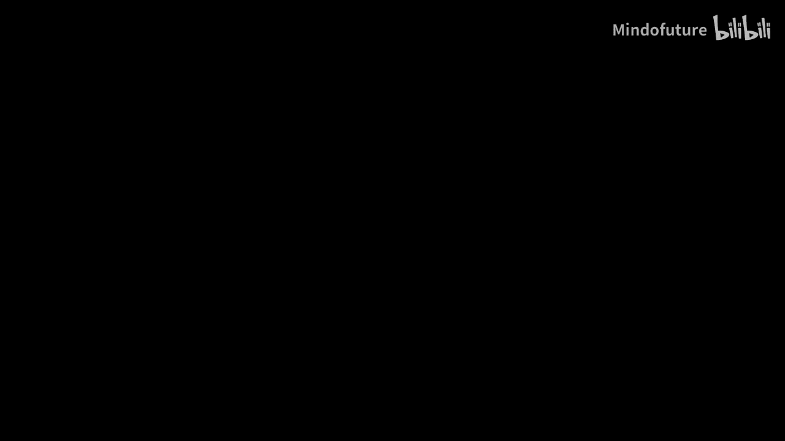

Okay good afternoon everyone， welcomele to E2 902 hardware for machine learning Today we're having another really interesting and exciting guest lecture from Brian Zimmer from Nvidia who will actually share us some of his view about hardware for machine learning。

 especially from analog and in memorym computing point of view so Brian is actually also a Berkeley along。

 he did his MS and PhD degree here at Berkeley and he worked with many faculties and students here so it's great to have Brian Beck even virtually and I also worked with Brian when I was at NVdia for a few years and I was really impressed with both the breast and the depth of Brian's experiences he can actually go into the circular level details very specifically at the same time he also have a really good understanding of the high level challenges and also opportunities so with that it's really great to have Brian being here and share with us。

😊。

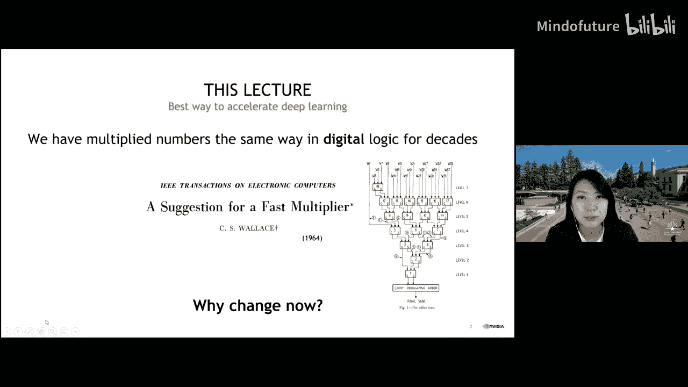

Experience and his insight in thinking about problems facing analog and in memory computing so with that Brian feel free to take it away thanks thanks for introduction。

So I only have 40 slides or so， so I expect to get interrupted and hopefully have some discussions。

 so please feel free to speak up whenever。

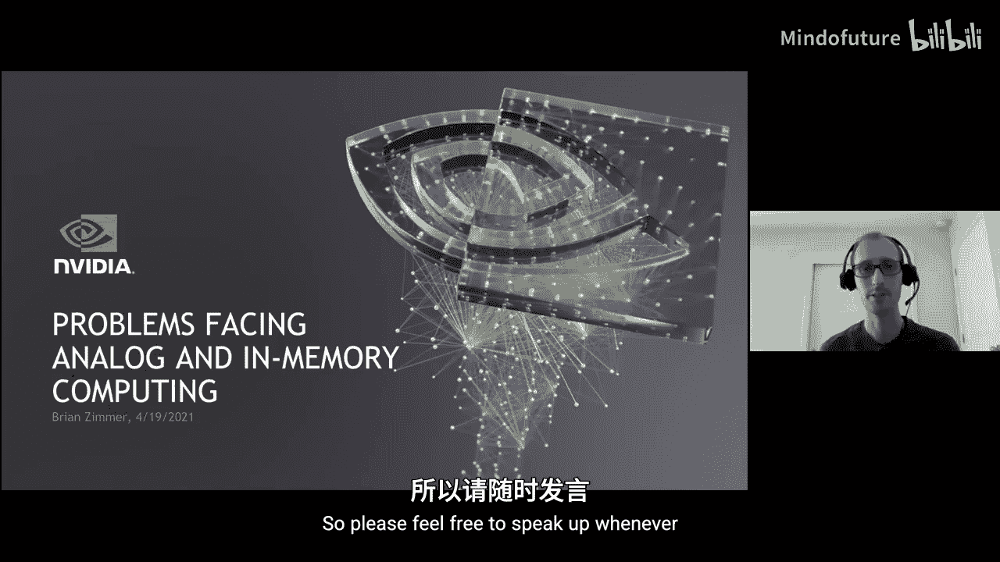

So just to frame kind of the motivation for talking about this subject。

The question I'm trying to answer is what's the best way to accelerate deep learning and this is something that N videodia cares about a lot and there's been a lot of research in this space because a lot of the new exciting applications revolve around deep learning。

But kind of at the bottom level what deep learning is doing is it's still just doing a lot of multiply and adding and we've been adding or multiplying numbers the same way in digital logic for decades so this is just the screenshot of a paper from 1964 and kind of this Wallry adder this hasn't changed at all and so the question is what have we missed in the many。

 many decades since we started doing this or what's changed or why do we need to approach this problem in a new way now。

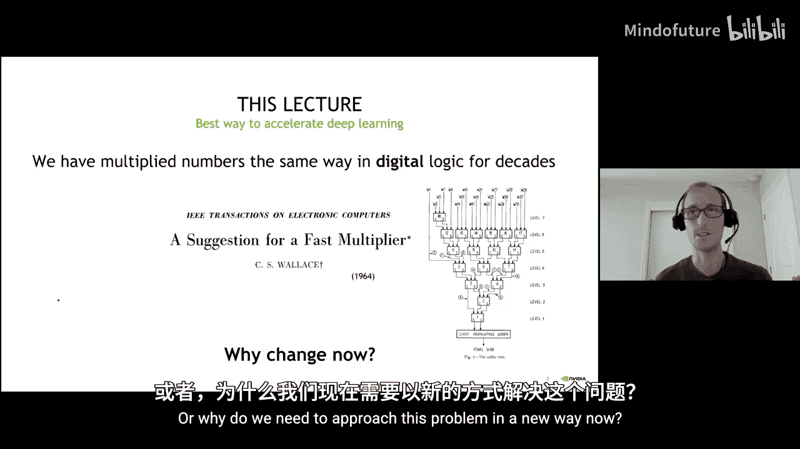

So I'll start by kind of defining what I think the problem is and just listing some assumptions so we're on the same page about。

What we're discussing and then I've kind of summarized everything into what I call seven problems and so you can think of these as research themes or research problems that face the field and most of the publications going on these days。

 they'll probably target one or two of these， but of course kind of all seven of these problems needs to be solved or avoid in one way or the other for the entire system to be efficient。

And then I'll conclude with just some high level thoughts about where I think the field is going and what some of the opportunities are。

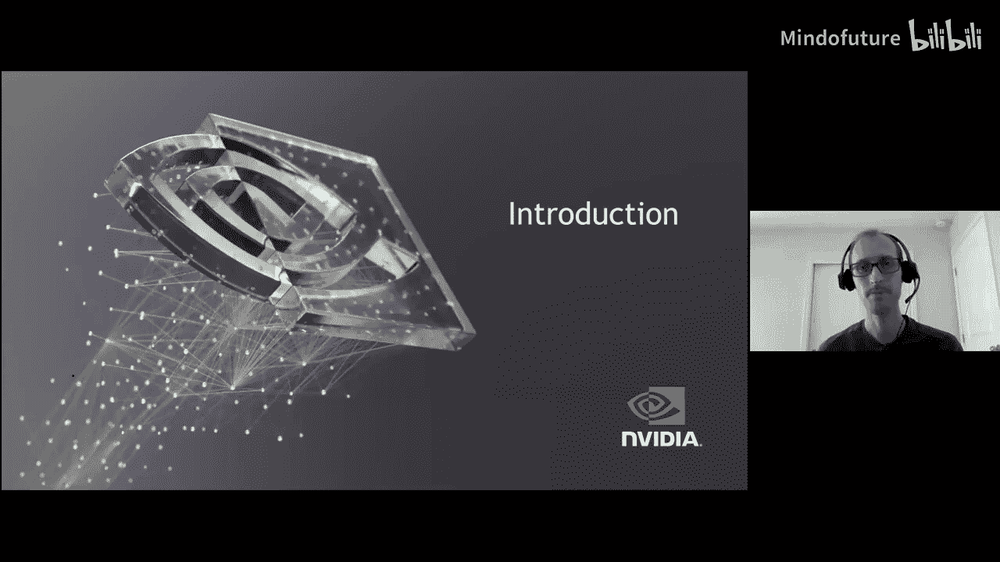

Okay， so i'm not sure I should have looked at the syabus to see exactly what got covered so far。

 but just to summarize kind of my view of what I mean what I mean by digital versus analog so the system on the left is。

Kind of a digital way of doing a convolution or any matrix multiplication so you have an input SRAM that stores your input and then a weight SRAM and you read both of those and do element wise multiplication and then add and then you have some answer that you store in an output SRAM and of course when you build a whole system。

 the dimension is going to be different， you need to move data around the loops are going to be different but in general this is kind of what's happening。

 it's analogous to a CPU kind of reading two elements from a register file。

 multiplying them with ALU， maybe reading a third adding it and writing it out so you can describe something like this with assembly code but when you're trying to make things really efficient then you wouldn't necessarily use something like a CPU you might kind of hardwire and accelerator that's specifically intended to do operations like this。

And so。Inside this vector Mac this has all your normal multipliers that are built out of standard cells。

 so you have full ladderers， half adders and gates。

 and either the synthesis tools do a pretty good job building optimized paths to meet your cycle time。

But in general， like you could describe a very easy version of this digital Mac with kind of 100 lines of RTL and verlo and the synthesis tools were did a decent job instantiating the SRAMs for you。

 building all of the math data paths and doing a pretty optimal solution。So。Moving to analog。

 the question is， well， can we do something more efficiently than digital。

 So there are a lot of inefficiencies in digital， So these SphraM reads than cells are fairly expensive because inside each of these SraMs the value might be stored in a small cell。

 but the cell is connected to a really long bit line。

 So there's a lot of capacitance on that bit line。That you need to charge and discharge every time you read it。

And then the vector Mac itself， if you're doing math then you actually have many。

 many gates forming a full critical pass of 30， 40。

 50 gates in a row toggling multiple times per cycle so there's lots and lots of switching energy there。

 and then of course writing S RamMmy at the same problem as reading。

 you have a lot of capacitities you have to deal with。

So the premise of making things more efficient in analog and digital is to try to fold all this computation into the SRAM themselves so you don't have you have these big capacance on the bit lines but you actually try to use that for computation so many times you still will have an input SRAM you need to read from because moving things around the chip moving things and analog is still very difficult。

 you pretty much need to digitize anything you want to move across the chip so you still have some digital portion of the system。

But then to actually do the multiply accumulation， you use the digital to analog converter and they come up with some voltage that reads information from a bit cell。

 and this bit cell can be anything， it could be an SRAM cell， it can be an RRAM cell。

 it could be a DRAM cell， it could store one bit of information。

 it could try to store four bits of information。And then you turn on a certain number of those on a single bit line and they all either contribute charge or current。

To do the summation and then off of that you can either directly send that to an ADC to digitize it or some people also try to merge multiple bit lines in parallel and maybe weight them by different amounts so ones represents a half or quarter of the full value using ADC and then store it to the output SRM and so the hunch with analog or in memory computing is that instead of toggling a bunch of gates and the spec Mac and having to read these big capacitances on the SRM this is the summation and current domain pretty much comes for free and so if you could minimize the energy of your DAC and goingize the energy of your ADC and represent the values with little a small variation is possible then maybe you can save all this adding energy and come up with a more efficient solution。

So that's a pretty much a high level overview of kind of why we're interested in this field。

 are any questions so far？Okay， and then I'd like to spend a little bit of time talking about。😊。

In my mind kind of what the digital baseline is and it's important to have a baseline because this is really what you want to kind of compare everything to and I think one of the difficulties of this digital baseline is it's actually not very innovative right so you're not going to get publications in modern process nodes about kind of a very conventional digital system。

Just because again it's been done for 50 years so most of the kind of digital papers you'll see at the top conferences are trying to do full systems full chips。

 do something novel to you with regards to sparsity or compression but in terms of ripping off all the kind of those neat fancy features just looking at the math operation doing multiplies and ads kind of at the very depths of your circuit we actually aren't that many good numbers on that so this is work coming out of our group a couple years ago where we do publish some actual numbers I think this isn't 16 nanometers to try to share a reasonable baseline for kind of how expensive math is if you do a fairly standard but still optimized digital approach。

So the diagram on the left is just showing a convolution。

 so I'll mostly be talking about convolution。And so you have some input with dimensions H times W with C channels。

 and then you have k different weights with dimensions r times s times C。

 and you're basically taking r times s times C element wise multiplications and adding them together into a one by one by one output。

And in order to make this operation efficient。What you do is you try to use reuse as much as possible。

 both for the inputs and for the weights， so one way you do this is if you if you look at the input so that's the blue section here。

These get spread out and you you read the SRAM once， stored in flip flops。

 but then you send it to 16 in this case， 16 different k lanes。

So this activation SstrM energy is actually divided by 16。

And then that helps amortize away the activation input SRAM energy and then for the weights themselves。

 you read from the weight SRAM and then you don't just read one element。

 you read maybe 16 elements that corresponds to kind of a volume here。And if you read 16 elements。

 store them in a flop， you do a  16 element。Multplication and add and then you add partial sum to that and then store it what that will do is this final ad and output store gets amortized by a factor of 16 as well。

And so in this way， you're really taking each。Component of the math and trying to amortize it by 8 or 16。

 so it looks less expensive。And if you do something like this。

 the number that's commonly cited is tops per watt。

 which is actually just the inverse of energy efficiency。

 so one tos per watt is one over one picojoule per op。

So 10 tops per watt would be 100 vendorules per op。And if you look on the plot on the right。

 you have this whole design space where you can I showed a factor of 16。

 but you can amortize by different factors to yield different design points here as well as change critical paths and change precision so whether you're doing four bit math or8 bit math and in the end you get this big design space where you can trade off performance per unit area for energy efficiency。

Are there any questions？So Brian one of the students Amir Kaami he's wondering whether you will get into different structures of the B cell using analog computing later in your discussion I'm not going to specifically talk about that but。

We'll see a bunch along the way， are there any that are specific。

I think we while students just generally interested in terms of what kind of structures could make a reasonably good be in analog or in memory computing in general。

 okay， I'll make sure you address that。Right。So I guess to summarize kind of the promise of analog computing is that these neural networks are already pretty inherently analog。

 I mean even the highest accuracy you see numbers like 70%， 80%。

 90% that still means they're getting it wrong over 10% of the time。

 so the question is if you get a little some8 bit math wrong at the bottom is that really going to affect your overall answer。

And so maybe we can get get away without doing 100% precise math。 And so that's kind of the。

The promise of analog is that maybe we can get some efficiency out by giving up a little bit of accuracy。

And then I've also separated into in memory computing in memory analog computing I think is is pretty well defined you' you're not using digital values to do math at the bottom and memory is a little bit harder to define。

Just because in memoryory could be analog so you could call a lot of that analog computing along the bit line in memory because you're storing the weights inside there。

 but you can also do digital math in memory as well right so you can instead of turning on more than one row at a time。

 you could just turn on a single row read that value and then basically instead of having your full ladderers distributed spatially through your chip。

 you would do it temporarilyly and do kind of cycle by cycle math。

And then of course when we're talking about accelerating deep learning we're talking about a huge range of different application spaces。

 so this is just a marketing slide from NviDdia you can see that we offer products kind of all the way from these enormous this is only showing one GPU but I think the more recent version of this probably has kind of a whole data center scale computer with thousands of GPs all hooked together this is just kind of。

Within one rack。And then we have one rack and then on the edge， this is still。

And video's definition of an edge is still pretty big chip right like even something going into automotive is considered edge。

 but。People are building edge applications that are extremely low power extremely tiny that's kind of many orders of magnitude even smaller than this so in the literature we're all trying to answer the same question。

 which is how do you do things efficiently both in terms of energy and area and performance。

But the applications that actually get run at the end of the day are going to differ whether you're talking about a data center part or something on the edge。

 so I try to keep a lot of these topics pretty general because efficiency is pretty general。

 but of course there are going to be differences depending on what your actual end application is。

And then just another note。In terms of deep learning， there's inference as well as training。

Most of the research， especially for analog and memory still targeted inference。

 the main reason for this is that。All these new memory technologies are generally better at reading than at writing because they need calibration。

 you need to write them many times to make sure you wrote the right value。

 but also inference systems are easier to build。And then training generally requires higher precision。

 and a lot of the analog approaches are still kind of limited to the lower precision ranges。

 which is it's hard to get training working for。

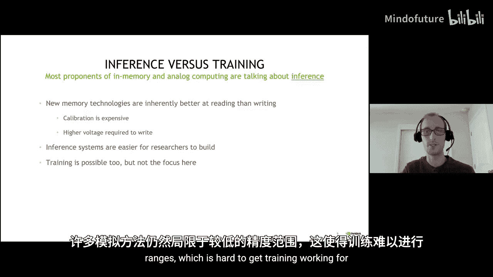

I'll pause here， were there any other questions？But if you have any questions。

 feel free to unmute yourself or leave a note in the chat window we'll also be monitoring the chat window。

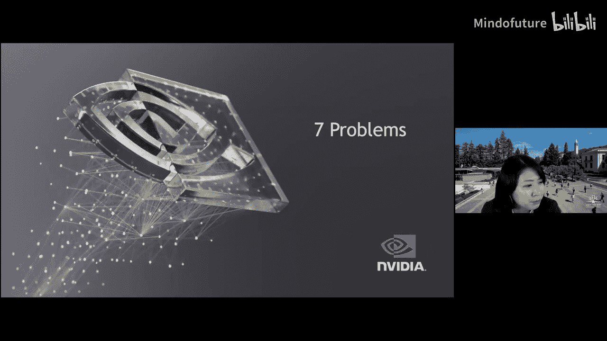

Okay。😊，So the first thing I like to talk about so I'm going to talk about seven problems some of these problems are kind of really big complicated problems and some of these problems are pretty small and I going pick a slide or two to explain so and they're really in no particular order the first one I want to discuss is area efficiency and so I guess another way of saying this is that one of the missing metrics from a lot of these publications is tops per millimeter square which is basically performance per millimeter squared of area and unfortunately this has gotten better over the last couple years more and more publications are citing their area efficiency。

And there's a couple of reasons why air efficiency is important。The most obvious is cost。

 so if you want a chip that does a certain workload at a certain latency。

 then the less di areaea you use to do that means that your part will be cheaper to build。

Also in terms of just。Physical area if you want to solve a big problem。

You can generally paraze it fairly easily on the chip and make bigger and bigger chips up until a radical limit and then you can't make a bigger chip anymore and that kind of sets the maximum size problem you can solve on that one chip and once you do that then you now have to move to multich solutions which becomes more complicated and expensive。

So in both those senses， just the forgiven workload， the amount of error you have does matter。

But thinking about in terms of different research ideas。

There's other reasons why area efficiency makes sense。

area efficiency is important thing to think about so one is that dense storage elements just tend to have more variation。

 so for example， when you're looking at like RMM cells。You can use those to store one bit。

 but people are trying to store two bits， three bits with multiple levels inside them and at some point you kind of have these overlapping distributions。

Where you're not really sure what what that you're storing anymore when you read the value and so there's some probability that you read the wrong value when you read it and the higher density you want。

 the more variation you're going to tolerate or going to have to tolerate。嗯。😊，Also SRM。

 which is kind of the basis for all the digital storage。

 has really small transistors that suffer from variation as well。And another thing to pay attention。

 so this gets to the question about different storage elements used。

 one of the things to remember is that you can separate out analog computing from in memorymory computing or just digital computing in general。

 which is whatever element you decide to store your data in。

If if you could truly store four bits of data in a really small cell。

 there's no reason you have to turn on 16 or 32 or 1000 of those at once and emerge currents to do some analog computation if you could really store four bits then you could store those four bits read them out as a digital value by turning on kind of one word line and then using your existing conventional digital approach to do the math and so it's。

Just because you have a new memory technology doesn't mean you need to fundamentally change how you approach acceleration。

 you can use it just as a digital storage， that's one thing definitely keep in mind。

So I talked about this briefly。Just to give a kind of a concrete example from some of the earlier publications in this field about the consequences of poor area efficiency。

 so if you look at the MLPf inference benchmark，😊，And you look at this is one of the harder tasks by doing object detection with high resolution images。

 if you just do the back of the envelope calculation for how many parameters there are。

 how many operations you need to go through all the layers and assuming you want to do something kind of real time like 30 frames per second。

😊，That gives you how much compute you actually need。

And then if you look at one of these comparison tables。

 which shows you kind of for these older technologies， different in memory。

 either analog or digital with different precisions。In the end。

 they still have some throughput number。And this is all very hand wavy， of course。

 because you can't really compare 16 bit math with one bit math and you would probably have to change this network if you were doing different precisions to get the same accuracy。

 just in general， if you compute out how much dire you would need to do this kind of high resolution image detection。

Some of these lower efficiency tops per millimeter squared ones come up with numbers that are kind of multiple radicals size things to do computation so。

It's one thing in a test chip to have a very energy efficient but inefficient solution。

 but at the end of the day， it's going to limit what applications you can run because you're going to have to scale it up to kind of a higher performance point in order to get into a lot of markets and when do that。

 then if you just multiply your size out by the performance factor increase you need then you end up with these kind of enormous chips。

So it's hard to see when you're working on kind of the low level data path。

 but if you think about it from an application point of view。

 air efficiency is actually a very important metric。Okay。

 I guess the other consequence of poor area efficiency is the question of whether this is still actually compute and memory。

 so one of the most common motivation slides you'll see。

Is that there's this von Neumman bottleneck where you're constantly having to move pay expensive access costs。

 to move data to your compute pipelines and then back again。

 and that's what's limiting energy efficiency。But if you end up using really big or area inefficient computation and or memory storage。

 then you actually create that bottleneck again because the。

The amount of distance or amount of area you took to do the compute。

 so's actually bigger than the amount of distance you would actually need to move it in the digital domain。

So this example shows this is a die photo from。One of the in memoryory computation and so。

I annotated top of this dive photo is showing for this compute and memory array if you just use the conventional compiler 60 SRAM you would need only kind of one corner of this chip to store all the data that's in that array and then you would be able to use kind of the rest of this area to do math and overall kind of the distance you would need to travel or the data would need to travel is somewhat equivalent and so that's one of the things to keep in mind is that if you have to give up。

On your bit cellll area that does have major implications and one of the reasons you have to give up on your bit cell area is that the sixth transistor cells inside these memories are very carefully designed by the foundry and optimized and use a special set of DRC rules and so if you。

Design your own cell which maybe adds a couple more transistors or a capacitor it's very hard to be to compete in area efficiency when you have to use a more conservative set of design rules。

 so that's not。It's not always a fundamental limitation。

 kind of with enough effort and with enough promise。

 you could potentially convince FabS to push the design rules on your cell as well。

 but still there's kind of a reason that those design rules get pushed and the more complexity you add into a bit cell。

 the harder is going to be to push it for area efficiency。Are any questions？Right so Brian。

 so in your previous comparison table， so Dan Frichman noticed that the worst case when the one is actually bigger than the vertical limit。

 seems like this is actually doing a timebased signal processing even further out than the analog methods that we're looking at do you have like what's your view for even further out way of doing this kind of analog computing here and for the area efficiency was that's just a special case or overall is actually pretty bad across different analog computing problems？

Sure， so yeah， time domain has seemed to be fairly energy efficient。

 but so far there haven't been that many publications in time domain。

 but seems that area efficiency is the hardest problem for time domain to solve。

And then I guess in terms of what the field's been doing， that's an older table， I guess。

More recent works they are built a lot of some people are building things right next to a high density 60 transistor and so you are ending up with a lot more reasonable。

Overall efficiency numbers。It is of course hard to compare just because the gap between cutting edge technologies and academic test chips has gotten so big right 65 nanometers is kind of decades old in production people are taping out in five nanometers now and it's over a factor of 100 in area and so it's almost。

It's really hard to compare between these technologies because they're just so different。

Itll come up I think later in the talk but in recent technologies wire resistance has become a major problem and so a lot of the topologies you can come up with in 65 nanometer that work really well would be incredibly difficult to do in a cutting edge process just because there's so much resistive drop across the wires。

 something at the top of your array is going to look very different than at the bottom。Okay。

I guess the other the other thing hurting or making area efficiency a hard problem to solve is just that Moore's law is still slowly marching on so if you look at a lot of the recent products that are built to do acceleration one of the things they're doing is they're just trying to store as much memory on chip as possible and so in this case this chip and 12 nanos has almost 200 megabytes on chip storage that's。

That's really hard to replicate and beat there's no way you're going to fit 192 megabytes a storage in an old process node。

And so if your device requires an old process node， then。

You won't be able to kind of use these really dense sRAs for your inputs。

 for your outputs for kind of intermediate weight storage。And so you really want to be。

On the cutting edge of technology to speed up。The other parts of your system outside your data path。

 and I think I have a slide on that later。Okay， so that's that was the slides on area efficiency are there any other questions for frame of them？

So Brian a quick question like for the previous slide like the Alibaba check you mentioned sounds like it's like it's a lot easier for like the center digital processor with onRM to use this more advanced technology are you expecting it's going to be harder for analog computing or in memorymory computing to actually adapt the more advanced technology because of other challenges Yeah so a lot of the novels and memory technologies are at least a couple generations behind。

嗯。And。I like I mentioned before， some of the。Kind of current based。

 even if you're using an SRM cell capacitors， then just the variation increase in the recent technologies compared to something like in 65。

 that variation is going to be much harder to deal with。

I see so it's not only just a current node on how we compare。

 it's also considering the skating how they will actually scale differently。Great， thanks。

Okay so the second kind of fundamental problem that analog computing faces is how you do something in high precision so one of the reasons that digital math has just taken off and been so ubiquitous is that you can use the same fundamental structures to do kind of four bit fixed point8 bit fixed point you could do floating point you could up to 64 or a more bit floating point and those are really just kind of knobs on a generator is not that hard to。

To change your whole system over to use a different precision。

And the efficiency scales in a pretty well known manner。

But it's a lot harder to move along that continuum of precision for analog designs。

 you kind of have these cliffs where something makes sense for two or three bits and then you have to completely change your approach if you want to go to four or five or six and then change it again if you want to go beyond and so as the field matures moves very quickly。

 it's really hard to keep up and。And。😊，Keep an accelerated design optimal so I guess just as an example。

 so digital when all this started。Was kind of all just using FP32 because that's what GPUs had in them and then as people realized and developed training techniques。

To use lower and lower precision， then now you start seeing kind of8 bit data pass。

 four bit data pass， et， ettera。And so the。Analoggue accelerators kind of move the opposite direction instead of going from high precision and then trying to slowly optimize the design with little precision。

 most the analog accelerators started with these really small problems like MNIST where you're just trying to recognize a digit with I think it's like 16 by 16 pixels。

Of zero or one with these one bit networks and now they're trying to move up to higher and higher precision to try to be able to do more and more workloads so I guess since a year ago when I give this first talk so。

I a year ago， if you're looking at object or image recognition。

 so Resnet with an image that data set most it was pretty accepted that you needed 8 bits and there just started being some works showing you could do less than8 bits and now it's。

Pretty much everyone in every framework can very easily out of the box do forit math and keep without any accuracy loss on resident Inet and so the kind of the training and the quantization techniques have really improved in the last couple of years that allow kind of analog designs that are。

Kind of targeting two bits，3 bits， four bits precision to try to tackle kind of a much more complicated problems in a bigger application space。

 I guess the current state is stuff like language models which are incredibly popular right now people are having a really hard time getting below 8 bits so there are cases where you can maybe get down to four for particular parts of it。

 but in general you still kind of need those aBs precision to keep high accuracy for inference but who knows in a couple years the motivation of going from below ABs is still pretty high in terms of efficiency in your performance。

So I'm sure there'll be more and more techniques out there that kind of bring these newer applications more down into the analog domain。

 but at the same time I'll show some examples of the analog chips really trying to do true8 bit math。

 but that's definitely hard。So。Like I mentioned， there are a lot of training techniques。

 This is a nice plot showing how precision trades off with the network itself。

 And so each of these they're all doing the same task。

 but each of these networks are different res with different numbers of layers。

 So the total number of kind of multiplies and accumulates are。

We're going to increase for these bigger， deeper networks。As well as the model size。

 but along each of these colored lines， you get different precisions all the way from8 bits to  four bits and I think the most interesting part of this plot is where these overlap right so if you're looking at rest that 50。

You can get the same accuracy with four bits doing rest that 50 as you get with two bits doing rest that 101 and so the the question is。

If if you can really get the same accuracy， this is the same application space。

 what what do you design do you build a。A chip with a four bit data path or with a2 bit data path。

And in this particular case the X axis is pretty compressed right the model size is pretty similar。

 these look like equivalent design points but this X axis could be other things too right this is just model size you could do a number of computations when you actually go to implement this there's a bunch of other kind of secondary effects that might make a big difference。

So overall。Even even if you all agree on， you're trying to build an accelerator for the same exact kind of。

I guess edge or application。呃。You can always trade off model for precision and even in general。

 just trade off accuracy for efficiency。Whether you're trying to build a design that is seeking kind of maximum accuracy。

 you're going to end up at a different design space than where you're willing to tolerate accuracy and so。

In the research community， it's not clear。What accuracy drop is kind of acceptable， right。

Do you only allow a 1% accuracy drop and anything below 1% isnt interesting anymore。

 is it okay to have a 10% accuracy drop？Those are questions that still kind of aren't entirely answered I think one% is probably a reasonable number that a lot of people agree upon。

That if it's within 1%， that's probably a reasonable loss if you can have a high gain of efficiency。

But you just have to remember that for those efficiency losses， for example。

 if you did something in analog that lost 1% accuracy that's equivalent to moving your digital solution as well right so you kind of had this slope here and so if you did give up 1% accuracy you could have moved from a3 bit to a2 bit or from for example。

 a ReISNe 50 down to a ReNe 34。And has gotten the same accuracy drop。

 So that's one thing to keep in mind with these digital baselines is that the。

All these training techniques work all these training techniques that allow analog techniques to do kind of low precision math。

Also allow the digital techniques to use lower precision data paths along at the same time。

Any questions？Okay， so this is just a slide pulling out some publications to show how you might try to increase weight precision kind of beyond one bit。

So on the left here is showing。Trying to put basically two bits on the same bit line where you're using transistor sizing。

 so one transistor is sized to be twice as big as the other。And so then。

Here you can try to get two bits of information out of the bit cells， of course。

This has some variation associated with it， right。When you build those two transistors along every single row is the ratio really two to1。

 there's going to be random variations so the ratio is going to differ between the two and so you have this matching problem and is to the limit。

 can you play this trick and put a1 x a 2 x a 4x an8x et ce。

 at what point if you put a 160x on here as well？Is the noise of that 60x。

Completely swapamping out whether that one x is on or not right so that's just kind of one example of as you try to increase precision it becomes more and more difficult to ensure that that that you're actually achieving that in。

Your units， especially if you're trying to multiply this up across like an enormous chip。

 you're going to see five sigma， six sigma， seven sigma cells。

And so can your application tolerate kind of bit cells that are many stigma away from the mean and still give you the answer you want and so that's of definitely one of the big challenges。

That's also hard to see in a test chip is because you only have one macro。

 you're only going to get a few sigma of variation。So that's for the weights so kind of。

The value you're trying to store in the array， but most of these in memory things。

 if you remember from the first slide you're trying to kind of multiply the weights by the inputs at the same time and so for example in this case you turn on the word line and depending on what your input is you're going to use different voltage levels on the word line to represent different input values and this of course comes with this own set of challenges so if this is along a really long word line remember I said the new technologies have really really high resistance。

What you see at the beginning might be nice， crisp and clear。

 but by the time you get to the end you're going to get。Kind of a messed up pulse and so。呃。

The same input looks different to the cells depending on where it is in the array。

So you're always going to have challenges like this and I guess you have the same thing along the bit line here right。

This 1x transistor is pulling down from the top of the bit line， but of course。

 if there's a lot of resistance between there， here and there。

 then depending on where you are in your array， you're going to end up。

With kind of a different contribution to the final output value。

And so when you're trying to implement these multiple levels of precision。

 it's very difficult to kind of keep variation at bay and people have been coming up with better and better topologies to try to handle this。

 but fundamentally， it's a very hard problem。When you build an SRAM， a lot of times you'll put。

Maybe like 128 cells here and。Ideally you have some sun splifier that measures the voltage so one voltage will stay high and their voltage will dip low and the sun splifiers have pretty small offset like tens or 2s of millivvolts but once you kind of try to take into account all these sources of variation。

 just to read one bit correctly across the chip， you end up having you put so much margin on the sample that many of these word lines are kind of swinging almost rail to rail。

 and and that's just to read one digital bit not trying to turn on multiple rows or read multiple levels in a single cell and so just as you scale up it's a huge research problem to try to figure out how you represent multiple levels and then how you keep those levels consistent across every single cell in your array with low variation。

Any questions？So Brian auto curiosity， and do you have like a rule of thumb。

 let's say for certified nanometer technology， what would be a reasonable like achievable SM size or capacity for this kind of in memoryory computing with multibi precision。

 is that in the tens of kilobytes range， hundreds of kilobytes range。

 what is the standard or state of art that can be achieved these days？

I haven't actually seen kind of variation information beyond a couple of macros。

 I think people are starting。To build bigger and bigger systems， but I have a slide on it later。

 it's not immediately obvious what's the best way to characterize the variations there's no like single number that you can really use to describe right like depending on what operation you're doing。

 whether you're using much a small values or big values。At the end of the day。

 people are used to keep it simple， people are just saying okay。

 I could do imageNe with this percent accuracy but that's hiding a lot of what's actually happening。

 so have more to say about that later。😊，Great， thank you4。😊，Fect。Let's get to slide actually。

There are other issues too， so in the last slide that was just SRAM。

 this is showing kind of an RRAM bit cell where you're trying to represent different levels。すます。

Represent different levels inside each each bit cell and so one of the issues with a lot of these kind of things and I guess I。

It's an issue with SRM as well is how do you represent sign？

Whether you're doing unsigned or signed math and so that's that's also one of the things that hasn't really been standardized。

 but one thing to pay attention to is that。If you're doing something like ResNe。

 then a lot of times you can get away with unsigned input activations。

But sometimes for other networks， you'll need actual signed math on both sides and we are doing something like this in memory or analog computation。

It comes down to， are you intending to kind of add or subtract to the same bit line？

And come with single value or you're going to do it separately so you have all of your positive values on one side。

 all of your negative values on the other side， and then you're going to sense the delta between the two of them。

So that's one distinguishing factor between a lot of these approaches is the handling of the sign bit and when you're trying to do kind of this in situ multiplication。

 if you have to a lot of times that means you have to actually represent the bit value twice for its real value and once for its complement。

Okay。In order to get efficient compute， but then of course， you lose efficiency in area。

So that's definitely one thing to keep in mind with all these papers is how they actually handle sign。

Because it's not trivial。And then I guess I had an example before about in modern process nodes how the the resistance along the word line means that the first and last cellll see something different this is an example from tSMC where it's actually in a fairly net modern process in 70 nanometers and in order to get around this problem you can see that it didn't bother。

Trying to change the voltage level。 So before you were changing the voltage level of the pulse。

 you can also change kind of the width of the pulse and this one。

Just try to keep things consistent in sending a pulse train， right。

They're sending a bunch of little pulses and so if something's zero。

 you' send nothing and then the bigger the number， the more pulses you send。

That keeps the math a little bit more consistent， right because it always。

Kind of sees the same waveform。 The problem is this doesn't scale very well。

To represent bigger input values and so you。This is four bit four bit。

 but you really can't do much more than four bit right if you had to send more than to the four pulses。

 then it'd be a problem。But this is an example of a。

Designed that I think these use push like foundry push rules8 cells so it has really high area efficiency as well as really high energy efficiency I guess the the hard thing to decipher from this work is kind of what math is actually happening so there are four bit weights that are stored kind of MSB。

To LSB in different columns and then。Charge sharing with different ratio of capacitances and then a four bit。

ADC at the end， but the question is like。When you sent a four bit input in and a four bit weight and you do all this math。

 how close is that final answer to what you expected。

 and there wasn't much information in this paper about what that variation looked like and what you would actually be able to do with this four bit math。

This is， I think， a good example of really。Pushing the area and energy efficiency。

To do kind of a reasonable amount of math at Forit。So this is what I talked about earlier。

 which was how do you actually report variation？And so when the lot of these favor started getting published。

 the most common thing you'd see was kind of do your D and your AD separately。

 so you would turn in your D and then just direct。Set all your weights to one way or the other just try to directly measure。

How close the analog value was to what you wanted and then you do the opposite so youd set known inputs and sweep your weights and try to see what the ADC did at the output and you'd quant you try to characterize each of those components separately Of course this is missing the bit cell as well but for a lot of these early works the bit cell was kind of on or off so it wasn't a made contributor had some questions if you could do something like this。

What data are you using， are you going to just do random data， are you going to do extreme data？嗯。

So and just the DAC and ADC doesn't really tell you the whole picture。So， kind of。

The other techniques people have been using recently to report variation I think one of the。

The most interesting in the。The best ways to do it so far is just what the final accumulated value is。

In this case， it's actually pulling out。Real layers from computation and so there's a data index each one is just a different operation that you're supposed to be doing and you know from your baseline reference design。

嗯。Doing that cycle of computation based off of your input value and your weight value。

 what you expect the output value to be。And then you can plot kind of。For each。

Pce of math you're supposed to be doing how close the chip was to the actual value。

 but this includes kind of your ADC， it includes your stored value it includes。Everything at the end。

 and this is just showing kind of just point by point what the simulation versus the measurement is。

 you can get more sophisticated than this。You could basically take the delta between every single one of these points and then plot that as a distribution and that distribution is going to have some stigma to it and that that gives you some information about。

How often you're you're close to the real value， how far off you'll be。

 and you could try to fold that。Distribution into some model that you could take back into training to kind of predict。

How close you'll get in a real trip？So yeah。Do you need to report just kind of？

Some randomly sampled points， but from real workload or do you need to try to calculate a variation。

 and then is it better to use real data or is it better to use extreme data where you're maybe trying to calculate the biggest possible value or turn on all the bit cells at the top of your array or those kind of more complicated corner cases。

And then one of the last ways to report variation is just to report network accuracy。

 this is from ISSCC this year， so they're going to say okay。

 we have a CFR 10 data set and then we implemented all these different networks and then also a different data set or imageNe with a bigger ResNe and then for each of these。

 maybe sometimes we'll use four bit， sometimes we'll use two bit。Sometimes we'll use eight bit。

And then just report the accuracy loss， so for each of these we lost 2%。Accuracy。

 we lost 3% accuracy， et cetera。嗯。😊，🤢，There's's the advantage of this approach is that。

It is actually implementing something end to end right it's not just doing a single Mac operation。

 you're forced to do layer by layer computation and implement an entire algorithm。Pfrontt to back。

 so there's there's more proof that the prototype was was actually doing something relevant。

 The downside is it's hard to standardize what these numbers actually mean right so what networks are actually important is C far 10 interesting or important to people。

And then even within kind of Re 18 for this CFR 10 data set， not everyone when you say Re 18。

 that can mean a lot of different things， all these renets have。

Really small settled weeks everyone has a different definition and then in this case you're doing math at Forbidden APA which means it needs to be quantized and then there's。

Tons of different ways to quantize a network and depending how you quantize that your baseline accuracy will be different and so there's a lot of kind of non electrical engineering chip design。

Staff going into these comparison tables that it's really hard to understand kind of。

Is the accuracy loss and innovation in how they did quantization and in which network they chose or is the math itself actually low variation？

So I think you're going to probably if people were here before I started talking。

 we just had an informal'll talk about。Publications and I was saying that this field is really hard to publish two papers on it ISSCC and the LSI and CICC。

 just because there's so much information that you need to get across。

 that's really hard ideally you would do all these three when you evaluate your chip right you would evaluate how good your DAC is。

 how good your ADC is how close real data was as it passed through and then evaluate on real networks and see what your accuracy loss work was but if you only did one I think kind of the best metric that people are doing so far is actually passing real value through and just doing kind of the transfer function between the two of them。

Brian just a quick question the Baltimore it's quite interesting I don't think I have seen this paper yet it seems like there is some configurability in this architecture like we can actually choose the different。

Accuration and weight precision I assume all of those numbers are actually for the same piece of hardware right just running different networks here。

 So how does this kind of reconfigurability being supported with n and all computing I typically just think I'm much fixed So if theres some reconfigurability how do they actually work here I can't speak to that paper but I can jump back。

So you can imagine doing so some reconfigurability。You can keep the data path the same。

 but then maybe only。Read half the values coming in here right so instead using four bit values you could just use。

 for example， the upper two bits so you could try to keep your data path the same but then just change the precision of all of the kind of quantized digital portion of the design。

That's I guess that's one way to do it a lot of times the base unit of computation example。

 this is for bit here right， but you can always compose things in the digital domain。

So if you think about a partial product， if you want to do8 bits times8 bits。

 you can represent that as four different four bit by four bits and then add them together in the digital domain and so I think that's what's happening a lot of times as these papers get up from2 bits or3 bits is that they were doing it in the digital domain on top of kind of a 2 bit or3 bit data path the problem with that of course is that any error you get is now getting shifted up into the MSBs right so even kind of a one LSB error。

If you're in your2 bit data path， if you're using that and you're in your kind of upper bits of an8 by8 bit。

 that's not a one else beer anymore， it could be even more sensitive to the noise， isn't。Interesting。

Yeah， that's my last slide。Just just showing that。And if you are doing lower precision， then。

I think I mentioned the beginning that。It's actually very efficient in digital to do low precision as well so if you just look at the partial products for an 8 bit by 8 bit multiplication。

 you need basically this many partial products you need to add together but by2 bit you can see it just dramatically smaller because it scales quadratically even though I guess one thing to note is that the memory access scales linearly right so if you balance if your system is balanced in terms of memory access versus compute for8 bit it's going to become a different balance for2 bit。

And just an example of how efficient you can be if you do things， the digital domain。

 this is a publication of VLSI where they tried to accelerate using a binary neural network。

Using digital techniques。 So in that case， you're not doing anything on the bit line。

 you're just reading an SRAM， sting them in latches， doing the XO。

 and then building a really big adder tree。To reduce the result down and then they're showing that if you do this on in digital。

 you can kind of get close to the top energy efficiency of the analog approaches。And have。

No accuracy Oscars is on the digital domain， but then the area efficiency that I talked about earlier is dramatically improved。

Okay， so any questions， this is just all about precision and kind of how how it's hard to do more than two or three bits in the analog domain。

 just a flavor of some of the issues you run into。I there any questions？

Just a quick time check we have roughly 25 minutes。

And more than halfway through them very quick question Brian I thought it's faster to speak and write this so when you said that they do this analog and digital and they're doing the multiplication how would that affect affect the energy efficiency the tops per watt so the plot that you showed you had like something between 500 to 1000 for tops per watt is this for cases where you're actually not doing any digital accumulation。

呃 the。I guess you're asking about the work that's being reported here is not doing anything they all domain me。

 iss 100% digital。No' I was asking about so you said for example when they're doing eight bit you know arimetic right they're doing four bit for example in analog and then they do the final summation and in digital how would that impact the energy efficiency because I'm assuming these numbers are reported without that Yeah so that has changed over the years I think。

Kind of the earlier publications would just report the energy efficiency of that four bit operation but。

The the systems are getting much more sophisticated these days。

 so people are starting to report their full end to end efficiency with all of the extra operations you need。

Do you have like a back of the envelope like would that decrease this by a factor of 10 so that the energy efficiency will come to be 100 instead of about you order of 1000？

嗯。I think the。It's probably more like a factor of 2x。Delta。

If you have to start doing things in digital。Okay， thanks。Okay。

So yeah all these last points are much smaller and easier to explain so the next one is diminishing returns and I think I talked about this a little bit already。

 so one of the places you'll see this is Omdll's law if you're talking about parallelism which is that you're the speed above your code by going to multicore or something is limited by the amount of parallelism you have in your system so if only 90% is parallelizable then you're only going to get a 10x speed up。

And so to translate this into the analog and and memory domain。

 if you look at kind of these baseline digital implementations。

 the Mac itself is only about half of your energy and so that's saying is that。

Even if you were wildly successful and you basically did a free energy Mac operation。

That's still going a 2 x improvement in energy efficiency because you still need to move the data to the accelerator。

 you still need to write the output， you still there's a lot of stuff you need to do in a full system besides the math and so if you're。

If you need to change the rest of the system， the other 50% of your system to accommodate your new data path。

 then that could basically undo a lot of your gains right if you're only ever going after a 2X improvement。

But then now you need to increase your off chip accesses or do something else。

 then you can very quickly undo a lot of your efficiency gainses。

And one particular case of that is in the case of RRAM。

If you have to do something in an older process node。

Energy efficiency is improved in newer process modes and so all other 50%。

 the SRAM reads are more expensive， the SRAM rides are more expensive。

 the data movements more expensive。On an older process node compared to if you had done everything in a new node。

And this is just a quick example of kind of someone reporting energy efficiency and To for watt。

 but if you actually look at kind of what's actually happening it's just a macro and there's not even ADC's just going to a oscilloscope and so it's hard to again newer publications are getting better but it's it's hard to。

To see kind of at the end of the day， how efficient this is going to be until you build an entire system that moves data around it and that's that's very challenging it's a lot of work when you're building a lot of these custom analog components at the same time。

And yeah。It's getting closer and closer people are publishing more and more full systems。

 and so we're ending up with more interesting comparison points now。

So the next thing is amortization and so I mentioned in the digital baseline if you remember that the the input activations。

They were they were spread out so they got amortized by a factor of 16 and then the final addition operation got amortized by another factor of 16 and the reason that that works is that you can read the SRM once you can either。

Fan it out to multiple lanes or you can store it in flip flops temporarily。

But the the fundamental issue with a lot of the same memory thing is you're immediately multiplying。

The input by the weight element by element and once you do that then that weight access cannot be reused right because the next axis is going to be used for a different input and so there's there's zero reuse when you do that in situ multiple access and so。

When there is zero reuse， then this these。Access has become incredibly expensive， right。

Pay as much as you did for an SraM read for this access。 In fact， you have to get。

6 x better at it in order to break even and so。The kind of the if you just did a naive comparison where you read an SM once。

 you read an a once， you multiply and at them together， then yeah。

 of course a lot of the end-memory things can do better。

 but if you start looking at these baseline systems where they intelligently amortize these accesses so that you get to use them multiple times。

 then that's factors of 10 difference， that are hard to make up for and they analog side of things。

And in some cases it's even worse than that， so this is an example from ISCC where they're doing basically trying to replace the kind of a full adult tree with in situ kind of bit cereal。

😊，Partial part approximationation and then the problem is for multiplication they end up with kind of an n squared number of operations that they need because they can't fan out because they have to access it every single time so you end up with really low energy efficiency and really low area efficiency this this is just kind of a concrete example of what happens when you don't get any reuse。

It gets very extensive。Okay。I guess another thing related to amortization is on the waste themselves。

So if you look at the ML Perf inference benchmark， there's a bunch different tasks and if you just look at object detection。

 there's a light and a heavy version and what that basically means is what resolution the input image is。

😊，And。In particular， I like to pay attention to。Kind of how many operations are used per input。

And also how many parameters are on the system and so if you just kind of do back in the envelope math and assume。

A certain like kind of HBM or DRAM access cost， depending on whether you're talking about a high resolution or a low resolution image。

 you're getting very dramatically different amounts of reuse。

 so for low resolution you might reuse one of these wave parameters 350 times。And so。

If you have to fetch that weight every single time off chip。

 you have to pay 114 f rituals per op just to get that weight onto to the chip every single time。

But if you assume high resolution then you actually use that value many more times gets amortized 12。

000 times and it only accounts for three feMtojos per operation。

 so depending on kind of what your network looks like， the costs of data access could change。And。

That's just one thing to keep in mind。When you talk about amortization is that there are ways to reduce the cost of data movement and energy storage at the architecture。

 microarchitectural level that are。That dependingending on the application you can actually take advantage of。

Okay。So the fifth problem is ADC limitations， so I've kind of。

 I don't think I've talked about this in depth yet。But at the very end of these computations。

 they most of these papers will try to add a bunch of numbers on a bit line and then。

Quantize them again with an ADC。And just。For some kind of。Ballpark numbers。

AUCs get incredibly expensive because they grow exponentially with their precision。

 so you pretty much double how much it costs to do a conversion for every single bit of resolution you want and the area and complexity of designing it also grows。

And one of the things fighting this is that。The more elements you multiply together。

The more bids you need just because the maximum possible representative value increases。

So if you didn't actually clip your value when you actually did true kind of math on AIs times8 bits with 1024 channels。

 you would need a 25 bit ADC which doesn't really exist so that tells you you either need to start clipping values or limit the number of values you add together a single time。

And so a while ago。😊，An intern my group had done a study for if you had actually tried to represent all the values and you didn't throw away kind of the edges of the distribution。

 how what would be the accuracy drop if you the imagenet？And so the results were basically。

To do8 bit math。And turning on kind of a different number of word liness at a time。

 you're kind of looking in the range of like a 10， 11， 12。

 13 bit ADc that you would need in order to， if you actually injected to this error。

At inver time to keep kind of less than 1% hec food drop。The problem with this， of course。

 is that you don't actually need to represent。The biggest and the smallest possible value， you can。

 you can basically choose what range of value you want by clipping some of the。

MSBs off and then that will let you push kind of the the ADC bit precision lower。So。ThisThis is a。

A picture which is interesting showing exactly what happens with quantized networks。 So most these。

In memory papers， they assume you send some quantized network already so the weights that you're storing are only three bits or four bits or5 bits and then you're only moving around these quantized values as well。

 but what's actually happening is during training you have these kind of full precision representation that it quantized so you have a weight and you have an input it gets quantize with some scale factor that tells you how to unquantize the number back to its what the number truly represents。

And then in the actual hardware， you only ever do this step。

And then something that actually doesn't come up that often is what do you do about this kind of output quantized value？

so。What actual number this it represents is a function of both the scale factor used for the input as well as the scale factor used for the weight。

 and this is typically more bits than。The computation right so you if you had four bits on both this input。

 this is not four bits yet because you generally need to do some multiplication。

 maybe this is your batch norm。And then you need to kind of。

If you want to pass this along as a quantized value。

 you need to basically pass along these scale factors as well。

And so a lot of the training techniques that people are using for quantization。

Always assumes that this is still kind of some really high resolution value that gets passed on through the network。

 But if you actually get around to trying to implement this kind of true low precision math。

 then you're faced with the task of。How do you kind of quantize？

Or pass around these quantized values at the output。

And one of the things that helps this is quantitization to where training。

 and so the fall on the left shows a histogram of kind of what the values are if you just ran inference on。

 I think this is ResNe。And when you quantize， you basically need to break up some real number into a fixed number。

Of levels。And then。Where you choose kind of the maximum value or the edge of this quantization is going to affect your total accuracy。

 so the max value these steps are going to be bigger， but if you use something like 99。

9% and you quantize in the same number of steps then you're going to end up with finer precision and kind of less accuracy loss and so you'd rather chop off kind of the improbable values in your distribution in order to represent the majority of your values more closely。

 but then you're also throwing away information from these tail values。

So PTTQ is post training quantization。So this plot is showing a bunch of different models and networks what the floating point accuracy is。

 and then if you just choose either the max entropy 99。9%。

 which one gets you kind of the best accuracy， the lowest amount of loss。

And then the next step is to actually fine tune the network。

 so start training it again once you've quantized these values。

And what that lets you do is basically。I guess chop off more of these tail bits and then when you retrain the network it starts moving the bits out of the tail。

Where they are actually more accurately represented and so with post training quantization you actually recover a lot of the accuracy and you get down to kind of less than 1% on all these networks and this is for eight bit。

So。And generally， I guess there's kind of two different ways that people try to solve this ADC challenge。

 one is to use really short rows in a low precision ADC because something like a three or four bit ADC is actually。

Fret small and efficient。And， but that just limits how many roads you can turn on so you turn on a few rows at a time。

 maybe8 or 16。 and then you have a pretty easy ADC。Operation。

 and then you kind of leverage kind of the digital side of things with these big adder trees。嗯。😊。

The other approach is that you use many， many rows in a high precision ADC。

 so in this case you turn on over1000 rows and you have an APA ADC， which is much。

 much more expensive than your fourbit ADC， but you' are also amortizing this value by over 1000。

So that's kind of just the other little general approach is you either use a small AEC or use a big AEC and try to amortize it with a lot of inputs。

Okay， any questions？Okay， so the last couple slides are going to be pretty quick。

 so we'll have some time at the end I think that the one of the issues one of the research problems is just the flexibility of these analog memory just because they're more specialized it's really hard to keep up with an evolving field。

Related to this area fi I talked about at the beginning， a lot of these。

 when you're starting to implement full end to end applications。

 people are realizing that you can't actually keep your weight stationary so you might need to reuse the same end memory or analog compute。

Data path for multiple layers。 and when you do that， you actually need to。

Bright in the new weights all the time and not only is there overhead to write them in terms of energy or latency。

 I think the big overhead is that there's a latency approach problem so you end up seeing a lot recently these ping pong approaches where you either have two different compute ones that half the time you're getting it ready for the next operation and then you're using it to do operations or you have kind of every other row where you're updating one row while you're accessing the other that sort of thing。

So that's one of the。Issues with flexibility is that you do need to be able to kind of pipeline these designs and it's it's an。

It's a research problem for digital designs as well。

 but there's even just less options and flexibility to pipeline layers。In in general。

 it's because for programming these sorts of things。

 doing things temporarily is just a lot easier than spatially and so this is example for different layers in resite。

Across a multi chip module， but this can really be any data path。

If you do have to do things spatially， you could try to pipeline this where you do a different layer in a different region of data pass。

 but then you have to load balance these so that each of them kind of goes through the same amount of input in a similar amount of time。

 whereas if you didn't really care about that and you did it temporally。

 then it's pretty easy to achieve higher utilization。

 if you're only doing kind of one operation at a time。嗯。So。

This is hard for digital and it's even harder for。More specialized things。

And just very simple things like if you were to make a big bit line how long do you make it so if you just look at ResNe if you multiply r times s times C you kind of end up these numbers between 500 and 5000 so do you make one that's 500 long。

 do you make one that's over 1000 or do you make a bunch of smaller bit lines but have less ABC amortization。

Also， at the very beginning， I show that。There's this continuum this preto optimal between energy efficiency and area efficiency。

I think I mentioned that these points are kind of different configurations per。

 but the other thing that lets you move between these points is just different voltage so as you change the voltage of your system you're going to trade off your area and your energy efficiency and that's something that that's harder to do if you have like a specialized system that's intended to run at one voltage。

Okay， and then the last one is just determinism。m so。

Digital parts are always margin so that every single thing that you ship behaves exactly the same。

If you have something in memory， every single part you ship is going to behave a little bit differently。

 so the question is is that okay for your application。

 is it okay if your voice recognition in one phone is a little bit different than another or security camera object detection。

 probably doesn't matter but maybe selfdriving car pedestrian detector really does matter that each car is going to have a little bit different accuracy。

But on the flip side， there's already this a lot of this inherent inaccuracy so that's kind of like this rule of thumb like 1% number if you stay within 1% is that kind of a reasonable。

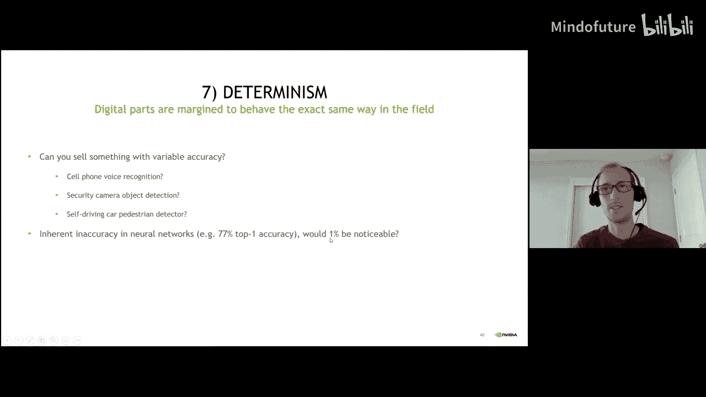

Penalty。

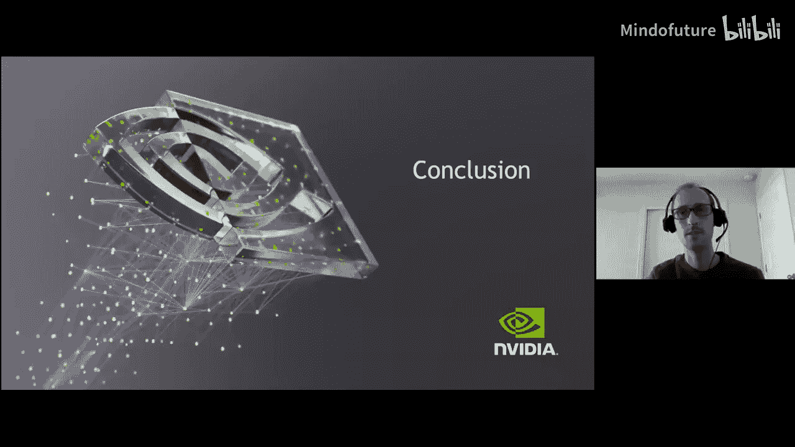

So to clue， I talked about a lot of these different research problems。

 so having high area efficiency。Fenia will to achieve high precision。

 getting around diminishing returns of the network。Being able to amortize memory operations。

 building an ADC or DAC， the flexibility， and then the determinism of your network。

So I guess just to conclude， I think digital is very hard to beat just because for every single analog trick there's usually a digital equivalent as well and because the field is changing so quickly。

 digital has a much easier chance of keeping up just because it's so mature。

And then software is already a pretty big differentiator。

 and so writing efficient software that maps walls your hardware is already kind of the key to efficiency in this and so the more flexibility you have in the hardware。

 the easier it is to solve things at the software level。

So I think analog is certainly interesting there's there's a lot of progress that's been made there's still a lot of opportunity I think the best bet for a lot of these accelerators is。

They're just going to have to work on more specialized applications。

 it's going to be really hard to make a general purpose flexible accelerator and then there's been a lot of improvement in training techniques。

 but there definitely need to be more improvements in training to do really fast training that takes into account all of these lower precision and accuracy issues。

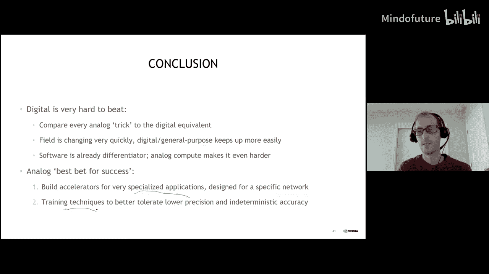

So that's it， are there any last questions？Great well thank you so much Brian so for this very informative and also thorough discussion regarding the challenges and also opportunities with analog and in memory computing this is super helpful to actually get this perspective。

 especially given this class as being so focused on actually digital optimizations but it's also good to see the analog alternative there so with that i'm going to first pass the recording for。

😊。

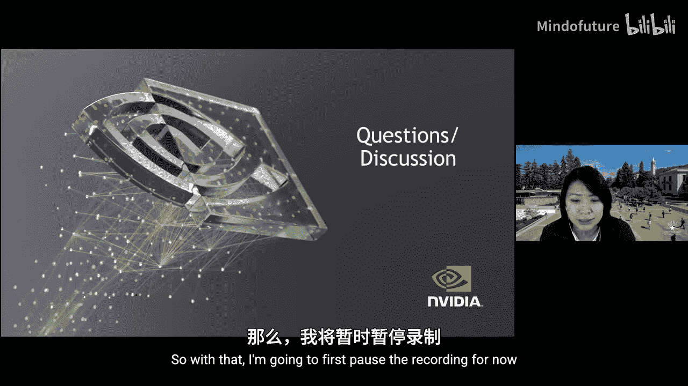