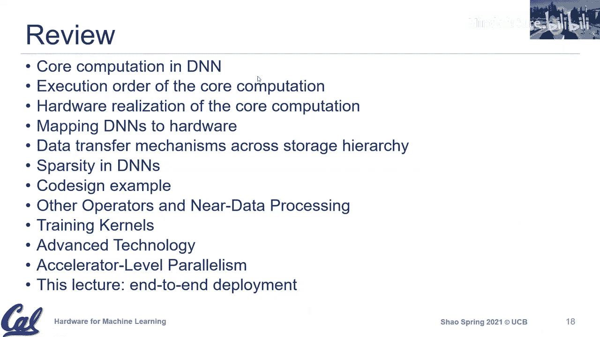

# 【加州大学伯克利】机器学习硬件技术课程 ｜ UC Berkeley ｜ EE 290 ｜ 2021 p21 P21 Lecture 24 End-to-end Deployment -BV1XfM4zKETU_p21-

Okay good afternoon everyone and welcome to E2902 hardwareware for machine learning we are approaching the end of the semester of we're having our 24th lecture so we have a range of different topics regarding both specifically how we think about machine learning accelerators and also some of the state of art product deployment or practice in building and deploying machine learning accelerators we also talk about some of the challenges at the SOC level with actually integrating accelerators efficiently so today we're going to actually talk slightly a different topic but also related is really thinking about how we do actually endto end deployment is what we have been talking about so far。

 especially between neural network accelerator is the only thing that we need to care but if not what our other considerations we also need to think about when we really deploy this both both in the cloud or on the edge。

 what are the road。The constraints that we need to be aware。

 that need to be factored into the design process。And whenever we talk about end to end evaluation or end to end deployment。

 a very commonre you will get， especially from hardware designers。

 system system designers is that you need to consider MDds law right so MDD's law is really thinking about and it's really very applicable in general originally thinking about for parallel computing but now become also very applicable when people talk about specialization right it's really talking about the limits that you can do given the behavior of the code and for either the parallel architecture 1015 years ago。

 people are pushing or this days the specialized architecture mostly a time we're talking about if there is a portion of the code that is actually can be easily parallelzable or can be easily accelerated how we can actually leverage that to make the overall system and lower application once faster what MDDs law trying to。

Point out is that okay you accelerate the parallel part right。

 either with your parallel computers or with your accelerators。

 but what about the sequential part and eventually you will be hurt by by the sequential part So some of the discussions will have today is related to does not or this happened to the accelerator already because we have seen a lot of deployment and were doing fairly well with the parallel portion or a portion but what about the other primitives or or the other operators that we haven't been paying too much attention and how do they actually behave and eventually those operators will actually dominate the performance。

And whenever we think about Amd's law， there's always a lot of actually goals in Amd's career。

 a lot of exciting things happening there， and one thing also related to his career is really as IBMs。

😊，360 which is a really infferential system， I think especially these days when people are thinking about the accelerators。

 when people are thinking about fragmented market， the market getting more fragmented to different people。

 different vendors have their own Is different SOCs also have their different groups of I will also talk about some of the fragment actually into this structure that will also affect this topic right and to end the deployment and this was also the problem actually five or six decades more than six decades ago at this point for IBM when they have different product lines and different IAs that actually make it really challenging to from a practical or engineering and even engineering point of view to manage all the different architectures so one thing that's actually remarkable with the 360 architectures really have a unified IA so that you can really set this hardware software your interface and then that can be used for。

Different product line well we we start hearing some of the discussions these days。

 especially when people start building all the different hardwares and soOCs and start getting a be concerned how they will be used and this kind of interface discussion also showing up how we can not only what we talked earlier about law the parallel and the sequential part。

 but also the fragmentation going on in the system so as we getting more involved in the system with all the different vendors building their own。

IP we talk about a lot of startups this days is also doing very well building their Is so how do we actually interact with this very fragmented market and whether there are opportunities to explore well something like 360 did to actually have a more unified interface that's also will be very interesting moving forward。

So with that。Yeah， just a quick review we talk about a lot of different aspects of actually building and deploying hardware where accelerator already all。

Most relevant to today's topic is actually what we talked about a couple weeks ago on accelerated level parallelism many of you actually also have questions or send me some feedback after the class very interested in this perspective so this is actually also very relevant with what we talk about accelerateder level parallelism and how different Is are are interacting with each other and how we actually manage things from a system perspective so with that we'll talk a little bit more about practical constraints with end to end deployment。

So first， we're going to talk about some of the things that are actually typically missing when we see accelerator papers or or even white papers when people are releasing products from the startup right we also see a couple actually very interesting guest lectures from startups this semester were the way they。

He there's the market， their hardware or they evaluate their hardware where different people have different ways of actually evaluating hardware these days。

 and typically people report certain things， but that really doesn't give both VCs but also like their users their clients right as the full picture。

 so what should be the end to end processing pipeline and how we actually really think about some of the high numbers or potential speed of actually being reported in those white papers。

So last what I think we see a little bit more push for this direction which is actually generally very good。

 this is to have this kind of holistic processing pipeline for machine learning algorithm applications together with a push with the MLPf。

 which is also a very important initiative with the community we also have the guest lecture about MLPf a couple weeks ago it's actually getting a lot better because there is this benchmark suite there are this benchmark suite for different deployment scenarios and provides us an opportunity again with all the different caveat embedded in those data but at least a niche opportunity to compare the different hardware and even the software system。

What overall， I think what we should， especially when you when you actually out there。

 when you actually either build your hardware or evaluating other people's hardware or trying to because what those companies trying to sell in their white papers or in their products。

 some of the questions we have been also trying to bring that perspective as well right throughout this semester。

 what kind of questions you need to ask yourself when you see a surprisingly good number there。

 what is actually part of that number。So besides some of the caveats we already discussed before。

 I think one thing keep in mind in general， both building your hardware and also evaluating other people's hardware is really thinking about having a full picture of the application。

 so generally at the end to end even the machine learning pipeline。

 it's more than just the machine learning algorithm in particular the different learning algorithm。

 we have a lot of discussion both the standard convolution and matrix multiply operators and some of the specific operators that companies show up in in the different learning frameworks and that' actually a very evolving process right you see all the different operators actually being added and even in our own infrastructure onx infrastructure。

 we also see different operators being proposed by different users and it's also fairly challenging actually from project management point view how to actually unify all the different operators。

So with that， so thats another perspective I hope everyone has。

 actually when you evaluate other hardware or software proposal is that some of them only focus on really the machine learning processing parts of kernel parts and a lot of times people just report convolution performance or matrix multi performance。

 but there are besides those different operators we already mentioned earlier。

 and typically there is also in most the deployment cases。

 also a lot of pre and post processing going on actually to prepare the data ready to be processed or to be analyzed by the machine learning algorithm。

For example， like this is a perspective from Facebook here from their actually evaluation and analysis is that for a lot of machine learning application being deployed in their data center they're typically actually a preprocess stage to actually fetch the data they preproces data and then before we actually start doing either training or sometimes also inference right so that pre processingces。

 sometimes you' actually very application specific you may even need to do some resizing and and sometimes you even actually just do some you even want to do actually some initial feature pruning they all of those are actually part of the preproces pipeline that need to be handled and sometimes you will actually for example video data you also need to actually break those video stream into actually images which will be actually eventually analyzed by the machine learning pipeline so all of those actually are not actually free they're not。

And a fairly decent amount of compute cycles， we hear this from on Facebook and also some of the Google's recent work also show that this kind of prepro。

 especially preprosing part， actually also fairly dominant and sometimes actually limit the rate of processing going on in。

For the machine learning pipeline。 So this is the overall experience as here is also a more quantitative data from some of the TPU analysis for again。

 the data in feed actually moving and preparing the data and removing the data actually to TU。

 So there is another layer of challenge So before we just talk about the real preprocessing here right。

 but here not only the preprocess as an accelerator will also need to actually move data to the accelerator here。

 the TU as an example So from this characterization basically you just look at a lot of time we focus on the flops part。

 but for the infeing the cycles actually spend to in feed the data to transfer the data from CPUU to TPU TU can actually analyze the data can also be significant。

Of course， it is benchmark dependent， Depend on the size of the model that's actually being used。

 but this is also a fairly wide range of benchmarks right and then we end up spending actually most of the time moving the data that will also lead to actually much lower performance that we get So all of those are actually part of the complexity of actually evaluating deep learning hardware is what kind of model to use what our assumptions for the preprocessing stage and what our assumptions for the postprocessing stage So you may some of the folks actually doing the tiny M benchmarking or for the course project that's a lot of things that the M perf community need to actually standardize so that at least we have the same infrastructure to do things and we can evaluate all the different performance components there So all of those are also very important will we actually evaluate and perform not only is for our view is actually all data is already at least indeed in our local。

And then we just fetch it and do the computation， that's our picture but then you will actually really zoom out to see the full picture there are quite a lot of different processing and data movement actually going on that could actually make the system evaluation more more complicated。

So this is the data center space and and even for some of the like I think Brian also mentioned earlier like to do the like surveillance camera。

 this kind of use cases， different use cases may have different precision requirement different use cases may have different applications。

 what they' are supposed specifically doing but even let's say do let's say looking at a face recognition pipeline right we still need to get the video stream。

 and then there is this injection injection phase， but talk a little bit more but something like I mentioned earlier right break the videos into images。

 sometimes we also need to do some resizing going on to actually so that it can be efficiently processed by by the accelerators and you remember some of the dis we have acceleration level parallel so also from Google's work。

 a lot of data sharing is actually done at the D level right so all the different stages。

Pline and when they need to share data while you first need to have different accelerators or CPUUs。

 different Is actually doing this or GPUs and then the data sharing is also pretty expensive because most of the time is actually shared through DM so then after we get individual frame we maybe do some face detection and then do some feature extraction and then that will be used to do classification to see whether there's a face or not if there's face who this person is so that's the level of analysis there。

I'm not sure people whether people call it， I think in MLPf benchmarking discussion we also talk about the differences。

 ViG also briefly talk about the differences between single stream and a multistream。

 so this is basically a single stream pipeline and sometimes there is also parallelism right we have multiple cameras going on for this scenario or let's for let's say a self-driving car。

 there are different cameras looking at different directions and we need to process all those different image frames simultaneously so if you look at MLPf。

 especially inference benchmarking efforts so they have single stream， they have multistream。

 the multistream is basically what we have here another layer of complexity all of them need to be merge that also processed。

As fast as as possible， so there could be again， more communication going on and more workloads are actually involved and then。

Also more scheduling complexities going on and then there's also I think verycur there's also a server category depends on the request and then depends on the workload behavior so this kind of realtime processes like oh every every like for like 30 frame per second every second will will be 30 frame is deterministic well the server processing that depends on the application depends on the user's request and they may follow particular distribution but that's actually more unpredictable from time to time you may get a request and then still also need to actually serve those requests whenever it actually show up so that's also the server part and then there's offline part which is doing the batching batch processing that doesn't have a particular latency requirement but just need to get the work done so even for inference which we think is actually easier we talk about a doesn startup actually start with doing inference transition to training even for。

There's like all the different scenarios and with single stream。

 multistream server and offline and even for single stream we talked earlier。

 there's some processing going on a lot of data movement going on with accelerator level parallel available all of them need to be actually factored in to the end to end processing but when we see a lot of either papers or either research papers or white papers from a different companies or from product release sometimes we only see a single number for their best performance or maybe pick a particular kernel let's say Res 50 and just report that performance。

 but how Res 50 is actually being used in the end to end pipeline。

 what are the other vactancy is actually being used if youre actually trying to buy a piece of hardware for your company or even for your house like to set up a smarthouse environment all of those are factor I need to be factored in to see how useful this hardware。

I and how performant it is to handle different scenarios so all of those complexities are typically being ignored these are intentionally or unintentionally。

 but we we really need to as someone trying to understand the dynamics of this area。

 we really need to educate ourselves and also ourselves and also understand the complexity here in different scenarios。

So a little bit more， I think we already talk about this yeah。

 like preprocessing par to individual frames and then face detection feature extraction and classification and then we look at actually the time breakdown so this is also people that I really like to really highlight some of the challenges in doing this kind of end to end evaluation with especially with deep learning applications so here as authors actually break down to injection detection identification part and this is back to ourdo law discussion right so we only accelerate the deep learning kernels。

 but there are actually a lot of things going on that still actually running on CPU these days so CPU is still very important and and a lot of times we actually funded by the CPU processing because a lot of application a lot of those scenarios are actually not being handled or simply being ignored when we think。

about building a socal deep learning accelerator right so for example for injection the deep learning part is a blue part。

 a label of AI that can be accelerated we see the injection part like we mentioned a lot of extraction the recizing those are completely done on CPU we see a little bit more AI deep learning portion like 40%。

 but then there's still more than 50% of the total time that we spend doing other either housekeeping work or some other processing that cannot really be done on accelerators。

And only when we get to actually identification then the deep learning become more actually dominant because data is already prepared or parsed and then we really just need to do the object recognition at this point。

 So again， so this is the link with Amdos law and also the way we think about the end to end processing here given a lot of the complexities。

 even we just look at a particular single stream scenario people typically most of the time report the their performance for the glue region if they do things honestly and and a lot of time there is also different metrics being used。

 but I feel like the M perf effort actually help with。

Provide at least a comparable way a way to actually compare different hardware even for the blue portion。

 but even on top of that， when we really think about when you actually buying the piece of hardware or software package to make your application faster to speed up your organization's processing。

 you really need to think about and to end pipelines and how much of that will actually be done or can be done on accelerators and how much of that will still be done on CPUUs。

 you you may actually end up buying different systems in the end because you have different applications different pipelines and the deep learning part can be dominant。

 sometimes the deep learning part is actually not even on the critical path and we really need to understand on those law and understand the complexities of those applications when we think about system evaluation here。

So that's basically the importance of having a broader picture of the processing in pipeline。

 we use this face recognition example which I really like as authors did a really good job under detailing all the different components need to be done and then the ML curve inference effort also highlight that's only actually one of those scenarios we have different latency and support requirement for single stream multistream server or offline even for multistream theres also especially for multistream。

 there's also the scheduling complexities， all of those are typically ignored when we think about deep learning deployment。

 deep learning hardware deployment in particular， but all of those are still very important in practice。

So before we move on to practical constraints， any questions。

 comments or anything you'd like to share with everyone？

So is the message of that prior paper something to the effect of can we work on speeding up the stuff on the left instead。

 please？Yeah， well， not directly。 I think this is more opportunity for the authors Well so first there are different types of papers。

 some paper is actually more proposing a specific idea。

 some paper is actually more highlighting a potential problem that we need to ignore we need to actually pay attention to not ignoring So I think for this message the message is really we see a lot of evaluations and comparisons are focusing on so-called machine learning part。

 but there is actually a bigger picture and and some of the especially I think this paper goes deeper onto the scheduling in part。

 some of that complexities or framework complexity we also need to be handled the solution may not be actually building another hardware let's say specifically doing actually resides some of the solution could be in the software space like I mentioned doing the scheduling better some of the solution could be actually in the framework space how we actually better or lower the cost。

Actually manage all the different components， so are there could be multiple four different solutions。

 not all the solutions actually end up actually building another hardware for a different kernel。

But there is a complexity in these scenario。Will there be different sort of like effects of this proportionality manifesting in different say。

 in the warehouse scale and at the edge scale， because I think this study was done at the data center。

 so there will be different demands or constraints for a mobile say。

That's a really good question so in particular this paper is also very interesting if folks are interested take a look so they actually highlight a scenario where they call this edge data center so it's actually something between edge and data center so not really the edge SO see that we have been considering but also not like the multiservver data center scenario this is actually still a single node or small number of node where they call actually edge data center this could be basically something in between there but to your question that's a very good point different especially different applications may have and may have different scenario like I mentioned the single stream multistream server and the offline for more data center scale I think the offline will be more important maybe server depends on the query type the query frequency the server and the offline will be a lot more important for edge scenario even that also depends on what kind of edge we're talking about or typical cases。

we're actually doing a single string processing that will be the end to end scenario。

 but for like the automotive market this kind of multi string multiple data coming in we need to process all of them simultaneously which is a bigger scenario like in terms of the cost and the compute power required that actually have a much higher both performance target and also a power target so those just a scale like edge I guess as a I'm approach to that tiny versus regular edge and then edge data center and then data center those have just in terms of general scenarios have different implications well performance I think that will also be important so for example。

 for this case is a lot of frame extraction rateizing going on that depends on the input image resolution and the processing resolution there's a lot of reizing going on right depends on sensors that we're using what is actually the data。

The resolution of those sensors that will also have different。Different performance。

 So another complaint you will actually hear not necessarily complaint。

 but another debate people are doing that even do Re 50 right。

 people typically do the typical imagenet resolution right。

 but in some scenarios actually higher resolution is needed。

 So what kind of resolution we need sometimes people actually do multiple resolutions together So all of those will also factor in。

 So this to your question， yeah， this is very scenario dependent and also very application very application dependent we may have very different tradeoff depends on a tradeoff in both internals the application that we're looking at and also the balance between throughput and latency were shooting for in the optimizations case So all of those are also part of the complexity。

If that makes sense any answer questions？Okay， great great questions and good discussion so we talk about the processing pipeline we'll talk a little bit more about some of the constraints that actually change the way people think about deploying accelerators and even whether to use accelerator in general。

 I highlighted three from some of the industry practices in recent years。

 there could be others like also related scenarios。

 but those three are very well generally I think we can see the connections with the challenges of actually pushing all the different Is in different deployment scenarios as what Josh mentioned earlier and what are the challenges what are the challenges of actually adopting different Is。

So first， I think we cover a lot about deep learning hardware and that was what we say。

 okay with all the framework here right once you understand all the different primitives it's actually not too challenging right so here are the tricks。

 people are using different companies using a different subset of those tricks。

 but those are general principles and once you have that you could actually build a decent hardware for handling all the different all the different primitives。

😊，But when we actually come to deployment， even without all the excitement。

 you can see we can highlight hype or real excitement here。

 but the deploying deep learning hardware at scale still requires a lot of effort and also require a lot of understanding I think people are more familiar with those concepts these days especially will not interact with people is working in this area。

 but overall I think those kind of constraints are typically not really being discussed and people very focused on the specific I that we develop but there are also other other type of scenarios so one thing in general is that for a lot of deployment CPU is actually still what be used you may actually get the picture with golden aging computer architecture everything is accelerator these days but for a lot of deployment both edge willll see both edge and also data centered as we highlighted here from Facebook experience CPU is actually pretty。

Still pretty important both for some of the applications that are running theirs is still being executed on CPUs and also some of the part of the processing pipeline that we mentioned earlier is still being done on CPU There are a couple different reasons for that Of course one of the most straightforward reason is actually especially in data center there are already plenty of CPUs there right for those applications especially theyre not that compute intensive we don't even need to actually deploy on GP not to mention not only accelerators we could just actually do it on CPU they are already there they have a decent compute cycles there and another part is actually a lot with the programming effort there ease the deployment CPU is still fairly easy to actually get things done in both data center will see。

Some of the mobile market was a different factor， but just in terms of the effort。

 especially the programming effort， CPU is still fairly easy。

And and can be used for a lot of different scenarios or SOCs in the world making it also still a good candidate。

 so given we have so much effort thinking about opportunities and also a lot of startup activities in this space。

 don't throw away CPU like CPU is still a very important factors of picture and we also see a lot of companies actually start developing designing their CPUs these days so that they have a better control of the overall pipeline here。

So well so this is a Facebook data here， we talk about CPU and the GPU comparisons and there are still some cases CPU actually can perform decent well or ice fairly close compared to GPUs or accelerators there but some of the challenges actually in deploying those accelerators or CPU accelerators or GPUs actually will talk a little bit more later related to thermal and also related to actually to management because different SOCs。

 we talk about the fragmentation in this market and anything。

 as the arms dominance in the SOC market actually make it a lot easier to deploy things on CPU compared to all the other accelerators which actually。

Have these unique challenges， so we'll talk a little bit more actually in a minute talking about why CPUs still very important。

So before we get there some logistics side we almost the end of the semester we have one more week to go I know everyone is actually very busy these days with the end of the semester will take care of yourself summer is almost here and this is the end of a very challenging year for almost everyone so we're almost done and then we'll have a fun year ahead after the summer so things will get a lot better with that course evaluation is out I think theres some issues maybe with this course with a course evaluation the department is fixing that the evaluation if you haven't got the email about this course you should get an email in a couple days about the course evaluation so pay attention to that and we'll also do the course evaluation next week with in class from H。

😊，This is very important， we really value your feedback and this year is really interesting with the dynamics with a virtual environment and also with guest lectures。

 with the way we interact with students， we also make a couple different changes to actually to keep the interaction going still is very challenging we love to hear your feedback both from this course or other courses or from your experience。

 what can be done， what can be improved what works。

 what can be improved and that will be very important for us to learn from this experience and so we can actually provide an improved version of this course in the future so definitely hear us with your experience and tell us what worked and what can be improved this is a fairly open endeded grade level seminars。

 we do have quite a lot of undergrad students as well so different students may have different experience。

 different perspective， although of those are very important definitely let us know your experience。

😊，We mentioned there will be actual credits early on。

 so this is also to encourage you to give you more motivation to actually participate this course survey。

 we basically if 70% of the class actually we get 70% of the response rate will actually get at one point for everyone so that and also if you actually finish your course evaluation post private post on PazA。

 even we don't hit the 70% response rate， you will actually get one point。

 one actual point on your own so especially let' say miss a reading or or miss or use one actual late days and this is a great opportunity to actually to make it up so that to get one more or two more points you will actually if things work well so yeah course evaluation and this may not be out here but we'll talk a little bit more next week and we'll also have in class evaluation I guess participation。

From HKN next week for the course evaluation， I just want to highlight this is important especially for this kind of more experimental open ended classes your feedback really matters you'll actually go through this experience so definitely tell us what worked and what can be improved。

And for the project， we are almost there Checkpoint2 this week。

 we see a couple projects already we saw a couple projects already last yesterday and looks like we are making very good progress and we're looking forward to actually hearing from more of you tomorrow to see the project progress and how we can actually celebrate it together and the project presentation we will tentatively will have a more detailed sign up sheet next week likely so be Monday。

 the Monday the first day of the reading week， we'll have 15 minutes per presentation and five minutes for Q&A so and everyone is invited so feel free to actually participate and see a very interesting I was very impressed through Checkpoint one is the interesting progress that you have and the good progress that you have made at that point so I'm looking forward to the presentation。

As well and for the report。Doesn't need belong we actually set a max number of pages don't need to be super long。

 This is really an opportunity for you to think about your project。

 think about the data you have factored， think about your learning experience and use as also experience to in preparation for maybe for your future report for your future paper or for some of you it will be the thesis that you will be preparing so doesn't need to belong its just a max number of pages you don't have to hit hit pages this is really just experience to start doing some writing and share what you have learned and and many of the project actually very hands on so if you actually have a code have code repository。

 have your code there also provide especially the teaching staff I to your code repository like we can also take a look at there。

😊，So that's I guess， on the administrative side for both course evaluation and the project。

 any questions， comments people have。You went the right up submitted。

So it will be Friday the reading week， so it should be May 8th or May 9th。

So we hope everything we just everything by the end of readingy week so that you don't need to draft this。

Into your final exam week。So the Monday will be the project presentation the Friday。

 I think will be May 8th will be the final report due。Yeah。Any other questions？Okay， great。

 so we talked about some of the constraints actually in deployment。

 so the first one is actually thermal constraints here。

 So we also talk about like the multistream case already earlier and also the acceleratedellerator level parallelism with all the different I actually going on this actually already start showing up interestingly actually in some of the VR devices where they are actually running all the different applications in parallel because we need to do eye tracking maybe sometimestime even speech recognition object recognition。

 all of those applications that actually need to run simultaneously and then there is a fairly strict performance requirement right typically we require the realtime processing going on and with realtime processing for all the applications that we mentioned So we expect this happen and I think we have been actually waiting to see a real case that this has been a challenging。

Challenging issues and interestingly， I think this actually first show up at least in the public space is when people start thinking about the VR AR goggles and how we can actually process a multiple different applications related to machine learning a lot of those applications interestingly are all actually machine learning deep learning based even for AR even even in ARVR space and then they also have a particular time target that need to be actually processed in real time and for some of those actually also need to have this on device processing so it's basically a target case we're looking for a lot of compute power requirement but also very limited very limited actually battery that's actually can be done actually on device。

So like a company used platform， this days is actually for most of the SOC is basically a CPU model with a vector core or basically with a DSP here that actually being used very commonly both actually be core and the small core。

 this kind of composition is actually being used very commonly in a lot of SOC in general。

 and including the SOC actually being used， the spectra and SOC being used in the VR devices。

So here is some of very interesting we don't see a lot of this kind of data there。

 so it's good that some of the industry actually publishing this data here。

 so we mentioned earlier we need like realtime processing。

 we need this kind of realtime frame to actually help us to interact better interact with the world here and a lot of cases based on the Ocuululus actually provide the reason that actually they need to or they have to actually deliver lower performance it's not because that the CPU cannot do that it's basically we cannot afford the power and power consumption or the thermal implications so we have to actually struggle the CPU so instead delivering that 20 frame per second we are actually delivering more like1 frame per second to make sure that we are still under the power budget and without actually triggering any thermal。

some problem。Here and here is also a good opportunity for typically for accelerator design。

 because accelerator is not only actually better at performance。

 but also at actually lower at also like lower power。

 So this is also a motivating case not only from performance perspective。

 but actually a motivating case for actually using DSP， but we already we mentioned earlier。

 it's actually still being DSP is actually easier。 People have a little bit more experience with DSP processing。

 but even that just a programming aspect and programming aspect can also be be challenging。

 and and another problem is that we can always assume there will be a CPU actually on the SOC device。

 but we cannot assume there is always a DSP or accelerator or different version of the accelerator on the device。

 So that fragment actually limits a lot of adoptions actually or even just using those accelerators in those market。

😊，I think yeah， so this is related to what I mentioned earlier。

 the performance variability here so even for Apple's SOC。

 which is actually fairly standard not talking about the Android SOC which is actually even more fragmented here。

 So also the data from Facebook where they actually where they have actually access to those different diversity of actually mobile SOC devices。

 they can actually doing this kind of pro to see the performance variability here。

 So even for Apple SOC with which actually fairly consistent right so we just have the different generations we definitely see differences across generation but even within generation and we actually already see different viabilities regarding different use patterns。

 the aging or other like co running scenarios， all of those actually contribute different quality of service that can be actually achieved in。

In in differentffer S OCs here。 And this is a similar data comparing the three generations。

 Apple S OC with different inference time that actually being being achieved。

 So even with Apple S OC， which is actually very consistent we are already seeing this kind of performance verabilities going on in our system and not we even mentioned the big Android market and like we mentioned during the acceleration level parallelism discussions depends on which what the time frame that were looking at。

 there could be tens of or hundreds of actually different S OC is actually going on in the market and all of them actually add more performance verabilities in the discussion and also。

And also I don't have that data here， but also the deployment challenges right so with that people have to actually make sure making conservative assumptions and the most conservative assumptions in general with accelerator development is that I'm not sure whether it's procu SOC have this accelerator or not what kind of accelerator has but I can in general。

 assume there is a some version of armcore actually on the SOC So from app developer point of view like Facebook it's actually a lot easier to think at least there will be different version。

 of course with different version， but will be some kind of armcops there。

 it's a lot easier to optimize for the CPU cases instead of optimizing for all the different accelerator cases so that's why a lot of cases。

 especially with the end to end deployment is's still actually very challenging to even deploy those accelerators and and in comparison the CPU is actually a lot easier easier to be deployed so that's。

Still aware and the focus of RP maybe more this days also DSP， as we mentioned earlier。

 also become important， but still a very limited market， a lot of those accelerators。

 how it actually can be exposed to be programmed， still very very challenging and also very important。

The final one I wanted to mention a little bit here and also very interesting work from Google here is really thinking about the interference so to Josh question earlier。

 so this is actually a very interesting case where they focus on a TU based system so actually a data center based system and then even here so with that is actually not a lot of connections sharing with with CPU。

 the only sharing is actually as a PCIE level， but even that they actually observed very interesting interference between CPUs and and accelerators to the shared resources especially to DRA here so with that there is actually start seeing some of the work doing what I mentioned earlier the accelerator level parallelism or management between CPUs and accelerators and think about how we can。

Provide reliable quality service QS guarantees for different deployment。Scenario。

 I'm expecting this will be even worse actually for some of the SOCs because then there will be actually even more resources being shared。

 We talk about some of that in the accelerator level parallelism this could be actually a an initial example showing some of the challenges there even with a data center scale CPU and accelerator shared substrate we already see some of the challenges but then when we even have a multiple accelerators being integrated and more data actually being shared。

 think about our pipeline， iss a single stream or multi stream pipeline that we discussed earlier。

 all of those will actually complicate the scenario。

 So this is another aspect of the deployment is actually really thinking about interference so far。

 a lot of the accelerator design has been actually very static I will assume this is multi resource that we have even with our own design when you think about your design both lab2 and lab3 this is a scratch。

I dominate the scratch padd this is the last double cache that I have access to。

 I also assume I'm the only one who need to actually access the last double cache。

 all of those assumptions are not valid anymore， actually when you have interference and this is one level interference at data center level with accelerator and the rest of the CPU system。

 but in let's say SOC through PCIE but you would say in the SOC environment where multiple agents。

 big core， small core， different cache hierarchy， different memory hierarchy。

 all of those actually need to be shared and interact with each other how would we actually modulate。

Contention there， so that's also very， very important and very interesting and especially with this particular quality of service。

Target so overall this is really optimizing for quality of service right so this could actually enable even wider adoption of accelerators we can actually provide a more guaranteed quality of service overall across the processing pipeline。

So with that， this is the end of today's lecture， I cut a couple points the slides。

 but I think we still cover those points throughout our discussion but in general what we discussed so far mostly focusing on the individual IP and the acceleratedcc level parallel open up the space a little bit more but as we mentioned earlier。

 really thinking about all the other applications， different parts of the processing pipeline also need to be considered to think about end to end pipeline and also different scenarios。

 single stream， multistream and how they interact with each other is also very。

 very important and then don't forget CPUU and the CPU still turn out to be actually very easy to be deployed so consider the CPU choice when you actually make the deployment and all the different viulabilities especially at the SOC level actually impact the way people use the different accelerators。

you will ignore those kind of complexities with different accelerators will create this kind of interference in our system that also make especially deployment。

 especially reaching a particular QS target become even more challenging so all of those factors are actually part of this and to end deployment scenarios and then when you either pick an SOC platform that you want to use or when you actually design a particular SOC platform。

 all of those need to be factor in in your decision-making process。

So with that I willll end here great to see all of you and I really enjoy。

 especially before class a discussion that we have so far we'll see each other again next week and I'll also be around for a couple more minutes if you have any questions or ourselves that you want to share so take care everyone enjoy the weather enjoy the end of the semester we'll see you next week bye。

