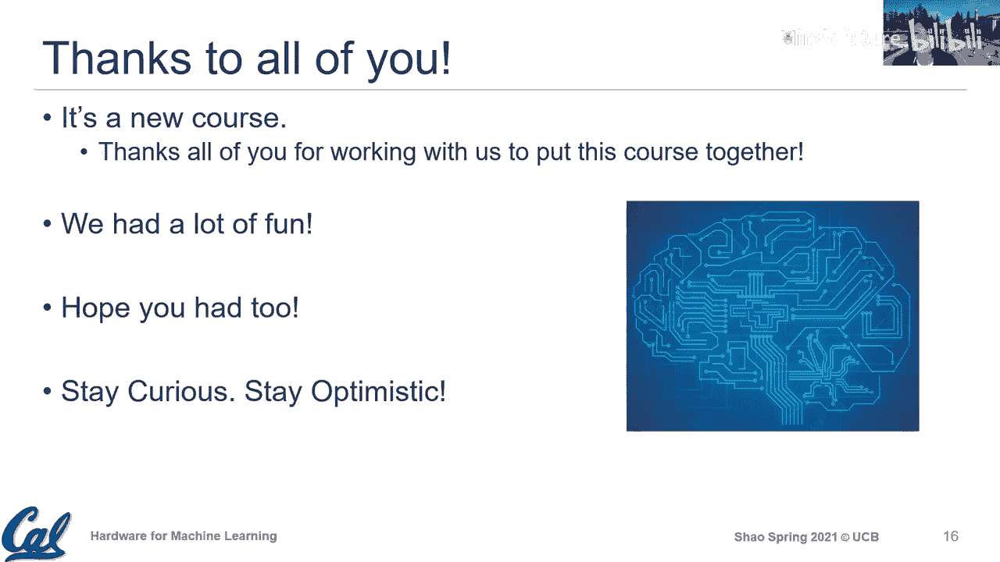

# 【加州大学伯克利】机器学习硬件技术课程 ｜ UC Berkeley ｜ EE 290 ｜ 2021 p22 P22 Lecture 25 Conclusion -BV1XfM4zKETU_p22-

3。

Okay good afternoon everyone and welcome to hardware for machine learning and today we're going to have our last lecture of the semester really time flies。

 it's really hard to be we're already at the end of the semester and so this lecture will be our last lecture I know many of you are really busy and really swamped with everything going on with the end of the semester so hope you do take care of yourself and use this time to really think about all the amazing that you have done throughout the semester and and also get ready for the exciting summer I know many of you have great summer plans for this Wednesday will have open office hour I will be there will be basically if anything any questions that you may have I know some folks are wondering about either grad school choices or like research topics or even just how to think about different internship opportunities or。

😊，The field in general， I'm happy to just provide my perspective in both working in athemia or industry or thinking about different career paths but any question you may like so feel free to join us also on Wednesday with our open office hour so with this I think we have been having really exciting semester I'll talk a little bit more about more specific plan especially regarding like project and how we do project presentation and final submission final paper report submission but at the same time I think we have been covering a lot a really exciting topic for hardware for machine learning both specific for machine learning algorithm but we also talk a range of other topics related to hardware software design related to general trends of both industry and athemia the way we think about architecture problem if it was not clear hopefully it's very clear at this point。

But if it was not clear， I do want to really reemphasize this is really a great。

 very exciting opportunity for hardware design， especially as the hardware software boundary in retrospect even like compared to 10 years ago when I started a little bit more than 10 years ago when I started my PhD the way people think about hardware problem back then was very different compared to the huge amount of opportunity that we see in this area。

 we sampled hardware for machine learnings because really theres a lot of interest both from industry and academia because there is a driving application to drive up the compute demand and also a lot of new innovation really needed in the hardware space but this is really a start well talk a little bit more about really exciting opportunities and in retrospect really different very different ways in even the way we think about。

😊，Education， especially hardware education。also talk a little bit more what we think or at least what I personally think what would be really important to be a hardware designer。

 but not really limited by hardware really be able to connect hardware and also system and also application out together and how we actually take those opportunities and really build something really important and can really change the world and you already see a lot of really exciting development。

 a lot of things happen very recently and the excitement happen。

 not only in acadeemia but also in industry， not only in traditional hardware companies but also in like software system companies and also tremendous opportunities in the startup space all of those excitement and may seem to be very focused on hardware for machine learning。

 of course this is as a starting point， but there are a lot of amazing other opportunities and。

We should actually approach future problems like those。

Soll cover a little bit more in this final really reflection。

 I personally put actually a lot of thought into thinking about how to connect。

 how we can actually connect all the different dots together and I really get excited actually whenever I think about things like this。

 I hope you folks also really also get excited because you are at a very unique position in both thinking about this problem and also approaching those problem with the unique background all of you have。

So as we are coming to the end of the semester， the specific course of hardware for machine learning。

 this is really the beginning of your future endeavor in thinking about hardware software interface in thinking about hardware software co-design and how to apply all the techniques and the way iss really about the mentality that you have already developed over the past few months to approach new problems。

 new exciting domains and also future complex， but but what will be very powerful system。

So with that this is actually a very different we typically do like history of computing at the beginning of our course and this may seem not related to history computing。

 but this is really I think a great way to actually summarize the challenges and opportunities the tremendous opportunity that we have these days so I put actually this is one of the figure I used in my dissertation。

😊，At this point five years ago， right so I think in almost all of the hardware system courses。

 you hear people talking about more law and skating right。

 so those are actually two very fundamental rule of thumb in general that dictates the computing hardware development and for most of the time we have been in this blue corner where we have more skating more law。

 we also have gender skating to actually continue。The hardware development。

 but now I do see a lot of discussion about the end of the na skating and the slowdown the more law。

We're really getting to the lower lower right corner of this picture where we don't have a lot of like known solution to keep up the performance improvement to actually really satisfy the demand of computing for a while。

 if I remember even 10 years ago when I started by PhD people were very pessimistic iss like， oh。

 we don't have a lot of things we can there's not a lot of things we can do right we still need hardware designer because there's actually not no more technology advancement and and everything need to and we don't have a lot of like known solution yet but in retrospect like after five or six year like now we have like we get like 10 years into this process we actually what we really realize that by ending Moore law and also ending the nextkating。

 it actually opened up a tremendous space for hardware designers to make an impact。

So before we just take everything for granted， wait for two more years， things will be better。

 we don't know what's really going on， but now you just like follow like we talk about we spend a lot of time talking about tech news。

InIn this class， especially for folks who actually joined early。

 there's like a lot of tech news these days are very hardware centered。

 It was not like that 10 years ago when I started my PhD。

 most tech news is Intel EMBs announcement that's about it or is there a new Tikt generation that's about it。

 But now you will read the tech news these days a lot of exciting development from both hardware and software industry and also mentioned also from startup。

 everyone is actually making developing their hardware and software solutions。

 So it is really the best of the the best of times and also the worst of times。

 I think it was more folks you know the worst of times before especially 10 years ago retrospectful way start realizing the end ofline dinner game but now 10 years after it is really the best of times especially for hardware designers now everyone knows we need some。

kindind of special hardware GPU before it was treated as as a small accelerator now is's actually being used in almost all the major computing platforms and it will be more special hardware actually being developed for machine learning and also other other applications and as part of the process I was as I mentioned that things have changed in the past 10 years right one a very strong signal with things have changed is when Heness and Patterson actually won the Turing award 202018。

 2019。 right they really coins the term。 this is a new golden age of computer architecture and things does actually things do actually behave like that we see a lot more discussions。

 a lot of I mentioned earlier， tremendous opportunities with hardware design。

 So all of us all of you are really positioned to really leverage this golden opportunity the lack。

skating the lack of technology solution， but think about how we can actually take advantage of this situation。

 but to make our own contribution either from research or development。

 either in academia or industry or in STA， there are tremendous opportunities here with more specifically some of those opportunities and also some things。

That especially from the W we approach problem that can help us navigate this exciting landscape。

So with that， let's get restart started。So again， course evaluation。

 I'll be following up with all of you once we hear back from campus。

 definitely fill out your course evaluation。 Very important for this course。

 And we are looking forward to hear from you。😊，Let's do a quick for recap and then I'll talk about some of the new challenges and also opportunities really in this area。

So as I mentioned this is still a very relatively new course right every time like I was talking to my own students earlier today I was like。

 oh， there is a new paper in this area and I mentioned in my course slide and we should actually revisit this paper because like also like a lot of the research a lot of the discussion is still pretty new right like before we like to we were super proud this nice abstraction in computer science or hardware we need to worry about hardware system only need to do system application algorithm only need to do algorithm this is one of our attempt adhere to really bridge bridge different area so this we can see this is a hardware course but this is also very focused on application a lot of our development is really thinking about how we can take advantage of the application to make someone a shortcuts at the same time one thing and you may do anything is still remember from this class。

😊，re emphasize on the importance of principle right and a lot of the hardware design principles of course。

 have been really useful for machine learning， but in general those principles have already been applied in the past five or six decades in the general hardware design like parallelism using locality using parallelism。

 all of those still relevant but we can actually exploit even more because we are focusing on even narrower even specific application。

So this the part of the goal is of course is really connect those two disciplines together and they really think about I mentioned those opportunities。

 all those applications are actually exposed to hardware and hardware designers have the flexbil to customize the hardware to make things more efficient once you actually graduated either start your own careers or your own company or start your own or like start your like for example faculty career。

 you will actually be fast about this kind of problem there is a very important application from your college or from your customer and then they are wondering what you can do to actually make this application faster right so of course we have done what we do is a very shortened path of that process like cram into this three months one semester to really go through that process but this kind of question you will see a lot I still being asked a lot by my colleagueslea Oh there's a really cool application。

But we just couldn't get it faster what can we do right and then you in industry people also get us this a lot like what can we do so that we can what can Intel or AMD or immediately do so that this application can actually run faster and then you manage your own business right you may also either you as a client as a customer。

 you are evaluating different hardware to see what things what which hardware is a better fit for your demand or your hardware vendor that you need to actually evaluate how we can actually serve your customers better by develop better hardware。

So over throughout semester we talk about how we can actually understand different application characteristics and also we have we really emphasize on principles right。

 how we can leverage those core hardware design principles to make more efficient hardware and in particular I think whats really what's really important for this class is industry perspectives right we have a range of very good guest lectures and every time I with like I personally really enjoy those guest lectures。

 those are really like。Scientists and engineers who work really at the front line and thinking about the very challenging problems and you also see some of the similarities with the problem or the approach they or their organization have taken compared to some of the design decisions or our design principles that we recommend in this course。

 so building that industry connection is also very important and one of the things that we try our best to do to actually connect students with our industry partners there。

So that's really the focus of this course。As we're approaching the end of semester。

 we have covered a range of different topics right we think about the general machine learning and the different learning differences。

 so so many different terminologies and our way of approaching machine learning and deep learning problem using the three or four components in the machine learning pipeline We talk about different primitives that being used and how we can actually make those primitive faster one of we also startedted is class to get you folks more Hanzg experience。

Using pipeytor and thinking about the quantization pipeline to see at this aspect of hardware software design and then in later guest lectures。

 you also see more advanced research in this area and also how industry really approaching this problem by either supporting different format or even designing their own right like the Google lecture talk about the Bflowat。

 the Microsoft lecture talking about their Microsoft flowing point， operators。

 so those are a lot of customization we see not only as just say algorithm level like different vendors actually have different different ways of doing optimizationization。

We also talk about different different accelerators， some of the more customized。

 some of the more flexible right， the San Barnovaba accelerator is actually fairly fairly flexible can actually do a range of different applications versus the TPU that actually designed to perform matrix application but in a very very efficient manner We also highlights the importance of mapping if you remember the Amazon lecture have two components right that actually turn out to map really well with our lab2 lab3 because there is accelerator design part a systo are architecture and then there is a compiler piece how we actually compile operation there right so we also really emphasize the importance of mapping how we can map on computation onto the hardware and a range of different topics related to co-design different operators and training。

 we also talk about advanced technology and with the NVDdia Brian Zs guest lecture。Of course。

 there are a lot of opportunities， but we also need to see some of the more realistic concern with using that。

 especially in the broader term。Application space， they may be applied to a niche market。

 but there are also more intrinsic limitations and at a system level。

 we also talk about both end to end deployment and also this notion of really think about accelerator level parallel and we'll see talk a little bit more later this having this kind of system bill because this is of course hardware for machine learning。

 we are very focused on this from application to lowerle hardware right but with the growing interest of all the different applications are being even more important how we actually coordinate how we actually design all the different accelerators or Is for those application and how we can actually coordinate coordinate coordinate together so that they can work in a coherent fashion All of those are very important I hope by covering all those topics definitely hopefully give you a。

Of how things is done today， what are the important factors。

 what are the basic what are the important components from our main lectures then guest lectures reinforcing some of the main topics or see how those actually principles are actually being adopted or being applied in their industry practice and you may actually see are actually what we're covering today is exactly what industry is doing or sometimes plan to do right so we definitely get a lot of feedback also from our industry partners what kind of things that they think that they spend a lot of time actually learning that。

 how we can actually summarize those into short lectures when we communicate those information with our students in a more efficient manner。

So all of those are really important topics again we use this course as examples that you see I guess I like to talk I like to mention this also to my students as well sometimes doing research is by doing a depth wise first depth first search。

 you pick a domain and then you see related concerns on topics and optimization for those domains so having depths is important but also having breath is also important。

 you also want to see other related topics and how things can be the system level so we hope by covering those topics both our main lectures and we'll talk about lab next and also in guest lectures give us give you both the depths of the knowledge and also the breadth of the knowledge。

We already mentioned a lab1 project we definitely wanted to use the lab to get everything everyone prepared。

 we do have a very diverse， all of you have very interesting background I'm really glad I get to know you know many of you actually throughout the semester we hope to use this class to at least get you comfortable using some of the infrastructures。

 some of the commercial like like quite towards like commercial ones but some like our research infrastructure there maybe before you think oh it's a huge infrastructures。

 we don't have a lot of experience but actually by embedding those infrastructures as our lab component you at least approach those infrastructure as a user and maybe in your later part of your career you could actually also be more active participating and with those infrastructure development as a developer and then even you are not using those exact infrastructure this give you a。

Of some of the very representative infrastructure is actually being used in both like classes。

 research and academia， like we're doing our tutorial， both TpyR。

 flu and and we're also planning to do Gemini tutorial in major conferences。

 we also actually have a lot of external users and based on my conversation with a lot of our industry partners。

 even they're not using the exact setups but we're using some of those actually some of them actually are using very similar setup。

But a lot of the flows are actually very representative。

 so we do hope like those labs both give you different different view of the hardware software your co design from application to hardware design to a more compile oriented thinking about the mapping process。

 but also get you comfortable with some of our research infrastructure so that you you are ready to actually navigate your project space we probably a bit more with project but。

After seeing your checkpoint one checkpoint two I'm personally really excited。

 we'll see more next week with your final presentation but all of you have done actually something really important and also interesting that some of the things actually I was a little bit surprised actually hearing your updates so great job everyone I think all of you are doing doing great and will celebrate really your accomplishment next week。

😊，So with that， just a little bit more administrator saying so we'll do our project presentation next Monday。

 we'll announce more details of Kearney were thinking about the afternoon time slot and every team have roughly 20 minutes so that can go over your project and also have some time for Q&A later we'll also use the same spreadsheet once we actually finalize the slot so we can sign up your slot but feel free to stay around so that we can see other other teams presentation because a lot of very interesting updates there and I have actually students not taking this class and asking me whether they can actually join the project presentation because they want to see more so if this is if Monday doesn't work for you let us know we can also accommodate it but tentatively it will be Monday next Monday Monday afternoon。

And then the report is due on Friday of the reading week again。

 it doesn't need to belong with just that maximum8 pages right you can write write eight pages。

 but you doesn't need to belong， we really just hope you can document the progress that you have made use as an opportunity to take some time really reflect what you have learned some of the technical challenges that you run into and how you actually solve those technical challenges so detail like your project and your debuing and your building process in in the in the project report and we're looking forward to seeing that。

So with that， before we move on， this is a quick course summary。

 before we move on to some of the more general opportunities， any questions。

 comments that you'd like to share or some clarification you like to ask with a class。Okay， well。

 again， you have my email， right。 And now I mentioned I'm very happy that I get this opportunity to know all of you through this semester。

 So if you have anything， feel free to send me an email either with discuss class or more general with anything。

😊，So Vis can we can also got the project titles in the spreadsheet so that we can watch others。 Oh。

 that's a good idea。 Yes， we'll also add that in the spreadsheet so we'll sign up both with your your and your team members's name and also add your project titles there as' a great suggestion。

 Thank you Vi so we'll also do that。Yeah， so I also take it。

 you'd recommend kind of presenting the whole project， kind of presenting。

 assuming everyone's going to be there rather than kind of a third update for the two of you guys。

Yes， that's also good suggestion。 Thank you Dan。 Yes。

 so this is supposed to be end of semester is a summary of the presentation。

 I think the way we do checkpoint113 is really want to help you to break down the work right but this is your opportunity。

 think about this like a poster session you get the opportunity to talk about why you get interested with this particular topic what kind of state of art。

 like what we covered in your what you covered in your project proposal and what is the first step how you approach this problem and what is the thing that you have discovered throughout this process so this is also great opportunity to think about your project proposal checkpoint1 and the two this is not checkpoint3 right so this is really project presentation So this is opportunity to really showcase your project So when reiterate that when we actually announced the sign up sheet and and as the transmission will also。

Include the title there so that people can be aware of what kind of topics folks are working on。

 great suggestions then and that big。And now there are suggestions。Okay， great。Again。

 I'm very happy with the amazing progress all of you have made， given this is a virtual semester。

 I think all of you are really doing great and very impressed by your project update。

 a couple weeks ago a few weeks ago I guess we also sent that the reading summary。

 I went through all of those and I also send some of the feedback。

 I'm also very impressed with with the depth of the depths of the responses that you have some many of you have very thoughtful questions either regarding the technical questions from those papers and also more broadly what is really real impact from the line of research。

 I really enjoyed there's a different way of discussion。

 I think I also really enjoyed reading your feedback and also I also spend all time actually thinking about your questions and how they actually connected with this course and how I can actually provide the best at least。

Guidance to navigate those questions。 So also I really enjoy a lot of the interactions and also some of the early class discussion that we have been having all of them have been really fun。

 so great job everyone I also。I really enjoyed that process。So with that。

 I'll talk a little bit more more specifically right so this is the class about hardware for machine learning。

 but at this point I really want to generalize a little bit more because there are， of course。

 a lot of opportunity in the machine learning space。

 but also a lot of other opportunities that's really the reason we're talking about hardware for machine learning or more general hardware for X。

 it's not not only because machine learning is important， There is also the fundamental。

Tology technological challenges that we're having that really moivate the the need to think about more specialized hardware。

So I mentioned earlier one of the very strong signals with this Golden ageO Comp architecture is is from the Touring Award winner Patterson and Henessy。

 they have this I think many of you probably have already done that either in this either in like additional system class or in your architecture class either read I think they have a paper。

 a communication of ACM paper out there summarizing their thought。

 they also give a really good touring Award lecture。

 I think in 2019 at ISA right you just search for Touring Award lecture， Heness and Patterson。

 you can also watch it， it's really great lecture， a great way to summarize actually the way really the computing industry all things have changed in the past past five or six decades at this point and three core lessons there are like many aspects。

 especially I think they。went indeed talking about some of the challenges in both opportunity and challenging in both domain specific architectures。

 that's our topic today and also security right we haven't talked we didn't have the bandwidth to really cover security here but so that's also some of the challenges there you can find in their in their touring lecture。

 but one thing they did and I think this is a great opportunity to actually highlight。

Those lessons is in retrospect， they highlighted three lessons from the 50 years of the past five decades of computer architecture or the computing industry in general。

 The first one is really software advances can really inspired architecture innovation。

 So this is always true， I sometimes people talk about oh now we're just designing hardware for software。

 but hardware is always designed for software。 of course。

 we talk about specialized architecture that may seem like very domain specific， right。

 but the emphasis in really thinking about you think about the quantitative approach。

 why things need to be quantitative we need to have benchmarks and then we need to run those benchmarks on our platform so that we can evaluate how good or bad they perform。

 over prior generation。 whenever a new piece of hardware being released， right。

 how do we know whether the hardware is good or bad。

There are a lot of both professional review like reviewers or from the company they believe a lot of data running different applications on their hardware to see how things have improved a lot even general architecture principles or proposal。

 thinking about caching， thinking about branch prediction， thinking about prefetching。

 all those are really inspired by software behaviors because software has this kind of locality there。

 but we can take advantage in our hardware design。 So in general。

 the trend of hardware for in hardware design， software advances always inspired and also moivate a lot of architecture innovations。

 but talk more specifically for our in our context。

 but this is not something new it not all of a sudden we care about software。

 This is always important。 Maybe this just become even more important iss not only run your spec benchmarks and get your result that you're done It's like。

You， for all of us， as hardware designers， we also need to develop our domain expertise throughout the process。

Another very important is really about the hardware software interface and how we actually approach the hardware software interface actually open up a lot of opportunities for hardware for architecture innovation。

 So a very important component of hardware especially architecture design is like the level of abstract。

 more even more specific the instructions and architecture right， there's a lot of debate。

 what kind of instructions that architectures are better are better fit for today's computing system even in today's specialized design。

 right if you recall， we also talk about the source of inefficiency of general commerce hardware and the key differences in a lot of the accelerators is the instruction granularity here were approaching a courseogram instructions and we're also using those instructions to be more not necessary。

But actually at least be more connected with the software primitives so all of those and we also talk about the hardware zone right。

 we keep we keep exposing some of the hardware control to software and so that we can actually do more optimization All of those basically the interaction。

 whether hardware take more control to get more efficiency or software get more visibility of the hardware so that we can do more optimization。

 All of those are part of this hardware software interface discussion Nobody can build a good piece of hardware without considering the hardware software interface we have multiple times for any kind of company。

 they may start start with hiring hardware designer at some point they need to actually have more have some software designers so that they can write program and from hardware designer point of view。

 we really need to understand how this。Will be actually approached to by the to the software in the end。

 what can be exposed， what cannot be exposed， What are the key efficiency factor that we need to keep。

 And then even from a software system developer point of view when you approach this kind of new generation of hardware do you need to actually ask。

 what is the interface， What can I control， How is this different from the way I program CPU。

 what are the sequences， what are the if theres no I say but what are the primitives。

That I can control。 So all of those are important。 This should always be part of discussion。

 and it will be even more， even before the domain specific architectures and resources versuss already a huge debate。

 right， So now is the domain specific architectures will be even more important。

 And a lot of our discussion covered in this class is's also very centered around like the I like。

 I talk about the zone， right， What's actually inside the hardware zone was outside the hardware zone。

 That's always part of the discussion。And finally， like I really like the way Hannesssi and the Paterson put it。

 I think they make this very explicit architecture in general or semiconductor industry in general。😊。

Is very closely tied with with industry and a lot of time the way people have debate have different opinions on certain things。

 of course sometimes it's technical right so that's why it's very important to have competitive approach that we can actually compare data compare results but this is also another another part of this debate is that it can be easily easily tested there just we're so close to the industry so that's what I mean like my personal career so far have been actually being shifted between industry and academia multiple times and I also see a lot of examples people actually can navigate both industry and an academic career but even independent with that just even look at the industry itself a lot of academic idea。

 a lot of ideas need to be eventually need to be applied to industry to see whether it solves a real problem。

And of course we can discuss very abstractly like whether things are good or bad。

 but eventually there is a way to test whether this idea actually survive in the market and I think the market is getting really interesting these day not a very small market with two or three major players。

 this is a huge pool we see a lot of interesting sometimes not even sometimes it's also feels bit crazy to be honest。

 but this is a really exciting time that if something that maybe hard to be resolved from a pure technical perspective。

 don't worry the market will give us the answer， maybe not right now。

 but in a couple years or maybe in a couple decades， sometimes we don't know。

 but we need to be patient but at the same time this is very well connected a lot of things going on here。

 its very well connected between research and industry and we' see a lot of。

Interesting debate and discussion。In as well。But those are the general trend I think I mentioned already when we went over this hardware for machine learning is really part of this trend。

 so I think one thing I like to avoid I don't want you have maybe this notion。

 oh after this this is a very separate instead we say okay。

 circuit architecture and system of we have another layer of abstraction saying oh this is hardware for machine learning as a separate thing。

 I think a lot of our discussion so far and the type of topics that we covered and the behavior of the market of the industry that we observed is really part of this the architecture system。

 the architecture scope or more broadly the semiconductor industry。

Like we don't need to mention the software， the advanced part of this whole hardware for machine learning is really driven by the strong demand。

 especially computational demand from the machine learning from the machine learning applications and a lot like we talk about the primitives before and how we actually expose those primitives to the system so domain specific operators is really thinking about not only just designing hardware。

 but really thinking about how we reach the level of abstraction between how hardware and the software so that we can still coordinate with the software but making more efficient system。

 we again very focused on the machine learning scope keep in mind how this can be transferable to other domains。

And finally， as a marketplace will settle architecture debates。

 I think I we talk about like tens or even hundreds of startups in this space。

 We also we also invited， right， a couple startup joining our discussion。

 And many of them are doing really well。 Of course， some already been being acquired。

 Some even IP old。 a couple of them are IP old。 and some of them are actually like we see the recent round C。

 even round B，😊，funding around these day so theyre all in general many of them are doing really well so what kind of architecture will survive。

 what kind of approach will win the debate is still pretty open there I think many of maybe some of you will actually also join some of the startup and also looking forward to hear from you your perspective but yeah。

 I mean there are definitely technical debate we talk about the tradeoff between different approaches。

 but who will actually eventually win will there be the traditional hardware companies。

Like InMB or media will that be actually more software system companies like Microsoft or Google or all those interesting starting startups in this space to talk about Senova。

 G and alsomeic like there are like a range of different startups also in this place we don't know its exciting times it's great to see so many different innovations actually going on but hopefully and it will settle at some point with the market who will actually win in the battle。

So as I mentioned this is really only a start， I don't want you after this class you think oh。

 this is hardware for machine learning is a solution and we order to get everything covered this we really start a lot of things do changing the machine learning algorithm is changing right like I mentioned earlier every year every semester there's like new algorithm I feel like things actually slow down a little bit maybe just things get more similar that could but overall there's like more more complex space with different algorithm by seeing more adoptions so this machine learning algorithm originally very focused on computer vision now actually in all the different disciplines。

😊，And we also see the hardware requirement is not only just the data center。

 we also see a lot of the like low power devices need to be attributed。

For those four different applications， so there's even just within ML。

 there's a lot of demand still there。And I also mentioned there's like a lot of other domains。

 I mentioned you may have your customers or you may actually need to evaluate hardware in the future or you may actually approach different research problems。

 there are a lot of interesting application domains that need to be that are also looking for solution to be accelerated to actually open up new research opportunities all of those still part of the discussion where hardware for ML is really just a starting point。

And one thing I think we do have we do， at least I personally like to emphasize a little bit more especially for all of you actually thinking about like at least bridging the hardware and the software area。

 it's really think I don't like people， well it's really at least understand。

 eventually this is actually a fairly it will be a fairly complex software hardware system。

 of course you may be like let say a digital designer in the future。

 computer architect in the future， maybe a designer or our software engineer or system programmer。

 that are all different career type in the future。But I think like we'll talk a little bit more about the general general education。

 but specifically one thing I'd like all of you to take away is that really just understand the complexities。

 at the system level， at least always have this system perspective。

 no matter what is a specialty of your job， but always have this system perspective。

 understand even we're only responsible for like one piece of the puzzle。

 eventually this piece of the or this piece of the I need to be integrated with some either some other I onto some other system。

 we need to think about interfaces， we need to think about not only the hardware。

 but also also the software or from the software perspective。

 not only just treated as the hardware as another lowlevel peripheral devices but also think about what you can do to leverage a lot of software hardware complexities to make your code runningning more efficiently。

 all of those are really embedded in this。Complexity of the future hardware software system and with like we mentioned this is really a start right future hardware system will be even more complex like traditional architecture class only teach CPUU at most I think more recently we start teaching GPU but very high levelve GPU architecture but now the future system will be even more complex it's not only just the core。

 even to the core there are like so many different cores that GPUs and all different accelerators shared memory there at least always remind yourself even andm working on this particular piece。

 I really need to at least understand the system level complexities and sometimes the system level decisions the system architect will be making in the later part of the design process I need to make sure if I'm not a system architect I need to make sure they have all the information to make sure my IP actually being treated fairly and so that I can get all the resources。

I want， or even I'm also， I'm actually a system market。

 I need to actually balance a lot of different requirements from different Is and making sure how they can be coordinated in a very efficient manner。

So again， this is only a start， we focus on the hardware for machine learning part but machine learning has a lot to go and a lot of other area also very exciting and with all the different excitement future system will just be even more complex。

So we already touch on this from the education perspective。

 like some of you already have either stopped by my office hour or during the undergrad avising session and also for some grad students will also chatted this from time to time the more you think about it it's really important these days first it's a great thing that all of you are actually in school either as undergrad or as a junior grad students。

 theyre like tremendous opportunities moving forward if anything。

 I really hope genuinely hope all of you really use your opportunities at school these days and and this actually can be even broader right it's not only at school like education is really a lifelong process right it's not like once you've graduated I don't need to learn you always need to learn right there are a lot of resources there。

But specifically to the topic that we're discussing。

 this is really a great opportunity to I like to so this way like become a more than renaissance person what do I mean by that I already mentioned there like don't limit yourself right no matter whether you're a grad student in a particular area。

 like we have very clear defined area in in our curriculum but mostly from a management reason right or for students you are graduating you also have a title。

 you have a job job description right but let those things actually limit the way you approach you approach education in general or the approach different different disciplines in particular even from a hardware designer like our class is a very hardware oriented class right even from a hardware designer point of view。

To become a renaissance hardware designer to really open up a lot of opportunity you might not be expecting I think one thing with limiting yourself too much is that you don't know actually what are the future opportunities are out there get yourself prepared they are a tremendous opportunity in this area even you're assigned as a particular in a particular area。

 doing a PhD or doing a master or you have a particular job description in your job title。

 but there are like lots of complexities and lot of very important things that can be transferable that can be used to really broaden your skills broaden your scope and then they open up new opportunities so of course like we talk about all the different applications。

 understand those applications but just even get to the system stack and compiler operating system computer architecture。

 all of those will actually give you the system perspective which is。😊。

Actually by thinking about all the different。Even like colleagues I have or I have interacted so far。

 most of the really good like experts in their area。

 they are not only just like have a lot of knowledge in their specific disciplines they typically have some knowledge either like one level up of their disciplines or one level down of their disciplines right so here were basically presenting the stack right it's very hard to like become an expert of the entire stack recommend all of you at least give it a try but at least should for become an expert not only in your particular area but also move one level up and one level down so that you can at least know the terminology is having a productive conversation with expert in those area and keep an eye on the opportunities in those areas so at least all the I think all of those are important I generally recommend my students to think about those topics when you think about courses but even also in my。

Undergrad andvis sessions， but even when you graduated。

 you may also want to maybe pick up like pick up another skill set or take another online courses。

 think about what not only that in your particular area going deeper， but also think about。

How to actually have this kind of more full stack feel so that you understand those terminologies and exciting development in those stack。

 And and I mentioned earlier， understand those because there are really a lot of opportunities when you are So we talk about this' a lot about oh vertically integrated。

 You need to break abstraction。 But the question is always， who can actually do that。

 right It's easy， it's very easy to say， oh， vertically integrated。

 everything need to be integrated together。 we need to break abstractions so that we can do cross layer optimization。

 Everyone can say that right， but who can actually do that。

People who can do this kind of thing need to be at least expert in more than one area。

 So as part of the education， I think when we talk about this general trend right it's not only really for hardware for machine learning which we talk about this is really generalized for all the hardware domain supposed be hardware and this can be even more generalized to the entire semiconductor industry we're really doing a lot of cross layer optimizations and trying to move up and down the stack to the core opportunities。

So it's easy to say， okay， vertically integrated。 But from every individual point of view。

 prepare yourself。 right， get yourself ready。 I think this is a good starting point。

 but don't never let any kind of job description or job title or your area assignment in your grass who actually limits yourself。

 Is there anything you think would be useful even not immediately。

 but maybe in the near future or like but in the long run， right。

 but it may actually come back to you and and actually help with your career in the in the long run。

So think about that， think about the the way you approach education or how we should actually educate the next generation of hardware designers。

So more importantly， I think we talk about the education more specifically in the last couple minutes I'd like to even go even higher up。

 I will talk about the general trend and how you actually really get prepared with the general trend thus the next two things are actually related to what I personally really excited about。

About computer architecture or hardware in general。

 when we talk about this class is really a bridge between hardware and an application。

 So this is really why it is really important and why it's really important to not only have a very like we talk about the technical skills both within this area and also in other area how those skills can really prepare you for future career。

 I think this part Id like to basically here someone light out on this。

 it's more about mindset how we should actually approach hardware in the future。

 no matter whether your hardware designer or you're just anyone will use hardware these days。

 anyone need to buy electronics， anyone to interact with all different hardware right so。

this can be definitely applied not only just for hardware designers or computer architects。

 but for anyone who who need to interact with hardware and how to actually approach hardware problems in hardware challenges or see generations of hardware。

So so the first part， I think that the internal mentality of approaching hardware。

 the first part that I think I personally benefit a lot after I realized this is architecture is a very temporal thing temporal in the sense that it's a reflection of your current generation。

 like we like to show if you remember like this kind of history of computer architecture from like different genetic single thread machine to multicore and then accelerator and then part of that is also the risk and six debate。

 you see like maybe every decade or every one or two decades。

 there are different things actually going on with architecture。You may think it's like oh。

 we're just changing topic that might be part of the thing but I think that's also more fundamental in the sense that hardware in general really evolves over time like different generations have different applications。

 different generation of different technologies we're not talking about some like pure theoretical thing that actually never change right architecture is a very adaptive thing with different assumptions with different assumption about application with different assumption about technology。

 architecture need to be adapted right so one thing you may hear more or hardware need to be adapted one thing you may hear a lot in any kind of hardware discussion is the word tradeoff right a lot of time we're making tradeoff to see how we can actually make a better manner decision。

So with that what I really like to highlight is don't being thoughtgged down by like all the history lessons that we learned with computer architecture that things have to be built this way right one thing with hardware is like oh we learn all those topics and we say oh this is a way to build a CPU and this is a way to build cache of course a lot of those are still true but at the same time I think be openminded and part of the discussion is that you want to build hardware that reflects your time right your current generation with different assumption about application。

 different assumption about technology， maybe even different assumption about about hardware right no one tells you what the hardware has to be looked like right as long as its meet the application demand it has the right interface like all the principles that we mentioned earlier especially these days I think people are even more equipped to actually thinking about openend problems。

Have the freedom to attribute different flavors of hardware that they think would be useful。

This like like even in my relatively short career I'm also exploring this。

 I still remember when I first started grad school I had a hard time actually getting any of my papers out a lot of the reviews we got back then is like we also work on the specialized hardware back then a lot of the review we got is basically this is a terrible idea no one will buy any specialized hardware career general purpose is so important we should focus on general purpose research instead of worrying about this kind of specialized I so a lot of a lot of feedback like that so the reason I think this is actually important in building up this mindset is。

You have the freedom to actually to see what kind of problems are important。

 you have the opportunity to actually build the hardware that you think can actually solve the problem although we do cover a lot of like specific ways of building things。

 especially in general computer architecture class but what I think really important more important is really the principle that we're using like a lot of like I mentioned like locality parallelism the different specific mechanism is really just a reflection of those principle in the current generation in the or in the specific generation of the machines once our assumption changes we may also have different ways of actually applying those principles So with that just be brave you the next 10 years we may actually don't know what kind of hardware would be a bit good fit for the next 10 or even 20 years don't of course understanding the history is important but don't feel like you。

Have to build something like very similar。To the history。

 very similar to things that people have done to actually make your contribution。

 There's a lot of opportunities to open up the box to attribute a hardware that really reflects who you are and what the time and some of the challenges in more recent generation。

So that's the first part the second part I think another thing is related with modern architecture is architecture also becomes a lot more spatial we use this word most times throughout discussion right we also talk about a lot of the accelerator today is really spatial a spatial accelerator where one thing well analogy I like to use is actually today's computing system is actually increasingly spatially distributed instead of building skyscrapers these days just all these a super powerful single thread core that actually can do a lot of things we are actually building a more flat architecture maybe like Hu home and for first we not familiar it's like more like if you having to like China or especially Beijing it's like very flat only one single floor but then very super organized and have their particular like this is a picture。

I find is basically have their spatial architecture and have their particular path to connect to get all the individual houses individual house connected and then by spreading this across spatially it become also very unique social economic system there I see a lot of similarities I think we have done a lot of building work in building skyscrapers these days trying to push a little bit more so we can get3% improvement for let's say single thread applications but now I think we have actually a more broader vision in really thinking about architecture in general and it's not only building a skyscraper for for one thing it's really all the different things need to be organized all the different houses they might look similar they might look different right those houses may follow particular style may not follow particular style style they need to be。

Integrated in a way so that all of those can actually coordinate， share data， talk to each other。

 share data with each other， communicate with each other。

 and also maybe each individual house is a lot simpler than the spikes were。

 but they can actually very specialize to their functionalities to get certain in stone。So with that。

 I use this way of like it's a conversation with space and also whenever we think about architecture these days。

 of course with most of the time we talk about how。Each individual house can be very specialized。

 but then there is also growing importance that you are not only building the house where you are building this part of this ecosystem that individual house may actually join your system。

 but you also need to coordinate or organize your houses in a more efficient way so that they can work with each other。

 they can talk with each other， they can really understand each other right so you need to really not necessarily know the enemy but at least like for you understand how your neighbors actually behave and how you can adjust either your behavior or coordinate with your neighbors whether we can actually accomplish a bigger task。

So that's one thing I think I find it actually very interesting even looking at some of the trend。

 like if we look at some the literature maybe 10 20 years ago。

 a lot of very like low levell techniques in like sharing very still very useful what are the challenges in building this kind of high performance high frequency skyscrapers like single third core。

 but now these days it's actually a lot of how we can actually dissemble those skyscrapers throw away a lot of unnecessary logic have a minimum version of a structure。

 but maybe can be layout spatially have a parallelism part to still accomplish a predictor task very very efficient。

 so it's very interesting to show to see actually this this shift in architecture and with that I think as a part of more general architecture principles with。

About the time right， how things will be temporal but also things will also be spatial and interacting with your neighbor。

 interact understand the entire system will also be very very important in the long run。

 So so those are the two general trends both I reflecting like be brave build your own architecture and also I could like be considered trying to understand your neighbors。

 but in general is really think about how to innovate given their particular time constraints with the available application and the technology。

 but also innovate， given the surrounding what are actually really around you and how you can actually innovate there。

 lots of time adding more constraints and not bad thing for innovation right so when you when we have constraints。

 we actually know we actually can be actually more focused in thinking about what can be innovated。

 what can we do to really explore。The space， so keep that in mind when you approach， I mean。

 this is really generally you approach system or architecture problem。In the future。So with that。

 I think those are the last two points we start with hardware for machine learning。

 but generalized to hardware for or the just generalized to the past。

 the lessons that we learned in the past few years and if anything is in my main expectation for all of you。

 I mentioned is's really become a renaissance person so that you can navigate across different disciplines this is really just a starting point there will be more exciting opportunities and in general。

 I guess two general specific trend I want to highlight is architecture is very temporal to think about the current application technology but also understand how things are actually integrated around the hardware that you're building。

So with that， I'd like to have a special thank to our GSI Abraham Abe Gonzalez。

 I'm very lucky to have Abe actually join me this semester。

 this is a very challenging semester for many of you， Abe also have his own research。

 his own deadline but very he has been very generous， very supportive。

 answering everyone's question and answering my question and also helped scheduling a lot of like different components。

 making sure things are running correctly， I'm so glad that we have Abe joining us this semester and and I hope you also enjoy interaction your interaction with Abe this has been a very important component with the class and Abe Stephanie put in a lot of effort in both updating a lot of our lab document。

 he completely actually updated all the three labs and also went through each of the problems。

me a fairly detailed throughout the semester and also spend a lot of time actually like the infrastructure may seem generally smooth on your end。

 but Abe has spent a lot of time actually both exploring the existing infrastructure。

 but also trying out alternative some of the alternative we eventually decided not to use but Abe actually put in a lot of effort in in exploring that。

 So thank you very much Ape I'm really glad we have you this semester。

 I personally benefited a lot having you around and I also want to use this opportunity to to thanks Abe for all his how his help and support throughout the semester。

And then finally I also want to thank all of you thank you for your time and your participation of this class I really enjoy interacting with all of you。

 This is a challenge semester I think at this point at least know all your names and and some of your voices I'm looking forward and to actually interacting with all of you when we actually get back to campus summer all this fall Step stop by my office office in general whenever you have time looking forward that is see your face to see who you are so that can we can actually be better connected and I really want to say thank you all of you for working with us and giving us feedback throughout the semester to put this course together I personally really enjoyed it and all of you actually make this virtual semester a lot more fun with all our interaction so thank you very much for having you we had a lot of fun I imagine I personally had a lot of fun very。

😊，Happy to have this opportunity to interact with you if you have any questions either a course planning or career or it support or recommendation letter or anything。

 let me know I'm happy to actually at least support you in AA form for your future past。

I also hope you you still also enjoy this part this this class。 It's a really new class。

 a little bit different having this weird combination of two different topics and not that easy。

 some of you I think for all of you actually are still here。

 You already survived all the three labs right and they are not that straightforward and all of you need to put in a lot of effort with those labs and the projects。

 So you should also be very proud of yourself for getting where you are and accomplishing so much So thank you very much。

 I also hope you have fun throughout the semester if anything， I think this is a lot of excitement。

 a lot of things going on in this area that need stay curious and stay optimistic I like say I like to say like hardware designers are typically more on the optimistic side because they are always like none of the hardware actually just work hardware designers always need to fix problems So having problem。

😊，Part of the process is a very natural thing。 so in general。

 hardware designers are more optimistic because they are not afraid of problems。

 they're always looking for solutions to fix a problem which is actually why one of the reasons why I got super excited to become also a hardware designer to actually really fixing problem is that of complaining about problems so stay optimistic there will be a lot of interesting and exciting problems that need to be fixed and all of you are equipped with both the technical skills and also the mindset and mindset to fix all of the problem so with that we're going to end the class here but again。

 the topic never ends the learning never ends I'm also hoping to interact with you all the time in the future and we'll see each if you have questions by my office hour or this Wednesday and we are looking forward to seeing you。

😊，NextMday for our class presentation。So with that， good evening you everyone。

 it has been a great semester， take care yourself and your family and your friends and others take care of especially during the last few couple weeks of the semester and enjoy your summer and all the exciting opportunities after that。

😊，That。Pick here， stay in touch， and I'll see you later。

