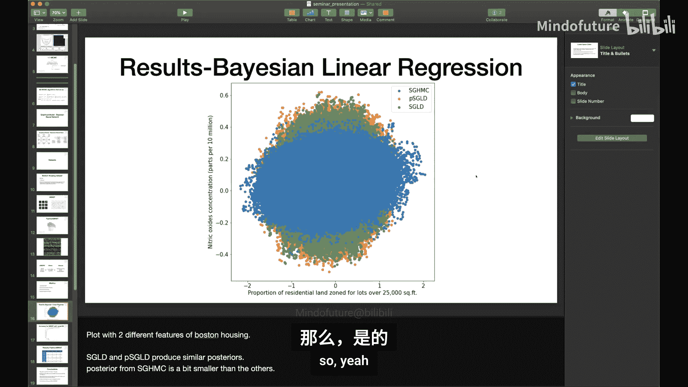
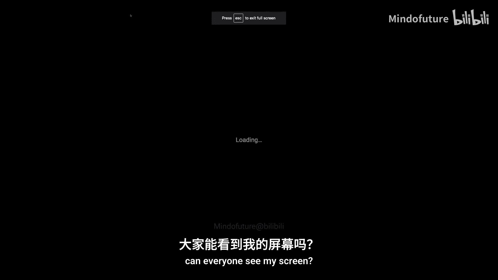
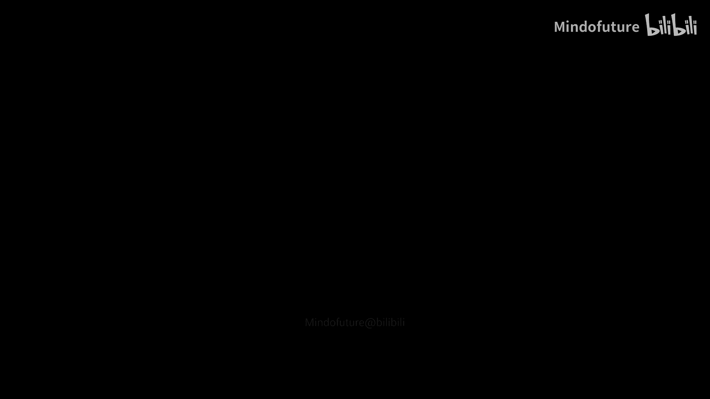
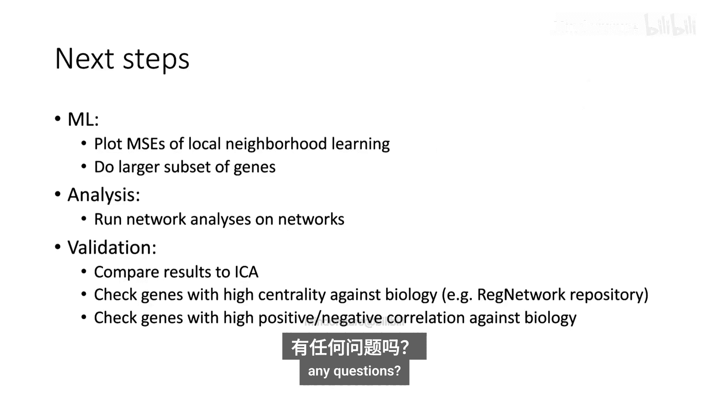
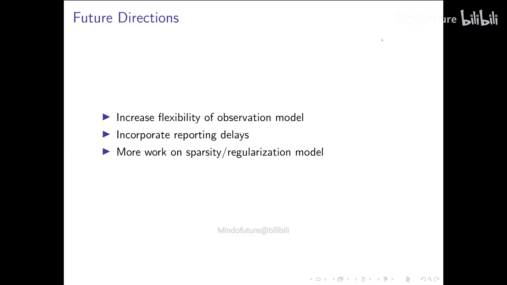
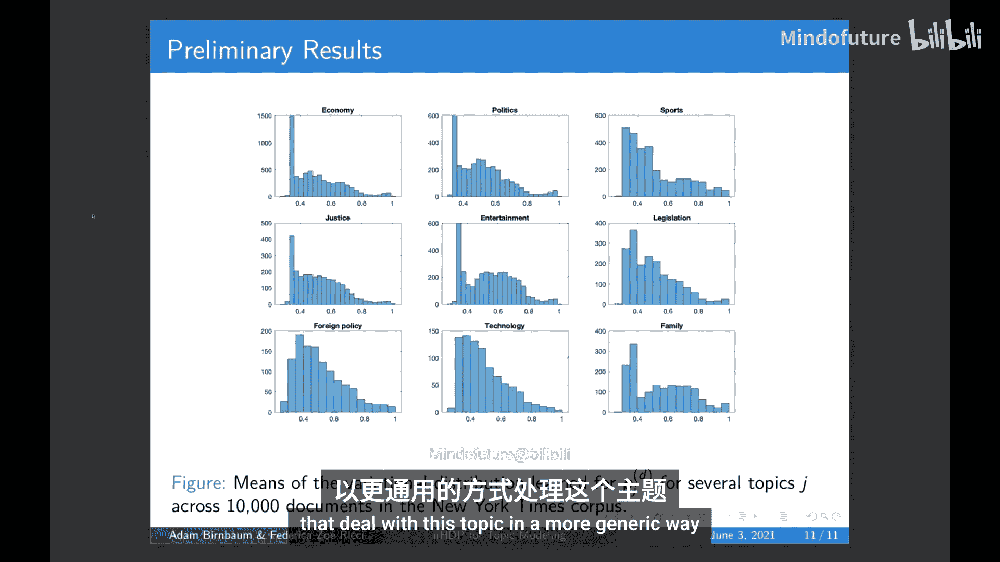
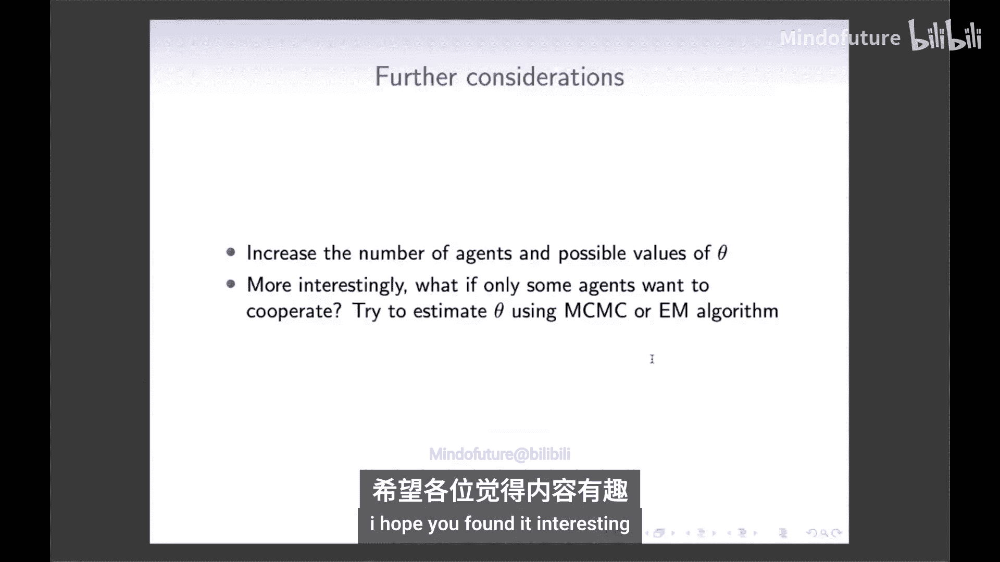
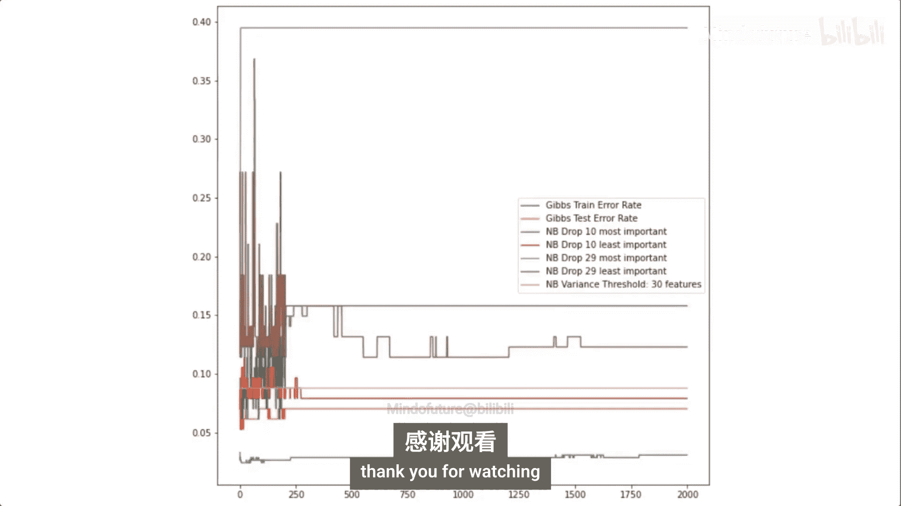

# 【加利福尼亚大学】图形模型中的学习 ｜ Cs274b ｜ Learning In Graphical Models (Spring 2021) p20 P20_项目 -BV1Tqx6zrEMj_p20-

Hi everybody， our project is Learning your own Connections and live Mouse recordings I'm Eric and we've got it Peter Vincent and Jonathan。

So our project uses data collected last spring， we want to model neuron activity in mice under different behavioral conditions。

 so as you can see in the image on the right there's a mouse there with a menoscoa test which records the neural activity on the mouse so we take the mouse we put in the box and then about halfway through the recording time we play an electric shock。

And then we repeat this process for multiple mice across different days。

 and then we expect to see changes in the neuroactivity before an act the shock as the mouse gets scared and then also across time as the mouse learns expect this shock。

So as you can see in recording B or a figured B， that's the raw data from the miniscope and then extracting neurons on the right。

 and then we record a time series activity of each neuron。

 as well as the spatial activity of each neuron。Yeah。

 so this is the sort of current state of the art for working with the spike train data so what most neuroscientists will do is take those video recordings。

 process them into binary spike datas， we can see some plots on the right here these are called raster plots each row here is a neuron and the points going across time represent whether or not there's an action potential or spike occurring at that time so since we're interested in studying the effect of this shock we're isolating time points and just 32 windows around the shock the shock is taking place halfway through this plot here and then one technique that we can use to look at associations between neurons is we can do some clustering of the time series data using a K middlelas clustering algorithm with the dynamic time working distance metric which looks at the similarity of temporal sequences so on the right here we clustered these neurons according to the postshock data so as you scan down these neurons are grouped according to this postshock data and towards the bottom we've。

If I had a cluster of interest， we call it where these neurons seems to have highly synchronous spikes right after these shock。

And so we can take a closer look at this cluster on the right we can see the spatial location of each neuron in this cluster the color is representing the cluster was before the shock。

 so this is showing that these neurons are actually being recruited from different clusters there seems to be some reorganization that is occurring bleeding to the synchronous action potentials after the shock but this is kind of the extent we can get with these traditional methods so in this project we should employ a probabilistic graph model to learn more about connections between neurons to get more advanced analysis。

so this is a pictorial render of what we expect the probabilistic graphical model to give us in both graphs in green are the connections we want to learn and in blue are the neurons that are connected。

And we expect from and this they should reflect experiments。

 E that the wire that the connections are different in the different experimental machines。对。

So the overall model that we're working with is a same semiparmetric Bayesian model for detecting neural connections is comprised of a non parametric and a parametric component。

 the non parametric component core part is this spiking rate piece of T that is a function of the firing rate U of T。

In beta， probably this important parameter of this model is essentially the connection connection strength between neurons。

 Eta is a degree of dependence between neurons， one means that it's independence and the P and Q basically are defined as above in the P of D。

The parametric component Coular model is defined as follows H is this joint distribution over spikeiking responses over all neurons Y sub from or I is1 to N。

And again， green， we have the beta connection parameter and FR the marginals of speciking for each neuron。

And this and then learning the parameters beta， they are forced to probabilistic interpretation constraint。

 and the authors implemented their own Monte Carlo method to learn these method parameters。

So to learn these distributions， they use Markco Monte Carlo。

 but instead of sampling these parameters with like something like the Gib sampler。

 they actually use a few sampling methods for the different variables So for the latent variables and hyperparmeter。

 they use a form of slice sampling which is basically a way the sample complex distributions where。

Well， while computation and only sampling for the uniform distribution on level sets。

And they have two flavors of this allipical slice sampler and just the regular slice sample for the laing variables and the hyperparmeters they also。

😊，Pioneer a different sampling method called spherical Hamiltontonian Monte Carlo for these data sets。

 so Hamiltontonian Monte Carlo includes a momentum term in the random walk。

 and this helps with increasing subsize and decreasing granularity of the random walk and the spherical part is just this parameterization of the distribution on this unit on this unit circle to extending it to the unit ball and here' is just an illustration of a path from A to B on that circle that how it's mapped onto the outside of the sphere。

And moving on， we have the results from 15 neurons。

 these 15 neurons all were from one cluster in the dynamic time warping clustering analysis。

 and left we have to control on the right way we have the experimental for each of the edges。

 this is a beta parameter and the beta parameter represents inhibitory connections if they're negative and excitory connections if they're positive。

And we don't see too much， but we notice both the emergence of new edges and also that it seems that the experimental。

To have more inhibitory connections。We also do this for a like a higher neuron case。

 so in this case we have all the neurons in the sample and they're all positioned where they would be on the camera and in this one it's much more clear that we can see in the experimental case that there seems to be more inhibition time after the shock。

😊，And。And so。Yeah， after show。 this is yeah。So if we look at our model performance more closely。

 we're looking at the edge weights or the betas for the 15 year case。

 you can see that most of the values are very closely around zero。

Which means that most of the neurons are actually not interacting with each other and then if we look at the plot of the betas across iterations of the MCMT algorithm。

 we can see that there actually really isn't a lot of convergence going on， this is for  10 neurons。

And then when we look at the entire network， the 116 neuron case。

 we see a similar distribution of beta is around  zero， and again。

 if we plot 10 major neurons we see that there's also not really any convergence going on。

 which means that we have to improve the performance。

So right now to directly look at this for the copyola model。

 we want to combine data from multiple shock trials into one run in order to get more aquaifying each neuro。

And then also prepro data a little differently to target more active neurons since our data set is much larger than the intended one。

And then also play around with the time window and the bin size to get behavior at different timescales and also less spae swiing data。

And then more advanced approach would also be to incorporate the spatial location of the neurons themselves into the algorithm since biologically we assume that neurons that are further apart are。

Most likely to be interacting。Thank you any questions。

Thank you that was great we have time for a quick question anybody has one。

Are you regularizing your model at all， you have， Jenny any sort of yeah。

So there is a constraint on the betas if you go to this go back to that slide。Yeah。

 so you can see a couple model constraint。So this forces the probabilities between zero and one。

And then we're looking at adding an additional term as well to account for the spatial data。

 so basically like neurons that are further apart might have a sensorensing out of their connection。

Just to clarify， I wouldn't call that constrain。Regularizer because it's just sort of like you need that for those to。

Define a valid probability distribution in this clus this is technical not this is is a constraint this own constraint we have but yeah。

 but you might， you know， there is a you said convergence and I think something for you to think about is is it。

Slow mixing of the markov chain or really kind of lack of identifiability like there's many settings of the betas that explain your data and your model can't sort of separate them and so sometimes adding the thing that you expect some of the betas to be sparse some of the betas to be zero or that。

Betas that are， you know neuronss that are farther apart or more like thatze betas might。

Make the model kind of easier to identify the graph structure。

 So I think I think as you those directions you suggested are good ones to explore sorry thanks。

 that's really good advice。 Thank you。 That was great。 Okay。

 well we have to move on so I see that a bunch of folks have have。

Volunteered own order in the chat so that's great Matthew if your group wants to go next that's that'd be good。

Hi。All right， let's share the screen here。是。Yeah。好。Right。嗯。All right。

 so our project consists of a comparison between a few different SGMCMC methods on Bayesian models。

 and this is where by Anthony Matt and myself。嗯。So as you all know， in Bayesian inference。

 we want to infer the posterior probability。Which is， of course。

 proportional to the prior times the likelihood。And。And as you might know。

 computing this integral on the denominator might be intractable because of the so many possibility of combinations of our parameters data。

And so。So then metropolis Hastings can be used to solve this。

 which essentially relies on just computing the prior and the likelihood。

But computing the likelihood can be problematic as well because if the data set is very large。

 it doesn't scale。嗯。So SGMCM methods come to rescue。

 and one typical method is the stochastic gradient lung dynamics or SGLD。

Where instead of looking at each time step， instead of looking at all the data set。

 we're going to look at the subset of the data。And there's a few differences compared to the metropolis Hastings。

 the first difference our updates for our data are going to be relying instead of relying on a transition distribution。

They're going to rely on the gradient of the log post probability。Okay。

 which instead of looking at all the data points in the data is only going to look at at the mini batch。

 okay， so for speed up presence。We also have an Epsilon T， which is our step size parametermeter。

 which decreases over time and it also is used as the variance for a noise perimeter eta。

And this parameter essentially allows us to explore the whole space over the thetus without just converging to the maximum of aity。

And then the second difference is we always accept these new states。

 so here's an illustration of the progress of SGLD。And as you can see。

 we're exploring the whole region and not just converging into the higher likely states and if I s。

To the end， you can see on the right， this is the approximation of our true distribution。

 which very closely relates to the one on the left。This still has a problem this method。

 and it is that it might suffer from slow mixing rates。And so to tackle this problem。

And this problem is just essentially due to having a universal step size that does not account for the difference in variances of across all theta。

 the perimeter theta。And so to account for this， there are solutions that use preconditioners。

 you can think of these as essentially ways of equalizing the curvature of the loss function around the gradient。

And one of those methods is PSGLD。A second method we study is SGHMC H for Hamiltonian Monte Carlo。

 which also uses a momentum term。嗯。So in the talk we're going to see a comparison between these three models。

 I'm not going to go into the details of these update steps for time constraints。

 and so I'm going to hand it over to Matthew who's going to talk about graphical models。Okay。

 so using the。Using the methods that Hadedro just talked about。

 we looked at Bayesian neural networks as our graphical model。

So here on the left I have the picture of a neural network that you're probably familiar with and then the corresponding graphical model on the right where the inputs X don't depend on anything and then there are hidden layer。

 so we have one hidden layer in this case， depends on both the inputs a bias and weight biases B and weights W。

And because we only have one hidden layer， the next thing is the output Y that depends on the hidden layer and its corresponding biases C and weights Z。

 so what we're going to be learning are the weights BwC and Z with the methods that Paro talked about and we looked at two different neural networks for most of these the examples that we're going to show。

 one of them was a small neural network with 10 with one hidden layer in10 neurons and then one larger neural network that had two hidden layers each with 50 neurons。

So that's the models that we used the data sets that we looked at or as the Boston housing data this is 106 different data points each with 14 attributes and what we're predicting is the price of the house so this is a regression problem some of the attributes that。

The data set includes or like the crime rate per capita and the proportion of nonretail businesses and things like that the next data that we looked at was the MNIS data which you're probably familiar with and this is just the classic classification problem so I'm not going to talk too much about that and then another classification problem that we looked at was the fashion MNIS data set that we have a cool visualization of here and this is just different pictures of clothing and the task is just to classify what kind of clothing is described in the picture。

So that's the data sets that we looked at and now I'm going to hand it over to talk about the results。

是。So regarding the results we tried four different metrics for that and the first metric is course the accuracy for the classification and the mis code therefore linear regression。

And then we chose the integrated autocorlation time。

 which is an estimate of the number of iterations on average for independent sample to be drawn。

 and given a continuous chain or market chain， of course。

 then we have the effective sample size which is inversely related to integrated autocor and measures how many independent samples would be equivalent to an MCMC sample。

And of course， we also have the estimate calibration error。

 which approximates the difference in expectation between confidence and the accuracy。

So the first result here that we see is a plot of the posterior distribution for the Bayesian linear regression。

 as you can see here we plot it with two different features from the Boston housing。

 the SGHMC is a bit smaller but the other two posteros are quite similar with each other。

The next result of course， is the accuracy for the amist that with a small Beijingian neural network I mentioned before。

 and the point of this plot is to show you how3 algorithms converge to their optimum。

 as you can see SGHMC reaches a better accuracy than the other algorithms and SGLD converges faster than the PGLD。

But we have to note here that amnes is and E Davis。

 and it's a pretty standard in deep learning and that's why we don't see a huge difference between those three methods。

And maybe in a more challenging task， we could see these differences。But。

Because you don't have a lot of time， we chose to present you like a table of the results for the fasciionnameist and not show you like any other kind of plots we shown before。

 so just as we mentioned before in order for a mold to converge faster we need the individual correlation time to be lower and the effect the same size to be bigger。

Right so as you can see here， the PSLLD for the bigger model converges faster than the others and we can see from the results here that the bigger models perform better and converge faster than the other ones。

 another smaller one than for the smaller model and of course the fashioner is kind of very similar to Mist regarding its difficulty but again we mentioned that we observed that the ion with preconditioners perform better。

And these are the final conclusions from our project， and we're open for questions。Thank you。

Thank you， did anyone have a quick question？Can it like that。嗯。I'll just I'll just comment that。

 you know， with the applying， you know these Bayesian MCmC to neural network ways。

 part of the goal is not just to do prediction like a center network。

 but maybe capture some of the uncertainty。And you know it's sometimes it's hard to know what's。

What the real uncertainty is， but I'll observe that one thing is that like on the linear regression you can compute。

The exact uncertainty in closed form because it's Gaussian and so you could consider a comparison where you compare the estimated variances to the true variances on that data set that'd be a nice kind of controlled test。

Yeah。that's kind of a good idea Eric we kind of focused more on like testing the models for convergence like which kind of file would converge faster eventually between those three some single data sets as you have shown here or maybe even for the calib but we didn't really think about the uncertainty per se but that's a good that's a good question that's fair I think accuracy is a fair assessment because these are approximate MCC methods right。

SGLD doesn't example from exactly the exact posterior there's some approximations there so yeah okay guyss great thank you why don't we go ahead and go on to our third group looks like getss Samuel has volunteered。

Yep， thanks， Eric。Can everyone see my screen？

Yep， yeah，' great。Great， okay。Hi everyone， we're working on learning graphical representations of migration patterns with socioeconomic data in the United States and our group is Sam。

 Edgar and myself。😊，So migration flows between states are essential to economic growth and development of a state。

 and although interstate migration accounts for a small subset of moves because it's much more common to move locally。

 this type of move is important because of its implications for regional demographic and economic change。

😊，So it'd be useful to simulate the effect of varying socioeconomic factors on migration。

 essentially treating those socioeconomic factors as a knob we can modify and seeing how that influences migration flows between states。

😊，So we'll look at domestic migration and within that we're interested in understanding what socioeconomic and demographic information most contribute to migration flows between a pair of states and by modeling this problem we can measure how policy changes impact migration patterns and simulate events that never occurred。

 for example， increasing the number of jobs reduces unemployment rate and we can see how this impacts migration into or from a state and this can help analyze and reason about the impact of implementing certain policies on migration。

😊，Thanks Pritci， to do this， we actually constructed our own novel data from an existing one。

 which was a very exciting experience we worked with a data creator we found on CAL that had 10 years of state to state migration data and then went ourselves back to the US census gathered five more years as much as we could get at that level of granularity as well as a variety of socioeconomic metrics that we thought would influence somebody's motivation to move those include salary。

 unemployment rate， GDP， crime， etc， as well as the latitude and longitude because obviously it can be prohibitive to move long distances as opposed to short。

In addition， we wanted to frame this problem in a useful way for graphical models and one of the ways we adjusted our inputs was to think as every migration as a composition of total exit from a state。

 so to be explicit， let's say 100 people left New Mexico in a given year and 20 of those people went to Arizona。

 that would be a migration from New Mexico to Arizona of 0。2 or 20%。In addition。

 we worked with our the original CAGL dataset set creator to make a Tableau dashboard for exploratory purposes and interactivity。

 if you're curious I'm sure we can distribute this link after the presentation the socioeconomic data may not be posted by now there were some issues with Tableau licensing but still very interesting。

Great here are examples of cases with the highest flow where as Sam mentioned the flow between two states is normalized by the total outgoing flow from the sending state and there's a few things to point out one is that these pairs of states share actual borders so there's geographical proximity also the direction of flow happens from the less pop state to the more popular state and furthermore there doesn't appear to be a massive difference in unemployment rates and or median income between the two so as we see in the plot if you look towards the right region of the plot。

 the states with the highest normalized flows don't have significantly better unemployment rates。😊。

Regarding related work， our approach that we ultimately take and get we'll get into in a moment takes from a couple different existing fields。

In particular our model is going to be a relational graphical model where we have entities and we're trying to extract the relationships between them。

 but in addition we can think of this problem as what's called a collective graphical model where you take aggregate data and you try to infer from that individual characteristics so you can think about that as population movements overall versus the individual movement patterns of somebody throughout their day that's the most common application obviously ours is longer term so we only take pieces of that in addition we have metadata from each state and there are some there's a variety of existing ways that people incorporate that including a variant of topic modeling your LDA there also stick breaking methodologies。

And lastly， for migration data， typically this is with more wildlife。

 but some people will model that as a hidden archive model。

 we don't directly use that in our existing approach but we did consider it。

So to the point with our approach， we do consider our model as a collective graphical model and we frame the objective as taking the metadata and then inferring from that metadata。

 the flows between states， although the reverse is also feasible。

 you can think about taking the migration data and going the other way。

The graphical model that we use for。For this project is the one we can see here， so namely the data。

 the insert data would be the XI and XJ for state IJ。

 that would be the metadata while the Delta IJ would be the flows between state I and stateJ。

So we model the delta as a beta distribution with parameters， W， alpha， IJ， beta Ij， which。

Wwhichch are calculated by basically multiplying or doing a dot product between India。

 the parameters is Lada and the data X and Xj。嗯。And so we're trying to learn this kind of like means of the。

We're trying to learn the means of the priors of these。Distributions， screen you go。And。

So what we did is that we created a pieytorrch model since this is。This is a simple graphical model。

 instance instance this model is not that complicated。

Create a pythr model in order to solve it with gradient descent so to maximize the likelihood。嗯。

And in order to so since the model outputs the likelihood we need some way to calculate what's。

When we want to do inference， we need to calculate the。The likelihood， for example， Delta。

 or if we want to do inference on the states， we can also do that。嗯。

And so we can use base rule to kind like solve the equation for what the likelihood of it is。

So the other thing that we had is that we had some priors on the on the Dltas for the。

if I'm prior from the beta for the inference。So what we found is that basically having a lower prior would give us kind of like a better result。

 however， if we were to look at how the。How this behaves when looking at。

High scoring samples and low scoring samples what the model would do sometimes is that it would predict a lot of like low numbers and and just trade off between like the high。

I numbered predictions so what we ended up doing is that。Um。

 we balanced this by taking a harmonic means between the high low errors and found that the best was kind of like a low alpha and kind of middle effect theta。

So these are some results of this， so what we did here is that we took the。

With an influence on the deltas for each pair of states in the last year。

 and then we just threshold the higher scoring deltas to show like。嗯。The'd like to show the arrows。

 but what is basically shows that a lot of people are moving from。

Like lower population states in California， Texas and Florida。and in addition。

 there's some other findings that we were able to extract from this in particular。

 if we go back to the graph and you look at the relationships down here and the high density of connections between Florida。

 Texas and California not only is that somewhat expected just because of the high population density in those states。

 but we also see this extreme lack of connectivity up in the northeast especially and generally through the north of the United States。

 so what you interpret that as is this idea that if socioeconomic change happens in a state that these。

Northast states and then the ones up above just in the North United States in general are more likely to dig in and not make any movements between states just on these socioeconomic。

Changes whereas in the south there seems to be more variability in addition it's also important to note that this isn't just a population biased inference here。

 so if you see Wyoming being it's an active node in this connected piece of the graph here。

 but Wyoming is the least populous state in the United States whereas California is the most we we expected that to have quite a few connections。

So。In addition to that。We have some next steps I'll pass that up to Bt In terms of next steps。

 we'd like to examine and interpret what the learn model coefficients mean specifically in the context of socioeconomic theory and migration literature also we're currently treating our metadata as is we don't have a ton of data which makes it difficult to use a neural network to learn meaningful features so we likely need to spend more time meaning manually engineering and defining features and if time permits we'd like to examine latent communities in the data set so say each state belongs to a community and essentially learn clusterings of states and perhaps find states that behave similarly or interact heavily with each other depending on how that's model。

And yeah， that's it， thank you。Great thank you， are there any quick questions？嗯。

All right， well， I think we should move on in the interest of time。

 but I think it's a very interesting data set and model family you're working with。Um。

So our let's see next Gilbert right。Yeah。Yeah。give me one second to share the screen。

All right so hello this is our project we trying to learn the structure of a graph model all the way you've shared it you I think maybe you shared for video enable you you have windows on top of your screen and that's showing those as grayed out okay is this better No there's like a couple rectangle on the your right side and a rectangle over the middle you probably need to drag them off off yeah I'm trying to drag him off this screen but it's not working I don't know。

嗯给。Okay。Second。嗯。Yep， that works Okay， yeah all right。

 so this is our project we're trying to learn a construct program model from data。😊。

And our motivation for this project is very simple。

 you know we have a lot of data and if you just look at these tables and rows of data it's pretty hard to infer relationships between different features。

 you know， for example， is this feature。More related to this feature or another feature， right。

 But if you look at graphical models， you know， if a node is connected。

 another node and if these are features and distance of a net is very。

Simple to look at these features are a relationship。

 but as we know that modeling relationships between features is not exactly a trivial task and so for this project we are exploring different methods to learn how to learn these relationships with features and we are focusing on under the curto models or aed fields for this project。

不。And we are using the census incomee data sets from UCI machineine Learn reposory。

The data set is originally created for a binary classification problem to determine if a person's income is more or less than 50k。

We have 45，000 observations which split into train and test sets。

Including the income feature we have 15 random variables。

 six of them are continuous and nine are discrete， after learning the graphical structure we are using influence on income fields and calculate accuracy on test set to compare our models。

Right， this is our approach as described before， we are using three different learning algorithms for this project。

And。Using these algorithms， we are we're going to learn the graph edges of the features here。

 the features being notes essentially you can think it of it like if you have a。

Fly connected MRf there， as in the previous slide， we are trying to learn which edges are the most important ones that can represent the data set best。

To evaluate our different graphs， we will calculate the local likelihood and we will infer the income。

Feature from the graph， as it extended with the data set。And for the baseline in the test data set。

There are so we are trying to predict which。You know。

 which people have income less than 50 k per year or more than 50 k per year and in our data set there are about 76% of them have。

And come less than 50 years。 So this will become our baseline。 if we're just predicting randomly。

 we'll get at this 1，7，6。 So our graphs， when we re our graphs， you should have more than 76%。

And this is our first method， this is our you know kind of like a baseline model this is based on directly from homework to。

In homework2， we convert these features from the data set about the discrete and continuous features into the binary features。

The way these features are converted is based on the income threshold。 So basically if a feature。

You know， a feature can have， let's say a discrete feature can have let's say nine different states like for example。

 the like an occupation feature， you know， you can have something like like a fisherman or something like a manager position or an executive and we just sort these。

Discrete features， discrete states by their proportion of how many people are more likely to have income more than 50K。

Then we just class。People with those。It shows the states as zero or1。

 depending on their proportion of have been more likely to have income less than 50K or more than 50K and as in homework 2 we are going to use the hour reor with approximately gradient descent。

Yeah啊。Ojectiveors are same to minimize the negative likelihood and to infer from the graph。

 you're going to convert the MRF to factor graph and use to people propag。And this is our results。

We can see that the lock likelihood is better than the fully connected model。

 We can see this is a very sparse graph， and。When we infer on this graph。To the income feature。

 we get about 81% accuracy， which is better than 76% and the training time took about one minute。

And the lambda here， as you can see， is quite high compared to the cohort which is 1500。

 you of a lot of regular here。And this is just a graph of。

The printing process of finding the best Lambda， you can see that we are firinging the lambmbda from000 to 10000 here。

 and it's like the zoom version of where the best Lambda is to get the bestlam likelihood。

And that is for method one for this project。All right。

 so our next method is the is a greedy method idea behind the greeding method is to basically find the pairwise connections that produce the conditional entropy of each。

😊，Of each node by as much as possible without it degenerating into a fully connected graph and the way we do this is basically we go through each node and we。

Find a set of neighbors that will。Minimize the conditional entropy of the node such that the。

Such that any other nodes added to the neighborhood will not reduce the conditional entropy of the node by more than some degenacy parameter。

呃。And this is done greedily because we we don't search through every node。

 but we go one at a time and we add the most we add the node to the neighborhood depending on how much。

Igitional entropy changes。Basically just maximizing as we add each node。嗯。😊，Next slide， please。

So here we have the results from different using different degeneracy parameters。

 as you can see if the degeneracy parameter is too high。

 our accuracy drops quite a bit and we're predicting randomly because we don't have any edges and。😊。

But as we decrease the degeneracy parameter， more edges。Appear and we get some much better results。

 but we get a lot more edges too， so inference becomes much more expensive。In each graph。

 we have the。The node we are trying to predict or the perform inference for as red。

 and as you can see。When we have around eight to five edges or aroundgeneracy peri of 0。1 is 0。5。

 we get some decent accuracy the total training time for this is about four minutess as compared to the  Iing model which is about one minute。

 so it's fairly slower and inference is much more expensive as well。呃。

We also want to model pairwise ethnicox only the existence of the edges。

 part of the weight of the edges， the challenge is we have a mixed graphical model with discrete and continuous variables。

We need to model a between discrete to discrete， continues to continues， discrete to continues。

We cannot work directly to joint likelihood since it includes a high order integral。

 but we can represent joint probability as a factorization of un conditional distributions。

And then we can model these conditional probabilities using a distribution from exponential families。

For example， continuous variables conditioned on everything else can be modeled as Gaussian and conditional probability of a discrete variable given everything else can be modeled as a multinomial distribution。

This means for each node in the graph， we need to estimate its neighborhoods and combine all neighborhoods to get an estimate of the whole graph。

We can also apply one regularization here and make some ats zero so we can represent E edges and achieve this partial graph。

Next slide， please。Here we have a visual representation of the graph。

AndVariable and affinities as edge。Variables， education number and education has strong correlation 11 and three because education number is just a tokenized version of education modeled as a continuous variables。

 these two features were included in the original dataset set and we have decided not to eliminate one of them since it's a good case to see if estimated ethnicffinities between a continuous and discrete variable really makes sense。

We can also see that medicalital status and relationship variables have a strong ethnicffinity as expected。

So this visualization allowed us to gain some insights about the model and variables。

And the accuracy on test sets when we use inference on income variable with this method is 0。 84。

Yeah， so just some observations from our results or initial results。

 we found that the greedy and the Nowise regression definitely performed better。

 but nodewise regression was about 10 times slower than greedy。

 thinking about maybe 30 minutes in order to make on the flip side greedy has probably the most amount of edges in order to get good inference numbers as compared to nodewise which had。

Less edges and。And had an easier time performing inference。Additionally。

 we haven't completely tuned our nodewise model yet we still have to perform some hyperparmeter tuning so the accuracy numbers might change if we compare our models to other methods。

They perform worse， but the idea behind this is to get a good visual representation and also to determine dependencies between features。

 so this is expected because if we wanted to get the most accurate results。

 we would just have a complete pairwise graph。嗯。Yeah， I believe that's it for us。All right。

 thank you and we will have。Answer any questions？Thank you。We're a little over time。

 so I think if anyone has a very quick question， we can take it。Otherwise。

 why don't we go ahead and go to Emmamanuel？grouproup。Maggie， you're muted。All right， okay。

 all right。Didn't get far that's good okay， our project is about learning the structure of gene regulatory networks。

Cs。😊，So first what is gene expression so we have DNA and this is then transcribed into mRNA and that is translated into protein and gene expression is basically the levels of mRNA or protein gene regulation is when genes control the transcription rates of other genes and thus affecting their expression。

We can simplify this as a gene regulatory network and in this example gene A is promoting the expression of gene B。

 gene B promotes the expression of gene C and gene C inhibits the expression of gene A。

So given mRNA expression data， our goal is to learn the network skeleton or the configuration of the edges in this network。

 and expression data measurements can either be single cell sequencing where we measure the expression of individual cells。

 or they can be bulk sequencing， where we measure gene expression of a clump of multiple cells。

As you can see， gene regulatory networks are inherently directed in cyclic and currently it's impossible to learn the structure of these graphs without perturbation data or time series data。

 so for our project we will focus on learning undirected networks。

We can also explore gene regulatory networks on a higher level of organization by identifying groups of codeexpress genes and we call these modules。

 these represent a molecular program and they're often groups of functionally related genes。

One of these module detection methods is called ICA， and this can put genes into multiple modules。

In this graph here， each node represents a group of co regulatedulated genes or co expresspress genes。

 and the edges denote the degree of gene sharing between these groups。

So we want to better understand the communication and coordination between these groups of coexpressed genes because this info can be useful for learning gene regulatory networks。

To answer questions about gene sharing and communication among co Expresspress gene modules。

 we need to take this from a module module network level down to a gene gene network level。

So we use singlet RNA sequencing data and then use ICA to identify modules and shared genes。

 use this information to then subset genes for a local peong graphical model。

And this local Poong graphicraphal mobile will help us learn an undirected gene regulatory network and identify gene neighborhoods。

 and finally we will compare and validate results from these two methods。So now Me。

 I will tell you about the look of theson graphical。

All right so what do we want we want conditional gene gene dependencies so what is that we want to know which genes are predictive of one another conditioned on all other genes right so what do we do we defined a joint markov random field distribution where each of the conditional node conditional distributions are Poisson we choose Poisson because we're using RNA seat data which is count data which roughly follows a Poisson distribution。

So if we take a look at the joint distribution defined below we'll see that as familiar right Poson is exponential family so we have our natural parameters data multiplied by our sufficient statistics and we have our log on normalizer but when we look at the log normalizer we'll see that there is this Xj times xk term。

Where the x's can take any values in the positive integers right so that term can grow pretty fast it grows quadraically and it's not offset by this log factorial Xj term right so what does this mean it means if any of your theta Jks are positive then this log normalizer will be infinite which means you can only measure negative dependencies with this joint distribution and we know then biology we have both positive and negative dependency so this won't work next slide please。

So what do we do， we stop trying to try to specify a joint distribution and instead focus on the no conditional distributions。

And when we do that， we'll find that we only have to sum over you know all the neighbors of a node。

 right， and that really helps the log normalizer。Well， what I just said doesn't help the log normal。

 but when we compute the log normalizer， we only have to vary x of J which is the node in question and then so what happens now is that Xj times xk term is just a linear function of xj。

And now that is completely offset by the log of Xj factorial right so what does this mean this means when we have theta JKs which are positive the log normalizer will be finite so we can model both negative and positive dependencies what if we sacrificed while we can't define a joint distribution and we lose the global Markov property but we retain the local Markov property right so any node is independent of the rest of the graph given its neighbors。

And now like we saw before， the previous group， learning these parameters is now reduced to piisson regression on each of the individual nodes in our graph。

 when we're going to also do L1 regularized poisson regression。Okay。Next slide， please。

So our first problem is with model selection so we'd like to choose our regularization parameter lambda however。

 we don't have a joint distribution so we cannot properly or get a real likelihood， right？So instead。

 we opt for some sort of consistency based measurement。And what do we mean by that， well。

 we take our data and we subset it roughly like you say 50 times we compute the Markov random field on each one of those subsetted data sets。

 right？And then we ask。If we chose two of those subset graphs at random and asked。

 what is the probability that they disagree that there exists on an edge between nodes A and B？

And you do that for every single possible edge。And you plot what would that probability be。

 this is the probability that any two given subset graphs disagree as to whether or not there is an edge between two nodes that's what we're going to plot on the right and that's what i'm calling consensus right so when you have a low lambda you'll have like 5050 and then you'll come all the way down to zero when there's no actual connection so obviously they all agree and then you choose some cutoffs like say 0。

1 or one in 10 times they disagree or1 in 20 times disagree and that's how we actually choose our lambda this consistency based measure so now we're going to actually show you some of our results。

嗯。Okay， so these are some networks that we learn for different land parameters a couple things to note one you can't talk to a colorblind and I apologize for that。

 but for those of us who aren't colorblind you have blue edges and red edges a blue edge is a positive correlation a red edge is a negative correlation this is the first thing to note so there's a lot of information there the second thing to note is that you know the visualization here is a forcedirected graph which means that the nodes in the center have higher eigenvector centrality。

If you don't know what that means， don't worry about it。

 basically what I'm trying to say is there's a lot of logging fruit here that we can analyze and interpret these graphs just through using graph theory。

And I guess the other thing to note is that the number of edges do corre do decrease as you increase that Lada parameter。

F。Now， if we do local posta regression， it turns out that we have an interesting phenomenon where the correlations aren't necessarily symmetric。

RightSo theta I to J isn't necessarily equal to theta j to I。

 so we were interested in looking at how different they were So in order to do that we calculated the standard error divided by this weird normalized term and the idea there is we just want to get like a good like order of magnitude to figure out how big or small the arrows are Re if we have an error of。

You know， 10 to the minus2 that could be very small or very big depending on the order magnitude of the actual thetas。

That we did， flood。And what we can see is there are two phenomena here。

 So the first phenomena is that as we increase lambda， the standard errors actually get larger。

And the number of thetas that are the number of pairwise thetas that are not both equal to zero。😡。

Decreases。Okay， so neither of these things are surprising。

 but it is interesting and I think there's a lot of interesting in analysis to be done here。What。

So next steps to just get a feel for the these great areas of the neighborhood learning based on your lambdas and do larger subsetsive genes not just 60。

 run just your basic network analyses on the graphs and then validate， as Maggie said。

 compare results to ICA and then check our results against the biology for what is known。

Thank you and we'll take questions。Thank you， any questions？

。So to get the overall network， what do you do you draw an edge if。

If it's it's if it's present in any of the local models。

 you start of doing an or or what's your operation yeah， you just to if an edge exists。

Then you just take the union of all of them。So if like if you get a you know。

 if you learn for A and there's an edge between A and B and then you learn an individual for B and there's no edge between DNA。

 then you say in the final graph there is an edge。对。All right， nice approach。So okay。

 let me let me do so I have a couple of。嗯。Pre recorded videos so i'm going to。

Drop in the first one of those here as a little bit of an intermission for a couple minutes。

So let me see。啊。嗯。

Hi everyone， I'm welcome to Taage in this presentation I am going to talk about recurrent latent variable Moic for extra car ECG data before jumping on to the topic I would like to give you some background information about the ECG。

The ECG is a time series data that reflects the electrical electrical activity of the heart using electrodes placed on the skin these time series data or more correct voltages that we measured are generated by the meaning of art cells。

The figure shown below is an example of a heartbeat that's segmented into five different parts。

 these parts show each phase of the PCD signal as it trails through the heart。

In general electroaldi and setups have 12 different chances that giving as much information from the heart。

 although most of the time the analysis are performed using a single channel for the sake of the simplicity。

 therefore in this work I also use single term citizen signals for the experiments。Also。

 as we work with the heartbeats， we get segment ECG signal for this purpose。

 there are so many different algorithms that are widely used in the literature。

However for this work I used Panic algorithm， which is the one the most famous one after giving enough background information about the application。

 now I want to move on with methods that I use for that。

As you saw from the title of this presentation， the aim of this project is to model the ECGCs using the graphical model。

After training this model it is used to generate heartbeat samples for this purpose I used variation auto encoders with recurrent neural networks in general the variational auto encoders are widely used to recover complex multi model distributions over the data by introducing a set of latent randomomer。

Wwhichch are designed to capture the variations in the observed variables for our case。

 the observed variable x represents the half bitat and as an example of a directed graphical model。

 the joint distribution is defined as an inclusion equation one。Moreover， in this work。

 the recurren version of the variation auto encoders is applied for the purpose of modeling sequences。

 typically several types of variation auto encoders are used for learning geneative models such as calm variational。

Carmon auto encoders and these models have been limited to either relatively simple state transition structures。

Or relatively simple internal state structure。However。

 the RNANs typically possess rich distributed internal state representation and flexible London transition functions。

These differences give Ors extra expressive power in comparison to other models。

This problem and the ability to train via aerobic propagation are the key reasons why I used to RN and the RNs have gained popularity as a genetic model。

As mentioned earlier， these models are used in combination to encode observed time series data using latent variables。

 a natural question that can be asked in here is how do we encodeote observed variable to via our latent variables？

The answer to this question actually depends on the nature of the data itself in this world we are mainly interested in highly structured ECG data。

And by high structure we mean that the two properties characterize the data。

 first that the data has a high signal to noise ratio。

 meaning that the majority of the variability observed in the data is through the signal itself map。

诶。From the noise sources。The others， the second thing。

 that should play complex relationship between the underlying factors of variation and observed data。

 which is the exact cause of heart signals， as I mentioned earlier the ECGform is generated as the consequence of the interaction of millions of heart cells。

These three figures showed the three graphical models of generation inference and recurrence operation for WLLN model。

The x represents the observed time series data， which is the heartbeat。

 the H is the hidden step of the RNn model， this z represents the latent variable。

And the variation of RNN contains another variation of encoder at every time step， however。

 these auto encoders are conditioned on the state variable H minus one of an recur neural network。

This connection helps the O qua to take into account the temple structure of significant data。

For the training of these graphical models， the objective function is a timewise time step price variational lower bound。

 which is shown in this equation as in standard variation of co。

 degenerative and inference models are joined the train by maximizing the variational lower bound with respect to the data parameters。

After training， these two。Moels the two cluster are sample to show the training performance performance between different epoch numbers。

 as you can see from these figures， the model's performance improves with an increasing number of epoch numbers。

Also I did the same experiments using another mid one of the abnormal heartbe cluster。

 which is the a fibrillation， as you can see the model also generates successfully from different class as well。

So I came to the end of my presentation， thank you for listening if you have any questions I'd like to answer now。

Yeah。Okay， great As that's very interesting。Project area。

 I think trying to build generatorative models of that data， I believe。嗯。M Berkin。

 I thought he was on the call， yes， so if there's anyone has a question， you could ask it。嗯。

All right， if not， why don't we go on to our next live talk。

 looks like that is Onkey is the next volunteer。Oh yeah。Screen。So hi everyone。

 my name is Angie Donong， my topic is Poling strategy over networks we work with Tyen。

Okay so here's the outline， so now let's go to the first part as you can see that there are two kinds of group testing。

 once the classical document and method is adaptive because you see assume that we have 100 samples of development into10 groups。

So first I need to check all these 10 groups and if we see that okay so two groups are infected we need to check all the individual samples in these two groups。

 so therefore that we only need to take 30 tests to identify the infected individuals from 100 samples。

As you can see that the P， which is a prevalenceval seems to be small， otherwise。

 if you have a large P， you I mean the certain number of tests per person will be larger than one。

 so therefore it's not necessary to do the group testing。So in other words。

 what we are interested is called the anoidductive group testing。

 which means that all tests are ci in advance， okay so here's the example。

So that is our pulling matrix A， so basically we're collecting samples into T that then we have the pulling matrix A where AI is to one the represents for one if the sample from individual J is present in the I test and there otherwise。

So basically， so the very of observation is the lo sum of AX。

So therefore we get y to the AX and y is the known vector of testing result， F T by N。

 we have T test and n individualss poly matrix and x is the N vector of viral load obtained from the patients。

So note that we also assume that the appearance in this x need to be small so that the vector x will be sparse。

 so therefore we have our ob problem because we won't have the x to be a sparse solution。

So we can this so we can solve the lot problem by a different algorithm。

And you will see that in the latter problem we assume that we know nothing about the vector x。

 it's just a random sparse matrix。But actually， because if we when we gather the sample， actually。

 we know the relation between each individual， so therefore we can derive the nano solution。😊，Of the。

Infection probability。So here here's a very simple result we won't have an infinitefinity linear graph。

😊，So PkT is the verxp that gets infected before T T and IKT is the probability that the versus K get infected in TT at1 T so heres the probability distribution。

So here's another run running box sample show you yes you can see that the red points represent the people that get infected okay。

 so basically the nose are back by neighbors。嗯。Okay， now here comes to our first formulation。

 because we assume that the very lot of x follows the code distribution and the is a y noise。😊。

And then we can found the two different entros。So we have like hx given y minus Hx is equal to the following。

 and we want this value to be smaller than0。So see we can write down the opt problem here this one and because we have x Gaussian。

 that was a y noise so therefore y is also Gaussian so that is the problem that we're prop in a proposal but I will tell you the two reasons that we cannot solve it so first a is like M by n matrix so we don't know like how to solve the found a and second see that we need to know the covariance of the x。

But you can see that from genetic solutions， we cannot find the covariance。😊。

So that's the reason why we post a second formulation。😊。

It's an optimal transfer formulation okay so here's all the notations。

 so now we still assume that a so the x is a very vector which is sparse random vector。

 we have y equal to a plus the y noise。😊，And so we know that Xk generates from the in probability PKT at time T。

 so therefore we just normalize the PKT and y to get like two different distributions and the optimal principle problem trying to find the optimal coupling matrix with respect to the cost matrix the。

😊，see， that is a very classical mesh problem you can solve by linear programming。

But also you can solve by approximately origin， it's called S。

So that is when you add this entropy term， so we can make sure that this objective function is three convex okay。

 so the syn is that you're just trying to regarding your coupling Q with to with respect to the two models A and B to get the optimal opting because of the book theory。

 the convex is guaranteed。So here is the all graphical model。

 okay basically we just transfer all the math de on N to M。😊，Okay so that's my assimation result。

 as you can see that that Q is what we get from the singlehole and that is the originalal polling matrix。

 you can see that the Q becomes more bars which means that we so that in each test we contains less samples basically we can we have a chance to make it more accurate。

😊，Okay， so that is a more complicated poll matrix A。

 And now I will like that into illustrate the effective representation。

Thank you n so consider a factor graph representation for the above problem if we think of x as random variables then we can create a factor graph with one factor for each row of the pullinging matrix and a dense factor graph representation can be constructed by adding edges just between each factor node and every single random variable node as shown the graph here。

But since each of the factor would have a cardinality vector of length N。

 which means for each factor， no the size will be n to n。

This means for even a relatively small test batching over a size， say n equals 32。

 the side of the value matrix would be immense， so this is not an ideal way of solving the issue。

Next page， please。So alternatively， we consider utilizing LDPC well an sorry LDPC code is a block code that has a parity check matrix that is sparse along every a row column。

And this。Parsley check matrix in a way similar to our sparse pullinging matrix here。

And the problem can thus be conveniently represented as a factor graph。

We won't go into specifics about LDPC here， but the important lesson from LDPC itself is that the number of edges in the graph scales approximately linear within n rather than quadraically as showing the fully connected graph in the last in the last page and the sparsity this graph representation further simplifies the decoding。

 which is the reconstruction of X from the polling matrix。And the testing results process。

A strictly sparse input means they are much smaller than n nonzero coefficients and well this problem can be solved by an already published algorithm called Cs which is not exactly graph related but is a very efficient algorithm well our main focus here is reconstructing the approximately sparse viral load。

Where they are okay much smaller than n large coefficients and the remaining coefficients are small。

 but not zero。Next， thank you。So we use a two state mixture Gaussian distribution as a prior model for the coefficients Act the methods we're using。

We're trying to implement would have a worst case complexity of analog log n。And apparently。

 the solution for reconstructing n from the polling matrix and the testing results will be infinite and lie across this hybrid plane。

 which we visualize in this graph。Using the mixture Gasian model for the coefficients。

 the blue line represents a set of x that satisfies our requirement。Next page， please。

So this is a demonstration of the fact graph we're going to use we're actually using to solve this problem。

State Q might defined here， which is in a way directly relating to x and the prior factor knows imposed of the newly prior on the Q in in updating the graphs with UPBP。

 we approximate a distribution by mixture Gaussian with。

A maximum number of components and use a mixture gausian parameters as messages。

We're still conducting the experiments， so unfortunately we don't have proper result graph to show yet。

 but were expecting to present we expect to be presenting them in our project report。Thank you。😊。

Okay， thank you。Um。Let's see any quick questions before we move on？All right。

 next up is Isaac's group， Isaac， do you want to go ahead yep， one second let me just。

Get my slides ready。Yeah。Okay， yeah， so today we're going to present an application of graphical models in infectious disease dynamics。

So some people probably already know this， but when you're talking about an outbreak of an infectious disease。

 there's a number called the effective reproduction number RT at time T。

 which is defined as the average number of individuals。

 an infected person is going to infect and it's a quick way to gauge sort of the sort of spread of an infectious disease if RT is less than one。

 that's an indication the infectious outbreak is slowing down and will eventually die out if RT is above one that's an indication that the outbreak is out of control and is going to continue spreading。

So the problem that we're tackling is a sort of fairly common one where we would like to infer s predict the effective reproduction number and also observed cases based on observed positive case counts in a sort of time series。

So to get through。Background， there's this common class of methods， which。

Essentially it conceives of the spread of infectious diseases as a specific kind of branching mathematical branching process and when you do that you can do a bit more mathematical derivations and you come out with this nice mean relationship here which links current incidence of time T which is called IT sorry incidence by the way means number of new cases so the new cases of time T is equal to the effective reproduction number times await weighted sum of previous incidence values。

So what's useful about this is that like now there's sort of this modeling relationship that we can use case counts to get back to RT and so there's lots of different models that use this relationship and we're going to sort of adapt one of them in this presentation。

So。What did we try the first thing that we tried was trying to add some regularization to get rid of some of the dependencies in the model。

 so if we go back to the mean relationship， we have this weighted sum of previous incidences right now that means that every single incidence point is dependent on every other previous incidence point that's like probably unnecessary。

 but that didn't work out too well so we're not going to spend too much time talking about it the other thing that we did is that these models usually assume that the observed number of cases that you see is actually the true number of new cases that you see which is of course never true in a real data situation。

 we're always actually observing a reported case count which is some fraction of the true underlying incidences。

 so the other thing that we tried is we added on a observation model into our model which models the actual observed cases as a function of the true underlying incidence which is unknown and the number of tests for a disease which we assume is known。

And then we implemented our model in our stand and using Hamilton and Monte Carlo。嗯。

So here this is a model of a graphical model of the excuse me this is a graphical representation of the model that we're working with here。

 so in gray that's the observed cases， those are the numbers that we actually have and then we relate them back to each incidence value at each particular time point these are unobserved values and then these arrows connect each of the incidence values to each of the other incidence values that's happening through the mean relationship finally we have a third layer which is the effective reproduction number at each time point we have it affecting each incidence value and then we also make it so that each effective reproduction number depends on the previous one as sort of just like a smooth estimation out a little bit。

And。So yeah， so the contribution we're making is we're adding this extra layer at the bottom in gray the observed cases。

 we're going to compare this model to a previous model where that doesn't exist。

 so where we assume instead we just have these two layers and the data that we have are actually the true incidence values。

 regardless of whatever tests are available。And we're going to apply this model on data from the SARS Cove to outbreak in Orange County。

 California， so we have。The number of positive cases and the number of total tests performed for COVID 19 for April 2020 through September 2020 in Orange County。

 California， and these are the time series that we're working with here。嗯。Okay， great。

 so I'm going to talk through some of the results that we got from our models now。

So what we're looking at here are the fits from our model。

 the new one on the top and then from the previous model with only those two layers down below and what we see is this is moving forward in time from April up through September and we are using the data from April through the end of August to train our model and then we predicted 14 days out into the future and that can be seen as the portion that is past the dotted blue line。

嗯。And just some things I would like to draw our attention to is that between these two。

 it's relatively similar in terms of overall shape， but if we look at the shapes of the curves。

 our curve is smoother over time and what's being shown in black is the posterior means and in blue we're showing 95% credible intervals。

So if we were to compare our credible intervals to that of the previous edition of the models。

 our credible intervals are tighter and we also see that this is true for the prediction portion as well and we see that in the prediction areas the credible intervals are much wider and that is somewhat desired because this is in a region where we haven't really seen anything yet。

Next slide。And now what we're looking at is the same time period but we're looking at the cases rather than the reproduction number and so the reproduction number is something that we never truly know。

 however cases， well at these observed cases is something that we can know and that's what's being shown in red and what we're seeing again is similar behavior with respect to the widths of the credible intervals and that our credible intervals are much tighter than for the old model and it's a little bit hard to see。

 but our posterior means seems to fit or be closer to the true observed cases for most of the days and I would also just like to highlight especially when we look at the prediction portion towards the end there the credible interval is going somewhere from around zero up to 1500 while ours is only going from like 150 up to maybe 300 so we're getting much more much less uncertainty from this model。

And it also seems to fit the up down motion a lot better in the middle portion around July as well。

Okay。So we also used numerical metrics to evaluate our models and the first is mean absolute to the deviation and this is just how far away our posterior mean is from the truth。

 the mean envelope so often we cover the true value inside of our credible interval and then credible interval width which is just how wide our credible interval is。

And let's move to that table now so ideally we want the mean absolute deviation to be low the mean envelope to be high because that's the coverage and then the mean confidence interval we kind of want it to be tight but we also want coverage there's a bit of tradeoff there and what we see is that for our model across both the train and the test portions of the data we get better performance on everything except for the coverage and that's sort of the tradeoff between these much tighter confidence sorry not confidence credible intervals we see that ours on the test that is 135 while for the other model is up around 1000。

And so future directions， we can increase the flexibility of our observation model。

And then we can also incorporate reporting delays so this is the issue where in reality the observed cases as they're being reported。

 they don't all come in on the same day， sometimes it can take up to two weeks for different centers to get their numbers in that wasn't so much of an issue for us because we're dealing with old data but in real time that would be something we'd be concerned about and then also as we previously mentioned we were working on forcing sparsity between the different days and working on getting that model to fit better。

And yeah， so thank you for listening and open up to questions out。Thanks。

 some very interesting results there， any questions for Elliot or Isaac？

Good， all right， well in the interest of time that I think we should move along。Let's see Junenlin。

Do you guys want to go ahead？hello。😊，Can you hear me。Yes， I think hear you。

I don't see a slide yet， oh there it is。佢怎么翻。Okay， our team project is metropolis light transport。

 and my team number is Kai Yan and Yu L Wang。 So metropolis light transfer is a global illummination application of a variance of the Markov chain Mo Carlo methods called the metropolis hasing algorithm。

 This algorithm is used to sample from render in to generate the image。

 Our teaer can the comparison between the traditional pass tracing bidirectional pass tracing and metropolis light transport。

Metropolis light transport can slow complex light transport based on the metropolis hasting method。

 It shows strong， strong performance under complex things such as the long tunnel and water plastics。

And here's the relationship graph between each key term that will be discussed in this presentation。

 so each term is based on the knowledge from previous terms and eventually leads to metropolis light transport。

In the first part of this presentation， we're going to first go through some background information on rendering。

Which are terms inside the Great circles。So if we're talking about rendering。

 as you probably have heard， a common techniques often can use is called ray tracing。

So retracing is rendering techniques for generating an image by tracing the past of the light。

The first re tracing organism was introduced in 1968 to calculate geometry savingd。

For our implementation， the rendering equation used to generate images contains three components。

 BDR。The direct illumination and also the indirect illumination。

Direct illumination considers light only from the original source。

 and indirect illumination in addition considers how the light path is bounced on the scene and they varied the final contribution after a certain number of light bouncing。

So the bidirectional scatter scattering distribution function。

 PSDF categorize the scatter of optical radiation from a surface， as you can see in these images。

It computes how the light ray bounces on surfaces with different properties。

The rendering equation then is an integral of the product of light illumination。

 BSDF and the geo geometry term。The illumination is some of direct and indirect illumination。

As you can see in the middle equation here。And so in order to compute this integral。

 we need to use Monte Carlo integration。Which can be rewritten with a probability density be proportional to a geometry term。

And here shows like a pseudo code of the Monte Carral integration。

 the random number is generated by uniform hemisphere sampling in R3。嗯。有。

And there are two sampling strategies for rendering equations， the BSDF sampling and light sampling。

Sometimes PSDFs I'm playing is better。Specifically， if the light source is large and close。

And sometimes light something better when the light source is small and far。

So we need to introduce multiple people important sampling in order to weight this few sampling methods。

Here are the equations。For those sampling methods。Here is our equal time comparison of BSDF sampling。

 light sampling and multiple important sampling for a scene we can see multiple important sampling allpers both methods for the scene。

So the bidirectional pass tracing has one surpass starting from a light source。

And then a second sub passs starting from the camera， and then two paths are joined together。

And we use the multiple important that Paul talk about from last slide。

To join possibilities and combine contributions for each life pass。

So the bidirectional path tracing generate samples using all possible subpath from the light source to the camera and combine them using the multiple important sampling。

And here is the equal time comparison between single pass tracing and bidirectional pass tracing。

 and is performing a lot better。And this is another example of that。SoOkay。

 so now we are going to discuss metropoli slide transport。

 so basically it is based on bidirectional pass tracing and metropolis hasting methods it can slope complex things such as the long tunnel or water causs by pass mutation based on the metropolis hasting draw each light path using the bidirectional pass tracing as we discussed before。

Metropolis hasting algorithm is a Markov chain Mo carlo method for obtaining a sequence of a random number samples from a probability distribution from which the direct sampling is really difficult。

 This is the key algorithm for the metropolis light transport。And here's the example。

 we can see when the sample size is small， the metropolis algorithm cannot reflect the actual distribution。

 but when there's more samples， the distribution becomes more closer to the reference。

Here are two steps for the metropolis light transfer first is is to estimate the normalization factor B using the multi Carlo by drawing the sea pads on the bidirectional path tracing。

Then we pick the representative C for the next step。

 the step two is to apply the metropolis hasing method to generate the samples according to the F and F is the render equation for the bidirectional past C。

And here's the procedure code for the step2 for each iteration。

 we need to pass mutation as the G function for the metropolis hassing algorithm and calculate the acceptance probability based on the mutated pass Now we we can sampling on the mutation if the mutation pass is accept。

And now we are going to discuss what is path mutation is。 And here's a figure of the path mutation。

 I mutate the light in order to find a nearby path in a scene。

In order to find a desirable pass mutation， we need to know how the mutated paths have high acceptance probability。

 It should also have a large large change value compared to the original light path。For example。

 when you you can see when the abstract value between the original path and original path and utility path is large。

 we usually accept this rate。And here's some of the result we currently have。

 and here's the equal time comparison between the bidirectional pass tracing and the metropoli light transfer for the water cas。

 You can see the metropoli light transfer have much less noise。This is another example。

 the thing is is complex because the light is come from a tunnel outside the door and there's an equal time comparison between the pass tracing bidirectional pass tracing and metropoli light transport We can see the metroized transfer have much less noise。

The major benefit of the metropoli slice transfer is the function F does not have to be a PDF but proportional to the probability density。

However， the issue is that it sometimes have a burning period by discing the first few samples。

 which cannot reflect the actual distribution。 and sometimes the and also the samples are correlated causing some issues。

And for example， in this two really simple thing， you can see metropoli slide transfer has worse performance compared to the traditional ray tracing method due to the correlated sample and burning period。

Our of software is based on my previous work price with differentiable rendering。

 we adjust code to our needs as well as implementing the metropolis light transfer on our own Kayya implement the rendering pipeline drilling Wang implement the metropolis hasing algorithm used for the metropolis light transport。

And thank you very much。Thank you， that's a really cool application Monte Carlo methods。

 any questions？😊。

Okay， so the next。volunteerolunteer was JU and I believe they are one of the recorded videos。

So let me。Share that。Books。Actually， hold on。 I think that。

All right， here we go。Hello everyone， I'm Zhu I'm Howard， I'm Han Shao。

 we are going to talk about our project Community on a social network。😊，In these days。

 mobile devices have become essential to our living and as social media platform blossoms。

 the connection between people has been as intensive as ever before。

 which makes community detection an important and interesting question as we observe the connection between individuals or entities。

 the similarities between people acts as a force of gravity that pull people together to form communities。

And these communities tends to have similar structure that there will be large number of connection within communities and only a few connection across community。

 so comparing to the mixture model which assumes conditional independence。

 other classical classification algorithms place each individuals to a single community。

 which is unrealistic。So to model overlapping community and interrelated preferences。

 we use probability vectors to assign community membership。

 And so this is called the mixed membership stochastic block model。 So to talk about MMMSB。

 JU has more。😊，We use the mixed membership Soastic block model introduced by this paper。

 the model assumes that there are K communities and that each node I is associated with a vector community membership data I which sums to one。

Consider a single pair of nodes IJ， conditionally on their community membership。

 we can calculate the probability that there is a linkage between those two nodes。😊。

W whichch is represented in equation1。 So the first two terms represents the probability that those notes draw an indicator for the case community from their memberships。

And beta K represents how densely connected the case community is。

The model captures the authororative node with similar memberships， which are more likely to connect。

The paper used meansled variational inference because the posterior distribution for the parameters are very hard to calculate。

 mainly because we cannot calculate the marginal distribution in the denominator for the posterior probability。

By defining a parameterized feminine of distribution over the hidden variable and then feed the parameter to find a distribution that is close to the posterior。

 we can find out the best estimates for the model。So the main goal is trying to minimize in the KL divergence with respect to the posterior distribution。

 however， due to the same reason that we can calculate the margin distribution for posterior the KL divergence as well。

😊，So we use a variational objective function introducing equation 3。

 The first term is the expected value of the log of the joint distribution across the variation distribution。

 and the second term is the entropy。To avoid the overfitting problem。

The paper used the algorithm that iteratively subsle a set of pairs and then updates the current estimates of the community structure。

 which is represented as a matrix gamma that describes the posterior distribution of each node community membership data。

😊，So at each iteration T， we subsample a set of pairs of nodes S and for each pair of nodes in the set of nodes S。

 we use the current community structure to compute the interaction parameter V hat。

 and then we adjust the community membership gamma and repeat the process until the inference conversiongence。

Now that you know how the model works， X will talk about the data。

The data we are using is provided by Hornet， the second largest gay social network with over 30 million users around the world。

Founded in 2011， the company is still rapidly expanding its user base in markets of France， Russia。

 Brazil， Turkey， across Europe and in the United States。

So these snapshots are basically what you would see every time when signing in the app if you registered as a user。

It looks very similar to the Facebook where you could post moments or video stories。

 send chat messages， or get in touch with people nearby as well as around the world。

This is a huge data set where with more than 10 million users and 100 millions of edges。

 but the overall connections are still very farrse。

 the top field celebrity type users have most of the edges and then more than half of the normal type users has degrees something less than three or4。

So at each iteration of the algorithm， the first step is to set sample a set of pair of so node。

 For example， we could do random pair sampling， which means sampling uniformly from the set of all pairs。

 or we could do random node sampling， which sample a node and select all its linked pairs。

 The baseline sampling method we choose is the link sampling that samples the edges directly。

 So this is particularly helpful and efficient in our case。

 because it may be difficult to find edges by sampling edges in in such a sparse graph。

 So this are the names of the sampling methods that are used by the paper。

 and our pair means random pair sampling our node means random node sampling and link sampling means directly sampling the edges。

And batch means doing batch inferences， or namely would break the entire dataset set into a couple of batches and remember the sufficient statistics of each batch during the iteration for later use so that we could gain some computational efficiency。

So this is the log likelihood of the algorithm using link sampling the first graph。

 it can be seen that the log likelihood converges very quickly within 60 iterations。

 The second graph is kind of weird。 So this problem may be due to the sparsity of our network when simply sampling edges at random。

 but it can be shown that when we do a stratified version of these R pair of sampling。

The log likelihood would resumes。Increasing， the performance of R node sampling is less efficient。

 as we predicted earlier， and it gradually converges somewhere around like a thousand0 iterations。

So the batch inference also does a good job and it behaves almost as good as the link sampling method。

 but a point worth mentioning is that it takes much longer to run for each iteration。

In this graph we plot the link sampling results and determined by the model there are 76 community assignments and notice that although the communities are pretty distinct。

 the number of connection or the edges between the communities is still very large and also the link sampling captures the nodes that overlaps between communities and to recall this method as the other methods mentioned previously didn't use any covariates。

 they only use the connection between the nodes or the entities。

So since we have covarirous information， we want to look whether the covariates can also help assigning communities。

 we will use caings to cluster on the demographic variables， including the geographic information。

 which is the longitude and latitude and also the language spoken。

Plottting the labels we can see that there are only eight communities which is determined by the sum of square distance and we can see it produce similar results as the sampling。

 so to conclude the H network concentrates on a very small group of people that means most of the edges belongs to a few people and the batch methods converge with lease iteration。

 however it takes a very long time。And for link sampling and most importantly。

 because it samples the edges， so it fits our model the best since our network is sparse and finally。

 looking at the covariates， we verified that the geographic location and the language spoken。

 both impacts community formation。😊，Thank you。嗯。All right， I think。

Some of the group members are here if anyone has a quick question。

Y a quick question so the labels that impact the communities you know that define the communities the both are the language spoken and the geographic right I mean the ones that can turn the 70 communities into like six communities or something so I'm just yeah just curious if there are these are not the only two labels are there are any more labels that define communities。

You mean specifically for the demographic variables？Yeah。

 so we look at the demographic fair which are the latitude and longitude and also the language。

 we use these three to do the K meanss to look at how covarius affects community assignments but。😊。

But in this case， when we use K means that means the assignment is only assign each entities to a single community。

 not like it doesn't have like the link sampling that consider overlapping communities。不。Okay。

Okay great I think let's move on so we don't get too far behind Stan do you want to I think you're next up if you want to yeah whatever your presentation yeah。

嗯。Its my solo cost project， the title of my project is unsupervised U segment where MIF based formation restoration and iterative graph card。

organ s is specifically to extract the atomic structures from CD images or the MI images。

 which is a critical steps in image guided treatments included in the radiotherapy in how radiological diagnostics。

And currentlyly the organ the state of art sitation results comes from the supervised methods。

 such as the classical unit， but the problem is that these kind of work these label intensity labeling especially in the medical area because it normally requires multiple doctors or decisions to double check the correctness of their labels。

 and before the deep learning area， depending learning age。

 the atlas based s methods is quite popular and commercially accepted well。

 and these kind of methods heavily relies on the graduation。

 basically it will project the structures in the atlas onto the target images in processing another kind of。

T of sit methods is called the interactive s， it also requires a large scale of data sets in training and it its goal is to subtract the foreground objects with minimum user interactionss。

 including the marking or selecting some Cs from images。

The overall of my methodology is to combining the illustration and the graph cards first of all。

 given the atlas images with the mask and the target images it would do illustrations and they hopefully they will get a on target images based on the atlas and then the the very initial positive were generated from thed the mask and then when the percentage graph card algorithms and would iteratively we will refine these predictions and the current positive fees will be selected from the last be iterative generated foreground prediction。

Here we goes to the first part about my methodology there are many types of deformable registrations here I was selected to do the discrete dense displacement sampling and basically it is a discrete optimizationization problem and in our scenario it is the MIF labeling problem and it is a classical MIF labeling problem and energy cost of function the first the data term is basically to measure the difference between the fixed fixed images and registration rest images and the term is to measure the difference between difference between displacement of the neighborhood pixels of boxess。

To simplify our work， I would choose to construct the minimums span entries from the MIF which is the grid of the images。

 I think in the medical images， the generated MSF because sufficiently reflect anatomic connectivity of the organs or all the body and under the generated the MST graph。

 we can ensure the global minimum using the master passing algorithms。

 and the way we construct the MS T is to first is based on the grid the grid the grid graph of the images or the volume and the node is the node P is basically a group of v cellss and the age between the P andq is sum of absolute difference among them。

哎。Solving these MIF labeling problem in the deonbo fluctuation parts。

 I would choose to do the dynamic programming because under the MST。

 given the displacement of the parents' notes， we can easily go to the displacement of the children node。

And here's the second part of my methodologystrology， it's basically a MIF labeling problem as well。

 but the difference is that the label space is basically combined with one lens one and zero and we have to generate the color distribution models from Cs we select it ahead of time and the z in this equation is a box of value and apparently we can replace it with any features that we want。

嗯。The difference between the original graph card and the graphra card we used to hear is that we cannot fully trust the prediction generated from the restoration different from what we do in the user interactionss so that I have to select we have to carefully select the positive C or negative from the prediction in the previous restoration process and the way I use it here is to select these theses from the scientists and map and I would set a cutoff so that I would to make sure that the CI select these I have more competence in their prediction。

And the way。The way I solved this MIF labeling problem is main algorithms and first of all。

 after constructed the graph based on the images， and is combined with the two destination nodes and the image grade so what we do here is to find the cards。

 whose flow is a minimum， whose flow is minimum among all the cards that we can get。

 therefore we can generate the two subgraph not connected with two destination node respectively。

The overall logic of my iterative sta is to c the prediction from iteration and then select the positive by active seeds fundinging and it will be used in the next iteration and the stop crition I set here is to check whether the prediction will be changed will be changed or not compared to the elastic expression。

 but I think there are still room to improve these stop criterion。

The data I used in my experiment these comes from the Mikai challenge made up with3 a city volumes and the3 organs are labeled but but I will only use for of them is really relatively simpler and Ats as for the Atlas images I was selected to the first sample and I would do to resle crop and pads for all the city volumes to make sure that I have the same size。

 the supervisy motor the benchmark what I selected here is a unit and。

And the first example I will use， I'll always put it in the training set and the overall evaluation score will be generated from the vice54 cross validation。

The method I proposed is de form of restoration plus the iterative graph cards and the evaluation matrix I select here is the die score and the 95 percent yield cost stop distance。

From the result here we can see that the data driven solution， which is UN3D。

 could still outperforms other unsupervisor methods。

 but we can see that ins to the 95 percentage host of distance the restoration based methods could outperform the UN3D because the restoration methods will enforce more shape contrain tutor optimization methods。

 but the UN3D do not explicitly encoded the shape prior。

And compared with the restoration methods and the restoration methods the iterative graph card。

 we can see that the improvement is obvious。And we can see some see some cases here the first of all I will show some successful cases and we can see from here the sp is represented is represented by the the。

The blue mask and the。Adddition is evaded due the long region。

 but after the traded ground graph cut the the。The prediction returnss to normal。

And here's to one more extreme cases， and we can see in the middle restoration prediction。

 it is completely missed the ground shoes。But hopefully。

 but luckily the prediction on the Naple slide could give the motor reliable reliable representatives to the ground shoes so that's the itative Gcock recover the prediction generally。

 and we can see from the results here is very promising。But here's some failed cases。

Even though that we can see that the iterative graph card can greatly correct the prediction of the liver。

 which is a green mask but it can also recover the prediction of the left kidney and spen because the registration message cannot provide the reliable initial mask tu to the following walk so that the iterative graph cards is heavily relies on the prediction of the registration to give it a。

Representative sees so that it can generate robust GM models to。To to。

 to model the color distributions。So basically is well I do， thank you， I'm open to the questions。

Great。Thank you。😊，I think we're running late so we should move on by thinking that's a very nice application。

嗯。just just to clarify is the is the convolutional network the unit trained on just that same set of data is that right yeah yeah Okay so that's probably why it struggles a little bit because that's。

Not a lot of labels for that approach and why you can get advantages from the un superervised。

 so that's nice。Good， all right， we're in the home stretch， Adam and Federicica。

 do you want to go ahead？诶。

Okay， so。For our project， we were looking at nested hierarchical gearlate process based topic models。

In particular， introducing branch specific stopping probabilities。

Just like quickly setting up motivation here， right？

Like a an approach people may be familiar with for topic models would be like lead and gearly allocation right and so kind of the。

The task here is to learn a set of topics that are featured in some corpus。

Where the documents are represented as like bag of words models right so we're discarding structural relationships between words and we're just encoding documents as。

The set of words that appear in them and then the number of times those words appear and so in these models additionally the way that we encode topics will just be a probability distribution over words in the vocabulary so the probability distribution over the UD words in the corpus。

And so。Kind of the the nested hierarchical deerlate process model could sort of be thought of as an extension of this where we're kind of adding in this this tree structure and so the idea here is instead of just learning。

The topics themselves， we kind of want to place them into。

Kind of a tree structured hierarchy right and so instead of just the topics we actually want to learn relationships between them。

And in addition， by putting them into this kind of layered hierarchy。

 this representation might also allow for us to kind of establish notions of topic specificity。

 right with。With with the hope and or goal that topics kind of deeper in the in the recovered tree structure are sort of more specific in the sense that they。

Use more specific words more frequently and so at a really high level the kind of the kind of structure that you sort of want to be recovering is something kind of like this。

 right？And so kind of coming off the root node in this first layer of the topic hierarchy。

 you know we kind of see more general topics that we might assign a label to like politics or sports where the most common words are sports related words but very general ones that would apply to kind of all sports right。

 and we can move down into subtopics in the hierarchy。Um， where words might get more specific。

 so instead of just game， you start to see like baseball， maybe even specific teams。嗯。😊。

And so kind of to describe briefly sort of the document generating process that's sort of implied by the NHDP model。

 basically the deal here is we have some global topic tree。

Which basically describes a distribution on paths down the tree right so nodes in the graph here would be nodes in this tree would be topics right and then based on like a nested Chinese restaurant process there's sort of a distribution over paths down this tree and this is kind of at the global corpus level。

And so kind of where the NHDp makes a modification is that。

The idea is that from this global tree we're actually going to draw a document specific tree。

 so that'll have a document specific distribution on paths down the tree。Um， and basically。

 you could think about that as being each each document that now kind of has its own local nested Chinese restaurant process that's defining probabilities on paths down the tree。

And so now that we have the probability distribution over paths to actually generate words in the document。

 words will start at the root node and they'll always travel down at least one layer。

And and then the idea is that basically they travel kind of where horizontally in a layer they they travel to is based on that nest that local NCRP and then how deep they go in the tree is sort of dictated by these node specific stopping probabilities and so。

If I'm kind of at this node。If I'm at node I， I transition down a layer with probability1 minus UDI or I stop at this node with probability UDI and draw a word from the topic represented by this node。

And so kind of。In plate notation， sort of the idea here is we have this global NCRP right where every node kind of has a delate process and they share a base measure。

And then kind of where the hierarchical component comes in again is that we have the document specific NCP where each node and document specific DP has as its base measure。

 the node specific DP from the global tree， and so the idea is that kind of given this document specific tree and the set of stopping probabilities。

 we can actually kind of get the probability distribution over the words that are going to be in the document。

Okay， so our goal for this project was to try and see if we could learn a bit of how whether documents or whether in the entire corpus certain macrotopics tend to be dealt with in more generic or specific terms。

 and so we want to exploit these stochastic switches to do that。😊。

And our strategy was to kind of simplify the original model and instead of having a nodespec stochastic switch that tells us whether how likely it is a a word that arrives and that node goes further down or actually is thrown from that topic。

 we simplify and we instead assume that the probability of stopping is macrotop dependent and so we have this kind of brand specific stopping probabilities。

 what that means for in terms of the gener process of the document is that instead of having a word that like walks down the tree step by step。

 those stochastic switches， we can imagine as we sample an infinite path in the infinite tree of this document and then we actually draw geometric randomly distributed very。

😊，Wwhich tells us how far down in the path we draw that word from and the probability of success of this geometric random variable depends on what macro topic we are in。

 and so for example we would have that a certain document tends to deal with politics in more generic terms and so that probability would be very high。

 if the word is drawn from that macro topic， and otherwise and it would be small if instead the document that deals with that topic in a generic way in a specific way。

So the algorithm that was used to implement this model by the ultraof paper is a stochastic meanfi variational algorithm and the reason is that the model is pretty complex and it is usually applied to big data and to further simplify implementation the choice is to adopt。

😊，Distributions for the model and the priors that are in the consgate exponential family。

 and this allows to get close form update steps for the variation parameters and the way that the algorithm works is basically it。

😊，Altternates between maximizing the variational parameters for the documents and maximizing the variational parameters for the global tree。

😊，And so our implementation relied on the code provided by Paisley where we had to modify certain parts of the code so to implement our simplified model and in particular we replaced the update steps for the node specific stochastic switches with update steps for the branch specific stop probability。

 we assign a bigger distribution to PJ to the branch specific stopping of branch J。

 that is conjugate to the geometric distribution and so we also get close form updated close form updates for the variation distribution of PJ and in particular the sufficient statistics ended up to be the expected number of words that use a certain topic or like the expected number of words that use any topic in a macrotop and then the expected cumulative topic of words that are in that macrotop。

😊，Which means it's basically a weighted average of the number of words that are expected to use topic in a certain macro topic weighted by the depth of each topic。

😊，嗯。So the data that we applied this model to is made of New York Times news articles。

 and we obtained it from the UCI machine Learn repository。

 the original data is consists of about 300，000 documents， but we randomly sample 10。

000 documents together preliminary our results， and this consisted of about 90，000 unique words。😊。

And so preliminary results show that the model is working as expected also with this simplification。

 with is simplification implied by our model that is we can see here the four most likely words learned for topic two。

 which ended up to be kind of a sport， and so we can see that the most likely words thrown from topic up in the hierarchy。

 tend to be more generic， whereas is the words drawn from topics further down in hierarchy in this hierarchy tend to be more specific。

😊，This cluster shows essentially the means of the variational distribution learned for the stopping probabilities and so we can see that there is some heterothergeneity between documents and between topics。

 and so we can see that there are some topics or macrotopic， for example sports and technology。

 which tend to be dealt with in specific terms and so the stopping probabilities along those macro topics tend to be small。

 whereas is for other topics， for example entertainment or family。

 we have both documents that deal with these topics in a specific way by sum documents that deal with this topic in them more genetic。

😊。

And yeah， this is the last slide。Great， thank you。😊。

It's an interesting generalization of that model nice way to explore that so thats that's interpretable as sort of a tying of some of the parameters in the original model together right kind of you constrain all the used to match and you get a geometric right is that is that yeah that's that's exactly okay yeah that's nice。

Good。All right， let's see our。next next yes， please， why don't you go ahead？

Hey everyone， so I'm going to present my project on coning the Generative aversarial net with a directed graphical model for AEG modeling。

So EEG modeling is essential to understanding the underlying mechanism that generate brand signals there are related gain based methods for EEG synthesista but they tend to straightforwardly characterize the spatial temporal characteristics of EG data subject to latent spaces of basic distribution so in this world I propose to combine G patient network to explore the latent variable structure the framework is expected to map from a latent variables to data and learn inverse inference process that infer the latent variable from the data。

So given data X so there are two ways to model data distribution。

 so the first is the prescribed models that define the likelihood functions for x with an explicit specification in contrast implicit models deterministically transform Z to x and the likelihood can be intractible so in this project I focus on implicit models。

 which is the gain model because they have been proven effective on complex data generation gain each trend by a pair of neural networks in a game theoretical approach discriminator D each trend to distinguish real from synthetic EEG signals while an generator G each trend generate EG from a latent space with the goal of making them indistinguishable by the discriminator so these models do not explicitly model the underlying structures of the。

W probabilistic graphical models provide principal ways to incorporate the prior knowledge about the structure of the variables。

 but they lack the capability to deal with the complex data。

 so this work controljos the benefits of both works。

So I model the geneative process and the inverse imprint process by the generator G and the instructor E。

 the frame will exploit the Gasian mixture model to comprehensively characterize the latent variable structure in GMs or capital of approximating arbitrary distributions。

 so let P and Q denote the generatorative and inverse inference models to discriminators D1 and D to receive as input local variable pairs from E P or Q separately。

 and randomly given the Gasian mixture indicator K G1 selects components indexed by k from a mixed Gasion distribution sampling cross sampling noise z G2 maps z into the fake EG E1 and E to inversely infers the latent representation Z。

From B EG and the Vian mixture indicator a K from Z respectively。

So let's talk about the learning algorithm， so our goal is to learn the parameters for P and Q cho via dirgence miniization。

 so in this world expectation propagation algorithm is proposed for learning as a deterministic approximation algorithm with analytic and computational advantages over all approximations。

So we start from the factorization of P observedserv variable X and latent variable Z in term set of a set of factor FG。

 the inverse inference model can also be factorized in same way。

So the expectation propagation itatively minimize the local dirgence in terms of factor。

 so for factor A， we are interested in the in the following divergence where PA bar ignores the marginal distribution over the complementary of a expectation propagation further assumes that the QA bar is appropriated to the PA bar to make the expression practical。

So given that approximation， we continue to expand the divergence doing some on plan here。

 we arrive at the last equations of the expectation of Q over the sum of the two distributions and the expectation of PA over the total distribution so as we are doing m inference。

 we further average the divergence on over the local factors with provide an efficient solution where we can obtain samples over the entire variable space once and repeatedly project the samples into each factor and finally we can estimate the local divergence using individual disriminators with the entire objective。

So let's move through the inference method so leverage the mT inference of deter model to infer the latent variables given the data。

 so as I introduce a structure extractor model with the exc graph G is the approximate stereo whose distribution is formally given by the equation。

Given data points from the two data distribution QX。

 we can obtain samples efficiently via access sampling。

 the invert factorization approach views the original graphic model as a for factorization and samples the latent variables given the observations efficiently by inverting the graph step by step。

And this is a training algorithm when we first update the discriminator to maximizeversions and then update the generator and the instructoror to minimize the divergence。

 the ad area process runs repeatedly until divergence and evaluated the approach on the EEG signal from the more neuro mass model that has been used to describe populations of neuronal activity the result show the comparison of the frequency result spectrum power distributions so the vanilla gain shows some deviations from the real spectrum even in the low frequency and in this time the main plot shows that the main and standard deviation of the EEG there is some significant deviations of the synized sample distribution from the real data in the vanillagan model so when we see the result from the graphical gain it resolved most of the problems with the。

very good match in the frequency and in the time domainman。

 also we measure the was system distance describing the point of transforming one distribution to another using un given cost function。

 so we can see that the graphical gain has a much lower was system distance than the vanillail again。

So in the future world， I want to improve the gener model to better preserve the temporal dynamics and the time series in the sense that the new sequences respect the original relationships between the variables across the time。

 read it there and my thought， thank you。Thank you。

Interesting connections to the earlier talk on ECG data， any questions for Qong？

All right well thank you all for your patience sorry we ran a little long there's too much good things to present so there's actually two more presentations these are by two students who are currently living in Asia where it's the middle of the night and so they're not here live so I just have videos so I'm going to go ahead and play their videos because you know I think they're interesting and I think you might be sure to hear about it I people had to go but anyway I will play these last two project videos also I want to remind everybody be sure to upload a copy of your slides to gradecope a PDF copy of your slides you haven't already because that helps me when I'm doing grading and giving feedback。

Okay。🎼And。that's it。So let me go ahead and play these last。To。あ。Talks。

 let's see this first one here is on。Reinforcement learning。Hi everyone。

 so today I'm going to talk about using graphical models for model based multi agent reinforcement learning。

So in RL you have a single agent operating in a Markov decision process。

 which is a collection of states at each of which they need to choose an action which will lead to them receiving some reward and will lead to them transitioning to a new state ST+1 and what their goal is to maximize their cumulative reward by finding either an optimal policy pi which is a distribution over the possible actions at each state or estimating the value of each state which is either policy-based or value-based RL but what we're interested in is actually either what we call model free versus model based RL which is really based on understanding this transition P so normal RL which you do or in model free RL which you do is you just try a bunch of rollouts。

 you just see which actions work best at each state where you try to figure out an estimate for the value of each state。

And the issue of this is that the number of rollouts can either be pretty high。

 the number of iterations really required to find the best policy in a real world sense this can be kind of costly if you actually have to use a real system that does these rollouts。

So model based RL tries to incorporate planning in order to be more sample efficient and this is a graphical model of what I just described essentially where you have。

 you can see here this is the row of the different states and this is the actions at each state。

Which transitions which determines your transition to the next state。

But what also is determining the transitions to each state is this parameter theta or parameter datata which basically describe the environment behavior or the transition probabilities of this environment。

And what you can do is you can use variational inference as described on the slide， essentially。

 like we've seen in class， you just have this approximate posterior and you try to maximize the evidence lower bound。

And you just try to get use inference to figure out what the distribution of these possible theta values are and this has been shown the work pretty well in practice。

 this' a paper from a couple of years ago where they actually are looking at where the probability transs are described by these things called Gaussian processes。

 which you can just think of as a generalization of multivariate normal distributions。

To a more continuous setting and they showed this on some standard like open AI GM R environments where they compare how using the model model base。

 which is this blue compares actually this is to the red which is the control theory way of doing it which is still planning and then on the yellow we see no planning at all so you see it actually fails to learn anything within December of trials whereas it learns it very quickly and even better than the control theory approach using this model based approach So my idea was actually to extend this to a multiageent Rl setting because I just worked on a paper on multi-ageent R so I just thought of this recently where。

We were looking at these specific kinds of games called Markov potential games， which are games that。

Have some cooperation between the players they aren't fully aligned like a team game or they all have the same utility。

 but they basically want to be cooperating in some sense so this is described here in this graphical model where now your transitions to each state are not just based on one single agent's actions but the actions of all the players。

But then you still have this parameter of theta， which describes the conditions of the environment and how it's going to affect transition probabilities。

So we in our paper， we looked at this thing we called the social distancing game where you essentially have。

Two two states in this MDP， which we call the distancing or bad state and the safe or good state where you want to if you the issue is people want to be in the same facility within the state because you can think of this as like parties or an event or something you get more utility from how many people are there but if you have too high of a fraction of the total people at one place you transition to the distancing or worst state so what you can think of here is actually this data value says what this fraction is how many people what fraction of P having people there causes us to go to the worst state so in our approach we just use policy gradient we don't actually try to learn this data we just try to figure out what are the actions at the state we want to take but what you can think about using is actually this modelbased approach or you try to learn this data using some inference methodss so this is what happens if you just do it in the modelfr approach which is what we did in the paper and you can see that some of the ones go pretty fast basically the policy gradient in a good direction。

You learn what to do quickly， but in some of the ones it took a decent number of iterations for it to get convergence to the optum policy。

 but if you used what I tried to do is I tried to actually incorporate learning of this model through estimating theta first from a few take a few rollouts only like 10 and then est the and then incorporate this into the policy the initial policy of the agents in some sense you just weighted in the direction based on how bad data is like what fraction causes transition to the bad state and if you do this you actually can see much quicker so all of the runs converged within 25 iterations here in this model based approach whereas here some of the runs took much longer。

So I was thinking about you can also extend this to either having more agents and higher possibilities of theta or the clearer things to do。

 but more interestingly， you can also say like we said this requires everyone to cooperate because to do this inference to figure out data you need everyone to say what their actions were which you don't actually assume you get to see what the other people's actions were in the setting。

 so what you could think of though is if you only know what some of the people' agents are or with some of the agents's actions are。

 then you have some missing data and then you can now try to estimate the either using like the MCMC methods we saw or the EM algorithm so that those or possible extensions。

But thank you for listening， I hope we found it interesting。

对。Okay， and one more。嗯。Bring up the very last。

1。Here we go is the final talk。Fatures hello。 My name is Hui Ali。

 and today I want to introduce a mixture model for features selection。To do the experiment。

It would be better if we have models that can learn parameters and do feature selections simultaneously。

 since we want a feature selection model。We want the model to be simple and interpretable。 Also。

 the data we use should be separable。So they can compare the model accuracy before and after feature selection。

This project uses breastas Cancer Wisconsin data set from UCI Ma learning repository。

This data set is proved to be separable。 using a simple na based model can achieve about 90%。

95% accuracy。Yeah， let's start with a na base model。Here for breast cancer data set。

 why is diagnostic result and 0，4 be 9，1，4 malignant。Xs are conditionally independent features。

 taking positive real number value。 And I use quantile mineralization from S K learn package to transform continuous feature to discrete。

 more convenience。We can easily convert the na base model to a mixture model by adding few parameters。

Pi here is a parameter for mixture propertiesbabil and set are parameters for feature distribution。

To make it clear， I will use plate notation in later size。There are n samples。

 and each sample has M features here。 Pi is drawn from beta distribution。

 and we use pi as a parameter for parameter to draw H Y sample from a Bnoulli distribution。

Why Y label controls cluster assignment in this model。

 y can be 01 So the cluster index lower K is also 01 set of 0 is for benign cluster and set of 1 is for malignant cluster。

Each feature observation X IJ is drawn from a categorical distribution using set KJ。And。

 the K is a cluster index， and J is a feature index。Up to here is just a simple mixture model。

And here's my future section model。For each observe feature， X， I G add a variable S。

 I G called feature switch。Is drawn from a Brnoola distribution， using the corresponding alpha as。

Prorameter in this model， this switch the the switch S and the label Y controls cluster assignment。

Together。K is3 here。 So which means there are three clusters instead of  two。

 but the number of levelss is still 2。What's the third cluster。

 The third cluster is uniformly distributedtri。Categoorical distribution。

And the idea is actually intuitive In the previous mixture model。

 an observation belongs to one of two clusters。 each cluster is corresponding to a label。

But it's possible to have irrelevant features do not depend on diagnostic labels。

 I assume those features belong to a cluster， follows a uniform distribution。This model。

Use switch S to indicate whether a feature observation belongs to the irrelevant cluster。

 if S equals 0。We take K equal2。whichhich means。好的。😔。

Observation is relevant and follows the uniform distribution。 If S is  one。

 the observation is useful and follows its real distribution。 So either set 0 or set of 1。

For each feature switch， there is a parameter alpha called informative weight drawn from data distribution。

 So as between 0 and  y，0 means the feature contains no useful information and larger value means the feature is more informative。

We can use this alpha parameter to do features selection by keeping features with large alpha and2 features with small alpha。

 we can fully control number of features we want to use。According to the alpha。

 this is the most informative feature， obviously， if。It has good separability。

 and its corresponding alpha is 099， very large value。 And this is the least informative feature。

 according to alpha。Its more like a uniform shape comparing with the previous one。 So it's alpha。

 it's only041。Here is arrow rate graph。The orange line ads give simpler test error rate and use all 30 features。

It's about 7%。 And the right line here is for the Moto job 10 least important features。

 according to alpha。And still very close to the model， using all features。

So green wine has much worse。This one is for mod drop 10 most important features， according to alpha。

S L rate is two times larger than the orange one。OhSo the。Informative。

 the most informative features plays a critical role in prediction。

And the brown line is the Mo shop 29 least important features。

 which means you only use the the most informative feature to do prediction。

You can see as accuracy it' even better than the green line using 20 pictures。That's it。

 thank you for watching。

Okay。That's all thank you all if anyone。Also， I'll start to say earlier if you have questions。

As you work on， you know you're finishing your projects and writing your reports。

 feel feel free to ask me I'm happy to try to help。And thank you all for a good quarter。

