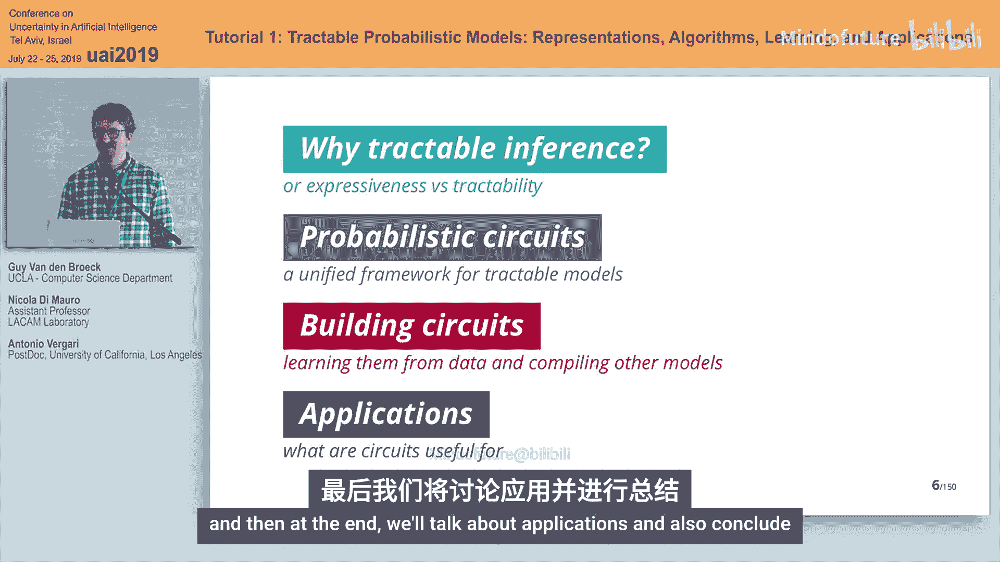
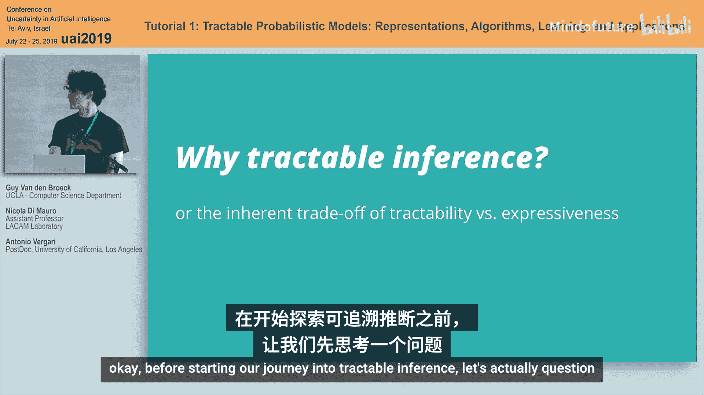
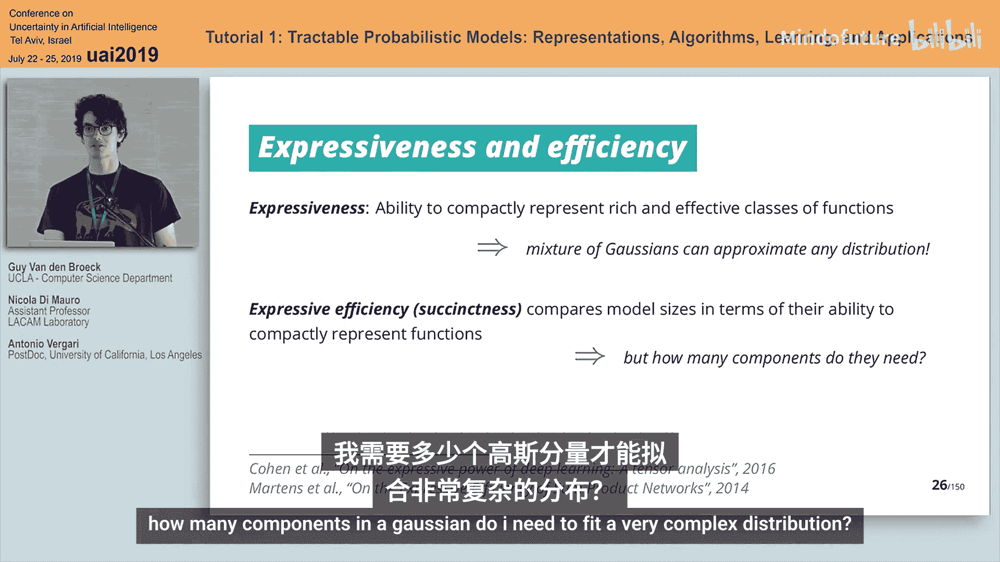
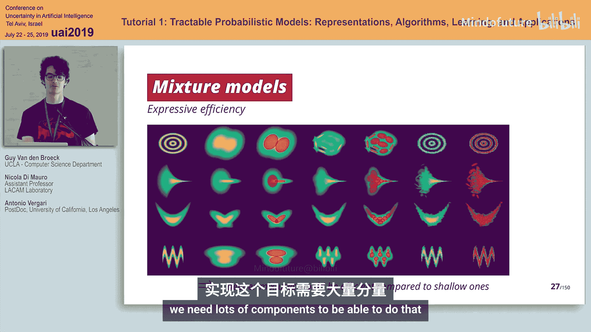
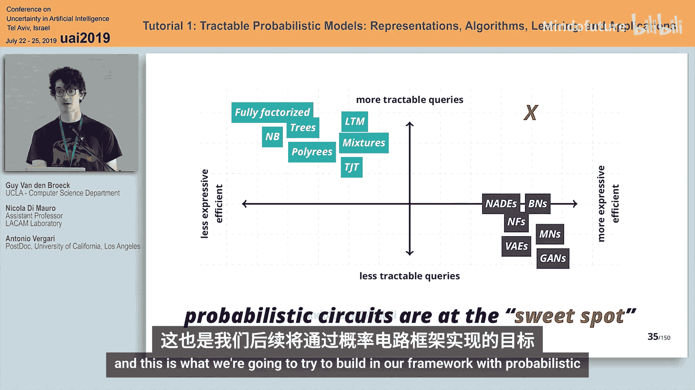
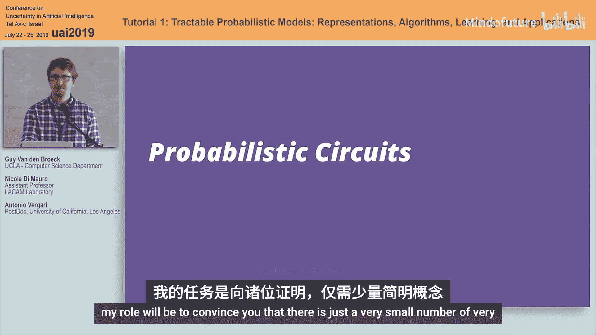
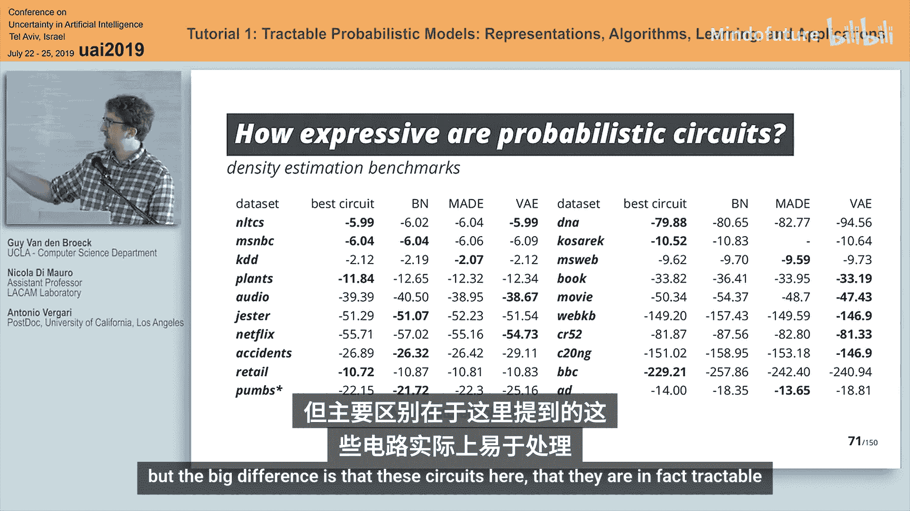
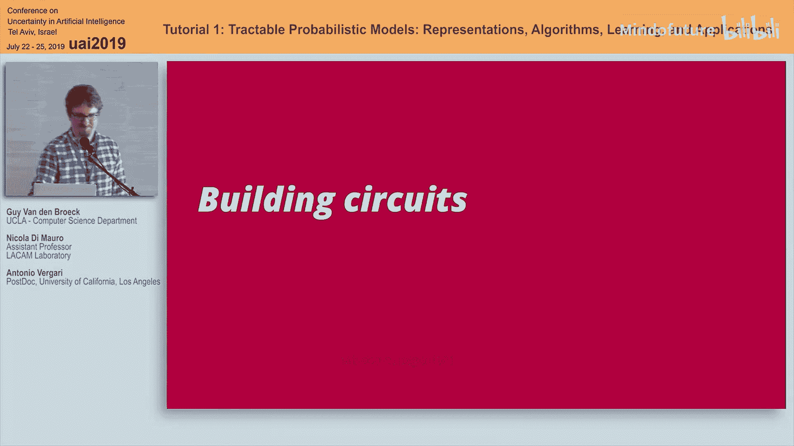
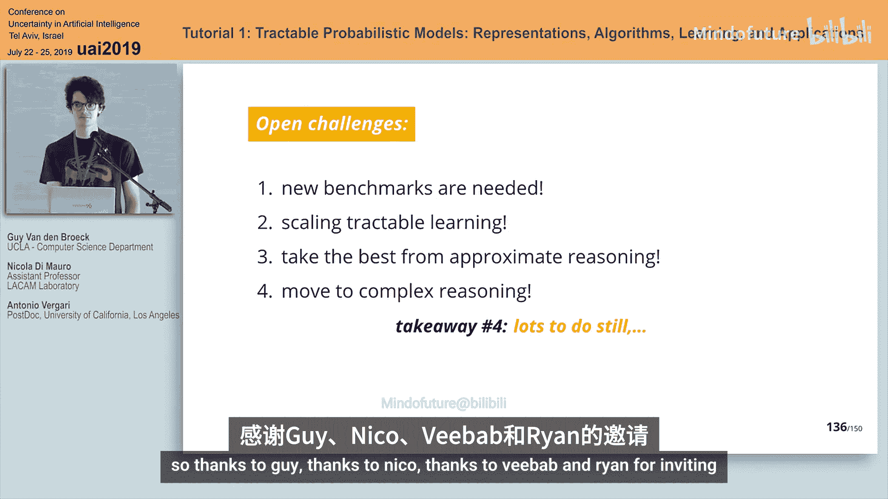

# 【加利福尼亚大学】图形模型中的学习 ｜ Cs274b ｜ Learning In Graphical Models (Spring 2021) p21 P21_教程_可处理的概率模型 -BV1Tqx6zrEMj_p21-

So the tutorial， the first one for today， will be on tractable probabilistic models。

Wwhich is a very rich area within UAI and as with any kind of area that sees a lot of excitement you get this whole sesame street of acronyms that is being developed the alphabet soup of models in AI and so one of the goals for today will be for making sense of this whole alphabet soupup and these are all kind of models AI representations that you may have heard of and we'll very briefly touch on all of them so there's a bunch of them that actually come from good old-fed AI from logical AI things like BDDs and they're very closely related to tractable probabilistic models in ways we'll talk about later but for now we'll focus on models that are actually representing probability distributions。

And so within those， you have your kind of classical probabilistic graphical models and other types of representations that unfortunately are intractable and so most of this tutorial will be about how to build tractable probabilistic models and we'll get into that later。

嗯。And then among all the tractable models， the question is， know if you want to be tractable。

 what's the price you pay and then we'll talk about the expressive power of these models and whether you have to make any compromises So that's kind of the high levell kind of takeaway。

 let's make sense of this whole research field。So this is the outline and we'll try to first motivate for you why we need tractable inference and the tradeoff between expressiveness and tractability。

 and then we'll try to introduce some kind of common language for tractable circuits。

 which will cover a lot of the existing formalisms and try to make some kind of abstract general framework for talking about these things。

So once we know the representation， we'll talk about how to get that representation either from data or by compiling it from some other type of model that you like。

 and then at the end we'll talk about applications and also conclude。

So the first part will be Y tractable inference， and so Antonio will present these part。Thanks。

 again。Okay， before starting our journey into tractable inference， let's actually question。

 why do we need probabilistic inference and probabilistic models to begin with。

So suppose you are a decision maker。 you are in charge to manage the traffic in teleel Aviv。

 So you may ask yourself， what is the probability that today is a Monday。

 and there is a traffic jam on Eartha Street， or maybe you are just a worker planning his own weekly routine。

 So you may wonder which day is most likely to have a a traffic jam on a route to work。

 So these are like basic questions we can formulate in natural language and they are like queries。

 So how do you answer that。 So suppose you have now data。 What do you do。 Well， of course。

 you're gonna fit a predictive model。 Let's say a classifier with a neural net。

 So you observe like questions and you try to predict answers。 No。

 because you're gonna know in advance， all possible questions and you're gonna need also answers and youre never gonna observe that。

 never gonna do that。 What we are gonna do instead is to fit a probabilistic model of our word。

This model is N， and we're gonna query this model。 This model is like a black box。

 We're gonna make a question to this model。 and these answers are what we call our way to do probabilistic inference。

 So I think we are in the UI community all on the same on the same boat on this。

 So let's have a quick look deeper look into this kind of questions。 So for the first one。

 what is the probability that today is a mandate， and there is a traffic jam on Eartha Street。

 are we gonna answer this。 So let's formalize this a bit。

Let's say we have a bunch of random variables， X， we have time。 We have day。

 and we have a bunch of Boolean variables indicating if there is a jam。

 a traffic jam on any of the streets there。 So answering this query basically is computing the probability according to our model that today' is Monday and this Boolean variable for jam on Earth street is true。

 We are ignoring all the rest。 So basically， we're doing marginals。

 We are marginalizing out all the other variables。Instead， for the second query。

 we have to do something more involved。 So in the same formalism in this to example。

 we're going use throughout this first part， what we actually want to do is to compute argms of the probability according to our model M that day is a specific day and we have this logical constraints such that with this joint all possible paths that are leading us to our route to work。

 So this is definitely more involved involves marginals involves making like a map prediction。

 we're going to see in a bit what map means。 and it goes making some logical reasoning about this。

 So so far it's like we are seeing to different queries to different questions and they do belong to different query families。

 So since now we know that we really want to do probabilistic inference。

 let's try to be a little bit more formal and see what is tractable inference。

 what are these queries。Do they relate to the model。 So here here's a simple definition。

 So we can say that a family of probabilistic models。

 capital M is tractable for a class of queries Q。 if and only if。

 whichever MI I pick and then Q query I pick from this family。

 I am able to exactly compute the result the answer for this query。

 given this model in polynomial time that is polynomial in the size of the query and in the size of the model。

In practice， this polynomial time as we will see， it's generally linear。

 So this is quite a good thing。 but there is a caveat。

 So we also need to make sure that the size of the model and the size of the query are also polynomial in the size of the inputs。

 the T， the class of my models， my class of queries are compact representations。All in all。

 we really want to be able to answer these queries in polynomial time。So what about exact inference。

 Do we really knew that we can actually question if we really want approximate the inference to begin with。

Well， real the question is， why would we want approximating things when we can go exactly to begin with？

 Of course， there is a price to pay as Gi said， and we're going to see what it is later on。

It's also good to remember that sometimes also approximations are not cheap。 they are intractable。

 and most of the time they also do not come with guarantees。

 There's gonna to be like a very nice talk by Rena talking about how to have guarantees in approximate inference routines。

 but generally they do not and whenever we chain approximations one or another。

 let's say we are flying with a blindfold on。 We do not know where we are going if we do not have guarantees。

 So this is a strong motivations to stick with exact exact inference。

 And this is like a violent fluorescent green to wake you up to say that。

This is what I'm going to talk about in the next 15 minutes。

 so I'm going to introduce a bunch of these classes of queries and at the same time。

 I'm going to review a bunch of families of models and we're going to inquire are those tractables。

 are those expressive， what are we trading of。After this。

 we're going to introduce probabilistic circuits as a sort of grammar to produce tractable models。

So let's start with a very basic probabil query we may want to ask。This is a question of this kind。

 What is the probability that today is a mandate。 It is noon。

 and there is a traffic jam only in El Street。 Clearly， we need to instantiate all our variables。

 So basically， today is mandate， the time is 12。 and for all our Boolean variables。

 they all have a value。 everything is0， except for the one for El Street。 This is complete evidence。

 may seem a very a very trivial query we might not really want to ask that to begin with。

 But if we really do probabilistic reasoning in learning， we have seen that quite a lot of time。

 whenever we do maximum likelihood learning， because we just want to maximize the likelihood of our data。

 which is generally complete。So this is our first kind of query， the simplest， I would say。

 which kind of model probabilistic model are we going to use。 Well， of course。

 we're going to use generative adversarial networks， which are super popular。Well， not really。

 to begin with journey of their cellular network， not even ever like an explicit likelihood。

 this is why you really need aversarial training。 So people would say， yeah。

 but I can compute these complete evidence probabilities by sampling， sampling a lot true。

 but you will need so many samples。 And also it's true that if you're doing adverarial learning。

 you're gonna mod collapse sooner or later。 So maybe you're not going see many good many configurations and your estimates will be quite biased。

So we are not gonna let's rule out generic asarial networks。

 And since we are not using adversarial networks。 nowadays。

 we must use variational o encoders and variational encoders now have an explicit likelihood so we can compute these complete evidence。

 This is cool。 So we're going to use variational o encoders。Well， not really。

 because us in this case， we do have an explicit likelihood。

 but we cannot actually compute that exactly。 So this is intractable because variational o encoders are a mixture model with an infinite and uncountable number of components。

 So there is no tractable full complete evidence queries for that。

 and optimizing that is also problematic。 So let's rule them out。 let's go back to。

 let's say a more general family of models and to which variational o encoders belong。

 Probabilistic graphical models。 And PGms are popular in the UAI community because they provide this very neat and clear separation between what's the model and how to perform inference on that。

 You know what the node is。 It represents random represents a random variable。

 You know what edges are。 They do define the dependencies or inencies relationships among that。

 And you have a bunch of inference algorithms that act as a black box。

So we really would like to use maybe a PGM， but we know there is some caveat。

 so let's sort of review probabilistic graphical models and see if they are tractable。

 so they come in a bunch of flavors， but generally we can say that they are undirected or directed ones。

 undirected are basically market networks， market networks are factorization of unorized probability distributions。

So these factors are we might compute like complete evidence， but the issues that o， sorry。

 we need to compute also the partition function to normalize that。 And this is intractable。 This is。

 again， another kind of intractability related to the one from rational O encoders。

 We have basically to some or integrate over an exponentially large number of。Vues， so。

Also Markov networks are not that good for this kind of very basic and maybe improbabilistic inference。

 so let's move to directed models like Bayesian networks and Bayesian networks are still factorized models。

 but now they are normalized we do not need to compute a partition function and we can compute complete evidence in linear time with respect to the number of variables so they are good so let's stick to Bayessian network at least for now。

And let's move to the next class of queries we would like to， to answer。

And we just saw this kind of query， marginal query so basically when I ask something like what is the probability that today is a mandate and there is a traffic jam on Earth the Street。

 I'm not considering the time， I'm not considering all other boolean variables for all the other streets are marginalizing them out so basically and in general case。

 I have to integrate all the remaining variables out or if they are discrete， I have to sum them out。

These are marginals。 and suppose I can do in attractive way marginals。

 Then I can also do conditional queries。 Conitional queries would be， for instance。

 that given that today is a mandate。 So a natural language is slightly different。

 This would boil down to compute a ratio between a giant probability distribution of my query and my evidence variables and a marginal probability。

 This is why if you can do marginals， you can also do conditional queries。

So let's go back to our class of models so we said， oh， it's cool。

 we can use Bayesian networks to answer conditional queries。Well， not really， because per se。

 marginal queries are hard。 So to compute them exactly。

 we are in trouble because we are with a sharp P complete problem and even approximations， if we。

 if we really want guarantees are intractable。This is due to the fact that general algorithms for probabilistic graphical models look at the structure of the model and the structure at this property called the tree with。

 which informally， we can say it's like。The way we can define our model to be similar to a tree。

 slightly more formally， iss the minimum width of any possible tree the composition of our model。

 with really the need to get into details。 But you can think about this。

 The more complex the model is just the structure。 All the black box inference algorithms for PGMs are gonna basically have a hard time computing marginals。

But things can get better if we just realize by looking at people doing work on and complexity theory that in the worst case。

For marginal and conditionals， we can compute。Thequeries。

With time that is linear in the number of variables。 and thiss like exponentially in the tree wheel。

So a natural question is， whatif， we fix the tree with to a value we can manage。

 that says small value。 So that becomes a constant。

 and inference becomes just linear in the number of variables。 This is a cool thing。

 And this is part lots of research just by bounding the tree with or PGMs。

 so we can have trees by having just one parent。 Were bounding the tree with。

 or we can have multiple parent but requiring just one path between nodes。

 We can also just limit the number of random variables appearing in a click in a junction tree。

 such that we have a thin junction tree。 So now suppose you are limiting your tree with。

And then you can have basically， let's say， by a value by 20 in practice， you can compute。

 you can compute marginals and conditionals。 So a lot tree with PGMs are somehow appealing to us。

 So let's peek into one of these models。 Let's peek into trees because theyre are very popular。

 they have been used a lot in the community。 So trees are just like Bayian network with any。

 any node in that having a single parent。 They still are like these factorizations。

 And the cool part about these kind of trees is that we can compute evidence。

 we can compute marginals and conditionals in time linear to the sides of our input。Moreover。

 we can also do learning exactly from data by the Cho you algorithm。

 We're going to exploit this later on in the learning section， quite a lot。So we can have a trees。

 but we can also ask you right now。 Okay， we know that we are bounding the tree with。

 we are losing something， right， what we are losing exactly。

 We are losing the ability to express all possible probability distributions。

 So basically suppose your data， your true distribution is not a tree。

 It's like a complete Bay network。 if you limit yourself to learn a tree with show you algorithm。

 You're never going get that。 You're never going get the true distribution。

 You're gonna lose something。 So this is a price we might want to pay。 But at a certain point。

 we might also want to exploit and go for other tricks to increase our expressiveness to try to to represents。

More complex distributions。 How do we do that。 One way to do that is with mixtures。

 So mixtures are another popular， old fashionashed， but very。

 very cool way to increase the expressiveness of a model。 So look at this mixture of two Gaussians。

 Each Gaussian is like uni model where we put them in a mixture together。

 we can model also bymod distribution。 So we are getting something that is more expressive。

We can increase this expressiveness and still we can compute evidence。

 marginals and conditionals linearly in the number of components of the links。 So this is cool。

 This is a useful tool。 We're going to use lots of time later on。

But another question we may want to ask is that， what do we lose。

Is it really true that we can basically represent anything but just increasing the number of components of a mixture？

To answer that， before answering that， let's make another observation。

 A mixture model encodes a latent variable that basically tells you which component you are selecting from the mixture。

This is like a very strong property of mixtures that will come Andy later on。

 But it is also gonna be one of the source of inefficiency。So back to our question。

 So are mixtures that expressive， well， it's known that a mixture of Gasians is asymptically able to represent with arbitrary accuracy accuracy any distribution。

 but that is asymptically and it means that we need a lot of components。

 and in practice asymmptically we are all dead。 So it might not be the best thing to do。

 So let's switch definition and try from expressing and look at expressive efficiency。

 sometimes called also succinctness when we talk about byian networks or we talk about circuits。

So basically， we want to see if our distribution， the size of the distribution is able to is related to its expressiveness。

Basically， it boils down to asking the question how many components in a Gasian I do need to fit a very complex distribution。

 So it's like this is like a cartoon for you to to， to get the feeling。

On the left， you have a simple two dimensional distributions that are somehow fancy like concentric rings。

 a cinooid， a funnel and the banana distribution。 I'm not saying that you're going to find them in real life。

 but you may want to fit your distribution over that。

 So you limit yourselfselve to mixtures of Gaussians。

How many Gaussian components do you need to fit very well these distributions。In every column。

 I'm increasing the number of components， and I'm also highlighting by this red eipoids。

 which Gaussian components are isfi that region of the 2D space。So just using maybe this is working。

You need are two components。10 components。 And the fit is pretty bad。

 I need 100 component to get something that resembles that。 So we might say that。Asymptically。

 we can express any distribution， but it's not really expressive efficient。

 We need lots of components to be able to do that。

So let's say that for now we stick to mixtures。 This is like mixtures of simpler models。

 maybe mixtures of trees。 that's the best model we have so far。

 and let's move to the next class of queries we might want to compute。Map maximum a posteriri。

 which also in the community sometimes is referred to MP E。

 the most pro probable explanation or evidence。 One query of this kind can be an answering this question。

 which combination of road is most likely to be jammed on Monday and9 AM。 So to do this。

 we have to condition， but also we have to。Compute this artrc max。Over the J， the possible。

 the possible indicator variables。So can we do that with a mixture。

So this is the general formalization， but the moment with which to the mixture。

 we have to recognize that we have to deal with the latent variable that the mixture implicitly encodes。

And if we have to deal with the latent variable， whenever we have to compute the maximization problem inside of that。

 we also have to， to solve before a summation problem。 And unfortunately， we cannot swap that。

 So as we will see more in detail later on， whenever we have latent variables。

 we cannot compute maximum posterior queries exactly。 So we have to to。

Get rid of mixture models or get something better。And you may think that map is a complicated query。

 but for this case， for latent variables， it's basically， it's just like。

Marginalizing and then computing the map solution， which as a query would be something like。

Asking to yourself which combination of road is most likely to be jammed at 9 AM。

 marginalizing overall all possible days。This is a more general class of queries。

 which unfortunately， it's very hard。 It's MP to P complete to compute。

 And the sad story is that it's NPR also for trees。And even Sader is that it's NPR。

 even for nextb classifiers。So it seems like we are left with basic queries。

 probabilistic queries we would like to answer and we do not have interesting models to answer that。

 but before getting into this kind of sadness I just really want to push you and say that during if we really want to do probabilistic reasoning。

 we want to do something more than just asking this toy queries， Baby queries。

 so we would like to answer something more advanced。

 one example comes from the initial one we saw before。

 like it was computing marginals performing map inference and involving some form of logical reasoning。

We can have something different， like involving comparisons between groups。Like。

 what is the probability of seeing more traffic jams in Java than Marina。 So we need to count。

 and we also need to compare between different sets of instantis。

 This is also not so complicated from a natural language perspective， as a decision maker。

 you would like to， to question that and have an answer。 But for our models， it's quite complicated。

 Later on， we're going see that given some structural properties。

 You're gonna be able to solve these kind of advanced queries。So for now。

 we are left with this kind of sadness and。Yes， more and more involved queries coming later on。

But there is one model is coming at Tower rescue。 The full factorized model。

 If we assume that everything is independent and is is super simple。

 we can answer all these kind of queries very easily。 Why。

 because we can solve all these kind of problems in parallel。

 And this is a form of divide and conquer strategy we would like to exploit later on by playing our cards well。

 So this is how the story told so far。 We had a bunch of  query families and we saw a bunch of models。

So let's try to wrap this up in a cartoon。 Let's draw some axis。

 And on the X axis on the horizontal one， let's put this vag thing like。

 let's place all less expressive or less exp。Models on the left and models that are more expressive or more expressive。

 efficient on the right。On the vertical axis， on the Y axis。

 let's try to put models that are more tractable， given some more pre families and model that are less tractable on the bottom。

 This doesn't really make sense。 It's like an artist's in impression of tractability versus expressiveness。

 but。Basically， the higher on the Y axis is， the model is。

 let's say the largest class of query family able to to compute。

 So the bottom line here is that we have a bunch of models that are very expressive。

But they are not really tractables。 And we have these market networks， Bayesian networks， of course。

 GNs and V As。 We also have fancier versions of Bayesian networks like NAs。

 mates and auto aggressive models。On the other hand， we saw some models that are tractable。

 but they are not so expressive。 And these are all the bunch of bounded tree with model and other PGms and also mixture models。

 They can do something they are some they are expressive， but not much expressive efficient。

 So we can put them there so we would like to actually if we have to pick some model or divine our own framework to be here。

 This is like the sweet spot we aim for。 And this is what we're gonna try to to build in our framework with probabilistic circuit later on。

 So and giving back the word。

Alright， so now that you're convinced that everything is very difficult and very intractable。

 my role will be to convince you that there is just a very small number of very simple ideas that make everything very tractable。

 So a different vi。

So wake up again So whatever we're going to do the next 15 minutes。

 I will try to go over the basic building blocks of tractable models we're going to build something that looks like a computational graph。

 a circuit， a probabilistic circuit which is going to do most of the work for us。

And then we'll try to analyze which queries these probabilistic circuits are tractable for and what properties we need from them in order to answer all of these very complicated questions Antonio mentioned。

And then afterwards， we'll again go into this alphabet soup。

 and and for all of the tractal probabilistic models。

 explain how they're really all kind of basically the same thing。

 They're all different flavors of this， this basic idea。Okay。

 what is the simplest tractable probabilistic models， Well。

 Antonio mentioned if everything is factorized， if all you have to look at is a single random variable。

 then things are easy。And so this is the base case of these probabilistic circuits。

 they are univariate distributions， so we have one random variable x and we plug in some value for x。

 so it could be the value of a Gaussian or a Bnoi and out comes the probability or the probability density of that state。

And so this is easy because we can compute the probability of evidence that's just evaluating orgaussian。

 let's say we can also marginalize， we can integrate these one dimensional distributions very easily。

 and we can also compute the mode of these distributions because again。

 they're very simple and so this will be the base case。Often it will be even simpler。

 so often when we deal with discrete data， these base cases will just say 100% probability for some variable you know being。

 let's say the weather is sunny， 100% probability， and there will be some other base case that says the weather is rainy with 100% probability So we'll only even look at these extreme univariate distributions that just assign all the probability to one to one value。

So this is how it works。 you plug in the whatever the temperature and out the probability density。

Okay let's try to be a bit more ambitious Uniivariate distributions are not that exciting。

 so how do we combine them Well the simplest possible way to combine a bunch of distribution is by by taking by basically treating them as independent random variables and that's what you see here we have three random variables we'll pretend that they're completely independent fully factorized and now we can define a joint distribution over these three variables as the product of the individual probabilities。

And so well the note is by this， this product product note here。And for example。

 if you have a multivariate Gaussian with a diagonal covariance matrix。

 this is basically what you're doing。Okay， you're just having these independent Gaussians that you're multiplying。

How do you evaluate such a little probabilistic circuits。 Well。

 here you have your univariate distributions， They say that。

 you know all the variables that you're observing， that they have some probability。 for instance，0。8。

5。9。 And now the probability of them jointly taking those states is just the product of the three。

 For instance，036。 Okay So I'm not going to tell you any kind of rocket science This is all just going to be very basic probability。

 but it's going to add up to something very powerful。Okay， so these were factorizations。

 Unfortunately， if we only factorize， then we， we again don't really have that much expressive power because then everything always has to be independent from each other。

And so the way around this is by， by taking this other idea of mixture models and applying it to these probabilistic circuits。

 So what we'll do is we'll build these basic computational units where we take two distributions。

 the two blue lines here and just combine them with a weighted average into one distribution。Okay。

This is what it looks like as a probabilistic circuit。

 so we have some simpler distributions over here， which could be two Gaussians to different ones over the variable x and we'll take the weight to some of them to get our new distribution over x which could now be multimodal right so we have somehow gained expressive power。

So again， the way that we evaluate these things is we get the probability of these components and the probability of the mixture is just weighted sum of the two。

Alright， so these are really all the basic building blocks that go into a probabilistic circuits。

 So we have the un distributions。 We have the mixtures of distributions。

We have also the product of distributions， which we can then combine with mixtures。

 and we can do this for many， many layers。 We can create a deep tractable model。

 and we can also reuse some computation。 So this is a directed ascyclic graph。

 And the only thing it does is it it it combines all of these uni distributions using sums and products。

And that's it。 There is nothing more to it。Okay， so， so what are these probabilistic circuits。 Well。

 some， you know， you might be tempted as as someone who attends U AI to call them probabilistic graphical models。

 Well， they're definitely probabilistic， and they're also graphical models。 but theyre。

 they really have a very different。 they're definitely graphical。

 but they do have a very different flavor from your standard probabilistic graphical models。

 So in standard models， the the notes are random variables and the edges are dependencies between them。

 And then you have a bunch of inference algorithms that really in many different ways just take these declarative representation and compute probabilities for you。

 So in these probabilistic circuits， it's a little bit different。

 So the the notes are really units of computation。 And the edges give you the order of the execution。

And so you have a feet forward pass of often and a backward pass。 And so the。

 the structure of your graphical model in some sense， already tells you how to compute things。

 And so that's the， the key distinguishing factor。 And that's why they're more like computational graphs。

 more like neural networks。Okay， so what are the benefits of this representation。

If you have a kind of generic， directed ascyclic craft。

 what you can do is you can reuse a bunch of computations。

 You can compute some little probabilistic circuit once and then reuse it in many other places inside of your larger circuit。

So you， that means you can amortize inference。 You can share certain parameters。

 You can share a lot of structure。 And this is really what distinguishes it from probabilistic graphical models and why these things can be very efficient where probabilistic graphical models are not。

They have these clear operational semantics。 And by just looking at how to computes。

 you can immediately tell how much it will cost you to computings。

 You just look at how many something products you need to do。Things are differentiable。

 You can do gradient based optimization。 We'll talk about that later when we learn these circuits from data。

嗯。And what's really nice about them is that you can now look at additional properties of the circuits to tell whether you can answer certain queries efficiently or not。

😊，Okay， well， it's actually a little bit more difficult than that。 So up till now。

 I kind of pretend that you can just arbitrarily nest sums and products just like in a neural network。

 But there's a few extra things you have to ensure there are some basic structural constraints that you need in order to be tractable。

 And so I'll quickly explain those。 So what do we need to get from the circuit。

 How do we need to be careful when we construct it such that we can answer things efficiently。Now。

 there's in some sense， the most important property of all which which goes back 20 years。

 which is the property of decomposability。 And this is really the idea of independence in probability distributions。

 In in graphical models applied to these probabilistic circuits。

And so it is the idea that any time you multiply a bunch of distributions。

 you have this multiplication notes， all of the children that they must talk about different sets of random variables。

 For example， here we talk about x1， x2 and x3。 These are all different distributions。

 So you can just say， oh we're assuming this independent product of these three distributions over here。

 we have a circuit that's not decomposable because we're multiplying a distribution over variable x1 with another distribution over variable x1。

 And of course， it doesn't make sense to say that x1 is independent of x1 and just multiply things So this is not allowed。

Okay。And then there's a second property that we need to ensure， which is called smoothness。

 also sometimes called completeness in part of the literature。

 And this property is saying that anytime you have this mixture of two distributions， let's say here。

 we have a mixture of distribution over X1 and another distribution over X1。

 Then these distributions must range over the same random variables。 And if you think about it。

 it makes sense， right， I cannot create a mixture model over the weather and which day of the week it is because a mixture model always needs to mix two distributions that have exactly the same random variables in them。

 Otherwise， somehow here， you're not accounting for the the day of the week And over here。

 you're not accounting for the weather。Right， so that doesn't make sense。 And therefore。

 we require the smoothness property mixtures only of distributions of the same random variables。

 If you don't have smoothness in your circuits， the no stress。

 you can always make things smooth by adding a bunch of notes here and there。Alright。

 so these are the the basic properties we would always need。 And now suddenly。

 things become tractable。 Sudden， we can do tractable marginals。 right， We can。

 we can sum out random variables。 We can do conditionals because we can do marginals。

 And so this is roughly how it works。If I have a distribution that is a product of two distributions。

 meaning I have this decomposability property。 and I need to marginalize。

 meaning I have to integrate out X and Y。Then， well， P of X。

 Y becomes the product of P F X times P of Y。 And so now I can really just integrate P F X separately from P of Y。

 okay。So again， theres no rocket science here。 This is just a very basic property of independence。

 Now， the nice thing is that because we have this computational graph。

 we can really just do this operation at every single product note in the entire circuit to simplify our marginalization task。

Okay。嗯。By the way， feel free to ask questions anytime there's a mic there。

 I see the people get more confused。 Feel free to interrupt。Okay， marginalization by decomposability。

 So this tells you what to do if you have a product note。 What if you have a sum note。

 if you have a sum note， then we have this smoothness property。

 which says that we really have this weighted sum of a bunch of other distributions。

 this mixture model。 And now if I need to integrate some variables out of this distribution。

 then I can kind of rewrite it as integrating these variables out of the。

 the weighted sum of these different components。And then I can just change the order of the integration and the summation。

 and I can integrate in every component separately。

And so this is the other trick that allows me to take this marginalization task and kind of start from the。

 the root of my circuit and push it all the way to the leaves of the circuit。

By just decomposing with decomposability and pushing these integrations into the summations。

In the end， what you get is you get some integration problem that only talks about a single random variable。

 and that's always easy。And so then we're done， right。

 So now we have this recursive algorithm for marginalization on the circuits。Makes sense。Okay。

This is roughly how it works。Here we marginalize。 So here we have a variable x1。

 And so some so x1 is one of the variables we want to marginalize out of the distribution。

So that already tells us that。This note here will just be one。

 because if we integrate out x from a distribution that only talks about x。

The probability is going to be one， right， This is a normalized distribution。Over here。

 we have some other number。 This is the， the， the value for X 2。

 So X 2 is not a variable that we're marginalizing out。 X2 has a state。 For instance。

 X 2 is set to true。 And now this is the probability of this particular state。

And you can do this for every single note， every single univariate leaf in your distribution。

 you either integrate it out。 It becomes one， or you replace it by the probability of the， the。

 the evidence， the， the thing you observe。And then the only thing you're left with is that you need to take sums and products。

 So now， if you take sums and products， what you get is that the probability of the state that you plugged into the leaves is going to be 49%。

So this is one forward pass linear in the size of your circuit。

 and it computes the marginalization task with two of them， you can do the conditioning task。Okay。嗯。

So now we already have a tractable model that is quite powerful and can solve kind of the the base case of or the the simplest query of marginalization。

 But we would like to do more。 And if we want to do more， then we need some extra properties。

 And one of these extra properties is called determinism。 So this is， again， a very basic properties。

 It's sometimes called selectivity in part of the literature。

And the idea is that any time you take a mixture instead of just an arbitrary mixture。

 you only allow for these some notes to mix between two distributions whose support is disjoint。

So what does this mean？ So over here， we have a mixture of these two distributions。

 and I constructed the circuit such that the distribution here over x1。Is only。

 only has a non zero probability。 If X1 has a value less than theta。This is some。

 let's say some truncated Gaussian， okay。Over here。

 I have another distribution that says X1 only has a a probability that is non zero。

 if it's greater than theta， another truncated calcium。Now。

 I know that between these two distributions， if I plug in any value for x1， that at most。

 one of these two guys will have a probability that is greater than 0。Because， again。

 their supports are disjoints。And so that that is the property that we require every sum node。

 every mixture is of these two distributions that are never really have any probability mass at the same time in any one possible world。

Here's an example where you don't have determinism。

 so here we have a mixture of two distributions that are just arbitrary products of Gaussians over two variables x1 and x2。

 but now if I plug in a value for x1 and x2， then both of these distributions may have some density that is nonzero。

And my mixture here may sum these two densities into some other value。And that's not allowed。

 if you want determinism。Okay， why do we care about determinism？ Well。

 determinism allows us to compute map inference efficiently。 And so map is， is when。

 when Antonio talked about map， it was this disastrous query that nothing is tractable for。 Well。

 with this property you can compute things efficiently。 So roughly the way it works is。

For these decomposable products that if you would like to find the map state。

 which is the most likely state of the world。 Well。

 instead of finding the state that talks about x and the y variables。

 you can just first take the x variables， first part of your your product。

 maximize those and then separately maximize the state of the y variables because the x and the y variables are are disjoined。

 we have a decomposable product here。Alright， so anytime we have this factorization。

 we don't really need to optimize jointly the entire joint distribution。 we can factor。

 We can optimize the state of the two distributions separately。And that makes things much easier。嗯。

Then for the sum notes， for the sum notes， we require determinism。 and indeed。

 determinism will be the strict that allows us to also solve this map problem。

 And So here's roughly how it works。 So again， I need to find a state of these variables that maximizes the probability in this distribution。

Now， the issue is that we have a mixture。 So now we're maximizing over the sum of these weighted components of my mixture。

 And in general， this is difficult。However， because of determinism， we know that for any world。

 for any solution， we may possibly find any value of of these。

 any state of these variables that really only one of the components will have a non zero probability。

So what does that mean if in our solution， only one component has a non zero probability。

 then it doesn't make sense to sum up all of the probabilities of the components because you're just summing up one number with a bunch of zeros。

 okay。And that allows us to basically maximize over all of these components， instead of summing。

And now we're maxing a max and things become easy。 And we again。

 just push the problem down into the circuit， and we decompose it into pieces， smaller pieces。

And then when we hit the leaves， then we have an easy problem。個正がある。The training。

 because now you have the train of。You mean training to ensure determinism right extra。didn't happy。

So when you're learning this。Oh yeah， you can use the mic there。

 So the question is whether you have extra parameters data。 I don't see the data show up here。

 but so so the weights here are the only parameters that are added to our distribution here。

 But anytime we have a mixture， we need to weigh the two mixture components。 that is there。

 no matter if you have a deterministic or an nondeistic circuit。

 that weighted mixture is always there。 So those parameters， you will have to learn。

 And so Nikco will talk about how how to train those parameters。

I'm not sure if that answers your question。Okay。All right。We can do tractable map。

 the way it works is we take those sum notess。 And because of determinism I just told you。

 you can take the sum notess and turn them into max。 All you care about is maximizing things。

 So now you plug into the leaves， the probability of your current observations。 For instance。

 it's a Monday today。 And then for all of the other leaves。

 you just set them to the mode of your distribution。And for example， here， X 1 may have some modes。

 This X1 is also a distribution over the same random variable。 It may have another mode。

 but we instantiate everything to its mode because we're trying to find the most likely world。

And then the only thing left to do is multiply max。

 and we get at our output to the probability of the most likely world。

If you don't care about the probability， but you would actually like to know what is that world。

 then that's also easy。 You have to do a downward pass。 and you have to figure out， well。

 the max here really chose this number over this number because it found that in the mixture。

This mixture component didn't have as high of a probability state as this one here。 So it went。

 it went and picked this number。You do this recursively。

 And now you can decode the state of all of your univari distributions that。

Made up this solution of your map query。Okay。So a little bit of hand waving。

 but it's all very efficient。 It's all linear。 It's all quite nice。All right。

So what do you do if you don't have determinism and a lot of the the representations that people use in the literature。

 they're actually non deterterministic。You have these latent variablesable that are mixing between two distributions that may have support that overlaps right And so now the issue is that this maximization problem where you sum out this latent variableable that is is telling you which of your mixture components to choose。

 This becomes intractable。 So what do people do in practice。

 they still pretend like this summation is a maximization。

 They add the latent variablesable to the distribution。

 And now they start to maximize also the state of the latent variablesable。

 And so this is something you can do， and it's often a useful approximation of map when you cannot get the exact value。

 so you will often see this done in practice。O。Okay， let's add more properties。

 So now we so we had decomposability， smoothness and determinism。

 Next property is called structure decomposability and structure decomposibility is going to be a pretty amazing property because I will soon show you a slide with like 15 different queries that suddenly become tractable just because of this one property here。

😊，So what is the property， Well， in general， anytime we have these products， these products。

 they can， they have to be decomposable， but they don't always have to be decomposable in the same way。

Meaning that they can split the set of variables any way they want。

 They can partition the set of variables any way they want。 as long as there is no overlap。

 but different products may choose to do so in different ways。Now。

 structured decomposibility is saying that any time you have the product notes at the first level here。

 it always has to。Create a factorization， a multiplication between a distribution over x 1 with a joint distribution over x sorry。

 between x 3 and a joint distribution between x 1 and x 2。So all of these notes。

 they all have to go X1 and then the rest， X1 and the rest。

 you cannot kind of do things in other ways。 Similarlyly， any time at a second level。

 you have decomposability， it always has to be in exactly this way。 This is kind of the bottom layer。

 So there's no other way to do it。 But that's the general principle。

So this is a decomposable structure to decomposable circuit。

 Here's a circuit that is not structured decomposable， right。

 And the reason why is that this note here does agree with the fact that it must put X 3 from the rest。

 That's what it does here。 It has a distribution of x 3 and the rest。However。

 this product note is still decomposable， but it splits differently。

 It splits off X 2 versus x 3 and X 1。So this is not structured decomposable。Okay。那我。

For reasons that I I don't have time to get into in in two hours， if you have this property。

 you can build a lot of really nice， elegant， recursive algorithms that reason about the structure of your circuits。

 And these things are incredibly well behaved。 And what you can do is all of this stuff。

 If you have a probabilistic circuit that is decomposable。

Deterministic mood and further more structured decomposable。

 You can efficiently compute the entropy of that distribution of that probabilsistic circuit。

You can ask a whole bunch of these difficult queries that Antonio mentioned。 You can ask。

 what's the probability that exactly 25 roads in Tel Aviv are jammed。

 that an odd number of them are jammed， that more roads are jammed in one district versus the other。

 All of these types of queries， which are extremely difficult， become tractable。This is for any V。

 for any way that you choose to do this structure decomposibility。Now。

 if you pick the right way of decomposing， if you kind of enforce how this V3 looks。

 then you can do even more。You can compute the probability of any kind of logical event in the probabilistic circuits。

 You can multiply two probabilistic circuits in quadratic time。

 You can compute a Quebec libar divergence between two probabilistic circuits that have the same V3。

 These are all things that you know to UAI people should sound like insanely intractable。

 but you can do all of this exactly but these tractable probabilistic models。

There's a bunch more papers that have been written about various queries I won't get into about decision making。

 about active sensing， about how to decide which features to prune feature selection on a distribution。

 how to compute expected predictions of a classifier with respect to a distribution。

 how to do even marginal map， so this is just to tell you that nice properties give you nice tractable behavior。

Okay。Alright， so for the next 10 minutes。You can wake up again。

 We have this language of tractable models， and we would like to very quickly describe how they relate to other types of representations you may have seen before。

 For example， logical circuits， for example， SNs， arithmetic circuits and so on and also how they relate to these low tree with probabilistic graphical models that we talked about earlier。

And so the goal here will be to convince you that they're all just different syntactic variations on this one simple language with these simple properties。

Afterwards， we'll talk about how to get these circuits from data。

 and that will be Nikco's part of the presentation。オー。嗯。

Nothing I told you so far really depends on the fact that youre dealing with probabilities。

 I was just taking sums of products。 And so that means that I can do sums of products in different ways。

 in different semi rings。And that's essentially what happens if you if you take these circuits and turn them into logical circuits。

 So what you'll do is you take the sums and you turn them into disjunctions or case。

 you take the products and you turn them into conjunctions and。

 And now you have tractable language for logical problems， not probabilistic problems。

And so these things have existed for many， many decades。 So here's a bunch of them。

 There's what's called structure decomposable negation normal form circuits。

 These are very popular in logical reasoning。 There's OBDDs。

 which are even older binary decision diagrams。 So these at some point this paper was I think the most cited paper in all of computer science about 10 years ago。

 So this is really the workhor of a lot of formal methods。

 verification logical reasoning in computer science。

 sential decision diagrams or another kind of recent addition to this。

And so these are really the same as these probabilistic circuits only they don't have probabilities。

 They do have all of the same properties of decomposability， determinism， smoothness。 And in fact。

 this is the origin story of tractable probabilistic models is these logical representations where we just sprinkle some probabilities over them and now we get a tractable probabilistic model。

嗯。Depending on which properties you again get tractability。 For example。

 if you have a logical sentence that is decomposable。

 then I can solve the set problem in linear time。 and normally， set solving is and P complete。Right。

 so we can， I can give another presentation just about logical reasoning where。

 where I tell you exactly the same story with different types of queries。How does this connect？ Well。

 the way that people went from logical circuits to probabilistic circuits is through this notion of weighted model accounting。

 So weighted model accounting has been used for about 20 years to do probabilistic reasoning in the U AI community。

 And in fact， I think in all of the most recent UAI inference competitions。

 this approach was basically winning half of the half of the competition。

 I think Fi solves were winning the other half。 So this is the general idea is you take your probabilistic model and you somehow encode it into logic and the way that you encode it into logic is that you take all of its parameters。

 all of the numbers in your conditional probability tables and you you introduce a new variable for them。

 that is a logical variable。 and that logical variable will somehow kind of represent as a placeholder。

 the fact that this parameter applies to a particular possible world。

 that it will be multiplied into the pro。Of a possible world。

And then weighted model accounting is just saying generate all of the possible worlds。

 This is kind of like summing， summing over。 This is like marginalization。

 And this product here is looking at all of the variables， in some sense。

 all of the the variables in your logical formula that have to be true。

 meaning that these are all of the parameters that you need to multiply to get the probability of your possible world。

And again， this is a lot of hand waving because I don't have time。

 But this formula allows you to bridge between logical reasoning and probabilistic reasoning。

And so the the general framework is you， you take your Beijingiese network。 let's say。

 turn it into this weighted model accounting problem。

 which has a logical part and a bunch of numbers that you associate with these parameters。

 You compile this into a tractable circuit。Once you have this tractable circuit， you evaluate it。

 and in linear time， you get the probability of your marginalization task。And depending on。

How you do this， you may even be solving the math problem。 Now。

 the big takeaway message here is if you take this pipeline to probabilistic reason。

 it's really equivalent to building a probabilistic circuit。

It is nicer for people who like logical notation， but otherwise， it's exactly the same thing。

 All you need to do to translate from one to the other is to take your logical circuits。 for example。

 this one。And now you replace your or's by sums， your ants by products。

 And now you take all of those parameters and you sprinkle them on the edges of your graph。

 And you have exactly the same probability distribution。Okay， so this is。

One minute version of how to connect logic and probabilistic circuits。Unfortunately。

 I I I cannot go into more detail。 Allright， what's another connection。

 So we talked earlier about detractable models that had low tree with that were very sparse and therefore tractable。

 Well， it turns out that these tractable models， they have a very simple。

 efficient translation into a probabilistic circuit with all the right properties。

And let me try to quickly convince you of this。 So here we have a Colu tree。

 a tree shaped page network that is efficient， distractable。

 and we can turn it into this probabilistic circuit here。

And the way to do it is with a simple dynamic programming algorithm。

So let's start at the bottom of the Beijing network with this distribution here over the variable a。

So this distribution， we would like to turn into a very simple probabilistic circuit。

 and this is what it looks like。 So we will have to assume something about the parent of a。

 which is C。 So let's assume that C is set to false。 Now I just have the distribution over a。

 given that C is set to false and either it is 0。3 probability if a is false or its 0。

7 probability if a is set to true。So what I get here is I have my mixture of my two components。

 This is deterministic。 You cannot simultaneously have that A is true true and false。

And the leaves here are un distributions that say 100% probability for A' is false。

100% probability for a is true。Okay， very simple little gadget。I can do exactly the same thing now。

 assuming that a parent is set to true， and I get another distribution over a。

I do the same exercise for B。 And I again get this。 now I have four little probabilistic circuits。

 And now I have to connect all of them because they all have this parent C。So what do I do。

 I have to instantiate。 I have to build a distribution for the variables， A， B and C。

 but that distribution must depend on the value of D。

 So let's just first assume that D is set to false。 Okay， if D is set to false。

 then with  point2 probability， I have this distribution here。This distribution says that C is false。

 And then here we connect these two distributions over A And B， where we assumed C to be false。

With 80% probability， we will assume that C is set to true。

And then we have to multiply with the probability of A and B， given that C is set true。All right。

Again， I do the same thing， but for when D is set to true。 And then finally。

 I compile this last little notes in my Beiesian network。

 and I say D is set to false with 50% probability， and it's set to true with 50% probability。

And I hope you're convinced that by just going through this very simple Bayesian network from。

From the leafs to the root， you can compile the circuit。

 and the circuit is just linear in the size of the Bayesian network。So what's the takeaway message。

 If you have a low tree with probabilistic graphical model。

 then we can efficiently turn it into a probabilistic circuit。 Moreover。

 that probabilistic circuit is going to be decomposable。

 Everything I showed you on the previous slide was decomposable。

 It's going to be smooth and it's going to be deterministic。

This tells us that on low trade probabilisticographical models。

 we can compute the probability of evidence， marginals conditionals。

 and the map state all efficiently。 We can build special algorithms for doing these types of queries。

 or we can just say， turn it into a probabilistic circuit。

 And now we know how to solve all of these things。Okay。Questtion。The number of。

So you always had like。Me use binary。Yeah， so the question is， how does it depend on the number of。

 of values of the random variables。 So it will also be linear in that。

 So it's gonna be number of variables times the， the number of values of those variables。也收。

The number of notes we will have to introduce for D will just be one for each value for false。

 for true， for rainy， sunny， snowy， whatever， but all of this is still polynomial。

 it's still efficient to do。Okay， good question。Alright。

 so load tree with PGMs are just probabilistic circuits。

 you may have heard of arithmetic circuits and arithmetic circuits kind of come from this logical circuit community where people compile logical circuits and then kind of turn them into arithmetic circuits。

 and these are also probabilistic circuits。 They're also decomposable。

 smooth and deterministic so they all support the same things。 All these queries are again tractable。

The syntax is slightly different。 The only difference is that in these arithmetic circuits。

 the parameters are not associated with these mixtures in the sum notes。

 theyre actually inputs to the circuit in their own right。

But it turns out that this is not important。 and you can just translate from one to the other。 right。

 So this is just a bunch of syntax， but nothing， nothing to worry about。

Some product networks are also very well known。 Theyre also a type of probabilistic circuit。

 and they look exactly synically like the ones we had before。 Now。

 the only difference is that these are assumed to be not deterministic。

 So they are decomposable and smooth， but in general， they're not deterministic。 if they are。

 then theyre sometimes called selective some product networks。

And so what that means is that because they're not detereristic。

 you cannot solve map inference efficiently。And then gutet networks， right。

 So this this is the whole alphabet soup that we're quickly going through。

 I promise you it will be over soon。 Cuet networks are again attractable probabilistic models。

 It looks like this。 So here we have a decision decision note and iss basically saying if x is set to true。

 then here we have a distribution over all of the other variables。 If X is set to false。

 here we have another distribution over the same variables。So it's kind of a mixture。

 but it's a mixture based on the value of x。At some point。

 you just give up introducing all of these splits here。 and you are left with a Chaolu tree， A。

 a tree shaped vision network。So it turns out these Cuet networks are very easy to learn and very efficient。

 We'll talk about that later， but as a representation。

 they're really just the same as one of these probabilistic circuits because you can just translate this little gadget here where you say if x is true。

 then this distribution otherwise， this one， you can turn it into this little gadget。

 where you just take it a sum that is weighted of a product of a variable that says whether x is false and x is true with the distribution you would like to get based on those values。

So again， we have a different syntax， which is nice if you want to do learning。

 but as tractable probabilistic models， as a tractable probabilistic model。

 this is a probabilistic circuit。嗯。It has the same nice properties， though， of decomposable。

 smoothie deterministic。 So it is tractable in all these ways。And then finally。

 a probabilistic sental decision diagram is also one that is kind of inspired by logical circuits with parameters to make them probabilistic。

 and they often have this extra property that they are structured decomposable。 And as I told you。

 this extra structuredness gives you the ability to do all of these crazy complex queries like compute Kl divergence between two circuits。

Okay， so big summary。 Where are these probabilistic circuits。 Well， we have a bunch of them。

 They are all different syntactic variations， but they're all probabilistic circuits that are either decomposable。

 deterministic or smooth or structured。 and I would like to convince you that well I think it's pretty clear that they're very。

 very tractable。 I would also like to convince you that theyre very expressive。

 And the way that I'd like to convince you is by know the proof is in the pudding。

 So I will show you a bunch of standard benchmarks where we compare Bayesian networks using a very nice Bayesian network structure learning library that learns a nice context specific conditional probability distributions。

also compare to what is， in some sense， the the deep learning version of Bayesian networks。

 these autoregressive models that have all sorts of fancy。

 deep learning tricks to learn the conditional probability distributions。

 but otherwise kind of looks like like a Bayesian network。 So these are very cool things。

 And also compare to variational auto encoders。And so this is the overview for these standard benchmarks。

 And what you can see here is that these probabilistic circuits， when you learn them from data。

 very often they end up getting the state of the art likelihoods， they end up best fitting the data。

 meaning that they are， in fact， expressive enough to model all of these distributions in ways that is sometimes better than Bayesian networks and better than autoregressive models better than VAs。

 despite the fact that they are so much more tractable。Okay， of course， some， some。

 on some benchmarks， Beijing networks do well。 autoregress models do well， or V As do well but。

You know， the big difference is that these circuits here that they are， in fact， tractable。

Alright， I think we probably need a five minute break now。

And after the five minute break is the machine learning part。

 how to get these circuits from data and also some applications。

 So let's start again in five minutes。

Okay， we can say that a learnna is attractiveable。For a class of queries， if for in data set。

 the learner runs in a polynomial time in the size of the samples in the data。

 and it give out a probabilistic model that is tract for the query sets。In particular。

 the model have assigns polynomly in the involved the the samples in the data and the number of variables。

And the the efficiency of the inference is polynomial in the size of the number of variables。

So here we will to see given a training set how to learn both the parameters of a given secret structure or how to learn both the structure and the parameters in a single step。

呃。As we already said。Some nodes in a circuits have a Latin variable or interpretation， in particular。

 some node represents a marginal distribution。Over a set of random variables and another hidden variable。

 in particular， the conditional probability is the child distribution。

 While the marginalized probability on the hidden variable represents the weights。Furthermore。

 in the case of continuous data， the leaf distribution may be modeled from with， for example。

 with the a Gaussian distribution and end we require to learn the parameters of the。

Of the weight of the sum nodes and the parameters in the leaf nodes。

So learning parameters involves learning both the， the weights of some nodes and some。

Prameterters involved in the leaf distribution。Okay， we have two cases。

 in the simple case of the de circuits。 learning parameters is very fast and simple。

 like in Bayian network。 While from on the deistic circuits。

 we have to use algorithm like gradient descent or expectation maximization。

So given a fixed structure and a data set， the aim is to maximize the likelihood of the parameter with respect to the given simple data。

 So we have to find the maximum likelihood parameters。

And this is can be obtained by maximizing the likelihood。

And it can be proved that in the case of the deterministic circuits。

 the maximum likelihood estimation as a close form solution。 So it's like for by network。

 we can compute parameters by just computing count sufficient statistics with a single path of the training data。

In the more complicated case where we have not determinism。呃。

We one approach to use gradient descent by considering a circuit like a deep computational graph。

And then we can compute， like in neural networks， the likelihood gradient optimized with e stochastic gradient descent。

We have two possibilities。 We can optimize the parameters using a soft approach。

Or enter approach where the difference is to use the derivatives of the some nodes or just counting some activations in the sum nodes。

We can also use another approach based on expectation maximization by exploiting the Latin variable interpretation of the some nodes in a circuit。

And。Since each sum node is a marginalization of an hidden variable。

 we can compute we can learn the weights but just computing the posterior of the hidden variables with respect to the weights。

Other approaches are based on by learning， and in this case we have to impose a prior on the set of weights of all the some nodes and hence the learning corresponds to compute。

 the posterior based on the training sex， however， this posterior for the case of circuits is intractable。

Indeed， if we consider a normal locally normalized sum node， in particular。

 some node where the weight sum to sum up to one。We can impose a prior on each sum node corresponding to a digital distribution and。

The world prior on the set of parameters is a product of theish distributions。And so the posterior。

 in this case， becomes a mixture of products of the distribution。

 and then the number of mixture components becomes exponential in the number of some nodes。

So we have to use different approaches to approximate these， these posterior。

One approach is to use the classical moment magic approach in order to approximate the posterior after each update。

With attract， attract distribution matching， for instance。

 the first and the second moment of the intractable posterior。So the。

 the joint prior can be approximate with a product or the distribution。

 and the me is to use the first and the second moment of。

Attractable distribution in order to set the a parameters of the single digital distribution for each sum node。

EThis moment matching approach can be also extended to continuous input variables。

Or the approximation of the untractable posterior could be used with a collapsed variational inference algorithm that has been proved to outperform the moment matching based approach。

The last。Approaches to learn the parameters of circuits。Are based on synomic program。In particular。

 can be proved that any complete and the composable circuit。Is equivalent to a mixture of tree。

Where each tree corresponds to a product of univari distribution， with this assumption。

 it's possible to prove that learning the parameter based on the maximum likelihood expectation principle can be formulated as a syn program。

 and then we can provide。A sequential monoome approximation procedure to in order to learn the。

 the weight of the mixture。Furthermore， it can be proved that this economy program。

Can be equivalently transformed into a difference of two convex function。

 leading to another better algorithm based on the conve convex procedure。

So when we have a set of data， but we have not a given circuit structure。

 we have to learn both the structure and the parameters。

 And this can be obtained by some greedy approaches or approaches guided by some aistic exploring space of possible circuit structures。

 or furthermore， we can employ some randomized structural learning approach。呃。

The first principle algorithm going to learn a circuit in the form of some of some product network is learn SPN。

That other inputs a data matrix of samples by variables。

And it tries to decompose these matrix in order to find some and product nodes。 in particular。

 if the algorithm is able to cluster the essences， it discovered a mixtureer。

 and so it can model these mixer with S node in a sub matrix if the algorithm is able to decompose the variables into independent components。

 it discovered a product nodes。 It can be applied in a recur in a recursive manner in order to learn deep and deeper some product networks。

By just relying on clustering rows and variables。The this basic algorithm can be extended in different ways by leading to some variances。

 or as we can see， the structural can be learned using different learning。Prple。A variant。

 interesting variant is I D SPN that works like La and SPN by clustering growth。

Or splitting variables。 the key idea of idea SPN is to is try to model the leaf nodes with a multivariate tractable distribution using a aable mark network instead of model leaf distribution with a aivari variable。

It tried to model the leaf with an arithmetic s circuits modeling attract Atable Markov network。

 In particular， it starts to process by learning a single Markov network on all the variables。

 and then it try to decompose the。These transportable networks into a sum of product circuits。

Following the same principle of La SPN。So at the end。

 we have SN with tractable motivated distribution in the form of macro networks。

Other variants are learning for learning in a bottom up fashion。 We can start with simple models， so。

Small variable scope。 And then we can use， for instance。

 the a maximum motor information principle in order to aggregate smaller scope in bigger one。

Or we can use an clipping approach in order to explore the neighborhood of a given structure by using some split or merge operations。

Another approach is based on S wouldD decomposition。 in particular。

 we can try to find an approximate rank ones matrix of the data。 And in this case。

 we have find we have discovered thecomposition of rows and variables in a in a single step。

Another variant of the basic algorithm is to， is。Ass been proposed in order to learn deeper network by limiting the node splits。

 the regularization has been introduced using tractable multivari distribution， like for IDSPN。

And the， the model is。Made robust by using a banking approach。Two other。

Algorithma have been proposed to， in order to learn graph based SN。

By using or some merging operations working on a three structured SN or by using some graph partition procedure。

O呃。A deterministic circuit can be learned。With a very efficient algorithm， for instance。

 a CAet network that is an R3 that try to decompose。

And dependenceencies on the variables and then models the remaining variables with attractable。

Multivariate distribution。Can be learned in。In a very fast way by using the likelihood the composition and the regularization can be obtained by using the by and information criteria imposed on the。

 on the layer structure。So the， the as for IDSPN， the process can be start with a single multivari distribution and then try to incrementally split this multivari distribution into。

In an improving catet network。Okay，Probabilistics and dragon as we already said are an interesting automatic circuit that provides exact maximum posterior inference and due to determinism we can learn the parameters in a very efficient way。

 in order to learn a PSDD， we have to learn a variable tree， particular variable3 binary3。

 where leaves are labeled with variables and internal nodes or or tree try to split variables into independent components。

The tree， the variable tree can be learned from data by exploiting。

Statistics like mutual information， however。Since mutual information among。large。

Set of variables is untractable。 A possibility is to use an average pairwise mutual information in order to learn in a top down or a bottom up fashion。

 the structure or a3。Okay， given a3 the structure of the。

Of the circuitqui may be learned by exploring the the search phase using to operator。Oper operations。

 a split or a clone operation。 In this way， the the algorithm can incrementally change the initial structure of the circuits by exploring the。

The neighborhood of， of that point。And。In every step， the。

 the structure is changed and the the algorithm go in the most imp improving。呃，那一部。

With respect to the best likelihood improvement per sight incr。呃。Logistics circuits may be used to。

Sove some classification tasks， in， in particular。A complete assignment propagates the values and parameters in a bottom up fashion。

 and at the root note there is a weight that is combined in a logistic function。

So due to the composibility of the logistics circuit and the deter it can be proved that any logistics circuit can be modeled。

Or reduce to a logistic regression model。 And that the cross centraltropy loss of a logistic circuit have a closed form。

 And then we can。Use any convex of optimization algorithm to learn its parameters。

The structure of a resistance or logistic circuits can be learned with an approach similar to learning sental dec diagram by using some split operation。

Okay， the structure can be learned using also by C an emmetric approach by defining。prior。

Notode by node， in particular， the prior for each sum node is the process。

 having a best distribution that。Is defined over the set of possible product nodes within the same scope of the parent sum node。

So in this way， the prior distribution of of SPN is specified with a three of the processes。

And the the model can be extended to graph SN by using aarchical and the process。

Another work aimed to overcome the problem in density estimator of assuming heterothergeneous variable and shallow dependency structures。

 in particular the proposed algorithm use some product nios in order to capture the statistical dependencies in the ethergeneous data。

And the algorithm is able to do inference。For both statistical data type and like models。

Is robust to missing values。Is able to detect anomaly data and is able to automatically discover the statistical dependencies and correlations in the data。

In particular here we sketch the generative model where we have to learn the weight of the mixtures of the sum nodes。

 We have to learn the weights。In order to select what distribution。

 we have to choose the model to model the leaf distribution。Okay。

 another basic approach to learn both the structure and the parameters of。And SPI。

Is a bias another basic an approach that。嗯。Solve the problem of structural learning into two step。

 The first step is to propose a computational graph。That。

Provide the arrangements of sums product and leaf distribution。

 And the second step is to learn the scope function。

That we have to assign to each some node in the network。

So the generative model is similar to the previous one。

 we have to learn the weights of the sum nodes。We have to learn。

A parametric form for each lymph node。 And furthermore。

 we have to learn how to attach the scope to each sum node in the model。There are。

There have been proposed also some disccomminutative learning approaches。

That have had taken by used gradient descent。我了。With an algorithm that is able to learn the structure of a discriminative model by extracting features that are maximal correlated to the label。

Or with an algorithm that is based on moment matching as for the structural learning of a generative model。

Okay， circuits may be learned also in a random approach。A way to learn random SN。

Is to firstly construct a random region graph and then to populate this region graph with ten source of SN nodes。

And in this paper， the autos proposed also an interesting dropout auristics in order to deal with。

Were fitting of the。OfOf the model and the obtained random SPN are comparable to deep neural network and at the same time are probabilistic models that are able。

To complete to， to model a complete joint distribution over virus。In particular， the approach is to。

Maximize an objective function that is a linear combination of a crosscentropi loss and negative log likelihood loss。

 in particular， if we set the lambda parameters to to one。

 we are optimizing a discriminative learning approach On the other side， we learn。

 we are optimizing a generative model。In order to deal with the scarce security of a single model。

 circuits may be。Used as component of a large mixed model。And in this case。

 the classical expectation maximization algorithm may be used where it is impracical due to problems about convergence and instability。

 So a solution could be to use the a begging approach that is more efficient than expectation maximization。

 where we set the mixture coefficient as equally probable。

And the components of the mixture can be iron on the。

Independently and on different both straps of the data。

Another approach to learn deterministic circuits is to use a random subspace projection。Also。

 boosting may be used to learn a circuits。In the simplest。Case。

 we can use a boosting density estimation that sequentially grow the theemble。

 adding weak base layer at the age stage。嗯。The algorithm may be extended used a kernel based generalization but the best performing approach for boosting probabilistic secrets is to use a sequential expectation max approach where at each step it jointly optimizes both。

The combining parameter。And the base weak model to integrate in the the。Into the boosting model。Okay。

 even a CAset network may be learned in a completely random way。 In particular。

 we have already said that a CAet network is an ortho tree with tractable leaf distribution。

We can completely， we can learn the all the composition 3 in。A completely random way。

Like in extreme tree。And。This give us the possibility to learn mixtures of thousands of。

Deterministic secrets。Okay， other approaches for learning circuits are based on incremental learning。

There are two approaches， one for discrete data， that is a variant of the classical learn SPPN approach where the clustering algorithm is an incremental version of the clustering approach。

And on continuous data， the idea is to start with the network assuming all the variables in independent。

 and then。In an incremental way， we introduce the correlation among variables in the form of a mixture of a motivated Gaussian。

Okay。2 other slides on how to combine tractable models with intractable ones。Okay， in case of。

Many variables， the the circuits that we obtain can be exponentially size。And as in， in this case。

 we。Could try to use a form of approximate inference。

And a ways is to use an online collapse of important sampling or another approach is to use a collapse compilation approach。

 in particular， we want to maintain a partially compiled circuits during an online collapse sampling。

Another model is to combine。Probabilistic graphical models with some product networks in particular。

 providing some product graphical model that always enable tractable inference。

By exploiting properties of circuits。 And on the other side。

 it provides also high level model interpretation being a graphical model。Finally。

 another utilization is to combine product networks with variational outen coder。

That is a flex a very flexible model， but it it does not scale when we have a large set of variables。

 So the the idea is to use first， thecomposition of of the variables using an SPN and then try to learn many variational outenrs on many subsets of those variables。

O， we。Can see some applications。怎么回事。Thank you， thank you， Nico。

 so for the last part of this tutorial。My objective is to bomb you with additional references and very quickly。

 like in a clockwork orange style。 So be prepared。 So let's start with additional green to wake you up and。

So just a bunch of application to show what probabilistic circuits have been used for so far in different flavors and why you should use them。

Likely。And what are the current trends and also the current challenges。

 which will turn into opportunities for the community。And straightly going to the conclusions。

 So let's start by density estimation， which is clearly one of the all。

Most used settings circuits have be used for and you generally compute just the test log likeludes on a set of standard benchmarks and these benchmarks are the same as we should before so you could say that we have a standard set of data sets and this should be a good thing but truth to be told these data sets are very simplistic and they are also quite poor in quality so the first challenge as a community if we want to do tractable learning or just probabilistic modeling should be to move away from this toy benchmarks and try to get something that more closely resed to the real world。

And the real world is complex and is hetero heterogeneous in nature and also contains lots of samples of random variables。

 So this is one thing that as a community， we should actually try to pursue。

But let's get into more applications and of course the is like computer vision and one task which is very interesting is like image reconstruction or in painting and basically this boils down to map inference when you observe a portion of an image you want to predict what's the most probable part for the pixels that you are not observing this was actually in one of the first papers of some product networks and somehow dictated the whole hype about these models but it's also true that we are somehow stacked in this and even though the circuits are somehow expressive we still are trying to pursue the very fancy results that we are getting from all the other models like GNs and maybe also the As but truth to be told again。

 all those models are limited in the set of pixels they can predict So this set is generally fixed or follow some orders with probabilistic circuits we can have like any arbitrary set and this is like the strength of my。

Even though we have to approximate it and we can do this in a different flavors being still in computer vision。

 we can tackle different tasks like image segmentation。

 semantic segmentation and scene understanding where the task here is to detect the object and to try to to remove them from a background and maybe track them。

 And this is another super cool paper that tries to combine now a tractable model。

As a small block inside a larger， intractable model。 and the striking results are shown on the right。

 And you， as you can see， probably you cannot tell， because it sos small， but。

The the story is that if you make inference tractable for even a small portion of an intractable model。

 you gain a lot and you gain a lot also in data efficiency。 And during learning。

 you you know where where to go。 You know where to optimize And by doing this by placing like some some product networks inside a larger intractable model。

 you can beat the classical attending for repeat model， which is quite popular for understanding。

So it is like the second challenge， which has also been previewed by Nco before。

 so we should also aim at navigate the spectrum of tractability and trying to hybridbridize tractable model with intractable ones whenever it's possible and try to get the best from both words。

Getting more on other computer vision related tasks。

 we have activity recognition may be from cell images or from from videos。 And again。

 we're just exploiting the properties we've seenofar from circuits。 We can do map inference。

 We can decompose complex and tough problem into smaller problems and we can also try to make probabilistic inference and use that to make explanations which might help。

Providing like sensible classification and communicate that those to users and so on and so forth。

My pin can be used again in the domain of audio when we want to reconstruct speech and we want to extend bandwidth。

 So nothing really different from what we've seen so far。

We can extend this to sequence labeling and again we have the structures provided probabilistic circuits we' are putting on now sequential data and maybe we want to have a language model we want to predict like the next token given the previous ones and this is yet another flavor of map inference。

We can also go into the domain of the robotics when we want to do some planning。

 or we want to understand the scene or the surroundings。 And again， this is a complex problem。

 or do we tackle that， We decompose that into smaller ones。 So we use a tractable model。

 in this case， a probabilistic circuit to decompose the problem on different levels。

More interestingly， we can move into those more complex queries involving some form of logical reasoning。

 In this case， it's preference learning。 so we can model some preferences or rankings as logical constraints。

 and therefore we can also build probabilities， distributions over them。 we can reason above them。

 So this is another application that is enabled。At the moment。

 when we take into consideration structured， decomposable circuits。

Moving along this line and having some references floating in the air across images and not text。

 it's trying to route to predict this time paths in a graph so you can have again。

 a decomposable structure by having a more complex map that turns down bos down to connection into intermediate maps。

 which by themselves are like the composition of a smaller maps again。

 another form of decomposibility that can be encoded in a probabilistic circuit。

Now we have like our challenge number three trying to scale these models to really image net sites or even larger data sets。

 This is still an issue， and this is an issue we want to learn them。

 So we are somehow limited not by the data but by this kind of algorithms that Nikco shows so far because most of the time we are trying to also look for independences and this is maybe costly。

 So this is another challenge for the community。Lastly。

 we can go for trying to exploit circuits in whichever flavor they can， maybe logical。

 maybe probabilistic for probabilistic programming and probabilistic programming is becoming de facto lingua franca of probabilistic modeling。

 so this is a very nice combination， which you can think of about like trying to bring circuits to the what was before like PGMs now it's like probabilistic programming languages。

We can have like a bunch of application coming from the most varied domains。

 but let's not focus on them， and let's try to push for maybe what's really needed in the community。

 which is move away from this toy queries we are sticking with， which is complete evidence。

 this most trivial case， but also map map is tough is inherentrrrantly tough。

 but we can do much matter， we can aim at something much bigger trying to automate reasoning in all these kind of subtle aspects thats involved like some form of reasoning by considering logical constraints。

So here are our take away for this two hour long tutorial。

 So the first one is that tractability is a spectrum is defined by classes of models and it is defined by classes of queries。

 This cartoon， this artist depiction maybe maybe the message you can bring home。

 you can reuse that also for the second takeaway。 which is yeah。

 sometimes you can be both tractable and express it。 there is this near and trade off。

 You have to come up to compromise。 but you can get also very good models that are expressive。

 expressive efficient and allow for a very wide range of queries to be tractable。 It is good。

 but as we said， it's maybe not enough。We are putting under this umbrella name of probabilistic circuits like this framework。

 which has been tackled for many， many years from different perspectives。

 but this really brings like a foundation for tractable inference and learning。

 And we hope that the UI community might be more and more interested in these kind of models。

So this are like this is like the last slide， the fourth takeaway message。

 there is still lots to do and these are the challenges I just briefly mentioned before。

 we need more benchmarks， we need more rigorous empirical settings to test ourware models and these beds settings have to be challenging we need to scale ourable learning to real wide scenarios and to real work data。

We have to take the best from approximate reasoning。 if it's possible。

 if this means like hybridizing with track intractable models， we can do that。

 And we can find a way that makes that provide also guarantees。

 And let's move toward really more complex reasoning， more interesting queries， yeah。

I think that's it。 And we have something like lots of pace of references。

 we didn't check by ourselves， but you can do because slides are somewhere online。 So thanks to Gee。

 thanks to Nikco。 thanks to Vbub and Ryan for inviting。

