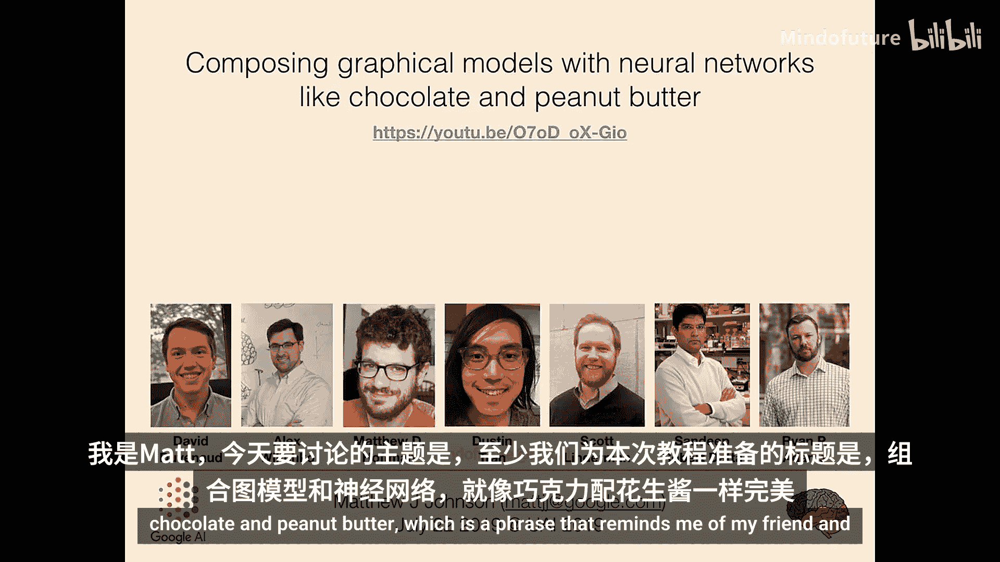
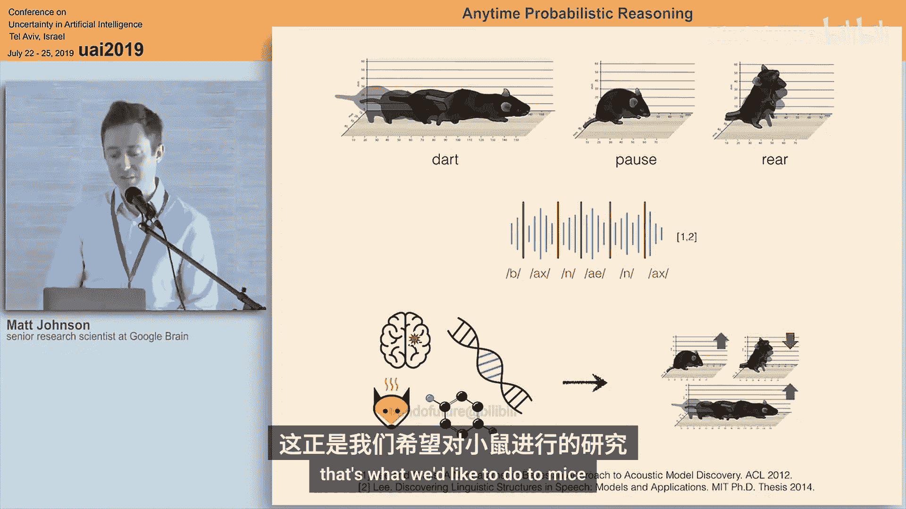
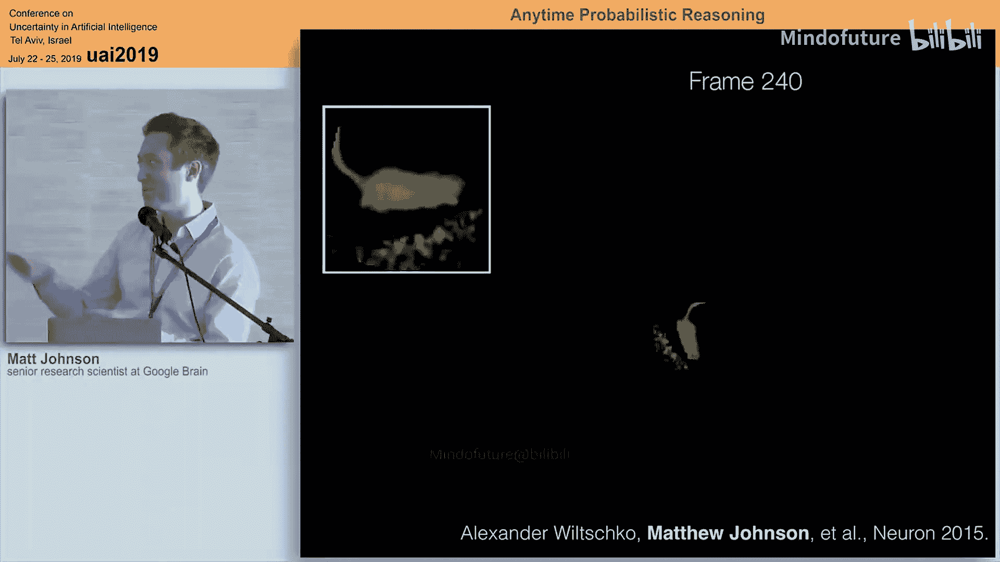
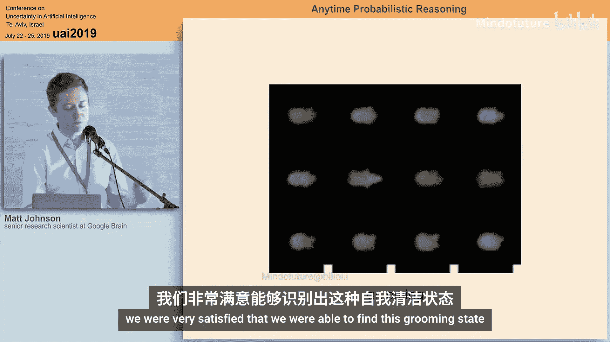
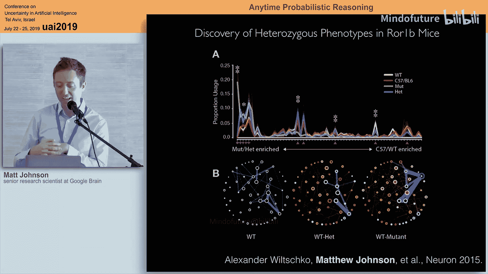
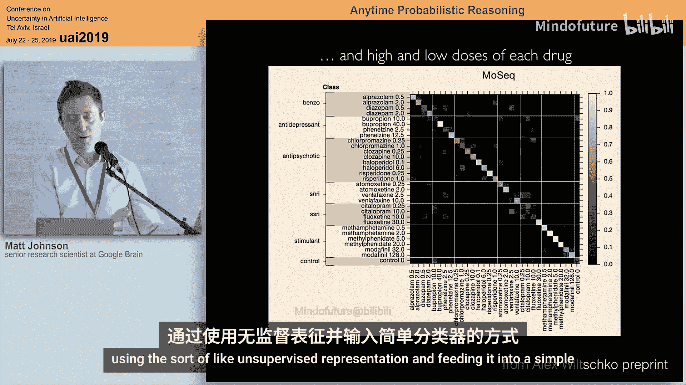
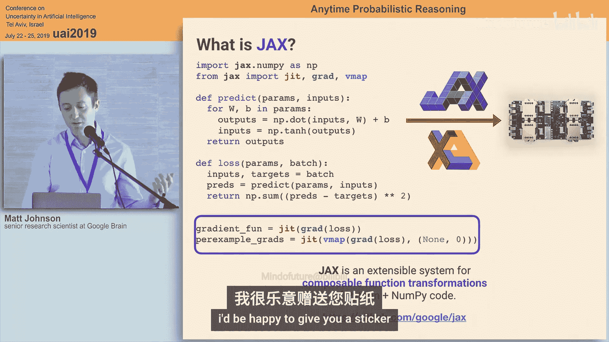

# 【加利福尼亚大学】图形模型中的学习 ｜ Cs274b ｜ Learning In Graphical Models (Spring 2021) p22 P22_教程_用神经网络组合图模型 -BV1Tqx6zrEMj_p22-

Thanks everyone。 So I'm Matt and I'm gonna be talking about。 well。

 this is the title that we made for the tutorial at least composing graphical models in neural networks like chocolate and peanut butter。

 which is a phrase that reminds me of my friend and collaborating， Matt Hoffman。

 So this YouTube link goes to a commercial for Reese's peanut butter cups from 1981。

 And I wish I could show you that video， but I think Google doesn't let me show like potentially copyrightrighted things when I give presentations。

 but watch this it's an ad or like two people are walking along one person's eating chocolate。

 the other person's eating peanut butter， and they bump into each other。

 their chocolate and peanut butter all mixed up， and then they taste it and it's like amazing。

 that's what the neural networks and graphical models are。 You got chocolate in my peanut butter。

 So as I've prepared for this tutorial。 I realize maybe a slightly more accurate title would be something like this。

 graphical models and exponential families in the age of differentiable programming。😊。

So you know， deep neural networks， people like to say well， really。

 it's all about differential programming， and I realize that I don't have that much to say about deep neural network details。

 but I do have some things to say about automatic differentiation。

 which is sort of like the workhorse that powers deep neural networks and how graphical models and exponential family ideas。

 you know， might be able to leverage Autodiff and work with it。😊。

So that's what you're going to see in this tutorial。

So let's start by just outlining some goals and sort of what's in it for you by attending this tutorial。

My first goal is to motivate all of you to sort of inspire all of you to say why PGMs and deep neural networks putting them together is a revolution waiting to happen。

 After I wrote that， I realized this is a bit strong， you know， the phrasing。

 But I do think that there's a lot of really interesting。 compelling potential here。

 like a lot of big things waiting to happen in you know。

 science in like robotics and control in putting these things together。

 So I hope to convince you of that， if not a revolution， at least some things were thinking about。😊。

The second goal of what you should get out of this talk is I'm going give a survey of the fundamentals of graphic models and exponential families。

To really give you a broad view of the territory。 So there's a lot here。 I made too many slides。

 And so as you you know， watch the math fly by increasingly quickly as I go through the the presentation。

 you know， the point is not to be able to dig into all the details。

 But hopefully you might see some things that spark your interest。 if you're new to the to the field。

 Maybe you'll you know， say， hey， that seemed really interesting。 I want to follow up on that。

 Or if you're， you know， sort of old hand， you've been doing these things for a long time。

 Hopefully there's something new in there for you as well。😊，In particular。

I want to show you a sort of unified view of how to think about these things in the context of automatic differentiationation and like how we can write software effectively。

 I think that。The sort of graphical models and exponential family ideas that you're gonna see here have not had their sort of automatic differentiation moment。

 So deep learning was， you know， it was sort of hard to do deep learning research before we had automatic differentiation and like GPU accelerated tools。

 And then when we got those available， it was like a garden of delights。 exploded in in power。

 And in terms of the research people were able to do。 and the ideas they were able to have。😊。

And I think that that moment is yet to happen for graphical models in the sense that when we get the right tools that can leverage auditive and accelerators。

 you know， I think there's a lot of potential to be unlock there。

 I don't think we're quite there yet。 but you'll see some ideas in this tutorial。

 So the last goal my real goal， fourth goal should I tell you now that I have you all trapped here in listening to me should I like reveal my secret evil plan why we're all really here。

 So I did some work on graphical models plus neural networks to be called structured variation auto coders。

 there's really a a lot of work in this space。 And the most common feedback that I get from that work is seems cool。

 but it's a lot of math like your appendices like 20 pages longer than the paper。

 So you know did it have to be that complicated。 and you know maybe maybe not but hopefully by the end of this tutorial you'll see that you know。

 I want to make these things super obvious。😊，To everyone。 So it's like， oh man。

 that was an obvious idea。 nothing really super hard there。 And in fact。

 hopefully you can come up with better ideas to move things forward。

 So that's my secret real goal is that you can improve on all this stuff and you know。

 fix it up and unlock our new PGM plus deep neural network feature。😊。

I just remembered I was supposed to mention the slides are now online as of like an hour ago。

 So if you wantan to look at these， you can go to the U AI website and you'll find a link to these slides except for the bonus slides at the end。

 which I added just before coming here。😊，So those are goals。 Here are some non goals。

 I'm not going to do a good job at all of surveying the recent literature。

In part because I don't know it's super well。 I've been sort of like sidetracked to working on systems and tools。

 I'll mention a bit about that at the end。 This is not going to be like a survey of recent works。

 I'm really going to focus on the fundamentals。And the other non goal is you're not gonna step away from this and you know understand all the technical details because。

 you know， back in my day， I took a course on problems with graphic models for a semester。

Has anyone here taken a course on graphical models。That's perfect。 great。 So if you。

 hopefully you'll see something new， but hopefully for everyone else。

 it'll just get a flavor for sort of what， what it's about。😊。

So let's start with motivation and to motivate you about why these kinds kinds of models and techniques might be interesting。

 I want to tell you how I got motivated by motivated to to combine deep neural networks and probabilistic graphic models。

 And it starts with this guy。😊，This is a mouse。 This is a mouse on a lab bench in a narrowbiology lab at the Harvard Medical School。

 And the neuroscientists there study mice。 They study the mouse brain。

 This isn't just that they have like a bad， you know， mouse infection。 They have you know。

 hundreds of mice。 They used to to study the the mouse brain by understanding its behavior。😊，Right。

So they want to sort of， you know， study the， this mouse and and do experiments on it and see how that changes behavior。

 But how do you quantify behavior of a mouse， right， Like， what does that mean。

You might imagine that by， you know， you can come up with some heuristics like count how often the mouse is in different quadrants of its enclosure。

 this sort of thing。 And those are sort of the cutting edge techniques。

 But if you as a human are told to watch this video of a mouse。 as I'm forcing you to do right now。

 I think you'll naturally come to a sort of description in your head of what the mouse is doing in terms of little brief stereotyped units of action that we call behavioral syllables。

 this is how eologist think about mouse behavior。 So they think about it as decomposed into little pieces that we might。

 you know imagine attaching even English words too。

 So the mouse might sort of dart forward or it might pause or sort of curl up into a ball and groom itself。

 or it might rear up into the air and explore。😊，And these little like units of action。

 discovering these automatically from video would be analogous to saying given an audio waveform。

 maybe in a language that you don't speak， try to discover the syllables， right， So if I said。

 try to discover maybe from some kind of video recording of a mouse。

 what its behavioral repertoire is， what it sort of behavioral syllables are。

 that's very much analogous to saying， discover syllables。

 you know the syllables present in this speech。 And the reason why you'd want to discover syllables。

😊，Is that then that's a representation that maybe you can， as a scientist or you give to your friend。

 who's a scientist to study， right so。At Harvard， they wanted to do things like app the mice in the brain with lasers or you know control its genetics or like sort of expose it to natural or synthetic compounds like drugs and study how that changed its behavior right and we can sort of instantiate that concretely as saying if I can learn from a lot of data what the sort of behavioral units are for this mouse。

 then I can study when I make these sorts of changes， these interventions。

 how the mouse of behavior changes concretely in terms of say how the unigram statistics or up and down regulated or the bigram statistics like the transitions between these syllables。

 just like how in speech， a lot you know not all of the content。

 But you can start to get a sense for the content and the patterns by looking at the syllables and the sort of transition structure between them and then see how those things change in different conditions。

 that's what wed like to do to mice。 So that was the challenge。😊。

How you know， did we approach it。 The first step was to get the mouse into a computer。

 And the way we did that was we used the connect depth video camera from above。

 this is a video from above of the mouse wandering around in sort of a bigger， yet empty container。

 And so the color mapping here is height of the mouse。

 you can see him sort of rear up and the sort of thing。 don't worry about the speckle。

 we can get rid of the speckle stuff on on the sides。

 So we would sort of track the mouse using a simple algorithm and then produce this video you see inla in the top left。

 which was that is you know， sort of egocentric version of a mouse's behavior。 right。

 It doesn't matter which way he's oriented。 We're just like the head's always on the right。

 And we're you know， recording this mouse in 3D。😊，So when I say we wanted to learn a model for mouse behavior concretely。

 We wanted to learn a model for this kind of video of the video you see in the top left。

So one way to sort of think about this video， maybe is that there's some kind of an image manifold。

 right， we don't see all possible， even though the images are maybe 60 by 60 by 60。

 So the very high dimensional image observations， we don't see every possible combinations of pixels。

 Maybe we only see a small subset indeed like a manifold of images so that every video frame lies on or near this sort of low dimensional manifold and image space。

 So then a video is a trajectory that lies on or near sort of image manifold。

 So when we want to learn a description of these data。

 this is the sort of thing that we might want to come across is somehow fit some kind of model for this manifold。

 we don't just want to learn the manifold as a set。

 we actually want to learn it in a coordinate system。😊。

In which we can describe the animal behavior in terms of these simple， decomposed units of action。

 So imagine that we have you know some simple， some coordinate space in which the dynamics are actually fairly simple for each movement。

 And then that can give rise to extremely complicated nonlinearar high dimensional data by sort of being dynamics。

 even though they they started simple being dynamics on an image manifold and we get to see noisy images。

 that's just to give you a taste of like how to think or at least how we start thinking about these data。

 So this is really a joint learning problem。 because we can't just like learn the image manifold。

 the preprocessing step and then fit some kind of dynamicsal system。

 we actually want to learn it in a way so that our model for the dynamics in the low dimensional coordinates works well。

😊，So what kind of tools can we use to model this video and extract out this kind of structure that we need。

One set of tools。 and obvious one to reach for is recurrent neural networks。

 I made this slide a while ago。 These references are super old。 But， you know。

 there's a lot of work on modeling video。 So maybe we can use neural networks to to model video。

 The problem with using neural networks on a problem like on， on a challenge like this one。😊，Is。

What we get out at the end is， you know， a whole bunch of weights and biases。 And， you know。

 who knows what's in there。 It's just like， you know， these big matrices。

 But we do know it can generate video really well。 right。

 so we could generate more mouse videos from this sort of thing。 That would be great。 The problem is。

 we already had a way to generate videos。😊，Called undergrads。

Undergrads will record as much mouse video as you as you tell them to。

 So we had millions of friends of mouse video。 We did not one more， you know， synthetic mouse video。

 We wanted to sort of like parse that information that we had into some kind of organized representation。

😊，So these weren't quite the right tool。Then， you know。

 you might think reaching for probabilographical models， which we're gonna learn a lot more about。

 But the basic idea is that these things are useful for constraining and organizing information in a sort of prescribed way。

 but they can fall down when trying to model things like images。To sort of explain the way。

 one way to think about these two alternatives。A bit more。 I want to abstract things。

 simplifyim them， get rid of the complexity of modeling a mouse video and even time and just think about a stylized representation learning problem。

 So here's a bunch of points in 2D maybe I tell you that they're conditionally ID sampled And I say like learn a representation for these data。

 you'd be like， well， it sure looks like there are clusters。

 And so maybe you'd fit a Gaussian mixture model。 And indeed， those are just synthetic data。

 that I generated from a Gaussian mixture model。 So if you have data that come from a GM and you fit a GMM works great。

 good。 the problem comes when you know your model design is false。 it doesn't fit the data Well。

 it's misspecified。 So here's still a toy example。 But just imagine here data that still have this sort of clustering structure but don't look like they came from a GMM that came from a sort of warped GM。

 depending on how you set the hyper parameters。 If you fit a Gaussian mixture model to this especially。

😊，If you let it learn the number of components using a dierschle process business。

 maybe it'll end up in stanching in a lot of Gaussian mixture components。

To model the data density well。 And， you know， maybe that's an okay model of the data density。

 put down enough Gaussian mixture components， and you'll be able to model anything。

But we've lost what we wanted， right， We lost this sort of interpreter representation of states。

 right， These are kind of like analogous， These clusters are analogous of the mouse syllables。

 And this is a real problem that we had when we tried to fit more stylized models。 you know。

 sort of graphical model techniques。 They would just use up all their capacity by sort of tiling the space。

 because of modelnessspecation。So PGMs on their own don't work for even just like slightly misspecified data。

 How can we hope for it to work with things like image manifolds and and all that？

 So another technique you could use is a variation autoencor or some kind of， you know。

 density network based on on deep neural networks。 And indeed。

 you could fit one to to data like these。 And it will do a great job learning the density。😊。

Maybe I should have run this for a bit longer。 So this is sort of this exemplifies， you know。

 it's analogous to how we might expect fitting an R N to a video of mouse behavior to work。

 It'll learn complex things like multimodal data and learn all all the details here。

 But you don't know sort of what it's learned。 Maybe you can sample from it。

 Maybe you can evaluate the density at points。 you don't actually have sort of surfaced to you the idea that there are actually multiple modes that have been learned。

 you're just looking at a bunch of weights and biases and stuff。

 And the fact that it' learned some complex data distribution is just a black box to you。

 So in this case， you know the fact that we don't get to see the clusters explicitly represented。

 That's sort of problematic。 It's just the density model， but that's not what we want。😊。

So what we really wanted to a picture like this， right that sort of combines the two where we can have a flexible density representation。

 Yet at the same time， maybe learn these mixture components。

 So this is a stylized picture to keep in your head， of one version of。

 of PGMs plus deep neural networks。😊，Actually， there's I think a very good analogy to what we do in supervised learning。

 which is to say in supervised learning， what we do even with kernels。

 but like you know deep neural networks， we have data that aren't linearly separable They don't play by the rules of our simplified models。

 But that's okay。 What we'll do is we'll stack up a whole bunch of feature transformations。

 And then at the end of all of our features。 If you look at the last layer of any neural network。

 any simple neural networks。 It'll just be a sort of linear classifier。

 right So the whole purpose of a neural network is to sort of like know move our data around。

 do nonlinear transformations So that a simple model like a linear classifier will work。😊。

We sort of want to do something analogous in this unsupervised learning domain， where we want to say。

 learn a transformation of our， of， of our data space， produce features in which a model。

 maybe like a Gaussian mixture model will fit well。😊，So。To summarize。

 I think graphical models have a lot of good things going for them。

 they have these sort of you know they give us ways to organize and constrain probability distributions。

 which means organizing information in a useful way。

 they're also really great at us helping us write down priors and uncertainty because maybe we understand how to how to encode information a priori But the problem is that the rigid assumptions don't fit。

 And so oftentimes we end up in this or know we used to end up in this terrible area of trying to do feature engineering。

 which was problematic on the inference side that's sort of like the modeling side。

 but on the inference algorithm side。 They also have some interesting things going for them。

 especially they're sort like computationally that can be quite efficient。

 So you can do graphical model inference sort of at test time if you like and support many different inference queries。

 not not just one will'll unpack that a bit more later。

 but these things only work in these very rigid model classes that are too constrained。😊。

Alternatively， sort of deep learning kind of techniques when you know， you fit a deep learning model。

 What you get out might be sort of this neural net goo to use Kevin Murphy's phrase。

 just like a bunch of stuff that models your data。 But you don't know what's going on inside of it。

 That similarly means that we don't know good ways to put priors on these。

 But we love deep neural networks because they are so flexible。

 And they let us model complicated data like images。😊，I think theyre interesting， you know。

 things to compare on the inference side， but maybe the most exciting development， you know。

 five years ago now is that sort of recognition networks can learn how to do inference for us。

 as opposed to how we used to do inference。 So as you can see， by comparing these two columns。

 I think there's a good case to be made that these sort of strengths and weaknesses are complementary。

 And so broadly speaking， I think we should， you know。

 work on how to combine these these strengths and weaknesses。

 very similar to how the last tutorial sort of you know， a theme of the last tutorial。

 How can we use you know， you know， simpler structures embedded in more complex ones to maybe push the boundaries of what we can do。

😊，So that was it for motivation， Let me。Make sure I'm looking at the time， okay。

That was it for motivation。 Let's move on to survey the fundamentals。 So again。

 I'm gonna go through some of these things kind of quickly。 but you know。

 take this as a way to sense what might be interesting to you。

Let's talk about graphical models from scratch。 So what graphical models are about sort of the aximatic theory of graphical models is ways of taking graphs。

 which are these combinatorial objects。 and relating them to probability structures in two ways。

 The first way is by giving them a sort of semantics in terms of conditional independence among random variables。

 And the second way is to say， actually， this graph is gonna describe some kind of algebraic structure in my probability density。

 So assuming that we have a probability density for these things。 relative to some measure。

 I'm not gonna say the word measure again， you should call me out， if I do。

 assuming you have some probability density。 One way of giving graphical model semantics is to say that they describe some algebraic structure in that density。

 And these two things are almost the same， but not quite。😊，So let's unpack that。What is a graph。

 So here's an undirected graph。 We're gonna start with undirected graphs。

 A graph is just a pair of a vertex set in an edge set。

 The vertex set is gonna be boring just like you know a sequence of integer Is。

 and then the edge set， I like to write it like this for undirected models where it's a set of set just to clarify that the order doesn't matter so of these edges from node U to node v in edge set。

 So here's an example here's that one simple example our vertex set being 1，2。

3 in our edge set being 1，2 and 2，3 So how do we take undirected graphs and give them you know and use them to ascribe structure to probability distributions excuse me to collections of random variables。

😊，So here's a definition。 We will say that a collection of random variables is Markov on a graph。

 If you take， you look at any triple of， of disjoined sets of nodes， you say。

 if I can delete the set C。And that means that there's no longer any path from set A to set B。

 Then I'm going to say that A and B， those subcolions re barrels are independent， given C。

 the one that I removed。 So disconnects means there's no， no more path。

 Let's just look at some simple examples。 I think you'll know how to generalize it。 Here's again。

 our simple graph。 This thing is implying the conditional dependence assumption you know。

 the statement that given x 2， X1 and X 3 are independent。So in general。

 graphs implies sets of conditional independent assertions。

 This one is saying that x1 and x3 are independent given x2 and x4。

But not if I just condition on X 2， right， Because if I just delete the node index2 in this graph。

 then one and three are still connected。 So connectivity in graphs and independent。

So here is another， that was the random variable view of graphical models。

 Here's the density view of graphical models。 We say that collection of random variables factorizes or it's density factorizes on an undirected graph G。

 if its probability density can be written as a product of factors that only depend on variables corresponding to cliques in the graph。

 So clique is a subgraph that's fully connected。 it's a complete graph within the graph。

 So it's like I think it's called a clique because you know you have a set of friends。

 and they all know each other， but maybe they don't know you。 That's like a clique of people。

 So the idea is that the algebraic structure in the density is that we can write as a product of cliques on the graph。

 So here's again， our super simple Markov chain example where we say when we have when we say that density factorizes according to this undirected graph。

 What we mean is we can write its probability density in this way as a product of just terms that one term that depends on X1。

😊，X2， another that depends on just x 2 and X 3。 And by limiting that dependent structure， you know。

 that's making that' saying a statement about something。So， here's another graph。What are the two。

 What are the factors that I can， that I can write this density in terms of。Perfect。

 I heard the answer twice。 Or there's an echo in here。 Yeah， indeed， So the 1，2，3 and the 1，3，4。

 either you guys have taken a graphical model course or you're very quick on the uptake。

 So that's the two definitions of how to relate graph to structure in a probability distribution or a collection of random variabless。

😊，Are these the same。 I already told you the answer They are not quite the same。

 but there's a theorem called the hammermersley Clifford Theorem that says if the density is positive everywhere。

Maybe there other technical conditions， like it has to be finite。 I'm not sure， but basically。

 if the density is positive everywhere， then these two are the same thing。 then saying the。

 the conditional dependence assertions and the density factorization statements。 those all hold true。

 no matter what。The trick here is to like have some density with zeros in it， right。

 or like log density with negative infinities。 You can see how to， how to break this thing。

So that's undirected graphical models。 I'm gonna talk a bit about directed graphical models。

 But before we do， actually you can already see the emergence of these exponential family things。

 little hints of exponential families here already。 And here's how to do it。

 how to sort of see these hints。 So if you know， you want to make your density positive everywhere because you don't want to worry about these sort of pathologies that happen。

 one way to do that is to say， I'm gonna make my density be X of something like X of a negative energy function。

 That's great。 And so then you know， if we think of the energy as the sort of log of the of the density。

 then we see， I don't have a mouse cursor。 But like on the second line here。

 we can think of this product structure is turning into sort of some structure。😊。

Now that we have this energy written is like a sum of all these local potentials。Now。

 our log potentials。 you might wonder， like， hey， without changing the graphical model structure。

 I could generalize this to consider all linear combinations of those instead of just one combination。

 And then I'd have a family of distributions parameterized by these coefficients that I put on them for the。

 for the linear combinations。 whole family of them。 And there's an exponential in there。😊。

So this is a hint that graphical models and exponential families are intimately related。

 So that was undirected graphs flying by quickly。 Let me tell you a bit about directed graphs。

 and how we ascribe semantics of of collections of random variables to those。 Similarlyly。

 there's a way to talk about independence。 There's also a way to talk about algebraic structure so。😊。

To start with a directed graph is also just a pair of a set of vertices and a set of edges。

 And the edge set here is a set of pairs。 right， In the other case， they were。

 they were just a set of binary sets。 So here's a simple example， as before。

Where now the edge set is the ordered pair 2，1， and the ordered pair 2，3。

So here's the first way to give to talk about random variables being Markov on a graph G。

 It's similar to the other one where there's a kind of separation where you say， okay。

 look at three disjoint subsets of random of of nodes in my graph。

 And we're gonna say that the sets C。D separates， that stands for directed separation。

 I think D separates A from B。 If that's the case， then we'll have this conditional independence assertion that the random variables in in A are independent of those in B。

 given values for the ones in C。 So D separates。It's very much like， I mean。

 it's analogous to undirected separation， but with a twist where we， you know。

 that we add just to make things work out correctly， so。Separation is all about paths。

 So when you're looking at all the paths that you might be able to follow from the set A。

 from some node in the set A to some node in the set B。

 we want to decide if that path is sort of blocked or not。 And if all the paths are blocked。

 that'll mean that know， this independence assertion holds。

 So here are all the cases when you're walking along a path。 you'll run into little， know。

 triples of consecutive nodes。 And these are all the possible cases that you can run into。

Which ones are blocked， You might think that all the ones in the bottom row are blocked because that's where it looks like there's sort of a filled in node in the middle。

 The filling in means we're conditioning on， on that value。 Indeed。

 these are the ones that are blocked。There's a twist。

 The only thing you have to remember is that this special structure on the， in the。

 in the right hand column。It has a special name。 It's called a collider。

 And we give it the special rule that actually， it's blocked if the middle node is not conditioned on。

 if it's not shaded， if it's not in the set C， and it's actually unblocked。

 it's opened up if you condition on it。 So this is used to trip people up on tests。

 That's what use this work。 Just getting。 It's used to， you know。

 model some useful property about how conditional probabilities work。

 So here's an example quite similar to what we had before。

 where we condition on two one and three are independent。😊，Here is the opposite structure。

 So the graph， even though I drew the middle node down， that doesn't matter。

 The point is that the arrows are going into two now instead of away from it。

 And so this is that special collider structure。 And that means that if we say that our distribution is Markov on this graph。

 X 1 and x 3 are actually independent when you condition on nothing， sort of marginally independent。

And it's not the case that they are necessarily independent when you condition on。

They might still be independent condition on two， but that's just because graphs imply sets of conditional independence assertions that doesn't mean that they imply all of them for the collection of random variables。

So that was random variables conditioning and， and relating those to directed graphs。

 There's this other way of relating directed graphs to probability structure that has to do with the density factorization。

 This one's really quite natural。 even though the notation is a little bit weird。

We say that a collection of random variables has a density that factorizes on a directed graph。

 If we can write the density as a product over all the vertices of terms where we think of the conditional probability of or the probability density of that node associated with that sorry。

 that variable associated with that node condition on all of its parent node。

 So P A here means parents of V in the directed graph G。😊。

So here's a factorization corresponding to these two different graphs。 as you can see。

 they are quite different。 And this is why you know， we have a special rule。 But you know。

 you can see in this collider structure。 maybe already why if I tell you a value for x2 in the former one。

 we get sort of a nice factorization in the top line of independence between x 1 and X3 in the second line condition on x2。

 somehow now we get this joint entanglement of x 1 and x3。😊，So。Directive models。

These directedive models， you might have noticed it's sort of everything is just parameterized based on its parent。

 It looks a lot like a sort of computation graph or something， right。

 It's sort of like a specification for how to to maybe generate a sample。 And indeed。

 you can actually say5 a directed graph。 And I'm not conditioning on anything。

 that sort of tells you a way to draw a sample just started all the nodes that have no parents And then sample values for those and then sort of march down for each node when all of its parents are sampled。

 you can sample that value。 It's called ancestral sampling。

 And that's sort of why directed models appear often with generative modeling because they're just a very natural way to parameterize things in terms of sequence of steps。

 I won't go into the details， but there are beautiful connections between Gaussian graphical models and linear algebra and numerical linear algebra。

 And So this might be a little intriguing。 directed parameterization is like， or in fact。

 exactly the same as having a Chilesky factorization。 or you know a lower triangular。😊。

Square root the Chi is the unique such one。 So theyre nice connections to linear algebra。

 if you're into that kind of thing。Undirected models， on the other hand。

 I think of them as coming up much more often in inference。When you have an inference problem。

 because it's actually quite simple， when you have a directed model。

 everything's hunky dory when you know you're just sampling from the the roots。

 the ones with no parents down to the leaves。 But if I like condition on the leaves and ask you what then know what kind of distribution do you have And that kind of ruins all the directed structure by conditioning on things at the bottom we can no longer。

 know， you can no longer draw a sample from that conditional distribution by starting at those nodes with no parents。

 So when we do inference， like when we ask， hey you have the nice probability distribution。

 How about this conditional distribution， when we try to do inference in conditional distributions。

 oftentimes we end up working with undirected models， you're gonna see a whole lot of that later on。

For Gaussians， these things sort of relate to linear system solving。 if you like that。

 There's one more。Vant， which I don't think of as distinct from those two。

 but it's sort of like quite useful to know about。 These are conditional random fields。

 And these are graphical models where the potentials depend on exogenous data。

 It just means that like you don't have a graphical model until someone gives you data。

 Someone gives you data。 And you have a way of producing potentials in your graphical model。

I should say these little factors， like these psi factors in the density。

 those are called potentials。So， for example， one way they're traditionally drawn is in the top left here。

 where we're sort of always conditioning on those nodes on the bottom。

 And the idea here is that it's saying， given you know， values for these nodes on the bottom。

 then I have this chain structured graphical model。

I don't like that way of drawing it quite so much because you might think。

 do I ever have these nodes at the bottom unshaded。 am I ever asked to inference over them。

 The idea is no， you're not you only learn distribution parameterized by some other values。

 So here's another way to draw them。 slipping into this kind of like factor graph convention where we sort of just draw a little squares。

 And we remember that those can depend on external data。 In fact。

 this is already a way to combine neural networks and graphical models these conditional random fields。

 this work sort of goes back decades， at least where you can say， hey。

 what if I came up with a graphical model by having a neural network or some like parametric function appximator。

 And that's gonna take in data and spit out graphical model potentials。 So for example。

 if you wanted to optical character recognition。 a sequence of images like the endnes problem。

 You have a sequence of images that correspond to a handwriting。

 And you wanted to estimate what the written characters were。 maybe。😊。

Ne network can take in an image and generate a potential on it's sort of a guess for what character that is。

 And then you can have a hidden markov model。 It's like a language model。

 The graphical model potential says， you know， it says how compatible are these pairs of adjacent symbols that we estimate。

 That's a nice way putting things together。 I just want to be sure to mention that。

 because that's a great way to combine graphical models and neural networks。😊，When I talk more later。

 I， you know， I tend to think more on the unsupervised generative modeling kind of situation。

 not this kind of conditional， generative conditional random field setting。

These are great to know about。Here's another cool CRF， like a grid structure。 Great。

 let's give over that。 So that is。😊，Trying to do math in my head。How， much longer we have。 Okay。

 so that was a sort of survey， the fundamentals of graphical models。

 And some people kind of stopped there。 Actually， oftentimes。

 when you see the word graphical models in the literature。

 some people just use these things using the semantics that we just talked about as ways to organize information。

 And they're already quite useful because you can say maybe I want to create a generative model where。

😊，The pose of my mouse is decoupled from the， you know。

 the instantaneous pose of my mouse is decoupled from some description of its body shape。

RightAnd already， you can imagine encoding that using sort of graphical model semantics by saying。

 well， the body shape will be sort of part of the latent code that doesn't depend on time。

And the pose does depend on time。 So I'll just have one random variable for the for each mouse for its body shape。

 And then for each mouse and each point in the video， I'll have the pose。

 And I'll sort of put those together。 But I'll learn them as independent。 Thats， you know。

 you don't need any any more than just graphical models and some like variation autor type neural nets to do that。

😊，However， I have a lot more to say about。Graphical models， especially exponential families。

 So there's much more in the toolbox。From graphical models and exponential families to do with。

 especially to do with algorithms for inference。 And， you know， when。So when I work on these things。

 I'm like， how can we use as much graphical model technology as possible。

 especially when technology around exponential families for inference algorithms。

 That's what excites me。 So we're going to talk next about exponential family stuff。

 We're also going to start seeing a bit more about how to leverage automatic differentiation。

 There's been no autod so far。 So let's start with defining an exponential family of densities。😊。

I don't want to say if you take one thing away from the talk。

 but I believe it is not the exponential family。 It is an exponential family of densities。

 as I think willll become clear when we look at this definition。 just use the indefinite article。

 It's like， I have an exponential family here。 Okay， so an exponential family of densities。

 Let's build it up piece by piece。 You can see this is blank right now。

 It's not because I didn't finish my slides。 We're gonna build it in one at a time。

 So think of an exponential family is really defined by a statistic function。

 And the statistic function goes from it's a function that takes in sort of the range or the know outcome space of your random variable and maps to a finite dimensional real vector space。

😊，It's very important that it's finite dimensional。 Otherwise， Everything is an exponential family。

 So that's really gonna be the the sort of power。 So we have the staistic function。

 And that once you set up a staistic function， more or less the exponential family is defined and constraint。

 Everything else is just gonna to be procedure from here。

 So Then we're gonna think of all energy functions that have this form。

 you take vector of real parameters。 and you say， think of all linear functions。

 if you like all in that statistic and expentiating them。 This gives us an energy function。

 So this will be a non negative， real valued you know， actually positive， real valued function。

 and we're gonna to use that to define our probability density。😊，This also sets up a log normalizer。

 And so now this sort of completes the view where we're gonna think of our density function on x parameterized by a natural parameter Eda。

 which is just a vector of real numbers as having this form where the sort of calligraphic A is the log normalizedizer or log partition function。

 And this is a function that takes in the natural parameters And it spits out a real number And it's basically how to keep this energy function normalized。

😊，Here it is。 The definition is just like a log sum X log integral X。

 I haven't defined what theta is， but I will， I think next。 Yeah， that's good。 Okay。

 so theta is just the set of all theta parameters for which this integral is finite。 right。

 So you might have values in your whole vector space where or this values is finite。

 It turns out that actually this is a convex set。 And a。😊，Is a convex function it's。Actually。

 sort of， if you know that log sum X is convex， that's the same reason log integral X is convex。

 So maybe， you know， pathologies aside。 this， this A is actually always a convex function of of the natural parameter。

 and and theta is always a convex set。So let's just move up our。

 our definitions there and say a bit of some interesting properties。 I already spoiled this one。

 So A is convex。And here's something interesting。 If you think about its gradient mapping。

So a is a function that takes a natural parameter。 Eda and spits out a real number。

 So the gradient takes in an Eda and spits out something that's the same shape as Eda。

So the gradientding of this log normalizer function actually gives you expected sufficient statistics where the expectation is over that probability of distribution you've defined with this density。

And actually， it's not hard to show。You just differentiate it。

 And if you think about differentiating a log， right log X。 you get a1 over x term。

 So we get one over the integral。 That's great。 And then we differentiate under the integral sign。

 which we， you know， it's very， we do very loosely， even though there's some kind of condition。

 we have to satisfy to do that。 And then， you know， we differentiate X。 we just get， you。

 with respect to Ada， we just get a copy of T of x and not another copy of the exponential。

 So that's actually just， you know， the definition of of the expectation of T of x。😊，In fact。

 doing the algebra slightly differently， you can show that a。

 the log partition function is directly related almost the same as the cumulant generating function。

 And so higher order derivatives give you cumulants。

 And the second cumulants is just the second moment。 So it looks like it gives you moments。

 but it's actually a cumulants。😊，So those are just sort of nice properties。

 I didn't define what the set M is。 the sort of range of this gradient mapping。

And M is actually sort of an interesting line。M is the set of all expected sufficient statistics you can get。

 So expectations of T of X that conform form for any probability distribution。

Not just these exponential family ones， but for any probability distribution。

 is sort of a nice property because it tells you why these exponential family things are are sort of canonical because if I can always write some exponential family distribution。

 Some member of my family， if I can always find a member of my family that can recover any expected sufficient statistic that any distribution can come up with。

 then I sort of feel like I'm not losing out on much。

 And it it's almost true that this map is subjective。

 it's only it can only possibly fail at the boundary in which case you can take like a sequence of of points。

 Those are interesting aside that I mentioned only in case you're into convex analysis。

 you if you like convex analysis or you want to learn about it。

 thinking about exponential families is a great way to do it。😊。

To give you some taste of like other things we can write in terms of this log normalizer function。

 One other thing is the K L divergence between two members of the family。 This is just。

 you can substitute the definition。 And in fact， a lot of different things， you know。

 a lot of different quantities really just come down to having this log normalizer function。

I should mention that。In the world of autodiff， these are not just symbols that we write down on slides anymore。

 right， You will see that you can actually just write this in your code。

 You can actually just implement this， you know， if you have an efficient way to compute the log normalizer for an exponential family。

 You don't need to implement a routine that computes the kale divergence between two things or compute the expected sufficient statistics。

 You just use grad。 And that's all。 you just use your auto diff。 That's gonna be a sort of theme。

 They'll see more in a moment。 So I'm gonna use this term loosely， this is one that I made up。

 I don't think it's。😊，Super common。 I'm just gonna say family is tractable if the log normalizer is easy to evaluate。

 What does easy mean， I don't know， polynomial time or something。And like， you know。

 maybe there are other ways of of being tractable。 But this is the one we'll， we'll focus on。

So here's an example of an exponential family。 and you will see the intimate relationship with graphical models。

 consider a binary hidden markup model。 binary makes it makes the notation simpler。

 but the whole picture generalizes。 So consider a binary hidden markup model by which I mean。

 we have a density that looks like this。 So the adas are just scrs in this case。

 And so our density looks like of a bunch of node potentials。

 if you like a sub1 x1 As to do x2 and a bunch of pairwise potentials。

 So if our density looks like that， we know we can factor it in terms of these potentials。

 So you know， we have pis， I think that'ssi， right， the s potentials， we can also write it。 This is。

 I think a tradition that you write ps， the expd one and phi for for the nonexentiated version。

 but this is sort of talking about the same thing。😊。

So are there statistic in our exponential family in this binary hidden Markov model。

 just you can write it as it's the sequence of all these phi values， right。

 And so the idea is that we can write down any， essentially any binary hidden Markov model by just saying。

 well， this is my statistic function。 Consider all linear functions of it。

 X of those linear functions thatll give me my density。 right， So that's the statistic。😊。

I actually want to write the same。 Well， a related statistic。 I want to write it in another way。

 So you can see that this is sort of all。Ultimately， this is based on all sort of like。嗯。

This is like a big polynomial where we have the monoials X1 X 2 X 3， and we have the mononoials， X 1。

 X 2 and X 2 X 3。 So here's another way we can think about writing it。

 Think about writing the statistic as this matrix， this outer product matrix。

 So this is gonna form all the monomials and along the diagonal will have X I squared。

 but because it's binary that's just like X I。😊，So this statistic is like all the different monomials of。

You know， up to， to sort of。诶。Maxster G 1， I guess I don't know。

 So Im I'm just gonna summarize that statistic is X X transpose。Then when we have。

 when we look at Eda for the statistics， So the statistic is still mapping to a finite dimensional vector space。

 but it's just a matrix。 And then if we look at the， the statistic， sorry。

 if we look at the natural parameter that corresponds to HMs。

 it's all natural parameters with this sort of sparsity pattern where the purple things are non-zero elements and the empty things or zero elements。

 and that triagonal matrix structure corresponds to this chain graph。😊。

I like this view because it makes clear that with this statistic， you can also consider， you know。

 more possible graphs。 right， What happens if I keep adding edges to this thing like。

I could end up with the complete graph or something like that。What would go wrong if I had， you know。

 the complete graph。Compared to the chain graph， any guesses。s。Yeah， that's right。 Yeah。

 it would link future information。 So it would lose sort of maybe our our local semantics。

 That's right。 It also presents computational issues as we'll， as we'll see in a second。

 So here's back to our chain model。 If we think about the log normalizer。Right。

 what is that that's a log sum X of our density where we have to sum over all binary configurations。

 And as you might guess， when this matrix is changed is tri diagonal structure。 So， you know。

 when we have this chain structure， we can evaluate the sum efficiently。 there's a whole bunch of。

 you know， graphical model semantics how you can think about complexity in terms of the graph that only works with the finite valued in Gaussian cases。

 But really， the point here is that you know， to do this sum， we can do it， we can do it efficiently。

 what it ends up doing。😊，It turns out you can think of this as doing the sum sort of zipping along that matrix。

 You can sort of sum out the leftmost node and then the second node and then the third node。

 And so you can think of this as sort of passing messages where to compute the sum overall configurations。

 I only have to do sort of local sums and propagate information。 I want to unpack the details。

 but you've probably know seen some version of that for HMs。

 here's the neat thing that I will unpack though。 if you have a way of computing this log normalizer。

 we know that we should be able to use automatic differentiation to get expected sufficient statistics。

 And in fact， if you use what that' saying is if I use grad of this log normalizer。

 thatll give me these expected statistics。 And moreover， you know。

 these statistics is these are binary value to just like the marginal probabilities of each node being on and sort of the pairwise probabilities。

 So。😊，And what's really neat， if you think about evaluating this in your computer with reverse mode automatic differentiation。

 the forward pass of your reverse mode automatic differentiation is gonna to be evaluating the function A。

 So that's gonna to do that red message passing on the top。

 And then when you do sort of the backward pass in back prop is going to， you know。

 look like passing messages backward to evaluate your expected sufficient statistics。😊。

So what's interesting about this is when I learned about HMMs。

 we learned how to write this bidirectional recursion directly。 you know。

 the alpha beta algorithm or the alpha gamma algorithm or like all these different message passing things。

 But we can reduce many of them。 certainly this one。

 just to automatic differentiation where we just have to implement the log normalizer to convince you that that is simpler then implementing message passing really makes the bookkeeping much nicer。

 Here is， so in this autograd package that we started in Ryan's lab we have an example of an HMM。

 And this is how we write the log normalizer function。 The details aren't important。

 but it's just a little loop。😊，Walking the graph from left to right and just sort of doing local sums。

We're doing in log space for， for numerical accuracy。

 And then to get the expected sufficient statistics。

 We actually have a little E M algorithm in that example， you just do gra of the log normalizer。

 So I've started to write all of my probability libraries。

 my exponential family libraries in terms of a minimal amount of stuff where I just implement maybe the log normalizer and the statistic function。

😊，And then get everything else for free。 So I think I might skip over this section。

 only to give you the briefest hint。 So what about， So this is gonna go really fast。

 What about maximum likelihood。 You know， some nice things might happen there。

 If you think about writing out your log likelihood objective， indeed。

 things simplifyim quite nicely。 And we give a name to the value of the maximum likelihood objective。

 sort of the optimal value。 we call that a star of mu。 So you give it any， for example。

 empirical moment vector of mu。 And this is the value of the optimal of the， of the， you know。

 log density at the optimal parameter。😊，So gradient Ascent has a really nice interpretation here where it just looks like iteratively trying to match the moments of of your model。

 sort of the model moments， the expected vision statistics with the target moments mu。

 you're just always taking that difference and taking a step in that direction。

 actually a lot of algorithms have really nice interpretations。

Here's a claim to go over very briefly。 It turns out that。Actually。

 the gradient of a star gives us the optimal， you know， technical conditions aside。

 They're sort of easy to satisfy。 The gradient of a star gives us the optimizing Eda。😊，So。Basically。

 if you want to do fast maximum likelihood and you have an exponential family that's tractable in the sense that you can evaluate a star。

 which you can in a lot of cases。 then this is where you can get closed forms of E M updates。

 if you like， So just to set back for a moment， this is the convex analysis of rearing its head again。

 In fact， A and A star even though we got to a star by just reasoning about maximum likelihood。

 they turn out to be conjugate pairs。 these are like really canonical objects and convex analysis。

 And there's this really nice sort of these mappings， the gradient mappings of A A star。

 are almost like inverse mappings with one another。 And some cases they are。

 essentially inverse mappings。 And this unlocks a ton of algorithms that we can use where we're like iterating these things。

 even better， you know if you just write your libraries to implement these functions and you have autod you get a lot of algorithms for free。

 We'll see a couple of cases of that so。😊，Here's a summary of exponential families。In terms of like。

 how to write libraries， if you just implement a sta function and the log normalizer function for a tractable family。

 So this is a family， these are like integral tables， right like。Integs， unlike Autod integrals。

 you just have to have a table of them， the ones you can solve efficiently。 right。

 That's just how the world works。 But there are some integrals we can solve nicely。

 like the sums in in a hidden Markov model or you know。

 the sums associated with integrating out the leading states of a Coleman filter or something。😊。

You know， the idea here is that when you have these special distributions where you can evaluate these log normalizers。

 that's very powerful that you can evaluate these integrals， exactly。And here's a way。

 to set them up in your code libraries。 You can just implement the statisticst function and the log normalizer。

 that's basically populating your integral table。 And that will give us access to exact inference。

 as we just saw where we got the expected sufficient statistics。And actually。

 sort of to be implied soon， that'll also be enough to do meanfield variation inference。

 even like structured meanfield variation inference。

 If you write a log normalizer for your HMM and a log normalizer for your linear dynamic system。

 like your common filter model， that'll be enough to generically implement structured meanfield inference with autod sort of analogously。

 if you， if you write down a star， which is a different kind of tractability。

 then you can get like variational E M for free， just all the different， know。

 you all these different algorithms。 And finally， if you want to draw samples。

 you might want to write a sampling routine。😊，So this was also sort of a view about tractable families。

 when we can implement the log normalizer exactly， as maybe， you know。

 hopefully should be clear when we looked at the binary HMM。Convex does not mean tractable， right。

 Like you can encode all kinds of， of hard， you know。

 N hard problems in the problem of evaluating the log normalizer。 But in some cases。

 we can evaluate it。And so， the next question is。What if we compose tractable families。

To make up intractable ones， how can we get approximate inference algorithms that exploit。

Those structures。 So back to mice。 remember， we wanted to model mouse behavior。In terms of， you。

 we to model a mouse video and discover sort of latent units of action。

 And now maybe we have some tools that might help us。

 Let me describe to you a model that sort of composes up pieces of tractable exponential families。

 So to start out with， let's imagine that we want to have a sequence of latent variables that corresponds to at every time at every frame in the video。

 what state the mouse is in， what behavioral state the mouse is in。

 So we can have a finite valued mark out chain。 right just like an extension of the binary valued one。

 And the idea is that as time marches to the right here。 the directed graphical model。

 it'll be in a particular state， like the blue state for a while。

 that'll be like when it's darting and then itll transition into the green state。 Great。

 So we have a little hidden mark out model， that's a great way to start organizing the information on our representation of mouse behavior。

 What next， we want to connect this up to images， ultimately。😊，So what we can do next， really。

 this is my favorite model， by the way， It's called a switching linear dynamical system。

 And The idea is that we have this latent Markov chain and each state of the Markup chain is going to correspond to a set of linear dynamics。

😊，In a low dimensional latent space。 these are like dynamics on our coordinates。

 So while we're in the blue state， we're gonna be driving this linear dynamical system with some set of dynamics parameters like this matrix A。

 Then when we switch to the green one will set switch to a new set of dynamics。 And then again。

 switch to the red one in the Markup chain。 got a new set of linear dynamics。

 So we have a collection of these linear dynamical models， one for each state。

 And each one is gonna correspond to a behavioral syllable in a very nice， simple representation。

 we can even do things like if we wanted to put priors on these matrices， we could say， hey。

 I want to make sure that the dynamics aren't too fast， right， like， you know。

 you can think about how what frequencies are included are likely to be included in these kinds of matrices。

😊，So let's just clean this up into a graphical model。

 We'll use x's for the so z is sort of the discrete state component。

 X is the latent sorry is the continuous state component。

 We'll package up those matrices as parameters in this theta。

 And so this is a great start to our model because we've sort of written down the organized piece of how we're going have discrete states and those going to drive simple dynamics。

 So the latent space is looking good so far。😊，The question is。

 how do we connect these up to mouse images， and we're not going to quite get there yet。

 but that is the ultimate goal。 I want to talk more about this kind of compositionality that we just saw where we composed up simpler pieces to get a more expressive model。

So instead of mouse images， for the moment， imagine that we just have linear Gaussian observations。

 and that'll play nicely。 There's no new neural networks here。

 this is just another iteration of composing nice sort of exponential family distributions in our directed graphical model。

😊，So the big question is， if we compose up。Exential families like this。What happens？

 And in particular， can we get compositional algorithms that use the structured pieces that we built in。

You know， if I wrote down at HMM， I don't want to lose， I don't want to lose the fact that I can do。

 you know， I can sum out the links states that H MM very efficiently。

 I don't have to fall back to like know reinforcement learning and some kind of super noisy gradient for learning。

 I want to like exploit that that fact in an approximate inference algorithm。

 So here's the way to think about that composition， I'm just gonna claim this。

 But if you write out some examples， you will see that this is true。

 This is how when we build up those， those models in that way。 Like I just showed you。

 here's the kind of structure we get out。😊，In fact， we get out， you know， not always。

 but the natural way to compose these things。 What you end up getting is。

A new exponential family in terms of， So think of the T 1 and T2 here as each is the set of sufficient statistics for tractable exponential family。

 So maybe T 1 corresponds to the hidden Markov model over time。 And T 2 corresponds to the you know。

 linear dam systeming over time。So the way these compositions work out is we get a new exponential family where the statistics are actually polynomials in the sort of in the statistics of the components。

 So here you can see that we're just expanding out the statistic to be theres a mononomial term on T 1。

 a monomial on T2。 And then we have this tensor product of T 1 times T 2。

 the tensor product just means， you know， sort of the outer product of these， these things。😊。

You can already see why this might be a nice structure。If you think about。

 what would the distribution look like， if you condition on X 2。 So if I told you the value of X 2。

 and then I said only reason about the distribution on X 1。What would that distribution look like。

 What would that density look like， So I'm gonna give you a value for x 2 and say。

 what's the remaining distribution on an X1 look like。Any ideas。Yeah。Yeah。Yeah， super nice， right。

 You get to combine some terms。 That's right。 So the answer was， if X 2 is no longer， you know。

 variable， you can throw away that T 2 X 2 term。 And this term that combines both of them。

 we just look at that T 2 X 2 as a constant。 So we get something like this。😊，So actually。

 read everything on the left as just part of the new parameter。 So we see that we have T 1， X1。

 X1 is the only variable here。We see we have T 1 X 1。 That's the statistic of our like the family。

 the exponential family on just X 1， sort of in the prior， if you like。

 And then for a fixed value of X 2， T 2 X2 just becomes part of the natural parameter。

 sort of part of the energy function on that， on that T 1， X 1。😊。

The notation here with the dot is kind of loose。 some kind of tensor contraction。 So that's right。

 So you can already sort of see why a polynomial structure like this one， in particular。

 a multi linear polynomial where the maximum degree of any mononomial statistic。 T sub I is just one。

 So they all appear linearly is nice。😊，In fact， let's generalize this a little bit and just write it with arbitrarily many terms。

 But it's the same thing here we're saying that let's consider a big exponential family composed out of small ones and the way in which it will be composed up will be。

 we're gonna to say that the overall family is some kind of multiline polynomial of the pieces。So be。

 and we're gonna write G as that multi linear polynomial。 So we're gonna。Mti aine。 technically。

 it's aine because if you plug in zeros， you might still have the constant term。

 but I'll probably keep saying multi linear because I forget。

So all these betas are just binary indices telling you whether or not a term is included。

And remember， we want to think about each sub little T as corresponding to a tractable family。

 But the overall family， the overall log normalizer corresponding to this big polynomial sufficient staistic will not in general。

 be tractable。 It'll be hard as soon as we compose up a few， you know， a few pieces。

So if it's nottractable， what can we do。Here's just copying that form again。

 and I just want to give you a sort of flavor of how we can get。 let's see aha the question is。

 can we build algorithms for this composite family。

 this compose up family like our composed up switching linear dynamical system that can do things like approximate sampling from this model via MCMC or maybe I can approximate the expected sufficient statistics of this model or even approximate or bound the normalizer itself。

😊，Maybe I can do variational E M。 And I want to build these algorithms generically， sort of like。

 you know， automatically。 And in ways that exploits the structured， tractable parts， if I can。

How do we do that， I'm going to show you two examples and then promise you that actually a lot of different algorithms。

Are unified this way。 And if once you see these pieces。

 you'll be able to work it out for yourself how to do it。 So let's think about sampling first。

 I have these slides memorized as I just made them like yesterday。 Great。

 So let's think about sampling。 Here's the claim to do gib sampling。

 So gib sampling looks like I want to draw an approximate sample。 But I can't do it all in one go。

 I'm going to do it iteratively。 And if I have a partition of my variable X into these components like x1 x2 x3 up to X M。

 these could be blocks of of the thing。 way I'm gonna build my MC algorithm sort of an iterative way to draw a sample is I'm just gonna resample each block conditioned on values for all the others。

 That's gonna set up an iterative algorithm。 And so the primary object of interest is what do these conditional distributions look like。

 when I look at X M the distribution on the block conditioned on all the others。

 That's what I mean by the little Neg notation。😊，So here's this claim。

 Gibbb sampling is easy or like sort of generic。 once you have this multiline polynomial form。

 we can write it。 This is basically using that idea that we saw a moment ago with the two statistics。

🤧嗯。We can say that the distribution of X M， given everything else。

 just looks like a version of you know， the sort of prior distribution of X M。

 this little exponential family with the statisticstistic Ts of M。

 And that's one of our tractable families。 So maybe we can sample from it efficiently。😊，啊。

The trick with Auto di is that you can extract the natural parameter for this guy by using differentiation on G。

 So if you have a function that evaluates that multiline polynomial G。

 we can just auto di it and that'll give us the natural parameter。

 And so what that means is here' is a way to write a generic gib sampling。

 If you specify your model in terms of G， the multiline polynomial。

 And you give me a list of samplers， one for every tractable family。😊，This is a gib sampler。

 And it works for， you know， if you wrote your you know， basic probability function library。

 the way that you should， right， in terms of just like write every tractable function that you can。

 If you wrote a sampler for each one。 Now you can generically implement a gib sampling algorithm for the composition of these things。

 So this will sample your S LD S， It'll do something like this。

 Here's a sort of stylized version of the model， This will do block sampling。

 Not just like single site Gis。😊，But this will cycle through doing block Gib sampling。

 All you had to do is write that normalizer like I showed you for the HMM that'll， you know。

 correspond to to joint resampling the not the normalizer。If， you know。

 if you reason about the sort of tractable pieces in this way。

 you can compose up these kinds of algorithms super nicely。

This is really satisfying to me because in grad school。

 I wrote a bunch of code that was just very specialized on the particular model every time I wrote a new Gi sample after writing a new model。

 whereas here， so long as you， when you compose up a model， you can get out the polynomial G。😊，Now。

 you can implement everything generically。All thanks to Auto diiff。Let's look at another example。

 This one is even better。 This one's my favorite， because in the mouse project。

 we' were doing variational inference。😊，So variation inference， if you don't already know it。

 I probably wonna explain it to you now， but here's the basic idea。

 We are going approximate a sort of intractable distribution。

 or intractable distribution with the polynomial of in the sufficient with a simpler one。

 Here's a simpler distribution on X。 consider an independent distribution in which all the little X of M blocks are independent。

 So we have a product structure。 and think about every single factor as just being in this know。

 in these tractable exponential families。In fact， just like we saw with the binary HMM。

 where when we put zeros in the in the Eda matrix and the natural parameter matrix that ended up specializing us down to like a chain structured family。

 Anaously， this is actually， in some sense， contained in the original exponential family。

 the big polynomial statistics， we're just setting to0。

 all were constraining0 all the natural parameters that correspond to the cross terms that correspond to anything other than you know T。

 I， X I。😊，So this is actually a subfamily with the original intractable family with linear constraints。

 In fact，0 you know， coordinate constraints on Eda。So here's a claim。

 It's very elucidating to write out sort of the regular variational。

 you know meanfield variation lower bound on the evidence that we that we often see。

 Here's the sort of convex analysis perspective。 It's to say that the intractable， normalizer。

 has to be greater than or equal to this expression， which is tractable to compute。

 So here's the idea。 Take the sort of energy function from your intractable family。

 but plug in instead of expected sufficient statistics in that original family。

 which you can't compute， plug in expected statistics from Q。😊。

And then we have this entropy term in terms of the， the Q's as well。

 And this is what we defined here on the very bottom right as this variational bound in terms of our variational parameters。

 Eda。And if we choose Ada to maximize this bound， we'll be approximating things like expectations of our。

 of our target family， so。This is actually not hard to show with the right inputs。

 It turns out to be a sort of clear， I think have too much color on this slide。

 It turns out to be a clear consequence of this variational definition。

 variation characterization of the log normalizer that I flashed up briefly。

 which is to say that you can write it as the soup over all possible moments of this expression here involving a star。

 And the reason this is an obvious consequence is we are now taking the supre not over all possible moments。

 but only the set of moments that's represented by our。

 that's representedable by our restricted family， where we constrain some of the natural parameters to be 0。

😊，Some coordinates of the of the natural parameters。 So this is interesting perspective on the。

 on the sort of classical variational evidence lower bound that we see all the time。

 One point to make is even though I wrote it in terms of these a stars。 And I said。

 maybe you don't have to write that in your library unless you want to do E or variational E M。😊。

That is true。 And here is the same expression where I've just expanded out instead of using a star and new parameters。

 I've written everything in terms of the natural parameters， Eda。嗯。So here is a claim。

That will give us a generic implementation of structured mean field。

 If you've seen any implementations， including my own of structured mean field for switching linear dynamical systems。

 They're super complicated。 But this is gonna give us a generic implementation of it using this sort of compositionality that we've built up。

 So here's the claim。 I'm going optimize that lower bound。 I'm going find the best lower bound。

 unless the best approximation approximation inference in in my target family by doing a sort of coordinate block coordinate updating procedure。

 or I'm gonna optimize over each tractable statistic ais of M separately。😊，And here's the claim。

 you can get the optimal natural parameter by differentiating G。

 That's very nuous to what we saw before。 And moreover。

 we know how to compute all the sort of corresponding means。

 That's by differentiating the log normalizer。 I think this is actually even clearer in code。

 So here's the way I write all my structured mean field algorithms now。 So this too。

 is's like a function within a function here。 Let me read for you because I think it's interesting。😊。

The inner function is a， so we see that we just define it in terms of G。

 which is going to specify how our composite model is built up of tractable pieces。

 We have a list of log partition functions called A's and a list of initial natural parameters called Adas。

 These are variation parameters that we want to optimize。😊。

So we're gonna write a function that does a meanfield sweep as a function of sort of set of moment parameter iterates。

 And all that means is we're gonna go through our， you know， for every M。😊。

We're gonna get the updated natural parameter by differentiating G with respect to its m argument。

 And then we're gonna differentiate the corresponding normalizer。 And this is automatically。

 if you just give me a way to evaluate these log normals。

 this is automatically going to be doing a sweep of meanfield variation inference。

 structured meanfield。Sorry， structure just means that we're using like the chain graphs。

 the chain subgraphs and this sort of thing。To call that subr routineine。We're given Adas。

 So we're gonna first turn those Adas into muse。 And then we're gonna。

 we're gonna run those meanfield sweeps until they hit a fixed point。

And that'll be sort of our optimal。 well， you know， a local optimum of the。

 of the variational objective， these muse stars。 We can convert them back into natural parameters at the optimum by using gra G again so。

This fixed point operator is something really interesting。

 I realized the one promise I made in my abstract was that I would show you how to efficiently differentiate this fixed point routine。

 because when you embed to peak， you know， ahead a bit。

 when you embed this kind of inference in a neural network architecture。

 So now you have this iterative inference within a neural network architecture。

 how can we differentiate through it efficiently。 we have to unroll it 10 steps or something like that。

 there's something much better you can do。 and it's in a bonus slide。

 didn't fit it into the main talk。 So we'll see if we don't get to it。

 I happy to talk about it after something。 great。 So this is， but this is generic。

 a generic way to implement like structured mean field。

 you can write switching linear da systems like this。 Everything's great。

 So long as you forget what the next slide is Okay， So long as you。😊。

Give me your composite models by specifying this polynomial G。

 That's the way you're gonna build up composite models。 Just give me G， right。 And we， you know。

 I argue that that's， that contains all the sort of conditionally conjugate models。

 All the things you've seen in the literature。 that can all be written as a G。

 So just give me this G function。 And now I've got all these great little code snippets。😊。

Here's the problem。 It actually is really hard to write these polynoms。

 It's just inconvenient to write them。 So here is actually taken from my code。

 I think this is for a switching linear dynamical system。

 What the multilinear polynomial G looks like。 this is not actually the entire sort of objective or anything like that。

 It's missing all these all these normalizer terms。 This is just the linear part。

 if you like and there's like library utility code being called。

 You could see that this is a polynomial because it's a sum of these in sum things that look like statistics。

 But you know， people this is really hard to write。 So I was really excited。 and I was like， oh。

 we can just write everything genetically in terms of G。 I'll just write all my models that way。

 And then I tried。 and I got you know to a switching linear dynamical system。 And I was like man。

 this is the worst no one's ever going do this with me。 know， no one looks at this thing It's like。

 oh， I want to program that way。😊，So that's too bad。 The story doesn't have。

Yet the happiest conclusion。 But I'll tell you why there's reason for hope。 It's a project。

 So here's a more natural way to specify。 This is the full。

 no library code or anything specification， except for like nup and s pie of。😊。

The density for a Gaussian mixture model， right， And this is not super simple， but it's， you know。

 sophisticated model where we're composing up a sort of like inverse gamma prior on the。

 on the variances and you know， all the stuff for a Gaussian mixture model。

 this is a more natural way to write to specify models。 And you know。

 even better is if you put a layer on top of this where you do some probability programming。Somehow。

 we want to， you know， if we， if we want to get these generic algorithms。

 we have to turn something like this。Into our multi linear polynomial G。What is that。

 what does that look like， By the way， I didn't。 I know this is natural because this is Matt Hoffman wrote this code。

 And so he must have written in a good way because he's been doing this for a long time。 So this is。

 if you like the computation graph for that function， the sort of model energy function。

 I'm sure that it is illegible to you。 But I will just tell you at the top。

 there're sort of like inputs like pi and X and mu and tau。

 So like mu or like the the set of means for our our mixture model。😊，And this is the。

 the computation graph。Somehow specified in there， amid the this。

 this tangle of nodes is our multiline polynomial。 That's my claim to use that somehow it's in there。

 I just don't have it。 I have the linear multi linear polynomial composed with the statistics functions。

And we really want to get them separated out because I want to have that polynomial and like auto difi。

 But we have them composed together。 and we want to decompose them。

The decomposed version looks like this。And you can see these red nodes are esome nodes。

 This is what I was writing by hand for a while。 But this was actually automatically produced from the previous graph。

 which itself just came automatically from that nu Python expression。 So this is a way this system。😊。

You know， we needed a way to automatically take those sort of like natural ways of specifying things and turning it into the multiline polynomial。

 so we could get that separately。 So the multi linear polynomial here is like if you cut along the input to every Einom node and you hoist that graph out。

 that's the， that's the polynomial we're after。😊，So this was this project called AutoCons。

 as you can see on the bottom。Not a great name。 but the idea was let's automatically detect and exploit the structure。

 even if you just write pure Python and nuy programs。 and the details here aren't super important。

 but it was fun where we use some sort of like python tracing techniques。

 some sort of pattern matching to rewrite the graph and like separate out this polynomial。

 write it in terms of e sums and separate out the statisticsistic functions For more。

 please check out that。😊，Paper， I think this method kind of failed， though。

 in that it doesn't scale enough。The sort of term rewriting approach doesn't scale to big graphs where you have like time series models and that sort of thing。

 I didn't intern who did an incredible job named Matt Mckai， who's working with me。

 Matt Johnson and also Matt Hoffman。 So we had like a little clique of Matt。 And my inter。

 Matt Mckaai did an incredible job extending the system to work。

 on general graphical models like the ones that we've been looking at with time series。 And。

 you know， that that that works pretty well。 But I think it to really scale this thing out will need a different idea。

😊，So this is some， you can check out the code online as well。

 It's some way to get automatically these polynomials， but， it's not the complete solution yet。

So here are our goals。 Let's check that time。Hey， that's not a bad amount of time left。 So we。嗯。

We went through motivation。 We went through talking about hopefully got a taste of not only the fundamentals of graphical models of exponential families。

 but also a flavor for how we can use autodff and try to automate all these and make generic all these inference algorithms。

😊，I think that's gonna be really critical， just like Autodiff was key for deep neural networks。

 I think we still need to push these things further and make them automatic so that anytime you want。

 you can sort of pull in graphical model technology and use it in your in your research。

 We're not there yet。 But I want to switch back to talking about models and sort of inference architectures that build on all of that technology。

 Plus， here's where some deep neural networks will will come。 And again。

 my goal here is not to tell you that this is the answer。 And。😊，Isn't that cool。 It's really to say。

 like， here are some ideas。 Hopefully there will be more obvious to now that you've seen the first part of this tutorial。

 And I hope that you can come up with with better ones。😊。

So I'm gonna focus on the ideas that I know the best。 I'm not gonna cover， cover all the literature。

 So remember our problem。 We have this nice model， this sort of switching linear dynamical system model in our latent space。

 We thought that was a great way to describe sort of mouse dynamics because we had these like switching behaviors Each behavior was like a simple dynamics model and in the low dimensional space。

 But we needed to hook it up to images。😊，How are we gonna generate images from this kind of a model？

 And the answer is to use some kind of deep neural network。

 So if you're familiar with variation autoenrs， this is very much in the spirit of variation autoenrs。

 Both more PGM graphical model stuff going on in the latent space。In particular。

 this is like a decoder architecture。 So if you like， we， you know。

 we just built an interesting intricate model for the latent code over time。

 And now we're talking about how to decode that latent code into images。Oh yeah。

 when we draw boxes around things and may have already done it。

 That just means we've repeated this part of the graphical model many times for like many different data examples。

 I'm probably gonna start using that。In these slides。

 So here's a simplified version of of that model。 I want to distill it further。

 at least a notation for it， just to， to simplify things。

The structureuc is still there behind the scenes。 Let's distill this by getting rid of time。

 Maybe it's still there， but we're just not paying attention to it anymore and even getting rid of the fact that there's multiple sets of latent variables that we might want to treat separately。

So what we have left over is this kind of a generative model class。

 These are the ones that we studied in our work。 And I really don't like this word conjugate anymore。

 But that is the word that I used when I made these slides。

 So the idea is we have this nice multiline polynomial exponential family structure in the latent space。

 sort of on theta and on these x's。😊，And then our likelihood to function is gonna be something like a neural network decoder。

So。That's an interesting model class。 In fact， I want to underscore that it's not just for switching linear dynamical systems。

 The ideas that I'm going to tell you， I think I haven't tried it。

 but I think naturally extend to a whole library of graphical model structures。

 And they're interesting ways to maybe compose them up with the neural networks to make things like generative models。

 So here's just like a whole bunch of of models， variants and and other kinds of things。 really。

 this is an open-end space。 and the algorithms that I'm gonna to show you are quite generic。😊。

So how do we do inference？ Once we've built up this model with the PGM and the neural network decoder。

 the question is， how to do inference。So first， I'm going start by saying by like reminding us。

 how would sort of inference look if we were just using linear Gaussian observations。

 So this is gonna be another a different algorithm from the ones we covered before。

 but it's gonna to fit into that framework。 I just didn't show you exactly how This is gonna be sort of the stochastic variation inference that Matt Hoffman and others developed in the early 2010。

 So how does this work if we have a nice linear Gaussian observations。

The variational family we write down， the structured variational family might look like this thing on the right。

 You can see on the left， we have a directed graphical model。 And on the right。

 we have an undirected one， which is I think the natural way to think about these things。

 Here is that same variation lower bound， but written in maybe more familiar kinds of notation。

 just in terms of the densities， not in terms of the if you unpack the exponential family definitions。

 So this is the thing we want to optimize to do inference in our posterior。

 We're gonna approximate the posterior with this variational distribution and we're gonna do it by maximizing L over the separate natural parameters。

😊，So the way S VI works is really interesting。 The idea is that。Because ultimately。

 this is because we have like many， many batches of data。

 We're gonna distinguish between the local latent variables， X and the global latent variables data。

And we're gonna think about optimizing out the local latent variables should also feel like a fixed point kind of thing。

 We're gonna think about optimizing out the local latent variables corresponding to optimizing out aus of x。

 It's actually the the parameters for the local variation factor。

 And we're gonna define the S VI objective to be the one argument function that just depends on aus of data That is the original objective。

 But we plug in the optimal variational factors。 I can， I can do that。😊。

And what Matt Hoffman and his colleagues showed is that you can actually get gradients of this objective。

 even though it's partially optimized out。 In fact， you can do better。

 You can get natural gradients of this objective。嗯。

Natural gradients are great because they're sort of curvature corrected。

 They're kind of preconditioned gradients They take into account curvature from the variational family so they sort of they can converge much faster。

 So that's good。 Another interesting fact that this work showed is you can actually compute natural gradients of this partially optimized objective faster than you can compute flat gradients。

 somehow you don't need to do as much， as much work。😊，So。嗯。That's this natural gradient S VI。

 And if we add boxes around everything。 So we're gonna imagine having lots of video examples。

 and maybe we're sub samplingling mini batches， we can write the natural gradient this way。

 And so this can very nicely be Monte Carlo approximated to do stochastic gradient when N is very large。

 so。😊，That's great。 That's this S thing。 It's all super nice algorithms of the kind that we've unpacked in detail。

 Let me just say a bit more about what these algorithms look like when you're running them on data like you know sequences of observations。

 So you're gonna sample a mini batch of observations。

 You're gonna condition using your generative model。

 You can actually just compute what the conditionals are the sort of local conditionals。

 that's gonna give us evidence potentials on every node。 That's the first step。

 The second step is we run fast message passing。 So this could be the fast hidden Markov model algorithms or like Kman smoothers。

 These are the fast these are some of the best algorithms that man has ever created。

 like your cell phone is running coman filters all the time。 these things aren't going go away。

 So we're using fast message passing algorithms。 And then step 3 is actually sort of there is no step 3。

 turns out we can compute we can write a simple expression for natural gradients with respect to the parameters shown in orange here。

 just in terms of those values we computed。😊，So。😊，That's how everything works in the nice hunky dory world when you don't have neural network decoders。

 Let me briefly say a couple other things that are nice about sort of graphical model land。

 You can compute sort of arbitrary inference queries if you have partial observations or something。

 that's no problem， Great。 So what goes wrong when we have a neural network decoder。😊。

I've used red to indicate that something bad is happening。 bad for inference algorithms。 I mean。

 so difficult to deal with。 So let's push this forward and see what happens。

 Can we do Hoffman at all style stochastic variation inference， you know， partially optimize。

 get our natural gradients， that sort of thing。 So we're going to write a variational family in in the same way。

😊，We're gonna define an objective。 but you can see now that we've written this objective before we had this P of y that sort of folded nicely into the polynomial structure of P of theta and X。

 and it sort of played in nicely。 Now it's kind of like it stands apart because there's some complicated neural net business going on inside of it。

 So we can still define this variational objective。

 I've colored the variational objective in red because we can't even evaluate it exactly anymore。

 we can only sample you know， can only do Monte Carlo samples。

 whereasas before we could at least evaluate the objective exactly here without even data subampling。

 we have to sample to evaluate it。😊，嗯。So let's try to do S VI。

 What we would have to do is define that like partially optimized out version where we say。

 choose the optimal local factor。 And the reason I'm talking like this。 it's like stressful。

 is that solving this problem is like solving a generic stochastic optimization problem。

 And this is the sort of thing we want to do in the inner loop of our optimization。

 So that's not gonna be easy to do。 And then finally， you know。

 the S objective that we wanted to write down the single argument version is hard for multiple reasons。

 maybe the main one is that we can't compute this like optimal local factor anymore。😊。

So this is actually the state of things before， you know， variation autoenrs。

 This is a view of the problem that variation autoenr solved。 What can we do。

 We can't just solve stochastic optimization problems as a subroutine in our learning procedure。

 What can we do instead。 The solution is brilliant， amortized inference。 Super cool。

 Here's a simple view of it。 an even simpler model。 This is of the variation autoenr model。😊。

So now we just have I ID D link variables This is the first， you know vanilla B A E。

 The idea is that all we need to do is spit out some like， you know。

 variational factors for our local lane variables X before we were choosing the optimal link variable factors。

 given our model and we were like conditioning on it。

 But we can't do that anymore because our observation model is too complicated what can we do instead。

It is actually， just a function。Right， from your data， if I give you a mini batch of data and say。

 what do you think the latent variables are， that's some function from your data to some variation parameters。

 And so you can just say， well， I'm gonna fit a function appxim。

 a parametric function appm that's gonna take in data and spit out variational parameters。

 And it's only gonna have 10 layers。 So I know how long it'll take。😊，So that is the。

 the sort of technique of amortized inference where you have these inference networks that take in observations and spit out variational factors just in in sort of one。

 one go。Then the objective you write down is something looks like this。

 So we're defining our local variational factors as just some function of the data and these now sort of inference network parameters that haveve written as p reusing the notation。

😊，And now we can just think of our variation autocor objective as just saying fit。You know， fit my。

 my model。 I should have written gamma， not ais sub gamma。 You know。

 just fit my model and fit the inference network at the same time。So that's V As。

 I want to underscore that that was the most vanilla kind of various autumn cutter。

 but there's a lot of different kind of inference architectures you can come up with。

 including ones that use ideas from graphical models。 So this is actually not this is not my work。

 This is and this is just a sub sampleample of some things。 So， for example。

 you could imagine a sort of CRF kind of approach that takes in those observations and spits out the natural parameters of your of your graphical model sort of in one step。

😊，That's that's a great idea。 very very CRF。 like you can also imagine approaches that just take as inspiration message passing。

 but don't actually necessarily use the graphical model structure。 So like， hey。

 why don't we just fit a bidirectional R N as our inference network。

 And maybe that'll do a great job。 So there's a lot of different architectures you can have for inference network。

 The work that we did was sort of focused on making the most general and the most sort of like structure exploiting version of these inference networks。

 So I'm gonna to tell you a bit more about that。 So let's review when we had this natural gradient SVI procedure。

😊，Things were nice。 They didn't work for general observations。

 But when it did work for things like simple linear your Gaussian observations。

 We had all these nice properties。 Va autoenrs， on the other hand， we love them because you know。

 I feel like the first bullet is the most important one by far。 So don't count the bullets here。

 But various auto encoders let us solve this sort of more general you know。

 inference problem by saying， let's just learn a function appximator that does inference for us。

 The downsides of that are now， in particular， I think that third one， maybe the most salient。

 Now we're relying on this inference network to do all of the inference for us。

 not just the hard part like reasoning about images。

 but it's really doing everything like smoothing over time and the sort of thing。😊。

One other limitation is that there's a limited set of inference queries you can make， potentially。

Like maybe you can't deal with all different partially observed data patterns。

So our structured SVAE work， sorry， structured VE work structured is in structured mean field。

 graphs inside was really an attempt to， you know， put these two things together like chocolate and peanut butter and make。

 you know， try to retain as many of their strengths as possible。

So let me just give you a high level overview of what that looked like。 Here's， again。

 our setting with sort of linear dynamical system， nice latent variable model。

 but a difficult decoder。If you think about the the challenge is。

 it's really that we have these tricky evidence potentials that look， you know， if you think of the。

 this is sort of the evidence potential that you get for data Y looked at as a function on on X or sort of laing variables。

 these things are just too complicated。 So we don't know how to deal with them。

These are the only hard part。 We don't actually need to， for example。

 have our recognition network output the pairwise potentials。

 We can derive those interactions from our generative model。

 It's really just these observation terms that are problematic in this case。 So the idea。

 our idea in the in SBAE architectures was to say， why don't we just learn a way to approximate the potentials that we don't know how to deal with。

 And for everything else， we will sort of derive the inference from our， from our generative model。

 So we'll have to learn the minimal amount possible。

 and we able we'll be able to leverage the maximum amount of structure possible。 So basically。

 the idea is we're gonna to replace that difficult term in。😊，Red。

 I should have made these slides more friendly to color blindness， but we're gonna replace。

 we're gonna replace the difficult term with thissi term that itself is gonna be a function appximator fit fit to data。

😊，So the view is we're gonna say those difficult potentials。

 we're gonna learn how to approximate them as a function of observations by something simple like a Gaussian potential。

 And then we're off to the races。 We're back in nice， happy graphical model land。 So in fact。

 we can sort of define the objective nicely where we're gonna sort of do inference as if we were in a nice graphical model world。

 And then that's ultimately just our architecture for outputting our beliefs on the laing variables。

 So I just want to give you a flavor for what these algorithms look like。

 you sample mini batch of data like before。 unlike before。

 you then apply your recognition network to get nice evidence potentials。

 And now really the difference between this and other works is you just get maybe evidence potentials that are that are nice。

 and then you're off to the races to do all kinds of inference algorithms shown here a sort of fixed point iterative switching linear dynamical system iteration that you can run then we can actually as we shown in the paper。

 get。😊，Sorry， problem one， that was step4。 step3 is you can sort of sample what you need to and generate flat gradients for updating the neural network。

 And then you can use what you've already computed to compute natural gradients for sort of the nice parameters。

So， you know， we try to include these two things as as special cases。 So I'm gonna try to wrap up。

 I'm trying to remember how much I have left。 We'll see。 I think we have 10 more minutes。

 but I want to have just a couple minutes for questions。 So let me show you some fun videos。

 This is that pinwheel dataset。 On the left is the data on the right is the latent space。

 And the encoder deco repair or initialize to be identity。

 And we put a Gaussian mixture model prior on the latent code。

 And we're gonna do all of our fancy fancy structured variation inference on the Gaussian mixture model part。

 And fit the neural network with gradienting descent。 I want to hit play。

 It's very satisfying what happens。 we've even used like a de s process to learn the number of components。

😊，And you can see， as hoped， we've learned a sort of complicated density model in the observed space on the left。

 And on the right， we've learned how to organize， you know， the neural net has done for us。

 learned how to organize a space so that our Gaussian mixture model prior fits well。

 Here's another video to do with sort of linear dynamical systems over time。

 I'm gonna skip it in favor of trying to get to questions。

 But I will play it because it's very satisfying。😊。

It's like learning to organize a latent space so that it looks like linear dynamical system。

 It's able to make good predictions。So。I guess one big picture takeaway is。

 I think there's really a spectrum of。Of broadly speaking， not just our work。

 but sort of these graphical model structure， exploiting variation autors that use different amounts of sort of exponential family technology。

 And as you sort of use more technology from exponential family world。 you can use less of you know。

 learned inference networks。 know， it's up to you where it to set that dial。

 So I'll just briefly tell you about how we were able to use this on the mouse data。 So if you fit。

 I guess these are raw image frames。 I'm not sure how reasonable those look。

 But these are just raw you know， the mice look like little sort of beanss where you can sort of see their head in their ears sometimes。

😊，This is just a bunch of random image frames。 If you fit a various autoenr and you just sample from it。

 This is just plain V A E。 I'm gonna like increase the sophistication of the model progressively and you draw samples。

 The samples look like this， and。😊，I'm sure to you。 but also if you look closely。

 these look essentially the same。 Theyre just sort of like de noise versions。

 So like Vs are really good at learning the image manifold of these know simple mouse depth of video images。

 So that's great。 let's add the complexity of the model。 this is really nice as well。

 If you take different2D planes like random 2 planes in your latent space。

 and you make a grid sort of integer lattice on that plane and you decode those points。

 you can get these nice plots where you can see how the latent factors are like explaining the mouse image。

 And you know I made a bunch of random ones and then chose was the easiest to interpret。

 this is really nice。 what we see from various auto coders where in the top left。

 This is the mouse actually sort bed up and you see these little ears sticking out。

 And as you move to the right from there he sort of elongating his body and you move down along the hes of raising his head up。

 So like this is a really nice way of modeling。😊，Ms。Then you could say， let's fit not just I IDD。

 Gaussian latent codes。 Let's fit a latent linear dynamical system and see how well it predicts into the future。

 And what we're seeing here is on the。Hi， yeah， on the bottom rows， those are real data。

 And then on top rows that's sort of generated data。

 We're conditioning on the frames up until the red line。 So that's kind of like a reconstruction。

 And then past the red line， were just predicting in the future。

 And these frames are actually subsampled。 So I think this goes up to like 100 or 150 frames out。

 So we're able to generate very coherent looking mouse videos。 from these kinds of models。

 If you look closely， you can see that it's generating a very plausible continuation of the mouses sort of smooth dynamics。

😊，So。Time series models looking pretty good。 And then we fit the full switching linear dynamical system。

 and we were able to discover automatically a lot of interesting behavioral modes。 You know。

 several dozen。 I'm just showing you some of the， some interesting ones。😊。

This is a panel of a bunch of examples of when a particular behavioral syllable was used。

And when the white square turns on， that's when we enter， you know， syllable number 32 or something。

 And， you know，32 is is what we can interpret as the start of a rear。

 You can see that little mouse's head sort of go up high。

 There's also things like falling from a rear。 right， All these different mouse videos。

 they're doing different things。 And then when the white square turns on。

 they're all falling out of that that rear， Here's a really interesting one they were able to find。😊。

Though you might not see what it's doing unless you're used still looking at mouse videos。

 this is grooming。 So this is sort of like the mouse is ballaled up。

 and he sort of grooming his tummy。 You see his little ears wiggling when the white square turns on。

 We were very satisfied that we were able to like find this， find this grooming state。😊。

And indeed， the scientists， not me， but the scientists used these kind of representations to do really interesting science。

 and they zapppped the mice with lasers and did all their， all their fun stuff。

 I won't talk about the details。 But you know， even we could look at things like we could recover what drugs we gave the mice。

 We gave the mice some crazy things。 And we， and then we could tell even like we could tell what dosages we had given them even in。

 you know， using the sort of like unsupervised representation and feed it into a simple classifier。

 We could recover all that information。 So。😊。

These were our goals。 I hope that you agree that we covered some of them。

 and I hope you also agree that we did not cover the nongoals。 But let's see， that's about it。

 One quick aside。 What I work on most of the time now。

 I hope you've been admiring my sticker on my laptop here。 is this system called Jackx。

 which is a way actually honestly， honestly got， it started out as an attempt to implement SBAs better。

 And then it grew into this this sort of thing。 So it's it's sort of a system for automatic differentiation and use of accelerators。

 I think it's very flexible。 And so it's gonna to be good for these kinds of new architectures and a lot of other things。

😊，It is all on Github and developed an open source。

 So take a look if you're interested or talk to me afterward。 I'd be happy to give you a sticker。

 So that is everything for the tutorial。 I think we have two minutes for questions。

 or I will be here all day and happy to answer questions。 Thanks for your attention。😊。

