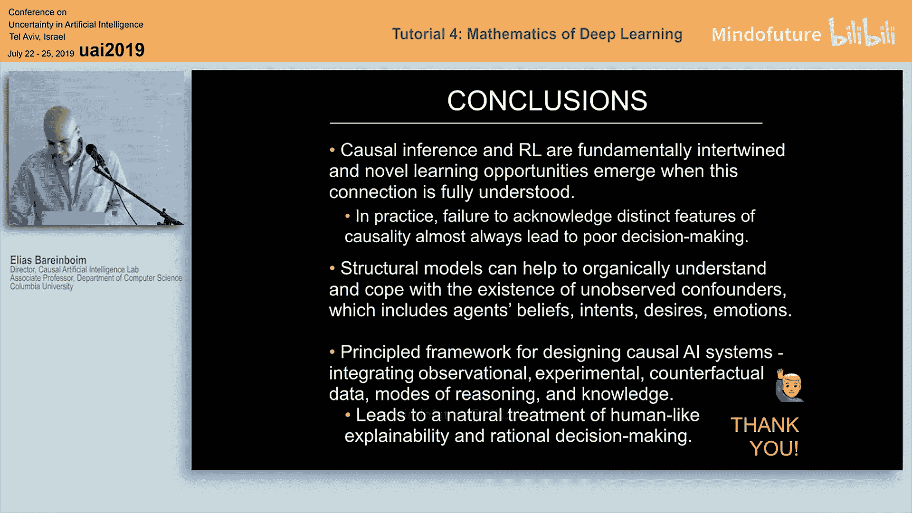

# 【加利福尼亚大学】图形模型中的学习 ｜ Cs274b ｜ Learning In Graphical Models (Spring 2021) p23 P23_教程_走向因果强化学习 -BV1Tqx6zrEMj_p23-

Thank you， Good afternoon， thank you and Ryan for the invitation。

 It' is a pleasure to be here at UAI。 This is I like to think that is a little bit more like a fieldport iss my perspective of what I want to call what I have been calling the causal of enforcement learning that is the relationship or the connection between causality or causal inference and enforcement learning。

This is joint work with Sanangak， the Posdlock that couldn't be here for visa issues。

 just in Zianang， Forny and Uda Per。First quick announcement， cause I would send the the。

 the file2 above。 This is preliminary draft。 Contact me if you want to share with others。

And first of all， I just like to start with announcement。

 not the cause of reinforce learning of what I'm doing in my lab。

 given that I'm trying to find a postdoc and you are still paying attention。The the lab。

 I think the insight that we have in the lab that is unique and quite simple is that the world can be decomp in terms of this underlying causal mechanisms that we usually in the field causal structural causal model。

 And I like to think that there are two views that we can take of of what's going on in structural causal model。

 structural causal models or our out there， but in general， you don't have access to it。

 except for in fields such as physics or chemistry that maybe it takes1100 years。

200 years and you end up being able to get one of these underlying laws of nature in general in the fields that we are very interested like in the health sciences the biomedical sciences or the social sciences that usually the one that we interface with。

 AI machine learning in general， those are kind of complex phenomena that is very hard to get the precise causal mechanisms。

 but they are out there。 and the task and causal inferences structure to go around it。

And to understand， when you know a little bit about it， can you still do some type of inference。

 Then this is the first bullet there that like to put like the DNA that you have structural causal model。

 And then we are trying to do some one side of the coin of what we are trying to understand about this model is what' a kind of fancy word now that's called explainability。

 We are trying to do some type of effect the composition effect identification， the compositions。

 bias analysis could be a fairness that is a recent application that people is very interested on and robust engineer ability of claims across changing conditions。

 Those are different tasks there are books on top of this this class of tasks。

 The other side of the structural causal model that we are interested could be interesting this decision making part。

 maybe we don't care about understanding the first one is about what people like to say opening nature's black box。

 we don't care about understanding。 you care about。 We are pragmatic。 and you are just trying to。

mize some measure。 Then this is the decision making part。

 One of them that is very close to us is the reinforce learning part。

 but we can have in the science or in the biomedical science something called the randomized control trials。

 you can consider problems of personalized decision making and so on。 Again。

 there are books and decision many decision ti on the top。

 our perspective quite simple is that this is following is not a primitive。

 but is following one of the of the coin or what is the structural causal or model for sure you could have interaction about that as much as the you have about the system。

 at least in general， should should buy some kind of mileage which should allow you to more efficient decision making。

 And when you are doing decision making， this would be one of the comments or those in the talk。

 We are also learning about what is the underlying dynamics。

 sounds very theoretical for sure you could like or you should have applications could think about software。

Tpes of applications that usually have in mind。 One is what nowadays its called on data science。

 the intersection。Of computer science of AI machine learning with the sciences or the empirical sciences。

 And we would like to try to， to give this label stamp the label scientific for the inference that you have。

 you like to believe or at least have some type of logic to say that we are being formal about that。

 and we have the decide that I will be talking more today here。 That is the AI machine learning。

 If you are like to try to design robust and adaptable systems。 today will be focusing。

On the reinforce learning part， that is whatever the our AIMl decision making view that we say to sequential decision making。

 then if you are a postdc or finishing your graduate studies。

 send me a message and you should talk and you have some interest in these topics that I will not destroy at the end of this talk that's it。

 then let go go back to the talk， what I will be talking today， let me make a line here of the talk。

 The first part， I' would like to do a brief introduction of how see what is reinforce learning and also introduction to causal inference this will be the first maybe one third of the talk。

 then Ill try to cast learning through my causal lens。

 how I perceive it yeah and then I will talk about challenge opportunities of when you see this as an integrated way or kind of encompass you way what are the new challenges of opportunities。

 even if this exists。For sure my， my， my comment here， Ill try to， to。

 to argue that it is the case that when youve study these two sites。

 causality or enforcement learning separately， we are losing something。

 That is something in the intersection that has value。Then that's the third part。

 The goal or the idea before people get unhappy。 given that I I is quite technical。

 I would like to try to introduce the main ideas。 The principles and what are the tasks that I I care about。

 I will not focus on the implementation， the details or the lit my experience as a review a member of the community for some of these topics。

 we get very quickly in the details are not even understanding what we are trying to do。

 Then this will be my my approach of my bias during the talk。

 for kind of more comprehensive discussion of the topics I said this is a field report。

 This has been appearing since 14， quick note here about how get I got here。

 I'm originally by background causal inference person。When I finished the Ph D in around 14。

 I start thinking about， oh， start going I usually make the joke that I was in causality land at UC A around U Perl and everything that we are doing in causality was good and we supported and everyone was happy in our in our land。

 But then when you start going out and talking with other people。

 people was not exactly excited about some topics in the AI machine learning community。

 not so much in the sciences or more there。 But in the machine learning。

 not so aligned with what we are doing there。 And I was thinking why this is the case because I'm pretty confident or at least in my gut。

 I believe that we are doing as a field in general nicely or the results are amazing in some way。

 And then I start kind of digging or doing some introspec to understand why this was the case。

 And the answer was reinforce learning。 En learning is。

 even though originally around2014 was not acknowledge or no one knew about that。 at least no。😊。

Told me， the enforcement learning is the way that we have machine learning is a very limited way。

 but the way that we can have some type of causality。Now， the question is。

 and I start trying to answer。 is it the case， then whatever people did in causal for the last 20 or 30 years is completely useless。

 possibly because the folks in our are ready to solve it or is there anything that is in this intersection that I'm referring for sure my answer is no。

 And then those are a few papers， paper after paper will show that how when when you are naive about this underlying mechanism of that are in reality how URL agent could be terribly bad。

 And how can you then restore and put this together。

 Then this is how I started pieces start appear in there。 theres a new survey that is coming up。

In in a few weeks， by the course of reinforce learning or call CR。

 then keep tune that I'm trying to put that together。

 That is in the spirit in some way of this tutorial because the papers are more， more technical。

 very specific about problems。 Then let me start talking about reinforce learning。

 Everyone here is familiar。 This is kind of textbook definition that is kind of go oriented mode of learning when you are trying to maximize some type of your word。

 usually numerical word signal， you are learning about from and why interacting with external environment。

 We have this notion of environment。And theres some kind of adaptation。 You have adaptive learning。

 each action tailored for the evolving set of covariance or features。 I should add。

 This is another word for Well I use covariance because we using causality。

 but the machine learning use the word features， evolving set of features and the action history of what you did in the past。

😊，嗯。There is some kind of interesting discussion that I really have when teaching。 that is。

 this is kind of in contrast with the usual planning or track of programming that we have that you don't need to。

 to do learning。 Then we are kind of do two things here。 You are trying to， to。

 to plan at the same time because we are acting there and you just don't want to explore all the time。

 But at the same time， you are。嗯。We have to learn about the underlying dynamics。

This is kind another textbook definition that we have for the R。

 just to get perspectives that you have a parameter of the environment。

 of the environment in the left side where you have the agent and have parameter of theta。

 And then you will observe some kind of state or context。

 And then these will generate some type of computation。

 And then you will do some action in this environment。 and then you get the reward back。 this。No。

 they， is here to receive feedback from， from a set of your from。In the form of rewardwards。

 Ageil utilities is defined by the rewardwar function。

 and they must learn to to act as to maximize the expected rewardwards。Now。

 I want to add just one bit here that will make a whole difference for us。

 instead of talking about only about the parameters， I would like to add a pair here。

 I would like to model explicitly the environment as what we call a structural or causal model。

 This is exactly what I said in the beginning。 in my add piece that we have this call S M structural causal model that is a model of the environment。

 There are this mechanism there。 And usually this is tied with the G。

 Then there is a pair M that induce a causal graph G。 I will define a little bit better later。

 a causal graph or causal diagram I usingchanably。😊，We have this word action here。

 It's kind of overloaded。 I would like to think that there are different types of inter。

 which is different types of interactions。 Ill talk more explicitly。 But one is called observational。

 The other is experimental and the other counterfactual。

 I will define what action let's upgrade this notionion for interaction。😊。

Then the cho observationsservations that you pursue kind of realize here is like the environment and the agent will be tied to the through despair S C M M and causalgraph。

 numberumb one， Numb two， we define these different types of actions。 as I just said。

 our interactions to avoid ambiguity。Yeah， I， Ill tell you how am big with you what what this means in。

 I don't know 1，1 or2 millions or three。Then this is my way of thinking about the RL traditional or。

 very simplified kind of 20000 feet。 Now， let me do the same or a little 10000 feet from what structural causal model means or SM。

 The approach that we take is followed U the pro and many others that came for maybe hundreds of years a lot of unification that happened the last 20 or 30。

 and the idea that we take a process based approach to this models and the idea is that we have this reality thatcompos in terms of this underlying mechanism here。

 for example， perhaps you are trying to understand some effect of the drug。

 you are automated physician you are hired by IBM Watson or some perhaps I'm not sure I should say that in the video。

 we are hired by some company to have some kind of automated system。

 and you are trying to determine the effect or some type of policy for the effect of a drug on headache And then we see reality。

What I mean by that， we have this reality that we have this variable that we want to analyze called drug and drug is a function of this mechanism F subd。

 where F subd takes as our argument， the variable age， depending on the age group。

 let's say the specific age people behave differently in terms of drugs。 and U subd。

 U subd here means all the variables in the world that are generating variations for the variable drug that are not age。

 There is1 million other variables that make up the decision of the person taking or not taking the pill。

 This is the U subd。 note here I'm just in the definition stage， I'm not saying how to get it。

 just saying these variables are out there。 And then you have another mechanism related to the headache of the person who have headache or not after taking the drug that you have this mechanism assignment operator F sub H。

 And then you have if the person took the drug or not you have a different。Heache are not headache。

 if it's cured， essentially， depending on the age group， you have different behavior for the person。

 If it's headache and you have， again， you sub age that is all variables in the universe that are generating variations for the variable headache that are not drug and age。

Then this is， those are the two mechanisms that we care about。 If you。

 if you are God or the system designer， you do have this specific instantiation for this function。

 We are just a data scientist is or AI fellow that is trying to understand about this massive phenomena。

 Then we will keep this guy unspecified。 Ca if we use this expression called nonparmetric。

 Its different than the the usual Bayesian non parametric where the non parametric here means that we don't want to say what is the form of this F。

We don't want to say。 We'd like to say we don't know it。 Then you leave it unspecified。Now。

 how we encode that or given that we are living unspecified that we don't know。

 you have our beloved causal graph or causal diagram。

Note here that causal diagram means that you add an arrow from one variable to the other。

 If the variable is an argument in the function of the corresponding variable in the left hand side。

 For example， By the way， I put X， Y， Z here just to make my life easier。Hopefully， ours。

 But note that for the variable headache here that I'm calling why the drug is an argument in the function F sub H。

 Then this means that well add arrow from drug that is X now。

 usually is the treatment of the decision to to Y。Then the arrow that has this meaning that it participates in the mechanism of the function。

 or the immediate mechanism or the granola the operate in this system。 In this case， is age。

 drug and headache。 You have another arrow from age to drug here from Z2 X。

 given that age appears in the F。 The mechanism F subdi。 And that's。

 that's the meaning of the causal graph。Note here that when you move from the process side of the process view of the system to the causal way of thinking about the system。

 we， we explicitly in some way， we don't even care。

 no longer care even about even bothering about writing these F。 at least in this analysis here。

 And at least for today， we already give up on that。

 It's too complicated phenomena to get the specific apps。

 Then you operating the causal graph in which F is left unspecified。That's good。 Now。

 process reality is running。 And then we can kind of get what from there。

 What is real would be the data。 People is very excited about the data me as well。 Now the。

 the data gives us。 at least in the abstract some distribution。 This is the distribution， P Z。

 X and Y。 It's called the， the， if you collect enough samples。

 we are able to recover this distribution。 That's called the observational distribution or the nonex distribution。

😊，A non cause or distribution。 That's usually the distribution。

 If you are doing classification or clustering or one of usually of our tasks。

 you operate on top of this guy， this P。Now， that's great。 Congratulations。 But so far， we don't。

 this is kind of very standard。 And this is everything we could。 we。

 we could have been doing for a long time。 You don't even need this guy。 But why I'm。

 I'm drawing this way because we care about the effect of the intervention or the causal effect of the drug and the outcome。

😊，And what's the causal effect is very related to is related to this notion of intervention。

 When you go to this system that is in the left， you get this variable x with your hands and you start moving the variable x。

Then you can see how y we respond to the moves in X。

 He regardless of any other variable that could be affecting the relationship between x and Y。

Note here that in the left side， the verbo Z， this third guy is making X and Y to move together。

Then they call this confounding。 It's confusing us。 Now， we don't care about that。

 We just want to know how X is making a virtual move or virtual change。

In the the idea of intervention comes with this operator that was defined by Uda called the do operator that essentially says that we go to this original system here and we replace the F subd the natural way that people is taking the drug by a constant。

A constant， in this case， yes， the person will get the drug。 There is no option。That's fixed。

Then is the replacement operator that you overrite the original mechanism or the original of function by a constant in this case。

You can play the game about replacing with other functions。 We can discuss that here。

 I just care about the primitive replacing by a constant。🤧。Now， for sure you you， you。

 if you do have the code of the system， you could do that directly。 You don't need any sophisticated。

 No， no causal inference。 go， go there and change it。In reality， the， the drama or the。

 the challenge or the depend on how you take it positively or not。 We don't have these guys。

 This is just symbolic。This is just the meaning， the semantics。 Now， for sure。

 you have the causal graph that is corresponding to this guy here to this system here。

 the causalgraph is maybe you saw the mutilated graph or the graph where you have the incoming arrows throughout the。

 the variable that you did the intervention cut， which means that this。

 these mechanism that was active here， is no longer active Now you have a constant yes that is the one that is giving the value to the variable X。

嗯。This leads to a different distribution or different animal in the zoo that is called the do distribution。

 If you sample， if you are able to go reality in contra reality that will match this guy here。

 you could sample from this process。 These will give samples from this distribution list that P of Z and Y。

 given do X is E could G yes。😊，Then this is called the interventional distribution or the cause of distribution。

Among other names， another name， for example， that you can get is a counterfactual distribution。

I why this use this name。 but because I will need later。

 but usually you put us instead of having Z Y given and do X， you can write as a subscript。

 Y sub X is equal21 or x is equal2 S， Z sub and so on。 This is the a possible notation contractor。

 Then don't get scared。 If you see that。 This is just a different way of writing it。

At least at this level of our analysis。Of， yes。What's that。I。

 I don't know exactly what control means at the moment。 It a well， not well defined term。

 Then I I I may answer later， but let me leave it。Because we didn't define any control or。京。Oh。

 the quick notes here。 the intervention is in reality is。

 is a symbolic operatorto in which you go to the original system。 If you could。

 and then we replace the original mechanism moving a constant。And I'm not saying how to get it。

 or I'm just saying that this is the operation because we are trying to convey。 That was the insight。

 in reality。 We are trying to convey the idea that if you go by your own volition of your own free wheel to this system。

 touch the verbalax and start moving。 This leads to this notion of causal and effect。

That we didn't have defined。 Then this is just a definition。 I'm implicitly defining。

 There is the whole thing about how to get that in reality or in practice。 But I will leave it。

 I will not get there。least is not no。嗯。But the the second thing I forgot to mention。

 that's thanks for the question。Note that given that these you here are are all these variables that we don't know。

 but are there， we， we even leave them just implicit in this model。

 There is no U D U H explicitly encoded here。 But depending on the part of the literature or the authorer。

 you may see the person adding the U sub X， the U sub Z and the U sub Y here。

 or the corresponding use after the relabeling。We just don't。 And here， by the way。

 Im assuming I will not do that throughout as a common mistake。

 But here I'm assuming that it's Machaian in the sense that these user are independent。

 I not necessarily assume that in general。All the problems happens when it's not myov， but。嗯。

But for my current case， we can just leave them and place it。Okay， that's good。

 Another name for these variable is that the drug could be called the decision。

 The headache in this case， is the outcome of interest。 and the Z is the set of features。

Now in the robot， this could be the location Where are you moving and whatever you reach the position that we wanted to reach or the task that we are trying to accomplish。

嗯。I'm very interested in robotics。 If you' are doing robotics。

 Let me know then perhaps you can have examples that are more aligned with the specific setting that we are working。

 I think this is very nice for this setting。😊，Okay， you have decision outcome and features。

 That's great。 Now，' just making this grade to show the to try to make it pictorial that we don't have access to this guy or you never measure this guy。

 The challenge that we observe or as we say， we are seeing this phenomenon fold in the left side。

 and our goal is to do inference about the phenomenon in the right side。

 almost always not in reinforce learning that I will tell soon， but almost always。

 without doing the action in the environment。😊，Note， we collected data in the left side。

 I'm just a robot。 and Im putting my hands in the back。 and I'm just seeing reality unfold。

 And I'm getting these samples in hasster and learning about this P of Z， X and Y。 No touch。

Now we go。 And I'm， in my mind， I want to say， if I go to this environment and start messing around or or doing my interventions。

 what would be the effect of this intervention。 This is this distribution here， P Z Y given to X。

But I don't want to go there， do the intervention first。

 because I may be destroying the whole system making a big mess。

 There's a friend here from economics。 He cannot keep doing all the interventions all the time and see how the GDP。

 the gross product will increase or decrease based on new taxation policy。

 There is some kind of analytical method to get the observation of data that is already going on in reality and try to speculate about what would happen if he had he engage in this new policy。

 The same with the robot。 Robert doesn't want to do shouldn't want to do a mass all the time。

You have the data that's coming from vision， vision， I mean， passively， recall。

 then this is the dichotomy between the scene and doing。

Let me just define a little bit more formally the structural causal model slightly。

 definition structural causal model M， or you can call data generator model at top。

 or if it's four components that I already mentioned， the set V， the set U。

 the set f and the set P of U， where the set V is the set of what we call M dodgegen end of from inside the set of observe observed variables V1 and V2 V N。

 whatever in this case， we have drug headache and H， this is V1 V2 and V3。

We have the set of exous variables， X from outside or the variables that we decide decide to put outside the cut of what to your model what is your model of reality。

 This is a set of unobsserved variables in our case。This could be U1， U true and so on。 In our case。

 this is the U D and U H。 Those are the sets of variables that are there。

Now you have now you have for each of the endogenous variables， V I in V。

 you have a a structure of function or function for simplicity determine the value of V。

 Then for that is V I is a function F I or two sets of variables。 One is we call the parents。

 by the this is not a base net。 you ask at the end， what's the difference。 I hopell be clear soon。

 But but if still use the fam relationships。 then this is a parent， the parent set。

 that is a subset of the observable。 Then there the observed guys that are affecting the variable in our case in the case of headache。

 this was drug and age。 That is the set of P AI。 and you have one hour set of U， U。

 that is the set of unobserved parents of the variable V I that are the hidden variables that are generating these variations。

嗯。So far， I'm describing kind of physical system without uncertainty for sure。

 there is uncertainty and variability in the world that is not entirely model。

 Then you put outside the box you kind of spread mass over this use that leads to this P of U。

 The probability distribution over the exhaustion of variables。

It turns out that this system admits somatic characterization。

 There is this true parallel works one by Hpern and the others by goddes and pro。

 given the axioms of systems like that。 And whenever you're proving some theorems related to that。

 you are using the the some of these axioms。 And it's kind of very and a very nice and solid system。

 I just put， there is some kind of solid foundations for that。

 And the result that we care about or we care about here。

Is a theum quote unqu that say that give once you have aMM， this implies what you the call。

 I don't know if you're familiar with the book of why， Let me do a poem here。

 How many of you read the book of why in the room。Okay。Maybe more than half。

There's something that's called the ladder of causation。

 I usually call and we usually call the causal hierarchy。 once you have a SM well specify。

 this will induce hierarchy of the different distributions。

 Let me show you what are the distributions that play a key role in our understanding of CR of enforcementment learning The first type of distribution is the one that I mentioned in the left side。

 That is the passive distribution that we call also associational distribution。

 is related to the activity of seeing。 If you write the book search to bore you。 just repeat here。

 This is chapter1 of the book my memory is right。 You have the associational distribution symbolically write as this P of Y given X。

 The kind of questions that we want to answer is how would seeing X change my belief about the variable Y。

That's the the scene。 And usually our inferences are here。 All the machine learning。

 If you want the counterpart and supervised and unsupervised learning。

 are related to these inferences of this layer or this type。 you have decision 3 is， beige nets。

 heion， the neural nets， all they are kind of living there。In， in some way。

Now we have a second layer second type of distribution that is the one that I show in the right side in the previous slide。

 that's called the causal or the interventional distribution。 symbolically。

 the way that you write that is the P of y， given now you no longer observe X。

 but you are the one inducing the change in doing the do x is equal to small x comma C that is the set of covariates。

Our context is related to actions or or doing。 What if I do act。

What if I take the aspirin with my head， they could be cured。Okay， that's the do。

 this is very related to the topic today that is in machine learning。

 The counterpart to what I mentioned before。 this is the window that machine learning has to access this distribution is that is reinforcement learning is related to the formalism that if you want That is one called the causal of Baysian network if you don't want to even take a full structure causal model。

 you can operate in the space of the causal Baysian network。

 that is one delta from our original Bayian network or mean from the 80s or early 90 depending on how you define say 8s You have other layer of distributions that I talk more towards the end。

 that is called the counterfactual distribution， the full blown counterfactuals is related to imaginations or doing some type ofspection or introspection is very related to the y questions that gives the type of the book the type of symbolic way that you write that is P of y subs give an x prime and y prime。

This is just one example in this language。 What it means is suppose that the guy。

 the classic example， supposeuppose that Joe took the drug that is X prime。 and then Joe is that。

 That is Y prime。 Now， the question is， would Joe be alive。

 That is why had he not taking the drug that is this X。Now， I have this counter to the factual world。

 because in the factual world， the guy did take the drug。 and he is that。

 There is no dispute on that。 I think。 But now you ask this contrary to reality question。

 if you would be alive。Had did he not taken this route。 Some people don't like so much these layers。

 There are kind of implications， given that it requires a strong models。

 One of them calls the structural causal model。 but still。

 it's pervasive part of human cogniation and ex the the notion of explanation。 but I I。

 I will live in between， I was I was I I live in between layer 2 and layer 3 in this talk。Yeah。

 one thing that I didn't mention。If you get a structural causal model M is important the theorem。

 If you get a structural causal model M， it means that you can operate in layer layer。

 In other words， the guy that lives in layer 3， It means that you can operate syntheticically in layer 3 and every everything below it。

 Then you can operate in layer 3， layer 2 and layer 1。If， if you get a model that is layer 2。

 it means that you can operate in layer 2 and in layer 1。

 but you cannot operate or do reasoning or inference in layer 3。Then I。

 I would just go directly and take a full blown approach and。

 and do layer 3 and be able to do all kinds of reasons that you want。嗯。Now。

 I kind of valid any comment here， I want you to start connecting with URL。

 But this is my view or kind of view yeah， my view of。

 let's my view of the field of what's going on in causality and causality land， yes。职业。

If I miss the beginning of the sentence， the question。えベンシ。Yeah， if。

 if you understood the the count these quantities here are counterfactual quantity as well。

 And this one as well， if you want， as I said， we can operate if you start from here。

 this one is essentially when this x is empty， you are living in some way in this layer 1。If the。

 the evidence of the factual world is empty， you are living in this new world。

And the Y given do X comm C， you can write， as I showed maybe true slideza ago as the Y sub x。

Given C sub X， then you can write in counterfactual notation。

I just think it's useful to understand because those guys match some ways that we operate in the environment。

 Sometimes we are just doing the brute action。 We are just going there and touching the variable acts and changing it to see how wire you change。

 This is very tied with this guy。 Sometimes we are just passive。

 Just let's see how what's going on in the system。 Then we operate in this layer。

 Sometimes I'm engaging in a deep thinking and say。

 what will happen if I haven't woke up today here today， above will be unhappy or what with the。

 Then you can engage in this kind of speculative。😊，Type of reasoning。 Then this is more layer 3。

 Then I I， I think it's useful to separate them。 But as I said， if you are in this language。

 you can do all of them and the。One more。 And then I， I， I will move。No。I saw， okay。Or anyone here。嗯。

Now， you can say， okay， is great。 but I'm a causality。

 What are you talking about More can you be more explicit and tell how R and causal inference fit in this picture。

 you talk to in some way。 But can you give me something more more explicitly。

 I' would say then let's start connecting and trying to see how these guys are what R and what causal inference trying to do in the context of decision making the goal of both or could be that you actually learn a policy pi such that have this sequence of actions that turns let's call pi。

 turns x1 x to an X n that you are trying to maximize some I write as this E sub pi of y given do x。

😊，No patient is tricky， but the， this pie here is the one that is giving the value to these variables X。

嗯。Now， this is where where I started around 2014。 this is how the literature looked like。 First。

 we have in our the online type of learning， which agent performs the experiment herself。

 which means that the input of any analysis like you do experiments experiments when you go to this reality。

 you touch， you do the intervention in this variable and you change and see how things go。

 then this is why I'm writing experiments， I'm writing this do X and you have in time。

 I is moving here I from1 to T， and then you collect this pairs here do X I and Y I。

 the go of the analysis invariably or almost invariably to learn about this P of y given do X distribution or or a function of this distribution。

This is online learning。and I go one by one slowly soon。 I'm just give you the bar's eye view。

 Now I have a second mode of learning that people is very interested now。 But for many years。

 that's called the off policy learning。 the agent once you learn from the other agent's actions。

 You don't want to do the action。 You want to learn from the other guy。

 The input here are I move from experiments and I wrote the word samples。

 We still have we are not the one doing the experiment。 Then you just get data point samples。

 I call here。 but you still keep the do here。 you know that the other guy is doing the experiment。😊。

In other words， the， the guy is being what I mean by that。

 The other guy is being deliberate about the taking this action。Then you call this do X， I。

 and it still orange line learn the Y given do X。That's the， the call of policy learning。Now。

 you have something that I'm calling do cless learning that the agents observed other agents acting。

Diffence， we don't know or the agent doesn't know why the agent is acting the way that the other agent is acting。

 The agents could be moving without any deliberation just in a kind of instinctive way or non subconscious way。

嗯。The， the input of the analysis。 Now I have this difference between samples。 These is still samples。

 But now I don't have the deliberation that the guys taking the action for some reason。

 or randomized， as we usually do。 If you' are doing an apom graded there were essentially randomized apsom percent of the time and getting the1ministic function。

 The other one minus apsilon。 These are called deliberate。

We know exactly how the actions are being picked。In reality。

 when someone is making the decision in this case here， someone is making the economist friends。

 Someone is making the decision about enrolling or not in the university。The guy is not。

Playing probabilities here if the a on deciding to go to the university or not。

 And there are even reasons that het doesn't know。 It's affecting him。

 perhaps the location that he is or the peer pressure or the the family history。

 There are to variables that may be affecting the decision about the guy enrolling in higher location。

 the fellowship that he got and so on。 Then we call this nonde。 He's not doing an experiment。

 He's just acting and making the decision。 Then this is this guy here have from samples to samples but we have not no longer the do here。

 You are just observing。 This is the guy on the left side that you have in the very beginning that you have left and hide scene。

 This is observing the guy at this level。 The input of that was in the do calculus one at least explicitly Hes also a causal graph G。

 that is this description。The goal here of learning is to learn about the do X distribution as well。

 This is just Victoriactorial in terms of the layers that we have。 We don't care about anything。

 We just do the action。 go there and change the variable。

 regardless what's there Here we are we are doing someone already did the action and you will like to know what if I will be doing the action。

 How can I use his data that is deliberate。 And here were just observing the guy to do the action。

 and you will like to do the action， deliberate ourselves。Then formally。

 or if you into a little bit more of syntax。 This is the duo itself。 This is from a do to another do。

 and this is from the C to the do。Now， let me go one by one here with a little bit more of details On line learning。

 we like to find a guide to optimize x star such that finding this X star is trivial once they I'm moving here from P3。

 But once the Y given to X is learned。嗯。The Y given x can be estimated through randomized experiments that is over adaptive strategies such as the eps greedy。

 If you have states， the MDP， the the P are doing this kind of process。

 There is a randomization plus this deterministic policies that is delivered Then it's very easy to get the y given x or this is the goal of the whole engagement in the exercise。

 the positive of the of taking this route。 is robust against these unobserved confounders。

 that is these U variables that was asked before about the controlling。 This is robust against the U。

 The use may be there。 but you are just going in reality un randomized in the variable X。

 Then I don't care about the U because I am physically disconnecting the the decision X from the U。

 Then this is the big win from this the big positive for this approach。

 The negative that experiments can be。Ex experiments can be expensive or impossible in many domains。

 it's totally impossible to do cancer to effect of cancer， smoking on on cancer。

 You cannot randomize or do experiment with human subjects。

The effect of cholesterol and heart failure。It's not about ethics。

 but it's practically impossible to open the patient throw a dice with 100 variables of cholesterol levels and。

 and randomized the cholesterol。 It's technically in feasible。 And it's very costly。

 even when you don't have the ethical and the technical issue。

 maybe at least in the medical science costs 5，10 million bucks。 Depend on the size of the trial。

 but you run a trial like that。 it's really hard。Then this is the negative of this approach。

This is the graphical picture， the way that I like to think that is the world there in which you could have this you that I ask about the controlling And that may be affecting the decision Xs。

 We don't know why the guy is acting this way。 is still。

 we just ignore whatever is going on in reality in a physical hardware way。

 We implement this policy pie that is setting in the value of x could be flipping the coin or you can be even the deterministic。

 Then this is called the pause randomizer or the active world。

 Then this is whole online learning literature。嗯。This is just another picture that I like with the tapes that you have no data from what happens before。

 And then we ignore this world。 And then you start those kinds here are the samples and you start collecting data about the do X 0 do X1 do x0。

 depending where the coin where your policy given you and you are able to get this E of y given do X is picture Now there is a huge discussion。

 huge literature in covari specific causal facts。 this model。

 what I just said can be augmented to accommodate the set of observed covarit C。

 also known as context depending on the literature。

 they use the set of the remaining unob confounders or the you sees note here that instead of x and y with the U Now I just add the C here that is affecting X and y。

 this could be like the age the ethnicity socioeconomic status and so on。

 the set of features that you observe。 They learn a policy。

 But now have a policy that is parameterized by the C pi。

So as to optimize based on what we call C specific causal by effect that P of y given to Xcoma C。

Youll challenge here because when C is high dimensional。

 start getting hard to get samples from the distribution， even in the online way。

 even if you have the possibility of doing the intervention。Then a lot of work around that。

This the second family of methods that I mentioned is the off policy learning。

 Why do x can be estimated to experiments conducted by other agents and different policies。 Remember。

 positive about that is that no experiments need to be conducted。

 Then you don't need to touch the system or spend the money。

 The negative that is usually left implicit。 This rely on true critical assumptions here。

 numberumb one， call a1 the same variable were randomized。

 We are able to touch and do the experiment in the same variable。 assumption a1。 And the second one。

 the system of the agents see the environment in the same way。 is a2 context matches。

 our case here just the context is empty。 both are saying being affected and what is leading what is leading to their decisions the same。

 This is the graphical picture here in the left side You have a policy pi that is driving the first agent decide the value of x and then you weigh time and you get this this is in time Everything is index here by I in reality will actually。

😊，They inference about a model policy， prime。That in this case。

 these two assumptions holds that we are still the scope of prim is still act。

And is still affected by the context empty。 In this case， Then they match perfectly。

 There's a collection of methods。Called IW inverse probability weighting。

 There essentially we inver the probabilities of picking this action here。

 And you are able to to speculate or to infer about this effect about this other policy by prime。

 But this is essentially what I W is doing。 They are like。

 I don't know 1000 papers doing exactly variations of that because it's hard in some statistical sense。

😊，But causally， this is what it is doing。 this is the picture that I like。

 same in the left side you have the policy pi。 You have agents that are already collect。

 This is full here。 I already collect many data points on the pi with these do X1。

 and you like without collecting the data is in the right side here。

 the yellow arrow is when you have the transition that you like the agent here agent doesn't want to do the experiment use this IPW And then you can get what will be the fact as if you have done the experimentation。

 I just mentioned that a lot of work here since the oh the variance may blow up even that you have thes like guys that may be very small and you can do clipping and there are many some ways around that of at least how to think about that。

 This is the of policy。 Let me tell you about the do cculus one that was not categorized before at least until that our work。

 the Y given do X can be estimated from non experimental data。😊，In the literature， you can。

 we can call can get。 this is called the natural or the behavioral regime or policy。

 The positive about that estimation is feasible， even when the context is unknown。

And experiment experimental variables do not match。In other words。

 the off policy assumptions that I just mentioned A1 and they true do not hold。

Negative results are contingent in the model。 You need a causalograph or some level of understanding about these mechanisms for weak models。

 non noninative models effect may not uniquely computable。

 as you call non identifiable This is here the passive world that we have in the left side。

 that is when you collect the data。 And you like to have this do calculus type of inference and make a statement about why given about this world here in the right side without doing it as well。

 is of policy in the du cclus are in the same bucket that we don't want to realize or to do the experiment。

 You want to be surgical about that。In this case， for example。

 if this is the model of reality in which to just have the action， the outcome。

 and there is some kind of confounder affecting both X and Y， then this is a non identifiable case。

 They would do calclus to say that it is not possible to do this inference。

If you want some kind of details about。What this means。

 we have this survey with you that that is at least in 16 years discussing the state of the art of this type of inference。

This is the， again， the picture that we have with same kind of tape picture Here you have the data。

 The data is coming from this passively connected， collected or non experimental P of Z X and Y， Ob。

 observation， ob so1。 And then we will actually make the inference about this E of y， given do X。嗯。

There's just doing a piece of advertisement。 There's a paper on Wednesday。

 That is our paper here that we are trying to do。 iss not phrase official like that because the general task。

 but you are trying to do exactly this task。 instead of getting O， B， S， O， B， S， O， B。

 S and and moving to the Y given do X。 here， we can be getting the do Z， O， B， S， do W。

 do whatever you want。 is that is not the do X。 And you like to infer about the do X。

 Then you can have a combination of the different types of experiments and observations to learn about the experiment over x。

This is the summer here of what we have around 14 online that we are essentially。哦。Yeah。

 on online that we essentially have the world we know what's there to implement our policy in a hardware or physical way。

 The second one is of policy that we are moving from one do to another do from pi to pi prime here and you have the two critical assumptions about the same variables are randomizing。

 the context C is the same That is a2。 And you have the do that you have the C you can generalize that I just said you come Wednesday you will be welcome。

 But you have the C， And then you like to move to the do without doing the experiment itself。 Now。

 this is 14。 then the valid question this was my question around that time is like。

 do this strategies always work。It's beautiful。 We are able to put under I'm doing a 20000 view。

 We get the the survey， but we are able to put in the same umbrella understand causal of inference and enforcementment learning。

 And they have these buckets and there are like thousands of papers in each one because there are different types of models and assumptions that you can make。

 But still， that's good view。 But does these do these always work in other words。

 These learning in inter interactive systems essentially done。😊，If so， by the way。

 for the first question， is it the case that AI is done like， don't need researchers。

 Why are we here despite the beauty of Israel， And we are very excited to be here。 Thanks for。

 And But， but apart from that， what are we doing here， do we need more engineering effort。

 with whatever tech。😊，Models and theory you have。 And then you're just developing the technology just called this huge effort。

 You need a lot。 But still， science is done。 Let's move to the engineering part。Now， for sure。

 my answer is I I hinted in the beginning。 I don't think so。 this was my concern。 quote unqu。

 I was concerned to move to university partial joke， but not entirely。

 but perhaps we didn't have anything to do in 14。 And I don't think it's true。

 Then I say this towards R causal R CR R。 But I want I think it's a good point here too。

 given that we are talking about the past。 And I like to start talking about the future。

 Any questions about the past or complaints from the R person or。What can I those。The biggest slide。

当时就的。Yeah， if understood the question。 Yeah， there， there are some， at least in this picture here。

 I'm showing that as if you have the perfect sample in the left side for doing the du。

The online we are getting the samples on the go and the game that is being plays how to optimize the samples。

 This is why we are not doing the fisherery and the randomization from the 40s or before that we are just flipping the coins and span all your samples wasteful。

 This is why you have adaptive strategy。 We are doingre doing a little bit here and trying to optimize based on what's going on。

 But yeah， this is the game demo number two number3， whatever the data is coming from。

 we do assume that the data at least this is like the data is perfect。

And we still have the whole problems。 There are like， as I said， many， even when this holds。

 you are totally right。 in reality， this is compoundfoed。 Now。

 you have true problems of true nature that comes together。

 One is the inference that is if you have the perfect data。

 But now we don't even have the perfect data。 In other words。

 every P probability that I put here in reality have the P hat or some approximationation to this P。

What's that。レビ行くま。Right， right。 That's right。 That's right。 And， and。

 and when you have the some type of a little bit the violation of the action。

 meaning you collect the data from one action and you move to another， I'll talk about that。 And。

 I think this is a main one。 This is。As I main want to like to handle or and handle， I mean。

 try to be systematic and as formal as we can。Because we are already trying to solve these problems in many different ways。

Thanks for the question。Yeah， speak loudly， please。Observation of what。要要单车。The yeah。

 that's a good one。 Perhaps I would like to invite myself next year to come to U I give another tutorial because I I went very fast。

 I spent maybe I don't know， one month discussing this kind of question。で。Look。

 let's go back a few slides。 That's a good question。

The that's picture that that I want you to have in mind。 Let me put the yellow here。 So it's nice。

Whenever we are doing the type of supervise， even on supervised focus and supervise。

 learning we operate in this left side， which means that we have data for sure it can be finite at samples as Iuded here in the previous question。

 but we have data that is coming from this process from this distribution， P of Z X and Y。

 we have this hat。And now we are trying to do some type of inference about the P of y given x of the distribution。

 classifier can be taken this probabilistic way。 I want to infer the outcome Y or the label given that we have this x that is this set of features。

And this is supervised learning。A way， way of thinking about supervised learning for sure you can have a 1 million model to do these kind of things。

 but is still， you're completed some kind of y give P of y or expected value of y given X。Now。

 here I'm talking about a completely different animal because the data that we have comes from the left side。

But we are trying to do the inference about the distribution in the right side。

 right hand side that we have zero data points。Oh， the the the man。Yeah， that's fair。

 I did I'm just telling you I'm just telling you that there is such a mechanism。

 but I'm not telling you how to do it。 I'm saying there is this thing called the Duke calculus。

Chapter 3 of causality book， P 2000 Chapter 3 and 4， if you want。 But that。

 that tells us about how to move from the left side to the right side。I I'm not。

 I'm not give the details I could spend one of。And I apologize for that。Perfect， yeah。 that's right。

 And this is one of the， that's perfect。 And， And I added that that in the， in this learning。

 where is it。😊，네 the。The this is the， this guy here that， yeah。

 as input of the analysis that they cook do cals learning。

 we assume that we have this G that is already the summarization of this mechanism。

 This would be what buys us。Some mileage to be able to hope to move from the left side to the right。

 from the observation or to the experimental。 And I also added that。The。

 the negative here is like if your model is weak。If you know too little about the system。

 then we get these answers saying， I cannot do it。 The calculate say I， not I cannot do impossible。

Yeah Ilia is here。 Heres the first to prove something like that。 Then it is。is provable。

 provably impossible to do some of this stuff。 But yeah， yeah， what we are trying。

 if you are interested in is one， we are trying to relax some of these assumptions。

 And instead of assuming that we have the causal graph。

What if you are having something that comes also from the data。

That we call equivalence class of graphs， collection of graphs。Our U A I 18 is exactly this paper。

嗯没有。And and a lot of work in the field of just to move on。

 But then a lot of the work in the field of causal emphasis is exactly to understand under what conditions can you do this type of input。

One thing that I didn't mention that causal inference is pretty good。

 or I would say a set of techniques that is pretty good about when you have some type of qualitative knowledge about the whatever phenomenon you're analyzing。

 how much information you can extract from that。 This is cause about this manipulation of qualitative knowledge to translate to quantitative enforcement learning。

 on the other hand， is pretty good about how to efficiently。Collect the data。

 and the models are quite weak。 If you get essentially any prototypical model like a bandit or MP。

 This is very weak。Nondescript type of model， because everything。

 all they have lifting is in the data collection side of efficient sample co sample collection。没有。

This is a good note， as well。Any， any other question here， I have one more minute。

To move to the second part， hopefully youre alive。辩费。

So a lot of reinforcement learning deals with very large state spaces。And those large state spaces。え。

We'll nature sure too。Implies to me context specific independence。Bsnets are often not good about。So。

How can we deal with that kind of？で。你好的错。That's a hard question in some way。

 because there are many layers。嗯。没。The way that I like to think that we have this kind of huge state space is that。

We are trying to keep this causal graph。That it is there implicit in the system。 We are。

 we are trying a meaning not that someone said not that reach Su。 I talked with him。

 but not that he said 20 years ago， let's keep the causalgraph implicit。 not didn't happen。 But。

 but I think that's their idea that。Whatever if I'm clever enough about。Re're presenting this。

 this S。 And this is what the deep reinforce learning is amazing today。

 because we are able to kind of reduce the dimensionality of the problem in a very massive and efficient way。

 Then we are kind of voiding to model that。😊，Then it's and。More broadly， the。

 the context specific the context specific that you are referring could be even considered the graphical structure itself that is turning on and off the。

 the arrows， but。As I， I show， hopefully， Ill show if， if I'm efficient enough with my time。

 there is no way of keeping the graph implicit all the time。Many you， this is the point。

 This is why I say CR， R L。 And I could try to contrast with the the textbook picture of the R that you don't。

The graph is there。 He got of I liking or wanting or not， because the mechanism are in reality。

 The questions like， are we making them explicit or not。Now the and the the question is like。

 do we have the option of making them explicit or not or。

 or these will hurt us in some way if you leave them implicit。I don't know if I answer it。

 because it's。The yeah， did I answer the question。Or in some way。Okay， okay the。Okay， guys。

 let me move here。Then going to to Coor， say challenge opportunities I would like to talk about based on my time management here。

 about four different types of tasks。The first one is what I like to call generalized policy learning。

 That is the we we assume that the world is like this cookie cutter way and match these three modalities online offline and the do c learning and everything will work in these buckets。

 We all is quite na and usually get a lot of negative answers instances that I will show now what I'm calling generalize of policy is like。

 let's try to have mode that has integrated these different modalities of learning trying to mix the positives and kind of atten the negatives of each one。

 The second one we also assumed without noticing that whenever you say that like a policy pi and the action variables are X that I already know that I want to intervene in these variable x。

Reality sometimes is better。 just this why call N。 Sometimes you just let the system evolve naturally because it is already go to some good place。

 And the best thing is not to touch it。 Then the better thing sometimes is to say。

 I just want to keep in my place and lets the system evolve。 No intervention。 so far。

 you haven't contemplated that still， if if it is the case that you decide to do the intervention。

 why do you intervene in the variable X。 Perhaps there is another variable W that would be the good target to do the intervention。

Possibly， I'll show examples of what this means then。

Then they are called it when and where to intervene。

 Another class of tasks that are in in this between。

 The third one is the one called the the counterfactual decision making。 So far。

 we assume that we have this kind of autota behavior that we have the do calculus do kind of behavior that something in the context of the the sensor inputs comes in。

 There is some process。 and I use this policy I would do this kind of do policy。

 I would do some kind of randomization or some kind of theteministic policy。

 some the agent never stops itself and say， I am operating in this way。

 but I may be I maybe should I should be doing differently。In pretty much in this spirit of layer3。

 the one that I like to call counteractction Y sub X given X prime and y prime。

 then given that to have this repeated kind of interactions。

 we could consider to do not a do type of intervention， but a counterfactual type of intervention。

 Then it's very related to the idea of intentionality that's loaded here in the context of AI。

 but intentionality He regret another one that is overloaded and free will。

 let's see if I can get there。 And there is another one that is where I started or many years ago maybe 10。

 where I start thinking about some of these issues。

 thiss about the robustness and general' ability of causal claims what I called it the time the transportability problem。

 here are some again that the agent is one environment and is collecting data and trying to do inference in the same environment。

 Now the question is we move the agent to another environment who don't one should start learning from scratch。

 in some way we like to leverage。What， what's called the structural invariances。

 What are the common analysis across this environment。

Should do the inference without needing all these experiments。 And this is called transportability。

 though， this is。References for the the， the papers and we are， by the way， we are not done。

 One of the reasons that I'm doing the the tutorial is like we need help all over the place。

 I think this is the beginning。 Then I'm just giving the flavor and my feel the report about what I think it should be the CR。

 It's pretty much open and， and help needed despite the progress。

 I think we did good progress as well。 Let me start talking a little bit about this generalize of policy。

😊，This is with my student， Justin Zang。The idea is like we have online learning that is usually undesirable due to these financial technical ethical constraints that you have。

 in general， when wants to leverage data collected and different conditions to speed up learning without having to learn from scratch。

 this is the online part On the other hand， the assumptions required by the of policy and the do calculus learning are not always satisfied。

 not always met in many real world scenarios， mainly due to these use un observed confounders。

 They are all over the place。 In other words， there is the system that is moving some way。

 We don't know why they are doing whatever they are doing。

 Then many of these kind of idealized settings， the assumptions in these idealized settings may be violated in this task GL we move towards realistic learning scenarios where the threemod come together。

 including when this most traditional assumptions are violated。

 Let me give you an example what this means simplest possible setting that is from this H。

In 2017 task of suppose robotics。 suppose that youre learning by it's called running by the demonstration when the teachers teacher can observe a richer context then the students。

 for example， the teacher may have more accurate sensors have a robot that has infrared I and the other robot that is observing doesn't have infrared and doesn't know that。

 Then you have is they have this mismatch of the assumption a1 that they have access to the same the same context C。

 We already don't have that。 The second example is like's called optimal experimental design from observational data is example that I use。

ically we are moving from the left first slide from the left side observation to the experimental。

 Then as input， you have the distribution P of X and Y。

 and you would like to learn about the distribution P of Y given do X。

Suppose to have a physician that is making these decisions X and Y。

 and there is this all set of covariates U that is unobserved。

 that is making the physician to act in the way that is acting。

 perhaps how the person is balancing the type of the skin， the tone of the voice and so on。

 physician is analyzing that。 even in the subconscious level until it decides what this you it decides what action acts it will pick And then that's great。

 And you can have tons of data of this kind。 That is the P of X and Y， in reality。

 you actually know not about to do a prediction， but election or what is the fact of this drug in the outcome。

😊，Why， because physician， the physician may be giving the drug for the guys that will be coveringing anyway ways。

 maybe the sooeconomic start of the person。 the guys are giving the drug for the people that high S E S。

 Sooeconomic status of the family and they have be better hygiene or better food or better type of environmental conditions that they will be coveringing and getting this in a high。

 Let's say why is the quality of life or a number of years that we live。

 And they are not giving the drug that people that support that will be dying。

 When you get the data from this side here。 They right in this case。 And you see。

 it seems that the drug is amazing。 in reality the drug is not helping at all。

 This is the way that the physician is giving the drug is biasing。

 And it seems that the drug looks good。 Then this is why have the FDA， for example。

 the federal drug the administration the American FDA don't remember the name or don't know the name in the Israel。

 But that will actually get。This P of Y， given to X。Again， the assumptions。

 if you run the du calculus， as I mentioned earlier。

 du calculus say not possible to run because we have this latent variable here。

 You can show that it is impossible to make a statement about the Y given do axis distribution。

If you try to do the off policy learning of policy， I I said A1， but the assumption A2。

 that they have the same context is violated because one guy。

 one type of agent that this physician is able to observe the you。

 This is affecting their decision while the other agent， this is not happening。

The other is just one the causal fact。Now， a1 is matching in this case。 but that is they are。

 they are considering the same variable X。 do X do X。 Now， what we can do is the following。

 Let's just pretend， let's ignore that this difference may be a problem。

 and pretend the physician and the FDA are is overloaded again， but are exchangechanable。

 And let's call this the naive Thompson sampling。 that is the allocation procedure a way of giving the drug。

 So some people。 And then we can have the plot here。 This is the kind of plot that we have。

That is the number of interactions in the system that is in the X axis and the Y axis is the commmulative regret。

 That is an oracle， someone that knows how to give the drug minus whatever you are doing。

 And this is the， the naive Thompson sampling that youll get here。

 Just pretend that they are the same。 In other words， you get the observational data P of Y X。

 And well put that as the prior distribution of this， the Thompson sampling or the T S solve。Now。

 let's plot here then the， let's throw away all the data and plot the then I Thompson sampling operating without the data。

 the standard one of vanilla， Then this is what we get。

 This is a much better behavior maybe after around 2000 interactions of experiments with 2000 units you be able to know what what is the best drug。

 Then this， the the question like， how could this be happening， Could more data be hurting。

The seems kind of to defy our deepest and strongest conviction。 This is like data is always good。

Give me more， and well give a party。This is not happening here。Let's do the following。

 Let's open up what's going。 Let's plot， let's plot some kind of 95% confidence interval what's going on inside this server inside of each of these lines。

 Note here the following， because I know the ground truth。 is the simulator。 You have this why given。

 let's start from the truth。 This is truth。EThe Y given do X 0。That is the。

 the guy in the solid arrow is higher than the do of x 1。 Y given do X1。X0 is better than the x1。

On the other hand， the data that we get from the physician is that the X。

Y given x 1 is bit larger than y given x 0， which is flipped。

And this is the data that we use to see it or to put as a prior or Tommpson sampling procedure。

 Then this is the behavior that we have in the left line。 You have the the solid line that is the。

 this guy here。 Y given x 0 below the Y given X 1。And then this keep， this keeps going forever。

For sure it depends on how you are setting the weight of these priors。

 But this is with a small number of samples。 I don't remember now， maybe 1000。This is the。

 this is the vanilla one， the one in blue that we start kinda half and half between the x 0 and x 1。

 And after very quickly， maybe after 100 interactions。 or even less， we are ready。

 and this is the C I 95。 We are able able to distinguish and we realize that the x 1。 Sorry。

 the x0 is larger than the x 1。😊，Then嗯。the question for sure is。

 can you do better once we know that this is happening。 But before that。

 let me just make a point about the size of this prior， because this is the data。 This is。

 let's say that I'm correct。 By the way， I don't know the number。 but let's say that is 1000 samples。

 I don't remember。 Now let's make the size of the prior smaller。 This is like 2250，200，100。

 the blue 1 is0 sample。0 is amazing。 When you have 100。

 are we start being able to recover If you go to the sample，1 hundred05 hundred50 is still possible。

200 start getting hard，250， we are already a little bit messed up。100 are completely messed up。

 The thing is strapped here in some way。Now， they。You know。

 which is the against is everything that we don't want。

 because our goal is that this number here should be huge because we do have tons of data that is observation from the hospital。

 from the physician or from the other robot robot that you can see interacting the system。

 And you like data should be using playing in our favor。 here， the data is hurting us。

The best thing seems to be not to use the data。嗯。The I not go over the numbers。

 I will make the slides available to above。 but the， the， we can see the numbers about this is the。

 the true SM on the， the high layer， the parameterization of what could be the simulator of following this system here。

 This is simplest possible causal or model that you have that you have the decision act。

 the outcome Y。 And there is this one hidden variable U that is affecting both X and Y。

And then you have the probability， whatever， the parameter， the。

 the correct parameterization of the system， the P of U。And the functions。

 And this is kind of the behavior that we got in the simulator that we have Y given x in which x 1 is larger than x 0。

 The second column or the third here。 and in which y given do x is do X 0 is larger than do x 1。Now。

 the questions that I ask I think implicitly here， but， or， or or maybe in a cumber some way。

 But does this imply that we should throw the data that is not collected by the agent away and start learning from scratch。

That's obvious question here。The the answer are hopefully not。

 because this goes against any intuition that you have about learning。

But it does demonstrate that in very trivial vi， trivial violation of the setting。

 when they already don't match in such， there is just one variable here that is generating variations for。

 for one guy that is this U for x is not happening if the other we already completely messed up。

Then but the answer to the first is hopefully not。 the second question。

 how do we know that this pattern， as appear someone could say this is an exotic pattern。

 Whatever you crafted here as our example， you may go home and say， oh， it's true。 He not。

 He was telling me the truth。 That's a primematization that leads to these numbers。 This is observed。

 This is hidden。 but it can happen。We see， this is just a pattern that you have crafting by hand。

 How do， But the question like， how do we know that this is not happening in our data。

We spend five years collecting。 if you play with people。 that is data。

's a struggle You should get the data。 But they spend five years collecting the data。

 How do you know that this is not here， I know， because I'm the simulator guy。

 I'm the one that have the cold。The， the question is how how to do it， how to know that。

We usually don't know， which seems to suggest that which seems to suggest that you just throw away the data。

Now the， after all， the question is like， is there any useful information in the observational data。

In this data that has this bias that you show that the behaviors can of deteriorate。

 Is there anything good there， or can you just throw away with confidence。And the the answer is like。

 yes， there is useful information for sure。 It will be。

 the world will be terrible and youll be learning all the time and the other the intuition。

 I maybe not like exactly like Rena， we are seeing the system in different ways。

 I can observe or operate in the system。 and I can learn something。

 Maybe not perfect for me and not exchangechangeable or in a Boolean way。

 And under the question of how this could happen。 This is this task1。

 theres two steps to the approach。 I， as I said， I would just give you the the big picture here。

 the first thing we try to extract the useful information from X and Y， we are not。

Pt our user is loaded。 I will not naively assume that they are exchangeable。

 Can I get y given probability of y given x is equal to probability of y given to x。

 But let's try to bound the y given do X in some way。 We can use the results。

 There is result even before this 96 in U 94。 There is work by bio and power， how to do that。

 In some cases， very how to generalize。 We can do now in difficult models we can do that in these models is discrete。

 We can do in continuous and so on。 But that's the the first step。

 That's try to do bound through the constraints that we have about the system。

You can show how the bounds look like and you can show that the bounds are tight。

 tight means that youre extracted as information to your radical side。

 This means that you can can prove that we extract as much information as you could from the observation distribution that could be useful to the interventional one。

 The second step is how to do how to use this information now in your Thompson sampling in our location procedure。

 essentially you take this as input as well of the Thompson sampling I not going all the details。

 but essentially you do some type of rejection sample， given that we do have the bounds。

 and you know where in our words， you know where the value of the effect is。

 you can avoid the sampling or can reject its sample that we get that is outside lies outside this range This thhompson sampling you can be which is quite nice and works in practice。

 you can do that in UC。In some way and be able to prove the the nice thing that we can prove that this the convergence of this algorithm will be much order of magnitude faster than the usual one。

 when you don't use the observational data。 That's kind of amazing result。

 Let me show just the plot of what this means。😊，The winner so far between the red and the blue as the blue。

 But now you could have the green1 in which we are using this approach that I alluded here about that that we are able to kind of chop some of the variances that you have the game that is being played here。

's how fast can you get conver not lose convergence in the red one。

 It seems that you are even not converging here you can kind of chop some of the area。

 And this is kind of the line of thegra versus the number of interactions that you have the causal after maybe 100 samples。

 In other words， instead of doing experiment with 1000 people I don't know 5 million bucks perhaps you can do experiment with 100 people and get the same confidence in the results。

 just using the data that is already sitting there in the hospital。

 In the case in the medical setting， robotic setting， I think is。Very compelling as well。

 This is the reference that we have about how to show that in this specific setting。bendit。

 we can generalize that。 This is task that I said that is moving from this graph here when you have this mismatch that you are learning from demonstration when there is a mismatch between the sensors of the two types of agents。

 Now you can have another type of violation that is the one alludd here earlier today that when they don't match the action space is not the same。

 The variables that you are intervening。 For example， here。

 you can do the intervention of this variable Z。 Perhaps you have robot that is a very old model that is able to touch this variable Z with this actuators and z affects the variable x that then affect the variable Y。

 This is the old 1。0 version of the robot in the left side。

 But now have a new generator of robots coming out that 2。

0 that the guy has much more surgical or kind of way of actuators that he is able to touch directly in the variable X that is much closer to Y。

 Now， the question from this， I don't know，10 years of deployment that you have in the。😊。

Rots do see can use this data to calibrate and start to have a policy to the new generation of robots that is do X。

嗯，那是看到。Same flavor of the， the question in this。Gene generalize。Pos learning。

 And you can have the other way around that you have a robot that is very efficient。

 And perhaps now the robot， someone should should take a shot in the robot or destroy the robot。 Now。

 the robot is just able to operate in the do z way。It's kind of impaired。

 Now can use the data that robot has for 10 years that he was able to move happily and fully to this new situation。

How to do that。嗯。If you go on analysis one by one， this is a violation。

 do calculus if say no in this case。 This is even our U AI paper。

 12 and do calculus say no in this case， of policy A 1 is violated in both that they need to match the same action space。

 And here we have do x to do Z or do Z to do X。 That is a no， no。

 Then it doesn't fit the three buckets that we have before。How to do that。 That's the question。

 This is the picture here about the generalized one that we have。嗯。Yeah。

 that you have a mismatch in terms of the policy that here， you have a context C that is。

 that is the data is collected over du X comma C。 And you will actually do an inference over the du X in the without having access to the C。

We need to have some kind of bounding and allocation procedure that takes this into account。

 This step 1， step 2， can you show， can you prove that these will generate to， to。

 to provably guaranteed ways of improvement。 Let me skip the algorithm。For now。

 because I want to talk about other things。 for sure。

 you can do that in other models that is not bandit。 First， we should bandit。

 Now you can do contextual bandit。 for example， that we have this C here。

 All these variables here that we have the dashed lines。

 It means that now we no longer assume that there is no observed confounding here。

 There is this latent variable that is affecting both C and X。

 you know on setting another one that is affecting C and Y， another one that is affecting X and Y。

 Then there is this you C all over the place。Then this is the contextual。嗯。

You and you can show the results are good。 and you can prove as well。

 And there's another one that I like a lot。 This is recent one。 still not public。 But I can talk。

 I guess， here， the you friends the one that's called dynamic treatment regimes that you have this kind of sequential is's called D TR。

 the sequential nature that we are taking actions X1 X in time。

 You come back next month to the doctor and the doctor decides to give different treatment based on the treatment in the previous months。

 again， assuming that you have this uses。Okay， this is a task one。 that is the generalized of policy。

 This is this mix between the ob， the own policy of policy and the do calculus type of learning。 Now。

 I would like to， to talk about the， when and where to do the intervention。Oh。

 this is this is work with my postdoc。 It's called Sunakli by and large。

 It's assumed throughout the literature。 a policy space such that the actions are fixed a prior。

 For example， we already know as a designer of the system that this acts is whatever acts we have。

 And we are not changing that。 And also we assume that intervened is a good thing。 let me read it。

 intervene is usually assumed to lead to positive outcomes That is good。 In this task task。

 our goal is to understand under what conditions， interventions are really required。 As I said。

 sometimes it will not be。 And whenever this is the case it's still unclear what should be changed or manipulated in the underlying causal system such as the corresponding or the desired state of affairs that we have。

 Let me give you an example。 standard this is the standard bandit model that we have action X outcome Y。

 And then you fix this policy。Sp that I'm not showing here just for clean to be cleaner and the that decide the value of x。

 And then you have your kind of average over in this U， U is no longer affecting。Now。

 assume that we are no not a priority committed to intervene on a specific variable。

 but just want to optimize this variable Y。 For example， keep the variable Y in a high value。

 This is the health of the system or the the health of the patient or the happiness and so on。

 And let's add one one observed and one unobserved variable in the system。 just one small variation。

 true variables， one observed another unobserved then from the standard banded case that' we are adding adding meaning there is now the link from you that is also affecting X。

And there is this variable Z here that was add is observed add Add that is affecting X。

Now I have this little model。And the question like in terms of when and where to intervene is like what are the possible things。

 maybe the cases like I don't want to call， we want to optimize why。

 we want to keep y in a high value And now we have the follow lever in reality。

 we can intervene on Z。 You can intervene on x you can do do X。 You can do do Z。

 or you can do do X and Z。 or you can do empty。 just let the system evolve by itself。

 the causal insensitive this very psychological very emotional causal inensitive strategy joke causal insensitive strategies。

 Let's ignore the causal structure as I think alluded to David。

 let's ignore the causal structure take x and Z as one large variable and search for the the guide that maximizes E Y of do x comm Z In other words。

 what we are doing in reality is assuming this model here。 This is the model in the agent's mind。

That we have X and Z pointing Y and the U that is this source of random is parent Y。

 This is the causal model that's assumed the true causal model is this one。

 But if I want to be insensitive relative to the causal dimension。

 I will just go for this guy on the top right。Now， I want to show you。要。

I want to show you that this is not good， not necessarily good。 before that before that。

 let me make just one more another， this is nice。 there is one strong intuition as well in decisions。

 at least my intuition at the point maybe be 15 or 16。

 that is like if I want to optimize the variable Y。

 the best thing to do is let's go to the guy that is closer to y。 who is closer to y in this case X。

 let me get closer to y， such that I have more controllability over Y。

 if I got to a guy that is very far from why like in this case Z。

 but could be 10 Zs before it perhaps the fact will get diluted。

 I go to the omb of the mom and I do intervention there it would take  I don't know16 years or 20 years until the guy goes and decide if they grow in higher education。

Then how can I intervention in the own have this effect。

 Then let me go to the closer that we have 1 millisecond before he was deciding。 I'll tell him。

 I'll give you a fellowship。And then I have a higher effect， strong intuition that I was buying in。

 Then it seems to， to， to be good good。 And in other words， the。

 this thing that I would be causal insensitive。 and I would do do X， do Z。I'll not show here。

 but we can see through the duaus that。Y given to x comma to Z is equal to Y given to x。

Because there is no link from Z Y that is passing outside X， not passing through X。Then P of Y。

 given do x。Comma do Z is equal to P of Y given to X。 Then it seems to match。 I can be insensitive。

 and I will still be aligned with this strong intuition that is better to get closer to y。Now。

 I want to show that this was not the case。This came up when I was visiting Alberta。

 the enforcement learning group there that I was on the field trying to learn from how R L people are thinking。

 And this is true mission。 I'm trying to understand if you are talk with me that I will love you。

 It has been a long journey， but very good he wording。 I should say， But let me show you the example。

 This is the thing。 Now， this is the parameterization that you have。

 Suppose that is an observed by us， But the designer of the system。 But nature operates in this way。

 You have Z that is equal to some variable U there's a type of U Z。

 Let's call some source of randomness。 X each variable will be X or of the parents。

 Then X is X or of Z and U。And why is I aor of X in U。

And now this P of view here is half and half is a fair coin。Now。

 what we are trying to show is or what we can see this is the observation。

 I say Y given to x is Z is equal to y given to x comma Z for any value of x and Z。

And this turns out to be equal 2。5。Just we can see that fast。 Don't need to do a lot of algebra。

 The Z doesn't matter。 You are just replacing recall call this replacement operator instead of X following Z X。

 or U， You just setting in the ver of x is equal to  one， for example。Now。

 the value of y to y to be a high value。 That is one in this case， you're just playing binary here。

 E of y equal to 1， given do x is equal to 1 is probability half because if。U is equal to 0。

 because I have one plus 0。If you is equal to1， you get 0 then， and you can do the other。

 the other assignments。 And you see that higarles of the value， this is 0。5。

Then to keep y is equal to1， you can keep that fraction of time of half of the time。

 You can keep y this level in a high level。What about Z， What about if you do the intervention on Z。

Y， given to Z is equal to Z， Let's replace here。 Z and U。 we replace here。

 Then I have Y is equal to Z or O plus U plus U。 That is z。

Then the E of y is equal to 1 give and do Z is equal to Z。

Then given that we are doing the intervention of Z， if you are able to set Z if equal equal to1。

 you are able to keep all the time。 Y is equal equal to1。Which is higher than the do X counterpart。

 Then this first example that I I found that do Z which one is optimal。

 Then it defies this very strong intuition of getting closure。Which opens up to the problem。

 This came from the Alberta conversation 2， two years until you have the paper。

 This paper appeared in nips last year in noips last year in 18 or how to do that systematically。

 In other words， you can get any causal graph。 And how do you know。

 what are these variables that could lead to the highest possible outcome of the variable wire。

This is just a plot。 Oh， the the plot here is about the do Z policy。 That is the kind of oracle1。

 that is the red versus this naive policy insensitive to causality that we call all at once that we essentially have the do X comma Z comma。

 whatever variables you tell there are L guide that this is manipable or is a lever in reality。

 You can do the manipulation or the intervention。 And they are just kind of checking what's the value that you lead to the highest outcome possible outcome。

 This is kind of combbinator approach。 the combbininator one will never converge。

Cause you don't pick the do Z。 it turns out that we can have something in between that is the answer that I get more commonly。

 They say， oh， let's just try all sets。 I can try X。 I can try Z。 not not only all values。

 But let's say all values of all possible subsets of the variables that are manipplable。

 Then this will eventually converge。 is the green guy。

 but it's kind of obviously totally impossible in very small instances。

 And it's kind of whatever it's kind of stupid in some way。 The question。

 can you do better than the the naive approach。 I will not define it。 This is just showing。

 let me move here。 have more half an hour， right，25。

And then what what well do in the paper just to give you we we。

 we start trying to derive properties of these graphs of the causal graphs。

 Try to understand what happened in this example in this baby example here， why in the， in this case。

 by the way， this Z and the X are the true contenders。

 If you try X and Z for sure do not lead to something good。

 There is some property that you can derive that you say that do X and Z is bad。

Or never lead to the good thing。 Then the the contenders here is do X and do Z。

 And we do need to do an intervention In this case。

 The empty set cannot lead to the highest possible outcome。

 Then what are the properties I will leave to you to have fun。 In this case。

 the do Z is the good guy， do Z can lead to the highest possible outcome of y or the no intervention。

 The do X cannot lead to the highest possible value。嗯。嗯。I overestimated my。Time management。嗯。Okay。

 now I would like to talk about this counter counterfactual decision making。

 This is with the Pearl and Andrew Forney， that was a student in the group。嗯。

Agents act in a reflective manner， without considering the reasons。

The reasons are the causes for behaving in a particular way。 whenever this is the case。

 they can be exploited without never realizing and exploiting forever。

 You can kind of impinge infinite loss in these agents。

This is a general phenomenon in online learning。 When the agent optimize based on the fisherery kind of randomization or they do distribution that is they do like。

 which includes all enforcement learning settings， this may be happening。

Our goal our goal here is to endow agents with the capability of forming counterfactual reasoning in the layer 3 type of in the layer three sense。

 taking their own intent into account which leads to a more refine notion of and a new optimization function。

 In other words， we are saying that all the R or the causal setting that we are trying to optimize based on the layer2 or the do distribution。

 the E of y given do x， Everything is around trying to optimize this guy。 We are saying no。

 don't optimize this function。 That is another function that is based on a counterfactual。

 That is this y sub x given something else。 that should be the guy that we optimize。 That's。

Our point there， the main point。Let's see what this means。 I'm assessing your my time。 Okay。

 question， this can be phrased as how should one select a treatment X star to a particular situation or context U is equal to U un observed so as to maximize the Y。

This happens in robotics and medical and economics and so on。

 Let me give you the example that shows this very clearly that shows this tension between doing the do。

 But one thing that I didn't mention just realize the do is population level quantity。

 You usually talk about the average expected here average expected URL given that we are doing this X in this counterfual is much closer to what could be called individual level or unit level causal。

 I try to convey what this means， But the tension between individual and population level。

 They go here to be a finite strategy pi so as to minimize the cuulative reward cumulative could flip。

The setting is the following。 This happens I have the idea when you are in the nips in the casino。

 I think it was like tau around that。 It bit depressed。

 Then you have this thing called the greedy casino。

 greedy casino has two types of machine that call x type of machine X 0 and type of machine X 1。

 Then you have the y that will be here that are we y1 or losing y0。

 Now we have something that we don't know it's important。

 but it is that is the blinking of the machine or the blinkness of the machine machine blinking and making noise this variable B could be0 or B1。

 And you also have the drunkenness level or socially socially you have the drunkenness level of the person that can be0 and1。

 And this is the causal graph of the setting that you have there that you have the decision x。

 What is the machine that you are playing。 Now we have the that is an observed confounder。

 We don't know that blinkness and drunkenness are playing any role。

 And you have the variable Y that is。😊，Somebody's waning or not。Now。

 there is a regulation there in Nevada saying that these Im making up the numbers are different。

 And you check the regulation。 But this is the story in the paper。 by the way。

 This is our paper New Res 15。 There is a regulation saying that the payout average payout has to be greater or equal than 0。

3。 The casino cannot be too greedy。Now， the casinos， the casino hires a team of psychologists。

 andthropologistists and people that understand human beings and learns that how customers operate in the sites in the casino floor。

And it learns， oh， let me not show this one that is kind of scary to me。

 because he learns how to operate。 And the main idea is like。

 if the person is drunk and the machine is， is blinking。

 they are attracted to the machine with a higher likelihood。 If the person is not drunk。

And the machine is not blinking。 They are attracted to this type of machine with higher the likelihood。

Then people that is drunk would be more likely to be attracted to this type of blinking and noise and eusive kind of machine。

 and not not drunk。 You are kind of more shy。 And you are avoiding to call attention to yourself。

 That's the behavior that they go for。 They spend a few million bucks。

 and they pay this psychologist anthroplogs and cognitive science。

 And this is what they learn from the study。 Then casino is trying to exploit that。

Then this what the lesson。 And then they decide to do the following。

 They hire someone in the nips and U AI。 and I cement out someone that's computer a fusion person。

 And now they install。 know that's not part the numbers。

 but they install in the machines a camera that will take a picture of the face of the customer and you detect the dilation of the poppo and they know if the person is drunk or not。

 Then they set up the payout structure in this way。

 that you penalize the people that is going for this type of machine under the drunk and the blinking condition and also penalize the person that is non drunkrunk and go into the non blinklinking machine of this type。

 In， In other words， that is important。 It sounds very amusing maybe。

 But what the is doing is a trap。😊，Because if the person is following the unnatural gut or their unnatural instinct。

 they are getting screwed， both drunk and non drunk。

 Two parts of the numbers that the numbers are saying。 Now， what we can do is the following。

We are there in the casino conference having our drinks and just sitting and say， oh。

 I don't want to play。 I just copy the parameterization here。

 And this is an observed and we don't know。 And then you start don't have anything better to do。

 And then you decide to do the following。 Let's do random sampling in the casino floor。

 What it means this is layer one operation。 We start drawing samples with our eye we start drawing samples with our eye and you follow the person。

 and you see this person is playing machine X 1。 and then you take note。

 and you say the person is winningy Y 0。 Y1。 Now you get another person x 0。

 and you do that 10000 times。 youre just having our drinks and fun。 nothing to do。

 and you get this random sample from this that is this graph。

 equivalent to the left side graph in the third slide。 and then you get this distribution。

 Exp value of y given x is equal to 0 is point15 of winning x 1 is also 15。😊。

Then this is the conclusion of our study。 We have so many samples that we even say this is the true number。

15% of the time people is winning。 Note here that we don't know this is the most important example that B And D are playing any role in the game。

 We just observe the actions。 What is the machine that the person is playing and the outcome。

 if they are winning or not winning based on this action。

for sure my claim is like this is happening all the time because we don't even know why you are acting in some way。

 These you seeize these variables。 You are all the time driving our decisions。

 We can just observe what the person is doing and the outcome of the action。

 But you don't know the reasons or the causes that why people is doing something this way。

 Then it is matching this sense more broadly。 Now that's good。

 Then we are already suspicious because don't like the environment。

 And then you call the commission and says， we can feel that there is something shady here smell here sendend some inspector because the numbers are not matching the regulation。

 regulation says  point3。 It doesn't matter what the machine people is playing。

 They are getting  point15 of the time。 Then there is something wrong here in the floor。😊。

Send your guy。 Then they will say， okay， okay， they getting so many of these calls and say， okay。

 I will send the guys。 And they send the inspector。

 we are very proud to show the data to the inspector and they say， how do you collect and say， oh。

 I just passive collected the data。 And I have this huge。 It is this is crap。

 You don't understand anything about causality or randomization of fissure。 Let's be serious here。

 And let's apply the the protocol such as the FDA， lets me do a randomized experiment here on the floor。

 the casino floor。 What does it mean choose steps。 still do collect a unit and you do a random sample from the casino floor。

 But in the decision time， you flip the coin。 That is this guy here。😊。

These xs here that were cut the B And D。 You flip the coin。

 The coin is the one that decide the values， the value of x。He does that a few thousand times。

 He even do a fancy one based on， I don't know， U C B or thmson sampling。 And he gets the。

 the expected value of y of winninging given that do x is equal to 0。3。

 That is the same of y given do x is equal to 1。Interesting case。 Now he comes back to us and say。

 please stop bothering me here。 I have more important things to do。

 The the casino Scher is following the regulation。 do something better of your life。

 And he leaves the place。 That's our paper。 You can read this story。

 I'm very happy that the reviewers allowed to pass。 because very paper is nice。 But it was good。

 now the question is for us， like what first， the question what's happening here。

 They have now these collisions because I have this two data sets。

 The natural data That is what the real people in the casino floor is feeling that is 15% of the time they are winning。

😊，And on the other side， we have these some artificial。

 but this thing that is 30% of the time people does get the cause what what is called the causal effect。

 but no one in the real world is getting in that。 a little bit artificial。

 But it is the causal effect。 Now， this is the question。 And you say， oh。

 we are more clever than that。 We are like， we took our what's the name machine learning class。

 And I can do even adaptive。 I can do better than point3。 or 15。

 And they they run all this strategy that we are used to。

 such as absentom greedy Tmpson simply X P and so on。 youB。

 And this is what we get in the left side is the probability of picking the correct actions in the Y。

 and the number of interactions in the x。 And we have the higrad here in the right side。Now。

 if you see the E garlic one of them is coin。 It's very small for me。

 But one of these colors is the coin flip。 They're just doing a basic one。

 Then all of them leads to the same thing。That's 15% of the time。

 We are able to get the correct answer。 Why， because the the outcomes X 1 and X 0 are the same。

 Then there is no distinguishability。 There is no way of picking one。

And all of them are equivalent to what the guy the inspector did in the floor。

They get the same numbers。Then we thought that we could be clever。

 but we ended up in the same place and its kind of not beautiful type of regret。Now。

 the the that that point， this was 95 is like bandit minimize short term he gra based on the do distribution。

Then all of them are doing the do， as I said。More broadly， I can tell you this today。 Now。

 the question obvious question here is like， can we do better。Second attempt。

 let's do something that's proposed in the paper called counterfactual randomization。

We we propose this thing called thegra decision criterion。

 Now you use the layer tree type of quantity。 I will passse here。

 Y sub x equal to x1 given x is equal 0。 Let's pass what this means is a counterfactual nest the counterfactual sentence。

 the expected value of y had x being x1 given that x is equal to x 0。

 there is a name for this just for the literature purpose。

 this called effect of treatment on the treated。 This is in comparison to our original criterion in red。

 That is the expected x of we are trying to find something based on the y given do x is equal to x。

 This is the flip of the coin or the U B so on。 the T S。 we say no。

 we want to do this y sub x given x 0 Y sub x1 given x 0。 By the way， this guy can be written。

 This was one of the questions in the beginning as y sub x is equal to small x。Like personal note。

 but no effect， the no。Just in terms of labeling， some people want to discuss。

 this is also called a counterfual。 Everything can be called a counterfual， but it's too weak。

This is too weak。 and we just call it。 This is a layer true quantity。 And we just call it do。

 There's no point because I want you to distinguish and get this name for this quantity here。

In this particular， this is for literature purposes。 But let me make a note。

 general counterfactuals like that， Why subbacks give an X that we call our E T T effect of effect of treatment on the three call E T T。

 E T T， Let me go。General counterfactuals are difficult or impossible to evaluate it from data。

 even when you can do experiments layer 2， except for some very special conditions such as the binary treatments back door dismissmiss。

 there is no confounding and so on。 Then you can go to chapter 9 of causality and there are other references and you see that。

 Now the observation we know for many years， observation in the paper that how can you get data。

 What were trying to that's great。 But can you get some way get data that allows you to estimate this kind of quantity。

 It turns out that is possible。 And the idea would be this idea of the paper。

 The would be the following， note that the agent that is about to play machine X 0。

 The guys there maybe hes drunk and hes going to play machine X 0 his hands here。

 if you are looking for the X 0。 whenever he's about to play 0。

 means that the unknown there is this unknown function。😊，S x， B of D。

 blinkness of rankness that is being evaluated at x 0。

This is the meaning that he is about to play a0 in English。Now this suggestion。 Let's pause。

 interrupt the decision flow and wonder， I'm about to play。 I'm my agent。

 Im about to play x 0 would be better off going on with my intuition。 That is x 0。

 This is what I want you to do based on my drunkenness and whatever is in the environment that I don't even know。

 or should I go against my intuition or my gut and play X 1。

 This is the meaning of the counterfactual。 This is layer tree guy quantity。😊。

Note that if this is step 2， that is the powers interrupt the flow and。If you do not interrupt。

 you don't pass that through your mind and you just move on and play D 0。

 These will give the data from the random sampling。 This is the P of X， Y that we are getting。

Random sampling。If you do interrupt and flip the coin。

 as did the inspector x is equal to R that you ended up getting x 1。

 this is the meaning of y given do X 1。Oh，5，5 minutes。Its67。I mean Ra， I need to negotiate。And also。

 my Jewish words。The the。Thanks so。If you do interact， you get this du X。

 This is the meaning of the quantity。But if you do interrupt and make x is equal to random size that you get x 1。

 given that you know that you are about to do x 0， this is the meaning of this counterfactual quantity。

 Y sub X 1 given an x 0。 That's the observation，Quick comments here。

 There are decision theories related to There's many books written about that。 A lot of discussions。

 newcom paradox and so on。 we can discuss in the coffee。

 The first one is called EDT if decision theory that is related to the first type of decision。

 The second one is related to the CT called causal decision theory。

 and there is this one that we essentially develop starting this paper's called RDT that is based on the grant or the counterfactual。

 we can show is not hard to show that RDT by the way， it is possible unexpected， maybe by some。

 but usually expected CDT dominates CDT is not true。

 There are some settings that EDT dominates CT in the newcom。

 It is possible to show RDT dominates this other two strategies。If you want to be the。

 you play the put the decision theory your ahead and play this game。 Now。

 this is the plot that we get。 same thing in the right size probability of taking the correct actions by the interaction。

 This is all the colors I just collapse in red。 And now this is the blue is the one that we are using the intuition taking the intuition into account and say。

 I'm about to play X0。 Should I be better off going against it。 And then you flip the coin。

 You need to flip。 You need to deconfound the situation。

 Then we are able to restore some type of consistency。 And then you can play。😊。

The you can play clever and now once you move from sorry to change change the quality。

 this another paper。 once you move from nonconvergence to converge。

 now the game that you are playing is another one。 How fast can you converge。

 Then we do kind of clever tricks here to move from this blue to the red hopefully be able to do better。

 but I'm already very happy that we could move from blue to something that converge based on this type of introspection。

 This is the picture with the tapes Now in each stage we are saying that don't do the y sub X or the y given do X。

 you should use the counterfactualized decision。 Let me try to converge。 We can do that by the way。

 we can do bandit we can have larger type of models we can do MP and variations of the P and so on。

 Let me skip task 4 checking my website。 I have nice video that I'm just talking about task4。

 let me move here。 Im going to conclusions。😊，嗯。哦。I was very optimistic。One second。Okay， okay。

 Some here they are true。 This is second last slide。

 Some first has we talk of generalized policy learning the causal agent， Let's call see Mr。

 C as youda says， causal agent learns through different modalities including by observing and intervene in the environment policy。

 the own policy in the du cculus talk briefly about this when when and where to intervene agency now contemplates not to intervene in the system。

 If it does However， it learns how to surgically charge change the environment so as to bring about the desired outcome。

 counterfactual decision making， I just mentioned briefly or talked about that。

 not so briefly maybe1 minutes see is capable of analyzing itself and conlating that he is about to do something and then protects against this such as the the greed casino。

 I didn't talk about robustness andability。 But agency is capable of generalized causal knowledge acquired in。

One setting to another with a minimum amount of experimentation by leveraging the structural causal environments across settings。

 My conclusions， causal inference and enforcementment learning are fundamentally interwine and novel learning opportunities emerge when disconnect is fully acknowledge or this animation fear in practice failure。

 if you want to be negative or protective， not for love。

 but because we are scared in practice failure to acknowledge distinct features of causal almost always lead to poor decision making in worse even without knowing it structural models can help to organically understand and cope with the existence of un observed confounders。

 which includes this agents beliefs In desires and emotion what we are trying to go towards and need help but this principle framework for designing causal AI systems in observational experimental counter factction。

 both data modes of reasoning and knowledge and this leads hopefully to a natural。

Treatment of human like explainability and rational decision making。

 Thank you and open for questions， if you。

