# 【加利福尼亚大学】图形模型中的学习 ｜ Cs274b ｜ Learning In Graphical Models (Spring 2021) p24 P24_教程_深度学习的数学 -BV1Tqx6zrEMj_p24-

Hello， everyone。 My name is Ra Jureus。 I'm a senior lecturer atviv University。

 living a group that doing research in deep learning and signal processing。And I will talk。

 I will give you today a short survey about recent theoretical developments in deep learning。

 Now I am knowing I I know that I am I don't know if I'm using the right term。

 but I think I am stepping on next because there are so many works that have been done in this field。

 So probably I will be missing a lot of them。 So if one of the works that I'm missing is yours。 so。

Please don't get offended。 I will try to give a generous survey， but it's， as all of you know。

 in deep learning。Since the beginning of my talk， another 1000 papers have been uploaded to archive。

 so it's a bit hard to track everything。So as all of you know， deep learning had a great impact。

Since in the last seven years in the Inet data set from 25% error in top five。

 we get today less than 5% error in speech till 2000 there was some development in the speech recognition then till 2010 there was some kind of plateau and then deep learning entered and there was great improvement and today we see more and more fields that。

Enjoy the empirical developments that happened in this field。😊。

And one of the main question that is being asked is that。All of you。

 I hope know that neural networks is not something new。 We had the pericron in the 60s。

 We had the neural networks in the 90s that are very similar to all the neural networks that we are using today。

 And one of the main questions is why neural networks are giving the great results that they' are giving。

 and many people give three main reasons for that。 So the first reason that people give that neural networks give very good results is that we have more data。

 We have larger data sets， more access。 So in the 90s。

 no one would dream to have big data sets like the imagenet。

 All of us would have the big floppy disks that。barelyrely would carry one image that you take today with your phone。

 We have today much stronger hardware。 So the。Comput computational power that we have in our phone is stronger than the supercomputers that people used in the 90s。

 and all these developments allow us today to achieve results that people wouldn't dream about in the 90s and with very similar networks that got。

😊，E averagever results in the 90s， people are getting today better and better results。

 And the third reason that people are giving is that maybe we have better regularization， like batch。

 like dropout on other things。But all these three reasons。

I think answer the question of why neural networks are getting good results today and not in the 90s or the 60s。

But they don't answer the question of what is so unique in neural networks。That。

Currently in numerousious benchmarks， the state of our results are achieved by neural networks and not by other fields that。

EHad lots of investment by in research， and。So I think we may answer why neural networks give good results today。

 but I don't think。We have a good question good answer to the question of why particularly neural networks have such good results today and not other techniques。

And I think that this is。The question that I will focus。

Today in the tutorial and not on the three first three reasons that I give。

 So many times you will hear the first three reasons。

 But I think the more important question is is why neural networks and not other techniques that also enjoy larger data。

 stronger computation and better regularization techniques。😊。

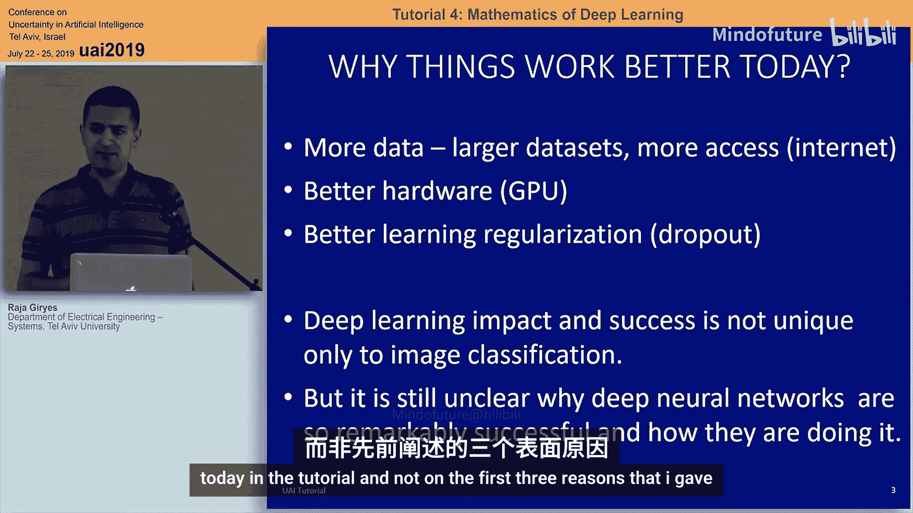

So there are many cutting gauge。Results in many application in neural networks。

 I will show few results by my group。 So， for example。

 here you may see a result of imagenoing by neural network。 So on the。Right here。

 you can see result of a previous competitor here you can see our result and what we have done in this work。

 we took a classifier， combined it with the noiser。 we first put an image in a classifier。

 the image classified to what is the type of this class and then we put it on a specific the noiseer designed for this class and then you can see that in this case we can recover the details of the and eye in a very nice way and this was not trained with the gun So it get very good results Another thing that we are doing in my lab in the practical side So today I will talk about the theoretical parts of the learning but as I mentioned just to give some motivation I will show some nice pictures or results if you will get bored with the math。

😊，え。So one thing that we have done is we designed to today。 you want to take photos with your phone。

 but many people today want to take also 3D photos。 The question is， how with just one lens。

 we can get the 3D photo， and we design the face mask that we can add to a。A lens。

 And then you can get 3D data to the information of the scene。

 And one of the interesting thing in our work is that we designed both the reconstruction。

 the data reconstruction network and the optics itself using a neural network。

 So we have a neural network that know how to design optics in automatic way。😊。

And it can give us also all in focus imaging。 Another work is related to what is called the light field。

I don't know if you know what is light field， but light field is a type of camera that try to capture the whole light field of a scene。

 So in regular camera， you get just one angle of a scene in light field。

 you get many angles of the same scene。 And then it help you in augmented reality。

 in virtual reality and in depth of construction and many other problems。

 One of the disadvantages of conventional light field imaging。

 is that you need lots of lenses to capture all the angles， or you need to modulate through time。

 which add some latency or blurir or disagreement between or sensitivity to moving objects。

 So what we have done in this work。 we added the mask that combine the different angles。

 And now we have a more recent work that learn this map automatically by network。

 And then we reconstructed all the angles。😊，From this coded du。

 And then we also reconstructed depth information。 And now we made a startup from this lens， so。

I hope you wish a success， or maybe not。I hope we will succeed。

 and you will see this lens in your phones。Another thing that we have done is together with the professor childuker。

 we use the deep， we are using deep learning to try to detect the exoplanets。 many times。

 you hear that NASA discover discover some planets far away and。

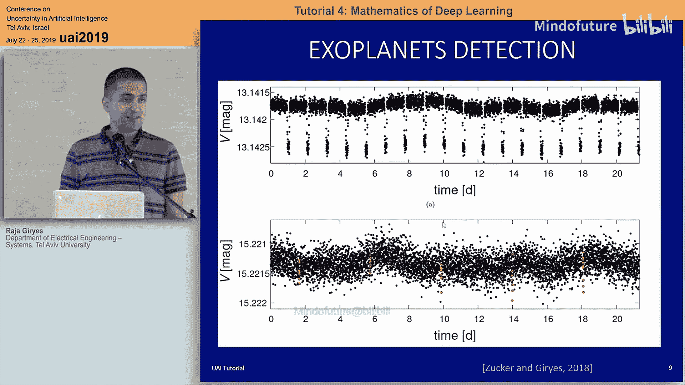

The common way to discover planets is to understand that planets doesn't emit light。

 but stars do emit light， and therefore if you look far away。

 you cannot see the light that come from the planet。

 but you can look at the star and see if in acyclic way in a periodic way you see decrease in the amount of light that come from a star。

 you understand that there is a planet rot around the star。

 So we use the neural network to try to detect such phenomena。 so clearly in this case。

 when you have very good NnR， it's very easy to detect the planet。

 but in cases that you have a very lowNR， you need more sophisticated techniques and we have shown that using neural network。

 you may detect the far away planets。Another work that we have done。

 we try to replace the ISP of phone so many times when you take a photo in the image。

 the optics that you have in the phone is very thin。

 it's much worser than the original optics that you have in conventional cameras and then you need to do lots of operations like the mosaking。

 the noiseising color correction， gamma correction。

 a brightness correction and so on and so forth and then we design an neural network that try to do all these process and end to end fashion and then we compared the results of the camera which is a black box and we got better results both with respect to visual quality and other things。

Another thing that we are doing is working on deep learning on irregular data。

 So this is a field that is developing a lot in the recent years。

 So most of the results that use in deep learning on images or on sequential data or on data that is on certain grid and one of the challenges is how we apply neural network on data that is not on grid So in one work we have shown how you can do partial shape alignment。

 So let's assume that you have with this airplane template。

 and then we scan another template of airplane， then we have just partial scan of this plane and then we want to match it to another template to get the full scan。

 So we use the network that learned how to do this matching。

 So this is one result in another work we learned how to train neural networks on meshes and then we have this network perform different mesh simplification for different task based on the task。

For example， if we want to detect if we have a handles or not。

 So the network just collapses everything and just keep the handles。

 And if we want to understand if we have neck or not。

 the network collapses everything and keep just the neck or not the neck。

So these are things that we have done in my group and many。

 many other research group in the world are working to get some nice results in their networks。And。😊。

One of the。And nice thing。That we experience when we work with neural networks is that we get much better results than what we could do or what we can get with conventional methods。

 So in all the results that I have shown till now， so。😊。

We compared our results to conventional techniques and got much better results。 So here。

 when you try to do this classification on meshes with neural networks， we get much better accuracy。

😊，Here in the She alignments， when we compare to ICP or conventional matching techniques。

 we get much better accuracy。😊，But one of the thingss that。

Disappoint me as a researcher when I do all these works is that we get nice results。

 we have some intuitions， some thumb rules why we should do some things。

 some know how that we have in the community， but we don't really understand why things work so well。

 so we just take layers， we stack them together， if something don't help， we add the skip connection。

 if it doesn't help， we try better norm， if it doesn't help we try another organization or play with the learning grade。

 And then after a graduate graduate student descent， we get a great results。

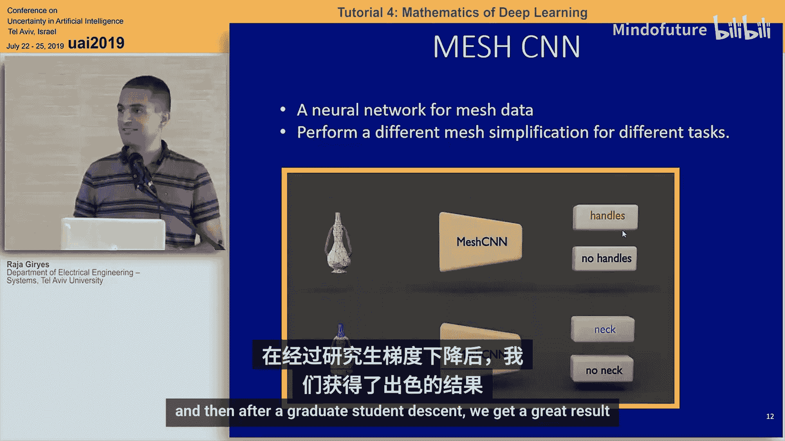

Now， the question is whether we may can find a better systematic way to design things。

 and I think that understanding the theory behind deep learning，Is something important。 Now。

 some people may say， no， we don't need that。 Today。 we have the next stage of neural network。

 We have the neural architecture research。 So， for example。

 this is one work that we have done in collaboration。

We so with one of our students and with collaboration with Alibaba。 So we， we have。

 so one of the active research fields today is the neural neural architecture search。

 So if till today， you want to solve the problem， you propose a network structure and train it to giving a data。

 today， you even don't need to design the network。You can just let the computer learn by itself what is the best neural network that you need to choose。

 And it does everything for you。But so we can design new networks in automatic ways。

 And here you can see results that we have。 So conventional network detector search took maybe 300 GPUus for weeks。

 which we cannot allow ourselves at as a search group in the university。

 So we design a technique that we just have a day。 We can design in neural network that get lower error than other networks that people designed manually。

😊，那。As you can see， the development or the empirical development in neural networks they evolve very rapidly。

 But I think that still there is something important to learn or try to understand because I think that it's important as researchers to design things in a more fundamental way。

 try to understand things in。😊，One of my activities。

 I'm consulting to a company that is trying to do autonomous driving。 And I think that if we。

 as research group or as a society， want to have autonomous cars， it's important that。

We will know what's happening in these cars。 So if we。

 if you take a robot taxi that take you from one place to another。

 you want to trust the robot taxi and understand what it's doing through sometimes if you just take a regular taxi driving。

 I'm not sure that you can trust the driver， but maybe。

We can try to understand what the networks are doing。

 But one of the interesting things is that when we have a neural network。 So basically。

 all what we are doing is we're taking such a simple component， which is applying a linear operation。

 followed by non linearity。And this is one layer of a neural network and then if we are not satisfied with the results of this network。

 we stack two layers together and if we are not satisfied with it。

 we stack 20 layers like that together and then we train it with data get great results and then all the neural networks that we have today are basically variation of these simple structure stacking the same layer again and again and again。

 we skip connection with some strides， but basically we are using a very， very simple。

Structure that is gained in straight of large results。

 And then if we have this linear operation and we restricted to be convolution。

 So we say that we have a convolution neural network and adjust a deep neural network。

And if we have feedback， we say that we have a current neural network。

 And in the non nonlinearar part， we usually we use very simple operations like Rorelu。

 which is the maximum between0 and the value。 the sigmoid， the probolic tang。

 and sometimes we apply pooling， which is basically summarization of elements。 Now， as you can see。

 or probably know， all the operations that we are doing are extremely simple。😊。

M most of the networks that I have shown use Re， which is basically， So basically。

 what we are doing is basically just linear operations followed by maximum。

 followed by linear operation。And we got results that we don't understand。

So what I will try to give today in。The time that is left。

 a sample of the existing theory of deep learning。 In the beginning。

 I will just mention some of the results that exist。 And other day。

 then I will focus on two works that we have done in my group。So， when we。Look at neural network， so。

There are many questions that we may ask。 One of them is what is so spatial with the deep neural network structure。

 Another one is， what is the capability of deep neural networks。 Are there problems that we。

Cannot solve with them。 So I know that Amidda Neli has lots of works on this things。

 Another question is， how many training samples do we need to train a network？

 I think that one of the。And I don'tt know if it's the most important questions。

 but one of the questions that many people in the industry are interested in is when enough is enough because when enough data is enough。

 so。Labelling data costs a lot of money I don't know if so in academia usually we are used to use the commonly available data sets like CA or Inet。

 or I forgot the name， but there is a recently published data by Google with millions of taggged images。

And。But。In the industry， when a company want to solve the problem。

 it need to pay for the labeling of the data。 And this cost hundreds of thousands of dollars。

And the question is， if I'm a medical company and someone tell me that I need to pay $1000 for a doctor per hour to label data。

 It's clear that I want。To pay him a limited amount and not have him label data forever。

But on the other hand， I want to have。To get the best accuracy that I can。

 to be the leading in the market。 So the question is， when I need to stop labeling the data。

 And this is very important practical question。 And。

 but it's also a very important theoretical question that I don't think that we still know how to answer。

Another important question is what is the role of the activation function。

 So why value is better than our things， so maybe it's not better。

 but we don't know how to use other things。Another question is what happens to the data throughout the layers。

 so many use today data the attention mechanism to look at the intermediate layers and try to get some conclusions about the data using it。

 So what can we say about the intermediate layers， can we use it。

Can we do some interesting stuff with that？So we have a results on it for detecting ultra cell examples。

 but I will not present it today。 I will present something else。 Another thing is。

 what is the role of the depth of neural networks。 So we know that deeper is better But the question is why what is the role of pulling and so on so forth。

 So there are many questions that we may ask about neural networks。

 And I think that it's important to answer them because each of them has implication on the design of the neural networks on labeling of data。

 on selection of architectures and so on so forth。😊，Now。We have a summary paper。 It's a bit outdated。

 It's one and a half years ago， but we are working to update it。

 which is called mathematics of deep learning。 that is presenting the main points on the main questions that I have mentioned here and G and。

And given， I think I'm not objective about it， I think it's given a nice survey about the theory of neural network。

 so if you're interested， you can look at it in archive。😊。

But I will briefly now mention some sample of related existing theory。

 So one of the most famous works on the theory of neural network is the universal approximation theory of neural networks that shown that you may that a neural network can approximate any measurable burrele function。

And basically， it mean that。You， you can approximate any function using neural neural network。

And when this theory was introduced by Horick and a letter by Saab Benco。It brought， I think。

 a lot of excitement。 But because it says that we can solve everything within our network。

 But one of the things that this theory doesn't tell you is what is the size of the network。

 how many parameters you need， how you can trade the network， so。😊，There is。

 there are more things that should be asked about or studied about neural networks。

 Another line of work looked at the depth of the networks and showed that if you compare a shallow network with a deep network。

 the number of parameters that you will need with the shallowware network in order to approximate the deeper network will be exponential compared to the deeper network。

 So deeper networks are more efficient with respect to the number of parameters。

Now there are works that talk about the generalization error of neural networks that I will survey more in depth afterwards and some other works studied the relationship between the local minima that you have in neural networks and the depth of the network。

 the group Michael La shows relationship to dial learning。

 and there are also relationships between neural networks and the information bottleneck and information theory in general some works showed that neural networks can be studied in relationship between invaris of the representation and the tasks that neural networks image at solving。

 and there are also lots of works on patient deep learning。So。As I mentioned。

 so one of the most famous results for neural networks is that is the universeverse approximation theory that says that you may approximate any function。

 which is a measurable Bra function up to any precision that you want。

 But the problem with this theory is that。It doesn't really tell you how you can do that and。Also。

 it doesn't tell you what is the size of the network。

 Maybe this network should be close to infinite number of parameters， which is not practical。

Another work that later followed in the 90s by Bon。

 and many times we tend to forget that neural networks existed before，2012。え。

We talk about the estimation error of function by neural network and this work show that the estimation error of a neural network is composedd of two terms。

 The first term is the approximation term and the second one is the generalization error term and the first term tell us that we may the error in the approximation of a function is related to the smoothest of the function and the number of neurons that we have in the network。

 the more neurons that we have the easier it is to approximation a function On the other hand。

 if the number of neurons increase， then we need more training examples to learn these neurons and therefore the generalization error of the network that we will define afterwards scales as the number of neurons divided by the number of training examples and we have also a relationship to the dimension that。

It doesn't appear in other works。EThere are， there are other works that talk about the depth of the network。

 As I mentioned， They show that deeper give you something that is more efficient。え。Now。

 there are other works that talked about pooling and showed that pooling give you invariance。

 some work showed relationship between pooling and phase rerieval。

And another work showed the relationship between a neural network。

 their presentation that neural network give you and sufficient statistics。

And another show that the structure of the neural networks can generate representations that are good for learning with a small number of examples。

 And this is related to some works that study neural networks with random weights that show that just the architecture itself is enough to get good results。

 So there is something inherent in the represent in the structure of the neural network and。😊。

That give you nice results， Brurunna and Mala studied the scattering transforms which are very similar to neural networks。

 it's concatenation of wavelets with some modular operations and they have shown that the cascade of this welet transform convolutions give better the deeper you make the concatenation。

 the more complex and invariant features that you get and this give us some idea on what happens on regular neural networks that we train end to end。

え。So this work showed that more layers create features that can be made invari to increasingly more complex affirms。

 and therefore we may conjecture that also in neural networks， when we go deeper。

 we can get this invariance。😊，嗯。Also there are lots of fork that use the scatter transformersymmetric。

 and today we also use the latent space of the Gahannosymmetric to see to compare images。

 So for example， you can see here super resolution using L2 minimization and then instead of just using the L2 metric to get good visual results。

 you can also use other metric spaces to compare images and this trade off the visual quality with the PSNR or the distortion and the tomer Mihalli from the technon with the highbl have shown that there is a trade off between the distortion that you have in image reconstruction in super resolution and the visual quality so you cannot get both visual quality and low distortion。

 you need to trade off one with the other。😊。

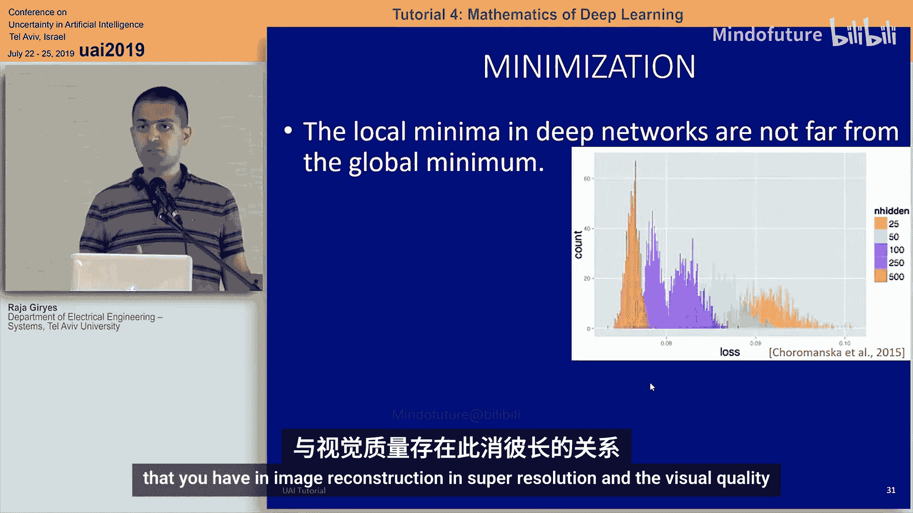

other works looked at minimization of neural networks。

 They showed that the local minima in neural networks are not from the global minimum。

 and they they have shown that deeper networks have more local minima， but less saddle points。

And other line of works looked at the global optimality。 So they studied they。 So， for example。

 the work of a Vida that was later followed by other works that have shown that if the neural network obeys some properties。

 then it is guaranteed to converge to a global minimum。Now。

So there are many recent works that show that over parameterized neural networks reach a global minimum。

 But you need to remember that if you reach a global minimum it。With the given data。

 it doesn't necessarily mean that you got good results because maybe you overfitted the data， but。

Still， you are not generalizing well。So also in my group we have some results for theory of neural network that I will go into depth on two of them。

 so in one work we have shown that the deep neural network classification is affected by the angles in the data in another work that I will talk about today about we studied the generalization neuro of neural network another work we studied the relationship between invari and the generalization neural network。

Another line of fork that if time will permit， I will talk about today。 If not。

 I will skip is about what is called the learned isam。So。

 or how we may solve optimization problems with neural networks。 So in traditional signal processing。

 if you want to solve a certain problem， for example， if you have a noisy image。

And we want to de noiseise it。 We wanted to remove the noise， we。Define a certain optimization。

 objective。And try to minimize it。 And then the standard technique to minimize the optimization of is by certain iterative algorithm。

Now， the problem with iterative techniques is that they need lots of iterations to converge。In 2010。

 Gregor and Lacoon have shown that you may take iterative technique， unfold it。

 learn the parameters of this unfolded iterative scheme， and then you get a structure of a network。

 and if you train it into to end， you can get much faster convergence。

Or you can get to the same result with much less layers compared to the iterative algorithm。

 but with the same complexity。So till two years ago。

 the reason for whites working remained elusive and the several works provided a possible explanation for this phenomenon。

 and one of them is our works that try to explain why we can solve optimization problems with neural networks。

Another work which I will mention today studied relationship between the Jacobian of the neural network and its robustness to aversal examples。

 another work we have shown relationships between neural networks and k nearest neighbor and we have shown that it may explain why neural networks are resistant to lab noise we have shown also relationship between equiangngular or tight frames and dropout and also in recent work。

 we have used lot of information for transfer learning。So this is So now。

 it was just a fast survey of existing results。 and now I will。Focus in the remaining time。

 I'll focus just on three topics， or maybe only two of them。

 I will talk about generalization of neural networks， and I will talk about it more in depth。

And then I will talk about a robustness of neural networks to adversarial attacks。

 which I think is related to generalization， and this time will permit。

 I will talk about how you may solve optimization problems with neural network。

So I will start with the generalization error。So here I will also promote another survey paper that we have I have written with my student Dia Jakoovitz and Miguel Rodriguez from UCL。

 which is a survey paper about the generalization error in deep learning so。

From maybe2 to three months ago。 So maybe it's also outdated， but but I think it it is。

 it's up to date， up to2 three months， which give a survey about recent developments in journalismization or in neural networks and if you're interested in this field。

 So at the end of this survey paper， there is a list of open questions that we think are interesting。

 So you may look at it and。Pick one and solve it。And save the world， so a。For this part。

 I will use this scheme。Of a neural network that， in my view。

 may explain at least partially why neural networks are giving good results。

 So let's focus at the case that we have just two classes。E we have the blue class and the red class。

And we each star is a point from the data。The color is the label。

And we want to train the neural network， to classify。This data， and usually。

When using neural networks， we apply linear operation。

 followed byon nonlineararity and so on so forth。 And then at the end of the network。

 usually we apply softms or some linear classifier with sigmoid。

 where which basically in the two class case corresponds to。

ESeparating the data with the hyper planee。So if you have just two classes and at the end of the network。

 you just apply linear operation。 So basically applying a linear classifier at the end of the day the。

At the feature space that the network is calculating。Now。

 one of the interesting observation that you may notice is that this linear separating plane corresponds to a non linear separating。

curve in the input space。 Now， clearly， in real data， this will be。

 the input will be high dimensional。 and this， the output will be also high dimensional。

 but everything here is 2 d just for the sake of clarity。

So you may think about what happens in neural network is that you take the data， you transform it。

 you transform it to another feature space， which is linearly separable。

 And then you apply a linear classifier。 Now， if we compare this process that I describe now to a classical machine learning。

The first part。Would correspond to the handcrafted features that you take data。

 you take features that you manually design， and then the second stage will correspond to applying SVM or another classifier。

 Now， the disadvantage of the all techniques or classical techniques is that you design in them each part separately。

 So you design the handcrafted features。Given one criteria。 and then once you have the features。

 you train the S VM or the classifier that you have using the final criteria。

 The fact the by the fact that you are doing designing each part。ESeparate。

 you make the final solution suboptimal。EAlso， in the case that you may may have solved each of them in an optimal way。

The advantage of neural network is that use。Design both parts in an end to end fashion。

 And because you design both parts in an end to end fashion。Through。

 the optimization is non convex and not nice。And had many problems， many time。

 a sub optimal solution for the whole problem is better than two optimal solutions that are not always optimal for two sub problems。

 but you afterwards to connect together。And I think this is one of the reasons that。

Give the strength to neural networks。 And I think that it's not something that I think it's a common know how in the community。

 but I find this figure very helpful to understand what's going on in the network。Okay。So。

What I will focus now at is the generalization of a neural network。When you train neural network。

You are giving a training set， a set of training examples that are labeled。

 I'm talking about supervised classification。And you want to minimize the error on the training set that you have。

And the number of。EExamples that you have， and we will denote it by L。Now。

 it's clear that we are not interested in。Only in the training examples。

 but actually what we're interested in is in the test examples that we don't have access to。And。

The goal is to try to minimize the error on the training example。

 such that the error on the test examples that we don't have access to will be as low as possible through we don't have access to it。

Now， to measure what is so the difference between the error that we have on the test set and the error that we have on the train set is called generalization error。

If we use more formal terms。 so the test or usually is called the expected risk。

 and the training goal is called the empirical risk。 So in formal terms。

 the generalization error is the difference between the expected error， which is the training。

error in practical terms and the empirical error， which is the training error in practical terms。

 So basically what we are aiming at is the expected error， which is basically the test error。

But in reality， we don't have access to it。 So we just train on it。EUsing the training set。EAnd we。

 we focus at the triangle。And the question is how we may use the generalization error。 Now。

 notice that reducing the generalization error alone alone is not enough。

Because I can give you a random classifier that will give you zero generalization error。

 But I hope that you understand that random classifier is horrible things to use。Okay。

 unless you don't care about the problem that you're solving and then it's fine。So。

Generalization error is important， but it's important to minimize it。

 along with minimizing the training error。 So we want to minimize both the training error at the generalization error such that at the end。

 the test error will be as small as possible。Also， we may use。

 we may reduce the training error to 0 just by have one nearest neighbor classifier。

 which will give us zero training error， but it doesn't generalize well compared to other solutions that we have。

So。So I hope that I convinced you that generalizationery is an important thing。

 so it's important to understand it。So there are many results that looked at the inization or like the result of baron that I've mentioned before。

And many regularization techniques were developed to reduce the generalization error。 some results。

 so。Wade decay was proposed， which penalized the deploy network weights。

 And one of the interesting things is that。I've been shown is that also when you use stochastic gradient descent。

 which originally was thought to be just a way to optimize things because we don't have enough resources to store the whole batch in the memory today understand that when you optimize with stochastic gradient descent。

 you also gain some kind of regularization。 Another interesting related a result from the recent years is that it was commonly thought in the community that when you do way decay。

 So way decay is equivalent to L2 penalty on the weights。

 So if you do SGD if you train neural network with the stochastic gradient descent。With weight decay。

 it is indeed equivalent to training neural network with SGD with L2 regularization。

 But if you are using Adam optimizer or momentum or other optimizes are related to momentum。

 So weight decay with Adam is not equivalent to Adam with L2。 And there is the Adam W optimizer。

 I forgot the name of the paper， that shows that if you want to apply weight decay with Adam。

 So just adding the L2 penalty theorem is not enough。

 Now there are many other organization techniques like dropout， drop connect。

 but normalization and more。😊，And there are many jizations that were developed。For neural networks。

 so for example， there is a result by Shaftz and Ben Davidavi have shown that the generalization of the network scale as the square root of the number of parameters times log L divided by L and it showed that the more training examples you have the better the generalization error that you will that you get。

 but on the other hand， the error of the network scales with the number of parameters。 now。😊，え。This。

Reult might sound reasonable to us because we may think that if we have more parameters in the network。

 the network will overfi。 But today， we know that other parameters networks or networks that where the number of parameters is much larger in the data generalize well。

 So such results are nice in theory， but they are less helpful in practice。

 Another result which is based on the rather macro complexity by aur show that the generalization error is independent。

Of the number of parameters that you have in the network。

 but is dependent on the product of the Frrobinino norm of the weights in the networks。

 but they have a factor of two to the power of the depth of the network。Now， again， today。

 if you use resnet and you have 100 layers， you generalize well。 But if you will use this bound。

 you will get to the hundreds of 100， which I think is more than the number of atoms that you have in the universe。

And I don't think that you will be able to tag so many examples。Now， goictel have shown of。

Refin this bound by Neia Bo and develop the Rad Mahar complexity bound that is independent of the depth of the network。

And they've shown that indeed， as we practice today。

 the gization error is bounded by terms that are related to the spectral norm of the weights and the fbious norm of the weights。

 and not on the depth of the network。But still， there is a problem with results that are dependent on the physics dimension or the rather complexity。

 And it is because the。Rmic complexity and the V dimension are in general are agnostic to the data that you are using。

 and they focus more on the structure of the network。

 and the Zqueal in a seminal paper have shown that you may take the same architecture。

With the seization and the same architecture will generalize well if the data is well behaved and will behave horrible if the data is is random。

 if you look at the test data。 But if you will look at the training data。

 the same network with the seization will overfi both the training data。

Of the true data and the data with the random labels。 So the， the。

 the work of Sangeta have shown that。You can take random data and train the neural network in it。

 and the neural network get zero training error。 But clearly， if you have random data。

 you cannot generalize well， and you will take the same network with the same tractor with the same parameters。

And。You will train it on true data， but then on the true data， you will generalize very well。

 So in the generalization of the network， we must take into account also the structure of the data and realizationization generalization bounds that doesn't take into account the structure of the data miss something important。

 I think。ESo in this aspect， and Iha Boetal have shown that if。You train neural network on real data。

 you get that the weights in the neural network are very redundant。So what you can do。

 you can take a neural network， train it on real data after you finish the training。

 you can prune all you can prune weights that are redundant and then the generalization error bound that you will get will depend on the number of parameters that you have in the network after the pruning and not before the pruning。

And then in this case， the， the bounds that we have seen that we have seen before that depends on the number of parameters will make sense again。

 because if I take a network， which。Is trained on random data。 Then I will not be able to prune it。

 and then I will get a generalization error， which is very high and is not helpful。

 and indeed scale with the number of parameters。 But if I take a neural network that is trained on real data So after training。

 I can prune the weights， the number of parameters。

 the number of actual parameters that I have in the network will be very small。

 And then the generalization error that will get will be very small。

 and they show very nice matchingching between the results after compression。😊。

Another work have shown that if when you train with stochastic gradientd in descent。

 so stochastic gradient in descent serve as a regular regularizer in the training of neural networks。

 so if you get to a flat mini it have been shown that SGD improve the generalization in the network another work by Brukuus have shown that if you look at two layers at the neural network with two layers understand some assumption。

 they have shown that SGD converge both of the global minima and generalize well so in this work they connected the optimization in the network and the generalization together and have shown that under some assumption the data network may both generalize。

And get to a very to the global optimum with respect to the objective。

 And this is important result because it connects both optimization and gization that are usually not connected to each other。

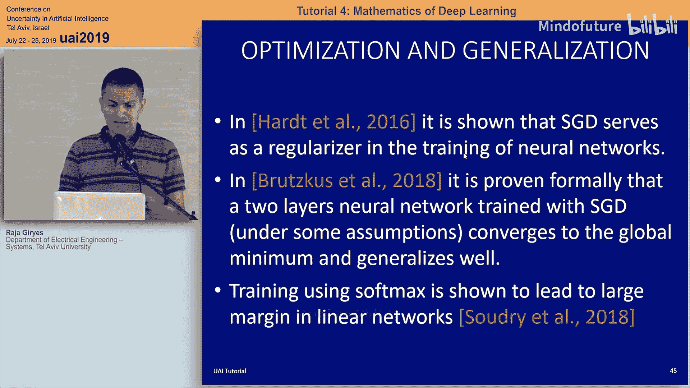

Another work by Daniel Sori， I've shown that if you train a neural network with So Maxax。

 you can get large margin in neural networks and as I will show in a moment。

 large margin in the neural network lead to a good day generalization。So， there， so as I've。

 so there are many interesting results that give you guarantees of。The network。

 And I think that one of the。嗯因。One of the interesting things that we find these results is that in neural networks。

 we have a phenomena that is contradictive to the common assumptions of a classical model。

 So in classical models， you have a graph of a complexity of a model versus the generalization of the model and it is shown that the more complex the model。

 the worse the generalization you can get and in neural networks。😊。

The generalization of the network improves when you increase the number of neurons。

 but I don't think it contradicts the。The classical understanding that journalismization become worse when complexity increase。

 I just think that the number of neurons in the network not the measure of is not the correct measure of complexity。

So it doesn't invalidate the old graphs you， but。It just means that you cannot replace one axis with the number four neurons instead of complexity。

Now， in。In our work， we studied relationship between generalization error and the input margin of the network。

 So if we will return to the figure。 So we we have shown that the generalization of a network is bounded。

By the square roots of the covering number of the data。That we have。Divided by square root。

 the number of parameters。So if we look at this bound that we have， you can see that。

 as compared to other bounds， that depends。That that decrease with the number of training examples that you have。

 Also， our bound becomes smaller when you have more training examples。

 which is something that you should expect in any generalization error bound that you will see。

 So you would expect that the more data that you have， the smaller the error that you will get。

On the other hand， in the denominator in our bound。

 we have something that is different than all other bounds。 We have something that。

Depends both on the structure of the network and the structure of the data。 So we have in the bound。

 something that is related to the covering number。Of the data and covering number with the balls of size gamma。

 So covering number is the number of balls with radius with radius gamma that you need to cover a certain set。

 So the more complex the set is the larger the covering number that you will need。

And the larger the balls that you have， the smaller the covering number that you need。

 because if you have bigger balls， you need less of them to cover the whole set。

And the parameter gamma， which is the size of the ball that we have。

 is basically the input margin that you have in the network。 So if you train a network。

And this network have a certain input margin with respect to the data that it was trained on。

Is the larger the input margin。The better the generalization error you will get in the data。Now。

One of the challenges of using this bound practically is that calculating the input margin of a network is an NPI problem。

 So it's not something that you can really calculate。 but fortunately， you can。

Have some lower bound for the input margin of the network， and we derive some lower bound。

 which connected the input margin of the network to the output margin of the network。

 and we have shown that the input margin of the network is greater or equal to the output margin of the network divided by the spectral norm of the Jacobbian of the network。

 which is greater equal than the output margin divided by the spectral norm of the weights or the product of the spectral of the weights。

 and then we have another term which is related to the Frbinus norm the weights。Now。

 we will dwell a bit about on， on the lower bounds that we have。 So in our lower bound， So remember。

In our bound for the generalization error， we want the input margin to be as large as possible to reduce the generalization error。

 So what we will do next， we will try to use this bound that we got。

To train neural networks in a better way that will improve their generalization error。 So we want。

 so we cannot cover the complexity of the data， but we can。E control the size of the input margin。

Now， as I said， controlling directly the input margin is something that we cannot do。

 but we can control the lower bound of。The input margin。 So if we want to increase the input margin。

 we will try to increase the lower bound。 And in the lower bound。

 we always have the output margin in thenominator。 Now。

 output margin is something that is easy to maximize。 So if you use SVM。

 you maximize the input margin。 And as I mentioned before。

 surgery have shown di surgery have shown that also when you use the softm loss。

 you also maxim the output margin。 So basically， both when you use hinge loss。

 And when you use softm， you are maximizing the input margin。 So basically。

 we are maximizing the output margin by the standard training。That we are using today。

 So for adding regularization， we need to decrease the denominator that we have here。

So let's look at the denominator that we have here。 If we look at the weakest lower bound。

 the weakest lower bound has a product of the Frbuous norms of the weights。Now。

 if you will think about it。reducing the Frennous norm of the weights。

Is exactly the doing or or it's very close to L2 regularization。Which is connected to AD K。

 which is commonly practiced in neural networks。Now。

But the interesting thing that we found is that a better bound than the product of the febinous norms is something that is related to the Jacobian of the network。

So。So， our bound suggests that， instead of。Reducing the Frrobius norm of the weights。

 When you train a network， what you should actually do is reduce the Jacobian of the network when you train the network。

Because our bound suggests that。EThe Jacobian give you a tighter。Approximation for the input margin。

So we tested it empirically， and we compared the way decay to our new Jacobian regularization。

That increase that tried to close large margin。 And we tested it on various data set。

 here you may see Ms that we tested it on imagenet and in sayfa and error things。 And in all cases。

 we have found that。Using regularization， using the Jacobian always give you better results than regularization using way decay。

😊，And the nice thing here is that we have a theoretical result。

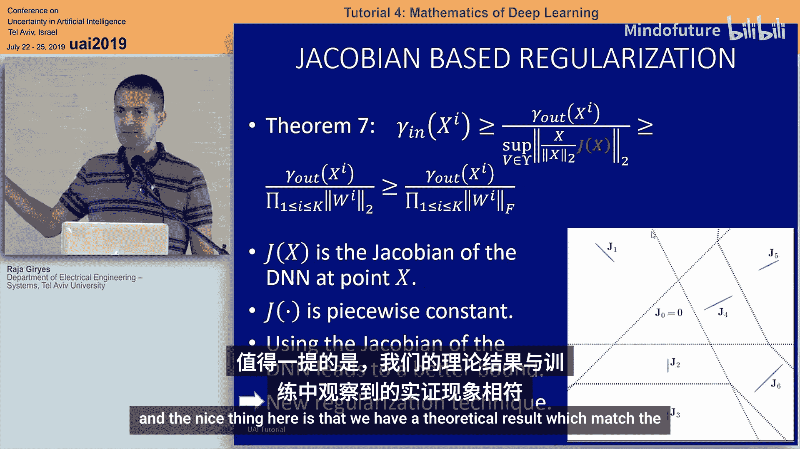

Which match the empirical thing that you see in training。

And I think that we should aim as community trying to develop more and more theoretical results that give us practical tools that we can use in the training of the networks。

え？And I think that this result tell us that。One way to improve gization error is increase the margin now clearly using the Jacobian is not the only way。

 One of the downsides of the Jacobian is that you need to calculate the Jacobian and penalize it。

 which increase a bit the training time。

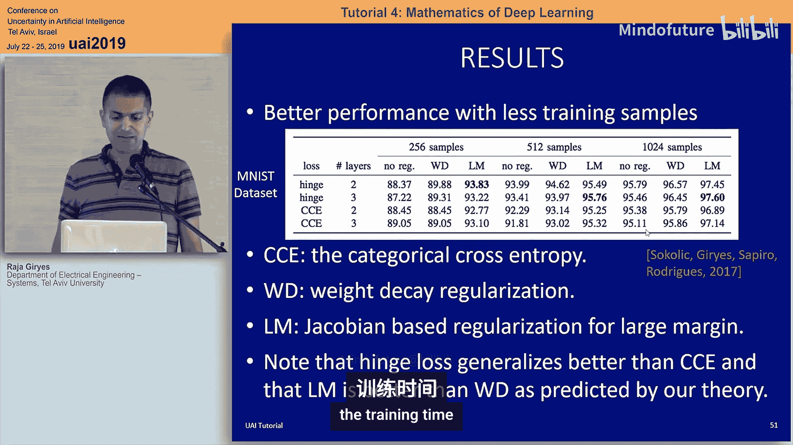

The group of Sam Benggio from Google have recently published a paper that suggests other techniques to increase the margin of the network that improve the training so。

We， we believe that our bound provide an explanation of or show that theory can guide us to better ways e for training of neural networks。

Now， in follow up work， we studied the relationship between invariance in the data and invariance in the network。

 And we asked the question of， if we have a certain data that。Is invariant。

ETo some transformation for a given task。 So for example， if we have classification of a cat。

 So we want to be invariant to the location of the cat in the image。

So let's assume that we have a T transformations that we want to be invariant to。

 So if we want to be invariant。To a rotation by 90 degrees。

 So T will be 4 because we want to be invariant to four transformations。

We have proven that if you have an environmentvariant classifier， which is invariant by construction。

To a T transformation， then the generalization error will be better by a factor of square t compared to another classifier。

 which is not en by construction to these transformations。 So basically you may。

 if you have some prior information on the data。You may design your classifier in a way that it will be inherently inviant to these transformations。

 And I think this this is used today。 So many people today use augmentations。😊。

To help their classifier to be in into the data。But we have seen both in our theoretical results and。

 in a。A practicalractical empirical experiments that if you take your classifier and make it inherently invariant。

 you improve， you can improve your results。 So for example。

 one work which is use the invariant slides， they took the input， took several transformation fit。

 then trained it， took average of the features， took the output and have shown that this improve the results。

 we suggested to do to train the network such that we enforce the features to be the same if we take the same input and apply certain transformations and many people today use the partial transformers that also give inherent invaris。

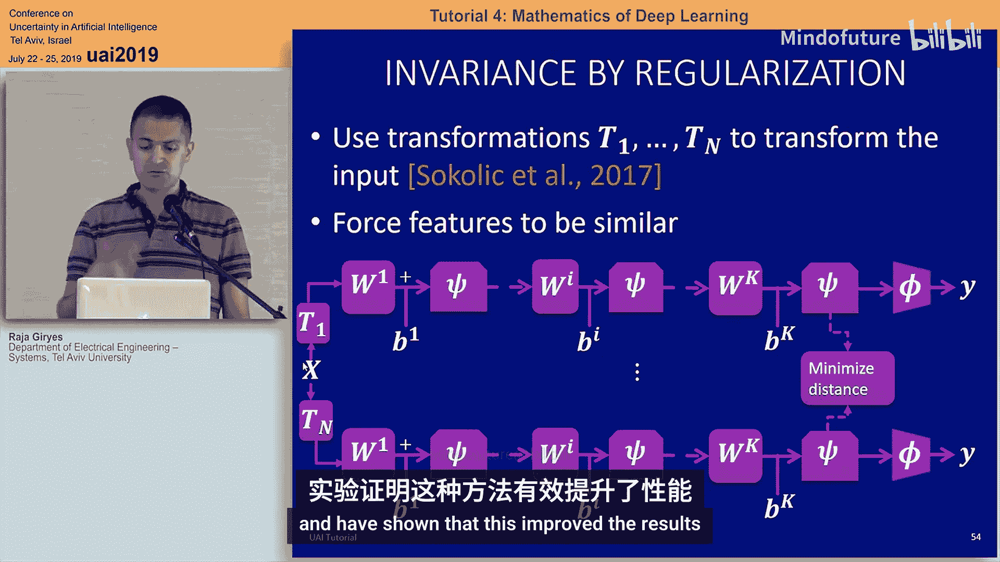

To the data and in this way， improve significantly the performance in the training。

 So here you can see also the results that we have with our environment organizationization。

 You can see that it improve the generalization in a significant way。😊，So。诶。So as you can say。

 that generalization error is very important topic in neural network。 and it's not important only。

Theoretically， but it's something which very important on so practically。

 And if we gain good understanding of what。Controls the journalismization of the network。

 We may develop new tools that improve the performance in our training of neural networks。

The next topic that I will focus at is the robustness of neural networks to the examples， so。

EOne of the interesting phenomena that we experience with neural networks is adversive examples。

You may take an image， let's assume that we take this balloon。

You may change just small number of pixels in it。 I don't know if you can see the pixels that we have changed here。

 And then the network we think that this is red wine。EYou can take this harp。

It change some pixels here。 You can see the changes。

 And then the network would think that this is letter opener。

You can take this iPod and then change some pixel， the network we think that it's analog clock。

 and you can take this armadillo and then the network would think that it's another element。

This is a G now。This phenomena is universal through all types of neural networks。

And it's interesting that researchers found that you may take。A variation that fool one network。

 and it will fool other networks， you。Can also fool neural networks by what is called blackbu attacks just you can take neural networks without knowing anything about the structure of the network。

 just look at the input and output and you may still form adversarial attacks and there are also the poison an attack which you may change several labels in the input labels of the data and it will change the training completely for certain tasks so an adversarial examples is something which is extremely important。

To understand， because。So right now， I think we look at it as a nice example。 but in the future。

If a change of。Small number of example of pixels or things can fool a neural network if you want to trust neural networks。

诶。We， we need to understand why these examples happen。 So be because otherwise。

 it can lead to dangerous effects of think about the future。

 If you will have autonomous scars and some。E adversary want to cause accidents to other people。

 He may just。Drive in front of the other car with adversarial example。 Okay。

 so maybe the mustsad will do that。 Ki people with adversarial examples。But the。诶。But， but。

This is something that is really。Really serious because you don't want。

Small changes that shouldn't disturb a classifier understanding to change decisions that in some cases。

Will be really important。E so。Now， as I mentioned， adversarial examples are highly transferable。

 They can be transferable from one network to the other。

 very little knowledge of the network architecture is necessary to attack and。EThere are many。

 there are several explanation to this phenomena that has been suggestions， for example。

So some people view a examples as。As the rational numbers among the real so they claim that we that we cannot avoid adversar examples。

 so through the measure of the advers example is zero compared to the whole data that we have still we can get to them as the measure of the rational number is0 compared to the real still we have rational number and we cannot avoid avoid it。

嗯。Other works show that positively curved decision boundaries are more susable to universal adverse pertus。

And there are other explanations that try to explain why we have adver examples。

And there are many attack in defense metals that have been proposed to counter the problem。

Defense methods aimed at either increasing the robustness of the attack or detecting that an attack has been performed。

Today， I will talk about defense methods and not about detection methods。

 These are two separate things that are studied in adversarial attacks。

 Some methods try to increase a robustness of of a network。

 so it will try to decrease the probability that an attack will succeed。Detection methods。

 just try to。Understand whether attack happened or not and detect it。

 Defense method try just to increase the robustness。

 But and then the network always give us a decision。 So I will focus on attack methods。

 through we have a work on detection that I will not mention today。

Now there are many attack methods that try to fool the networks among them we may find the fast gradient method。

 the Jacob and dealency map approach， the Deep fool or the Carlini Wagner。

 which I think is considered to be the strongest method today。

And most of them try to go in the space in a way that。

will make the minimal number of changes to the image。

 whether in L2 or L1 or to make a change only to a sparse number of pixel。

 such that the decision of the network will change。And in the defense methods。

 we may name adversarial training that。Try to train a network。

 both with real examples and averive examples， such that the network will know the true label of the advers examples。

 Many people use distillation that surprisingly help a lot to increase the robustness。

 You take one neural network that was trained out their real data。 And then you don't。

 and then you distilled information to another network。 You just。え。

Train the new network using the logicits of the old network and this to improve the performance another work is the input gradient regularization or the cross slip sheets regularization and we suggested in what I will talk about today is about the Jacoban regularization which is a technique that is related to what I've shown before on the gization now。

 and that we show that Jacobbon regularization both improve。😊，EJizationer。

 which you have shown seen before。 And it's improved also。

The robustness of the network to aversile attack。So。So what what we do。

 we take an neural network and we regularize the febiino snow of the of the network Jacobians。

 So we calculate the Jacobian of the network with respect to the input。

And we perform it as post processing we regular the organization is applied on the already train network and this reduce the computational overhead and allow us to use the pre existing game networks and the reason that these workss is that what we have done is we looked at one of popular attack methods of neural network which is called the deeppool and we have seen that Deepfool try minimize to maximize this ratio。

 it tries to maximize the distance between the output of the network with a perated examples。

To the output of the network， to the regular example。

 So think about x being regular example x perturbated is the adversarial attack。

 And then what we want to do in adversial attack， we want to increase the distance between the output of the network for the regular examples compared to the output of the network with the perturbate example and decrease the distance between the examples at the input before perturbation and after perturbation。

 So in other words， in adversarial attack， we want to make。A change which is as small as possible。

 and therefore， the distance between the example with the perturbation and without perturbation will be small。

But still， we want the output of the network to distance to be as large as possible。

We have shown in our paper that we may bound。This ratio by the sum of the Jacobians of the network for the different。

Outputs that they have at the network， and this is bounded by the Frbiino norm of the Jacobian of the network。

 So we have shown that the term that an neural network is trying that the term that an adversarial attack is trying to maximize。

 is bounded by the Jacobian of the network。 So if this term is bounded by the Jacobian of the network。

 if we may reduce this term， we will reduce the probability that such attacks will succeed。

And we tried this technique and compared it to other techniques。

 and we have shown that if you look at a training of a network with no defense method。

 you can see that the Jacob of the network will be relatively large if you train a network。

With defense methods， the Jacob of the network decrease。

 and it shows that decreasing the Jacob of the network improve the robustness。

 So I will skip some details so。And we compared our method to other techniques， so for example。

 compared it to adversarial training to input gradient realizationization。

 to cross a lipshes regularization， and we have shown that if you use the Jacobcoan regularization you always you get better results in most of the cases and again。

 as I mentioned before also here better theoretical understanding of the source of the adversarial attack help us to get better defense technique against advers attack now clearly I'm not claiming that this is the best technique that exists today。

 there are better techniques that you may found you may find but compared to similar techniques that use similar computational complexity like our method we get better results and this holds because we have better understanding of what's going on yes。

いりたいで。Yeah， this is here the deep full。This is the dippo。 Here you have a results on FGSM。And。

And here we get better results here， higher is better。

 we get better results with adversarial training。 And this is with the JSMA attack。

 And here we get better results。

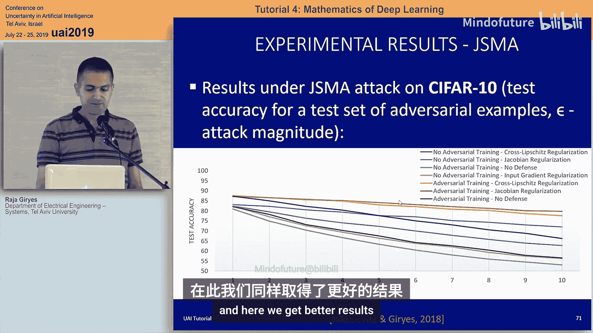

Now we didn't compare to distillation and I think distillation here is better。

 but distillation is a different。 you need to retrain the network again and we take a train network and just apply a few steps of processing。

Now。So we have， I think， a good method that improves the robustness of the network。

 but I think my key message here。Is not to use this method， So I will be happy if you will use it。

 but that if we have better theoretical understanding of。What is the source of the problem。

 And we will try to bound this。And we will try to understand why it happens。

 We may get new tools that will give us improved results。So we took the Jacob realization。

 and we have shown also relationship。え。To to other things in the network。 So for example。

 we have shown that the distance that you need to take to make an attack is upper bounded by one over the Jacobian of the network。

 and therefore if we reduce it we increase the distance that an attack need to take。

EWe have also shown that there is another work that show that。え？

If you have high curvature in the decision boundaries of the network。And。

Then the network will be more。A less robust to advers attacks。

 and there is a very known approximation to the curvature。

 which is basically the Jacobians transpose the Jacobian。 and therefore。

 if we reduce the Rubinusino of the Jacobian， which is the trace of the Jacobian trace， the Jacobian。

We basically also reduce the curvature and therefore if we reduce the curvature。

 we also improve the robustness。 our so using the Jacoban realization is also related to other theoretical results or theoretical understanding that were're developed in the field。

😊，Okay。So。Okay， so the last topic that I will talk about is about how we may use deep neural network to solve optimization problems。

So。Till now， I've talked about the training in neural networks in general about how about the generalization error of neural network。

 about the robustness of neural network to address error attacks。

 And now I will shift a bit to a slightly different topic， and it is inverse problems。

Nururing networks and how we may accelerate。The solution of several inverse problems using neural networks。

 And I think that this is particularly important when you want to have things working on embedded systems or small systems。

 but we will take the theoretical aspect of this thing。So in interest problems。

So I will start now with the few mathematical formulations that are general and not related neural networks。

And then I will talk about how we may solve them using general iterative methods。

 And then I will show the relationship。Between these iterative methods and neural networks。

And they hope that this relationship will also give us another aspect and understanding of how we can use neural networks better。

So let's assume that we are given a measurement x， which is equal to a times z plus noise。

Z is the unknown variable。A is some measurement matrix， and D is noise。So。

This can represent many important problems。 So， for example， Z。Can be an image。

A can be subseling in operation。E will be noise， and x will be， in this case。

 low resolution version of the image。And then the goal is to recover the high resolution version of the image from the low resolution version of the image。

 So this is just one example。Clearly， this interestverse problem represent many important problems that you may find many places。

And in classical techniques。😊，The standard recovery technique for almost any inverse problems or linear inverse problem that you may face will be of this form。

 You will try to minimize the L2 norm between X and A Z。Such that。Z belong to some sub， so。

Or you may have the unconstraint form， which is you will minimize the difference between x。And A Z。

Plus， some regularization on Z， where F。EI some penalty function on z that we don't like？So， we。

And so so basically， almost any regularization， any inverse problems that we know。

 the solution to these inverse problems will have this form。え。

We just use this to promote another work from a group in a recent one month ago we posted a work on archive with my student Tom Tyre that I've shown that sometimes you may not use this L to listque term sometimes it's better to solve this with taking the a conjugate with the a interters。

Almost all solution to inverse problems or all solvers to inverse problems that you will see will have this form that you have the least squares plus someizer。

We have shown that if you take the aseu inverse and multiply it by x。

 and then you have here just aseu inverse A Z， which should basically give you a projection。

In some cases， with low noise， you get better results and much better convergence compared to the case that you use this standard in first problems。

So if you're interested with this is not the topic of the tutorial。

 if you're interested in deep in interest problems in general， So Google Tomm Ter。

 and you will find this work。 Anyway， we will return to this case。

So we have this list we want to solve this minimization problem that we have the least square part plus the regularization。

 which is the most common way to solve these problems。And。

One popular penalty function is the L1 penalty function。

 and its related to sparsity and compensing and in statistics its it will give you the laso problem so this。

Mminimization problem is very popular， and the popular technique。

To solve this minimization problem is using the proximal gradient。

 which is also known as iterative shrinkage and thresholding algorithm so some people call this proximal gradient。

 some people call it ista。😊，Use the term that you like more and basically what we are doing here if you will look at this minimization problem。

 it has the least squares term and we have this L1 minimization so if we will cover this L minimization。

 if we will ignore it for a a bit， we can solve the least squares just using gradient descent So if you will look at the term here in the parenthses is basically what we have here we have very gradient step that result from gradient descent apply just on the least squares Now if we will just use gradient descent clearly we will violate this penalty。

😊，And to meet this penalty function， we add here。In a shrinkage operator， which is related to the L1。

And this shrinkage operator， which is in the L1 minimization case called the soft Tra operator。

 is basically an operation that is very similar to the Reello。

 It zeros everything that is smaller than Lada mu here。

 and everything that is greater than Lada mu in absolute value it just decreased Lada mu from it。😊。

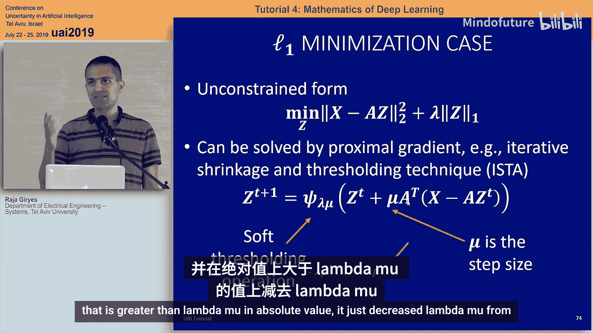

So basically， to solve this minimization problem， you need just to apply gradient step followed by a simple。

Point wide operation， another gradient step， another simple point of operation。

 and you minimize this objective。 and this algorithm is very popular。So and then if you want。

 if you look at the reconstruction minus square error as the number of iterations。

 you get that after 200 iterations or 300 iterations， you minimize。

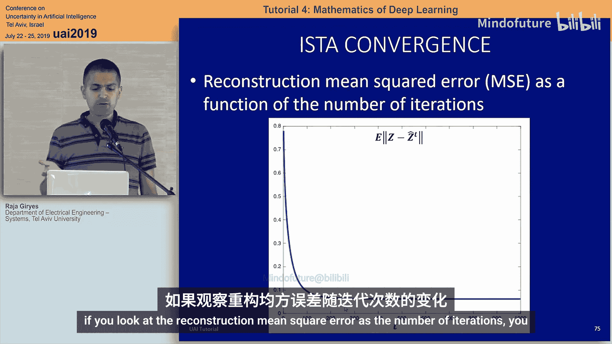

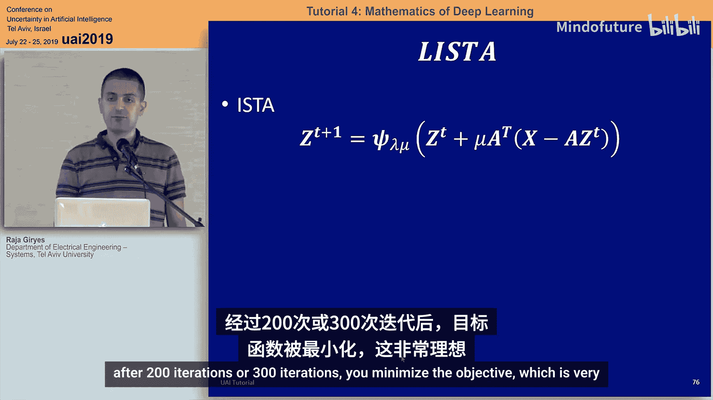

And the objective。Which is very nice。😊，EUnless you want to work in real time。And。

And for working in real time or for getting the solution faster。

 many acceleration techniques have been proposed to the East algorithm。 So the Fsta。

 the fast East algorithm that is using the nesttro of a accelerated gradient。

 has been proposed and many， many other techniques。😊。

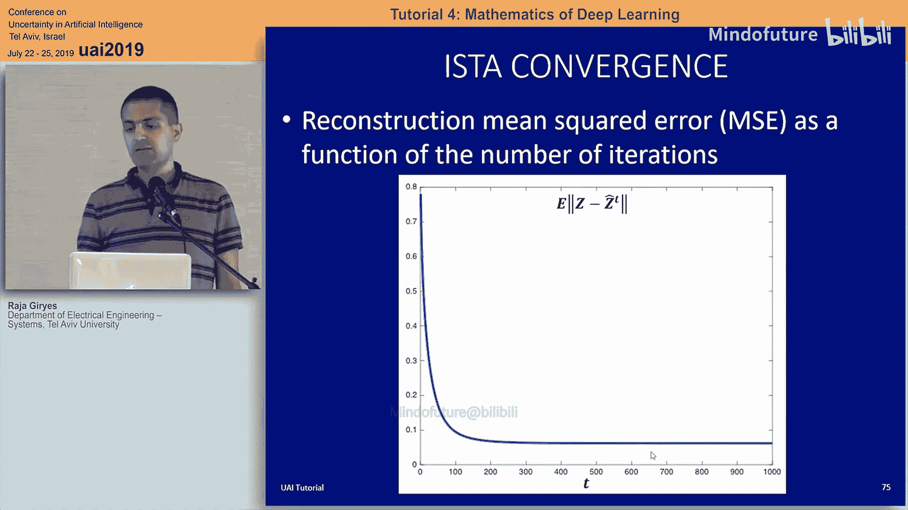

Because the tutorial is on mathematics of deep learning。

 I will pick the deep learning solution or acceleration。

 which I think is the nicest or don't know if this is the nicest， but I think it's a very nice one。😊。

So we have the Ita， which as I mentioned before， is taking gradient step and followed by proximal map。

And then we may rewrite the ista in the following term。

 We can take this gradient step and write it as。Lar operations times z from iteration T plus another linear iteration linear operation times the measurement Min。

What Gregor and Lacoon suggested in 2010 is to replace this little operation and this little operation with two other mattresses。

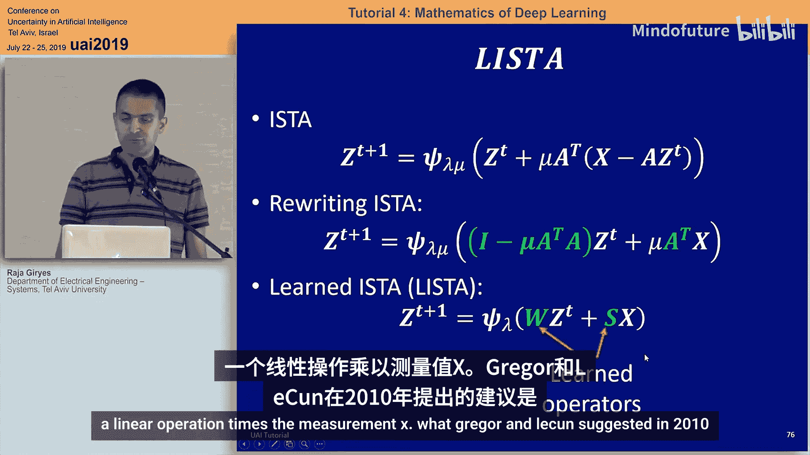

That we will learn， and they learn it in the following way。 What they do。 They take the ista。

 They take the final solution after the 1000 iterations。😊，And then， they take。This。呃。A structure。

 they unfold it。 So basically what you have here， we have here applying the linear operations。

 then simple nonlinear nonlinearity， another linear operation， another nonlinearity。 So basically。

 we have here neural network。And if we have a neural network。

 we can learn the parameters of this neural network。But we need training data。

 So what will be the training data。 We just use the regular ista。 We will run it for 1000 iterations。

 We will take 1 million inputs。 We will run is then 1000 times。

 So we have 1 million inputs with 1 million outputs。 We will train the weights of the lista。

And in the magic way。You get that when you run the lista on new examples。

 not the examples that were present in the training。You get。

The error that you get with is that just with 20 layers。

But notice that these 20 layers has the same complexity as 20erations of Ita。 But with Ita。

 you get very high error after 20 iterations with Lita， you get very low error。So as。

Everything in neural networks， when you see it in the first time， it seems very surprising。😊。

And the more surprising thing is that this works not just。4。

The L1 model that Ive shown it worked almost for any model that you can think of。

 So Spman Branchstein and Sapppiro extended it to the analysis sparse model。

 and I've shown examples for speech。 Remis Litanian Branchstein haveve shown how they can use it for poson noise and with quantization and they looked at camera that have just one bit sensors Thompson Schlater Spman Perle haveve shown how this can be used for euran flow。

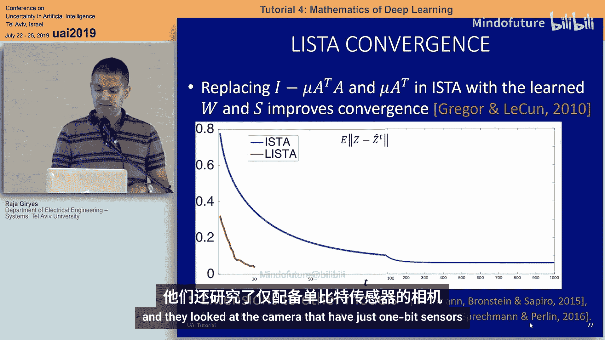

And there are many， many， many other works that have used this concept。EFor many applications。Now。

 the question is why this works。 So as I said， we can view list as a neural network where basically you have linear operation。

 you have the non nonlinearity where instead of the relu。

 you just have the soft threshold which looks very similar to the relu， then you have some feedback。

 So you have here some kind of recurrent neural network。那。We have this input。

We have this soft thresholding， and we have an estimate for that。Now。

 what we will do to try to understand。Why this operation works。

 we will compare it to another structure which is similar to this。

 where we can get an acceleration by changing the parameters。

And then this comparison will give us some understanding of why we may train these operations and get the acceleration that we get。

那。I will present now our explanation for the lista and at the end I will mention other works that appeared in parallel to us that provide alternative explanations for why Lia work I that all works together I think that all works together complement each other and each of them give another aspect to the reason of why Lia is giving the acceleration that we are saying。

😊，So again， if we compare this structure to the ista。

 so in Ita we just here have here the step size mu， a transpose identity minus mu a transpose a。

And in Ita， we assume that we have this measurement model。

 we assume that the norm of this matrix is smaller than one over mu， we have this soft thresholding。

 and we are guaranteed that the output that we will get the minimizer for this optimization problem。

Now， another algorithm which is slightly different than Ita is the projected gradient descent。

 where instead of the proximal map here， we have the projection operation。And then in the input。

 we assume just that the input， we assume that instead of regularization。

 we assume that the input belong to a certain set if Z smaller than R。

We assume that here we have a projection onto the set gamma。And we assume that at the output。

 we have an estimate Z where we aim at solving this minimization problem。EO Macrean Sulttanno Kotabi。

Provided theory for the PGD algorithm that I've just presented。EI I will not go at all the details。

 but they have shown that if A is random and we have the measurement model that we have mentioned before。

 then the convergence of this algorithm。Is the convergence rate is Ka F row。E where Ro。

Is the superm of I minus mu a transpose a times v And U when U and V are in C， F。And Cf is the。

The cone that is related to the function F that we have seen before。Now， you don't need to。

 So all these details are important， but。The most important thing for our context is how we may bound this row。

 They have shown that this row is related to the Ga oceanian mean width of the set C F。

And this Gaussian mean ws。😊，诶。Is something that is related to the complexity of the data。

 So if here at the output， we have this set is a very complex set。

 The Gaussian mean widths will be very large。 if they set here at the input。Will be very simple。

 The Goam Minwis will be very small。And then they have shown that if we look at these Gausshemin widths。

 if these Gaushemin widths is very large， then row will be very small and we will get fast convergence。

If the Gaussian wind width is very large， then row will be very large。

 and then the convergence will be very small。So this is the important thing that we need to get from the theorem。

 which is。If the data is complex， we get slow convergence。

 If the data that we project onto is simple， we get slow convergence。 So repeat。

 because I think it's important for to understand what we have done。

So we have the projected gradient descent， which apply linear operation， then projection。

 then linear operation， then projection。 And then here we are projection projecting on a certain set and then OimMac。

Have shown that if the set that we are making the projection onto is complex in terms of the Gaushi in widths。

 the convergence will be small， if it's a simple set， the convergence will be fast。Okay。

 so what we have done， we said， okay。So， a very。Simple way。To make the convergence faster。

Is to take a set with smaller。Gominitz。So I understand so you， you understand that this is。

E something that。They could also claim， but we have made another step。 So I've said， okay。

 let's think that this is。The set in which the signal exist。 Now。

 the problem in this set is that because this set is complex， you have these spikes in this set。

It's very hard to make a projection onto this set。 So there are some sets that it's very complicated to make the projection onto。

 So making So if you have an iterative algorithm and the projection is very complicated。

 It's better to use another algorithm that needs more iteration and have simple projection。

 So we want to have a projection， which is simpler。So therefore， in general。

 we would prefer to make iterations with the simple projection。

But something that we can do is we can， instead of projection making a projection on this set with the spikes。

 which is very complicated and because it's very complicated。We cannot do it。

 We can take an approximate for this set。We can make an approximate projection onto this set。

 but this approximate projection will give us an error epsilon with respect to the signal。

That we are trying to reconstruct。So we have a signal that resides on a certain set。

 We want to estimate the projection onto this set。 So we'll use an inaccurate projection projection that give us some error。

Then what we have， we have a trade off。Each iteration that we apply with the in So we have the inaccurate PGD。

 where in each iteration， we add some projection P here。Which， on the one hand。

Allow us to use here simpler projection that give us faster convergence。 On the other hand。

 this projection P add some error epsilon。In the approximation。So in the final error。

We have a trade off。 on the one hand， we will get faster convergence to define the errorer because we are projection。

 we are using here projection， which is simpler， which has a smaller Gaussian in widths。

 on the other hand。In the final error that we have here， we have this additional epsilon。

We have this additional epsilon because the projection P adds some epsilon approximation in the projection。

So we， we have a bound that show that if you use this inaccurate PGD algorithm。

Then you have convergence， which is of the order of R P。

 which R P is the convergence with this simpler projection。

 but on the other hand you have this epsilon term， which is the inaccuracy that you add in the data。

So。This。A theoryory may tell us why you can。Take a neural network and train it to get acceleration for these type of techniques。

 You can understand what is the projection that you have here。 You can make it simpler。

 You can make the threshold smaller。But before that。

 you can add a projection that give you an inaccuracy。 Now。

 notice the following thing in the first iterations。

 we can add big inaccuracy and get fast convergence when we get close today。😊。

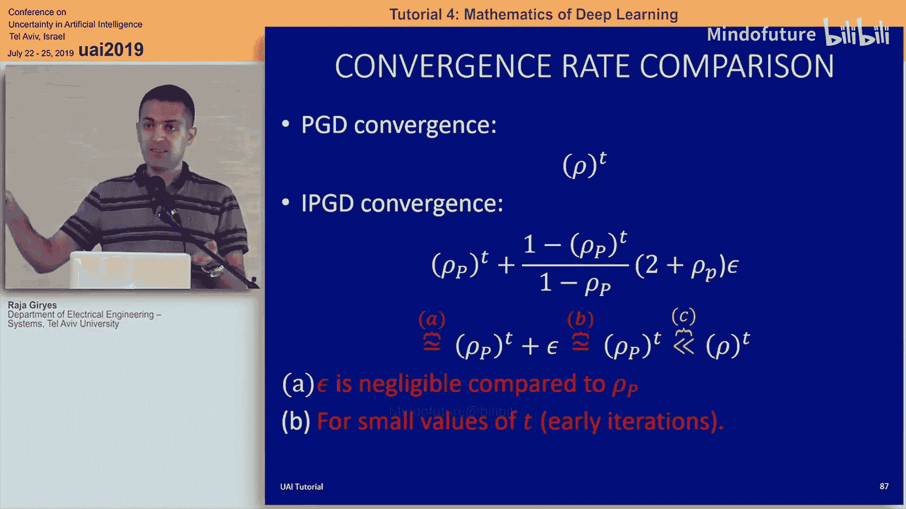

Eror， when we get close to the solution that we want， we can remove these projections。

 And then we don't have this error that we added。So， we tested this algorithm。

On the cases of comparison with trees。And I will， what we have done， we took a model。

Where we assume that we have sparse data that have tree structure。And。

We made a simple assumption instead of telling Goki we want to make a projection onto three。

 which is complex。 We will just project onto the leaves。

 And when we make the projection onto the leaves， we just throw some of the information。

And when we have seen that if we take the PGD algorithm， which is。Marked with blue。

 you get slow convergence。If you take the PGD with the projection on the tree。

 you get very fast project conversions， but projection onto three is something that is very complex On the other hand you can take the inaccurate PGD and just project onto one tree level but if you project just on one3 level。

 for example， if we just keep the main node of the tree we throw most of the information and therefore epsilon will be very large。

And we will converge very fast， but to very large arrow。 So this is not something that we want。

If we will keep2 three levels， we will converge fast also fast， but to a very large。If we keep more。

Levels of the tree， we will converge fast。 And again。

 we will stop at the place with the arrow epsilon。And then we have the IPTD with the changing levels。

 So we say， okay， we start with fast convergence with projection onto only two levels。

 And then when we go through the iterations， we add more levels。

 and therefore we allow ourselves to get faster convergence。😊。

And we believe that this way may explain why a neural network can get the acceleration that it's getting in the learning。

 because it can learn this inaccuracies because。If you just want to to get to a solution in five iterations。

You don't really care to get to the most accurate。 So you don't care if you add some inaccuracies in your projection if it give you faster convergence。

 So we have a tradeoff between the inaccuracy in the projection and the convergence that is due to the set that you are making the projection onto。

 Now， if we compare。The running time， we we will see that the IPGD with the changing level is faster than the one with the three。

Now。We have met this experiment also with things related to spectral compress sensing。

 where we have just few spikes in the spectral domain and。

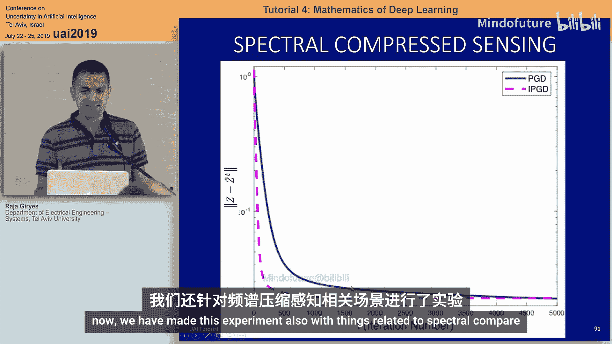

We compared PGD with IPGD when we use these inaccurate projections and got much faster convergence。

 and we have shown this that this work in many， many applications inspector compensing in。

In super resolution and the other problems。 But the important thing for our tutorial today is that。

一-一。That this learned this IPGD in which we have this projection P and in the algorithm。

 one question is how we design this projection P。 So till now I just told you， okay。

 let's assume that we have this projection P that give us this inaccuracy and this projection P can give us faster convergence。

So our conjecture is that as we can get faster convergence with getting this P。

 we can also learn this P and then we get this learned IPGD。

 So we use this learned IPGD when we just learned here the projection or learn these mattresses。😊。

And we compare to the super resolution algorithm by Z data that is based on OM。

And we replaced OMP with this learned IPGD， and we got better construction results and the faster convergence。

😊，So and this is related to the list， I think。

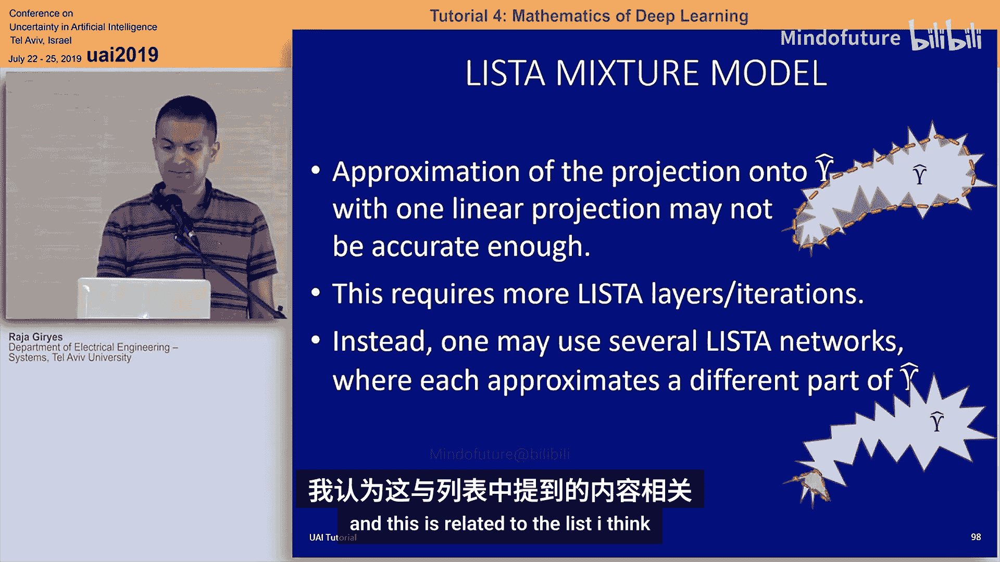

Now， also。This understanding can lead us to saying， okay。

 so we also don't want only to take our set and approximate it with one group。

 we can take our set and approximate it with small projections and this leads us to the lista mixture model and we took a lista where we use several projections and this give us also a faster convergence in terms of latency。

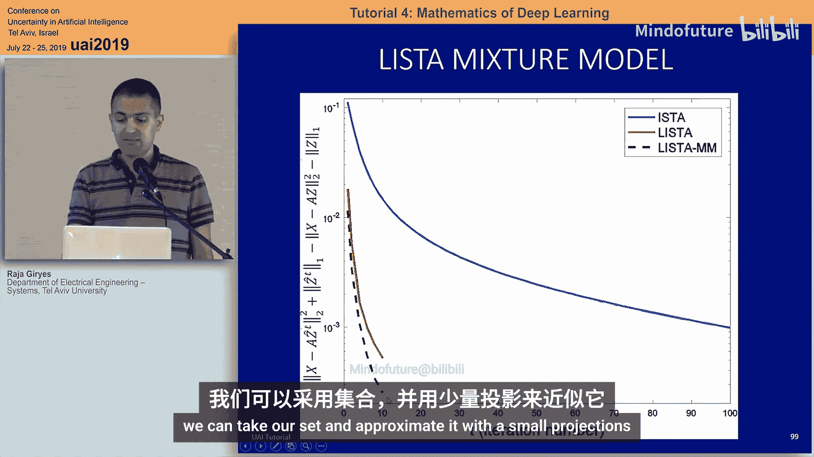

So there are other works that they gave explanations for why Lita is working。

 So John Bruna have shown that the learning may be。

The acceleration that we get in learning may be due to a better preconditioning of A and he studied the relationship between Lita and the matrix of the composition。

 Sinaal have shown a relationship to the restricted isoometry property and the drone conclusion as to the convergence Brggenin and the Schneer showed connection to approximate message passing and the Cheital and Luueal in the listta paper。

 they tied some of the the weights in the listta， the first work of Cheal have shown that you can just train one metrics and the two matrixrices and they showed this exponential convergence under some conditions and Lieta have shown that you can just learn the thresholds。

 but all these works considered only the sparsity case and our work consider more general case。So。

If I will summarize。 so I think that the take home message from this tutorial is that。

Deep neural networks is getting great results。 So this is not the echo home message。

 I I believe that you know that。 but that I think that more。

 there is a large need to better understand why neural networks are getting the results they are getting and that theoretical results are not things that should be kept only to theory。

 But sometimes if we get better theoretical understanding of the network， we can。Develop new。

 better practical tools。 So， for example， in the generalization error。

 So we use our bound to derive a new Jacobian based regularization technique that improve the input margin of the network and gave better results。

 and this understanding was later used for other regularization techniques that focus on the margin。

诶。We have shown that。We can， the understanding of why neural networks solve optimization problems can give us。

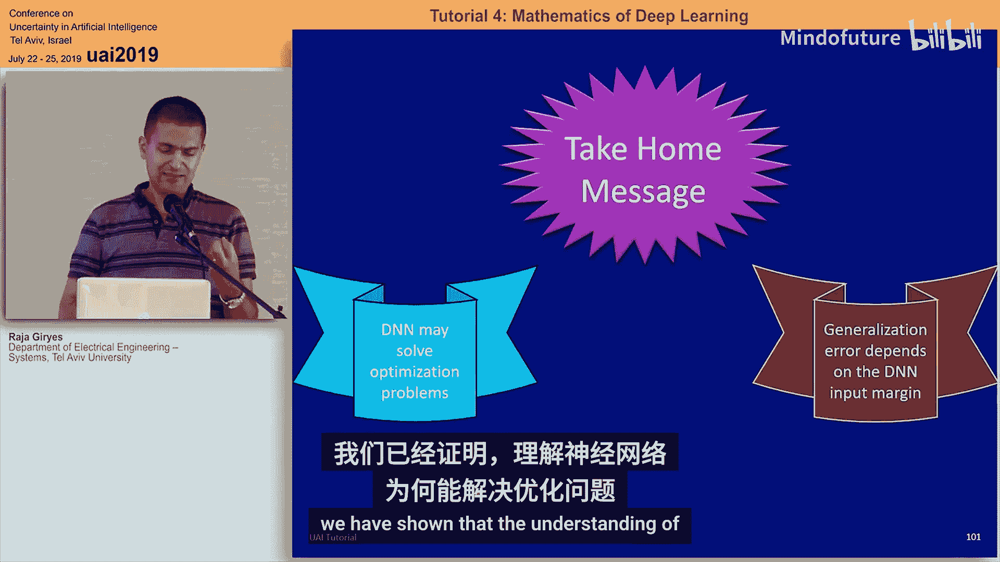

The tools to design new ways to design neural networks for solving these optimization problems and get even faster convergence。

 And also， if you understand。The mechanics that try to fund neural networks we may design neuro regularization techniques that will help and improve the robustness。

 And I think that in general， what I have shown here is just examples and many other works in the community that try to use theory to improve the learning。

 And I think that this is a very important thing to do。

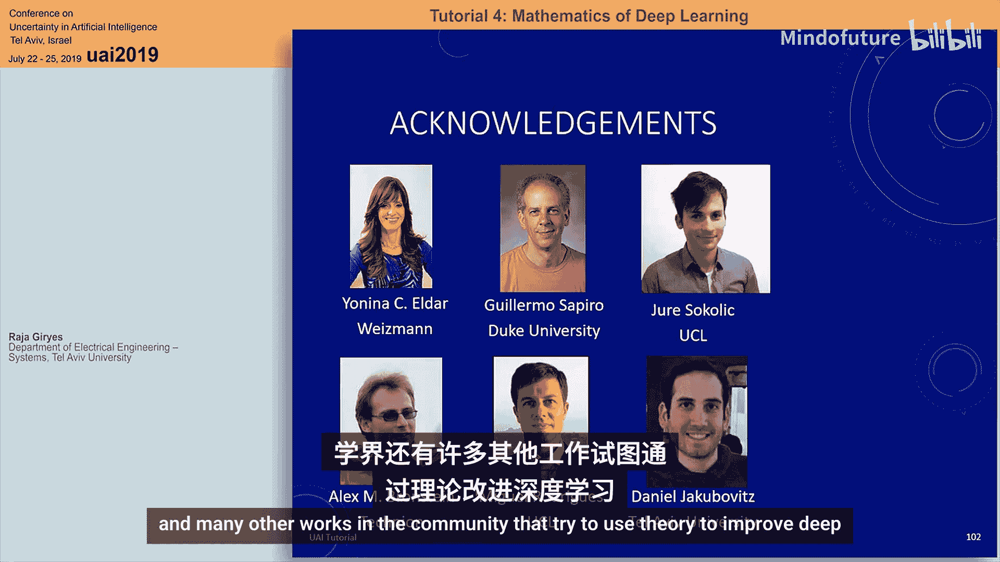