# UCLA《计算统计学｜Stats 102A - Computational Statistics with R 2024 Summer》中英字幕 p01 [01]Stats 102A - 2024 Summer - Video 1 - Syllabus and Course Description.zh_en [BV1jizNBrEm2_p1]

All right， well hello and welcome to the course This is Stats 102 a computationalal Sta with R I'm trying something a little bit different this quarter。

 I'm going to try recording shorter videos and we'll post a whole bunch each week so anyway let's just begin with a few highlights from the syllabus。

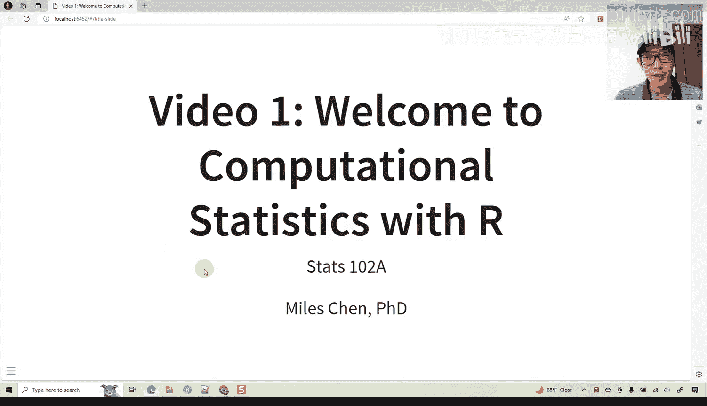

And so yes， my name is Miles Chen， I will be your professor for the quarter。

 you can call me Professor Chen or Dr。 Chen， you can call me Miles by my first name。

 whatever you're comfortable with， that's fine with me， okay。This is the grade breakdown。

 I will have little quizzes associated with the videos I post and so that will count for your grade。

There will also be homework assignments as well as a midterm and final exam。

 and there's also a campus wire forum that you are required to participate in。

 so you should receive an invitation to join campus wire。

So please join that I will give you more details and information regarding the midterm and final exam as those things approach。

 the homework assignments is the most heavily weighted portion of the grade and it reflects the fact that I believe the homework is probably the most important thing that you'll do in the class。

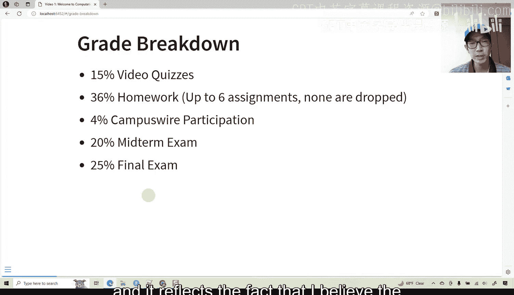

Okay， I grade on a straight scale。You know， take a look at the syllabus for that。

 I don't curve grades， okay？All right， so video quizzes as I mentioned earlier。

 videos will be accompanied by short quizzes， make sure you take the quizzes to get credit for that and treat them as quizzes so don't don't share answers to the quizzes or things like that you should be able to answer them if you watch the videos regarding homework turn them in you will do。

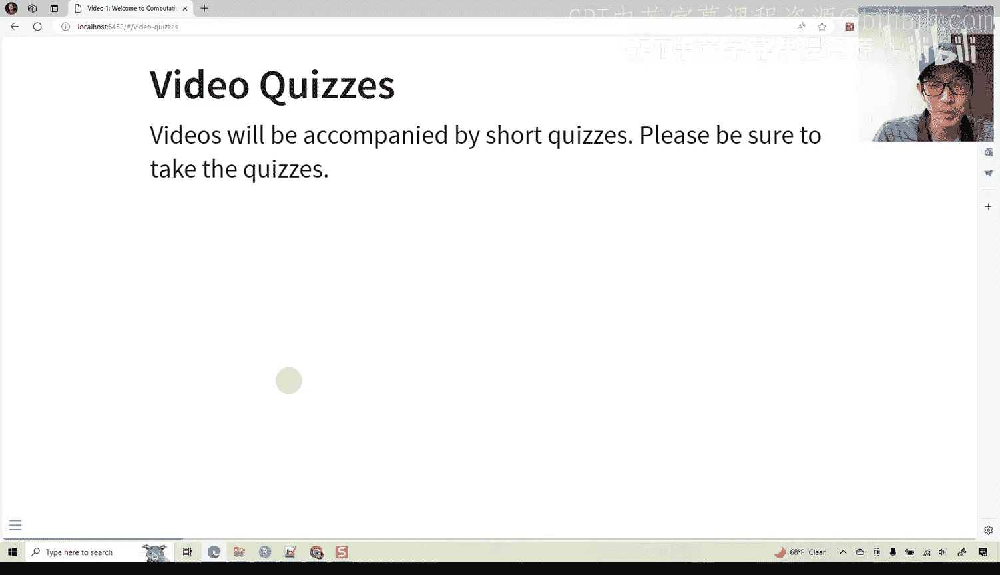

You will knit your homework as a PDF， so homework will be posted as R Markdown files。

 you'll complete them， you'll knit them as PDFs， and then you will upload them to grade scopecope now it's very important that when you upload your homework to gradecope that you tag the pages properly if you don't tag them properly we won't be able to see the output and so it's very important that you properly tag your pages。

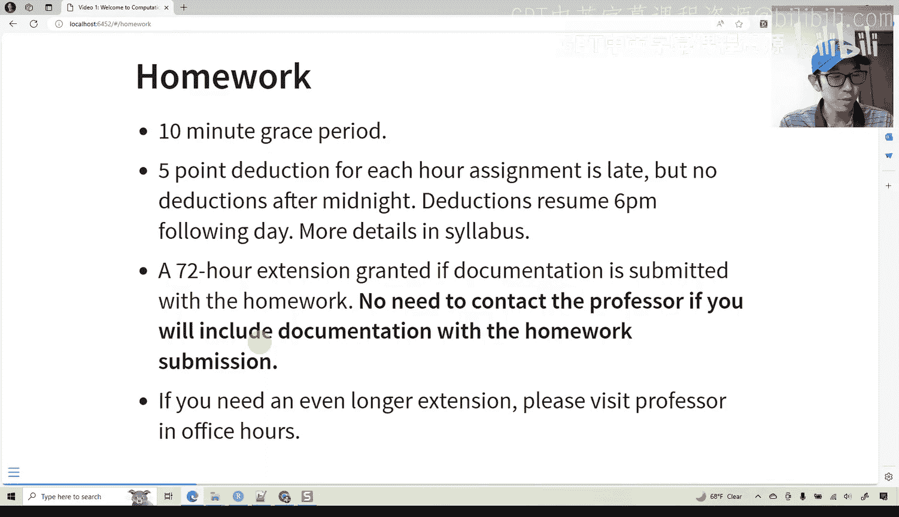

Office hours i'm going to have office hours several times during the week and that is my preferred method of contact and communication you can send me emails i'm kind of slow at responding to emails'm not it's not i'm not great at it and so。

That's that you will get a faster response if you come to office hours I will eventually respond to your email but you know's not it's not my fastest method of communication okay so so come to office hours if you need to meet privately I can always set up a breakout room on Zoom and you can we can read privately I'm happy to fix any kind of mistakes things like that okay I do ask that you just kind of introduce yourself at least make sure your name is filled out on Zoom when you join join office hours okay。

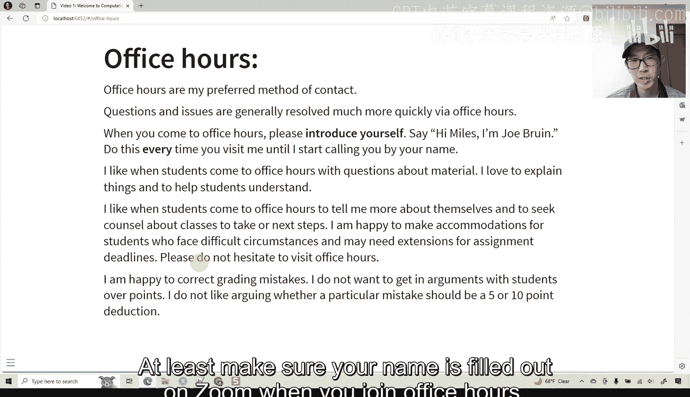

So that's that。You know， as far as。Questions and things like that regarding homework you can ask them during office hours I'm happy to give you help。

 but you'll probably get a faster response if you post things on campus wirere and so campus wires are discussion forum。

 I'm requiring participation from you and so go on campus wire， respond to each other's questions。

 you'll probably get a faster response from your classmates。

 if there' you know if you have a private issue or something。

 you can come to office hours or you can also DME direct message me on campus wire。

 things like that generally keep your message as short and this goes for emails and things like that。

 you don't need to go into great detail about you know whatever's going on you know if at the end of the day what you're asking for is an extension for the homework。

 just say， hey， I've got。Personal issues going on can I get an extension for the homework and if I need to ask more detail for more detail。

 I'll ask for more detail but generally。I would rather have a short message rather than a really long one。

 okay， but yeah。Especially if you need something beyond like。

Most of the time for homework extensions I'll generally grant you three days。

 72 hours or something if you need something even longer than that or you need to schedule a makeup exam or something like that。

 I would say come to office hours for those kinds of requests， but if you have questions like hey。

 I'm stuck on the homework and I'm not quite sure how to approach this I would say campus why is the place for that okay？

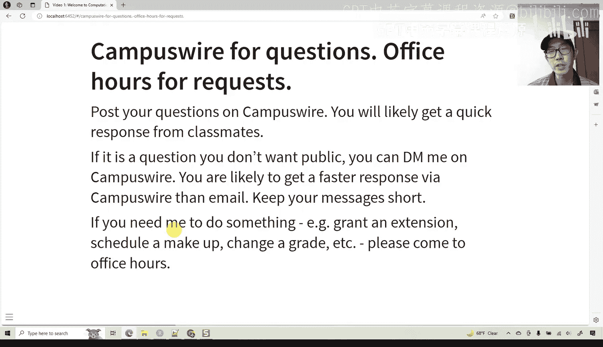

All right， let's talk about what this class is about。

 this is Stats 102a it's titled Introduction to Computal Staistics with R or something。

 I like to think of this as kind of a foundations for data science course。

 there are if you think about what is data science。

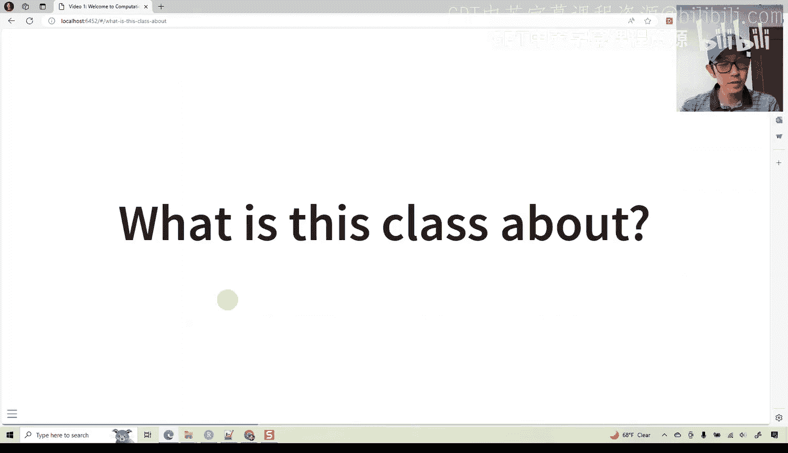

It's often thought of as kind of made up of these three different parts Drew Conway kind of created this Venn diagram for data science and he breaks it down into kind of coding skills。

 math and stats knowledge and domain expertise and this is the diagram he calls the coding skills。

 hacking skills， but basically you know we're at this time where。

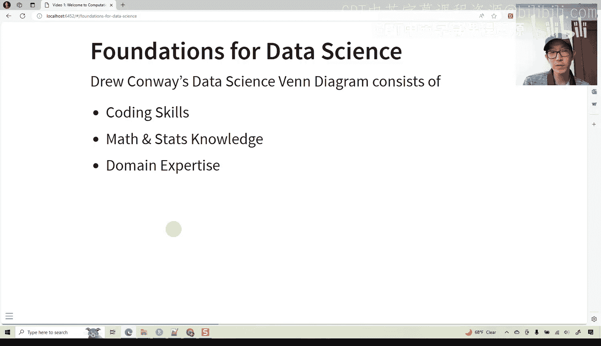

Our data sets are so big that we can't interact with them in any way other than using a computer okay and a lot of times。

The the data set is kind of beyond the you know where it's no longer efficient to use something like Excel or kind of you know a traditional tool and so the way you'd have to kind of work through it would be either you know coding things in a programming language like R or Python or things like that and so you need to have some comfort with with coding okay we pair that with math and stats knowledge and so you know you're getting a lot of kind of your foundations in your math and stats courses in your stats 100 series you know。

So you've probably taken stats 100 A and maybe you're taking stats 100v right now and that's going to provide foundations for how to。

 you know the theoreticaloretic foundations that are necessary to kind of make sure you understand you know where these ideas are coming from and kind of when you combine your coding ability along with that foundational math and stats knowledge。

 that's you know we might call that machine learning。

 the ability to kind of apply these algorithms to learn things from our data okay。

And the other element is substantive expertise， basically subject。Subject matter expertise。

 So this is basically whatever domain you are going to be doing data analysis or data science in。

You want to be an expert in that segment of the world there or segment of knowledge。

 so if you're going to be analyzing baseball data， you need to be an expert on baseball if you're going to be doing some。

Medical diagnoses like you want to look at data from kidney patients or something you should have knowledge about what these numbers mean if you have no idea what these numbers mean there's no way your data analysis could be really useful you have to become kind of experts in that in that subject matter okay now this is something that as the kind of stats and data science major or the data theory major we're not able to provide this substantive expertise。

Because there's just too many subjects out there。 So it's really up to you to kind of become an expert in whatever subject it is that you want to。

do data analysis and and then if you take kind of the what we teach you with the coding and the hacking skills of the math and stats knowledge and apply it to whatever subject you're interested in。

's that's where you are able to kind of。Do data data science Okay。

 traditional research is kind of you take your subject matter expertise on apply traditional or classical math and stats knowledge and。

That's your quote traditional。Research， and then this part is basically the hacking skills and substantive expertise。

 calls this the danger zone because if you don't have that math and Stas foundation。

 you might be applying tools and methods of analysis in ways that are not appropriate in ways where you kind of cobbled together some kind of results。

 but perhaps know you're making assumptions that you shouldn't be making or something like that。

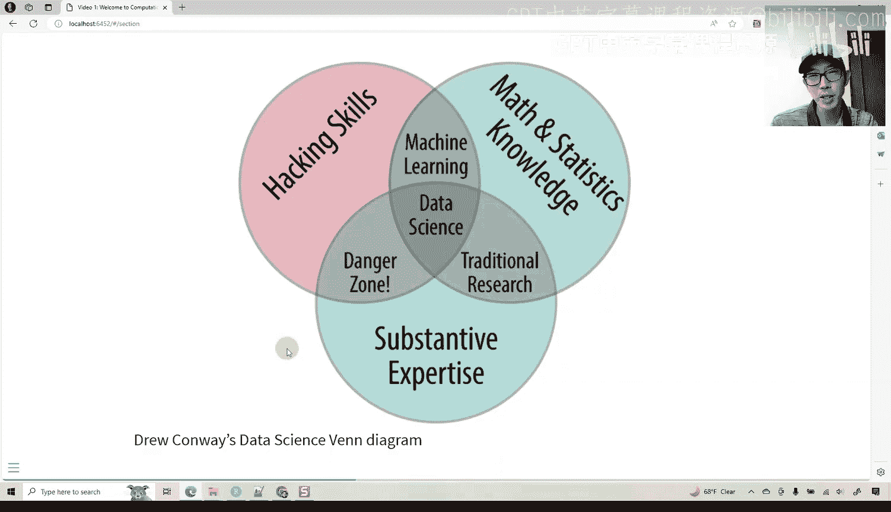

All right as far as this class goes。I would say this is a little bit of an introduction to the field of computational statistics and data science。

And you know the course aims to prepare you for data science by developing your coding skills in R and then we're going to be applying those to some statistical applications thematically we can kind of divide the course into two parts the first half is going to be more intermediate to advanced programming in R so all of you have taken stats 20 the prerequisite where you got introduction to programming in R and so we will kind of expand on that so if some of it will be review some of it will be kind of really getting into some of the nitty gritty。

Little aspects and we'll also maybe be expanding that with additional packages and you know things like regular expressions and web scraping just because those are important aspects as far as you know gathering your data or cleaning them up or things like that and so we'll be doing that and then after that we will also be。

Introducing some of these methods of computational statistics now in the second half of the class。

 where we are looking at some of these computational methods， there is a decent amount of overlap。

With another course called Math 151A， which isnumeric methods。

 and you can kind of think of those weeks where we do numeric methods in this classes as like a light boiled down version of Ma 151A now if you've taken Math 151A or you will take that class。

 you you'll certainly get a more in-depth thing， but that's not required for stats and data science majors。

 but certainly some numeric methods are important to learn and so you can think of that segment of the classes。

嗯。You I guess a light version of the numericalmeric myth。

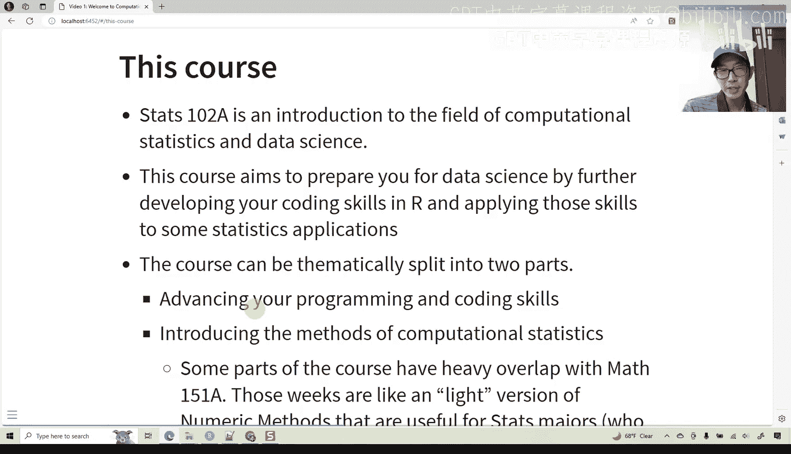

So here are some of the topics that we'll cover regarding programming and coding things we'll look at some data structures as well as subsetseing。

 you know flow control things like you know your conditional statements and loops and things like that we'll talk about functions and scoping and environments we'll also look at some things from the tidy verse tidy R&D plier I think are some very important and useful packages we'll also look at regular expressions and an object oriented programming and I think all of these this is just a selection of topics that I like and I think are important。

 you know if you were to take another course from some top by someone else。

 they might have you know different selection of topics。

 I think these are all fairly useful and these are the topics that I've chosen to focus on。

As far as the computational statistics， methods and things like that。

 we will have a discussion or we'll talk about floating point arithmetic。

 it's important to understand that the way our computers store numbers and handle numbers is they do not they are not real numbers。

 okay， so real numbers， you have real number line and floating point numbers。Try to mimic that。

 but they are certainly not the same And so there's certain implications there and we'll talk about that and and once we have an understanding of that。

 we can think about these numeric methods like root finding methods or optimization methods We'll also look at things like randomization tests and bootstrapping and a kind of these。

You know， resampling techniques that are useful。

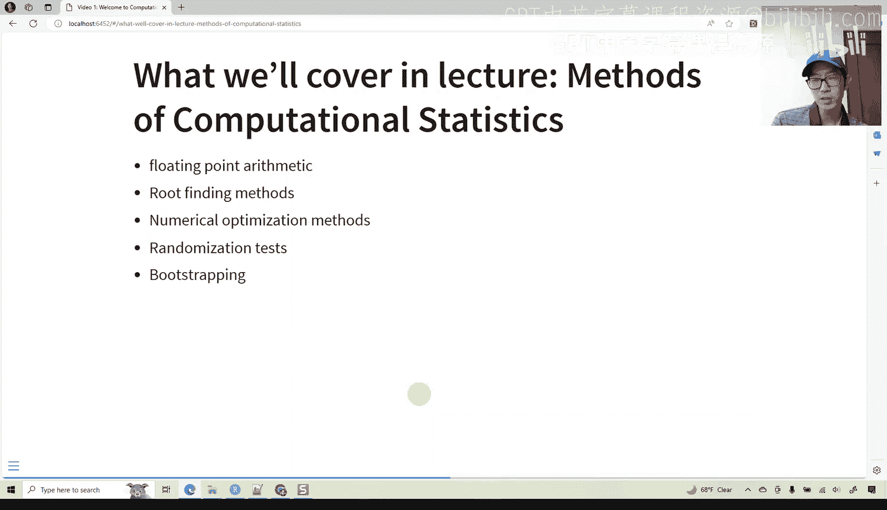

For in computational statistics。Now， that said。There is only so much that I can teach you during lecture and in the class the rest of the things that are really important you need to develop on your own and these are things that I can't teach you。

 so I'm going to be presenting stuff to you in lecture via these videos but other things like your ability to read and write code that is something that you have to develop by practicing it yourself。

 so you need to so I'm going to try to encourage this through our homework assignments where you'll have to read and write code。

 but this is something that you are responsible for kind of you know developing this yourself another important thing is debugging your code right so as you。

Right code， certainly you will make mistakes and you have to become an effective programmer or coder。

 you need to be able to debug your code， you need to be able to read through your own code。

 understand where an error might occur。And identify that and then figure out how to fix that so that's going to be important to debug your code。

Problem solving is the idea of， you know， how do you kind of take a complicated program and break it down into。

Smaller pieces that you can solve right， and so how do you kind of decompose that problem and solve it using this solutions or a VI？

Yes， tools that you have available to you okay and then another aspect is reading documentation。So。

There's only so much I can teach and present to you in this class Eventually you are going to have to encounter functions that I've never mentioned or you've never seen before and how do you use that Well。

 the way you're going to learn how to use that is you're going to be reading the associated documentation for those functions or packages or modules or whatever it might be and so your。

Future success heavily depends on your ability to read and make sense of the documentation。

 And so these are all things that you need to work on yourself outside of lecture。

 things that I can't give you just in kind of videos。

 So you know when you watch a video it's a very kind of passive thing or you just kind of sit。

 hear me talk， read the things on the screen， I think a lot of this。Will develop as you。

Aively try to engage with the homework assignments I actively use the parts of your brain that required you to think about these things。

When I assign homework assignments and you'll get quite a few of them and they are long and they are challenging。

 those homework assignments are intended to be structured exercises that will help you develop these skills。

When you approach the homework， I want you to think of it。

Approach them intentionally with the goal of developing these skills， you know。

 rather than just trying to get the homework done。 Okay， if you approach everything is just。

 I just need to get it done。 I think you're going to miss out on。嗯。You know。

 your your development and your practice， you know， think of。

A sport if you want to become good at a sport。You know， when you have these different drills。

You know you want to kind of think about the drills as a way to kind of improve your form and technique rather than just I need to get this done right so if you're swimming and they say hey swim you know a whole bunch of laps rather than just okay I just need to swim these laps。

 you want to be thinking about okay how do I improve my form。

 how do I make sure you know the the way I'm。Swimming is good or things like that and similarly when you approach the homework with the code。

 you want to be thinking actively about this and how do I get the most out of this assignment？

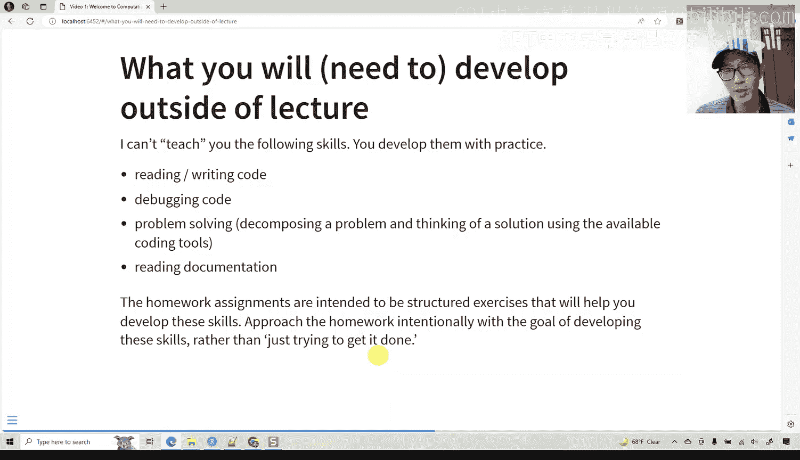

几。嗯。This， I like to kind of think of this as a quote coding to class。

 so in order to graduate from UCLA， you have to fulfill what's known as the writingrit to requirement。

You have to take a course， you know， perhaps like a history class or something like that。

 where that meets the requirements of a writingrit two class where you have to write papers and essays and things like that and UCLA makes us required because。

It says your ability to write and express your thoughts is important and so everybody who's going to graduate from UCLA is required to fulfill this there's no coding requirement。

 but if you're going to graduate with you know majoring in statistics and data science or data theory。

 it's going to be important that you are able to take ideas and put them into code。

And so I like to think of this as kind of a coding to class where I've adapted UCLA's writing requirement or its justification for the writing requirement by saying you know coding is going to be essential to interacting with and learning from the data and the ability to write clear readable code is going to be a key strength for any data related career and so students who code well can create powerful tools to implement your ideas and solutions so think of this as kind of a coding to class。

 there's going to be a lot of homework where you have to write a lot of code and that's intentional。

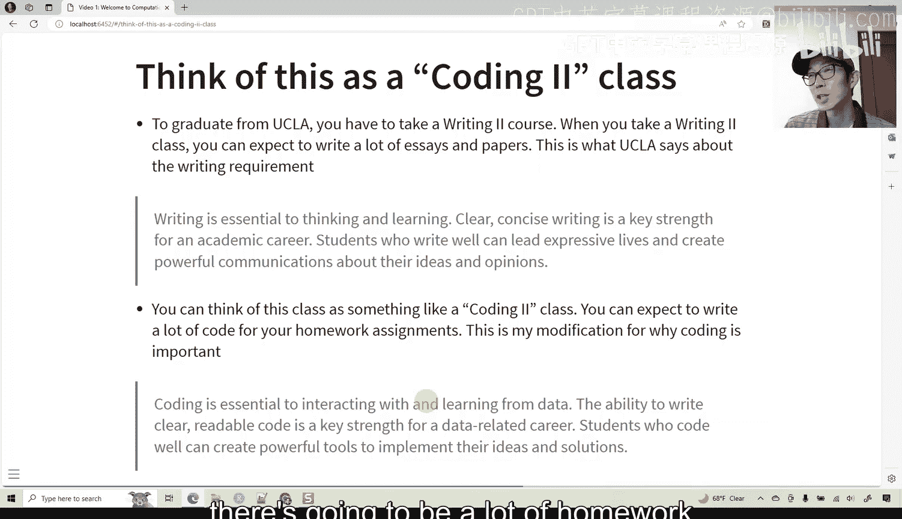

Okay。So that brings me to this where I want to talk about academic integrity and plagiarism。

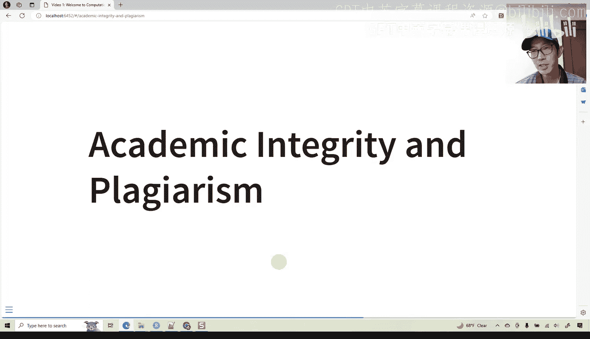

Okay， so the truth is is that there are lots of tools out there that allow you to kind of get the answers to any of these assignments that I give you very easily right so there's a lot of high quality code out there that does exactly what you need and you can find these solutions on the internet if you do a little bit of searching okay。

 there's a lot of kind of。Packages that do a lot of these things， okay？We have AI tools right。

 chat GT and GitHub Copit and all of these things， they are really really good and a lot of it a lot of these tools have been trained on code and so if you ask them the question。

 hey， how do I solve this problem， you might even be able to copy and paste some of the homework prompts and put it straight into the chat bot and it's going to write out your solution for you okay？

And you know what？嗯。If your job。Is to just get the task done okay， these tools are a great help okay。

 and they will help you get the job done okay but that is not the point of the homework that I assign to you so I'm going to assign you know a homework assignment is you're going to have to code up the game shoots and ladders。

In R and I don't actually need a working shoots and ladders game okay I don't really care that's that's not the point okay I'm not a company that says hey。

 we need this product ready to go All right the reason why I assigned this homework to you is because the process of you thinking about that and the process of you coming to the solution and creating it and understanding it that's going to help you develop your skills as a coder。

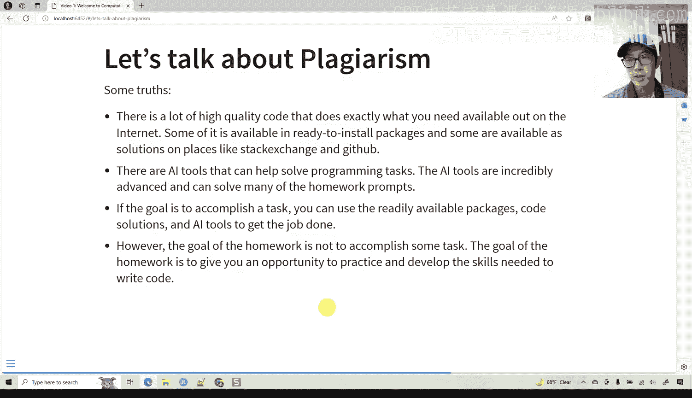

So。You can think of it as like going to the gym， okay， when you go to the gym。

And you're going to lift weights at the gym， okay the goal of lifting those weights isn't that the weights get picked up off the ground。

 okay the whole point of lifting the weights is that the process of lifting the weights is going to help you reach your real goal of gaining strength okay。

And there's this concept of no pain， no gain， so if you do weight training and you're going to lift。

Lift weights if you don't。Challenge yourself okay， if you only lift you know one pound weights。

And you say， hey， that was easy okay and you don't tire yourself out or anything like that。

 you can't expect to be making any gains right， you're not going to get stronger if you don't lift anything' that's heavy for you okay and so。

You know， if you go to a gym and you want to get stronger。

 you have to lift something that's difficult for you and you want to kind of experience that muscle soreness and then when you rest in sleep and things like that。

 your body builds it back stronger and similarly， your brain。Needs to be challenged。 Okay。

 if your brain doesn't struggle at all when writing the code， then your brain has no reason to。

Create kind of these additional neuron connections in there that's going to improve your abilities as a coder right on the other hand。

If you。Are faced with a challenge and your brain struggles to think about the solution， okay。

 you know， as you first see this thing and you're thinking through it and it's hard and your brain is working hard and you get tired from it。

 okay， then what's going to happen is that when you sleep， okay， your brain's going to say hey。

 that was pretty tough， can we form new connections。And when it does form a new connection， then。

It's going to be able to figure out you know the solutions better right that's the idea of like when something just clicks and you're able to kind of understand and you know understand the topic better。

 that's because your brain has formed some new connections and so when it's faced with this task again it's able to to do it okay and this is how you're going to become a better coder so。

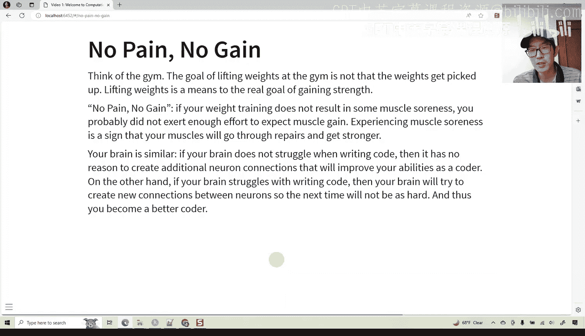

If you turn to chat GT or something like that， or if you plagiarize someone else's code。

 that's like going to the gym and having a stronger person or having a robot lift the weights off the ground for you okay and that would be great if the goal is that the weights get lifted okay。

 but that's not。But that's not the goal lifting weights right the goal is to gain strength to that you do it yourself okay。

 and so similarly copying， pasting in someone else's code or some you know copying the AI's code works if the goal is to accomplish a task a coding task。

 but it's not going to help you as far as。Improving your skills as a coder。

 So I'm truly appealing to you in your desire to learn and become you know， a better coder。

 better equipped to go out into the marketplace and things like that。I'm appealing to that desire。

 so you don't just kind of turn to the AI or turn to you copying someone else's code， right？

you know again， if you go to the gym and you say， oh man these weights are heavy can you lift these weights for me and you know some you a big person lifts the weights for you and you clap your hands and you say。

 oh great we had a great workout you know that defeats the whole point okay so you know getting your homework done by having someone else to do it for you whether that someone else's literal another person or an AI tool doing getting your homework done that way is not going to help you out so I want you to go through the struggle I want you to challenge yourself and improve in that way okay。

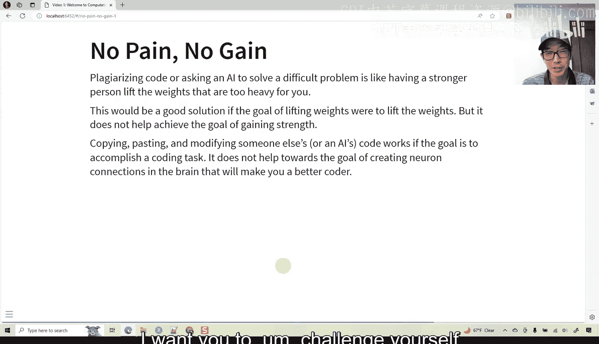

So I wrote， you know， I believe students who do resort to plagiarism。

I believe students do that because， you know， sometimes they confuse the goal of the course Okay。

 students who plagiarize， I think， believe that。Getting the homework done for the sake of finishing it and avoiding a bad grade is more important than the goal of learning。

 okay？The goal of learning is secondary to the goal of avoiding a bad grade but'。That's not。

that's not the right way to approach it Okay， the goal of the course is your learning right now there is a conflicting issue in that I can't create kind of individual grade scheme schemas that will evaluate exactly how much each student learns over the course so you know everybody has to be kind of graded on the same criteria。

But that said， I hope you can judge your own performance in the class based on what you learned and not your letter grade and so you know if you。

Feel like you learned a lot， I hope you can say you that was a success okay。

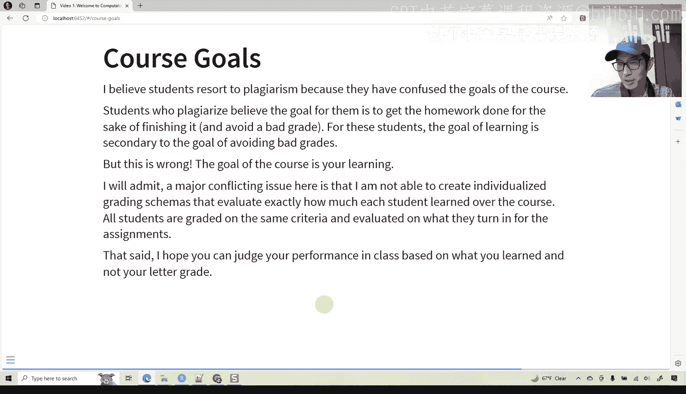

When you face a challenging homework assignment， what I want from you is for you to put forth a good faith effort。

 I want you not to look for solutions online or use an AI tool or someone else's code。

And you know what， if the deadline comes around and you're not able to complete everything required by the assignment deadline。

 you， submit what you are able to do。And。You know that probably means you're not going to get 100% on the homework right so homeworks are graded on correctness。

 not just completion， but actually like actually getting it done and getting it correct matters。

And so， you， if you code your homework and it's not working properly。

 you're going to lose points okay。But I hope you're okay with that and you'll view this not as a failure of your coding abilities。

Recognize that okay this is some area that you still need to kind of work and practice and things like that right if it comes down to it。

 you know we do take issues of plagiarism seriously and you know and I don't want to ever I don't want to do this but if I have to you know we'll escalate cases to the dean of students but but my appeal to you is you know。

 just be honest in your assignments okay。

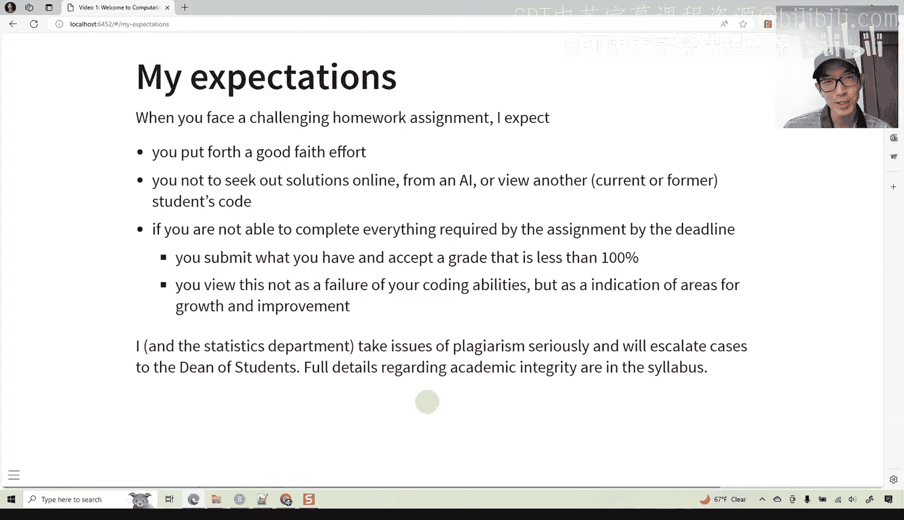

There is a collaboration policy and so you know you're。

I guess homework zero is to kind of read through the syllabus and sign the collaboration policy and basically。

You know， when it comes to things like。The campusus wirere discussion forum or even just kind of like talking to your classmates and friends is you can talk to each other but you cannot share your actual code okay。

 so you are allowed to collaborate verbally with other students but you're not allowed to like show that person your code or look at someone else's code okay so you know something like how did you approach problem too。

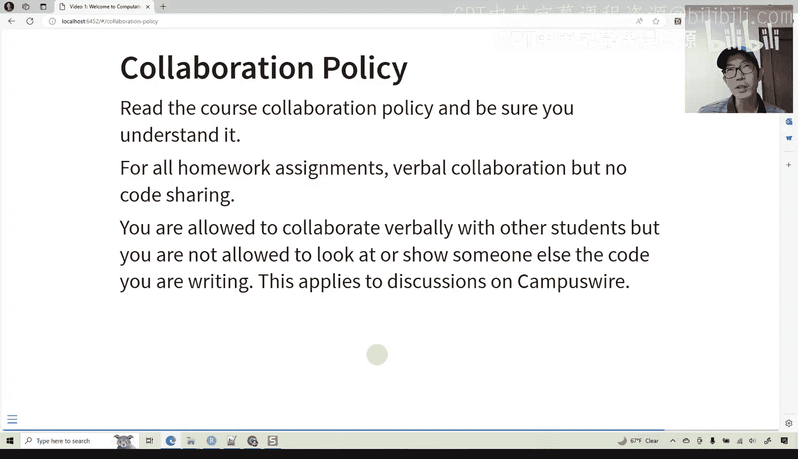

There's a lot you can answer without actually writing out the code so you can write something like I created。

 you know a for loop， and within each iteration， I did this。

 I subset the vector X and things like that versus like here's the code that I wrote to。

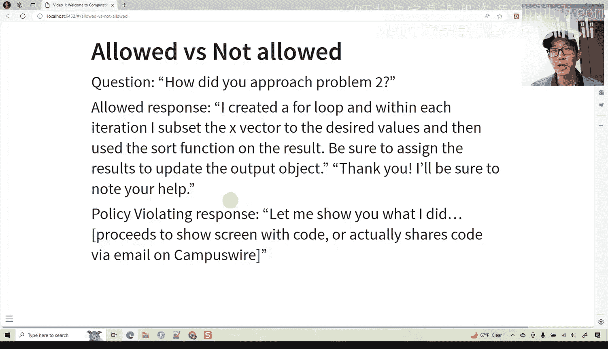

To fix the problem， okay？You know， you're not allowed to。

Kind of ask somebody to debug your code for you or double check your work for you or something like that。

 okay？You know can I see how you did the problem problem two to double check my work right again。

 you have to say like I don't want to show you my code。

 but I can tell you what I did right but then if you showed the code that that would be kind of a violation right？

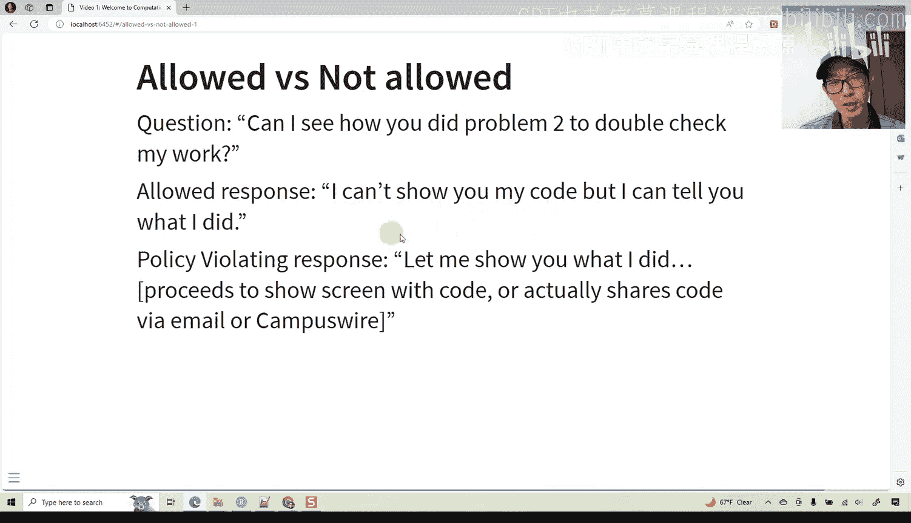

So。Sometimes you'll be encountering error messages。

 you can kind of you can copy and paste error messages right and and there are a lot there's a lot of information in an error message that will help you figure out。

诶。What is going on Okay， so that's I guess that's an important thing is。Reading documentation。

 but also reading and understanding error messages。So as you encounter error messages。

You can copy and paste your error message， okay， but don't copy and paste your code， okay？

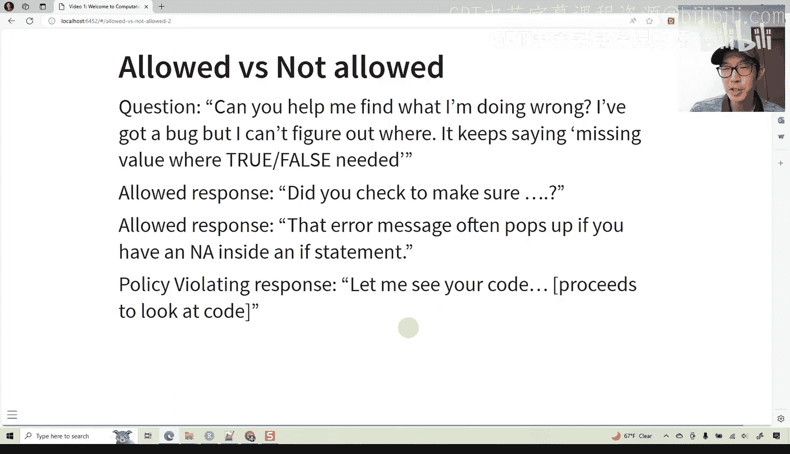

As far as code other code that appears in lecture， you can discuss that so on campus wirere。

 if there's a certain slide where you see the code and you don't quite understand what's happening in the code。

 go ahead and copy that and put that into your campus wire post and say， hey。

 what is going on with this line， and that's fine， I'm okay with that。

 but as far as homework assignments and homework problems， please don't copy and paste your code。

Okay， so this is our first video where I just kind of introduced the course。

 go over a little bit of stuff from the syllabus and make an appeal not to playgirce all right。

 we'll see you in the next video。

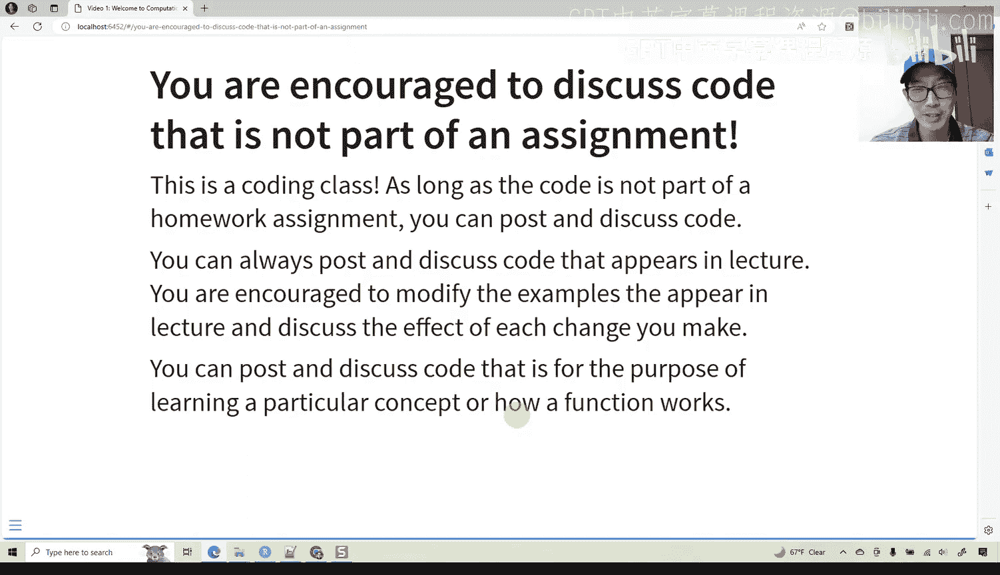