# UCLA《计算统计学｜Stats 102A - Computational Statistics with R 2024 Summer》中英字幕 p02 [02]Stats 102A - 2024 Summer - Video 2 - Grades and Life.zh_en [BV1jizNBrEm2_p2]

All right， in this video， I just want to talk a little bit about grades life and kind of work life balance。

 it's a little bit different but it also might be my favorite kind of talk that I like to give。

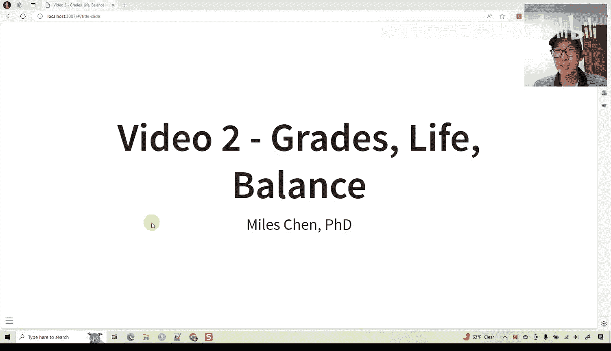

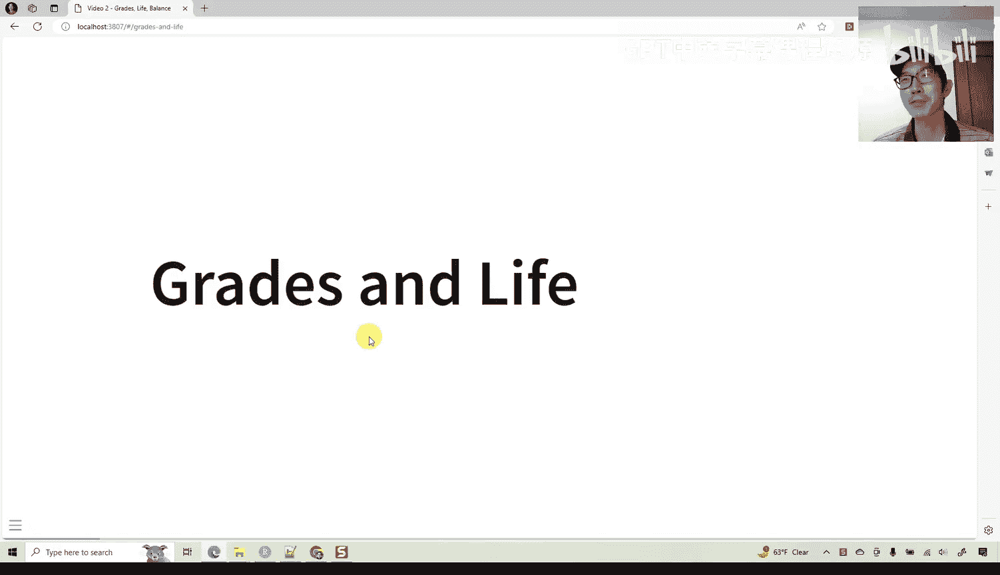

So the first thing I like to say is that。诶一。It's important to remember that your grades do not define you。

 you know you're here at UCLA and you know probably one of the reasons why you got into UCLA was because you had good grades in high school or at your community college。

And you know while you're here at school and you're taking classes。

 so much of your energy is poured into studying and homework and things like that and so because you're investing so much time into it。

 it feels like your grades are so important。

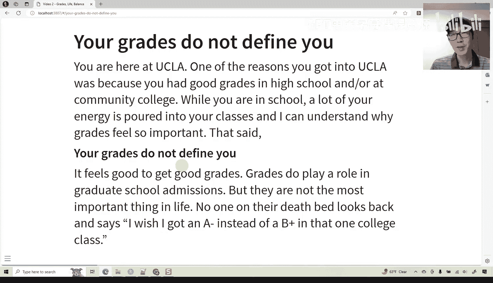

And you know they do play a role， but that said， your grades do not define you， you know， it feels。

 and I get it， it feels good to get good grades， it doesn't feel good to get bad grades。

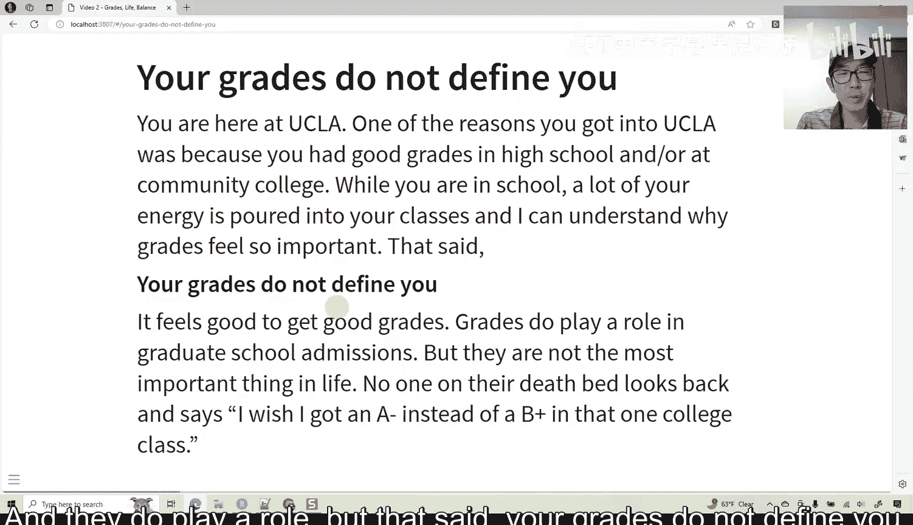

You know， they certainly have their kind of role and say like grad school admissions if you're thinking of going to grad school。

But it's important to remember that they are not the most important thing in life， you know nobody。

You know， and they're。Looking back on their life， you know， thinks back and says， oh man。

 I can't believe that。You know， I didn't spend like。

 I wish I got an a minus instead of the b plus or something， you know。

 that's that's not going to be the thing that they regret。

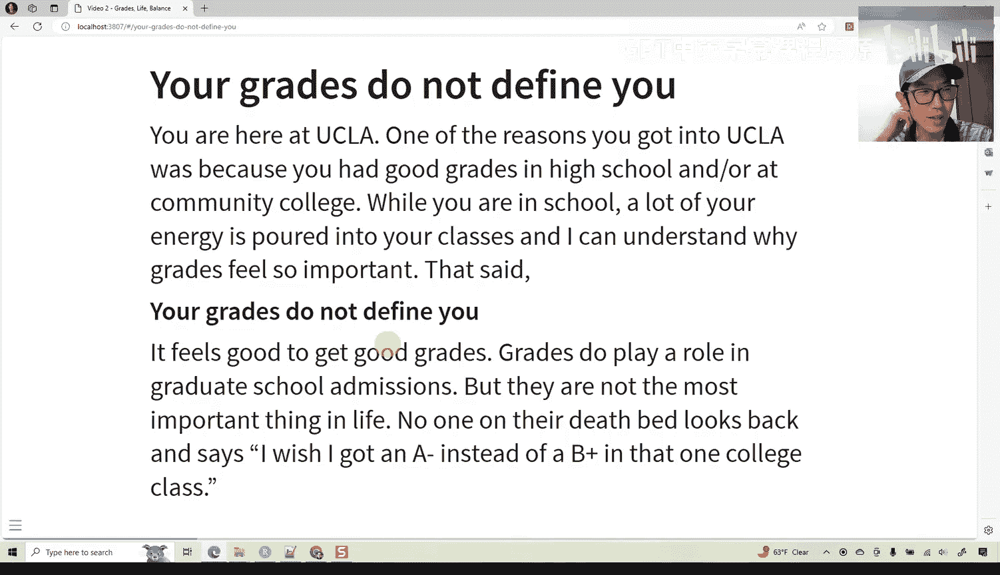

I want to share a little bit of a story from my own personal life because。

You know it's been many years since I was in high school。

 but you know in high school I worked hard and I got good grades and as a senior。

 I was admitted to my dream school， which was Caltech。

 I had dreams and ambitions of I don't know becoming a rocket scientist and working for NASA or something of the sort。

And I thought。嗯。That I would want to go to Caltech and I wanted to go and I worked hard and I got good grades。

And as a senior， I got that admission letter and I was so ecstatic and I felt like， oh yes， finally。

 all of my hard work had paid off。And then that fall I started。At Caltech and it was。

It was so hard and that fall quarter I got my first C grade ever and I thought。

 oh man this school is tough and then winter quarter at Caltech I got my first D grade ever。

And I thought， oh man， this is。This is rough and then in spring quarter of that year of my freshman year。

 you know I don't know， everything kind of fell apart and I failed multiple classes。

 I was put on academic probation and they said if you come back in the fall you need to get you know this many this high of a GPA and I thought there's no way I can pull that off and know I was depressed。

嗯。TheThe issue was that。Up to that point， I had tied so much of my value and my personal identity to my academic achievement。

 I felt like， you know， it's okay that I'm not a star athlete。 It's okay that。you know。

 I don't do go out to all of these social events because I have good grades and this is where my value as a person comes from。

And and that was fine and all in high school when I had good grades。

 but then during my freshman year， when I lost those good grades and I only had bad grades。

 then I start to wonder like， well， if I don't if my value comes from my grades and I don't have grades。

 then what is my value and。And and I think that kind of compounded， you know。

 just kind of made the whole situation you know， so much worse。

 I'm grateful because my parents were very supportive during that time， you know。

 and especially my father， he he basically said you know this，This dream， it's not worth it。

 basically saying that this dream I've had of going to Caltech。

That that it wasn't worth kind of the toll that it was taking on my own personal and mental health and so I ended up dropping out I ended up transferring schools。

 I transferred to another school in Michigan in a small engineering school and。

I completed my undergraduate degree out there at Ketterring University。

 and but you know I'm grateful for that painful experience because。You know。

 what it forced me to do was it forced me to separate my identity from my grades that I as a person。

 have value as a person， not from my grades。But for being who I am for， you know， being。

You know who I was， I guess， created to be。And so today I find my value not in my personal achievements or my career success。

 but I find it， you know， I find my own intrinsic value， I find it in my faith。

 I find it in the relationships that I have with other people。But yes， for me。

 it took a painful experience of basically losing。You know what I had cherished and valued so deeply。

You know， you know， because I was kind of forced to。Give that up， not by my own choosing。

 I was able to kind of make that step。And I guess I tell you the story and I share this with you because。

I don't want you to have to go through that same painful experience that I went through。

 but I want you to be able to kind of step back and recognize that your life， you as a person。

 are not defined by your grades that and you know in the future you will your value as a person isn't defined by your career or your title or your income or any of those things。

 you as a person have so much more value than what any of those things。Can do so you know。

 I want to share that with you just to kind of remind you and。I guess。

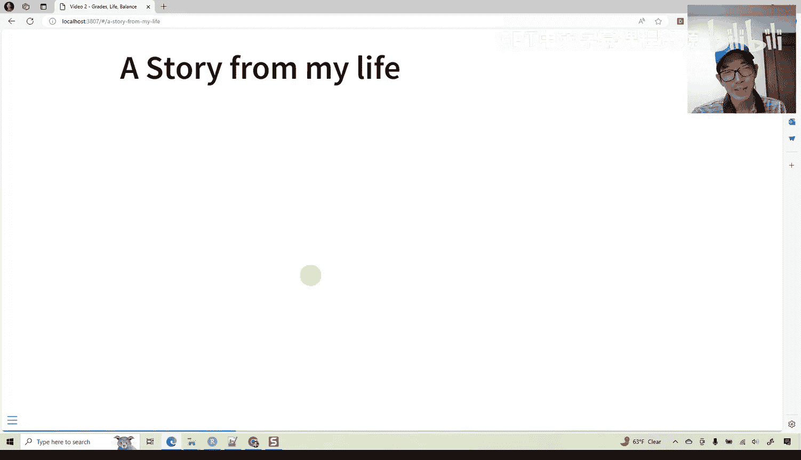

To let you know that I understand。That it feels good to get good grades because I was that person who liked to get good grades but。

Also， I just want to say that your grades do not you。

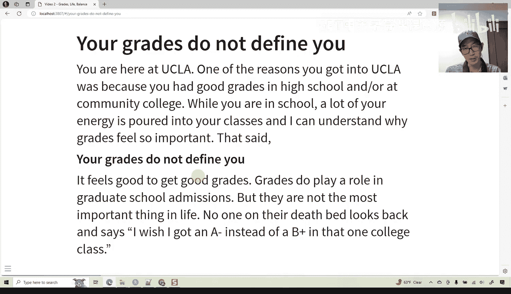

嗯。I want to talk a little bit also about work life balance。Um， you know。

 I like to think about you know， where we can put our energies and I I would say， you know。

 broadly speaking， I would say there's three kind of main categories where you can put your energies and that would be work。

Relationships and self， and so work includes anything like actual literal work like jobs。

 internships， things like that， but right now probably work entails school and academics for most of you or any other kind of professional obligations that you might have。

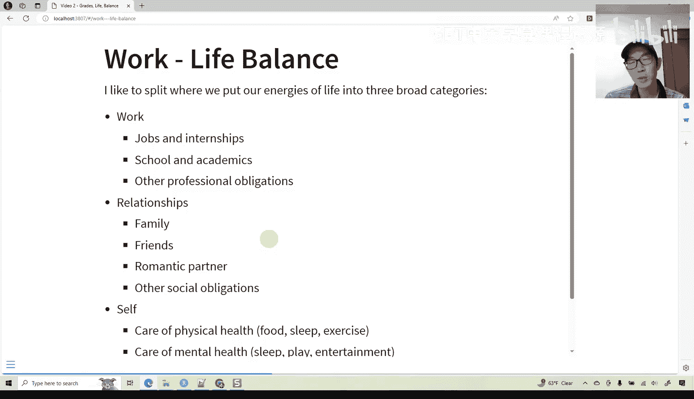

Another big aspect is relationships， so this would be relationships with family or friends or if you're in no romantic relationship with your romantic partner or any other social obligations and and you might have clubs that fit both in relationships and work and things like that and you might have some relationships and friendships that fit into both work and relationships。

 but overall broadly speaking， Id say there's work and there's relationships。And then lastly。

 there's yourself， you have to take care of yourself。

 and so you have to care for your physical health， things like eating well， getting sleep。

 getting exercise， care for your mental health， you know， that includes sleep， but also having fun。

 playing， having entertainment things that bring you joy in life。

 care for your spiritual health if you're a spiritual， religious person。And you know what。

 there's only 24 hours in a day。

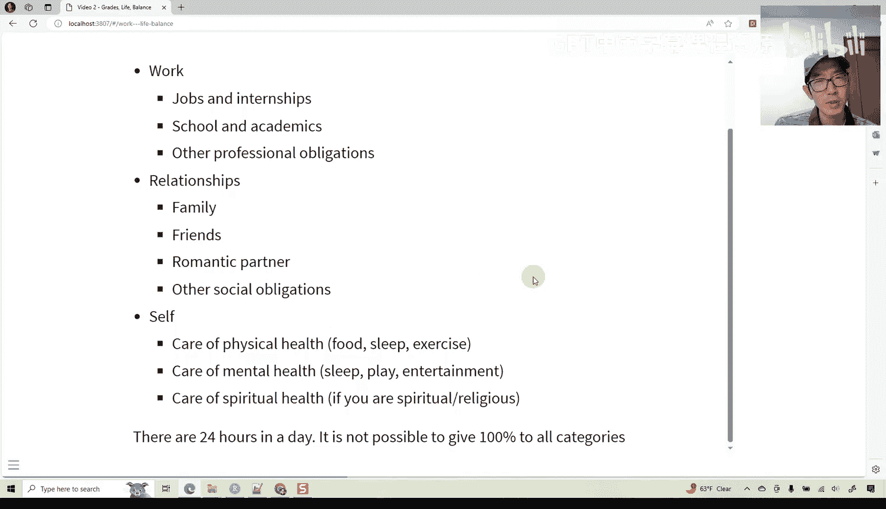

And it's not possible to give 100%。

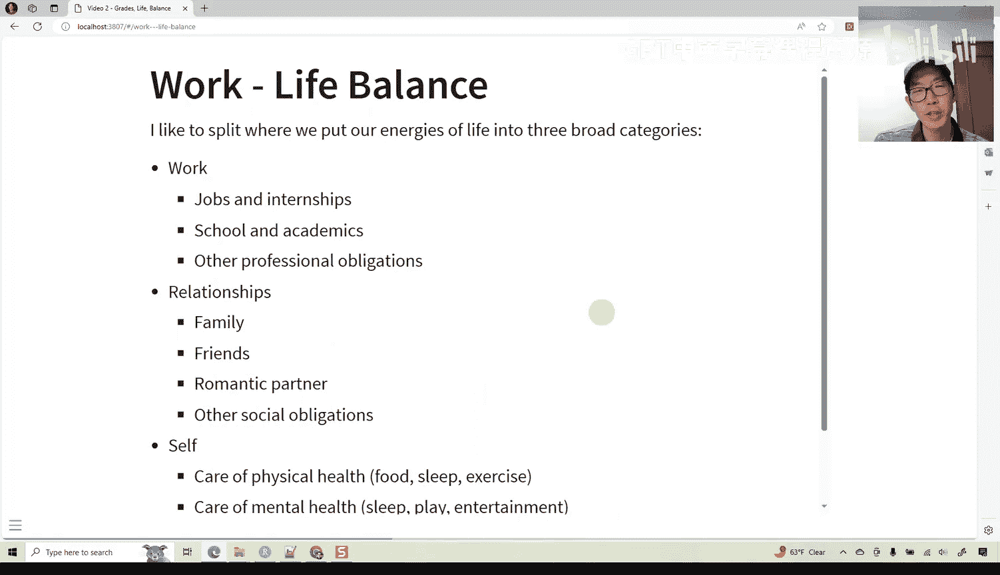

To all of these categories， and so we as a person， you as a person， need to decide and choose。

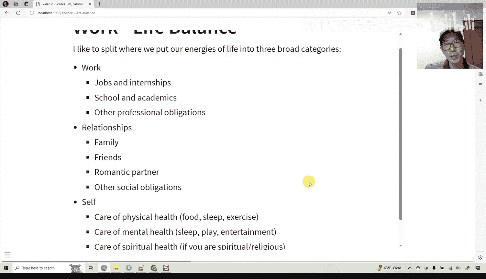

How you're going to spend your time， okay？And I believe that good work life balance is achieved by making conscious decisions and choosing what is important to you and then devoting your time and energies accordingly。

And generally speaking。The more you put in to something。

 the more you're going to get out and the less you put in， the less you're going to get out。

And I think you can find satisfaction in life。By accepting the natural consequences。

Of you know the things that you're putting not putting time in。

 the things that you are deprioritizing。Those things are just not going to flourish as much。

 and if you can kind of accept those natural consequences。

 I think you can find you know joy and satisfaction。

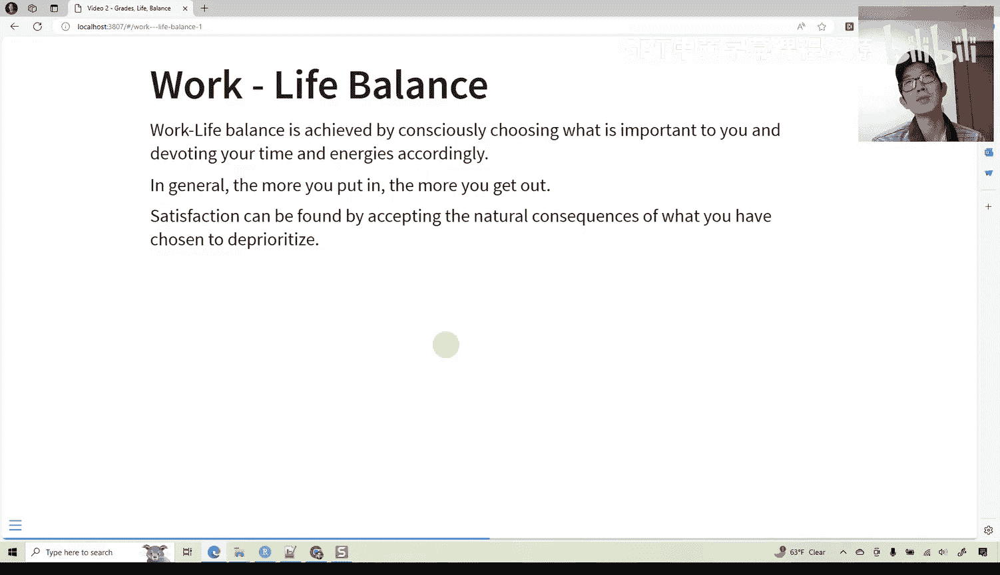

So this is kind of a silly example。But you， let's say you're part of a group of friends。

And one day you get involved in a relationship with a romantic partner and so now you are choosing to invest a lot of your time and energy into you know your romantic partner and so because you're putting so much time into spending you're spending so much time with your romantic partner。

 your relationship with that person is going to flourish and grow but now you're spending less time with kind of your original group of friends and so you're going to。

Naturally get a little bit more distant from them Okay。

 and sometimes when you recognize and see that there's starting to become you're starting to become distant or they're becoming distant from you。

 it can feel a little bit hostile， but that's not necessarily because your friends are angry with you for having a romantic relationship。

 but that's just the natural consequence。Of having less time to spend with them， and so。Yeah。

 I don't think they're necessarily， you know， trying to get back at you for for having a romantic relationship。

 but that's just naturally what happens when you spend less time with somebody and you as a person。

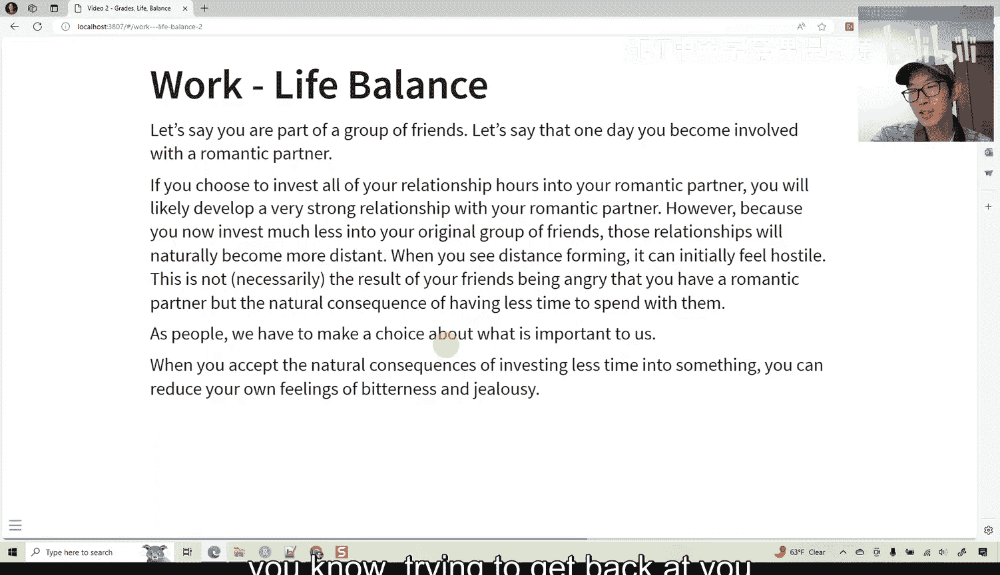

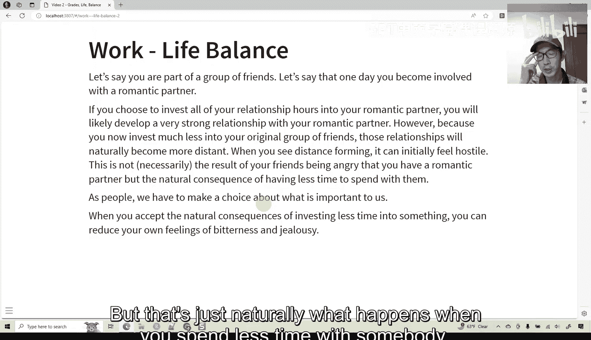

You get to make a choice about what's important to you and and I think。

The proper attitude to have is to say， hey， you know what？

I've been investing a lot of time with my romantic partner and now I have a great relationship and this part of my life is blooming and this other aspect。

 I'm appreciative of my friendship， but I'm also I can accept the fact that I'm not as close as I used to be。

And that's just naturally what's going to happen when you spend more time with one person and less time with other people。

And so， you know， when you're able to accept those kind of just the natural consequences of investing less time into something。

 I think you can。You know， reduce your own feelings of bitterness and jealousy and， you know。

 find find contentment， okay？

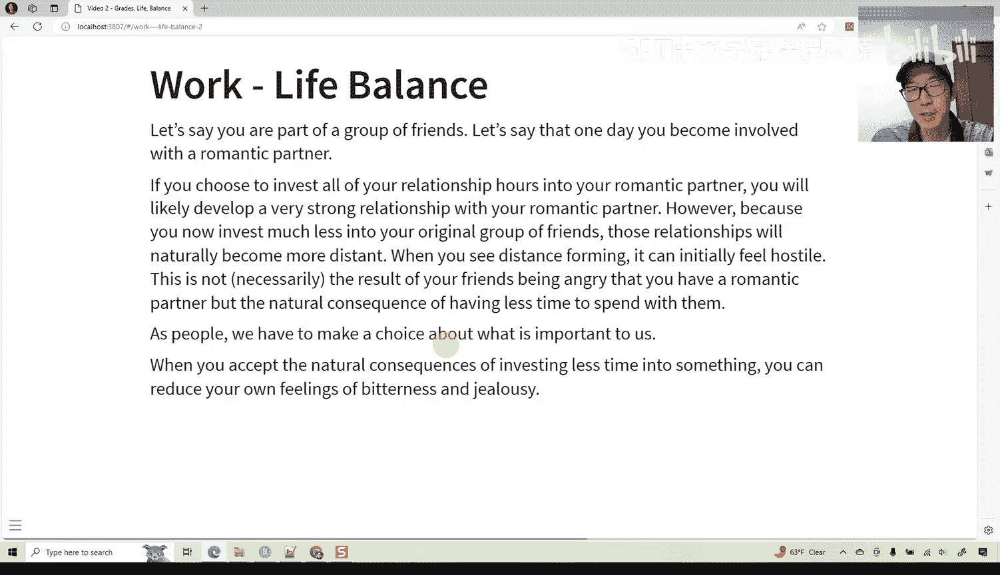

Another kind of example is， you know， and when you start working， you're going to。

Meet different kinds of people， and there's going to be people who devote a lot of their time and energy into the company goals。

 okay？And。When that happens， the company is not necessarily punishing people who have。

 say a life outside of work， family and friends or something， but just naturally。

 if you think about from a company's perspective or from a manager's perspective。

 who should the manager promote， should they promote the person who did everything that was asked of them and then continues to stay at work and do even more。

 or do you promote the person that does everything that was asked of them。

 but then immediately leaves to spend time with their family and friends or romantic partner？

And you know from that perspective， it makes sense to reward the person who stays and does even more。

But that's， again， not a penalty to people who have a life outside of work。

It's just that you you get to choose what's important to you if you're at a point in time where you say you know what climbing the ranks within the company is really important to me then you should spend your time accordingly and devote a lot of time into into the company and try climbing those ranks yeah but what the kind of the flip side of that is that you know your family and friends or romantic relationships might not flourish as much during that time okay on the other hand。

 if spending time with in those relationships is more important to you then absolutely spend your time accordingly and just kind of recognize that at the same time you know you might not be rewarded as much at the company as somebody who。

Whoho spends all of their extra time there， okay so just be aware of that and recognize that and be content with the choices you make。

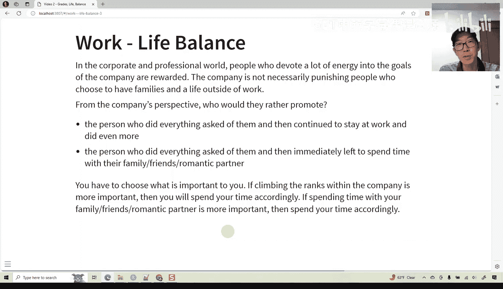

は。I also want to say taking care of yourself is also very important if you don't take care of yourself。

 then what often happens is you end up operating at less than 100% efficiency and you're not going to be as productive and so things like if you don't get enough sleep then。

You know， you might be cranky， you might not be as much fun to be around or if you don't get enough sleep。

 maybe。You get sick or。Other things suffer your own physical health or you and your mental health will suffer so make sure you take care of yourself。

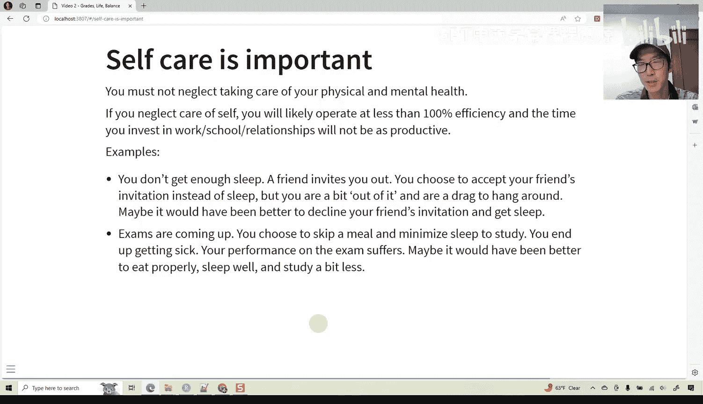

嗯。I think there's a number of us in the statistics and data science department that say things like selfcare is important and it's important to take care of your physical and mental health。

 and these are not just little nice things that we like to say are little platitudes that are empty I think we sincerely mean it and。

嗯。What this means sometimes and you have to kind of judge for yourself what what this means for you。

 but sometimes taking care of yourself means not completing your homework to 100% right if if life is kind of。

Too much is going on。And you just need to take a few rest days， and you can't work on your homework。

That means you're not going to finish your homework， okay。

 and the natural consequence of that is that your homework grade。Is going to suffer for it。

 okay if you don't turn in your homework。Okay， you're going to lose points for it being late。

 or if you only do half of your homework， you're going to only get half of the points。

 that's that's what's going to happen。But I want you guys to reach a point where you can say。

 you know what？My own kind of mental or physical health is more important。

 I want to take care of my health in this moment， and I'm okay to allow my homework grade to suffer or whatever it might be。

 right， when you can kind of readily embrace kind of this natural consequence of prioritizing your own physical health or mental health over your homework grade。

 I think you can。Enjoy the quarter more right， with more joy and better health， you know。

 if things get tough， you can ask。Your professor you can ask me for an extension and sometimes I'll say yes。

 sometimes I'll say no depending on the situation， I think I tends to be on the more generous side。

 but that's not a guarantee that I'm always going to approve your extension requests。

But even if somebody doesn't approve it， that doesn't mean suddenly you have to。

 you are beholden to your grade right， you can always just say hey， you know what。

 even if I don't have an extension in this time， I want to take the time off and I'm okay losing the points。

And I think that's a decision that you have agency to make for yourself。

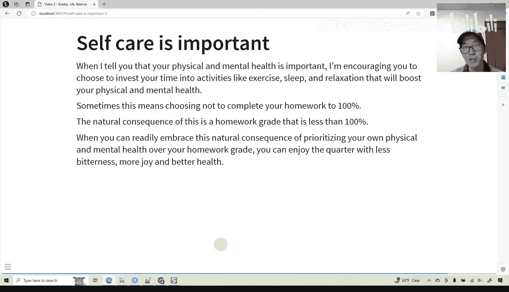

嗯。One last thing I like to kind of mention is just to be mindful of what I call fruitless entertainment okay so I love entertainment。

 I love doing fun activities and I think it's super important for your own kind of mental wellbeing right I like hanging out with people。

 I like watching TV， watching movies， playing games， things like that。

 there's all kinds of things you can do sports， reading a book。

 listening to music or podcasts or whatever these are all great great things that you can do right。

When you participate in some kind of entertaining activity though。

 what it should be is it should be a break for work。

 it should give you kind of joy and mental energy or something so that when it is time to return to work。

 you're in a better mood and that you enjoy life， okay。But also， you know。

 there's some activities and possibly I hate to say。

 but possibly even like hanging out with certain people can end up having the opposite effect in that these things end up draining you right there's also kind of some video games and some apps and social media sites that are really just designed to be addictive。

 they're just designed to keep you kind of scrolling forever。You know。

 they gave you little immediate dopamine hits so you kind of keep coming back round after round or scrolling forever and because that's how they make money。

And you end up kind of spending hours on this app or site or whatever， and at the end of all of it。

 you have no idea where your time went and you don't feel any better。You don't feel like， oh。

 I have this much more joy about life or anything like that。And。And in those cases。

 I think we should just be aware and I'm not saying you have to delete。

Your social media accounts or something。You might choose to do that， but you don't have to。

 but do be mindful and selective about the kind of。

Activities you participate in and where your time ends up going because。Again。

 you don't want to just lose。You know， lose hours of your life or something that's not actually。

Making you more excited to live。So that's all I have to say about that。

 but anyway just want to throw that out there， thanks for watching this video and we'll start talking about R in the next next one。

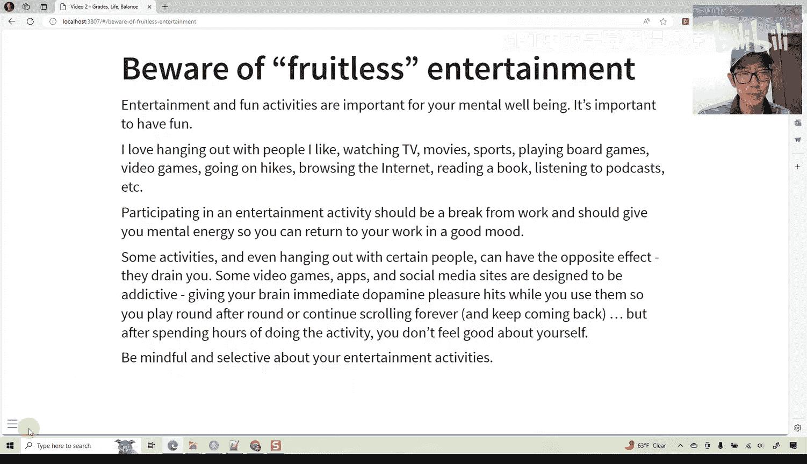