# UCLA《计算统计学｜Stats 102A - Computational Statistics with R 2024 Summer》中英字幕 p04 [04]Stats 102A - 2024 Summer - Video 4 - Vectors in R.zh_en [BV1jizNBrEm2_p4]

All right， let's talkck vectors in R。

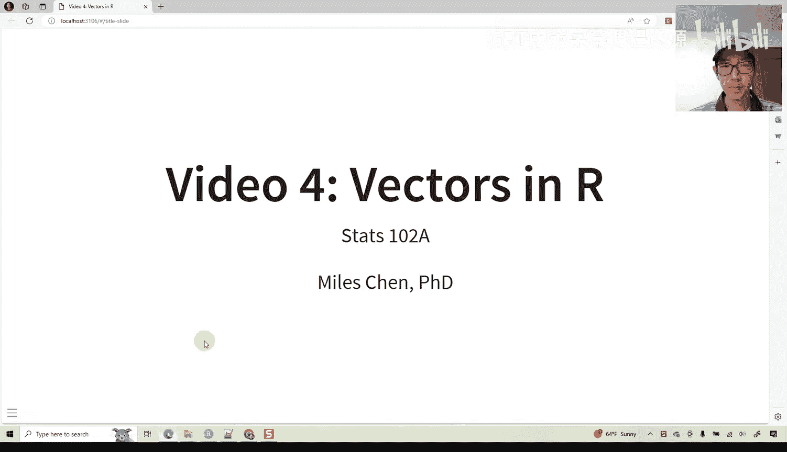

Just some related reading from。The Hadley Wickham's textbook。

 a lot of my examples come from that textbook， so I just want to make sure I give credit to Hadley Wickham。

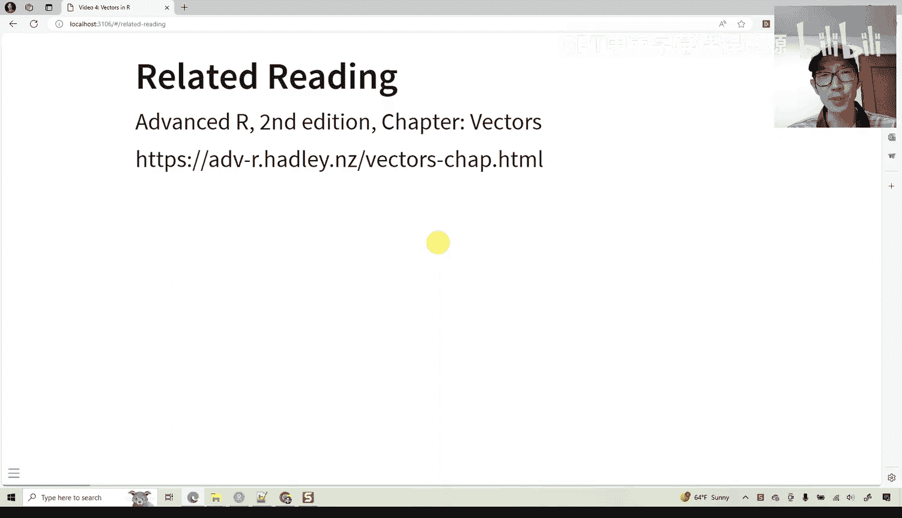

Okay， the most important kind of family of objects that we have in R is vectors and we have two types of vectors。

 atomic vectors and generic vectors we'll just call them lists， basically in an atomic vector。

All the elements in your atomic vector have to be of the same type。

 you cannot mix different types of values in your atomic vectors， whereas in lists。

 you can have different types of things in there。And this is not a vector。

 but null is a value that we use to kind of represent zero length generic vectors。

 we have zero length vectors that are of a specific type。

 but null also is used to kind of represent things that just don't exist and I'll talk about。

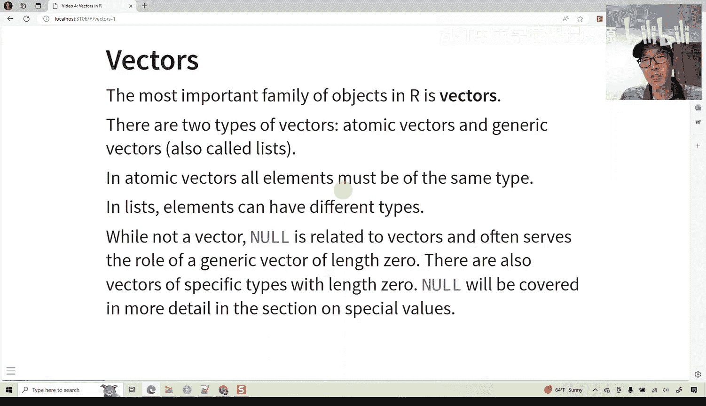

s null and special values in the future。All right， as far as。

Atomic vectors go we have six different types and although you know there's really only four that we commonly use。

 but we have logical vectors， double integer character and those are kind of your four basic ones but we also have complex and raw okay logicals for like true false values。

 other places call them like Boolean values， we have two numeric things okay we have floating point numbers which are double if you ask type of it distinguishes between double and integer。

 but mode will always kind of return numeric。So integers are for whole numbers。

 floating point numbers are called double for double precision floating point。

So if you ask mode on those things， you get in numeric。

 and then you have character for strings and those are primarily the ones that we'll be dealing with。

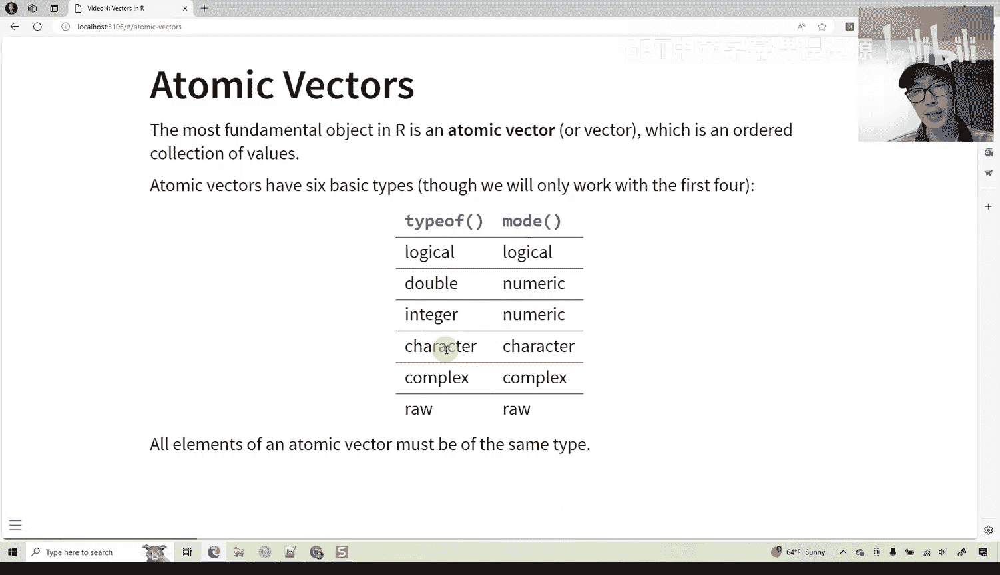

So as far as there numeric types， we have double and integer and the conversion kind of flipping between integer and double is often done automatically in R。

A lot of times we don't have to worry about it， okay？

There is an important difference in that type double is numeric with floating point precision。

 meaning that when you have like decimal values and things like that。

 they are not precise and so if you do something like one divided by three。

 that is not going to be exactly equal to one third。You know。

 it's kind of like if you try to write13， 0。33333 in decal in decimal form。

 eventually you're going to have to stop writing threes。And。That's not exactly one third。

 So if you need to represent this quantity， one third exactly。

 the only way really way you can do it is you have to kind of store two integers a one and a three and you have to know that what you're trying to do is you're trying to do one divided by three。

 but as soon as you actually try to write one divided by three in the computer。

 it's going to store this。Approximate representation of it， okay？

The default numeric type is double if you want to so if you write like the number two。

 that's going to be a type double to a floating point representation of the number two if you want an integer you write the a capital L after it so2 L is going to be an integer 2 and then when you use the colon operator it just kind of creates a vector of integers。

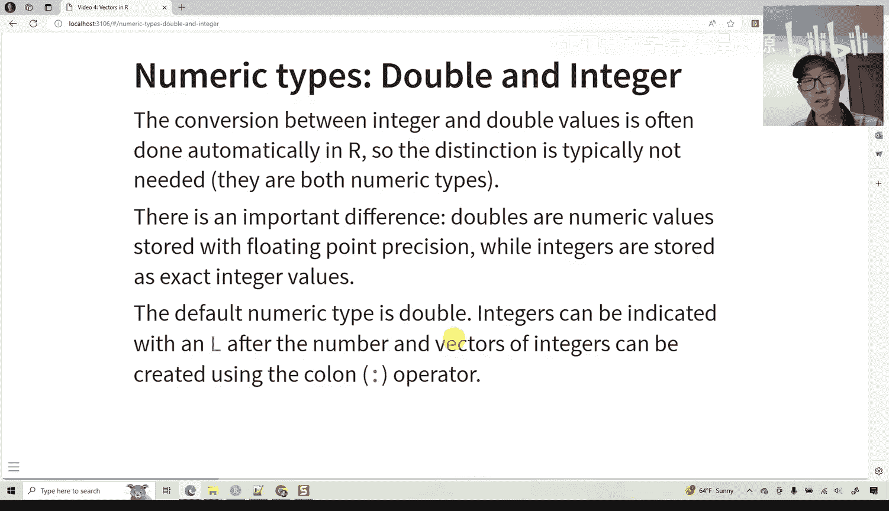

So if you create a vector with one comma  two， comma 3。

That is going to be type double So if you ask type of on this， you're going to get double。

 whereas if you create the same kind what we might think as equivalent，1 colon 3。

 which is going to be the vector 123 using the colon operator is going to be an integer and number one all by itself is going to be a type double whereas if you want an integer。

 you write 1 L and we also have these function is dot double or is dot integer which return true false values and let you know if it's a double or an integer。

A does what we call coercion， meaning that it will kind of。

Convert or coerce values from one data type to another when you combine them into an atomic vector。

 so again atomic vectors everything has to be of the same data type。

 and so if you try to combine values of different data types。

 some of the values will get coerced so that they can be combined。The way it works。As it goes from。

It coerces the more restrictive data type into the less restrictive data type。 And so in order。

 you have logical integer double character from most restrictive to least restrictive。

 And so here I've got。Vctor L， which contains the logical values， true and false。

 I contains the integer 1 D for double contains double values 5，6 and 7 in character C H。

Will contain the character vector with the character string A and character string B。

So here I'm going to combine the logical， the integer and the double vector。

 And what's going to happen is the logical and integer values will get coerced into type double。

 So type of on this thing will be type double。 If I combine the logical。

 double and character together。Everything is going to get coerced into type character because character is the least restrict。

 And so the type of on this thing will return character。 So we can see what happens。

 So when we combine the logical integer in double。

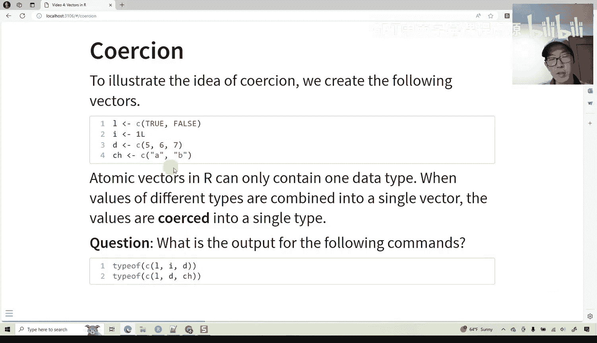

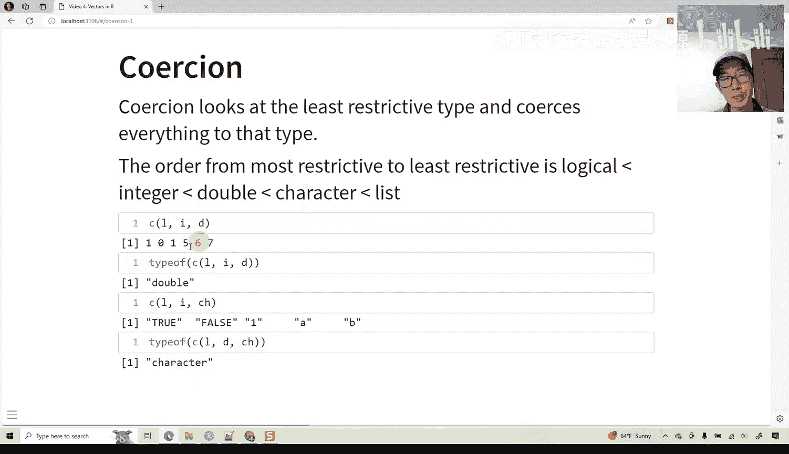

That returns type double and look what happened to the logical values。 we had true and false。

 the logical values got coerced into a 1 and 0。 the true got coerced into 1。

 the false got coerced into a0。 the I， the integer 1 remained the integer 1。

 and then the double had the5，6， and 7。

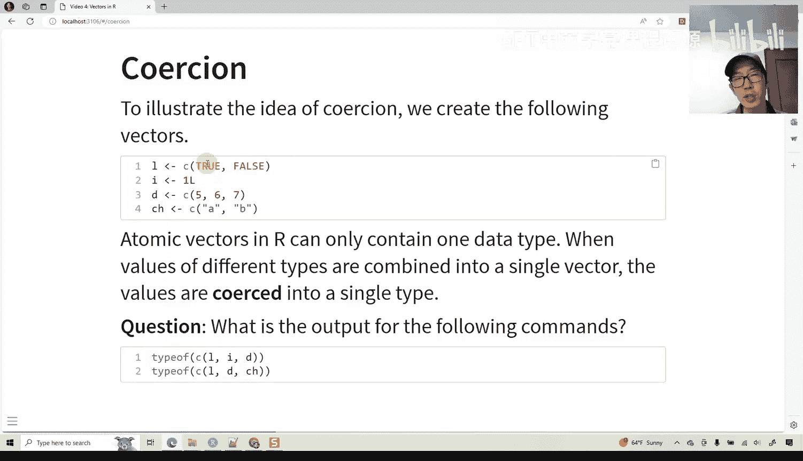

One would combine the logical integerent character。Those logical values true and false。

 got coerced into character by just putting quotes around the value true and the value false those got put into quotes。

The integer 1 remained the integer  one， but now with quotes around it。

 so now it's the character one， and then the character AB is character AB still。

 so that is T character。

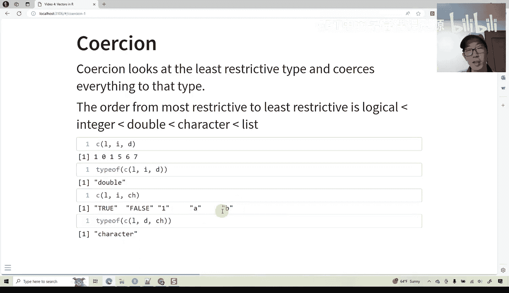

Coercion often happens automatically whenever you use a an operator that expects values of a certain type。

 So if you have a mathematical operator like the plus sign or the log function or absolute value。

 that's going to courseerce things into。You know whatever it needs to some kind of numeric type to be able to conduct that okay。

 you have these logical operators like the and and the or thing or a't any and that's going to coerce things into logical values so here I have。

This logical vector false， false true。And if I explicitly course it using as dot numeric。

 that will turn false false true into numeric values 001 if I call sum。

 which is a mathematical operation on trials， what it will do is it will course false false true into 001 and add those up and we get a sum of 1。

0 plus0 plus 1 is 1 or mean basically converts these things into 0s and 1s and says， hey。

 what's the mean of 001 and we get 0。333， which is handy because that's basically the proportion of values that are true。

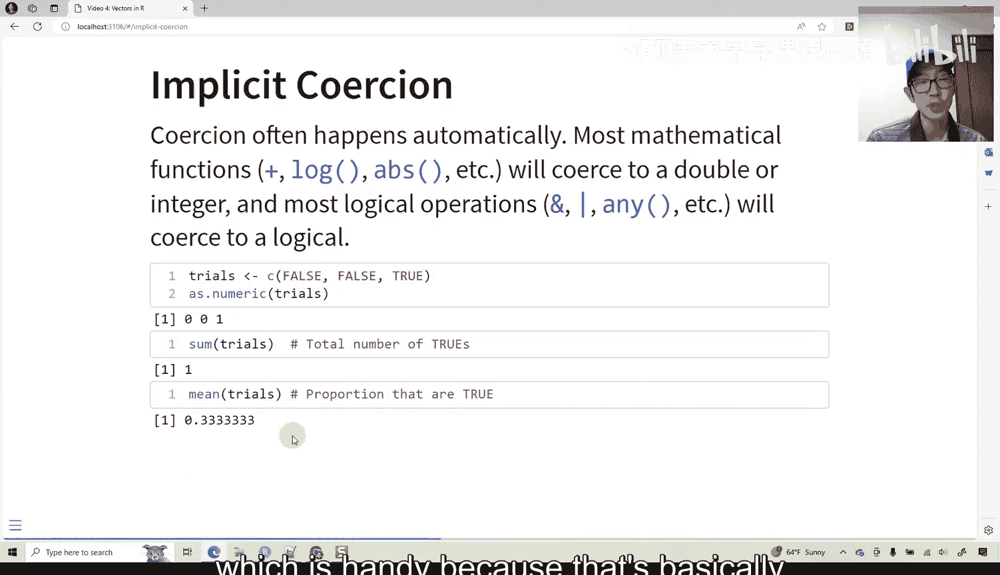

Any of these things， you can explicitly co using as dot the type， so you can do as dot character。

 as dot logical， asdot numer， or whatever。Which is basically going to turn it into type double and it will do it so if we take again。

 false， false true and say Adaq character， now we get the characters false character。

 false character true。

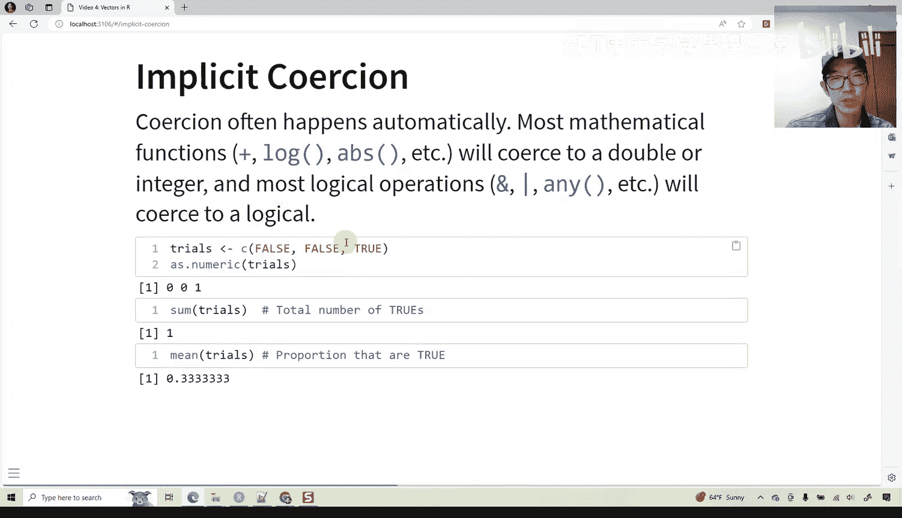

If we take。The integers are the value numeric value is0 and1 and coerce them into logical we get the0 becomes false and the one becomes true if you try to do something that doesn't quite make sense like I'm going to try to make the characters string DOG dog into a numeric it's going to say I don't know what to do with that and we get an NA for that NA for a missing value。

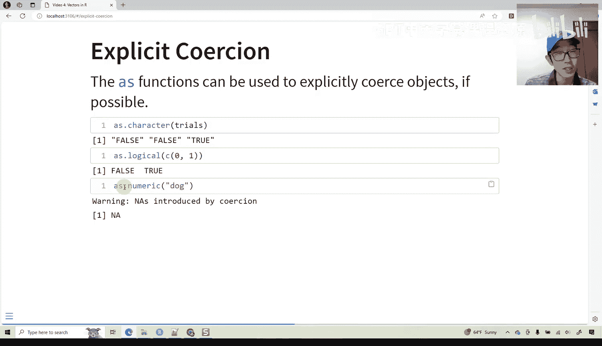

嗯。When you call as dot logical， basically a zero becomes false。

And everything else becomes true with the exception of Nan okay so Nan becomes NA。

 but if you try to say， hey， I want as dot logical 1 becomes true that makes sense。

 but so does negative 1。12， negative infinity， a really big number or really small number。

 those all become true， so anything0 is false， everything else is true， Nans become NA。

As far as coercing things into logical， as far as false and true。

 these are the accepted spellings of false and true， you can use a capital F， all caps false。

 capital F， lowercase ALSE， or all lowercase false and then these。Get coerced into true。

 and these are all。Acepted spellings are true。Okay， if I do F and T lowercase F and T。

 those are not accepted， so if you call a logical on that we get an NA other words like cat will be NA。

 what's happening here zero， if we call as logical on0 we normally get false and as logical on one we normally get true。

 but here what happens is the zero。Gets coerced into character 0。 So imagine quote signs around the0。

 And that just happened right as soon as we ran the。Combine function here， so the zero， so quote 0。

0 and quotes。Is not accepted as logical value and so that becomes NA and then again one in quotes as a character also become NA。

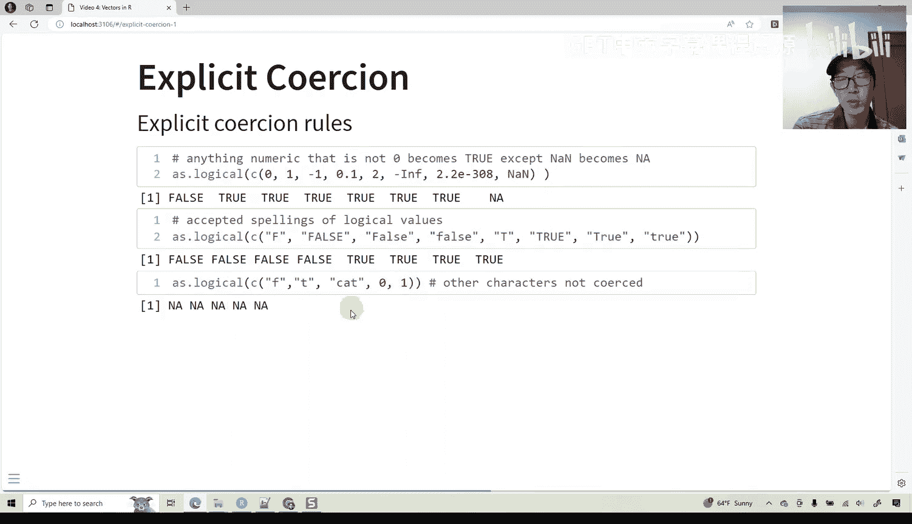

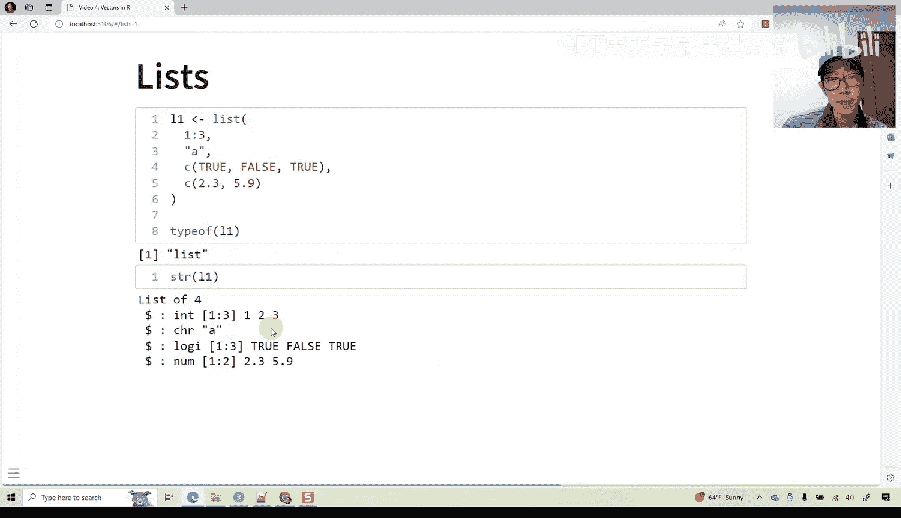

So those are that's that for atomic vectors， let's talk about lists， lists or generic vectors。

 we can think of that as an ordered collection of objects。

 lists are basically the most flexible object in R。

 and the components that you put inside a list can be really any object in R， including other lists。

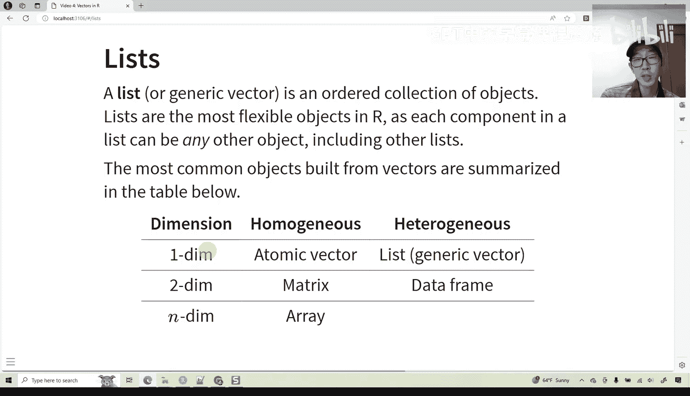

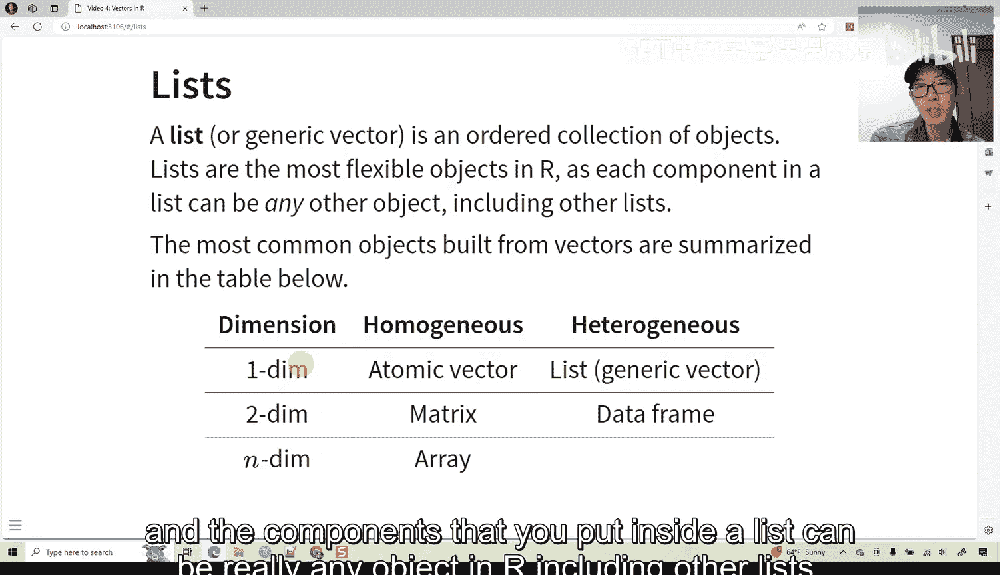

So if you think about this， we have these one dimensional structures and if everything has to be of the same data type that's an atomic vector and if you can have different things we call that a list if you have a two dimensional thing。

If everything's is the same data type， a two dimensional structure we call a matrix。

 if we have a two dimensional structure where the columns are different data types。

 that's a data frame。And you can have higher dimensional things and are we call those arrays。

 and they only exist for when everything is of the same data type。

So here is a list。This is a list with four elements。Each one being a different vector。

 so I create a list one through three， that's going to be integer when you can ask for the structure of that data。

嗯。That object and say can say， hey， what's the structure。Have this list L1。

 and it says a list of length 4。 And the first thing in the list is a integer vector with the values 1。

2，3。 The second thing in the list is a character vector with a value A。

 The third thing in the list is a logical vector with the values true， false true。

And the fourth thing of the list is a。Type double or numeric vector with the valuess 2。3 and 5。9。

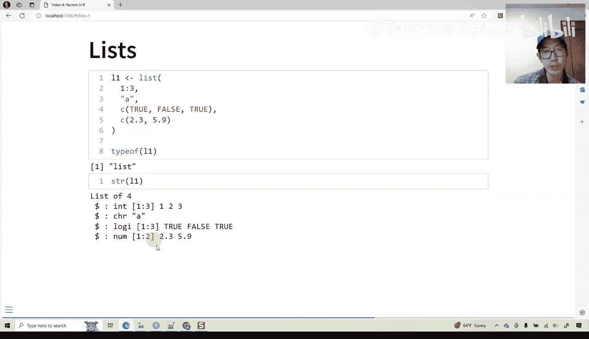

When you use C， which we often think of creating vectors， basically combining things into that。

 you can also use that with lists and they will combine several lists into one。

If you give C a combination of atomic vectors and lists。

 then C will coerce the vector's two lists before combining them。

Compare that to using list which kind of embeds lists can embed list themselves， so here L4。

 I say make a list。Inside that we have a list 1，2， and a vector，3，4。

 And so when you do that here we're creating a list out of a list and a vector。

 And so the result is going to be a list of two says list of So the first thing that list of 2 is this list with the values 1 and 2。

 Okay and then the second thing in the top level list is this numeric vector with the values 3 and4。

 So the top level is a list of length 2。 The first thing in that list is another list of length 2 with the values 1 and 2 in it。

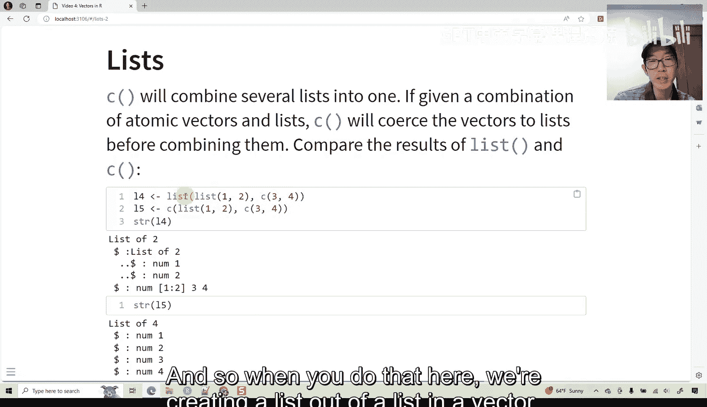

And then the second thing of that top level list is a numeric vector with the values34 in it。 Okay。

 compare that to L5 where I am combining。A list of。Length 2。Basically。

 this list of two of the elements 12 and a vector。Three， four， okay？And here。

 what's happening here is we're using C to combine these， and so that's going to coerce the three。

 four into a list。And so the total thing ends up becoming a list of length four okay and we get the one。

 two and the three and four in there， okay， it feels a little bit odd。

 but that is the difference between， hey， just make a list out of these things versus combining them would see。

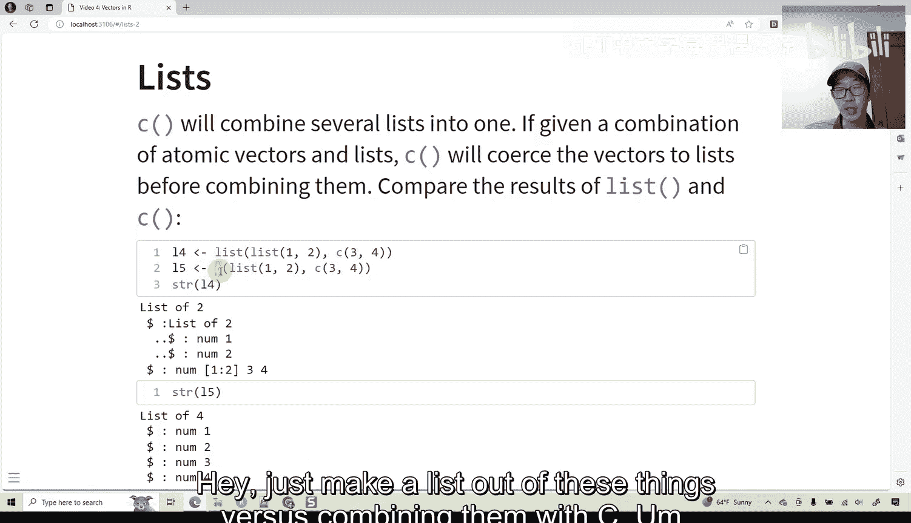

嗯。

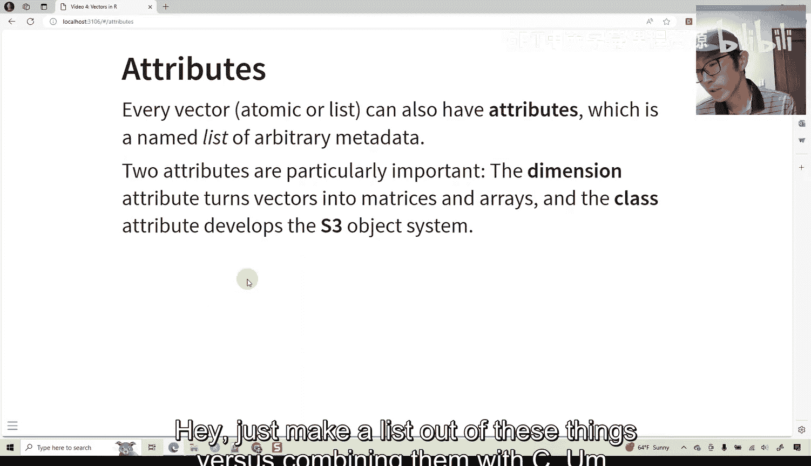

These。These data structures， the atomic vector and the list。

Can also have attributes okay attributes is a named list of arbitrary metadata。

Basically you can kind of include whatever information you want that you want now sometimes the attributes do carry important information that helps our function and that will be if the attributes include dimensions and that turns kind of atomic vectors into matrices or arrays also the object oriented system in R uses a class attribute and that is how R is going to handle basically any of the。

Object oriented。Programming systems in in the S3 system there。 Okay， let's， let's just take a look。

 So there is a data frame in R called trees and。

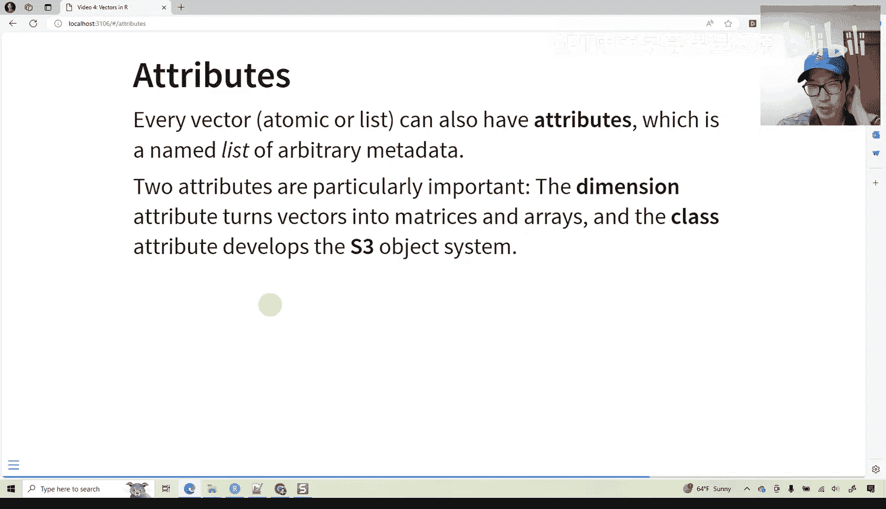

If you look at the first few rows of trees， we see this it's got information about the girth of the tree。

 the height and the volume of the tree and we can learn about the attributes okay the ATR function is used to get basically single attributes and can be used to kind of get those or also change them or set them whereas the function attributes all spelled out can give us basically the entire list of attributes so again here's that data frame trees we can ask what are the attributes of trees and what it gives us is it gives us the names。

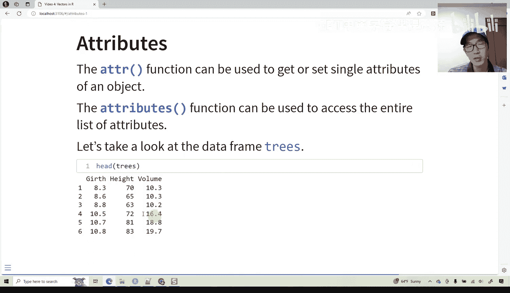

The class and the row names so it says the names are basically the column names right the class is that this is thing is a data frame and the row names well it's just this vector of integers and those are the row names basically rows run1 through 31 if you want to you can set attributes and again because attributes are just an arbitrary list。

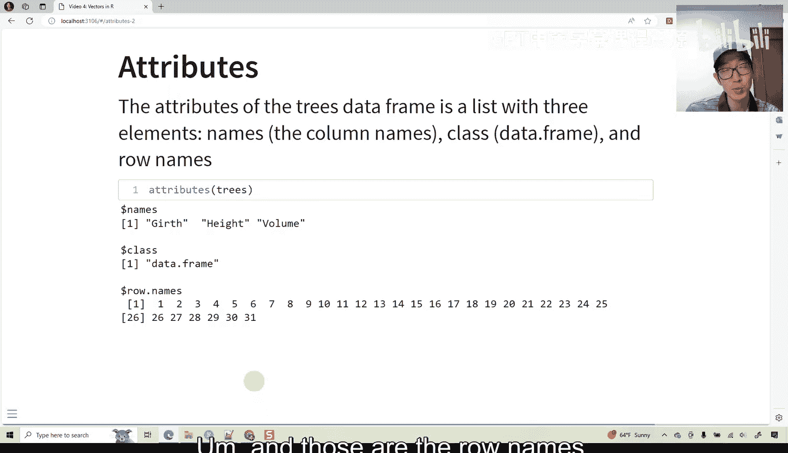

You can throw in you know whatever information you want if I wanted to throw in an extra piece called information info and say this data frame is about trees。

 you could do that， this is not really normal practice probably not something we would do in real life but attributes in R just a list and so doing something like this as possible and it just kind of tacks on that additional information you can kind of think of you know you have your。

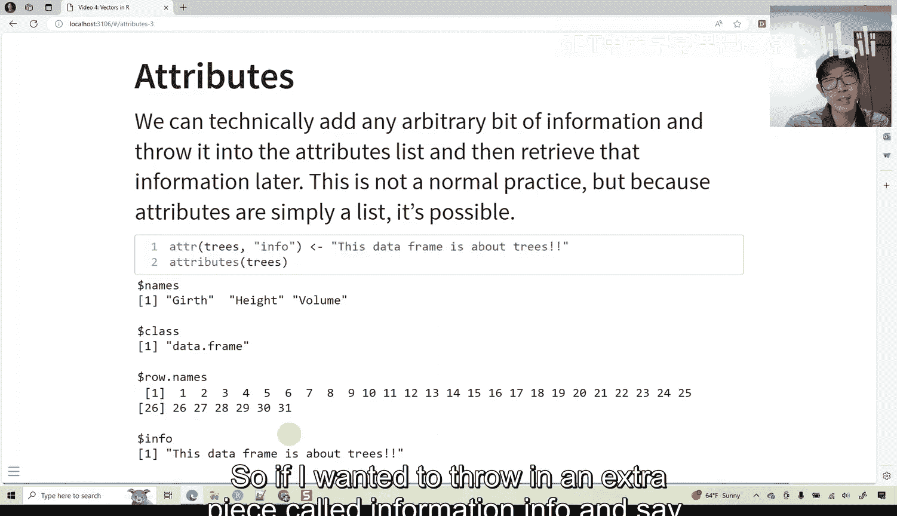

Object your data frame your list， whatever it is， and attributes is you're basically just kind of staplling on a little piece of paper with additional information and you can kind of write whatever information you want on that piece of paper。

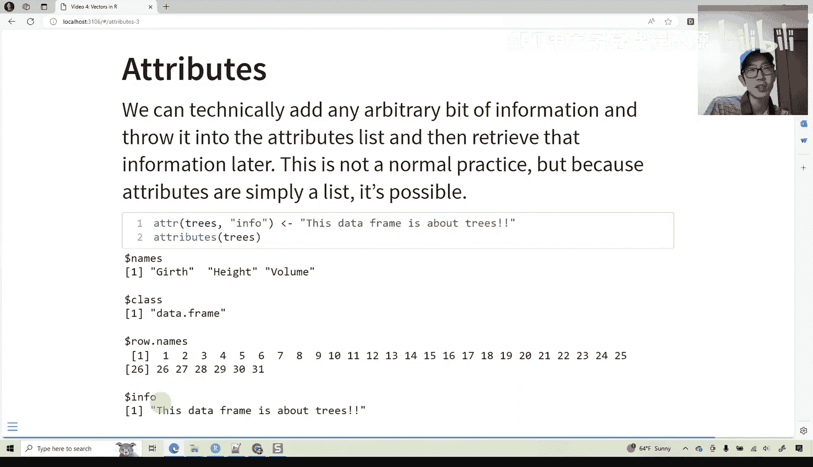

嗯。Other things you can do with a。A vector is you can provide it names and these will get kind of stored in the the attributes。

 so here we can take。We can create a vector right， And when I create the vector， I can give it names。

 And so we have the elements 1，2 and 3， but those elements come with names。

 So the name for the the value 1 is a and the element for the value 2 is B。

 and the name is C for this third value。 Okay， and that's going to do that。

 We can create basically the equivalent by creating。A vector， integer vector1 through3。

 and then providing。I can use this function names X and give it a character vector and give it the values A B and C。

 and that will assign the names A B and C okay there's also set names which is another function and this will take say the values here。

  one，2，3 and I'll also set the names ABC， you know kind of respectively to the elements in there。

If you want， you can get rid of the names using unnamed and so that will basically simplify your vector just down to an unnamed vector。

 or you can take names and set them to null and so that will get rid of them。

Okay and again， if you have something like a data frame names will be things like the column headings。

 but if it's just another vector， it'll just get stored in the attributes and it will be the names of the you know whatever elements you have in the atomic vector so that's what we have to say about vectors。

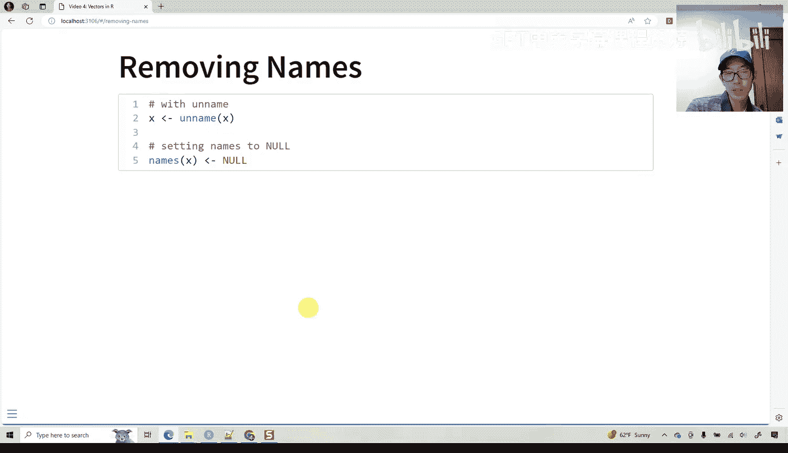