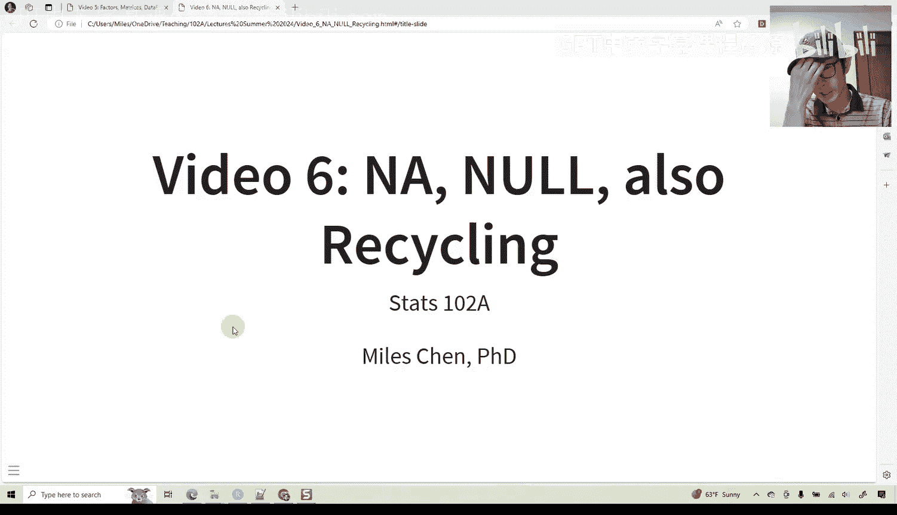
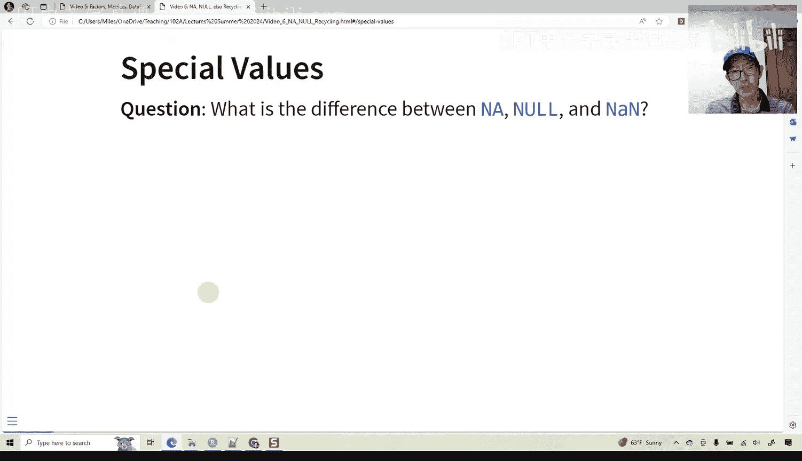
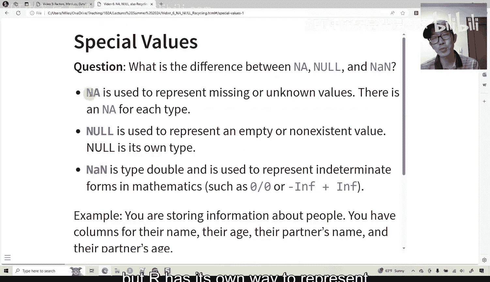
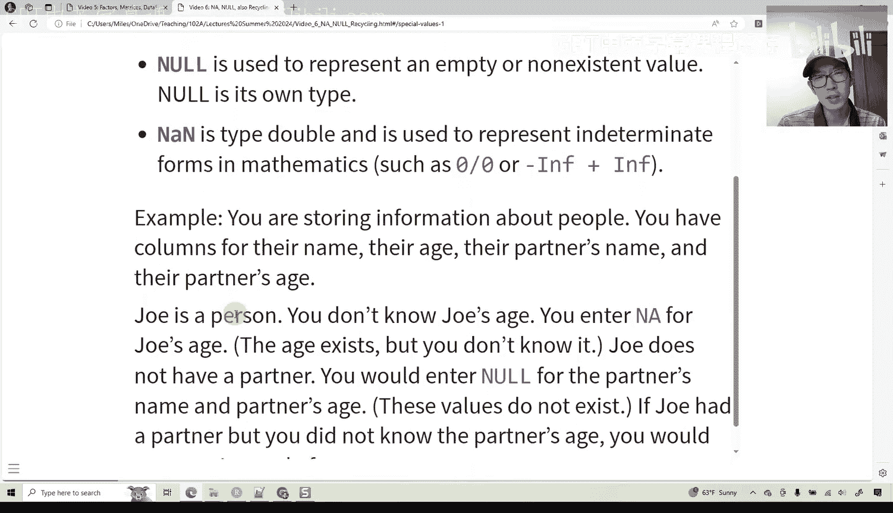
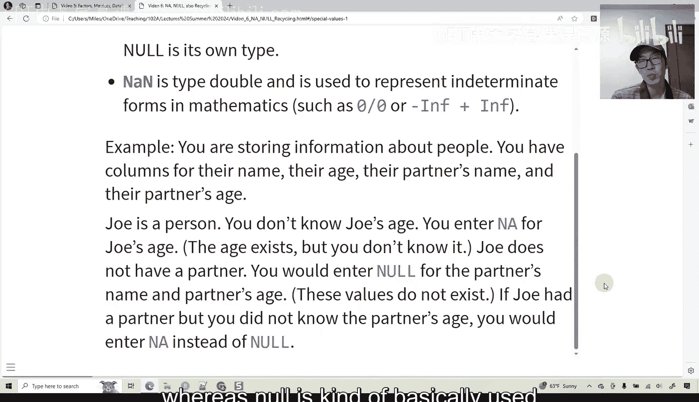
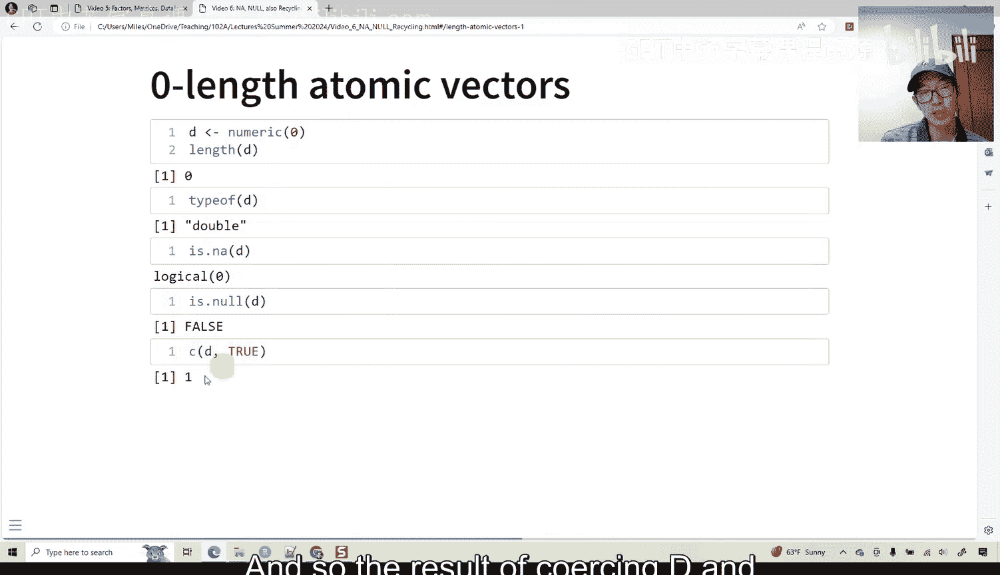
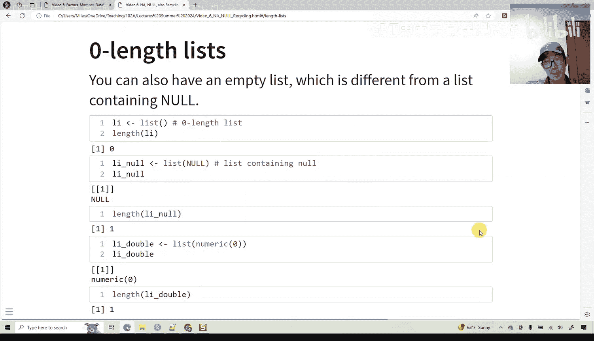
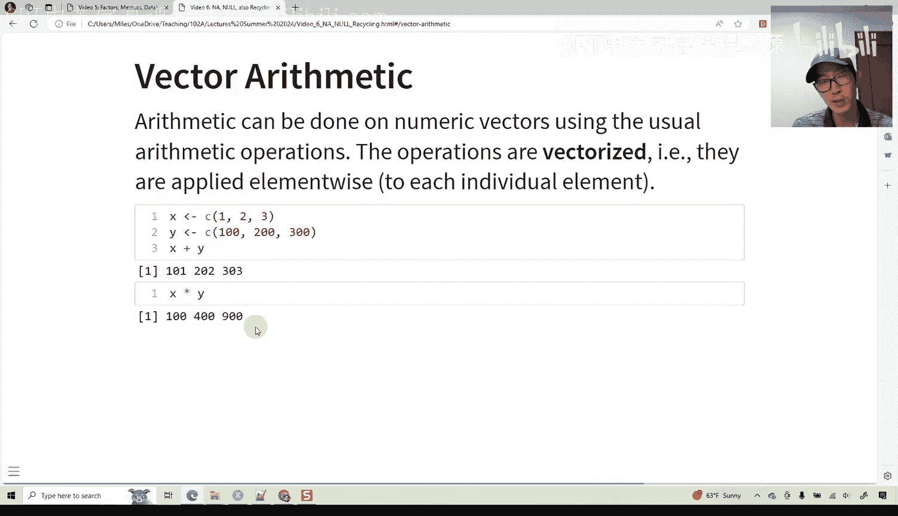
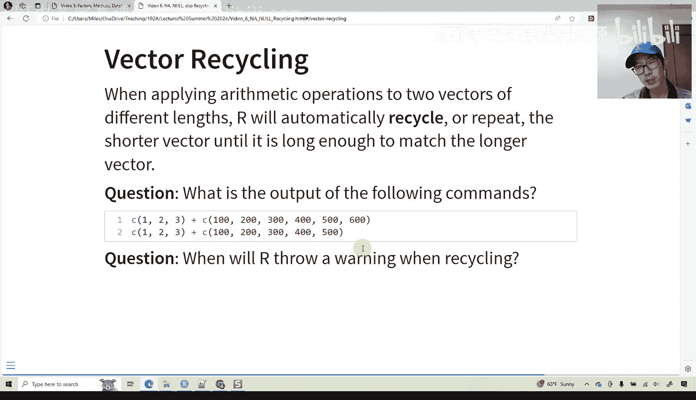
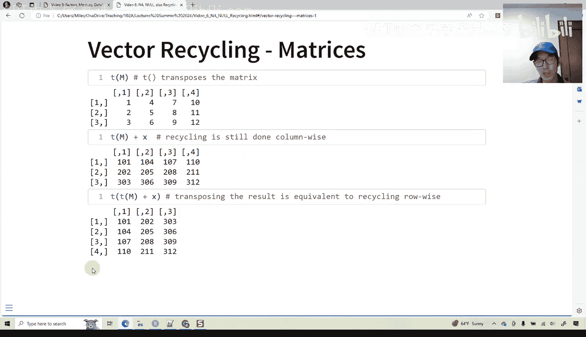

# UCLA《计算统计学｜Stats 102A - Computational Statistics with R 2024 Summer》中英字幕 p06 [06]Stats 102A - 2024 Summer - Video 6 - NA, Null, NaN, Recycling Values in R.zh [BV1jizNBrEm2_p6]

All right， I want to talk about some special values in R right， we have NA for missing values。

We have null and we also have Nan for not a number。

 so what's the difference between all of these things okay？

Well， NA is used to represent basically missing or unknown values is。An NA for each type of data。

 so you have an NA for logical， you have an NA for integers and NA for character type。

 NA for double type okay？Whereas null。Is basically something it's a zero length vector。

 and it's used to represent things that don't exist。 Okay， the null is its own data type。

OkayIt's used to represent things that don't exist right and then there's also something called Nan。

Nan is a numeric value， it is always type double， this is something that in the floating point number representation and specification。

 there's Nan and this is used to kind of represent indeterminate values like zero divided by zero or negative infinity plus positive infinity。

 what do you get when you do that you're going to get Nan okay what's maybe going to throw a few of you off if you have familiarity with Python。

Nan is also used to represent missing values， but R has its own way to represent missing values and that is NA Okay。

 so you know， again， what's kind of this difference between NA and null。

I you know， let's say you're storing information about people。And you have columns for。

 you know the person's name， the person's age， maybe their partner。

 and then maybe their partner's age， Okay so let's say we have a person Joe okay we don't know Joe's age so we are going to enter NA for Joe's age because Joe has an age we just don't know it okay。

 so this is we use NA for something that exists， but we don't know okay Joe。

 let's say does not have a partner。And so what we would do is we would enter null for the partner's name and partner's age because these values don't exist。

Okay， if Joe did have a partner and you didn't know the partner's age。Then instead of writing null。

 you would put in N， Okay， because you might。You might know that the partner exists。

 you just don't know that person's age， so you would write NA。

 so NA is used for things that you don't know that do exist。

 whereas N null is kind of basically used to represent things that don't exist。

So as far as NA。Including NA in an atomic vector or matrix will not change the data type internally there is NA and NA。

 which is li logical NA， and then you have NA integer。

 NA real NA character and these are all kind of how we're going to store a missing value in。

Vects of different types okay， so if you try to if you just use NA and you're putting it inside a character vector。

 then it's going to get coerced into the character NA。诶。

So that every element in that character vector is remains type character。

If you want to check to see if something is NA， you have to use the function is NA。

 you can't use the equal sign， the equal equal sign。

 normally to test if two quantities are equal or the same you use equal equal。

 but that's not going to work for NAs okay so if you have NA equal equal NA。

 the response to that is going to be NA， basically you're saying like in this hand I've got a mystery value and in this hand I've got a mystery value and the question is。

Is this value equal to this value and answer is you don't know。

 you don't know if the value in this hand is equal to the value in this hand。 So is NA equal to NA。

 the answer is unknown so that the answer there is NA。But if you just want to know， hey。

 do we know the value in this hand or is it unknown to us， you just ask is done in a？

And if it's unknown， you're going to get back true， if it is known， you'll get a false。嗯。

So null is used to represent the null object at its own type， so if you ask type of on null。

 it's null。To check if something is null， you can ask is dot null un null and you get back true。

 if you do really anything else like you ask is the null NA。

 you're going to get basically a length zero vector and the question for is dot NA the answer to that question is always a true or false and so it's going to be logical type but here we don't have anything so we're going to have a length zero logical vector that's what logical zero means it's a length zero logical vector。

Is null a logical value that's not true， so is logical on null is going to be false if you try to do any operations with null。

 you get back zero length vectors， So if you do null plus false。

The plus operator kind of coerces things into a numeric type。 So first。

 it will try to converse it into it integer type。And anytime you try to do something with a null。

 you're going to get back at the zero length vector so we get integer zero。

If you try to include null inside a vector， so I'm going to combine4，5， null and 3。

 it's basically like including nothing， so the length of this vector is just length  three。

453 and it's as if，Nothing was really inserted there， okay？And again。

 you can't check to see if null is equal to null by doing equal equal。

 you have to ask the question is null， is it null， and you'll give back a response there。

We have zero length atomic vectors for each dge type so you can have。

Say a zero length logical vector， so I'm going to create a zero length logical vector stored into L and I can say。

 hey， what is the length of L， the length of L is0， but what is its type， the type of L is logical。

Is。L， a missing value， okay， the question， any answer to one is question is going to be true or false。

 so the answer to that question is going to be a true false value。

 but it's length zero because L is length zero， so we get logical zero。Is it null。

 it's not null so that comes back as false， and if you try to combine a length zero vector with something longer or with something else。

 basically you're combining nothing with it and say you're just here I just get the value true back。

I can do something similar with。A length zero numeric vector， which is going to be type double。 Okay。

 so the length of D is 0。 the type of D is double。If I ask， is it an A or is it null。

 I get a length zero logical vector because again， anytime you ask a is question is dot something。

 the result of that's going to be true or false？Is it now that's false and if you try to come。

Combine。Look what happens here， I'm going to combine the length0 double vector with the value true so even though D is length0 and has nothing to it。

 the fact that it's type double coerces the true into a1。

 and so the result of coercing D and true results of the number one here。

A lot of times you end up with length zero logical vectors。

A length zero vectors because you have some kind of criterion and you're trying to substitute using that。

 so here I say。I is going to be an integer vector with the values 1，2 and3。

 and then I can have this criterion that says hey。Which of the elements in I are equal to four？

That's the logical vector of length three， false， false false， and if I try to subset I。Using that。

 basically none of the values in I get returned。So I'm going to get a zero length vector because I itself is integer。

 I'm going to get a zero length integer vector。You can also have an empty list。

emptympty list is a zero length list， and that is different from a list containing the null object。

 so here I've got LI， which is a zero length list I just created lists with nothing inside。

And if I ask， hey， what is the length of La I get in zero， that's the length。Okay。

 I'm going to create another object called L null， this is going to be a list。

Containing the null object。And so fast L I know。Then I have a list and inside that first element。

I have null in it okay， so I've asked， hey， what is the length of LL？Its length is actually one okay？

Here I can say create a list L double。And inside the first element of the list is a zero length and numeric vector。

 And so if I ask， hey， what is this， L double is going to be kind of like this， I got a the。

A list element， but the first thing in the list element is a zero length numeric vector okay。

 what is the length of this list， also length one。So that's different from a list that contains nothing。

 which is a zero length list。

Okay， let's talk a little bit about doing some arithmetic with vectors and one nice thing about R is that a lot of these arithmetic operations are vectorized。

And they're very quick。So here I've got a vector x with the values 12，3。

 I've got another vector y with the values 100， 200 300。

 and you can do x plus y and these are going to be vectorized and'' just going to add the first elements together 1 and 100 give me 101。

2 plus 200 gives you 202，3 and 300 gives you 303 Similarlyly， if you do x times y。

 1 times 100 is 100， 2 times 200 is 400 and 3 times 300 is 900。And R does this very， very quickly。

 it is very fast at these vectorized operations。

Now， if you have some kind of operation and you have two vectors of different length。

R will automatically recycle the shorter vector until it matches the length of the longer vector。

 So here I've got a vector 12，3， and I'm going to add it to this vector。100，200， 300 400，500。

600 okay， and so it's going to recycle。It's first it's going to do the 1+ 1002 plus 2003 plus 300。

 and then it's going to recycle the shorter vector and it's going to do 1+ 400。

 2 plus 500 and3+ 600 okay。And that's fine if you have something like this。

Where you have a length 5 vector， and this is the length 3 vector。

 R is still going to do the same thing， and it will just kind of throw away the leftover values。

 So R is going to throw an error。 So again，1，2，3 plus 10020，304，5 and 600。

The 123 get assigned to the first thing and then it kind of recycles around and you get 4 plus 400 plus1。

 500 plus 2 and 600 plus3。Okay if you do this where you have these vectors that are length three and length5。

 they're not quite compatible， R still allows you to do it， but it throws in a warning and it says。

 are you kind of sure you wanted to do this because the longer object length is not a multiple of the shorter object length。

 meaning you know， if the longer one？Had six elements。

 then it's you know a multiple twice as long as the shorter one。

 and so kind of the recycling is even and all of the values get。Get used up the same number of times。

Similarly， you can do operations that involve recycling in a matrix。

But the recycling for a matrix is always handled column wise， so here I have this matrix。

Where I have one， two，3， four， five， six going across the rows， and I created that using R bind。

 which binds rows together。And I've created this matrix here here。

 if I say m plus x where x is this vector 100 to 200 300。

 you can see it gets applied down the column， so 100 gets added to 1， 200 gets added 4。

 300 gets added to 7， then it recycles around 100 gets added to 10。And it comes to the next column。

 200 gets added to 2， 300 gets added to five。Then recycles around 100 is added to 8。

 200 is added to 11 and basically you get this and this is probably not what we wanted Okay。

 if we wanted to do thing column wise， we have to be a little bit creative and so this will involve us first transposing the original matrix M so that the values are in columns 1。

2，3， 45，6，7，9， 100， 12 down the columns。Then I could add X， adding X here。

Recycles them down the columns。100 to 200， 300 for that column， 10 to 200 300 for that column 100。

 200 300 for that column and so on and so forth， and then finally to kind of get it back into the original format。

 I will transpose that result。So I have take the matrix， transpose it add X。

 and then transpose the result， and now we have。Across the rows， 100， 200 300， then the next row 100。

 200， 300， so on and so forth。All right， and so that's how you can kind of work around some of ours you know。

 kind of limitations or quirks that you know say adding things down the column you know you might like。

 not like， but you can kind of work around it by using， say the transpose function。

