# UCLA《计算统计学｜Stats 102A - Computational Statistics with R 2024 Summer》中英字幕 p07 [07]Stats 102A - 2024 Summer - Video 7 - Subsetting Atomic Vectors.zh_en [BV1jizNBrEm2_p7]

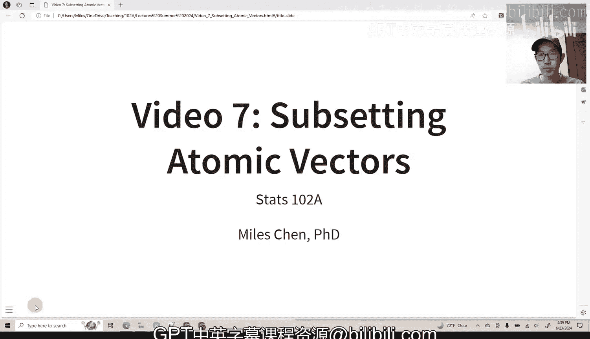

All right， let's talk about subsetting atomic vectors。

A lot of this is based off of chapter4 in Hanley Wickham's Advanced R book and subseing。

 so I recommend reading that， it is an excellent book。

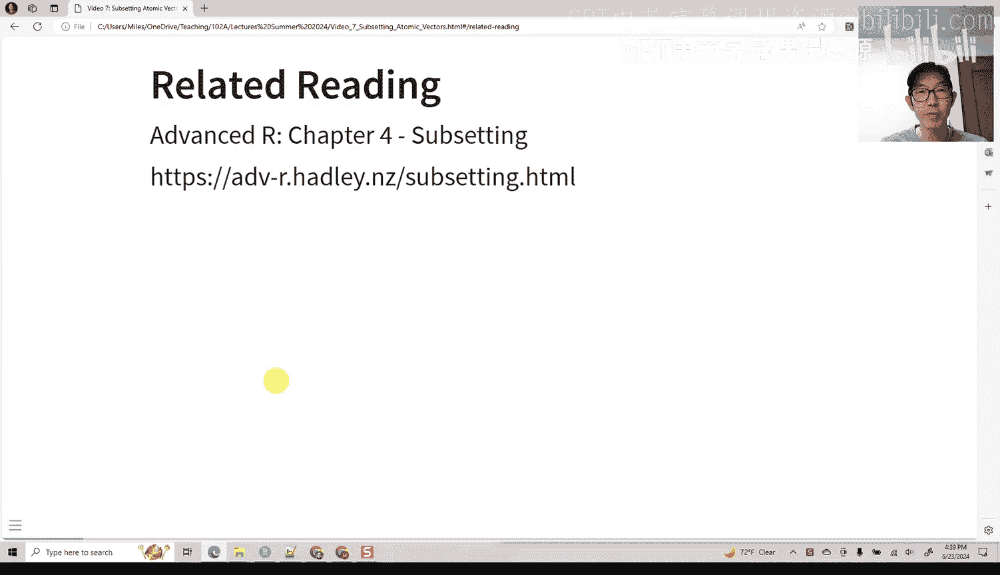

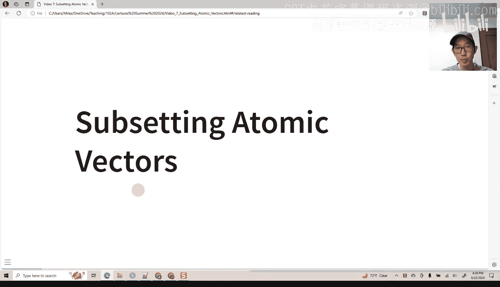

Okay so what we want to do is we want to be able to subset a vector meaning just select a portion of it and so here we have this simple vector X it's got the values 2。

14。23。3 and 5。4 and you'll notice that the value after the decimal the 0。1。2。3。

4 correspond to its position in the original vector so that will just kind of help you keep track of things There's a few ways you can subset a vector you can use positive integers。

 negative integers also logical vectors and character vectors to subset a vector so let's take a look at each of these methods。

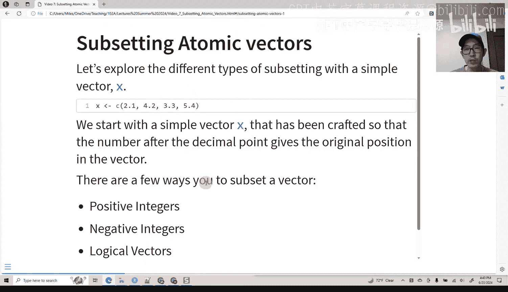

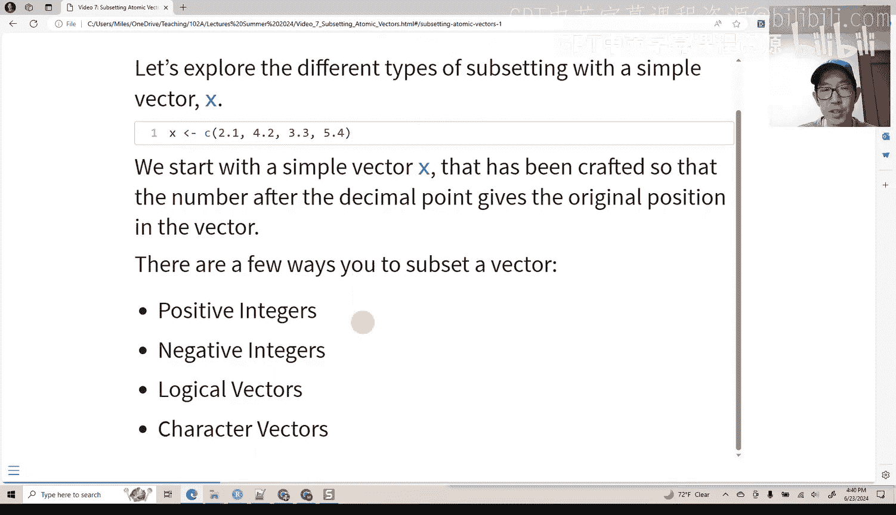

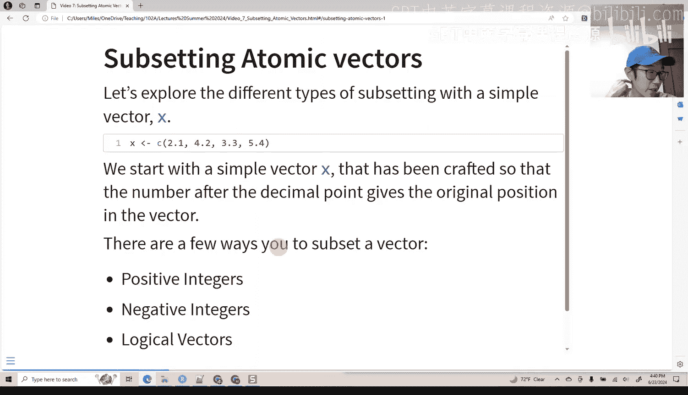

So subsetting with a positive integer basically returns values at that position。

 so here I can say give me the third value and the first value， so you use square brackets。

 you do x square bracket， you put in the vector three comma 1 and that will give you the value at the third position and the value at the first position okay。

嗯。There is a function called order X， Order X returns the values that。

OfThe indexes that you would need so that if you were to subset x using order of x。

 it will put the values of x in order from least to greatest。

 so it says if you want to put these in order you'll need to select the first value。

 then the third value， then the second value， then the fourth value。

 and if you put select the first third， second and fourth in that order you will see you have basically sorted the vector。

If you select values like the same value multiple times in the vector， so if you say select1 comma 1。

 it's going to select that thing multiple times， so you'll get 2。1 2。1。

If you put in something that's not an integer okay R is going to just silently truncate these so it's going to just do 2。

1 becomes the second value 2。9 becomes 2 it's not rounding。

 it just truncates them so you shouldn't do this， but if you do some kind of。Calculation。

Where you end up。With a floating point number that's not exactly the number。

 let's say you get something like 1。999999999 and it looks like a two。

 but it's not actually a two and then you subset using that number。

You you're going to end up selecting the first value now in general， when you subset using integers。

 you should make sure they're integers， but yeah， if you're using like a floating point number and it's something like 1。

999999999 and you think it's the number two it's going to get truncated and it's going to select the first value。

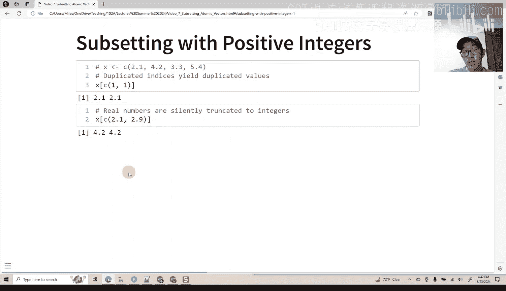

You can omit values by using negative integers so if I say x and then I put square brackets minus three comma1。

 then we're going to select everything but the third and the first values。

 so we end up ending the second and fourth values now you can't mix negative and positive integers because that's just weird you're saying I don't want the first value。

 I do want the second value。And then it says， well what do you want with the third and the fourth values do you want them。

 do you don't want them， and so R will error out if you try to mix negative and positive values into into the same kind of vector here so you can kind of negate。

 you can put a minus sign in front of the entire vector and that will remove those or you can just you know create a vector of all negative values。

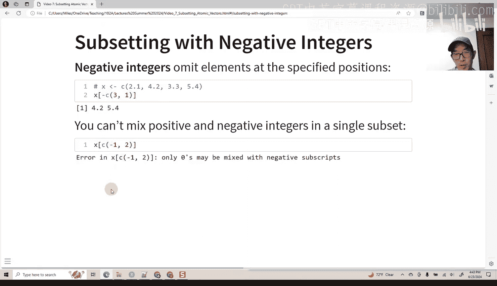

But you can't mix negative and positive values。Another very common way of subting a vector is using logical vectors。

Logical vectors are basically true and false values。

 and it will return values that correspond to the truths。 So here I have X again， these four values。

 and I've got a logical vector with true， true， false false。 And so of course it's going to get the。

Values that correspond to the true， it's going to omit the values that correspond to false。

 so it's going to get the 2。1 and the 4。2， and it won't get the 3。3 and the 5。4。

All here I put in a logical statement or a statement。

 a comparison operation that results in a logical vector x greater than3 x greater than3 is going to return false for 2。

1 and true for the other three values， and therefore it does not return the 2。

1 and it returns true for these values。

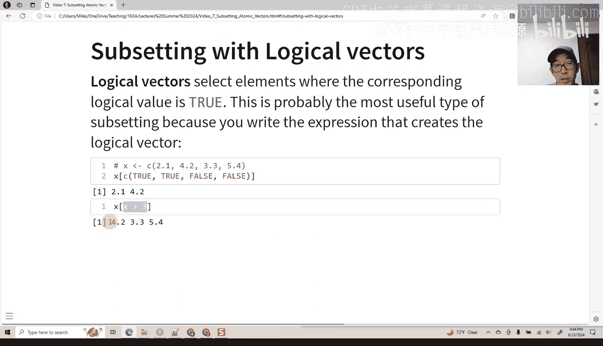

If you give it a logical vector that is shorter than the vector that's being subset。

 it will be recycled to be the same length， so here I've got x is true comma false or subsetting a vector that says true comma false。

 and so this is going to get recycled to basically be true， false， true。

 false to kind of match the length。And it's going to give us 2。1 and 3。3。Okay。

If you have a logical vector and you have an NA NA being the missing value。

 then it will always correspond to giving you an NA， so here I have true true NA false。

 so we're going to get 2。14。2 NA， and then we won't get the last value 5。4。

Maybe you do something like true comma N。Then it will recycle it to true N， true N。

 and you will get 2。1 NA 3。3 NA。

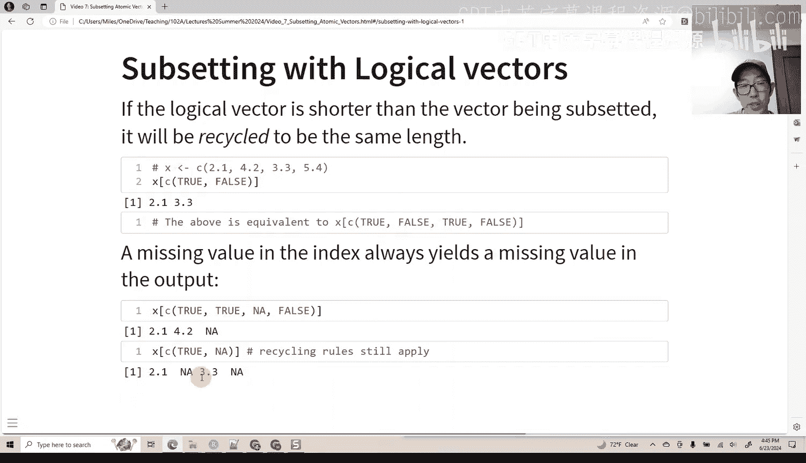

If you subset and you put nothing inside the square brackets that will always return the original vector now generally you don't do this by itself。

 but it is very useful for something like subsetting a matrix or a data frame and as because you will have like I want these select rows but all of the columns or something so you might just leave nothing there okay so if you just do x square brackets you get everything anytime you put a zero。

Inside。The square bracket okay you're going to get a zero length vector right and again this is not something you do on your own but a lot of times when you want to kind of test out your function。

 you want to make sure it's still going to work with a zero length input or something like that and so you can kind of create test。

Test cases by using x square bracket zero and that you'll get a zero length。Nummeric vector or。

 you know， zero length vector of whatever it might be。 Okay， and this this again。

We had an example in one of the earlier videos where we had a condition that just didn't apply。

 you know， if I said a subset to give me where x is greater than7， okay。

 all of the values would be false and you would get a zero length vector there。

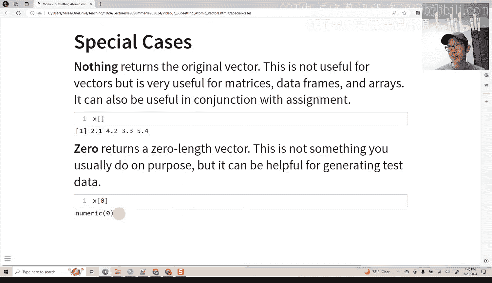

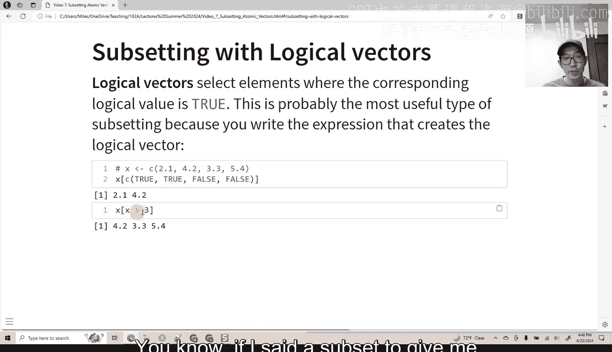

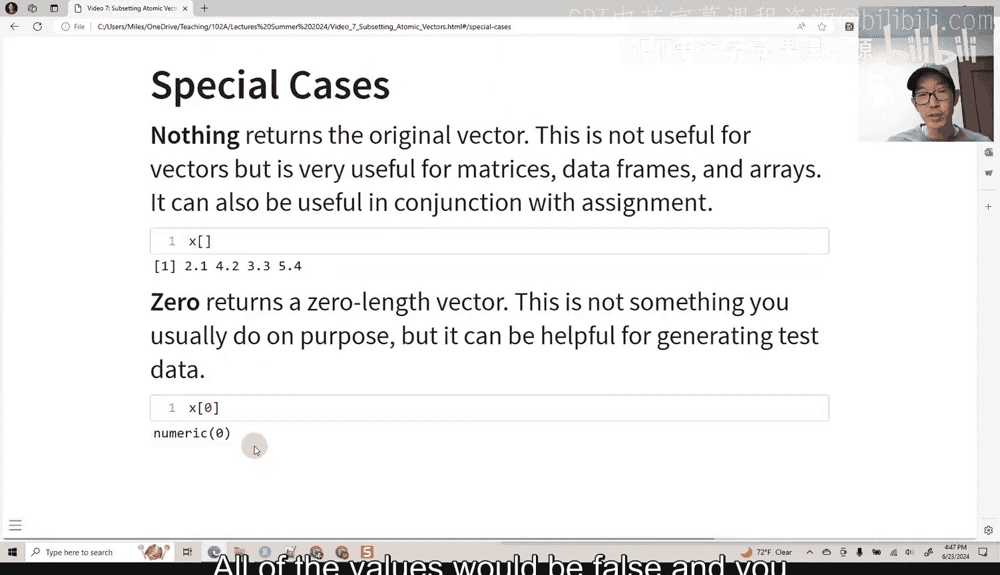

If you have if you've set names to your vector， okay， so here I'm going to set the names。Of x。

 I'm going to give it the names A， B， C， and D， and we're going to store that as y。

And if you have a name vector， then you can subset the vector using a a character vector with the names。

 so you can say I want。The names D and C and A， and it will give you those values in order in that order。

Like integer indices， you can kind of repeat them so you can say give me AA and A and you'll get 2。

1 multiple times。When you have when you subset using this， the spelling has to match exactly。

 so here if I have a vector Z and the name is ABC and the name is DEF and you say hey。

 subset on a or subset on D， you're not going to get a match and you're going to get NAs there okay and so if you have something just spelled a little bit off right you have the capital。

ABC or something like that and you put in lowercase ABC， you're not going to get a match。

 so you have to make sure things are matching exactly。

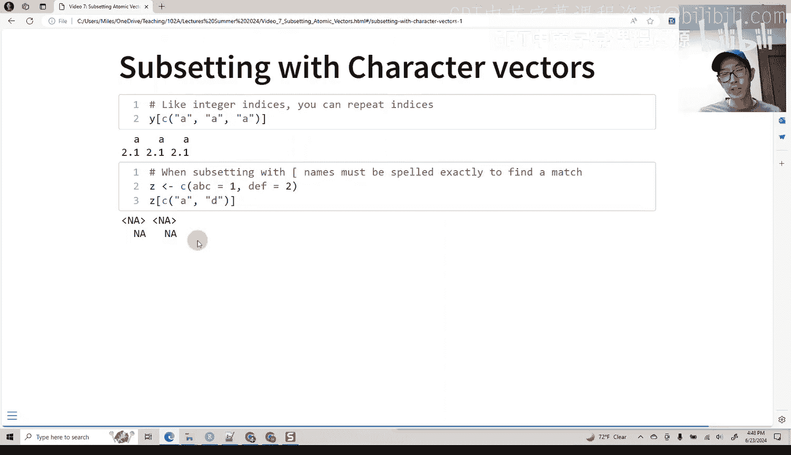

A handy little thing is creating a little lookup table all right。

 so here I've got a character vector。And I've got MF， U， FFM and M okay。

 and let's say I want to kind of replace all of these things so that instead of M I have male and instead of F I have female。

 instead of U we're going to put an NA okay。And so how can I go through and replace all of these things All right Well what I can do is I can create a small vector that kind of corresponds with the look of values and we're going to basically say when you see we're going to put in the values that we kind of one replace them with so we'll put male and we'll give it the name M we'll give female and we'll give it the name F and we'll have NA and we'll give it the name U。

And then I can subset look up。Okay。Basically， I'm subsetting my small vector with the kind of desired values。

 This is a vector of only three values in it， but I'm going to subset this vector of only three values using the longer vector X And remember。

 R is able to kind of handle repeated。Repeated values here so when it subsets here it's going to look up using kind of the names it's going to put in the M and it's going to pull retrieve male。

 it's going to find the F， it's going to retrieve female， it's going to find the U and retrieve NA。

 it's going to find the F again retrieve female， find the F again。

 retrieve female and so on and so forth then it does that。

So this is what happens when you subset the labeled or the named vector。

 the short named vector with basically the vector X， and then if we want to get rid of the names。

 then we call unname on that so we say unname look up X and now I have replaced。All of these things。

 you know in accordance to there。So that's a handy little application of the lookup table。Is a hint。

 I will say you can apply this to one of the problems in your homework assignment。

 the one where you're doing month names， you can kind of frame it as a lookup table and I think that's a fairly elegant approach to the problem there。

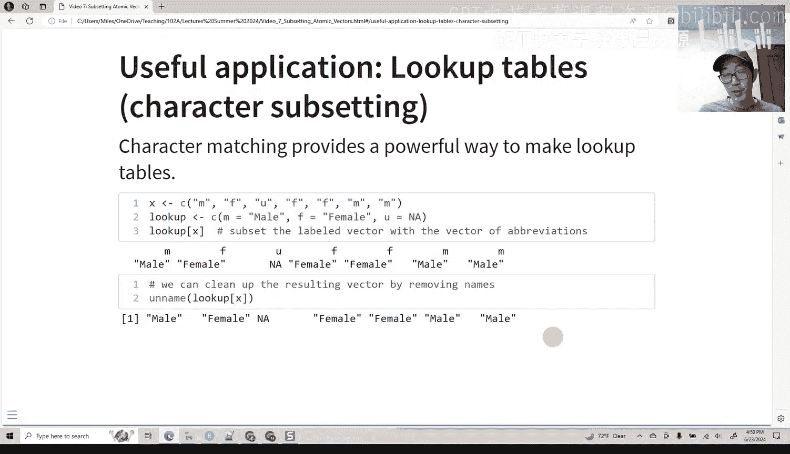

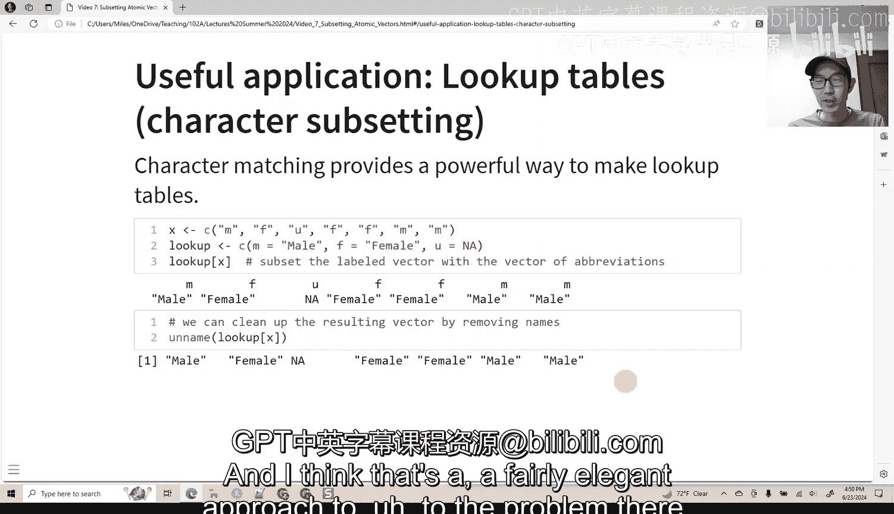

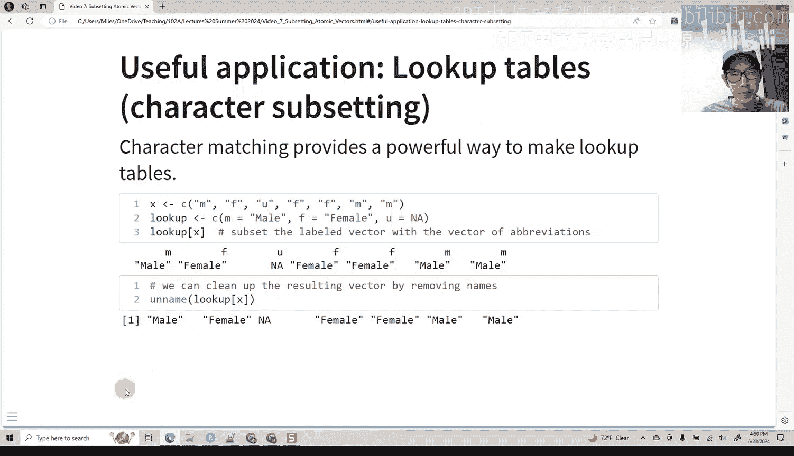