# UCLA《计算统计学｜Stats 102A - Computational Statistics with R 2024 Summer》中英字幕 p08 [08]Stats 102A - 2024 Summer - Video 8 - Subsetting Lists in R.zh_en [BV1jizNBrEm2_p8]

Okay， let's keep talking about subsetseing this time we're going to look at subsetting lists。

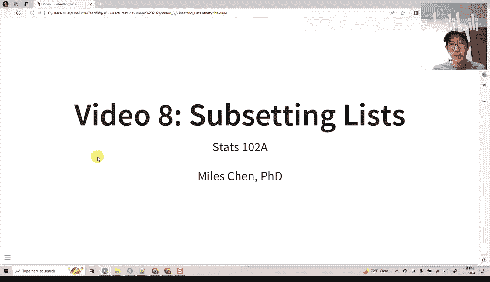

Okay， so lists and atomic vectors are similar， but they are different because。

They are similar in that they're both one dimensional structures， but with lists。

 lists can contain other things， and so we need to be able to distinguish between you know the contents of the list and elements of the list and so we have single square brackets and we have double square brackets Okay when you use a single square bracket on a list what you get back is always going to be a list when you use a double square bracket what you will get back is you will get the component that is being stored inside the list double square brackets can only handle one value whereas single square brackets。

 you can give it multiple values okay so these。

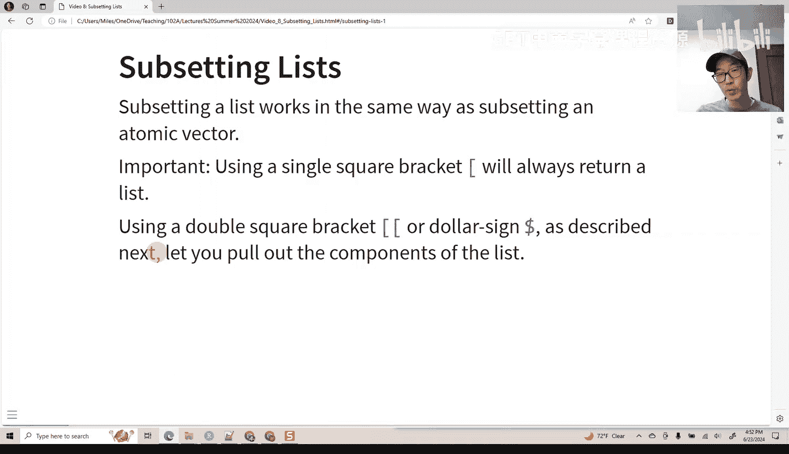

The subsetseing operations double square bracket and the dollar sign double dollar sign is also similar to double square bracket are similar to the single square brackets except the double square bracket can only return a single object and it pulls pieces out of the list dollar sign for subsetting a list it's basically shorthand for the double square bracket。

 but you use it with names。One way to help us think about lists is you think of a list as a train。

 okay， a train carrying you know multiple train cars and each train car contains objects。

So x double square bracket 5 is the object inside train car number5。

Whereas x single square bracket4 through6 is basically a train consisting of train cars four，5 and6。

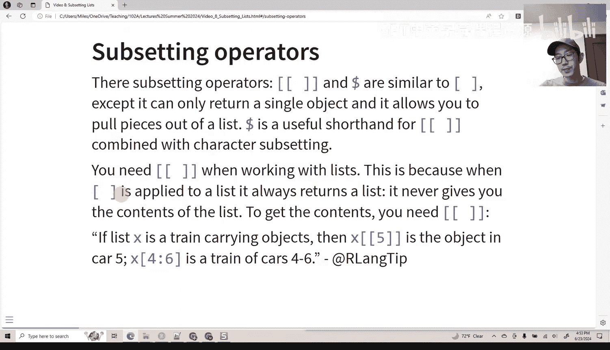

So here。We are going to create X。X is a list of three train cars， that is a list of length  three。

 the first train car contains the vector， 1，2，3。The second train card contains the character A。

 and the third train card contains the vector 456。If you do x single square bracket 1 that returns the train car with the vector 123 inside of it。

 if you do x double square bracket1， you get the object inside that train car。

 which is the vector containing 12，3。These illustrations come from。

The Adv our textbook by Hadley Wickham。So again， think of a list as a train with cars。

 single score bracket will return the train with that particular car。

Double square bracket returns the object inside the train。

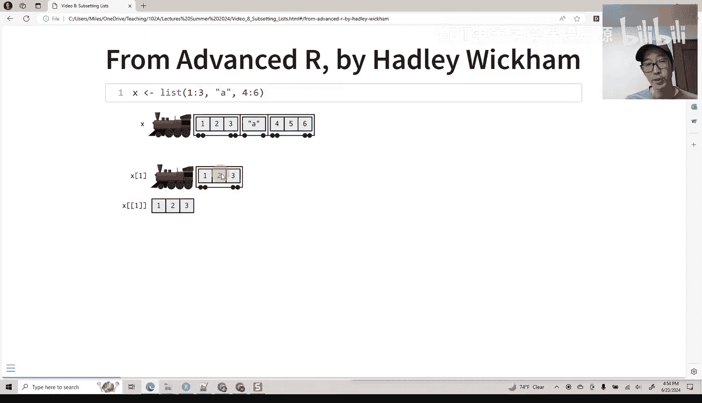

All right， so here again， the train is x3 cars。X single score bracket 1 through2 gives us back the first two cars。

X single score bracket negative 2 gives me back the train without the second car。

X single score bracket， C1 comma 1 gives me a train width。

That the first car kind of duplicated and x single score bracket zero gives me back basically a train with no cars。

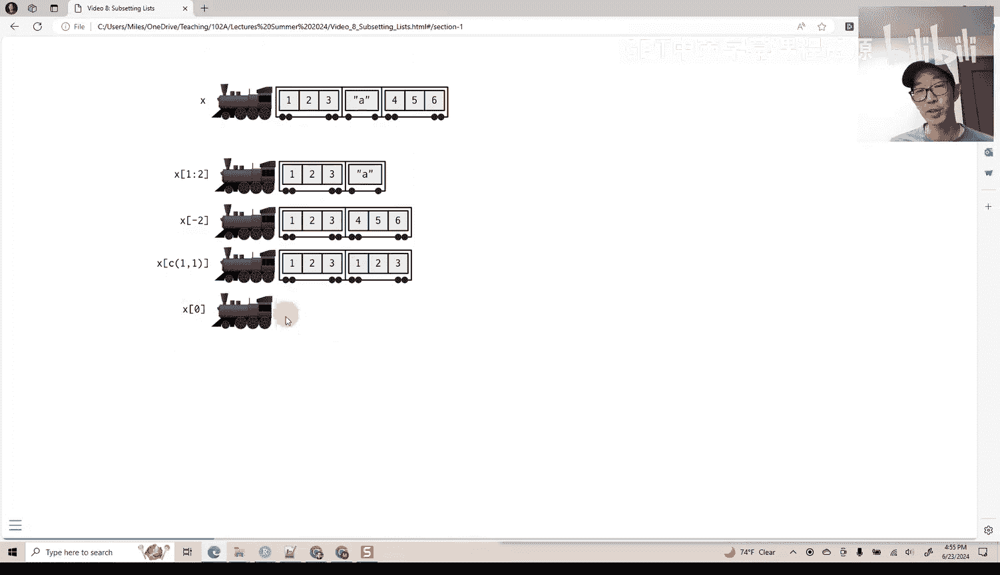

The double square bracket can only return a single object and so with the double square bracket you have to put in basically just a single integer or single string。

 so here is a list with three cars in it， and we're giving the cars， the name A。

 the second car gets the name B， the third car gets the name C。And so here I can see it。 What is X。

 X is basically a list。 First car is a with the vector 1，2，3， Second car is B with the character A。

 third car C， name C with 4，5，6 X double square bracket 1 gives me the contents of that first train car。

 the vector 1，2，3， X double square bracket with。The character A gives me back the same exact thing。

 the vector with one， two， three in it。嗯。

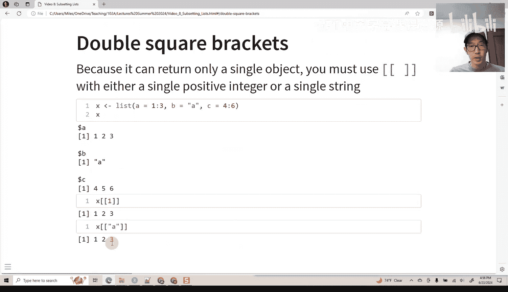

If I use single score brackets， I can give it a vector with A， B and B。

 and that will give me back a train car consisting of train car A， train car B， and again。

 train car B。If I try to do something similar here and I do x double score bracket using with a vector A comma of B。

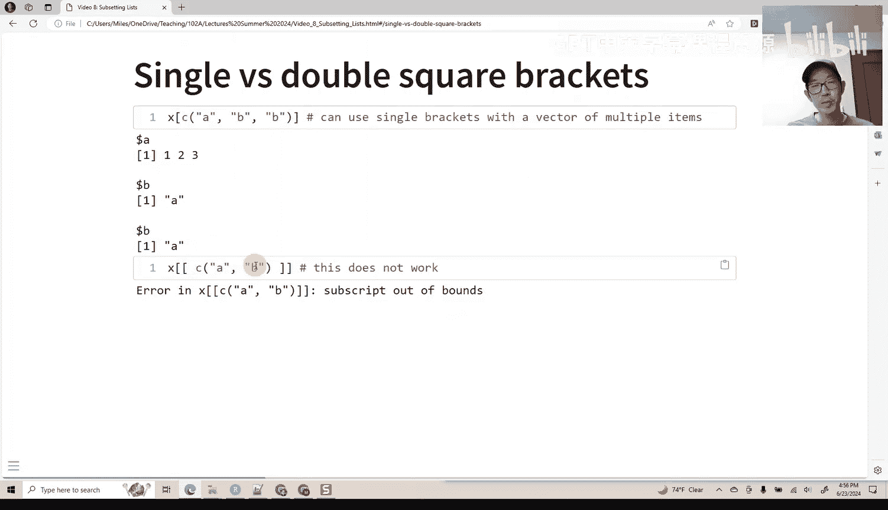

It is not able to do that， it is not able to extract out the element from car A and the element from car B and combine them or something like that。

 you end up getting an error， you get error subscript out of bound。

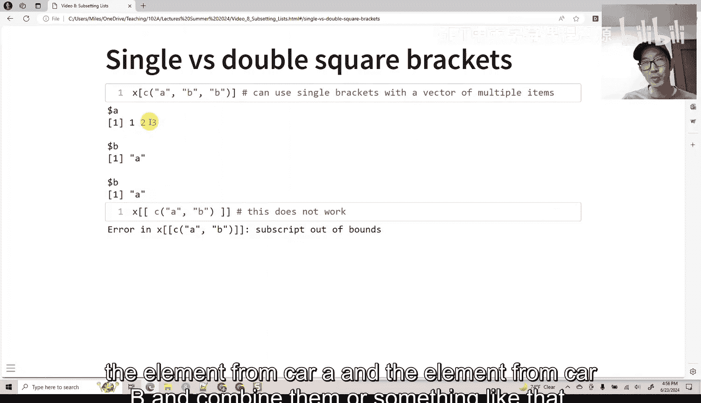

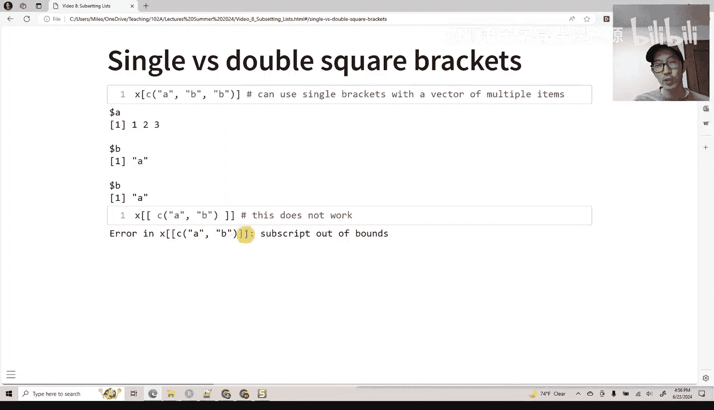

Okay， now technically。What is going on is that when you put multiple elements inside a double square bracket。

 it performs what's called recursive subseing， it's a little bit confusing。

 and so I don't recommend using recursive subseing when you do x double square bracket。

A comma B inside a vector like this， this is actually equivalent to doing x double square bracketet A。

And then double square bracketet B。And this will work if x has basically a train car named A。

And within A。Is another list。Where there's another tri RNA， so you can imagine。A train with cars。

 And within that first train car， theres like a miniature train， another list inside of it。

 And inside that， there is also another train car with A and B。

 And so if this is your kind of your structure where x is a list。Where you have two elements A and B。

And this element A itself is a list。Then this will actually work。 You can do x。

 double square bracket A， then double score bracket B， and that will go into。

The A first and then once since you're inside A it'll find the B。

 and it will pull out this character B， and then you could do x double square bracket at a comma B。

 So this thing would actually work if you have this kind of structure Again， it's a little bit odd。

 a little bit confusing and I would say this is not recommended， but it is something that does exist。

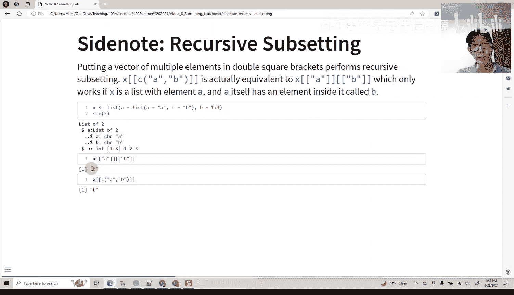

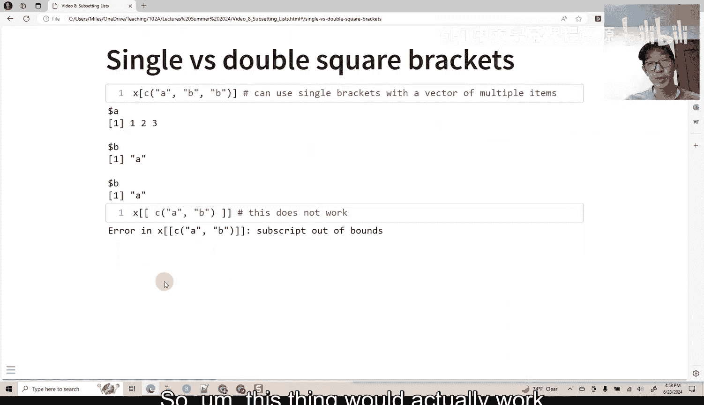

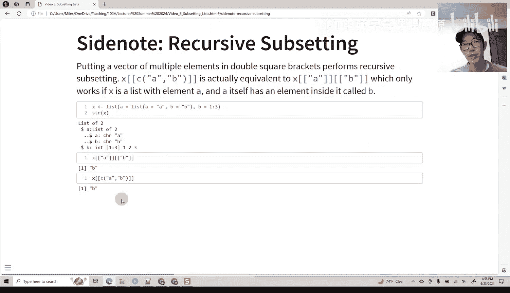

All right， so let's just kind of really make sure we understand lists subting here。

 So here's another example here I have a list called D。List D consists of three train cars。

 three elements， it's a list of length 3， and the names are A B and C。

 A is a numeric vector or double type double with the values 1，2，3 B。

 it contains a vector true true false， and C contains a vector with just the character A。

Anytime you want to see kind of how a list looks， you can always ask structure of that list。

 structure D， and that's what we get。

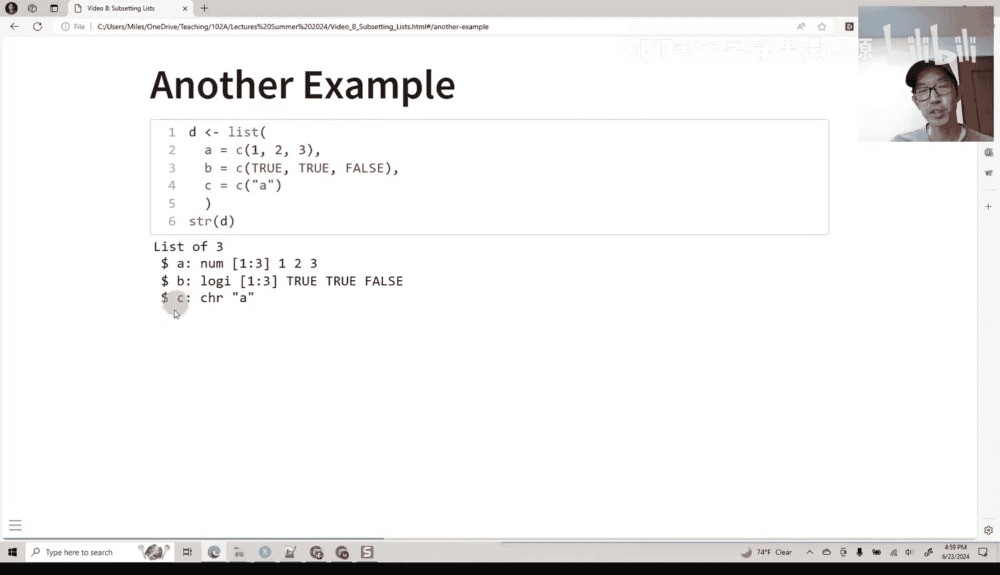

Okay， so let's look at what we get using D single square bracket one， that pulls out the train car。

 train car A， the first train car， and so we get train car A。

What inside of that train car A is the vector 12，3， when you ask what is the type of on this。

 it's going to be a list， this is a list of length one containing a vector there。

D double score bracket one。only returns the contents of that train car， the vector itself。

The vector itself， it doesn't return a list， it returns the contents of that train car。

 and so when you say type of D double square racket 1。

 it's type double because that is the type of the vector we have。

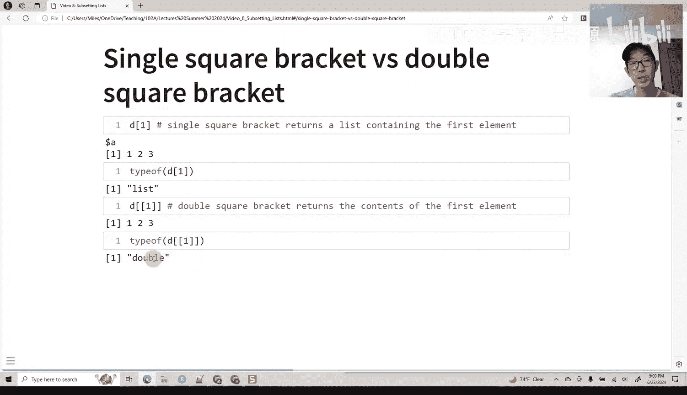

Here is another list this time the three things in it are unnamed Okay。

 we don't have names A B and C， so here I' got list L1 vector 1 through 8 vector with the characters ABCD vector with the numbers 5。

4，3，21 Okay， how does this look when we print it？

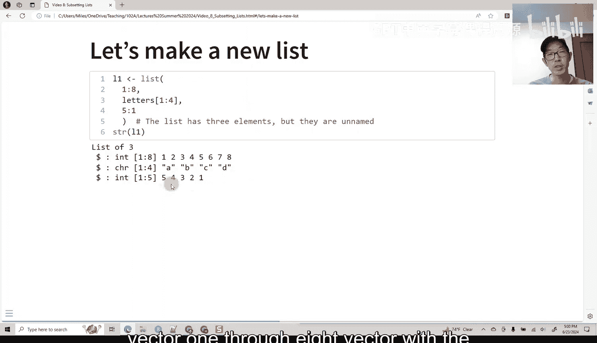

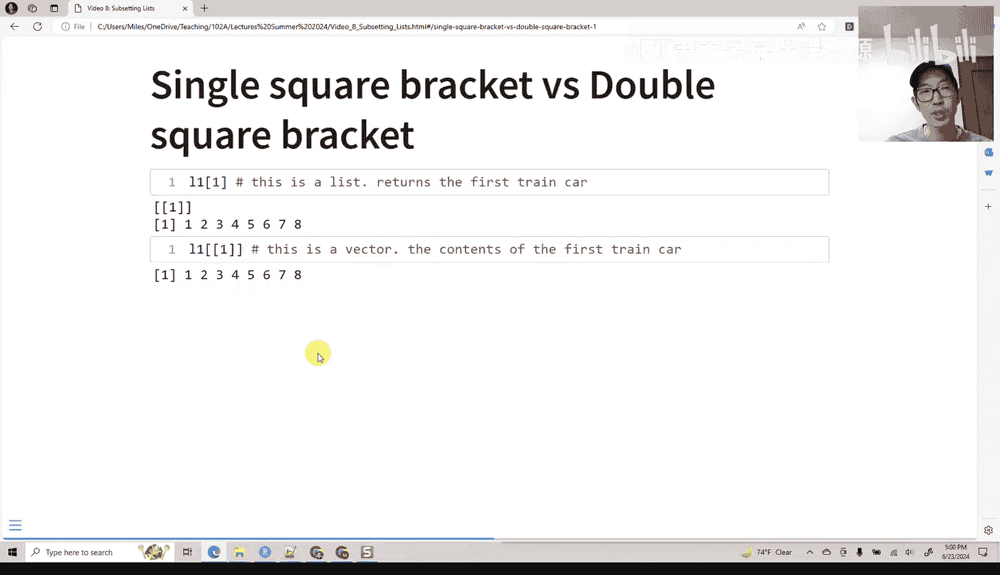

Okay， so when we see structure， it just says dollar sign and there's nothing there。

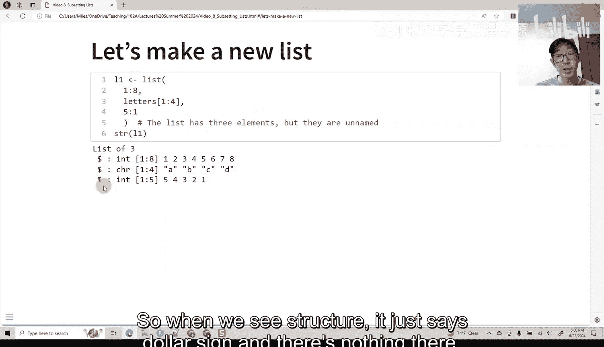

And when you print this， okay， when you say， hey， give me L1 square bracket1。

It comes back and you get double square bracket one and then single square bracket one。

The double score bracket one up here indicates that this output is a list， Okay， whereas back here。

 because it was named， it gave us dollar sign a to kind of indicate the output as a list here the。

It gives us a double score bracket and that's how we know the output of this thing is a list。

And then what is the contents of that， it is a vector。The vector has a single square bracket one。

 and it's the vector 1 through8。 When you do L1， double square bracket  one。

Now in one double score bracket one， it pulls out the contents of that first train car。

 that's a vector， and it is just a single score bracket one to indicate this is the first element of the vector and it contains 1。

2，3，4，5，608。So single square bracket always returns a list， returns basically the train cars itself。

 double score brackets give you the contents of that train car。

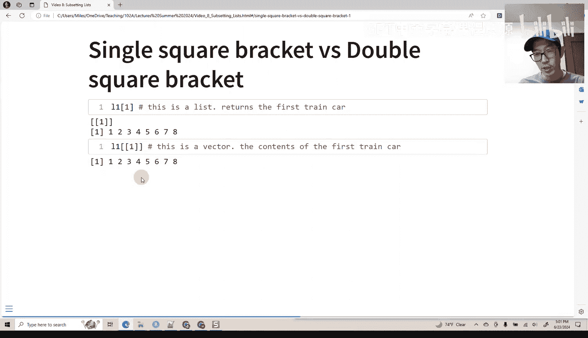

So what happens when we do something like this， L1， single score bracket  one。

 single score bracket 2？We are saying。This first part。

 L1 single score bracket 1 gives me the first train car now that I have the first train car I'm asking give me the second train。

Okay， give me the second element of this train that has one car， well there's no second element。

 so we get back basically null a list with null in it okay。Here， if I say， hey。

Double score bracket one， okay， double score bracket  one says okay。Pull out the contents of this。

 So we're getting the vector here。 and now that we have。Double score bracket1。

 that's basically that integer vector 11 through8， I can say hey， give me the second element there。

 the second element in that is just two， basically L1 double score bracket1 is this and then I'm saying hey。

 give me the second element which is going to be that number two there。

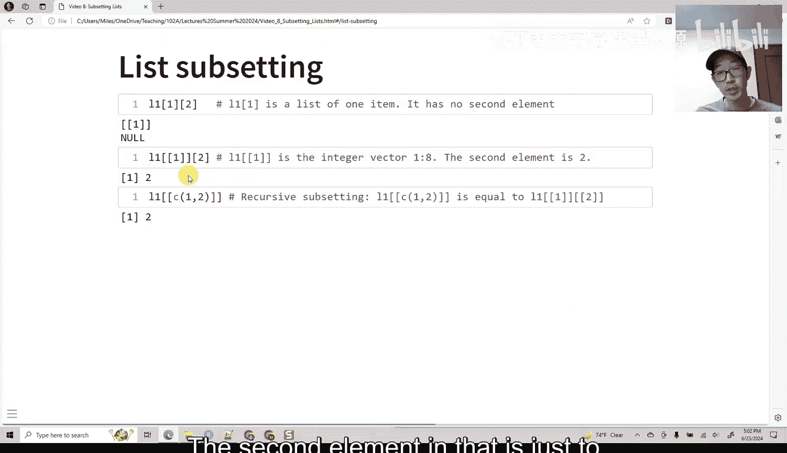

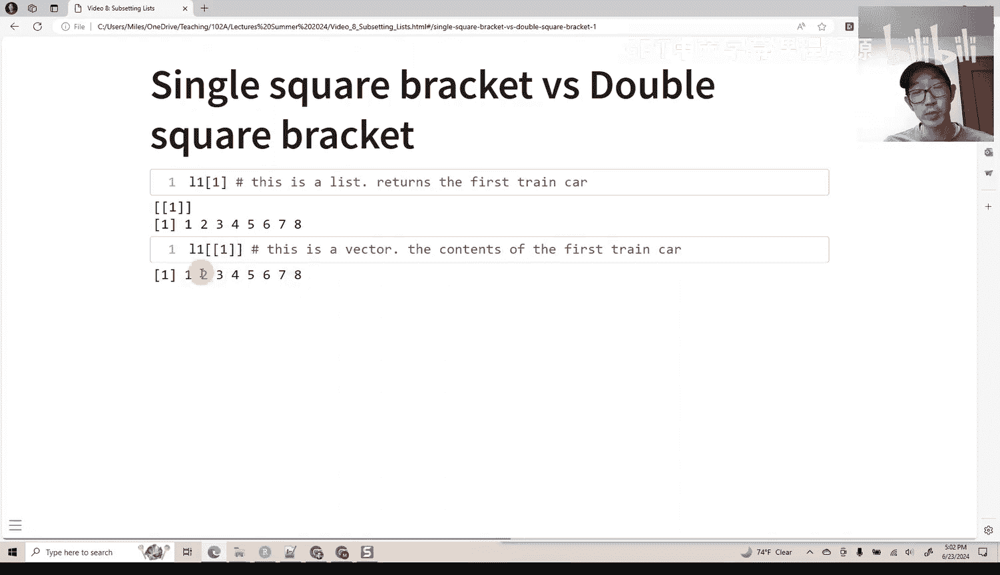

That's what we see。L1 double square bracket with C1 comma 2 again， this is recursive substing。

 it's equivalent to doing this。

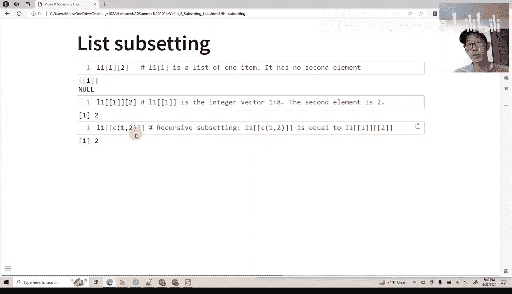

And so we're basically taking this thing and I'm saying， hey， give me the second element。

 when you use double score bracket2 on an atomic vector。

 it's basically like using a single score bracket and you're going to just get the second element there and so we get the number two。

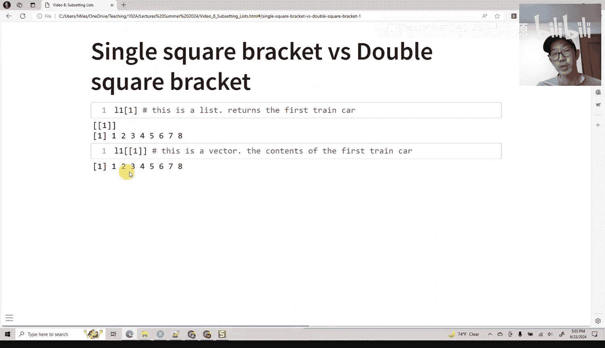

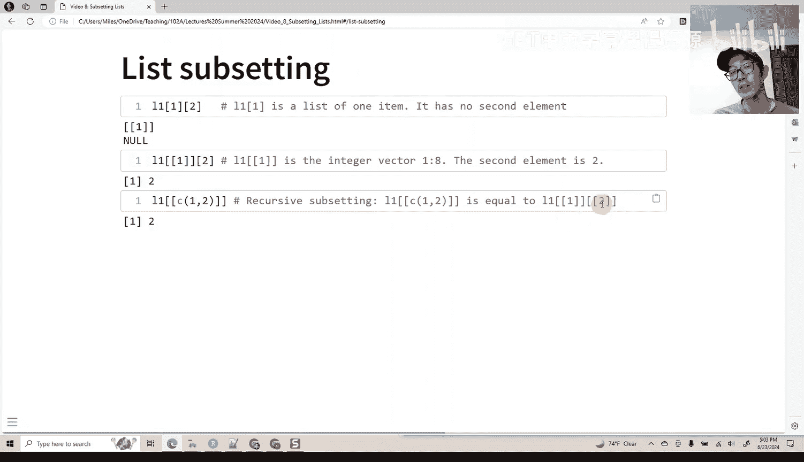

All right， what happens if we put a list inside a list so I put a train inside a train car？Okay。

So L2。Has three elements in it。The first。L2 is a list of three， and the first thing in L2 is list L1。

Then I have the vector 102030， and then I have the letters D FGH， I think。

 or whatever whatever letters are in there， okay， so we can see the top level is a list of three。

Within that first train car itself is a little mini train， basically list L1 list F3。

 and know we've got， you know， the vectors 1 through8， ABC D 5，4，3，21。

 Then we have the second train car 102030 and the third train car with the letter to D E FG Okay。

 how do we。Reference and pull out elements from this。

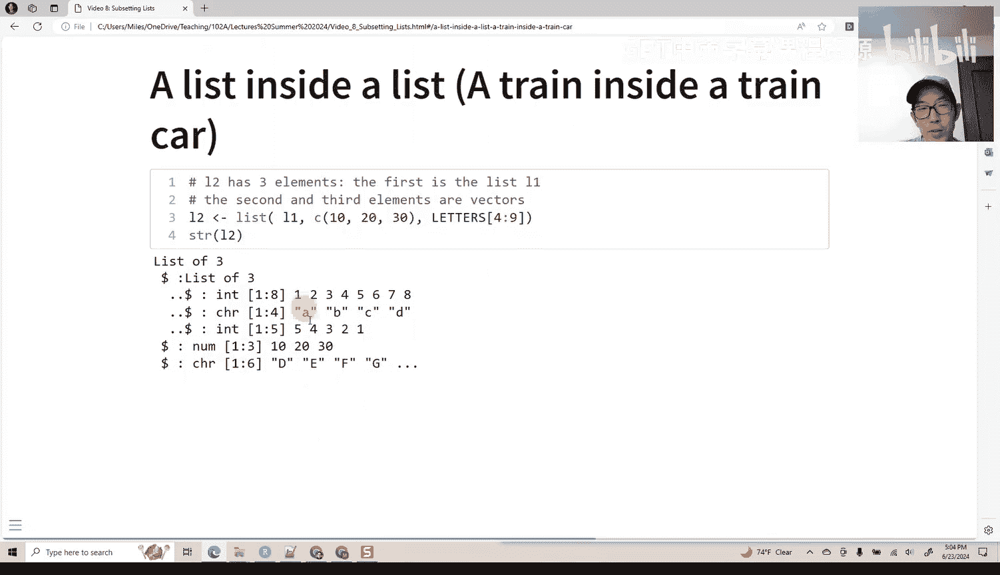

Okay。😊，Well， when we ask L2 single square bracket1， that's going to give me back。

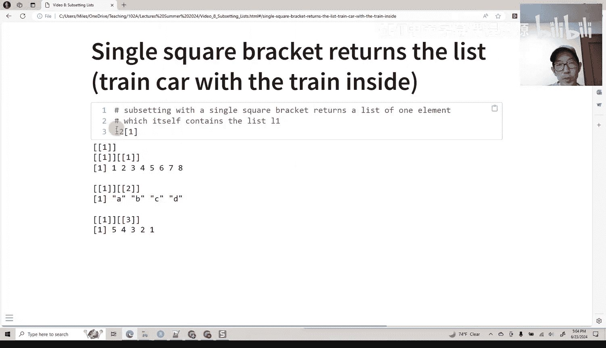

，The train car itself that contains a list of three。

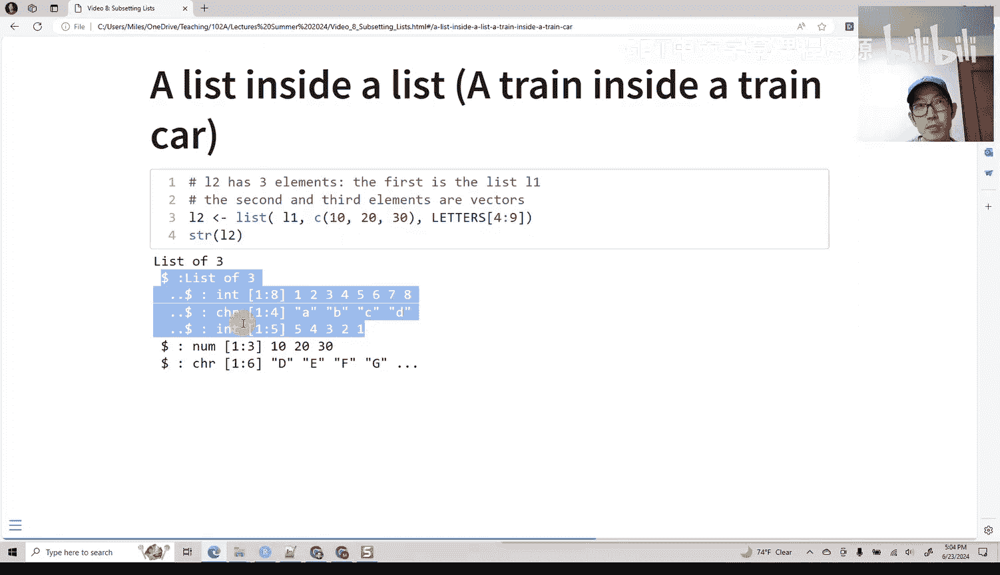

All right， so remember the top L2， the top level list is a train of three cars and that first train car。

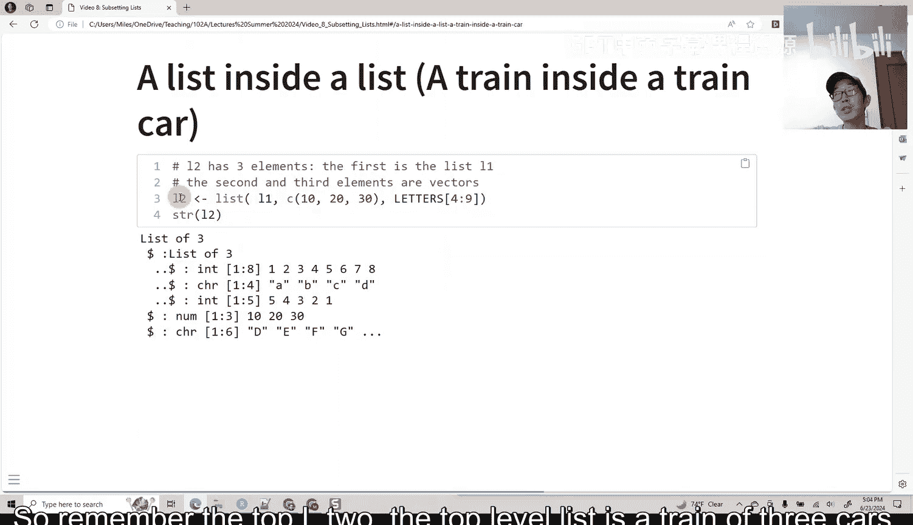

It contains a list of three in it， so here what we see。Is we see a double square bracket one。

 So basically this is the。First train car， or basically you get Becca。

A train and we have the first train car and then within that。We have another train。

 and so to indicate what's inside that， we have double score bracket  one， double score bracket one。

 basically the first train car inside the first train car， double score bracket one。

 double score bracket 2 is inside the second train car。That exists inside that first train。

And then that's the letters ABCD， and then we have double score bracket one。

 double score bracket three。So again。This is the third train car inside the first train car。So again。

 when we say， hey， what is the structure of L2 single square bracket 1？It is at the top level。

 it is a list of one， basically a big train car， and inside of that is a list of three。

 a little train inside that first train car。And that's why you see it printed out double score bracket one。

 double score bracket， one， double score bracket， one， double score bracketet2。

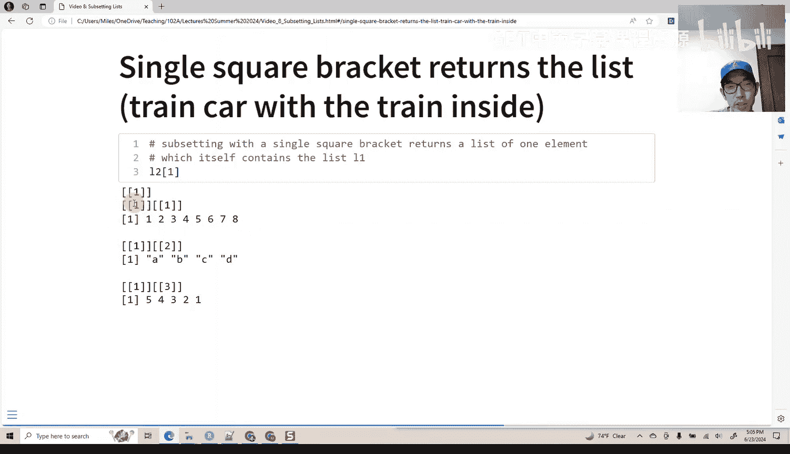

Okay。If we do L2 double score bracket one， okay， so now we're pulling out the contents。

Of that first train car， which is just a train of three。

 and that's exactly the same as list L1 listist L1 is exactly this。

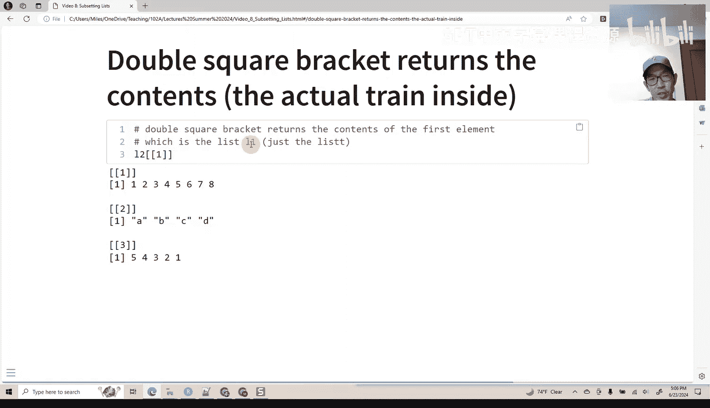

So if we scroll back to a few slides back， list L1 is exactly this thing。

And that's what we have right here。 this is list L1 Okay， first train car has this vector。

 second train car has that third train car has a double school vector。

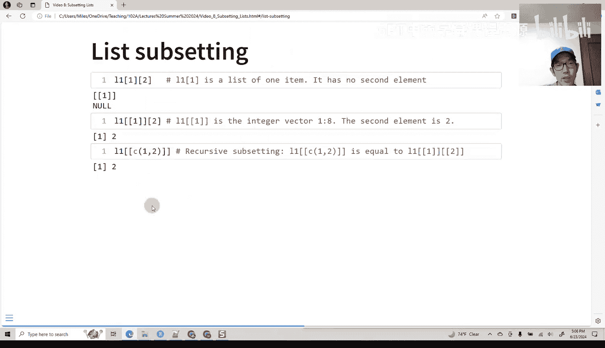

And so if you say hey， structure of L2 double score bracketet1， then that is just a list of three。

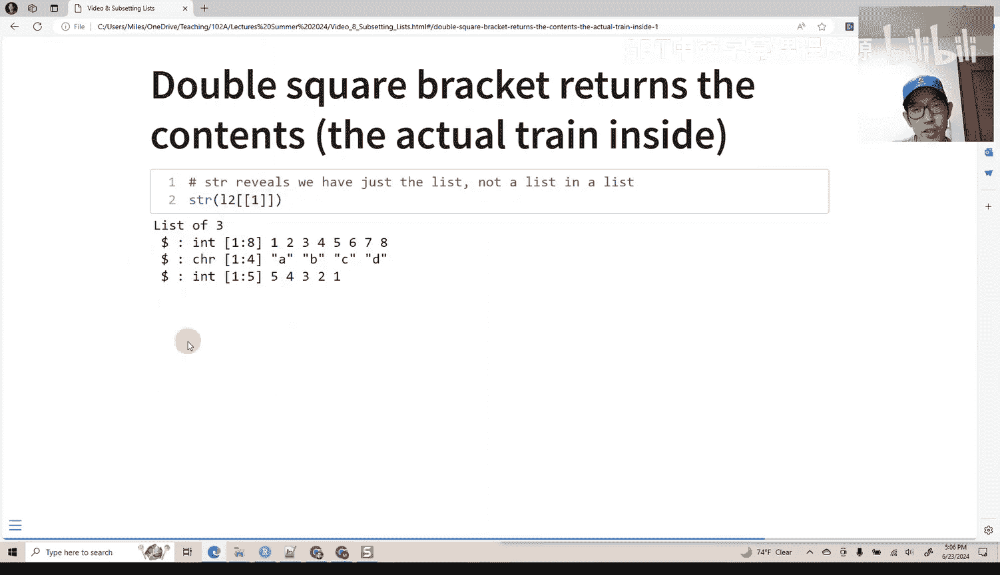

Okay， so the difference between this is that here we have a list of one where that inside that first list。

We have a list of three that's L2 single score bracketula1。

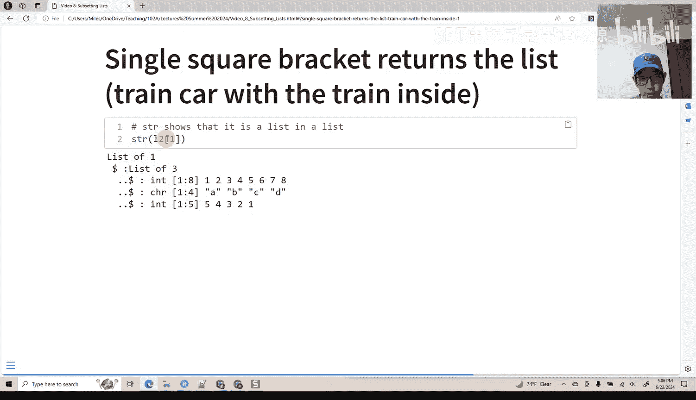

L2 double square bracket1 just extracts out that list of three。

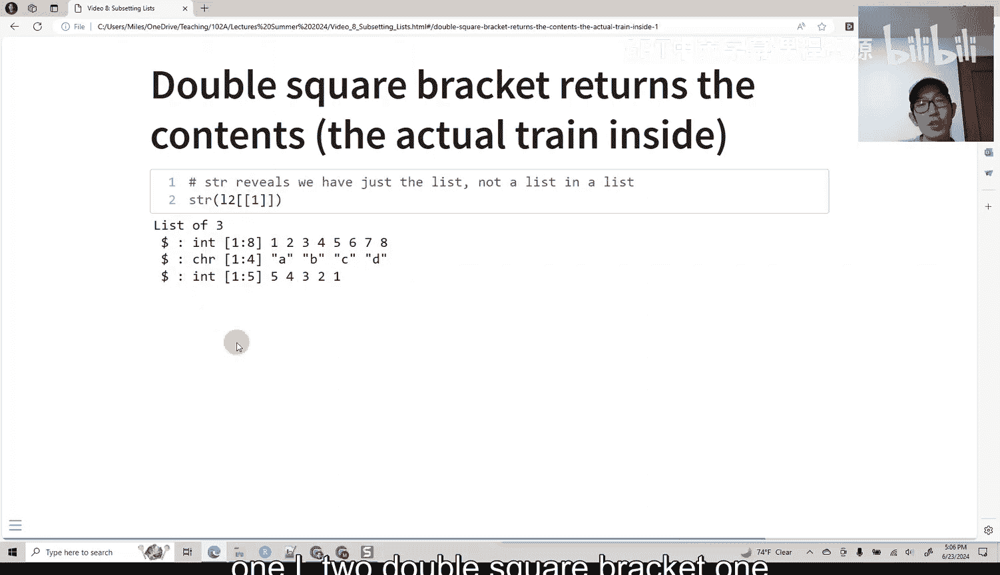

So always kind of pay attention。Because now we have all of these square brackets and you have to be able to read all of these things Okay。

 so L2 remember L2 is the big train and inside that first train train car is the little mini train L1。

 so L2 double square bracket one will pull out。The mini train inside that L2。

 and then we ask for the first train car there， so we get basically the little mini train car with the vector1 through 8 in it。

L2 double score bracket， one， single square bracket， one， single square bracket2 is asking， okay。

 if you have basically if we get this and we say， hey， what is the second train？

What is the second train car here， which is basically what we're asking here， it says， hey。

 there's no second train car， okay， so we get list null okay。If I do L2， double score bracket one。

 double score bracket1， we're going to say， hey， look inside the first train car and L2。

 you're going to find a train。And then look inside the first train car of that thing。

 you're going to find a vector and we'll get this vector1 through eight。Then I can do L2。

 double score bracket one， double score bracket one， single score bracket 2， now we're asking， hey。

 what is the second element？Inside。This vector， that's just the number two。Okay it's a lot。

 take some time， make sure you understand the differences on this slide and if you can get through that then you'll have a pretty good grasp on how subsetting list works。

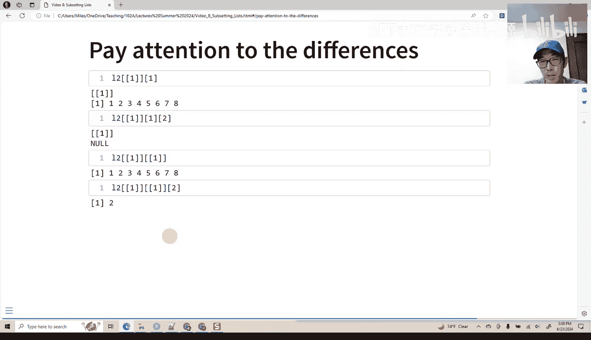

What happens if you use a double square bracket on an atomic vector。

 basically what it will do is it kind of simplifies it。 So if you have a。AndBa。

 it works pretty much the same way except here。If you have a named vector like 1，2。

3 and with the names ABC， if you use single square bracket， you'll get that one back with the name A。

 if you use double square bracket， it drops the name and you just get the one。

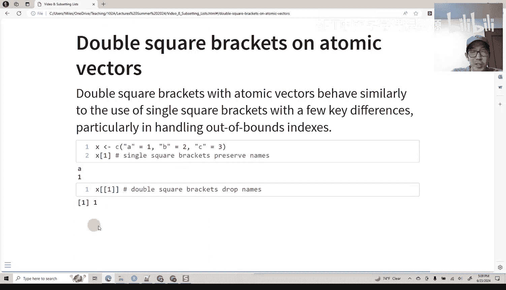

if you use single score bracket and you give it an out of bounds index， so x is a vector of length 3。

1，2，3， and you say， hey， give me the fifth value。Okay， R is going to return an NA。 This is kind of a。

An interesting design choice that are made， the designers of are made。

 but they said when if you ask for something that's out of bounds。On an atomic vector。

 you're going to get back an NA versus an error or something like that。 however。

 if you use double square brackets and you say giveive me the fifth value。

Then you get an error okay so it's a little bit odd。

 but these are just some of the things that you have to know is that in R。

 you can use single square brackets on an element that's out of bounds and you don't get an error you get an NA。

 but if you use double square brackets and you give ask for something that's out of bounds。

 so the vector is only length three and you ask for the fifth thing。

 you get an error subscript out of bounds。So that's going to be kind of an indication of where something might have gone wrong。

If you use single square bracket and you put in null， okay， or base a zero。

 you will get a zero length。Vectctor okay， a zero length vector， x is an integer type vector。

 so you're going to get an integer integer vector of zero length。That's a single square bracket null。

 if you do double square bracket and you put in null， okay？Then you'll get an error。

 it says attempted to select less than one element。

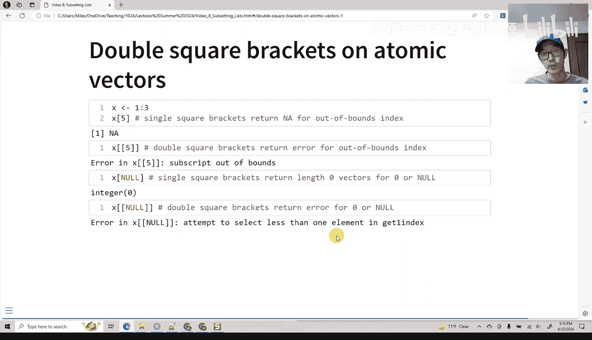

Other things for out of bounds and null indices， so we have similar rules for out of bounds indices。

And so let's take a look at list L1 again， so this is list L1 list of length3， we got a vector of 8。

 vector of 4 ABCD and vector of length 554321。

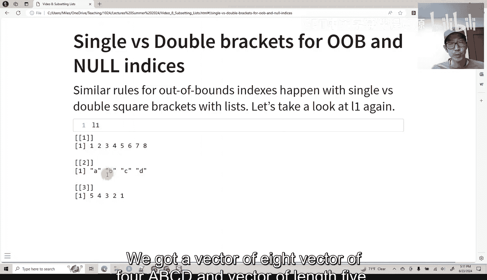

If you say， hey， give me an out of bounds index， okay， give me the fourth train car。

In this list that only has three things， the fourth trend car， you get back a list with a null， okay。

 basically。Train car with noll inside。If you use say L1 double square bracket4。

 give me the contents of the fourth train car， then you get an error subscript out of bound。

If you do L1 with nothing inside or a zero， if you put a null or a zero here。

 you get back an empty list， basically no train cars。Like train， but no cars， okay。

And here we have L1 double score bracket null， you get back an error again。

 so similar to how it works with an atomic vector。

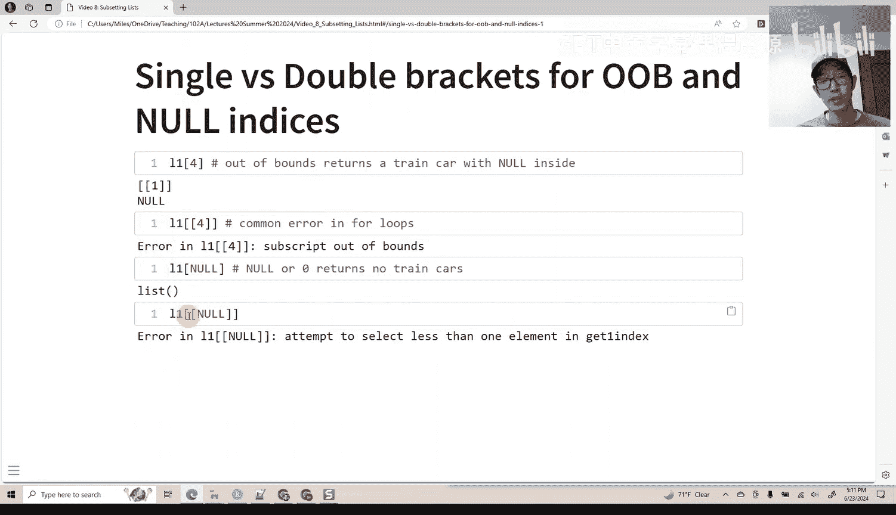

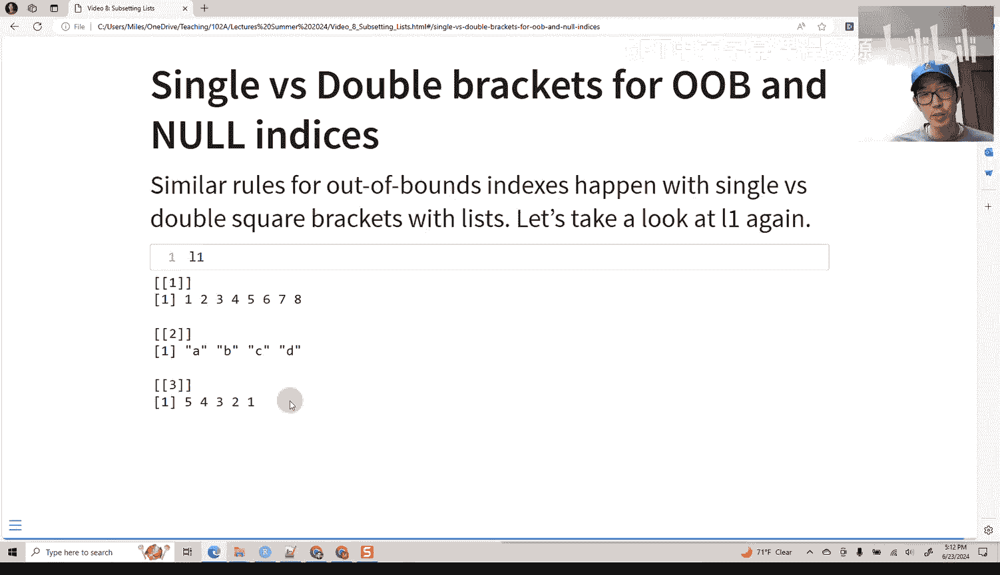

And that。

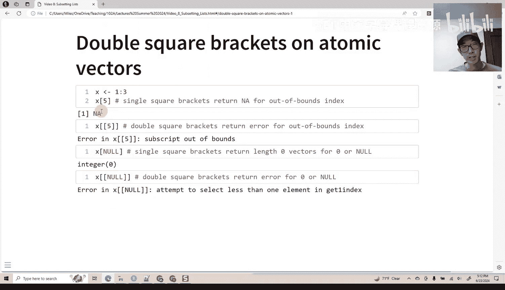

But instead of getting an NA here， you get back a list with no in it， okay？

And this is basically the equivalent of a zero length。List。Okay。

 and that's how subsetting a list works。

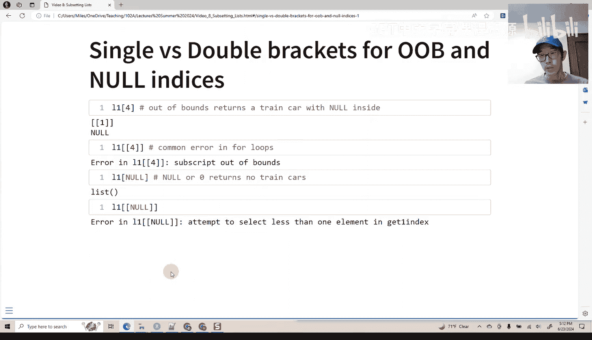