# UCLA《计算统计学｜Stats 102A - Computational Statistics with R 2024 Summer》中英字幕 p10 [10]Stats 102A - 2024 Summer - Video 10 - Conditional Statements.zh_en [BV1jizNBrEm2_p10]

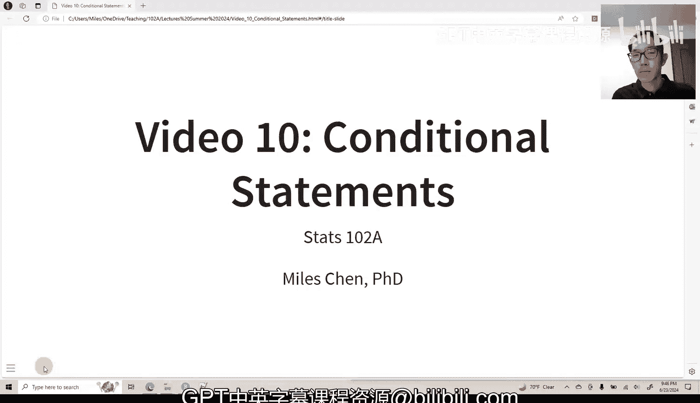

All right， let's talk about conditional statements。

A lot of this is related to or comes from chapter5 in the Adv our textbook。

 there's also a bit covered in chapter3 of this textbook。

 which you should be able to access for free if you're connected to the UCLAVPN。

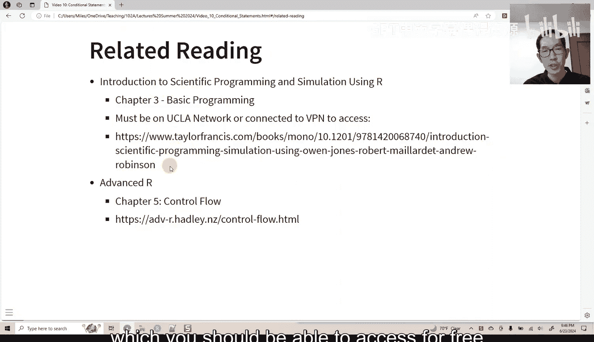

Okay， conditional statements are basically statements that have a condition。

 basically your if statements， but they also play a role in say like a while loop because those。

Are based on a condition and so the way we evaluate a condition is we need a logical value true or false。

 if it's true， you know the related lines of code get run， if it's false， those lines of code。

Do not run， and therefore we need to know what operators produce these logical values true or false。

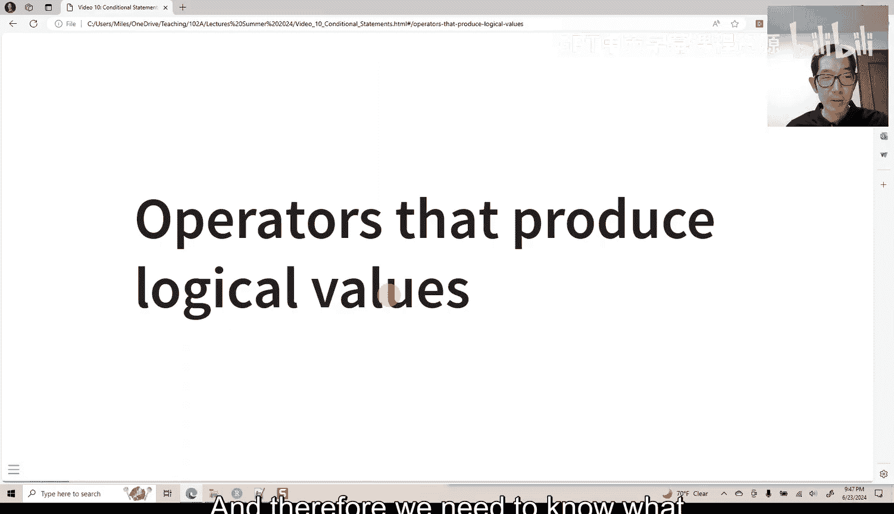

Okay the。Logical operators that we have are basically and an or。

 we also have not which reverses you know switches the operation false the true。

 and then we also have exclusive or if you use a logical operator that is going to coerce anything that is not logical to logical type so。

But basically， the only thing that becomes a false is is zero， zeros become false。

 and pretty much all other numeric values evaluate to true so that's something you have to be aware of。

all of these logical operators are vectorized and so if you have two vectors of values。

 it will match them up element wise and also perform recycling okay。

 and then the result will be a vector of logical values。

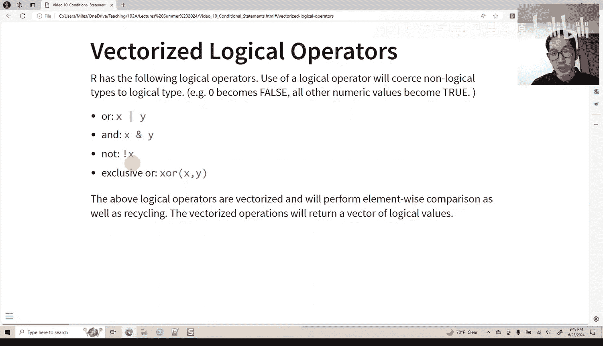

We also have non vectorized logical operators， Okay。

 we have the double or and the double and and these。Only accept values that are length1。

 and if you give it something that's longer than length1。

 it's going to return an error if y has a length that's greater than  one and is evaluate it that will X and Y。

 they will both return an error。嗯。But if y has a length that is greater than one。

 but it is not evaluated， R will not return an error， so I'll show you an example of what that means。

 okay older versions of R will actually read left to right and allow for things that allow for vectors that are longer than one and will only evaluate the first one。

 but you should have。I would say update to the latest version of R and have kind of the updated operations here。

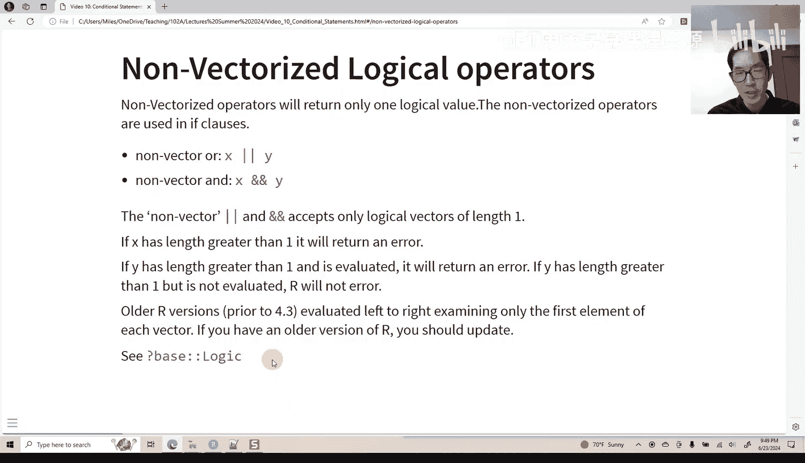

So。Here I have x and y， these are vectors， x is true， true， false false， y is false， true， false。

 true。And if I use the single or that's going to be vectorized， and basically with or。

 if either one is true， it will evaluate to true， and it's only when both are false that evaluates to false or true。

 false is true， true， true is true， false false， evaluates to false， false or false。

 and false or true is true。Meanwhile， with and both things have to be true for it to be true。

 so true and false is false， true and true is true， false and false is false。

 false and true is false。Here we have an or operator， it is the non vectorized。

 and so giving a vector that is longer than length1 results in an error okay。A and x or or Y。

 it's trying to coerce this into length1 logical and it can't do that okay。Here。

 if I have a false and the double and y， okay， it doesn't need to evaluate y because as soon as。

The and operator sees the false。 it knows that it's going to be false。

 so it doesn't even bother evaluating y。 so even the y has a length longer than one。

 y is not evaluated so it doesn't produce an error if you have a true with or okay， then。

R also knows that the result is going to be true， it doesn't need to evaluate y。

 so even though y has a length longer than one， it doesn't produce an error Okay here if I have a false with the non vectorized or。

Now it needs to evaluate y and now it needs to know if y is true or false in order to produce its answer。

 and so now that y gets evaluated， it notices that y has a length greater than1 and therefore it returns an error because it sees it has a length greater than1。

Okay， when you have an NA， NA is a missing value。And R treats that as unknown。

 but it can still kind of evaluate。 So if you have true or N， it doesn't matter what this is。

 because if there's a true， then the result of true or something else。

 it doesn't matter is going to be true。 On the other hand。

 true and N is going to remain unknown because it matters what this is。 if N is true。

 it will be true if it's false， it's going to be false So it matters what this is。

A false or is an unknown okay the result of that's going to be unknown because we need to know whether the N is false or true in order to evaluate that。

 however false and NA we know is going to result in false so the operations there depend。

On on whether you're using an orN and and whether you have a true or a false or things like that。

 so true RNA will be true， no matter what the N is， true and N is unknown to us。

 false or NA is unknown to us， but false and NA we know for sure is going to evaluate to false。

 no matter what NA is。Exclusive or requires that one thing x is true or y is true， but not both okay？

So if you have x or and you have a true and a true that's going to evaluate to false。

 so true exclusive or false is going to be true， true exclusive or true is going to be false。

 false exclusive or false is false， false exclusive or true is going to be true。

 and then if you do an exclusive or with missing values they're all going to be missing because it matters what that missing value evaluates to。

You have any and you have all， any is kind of like the generalization of the or to more than two values。

 all is the generalization of the and to more than two values。

 and so basically everything has to be true for all to evaluate to true and any one of the values has to be true to evaluate to true so here I've got you everything is true。

 any is true all is can be true if you have true true false the n will evaluate to true。

 and the all will evaluate it to false， if you have false， false false。

 any evaluates to false and all evaluates to false。

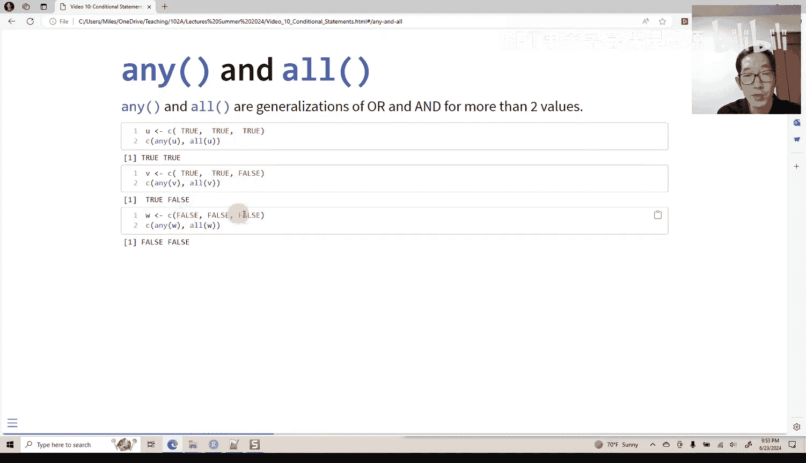

All right， so here's a question that you should think about okay if we have a zero length vector like logical zero or null。

 and if we add it to a vector of logical values V， then it shouldn't have any effect on the result of any or all。

 that is if I do any， and if I have a V and I have a logical0， I add logical zero。

 then the result should just be the same as any applied to V because logical0 is basically nothing same idea with all if I have all on V and then I throw in a logical zero basically I'm adding nothing to the thing。

 the result should still just be the same as all V。So with that in mind。

What should any on a zero length vector return and what should all on a zero length of vector return？

Okay。You can pause the video to think about this， what should any on a zero length vector or what should all on a zero length vector return？

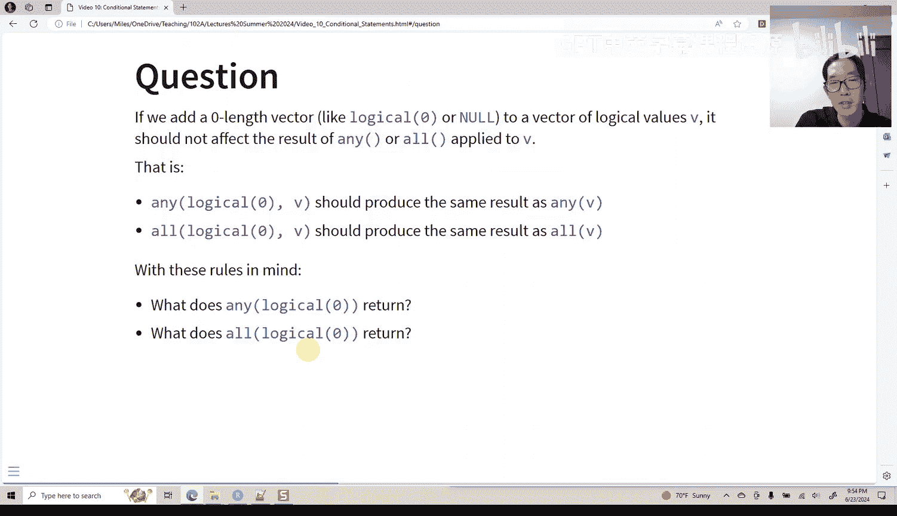

Let's take a look， okay， so x is going to be a length zero logical vector。

And if you apply any on a length zeroological vector， that's going to evaluate to false， okay。

 why is that？Well， if you think about it， if I have true， true， true， and I evaluate any on the true。

That would be that evaluates to true。If I combine the logical zero。To the true， true true。

That should be also true， okay？If I have true， true false I and I throw in any on there that evaluates to true。

 if I add the length zeroological vector to this， so true true false and a logical zero。

Now that still evaluates to true， here I have false， false， false， any on the false。

 false false evaluates to false， and if I include the length0 logical vector， any on the x。

 the logical length0 logical vector and W。That thing also needs to evaluate to false if any on logical zero somehow evaluated to true。

Then this thing， any combining the logical zero and the W would then evaluate to true。

 and so it's important that any on logical zero evaluates to false so that this rule holds up。

And with the same kind of reasoning。All applied to a length zero vector is going to evaluate it to true Okay。

 so here I have x is now a length0 vector， all applied to that is going to be true。

And so all applied to you， which has true， true， true is going to be true， and then if I combine。

The length0 logical vector with you， it should evaluate to the same thing。

 basically I'm adding nothing and but somehow if the length zero logical vector on all evaluated to false。

 then this thing would end up being different okay all of these other things remain kind of false and so they evaluate the same。

But throwing in a length zeroological vector。Shouldn't affect the result of the evaluation of all。

 and so all applied to length zeroological vector is going to be evaluated to true。

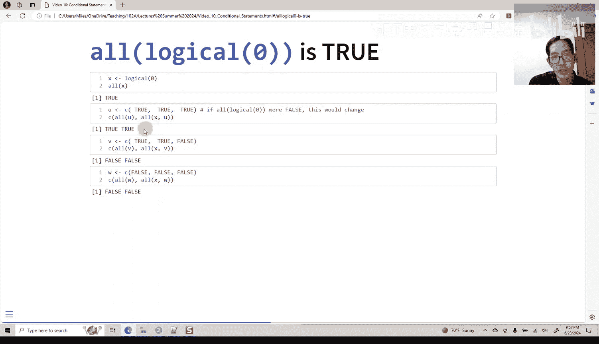

We also have comparison operators， these comparison operators produce logical values and they are vectorized and they also perform recycling。

 so you can check to see if two quantities are equal to each other with the equal equals。

 you can check if two quantities are not equal to each other with exclamation point equal not equal。

 less than greater than less than or equal to greater than or equal to。

And then you also have the in operator， okay， and so x。

 it's vectorized for x so if you have like 20 using in x。

It will produce 20 a vector of length 20 and it will check to see any those if the element in x is one of the values in vector y。

嗯。If you have character strings， okay， comparison operators are based on alphabetical order with the following general arrangement。

 we have symbols。Okay， and then the digits。Starting with zero， and then one， going up to nine。

 then lowercase A followed by capital A， then lowercase B。

 followed by capital B continuing until you reach。Capital Z， all right。

 so one side effect of this is that the character string 10 comes before is alphabetized before。

The character string 2， okay 10。Is alphabetized before2 okay。

 of course if you look at the numer quantity， 10 is not going to be less than two。

 10 comes after two， so 10 less than two is false， but the character string 10 comes before the character string2 and so character 10 less than character 2 is evaluated to true。

As far as the symbols， this is the order of the symbols and here I wrote back tickick。

 but that's basically the little back tick that's above the tab key on your keyboard。

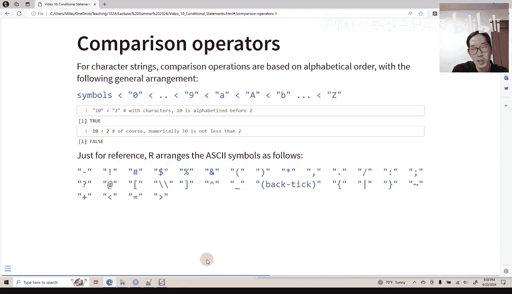

We also have I functions that can check to see if something has a certain kind of。

Is a certain type or class or trait or whatever it is， and these will return either true or false。

Statements， so is something missing， is it null， is it atomic， is it a factor or whatever？

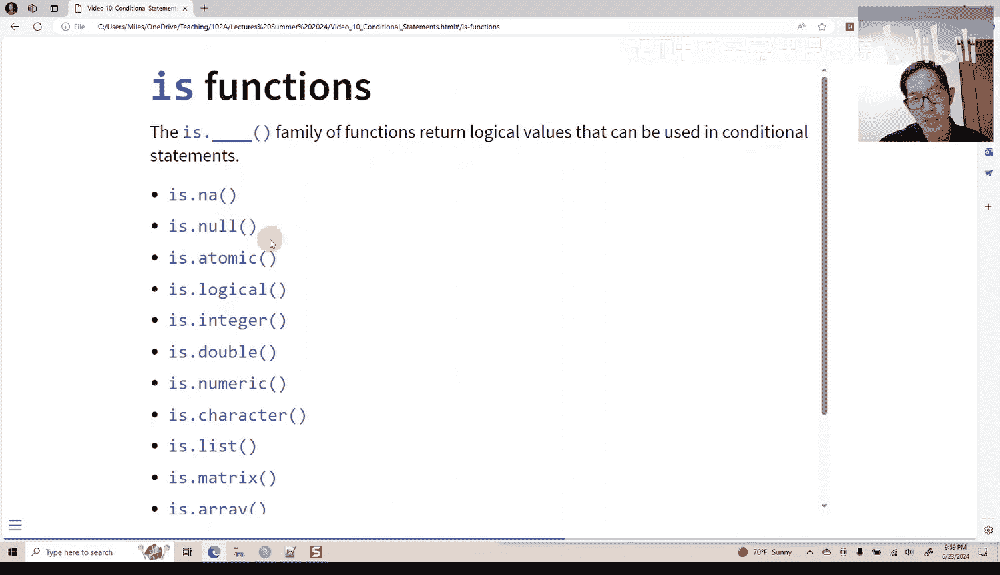

And these will return true or false。So now that we can create or produce logical values。

 we can throw those into conditional statements。

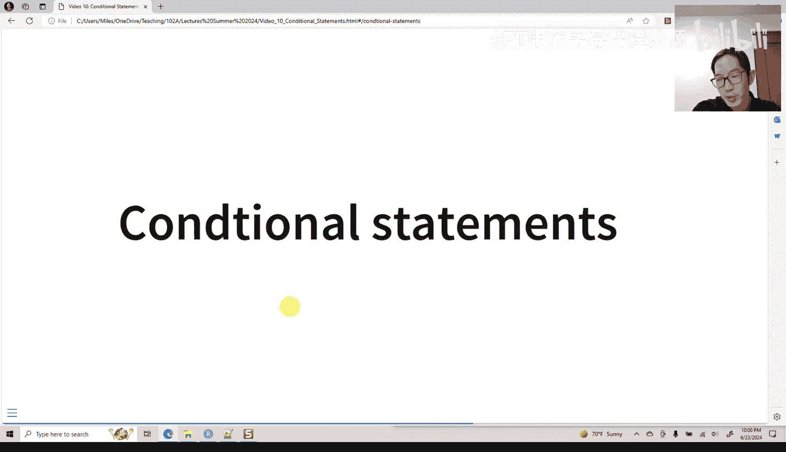

So the if statement， is how we execute code blocks， right， conditional execution of code。

Using the if statement， so basically you have if a condition。

And that condition that goes inside an if statement。Must produce a length one logical value。

 length one logical vector， and it cannot be NAA cannot be missing okay。

If you have if this conditional thing is a length greater than one。

 that's going to result in an error older versions of R。

Allowed for it and gave you a warning where only the first element is used。

 but basically the newer versions of R set you know that doesn't really make sense。

 so it results in an error okay other types of things if you throw it into conditional statement will'll get coerced into a logical thing if it's possible but generally you really want to kind of make sure it's a logical value in there if the condition results in a missing value you will get an error if the condition is length zero。

 you will get an error。And then as far as the。诶。The expressions that run when that condition is true。

 you generally put them in curly braces， but if there's only kind of one line to execute。

 then the curly braces are optional， but it's good practice to use the curly braces so here。

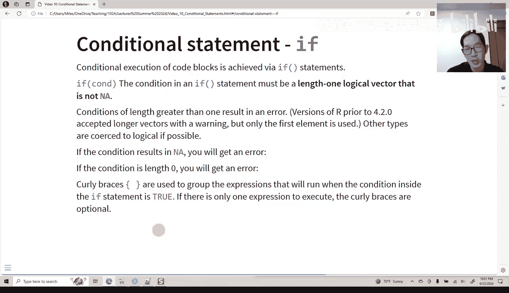

I have this vector x， it's got the values1 and3， and we can run this operation 1 percent in percent x is one of one。

 a value that's inside the vector x that is true。And so I can write a statement if  one is an x。

Execute these code， the code says print hello， and so this statement is true。

 and so we print out hello。

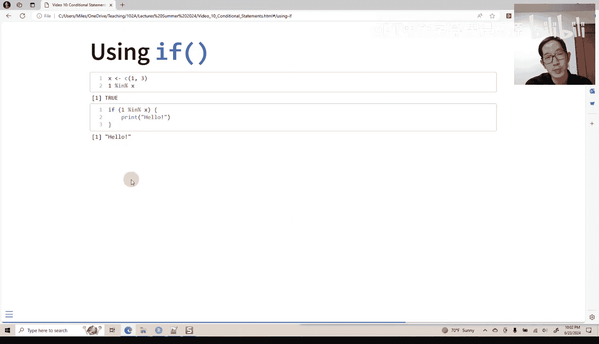

Here is。We get an error if we have a logical vector with a length greater than one。

 so here I have x is the vector 1 and3 again， and now I can say is x less than or equal to 2 Well。

 it's true for the first value and it's false for the second。 we have this comparison operator。

 it's vectorized so it says is one less than or equal to2 that's true。

3 less than or equal to2 that's false。 if we throw that in here we get an error because x less than or equal to 2 produces a length2 logical vector and so。

It says error in if x less than or equal to 2。And says the condition has a length greater than one so error messages in R are helpful you when you encounter an error message。

 don't just throw up your hands and say oh oh， something broke but。

But read it and see if you can figure out what went wrong。

 so here it says the condition has a length greater than one。

 what is the condition x less than or equal to two so you go oh。

 you know what something's going on here， this thing is producing a logical vector with more than one value。

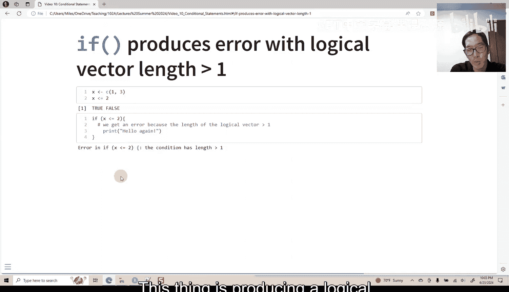

嗯。If you do want to have a vector greater than one， then you should wrap it in any or all。

 So now if I do。X greater than or equal to 2 with a1 and  three。

 we're going to get a length 2 logical vector， but I can wrap it in any。

 and now this becomes a length one value of true， and then I can throw that in there if any of x are greater than equal to 2 then run this code which says print。

 can you hear me now and that works okay？

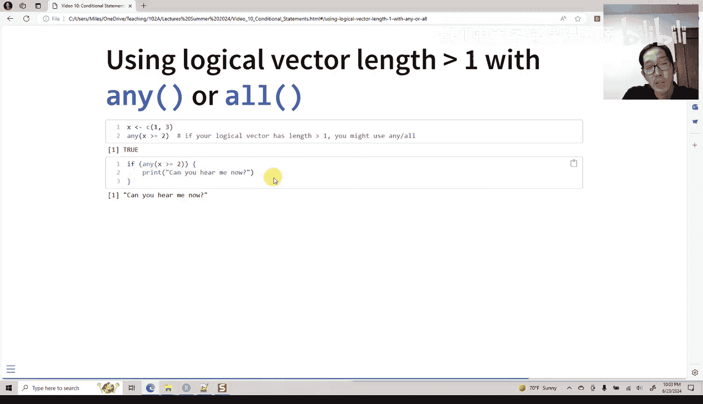

Which over here we got the air， so that line of code never ran。

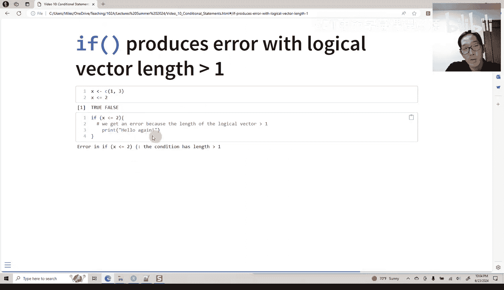

If you throw in an NA， okay， so here I have x is the values  one， two，3。

 we're going to ask for the fifth value。The fifth value in x is that greater than or equal to 2 well x square bracket of 5 is going to produce an na or so we're asking if NA is greater greater than or equal to 2。

 well that's going to result in an na because if you're trying to compare an unknown value the result of that comparison is unknown and so you get an error it says error in this if statement x greater than x number5 greater then or equal to 2 it says missing value or true false needed so that happens missing value where true false needed。

 that's going to be a very common error that you'll run into and that means you have a missing value and you need to go through your code figure out why this thing is producing a missing value here it's easy to see We're asking for the fifth value。

And there's no fifth value in here this kind of stuff could happen a lot in your loops。

 so you might have some kind of loop and you say， hey， do I plus one and I keeps counting。

Higher and higher and maybe you don't have your stopping criterion set correctly and so maybe the original vector is length 10 and I reaches 11 and now you're asking for the 11th value and that 11th value doesn't exist and so you get an NA and then you encounter some kind of error message so again。

 read the error message missing value where true false needed is going to be an indication that you have an NA inside an if statement and then once you know kind of what's the source then it makes it easier to track down where something went wrong。

If you have a length zero vector， you get an error so here I say x is  one through3 and then I ask which value of x is equal to 4。

 that's a length zero vector so if I say if。Basically， length0 vector is equal to 4。You know。

 that condition。Its going to be an it says argument is of length0 Okay so print will this work。

 well that's not going to run I get an error okay， and again。

 if statement says argument is of length0， so that's telling you that something inside of here is producing a length0 length0 vector and so。

So that will be the indication， so read the error messages again and you get errors for if so if really only accepts。

True。Or false or this statement inside there has to evaluate to true or false。A lot of times。

You have these you might put some kind of expression inside the if statement。

 I would actually argue for the sake of making your code readable。

Put the thing that's going to evaluate into true or false on a separate line and basically you know say you know give it。

 give it a title if I don't know， is even okay so you're going to see the value is going to be is even and you'll say that's you know set that equal to basically assign to is even you know less than dash。

 the arrow sign assign is even and then you have the operation or the expression that's going to evaluate whether something is even and that's going to assign either a true or false value and then you put if is even。

And then you go through your operation。

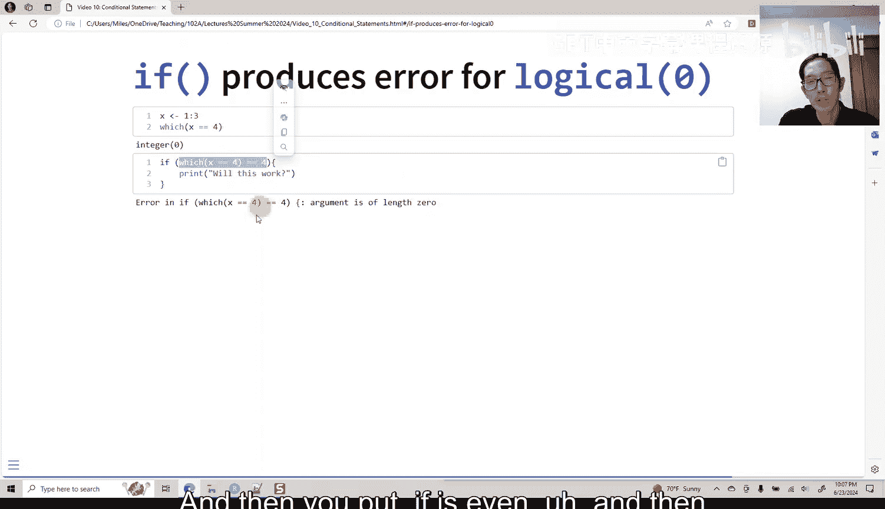

All right， you can take your conditional statements and you can nest them， so we have if。

 we have Elif and we have else。If you want to use an L statement。

Then it needs to else only works if there's an if statement and then the else is only going to evaluate when the if statement is false Okay。

 you can also have another condition with an else if， but again。

That's going to evaluate only if the kind of starting if statement is false。

You got to kind of put the else on the same line as a closing curly brace of the for the previous if statement。

 Otherwise， R is going to just think the evaluation of that if statement is correct。 So here I got X。

We're going to assign 3 to x， and it's going to be if x is less than0， print negative， otherwise。

 check to see if x is greater than 0 than print positive， and if that's not true， then print zero。

 so for x。Assigning 3 to x， this evaluates to false， so we'll go to the else statement。

 this evaluates to true so we print positive。

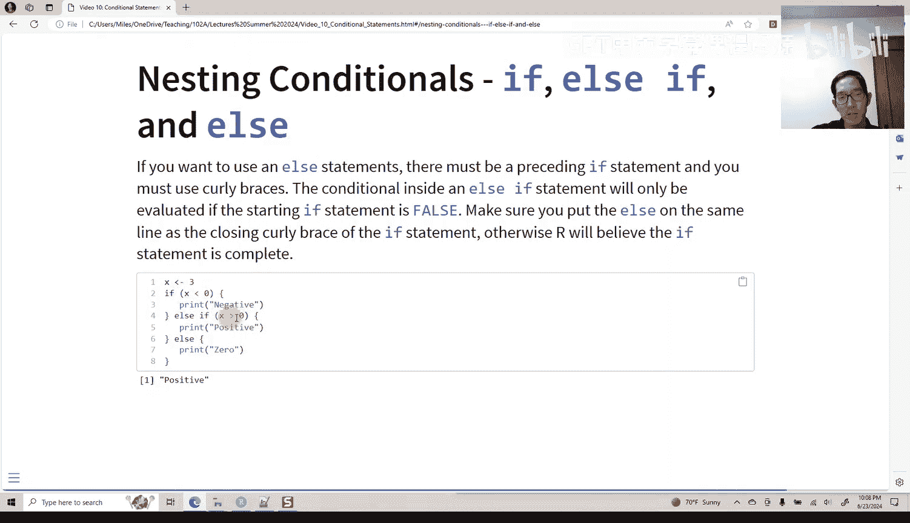

Here I have zero， x less than 0， that's false， so we go to the next thing else if x is greater than 0。

 that's also false，0 is not greater than0。So so we skip that and so the only thing left is else。

 and so we print zero。If you do something like this， x， we're going to assign 3 to x。

 and then I say if x is greater than zero print positive。Else， if， if x is greater than one。

 print bigger than one。 Okay， however， this statement will never get evaluated because there is never condition。

 Again， this， if statement on this else line is only considered。

When the the previous if statement is false， so there's no situation。Where this statement is false。

 x is greater than0 is false， but this statement is true okay？

So so if this statement is true it's going to skip basically everything else。

 it's not going to run any of the else statements and so the else is only get evaluated when this is false and there's no situation where this is false but yet somehow this is true so this bigger than one will never ever get printed and that's what's going to happen as far as evaluating that code there okay。

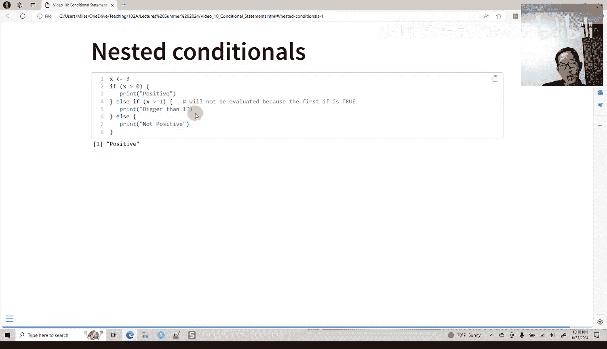

If is not vectorized， if is not vectorized， it requires a logical vector of length one。

If you have a whole bunch of values， true false values and you want to。Do it。

 then you have to either run a loop。And evaluate the if statement on each of the elements， okay？

There's another thing you can do。You can run if else， okay， there's if else。And that is vectorized。

And it will evaluate。嗯。Basically， this。This first statement， the test， okay。

 this is going to be vectorized is x equal equal to 5。 and so you could have a vector x。Okay。

 that has a whole bunch of values。And。And it's going to evaluate true or false for the values that are true。

Okay， it's going to。Pick the yes and for values that are false， it's going to pick the no Okay。

 so that's。The if else is vectorized for this condition。

 and then it will evaluate this condition for all of the values in x。

And then for the ones that are true， it's going to pick the yes and for the ones that are false。

 it's going to。呃I'll got the know。All right， so that's that for conditional statements。

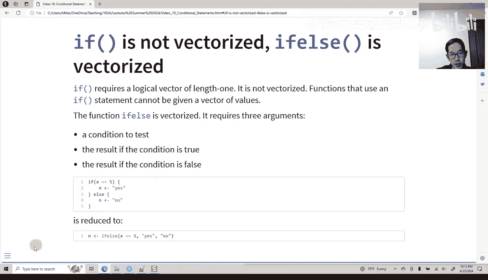