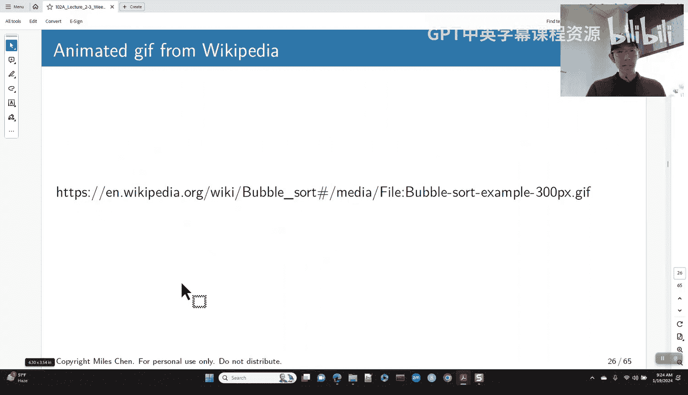
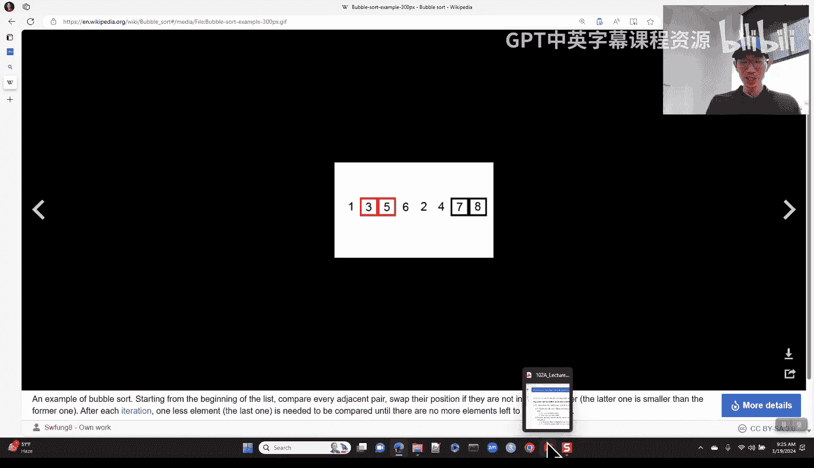
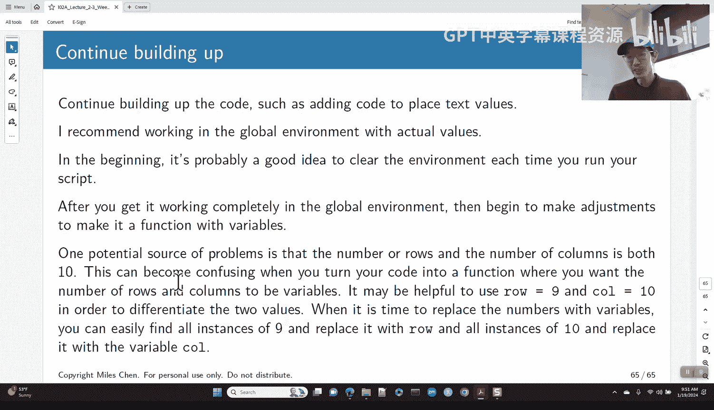

# UCLA《计算统计学｜Stats 102A - Computational Statistics with R 2024 Summer》中英字幕 p12 [12]Stats 102A - 2024 Winter - Video 12 - Function Writing Strategies (Optional) [BV1jizNBrEm2_p12]

All right， well happy Friday， end of our second week。

we'll talk about functions today okay function writing strategies now you guys have already been writing functions you've had to write functions for homework one and then in homework two which I just posted you have to write more functions there okay and so I wanted to talk about strategies for writing functions because at least in homework two。

 I think the functions get more complicated right and so you want to kind of you don't want to just jump in and start writing a function。

 you want to kind of think about how you're going to go about this。

 you want to be able to take that big like a big task and break it down into smaller tasks and build up from there。

Okay， so let's let's talk about that Okay， so a lot of this stuff comes from。

These are just some I guess related reading， you have basics about writing functions。

The bookIntroduction to Scientific Program and simulation using R。

As well as the Adv Arch textbookbook with the chapter on functions there。All right。

 so we'll start off with just talking about function basics。

 you guys already are familiar with the basics of functions bit。

Just kind of review it and go over it all right and so you know functions when we write them in R。

 they kind of have this basic form where we use the keyword function to kind of indicate to R that we're creating a function you put in any of your argument names inside the body of the function enclosed in those curly braces。

 you have your different expressions where you're doing different kinds of either comparisons or assignment operators or math calculations or something and at the very end of the function。

 you return some kind of object。Okay， return some kind of output。A couple things。

 or I guess quirks that we have is that if the function in R has only one line。

 you can technically leave off the curly braces and R will still be able to interpret it。

Generally not recommended， it's not good style， but it won't crash your code or something like that。

And if you don't use the。The function return inside your function that command there。

 then R is going to take whatever last line of last expression evaluated and return that so here I could create a function called F where I do X times x function of x and you take X and you multiply by itself and that's a function functions are objects。

 you can kind of treat them as objects meaning you can put them inside lists and things like that so I can say hey。

 make a list where F is there now it says yeah， you' got a list and the object inside basically the first train car。

Is function of x， okay？And you have that when you ask type of on what it's a function。

 R says it's a closure， if you ask mode， R says it's a function。

 these are kind of like weird words that R uses， this is just part of the R vocabulary。

 this is kind of what allows R allows for I guess functional programming。

Well we'll worry about it right now。A function returns values， and we can use kind of the command。

 use return and explicitly return a value， and we can say this is the value I want to return。

 return x times x， or you can just have x times x and if you don't explicitly use return。

 then r will just return the kind of last line， and the function。

And this is actually the recommended style when coding in R is not to use return explicitly。

 but to use x times x now。I like。In Python you have to use return if you only't use return basically your function returns none and stuff like that。

 so I often use return， but a lot of times as you read other people's code in our you'll see the return being left off so I'm not really a stickler on like the style here so whether you use return explicitly or implicitly I'm okay with it okay？

One thing to remember is that in R。Functions can only return one object。

But there's lots of times where you want to return multiple values。 well， you can do that。

 you just have to。Group all of those different values into one single object。So。

You can do that with either a vector or a list， so here I want to return three values here。

 x x squared and x cubed。And I'm going to do that by kind of grouping them together。

 combining them into a single vector， and when I run function I 2。

 I get the three values back there inside the vector。Here I have the three values。

 but they're this time they're in a list and those values have names now， so I have function2。

 this returns a list again last line in the code without a return， even though I don't have a return。

 this is look gets return， so I get the values to foreignnate， but now they come with names here。

When you define a function and you put in the argument names here。

 you are also defining the names of the arguments， so here when I say create a function F with arguments x。

 Y， and z， these are the names of the arguments that the function is going to use。

And when you call the function and you want to actually use the function。

 you have to use those argument names as well if you don't specify the argument names。

 then R says okay well you're providing me some values I'm going to assign them in the order that I see in so here a very。

 very simple function F and it just says takes the values x y and z and then it basically paste them together into one string or one character yeah character value x equals x y equals y is z equals z and so if I plug in 12 and 3 it says x equals 1 y is 2 and z is equal to3。

When you call the function， you can specify the argument names and when you do that you can put the argument names in any order you want。

 so I have z 1s x equals 2 y equal 3， and again the functions prints out x is this。

 y is this and z is that and so we get x is 2， y is 3 and z is1 because I put them in that order。诶。

If you specify names for some of the arguments， but not all of them。

 R tries to do its best as far as matching them up but if you also give the name of an argument that's not part of the function definition。

 then R is going to give you an error and says an unused argument。

 so here I have y equals 2 but then I just provide1 and 3。

 so R says okay well that one's going to go to X and the three is going to go to z。

Here I have Y is2 and I give it one and x is3， and again R tries to match this up and says okay。

 well x is3， y is 2， and then that leftover argument is going to be Z and it does that。

And then here I have one， two，3， m equals1， and then R goes， whoa， I'm confused， okay。

In the function definition。🤧。まあ、好きしに。In the function definition， I don't have an argument M。

I don't know what to do， unused argument m equals one。一个る嗯。

If you use an argument inside the function， you've got to provide values for it。Otherwise。

 our is going to complain。So here I have a function。This function takes in the arguments X， Y， Z。

 and W。But as far as the code inside the function。It says paste zero this， and inside this code。

 I only use X， Y and z。So I can call the function with1，2，3，4， okay x is1， y is 2， z is 3， and w is4。

 and even though4 is not used inside the code here， W equals 4 is not used inside the code here。

 this doesn't provide an error because。This4 gets assigned to the name W， and that's fine。

 R just uses those things and doesn't complain。Here I can call the function without providing a W。

 just f of1， two，3， even though。The function takes an X，Y，Z and W。

But also R doesn't complain because it says， oh yeah。

 I was able to do all the lines inside the function， I never needed W， so you never gave me a W。

 but that's okay， I never needed it in the first place。So this works。However。

 if I do something like this， here's my function again。

 and I call it with x is 1 y is 2 and w is 4 and I don't provide it with a Z okay now R says， well。

 I can't。I can't run this because inside the function I need a value for Z and Z is missing and I don't have a default value。

 so if you're using an argument inside there you need to have a value provided for it。

 but if you don't use it。Then R is not going to complete。

So to kind of avoid this error of not having a value， you can provide default values。

And so I've got x is1， y is 1 z is 1， this is how we provide default values。

 and so inside the definition of the function， these are the default values。

Values are not provided when I call it。 and so here I call F with no values。

 and so R is going to use the defaults Okay here I call F。With the number two。

 and so two gets plugged into the first argument X。And we get that uses defaults for the others。

Here I call F with z equal to 3， so3 gets plugged in for z， and it uses the defaults for x and Y。

That's no surprise I think we're accustomed to this。Okay， let me give you your first Vquiz answer。

 which is the letter C。See， as in。Can't see。All right， one thing to remember is that values。

That are created inside a function。Only exist inside the function。呃。In general。

 you should not try to change values in the global environment。While you're inside a function。

And if you do want to get values from inside the function out into the global environment so you can use it later something。

 that value needs to be part of the object returned by the function。

That should really only be the way to get things in and out of the function。

Values go in through the arguments and then values come out through the return object。 Later on。

 I'll talk about。Changing things in the global environment from inside the function， but again not。

Generally not the recommended style for writing things in R Okay so here's an example。

 weve assigned the value 10 to x in the global environment。

We have this function F inside the function F， we take in the argument X and inside the function F。

We assign the value x plus 55 to x， so we change the value of x inside the function to x plus 55。

 and then we're going to return the value x at the end of the function。 So when I call f of x。

 remember， we start off with x equal to 10。This function returns 65 because we do 10 plus 55。

 we assign that back and the function F。Returns that new value 65。

But the value in the global environment。Remains unchanged， stays at 10。So again。

 x in the global environment is 10， I run f of x， it get returns 65， but again this。

 even though inside the function we're changing x， it doesn't affect the x in the global environment。

 X in the global environment remains 10 if I do want to change the value in the global environment I have to use that function and then assign。

Stuff back to x。 So I have to take like F of x assign it back to x。 and in that case， x becomes 65。

 but if I don't do that。The values just remain what they are we'。We're not going to change things。

 okay？Functions are intended to make our life easier。

 and the goal of our function is to be able to kind of take a chunk of code。

And be able to reuse it and adapt it for different kinds of values so as you write code you're going to find yourself。

Doing the same thing multiple times right this is kind of a very common thing you say like， okay。

 here I wrote all of these lines of code and it takes this data frame and it produces this graph using you know column number two。

And you say， well you don't actually want to produce the same graph。

 but this time for column number three， so what do you do， you often just take that chunk of code。

 you say well this worked well， I'm gonna copy it， you paste it。

 you change all the twos to threes and now now that code works for column number three and you go okay great and you go oh you know what。

 let's also do it for column number five so you take that code you copy it and you paste it you change the threes you change them to fives and now it works for column number five So that's like a very common thing that you do where you say all right here's a chunk of code。

 I want to do the same thing again， but I want to adapt it for a slightly different situation。嗯。

And so that's fine。And my rule of thumb is this。You copy and you paste it once。

 no biggie okay if you copy and paste it a second time， okay。

 so basically you have the same chunk of code existing in three places now。

 you should really start to think about a function and by the time you copy and paste it a third time so you're going to have the same basically chunk of code but in four places。

Definitely it should be a function at that point Okay。

 you don't want to have the same chunk of code existing in four places or more than that Okay。

 so kind of my upper limit is copy and paste once fine copy and paste twice then it's like maybe you should have a function by the time you do it。

By the time you copy it a third time or paste it at the third time you basically have the same chunk of code four places。

 that's when you should say this needs to be a function okay and the reason for that is because。

Let's say later on， you're like， okay， I like the way this graph looks。 But you know what。

 I actually want to change the thickness of the line。

 I want to go from line thickness 1 to line thickness 2 or something like that， right。

And if you have the same code existing in four places。

 now you have to modify length thickness to two in four different places or more。

And if you forget to do it in all of the places， then you start getting like slightly different variants of stuff。

And it's just not great if you have it in a function， you just change it in one location。

And every time you execute that function， it's going to work。

So that's why we want to do a function right if you're going to again copy and paste the code multiple times again which is a very。

 very common thing to do you don't ever have to feel bad about copying and pasting your own lines of code to just repeat the same task because that's like that's what coding is like repeating the same task but just in slightly different situations but then we should be using functions when you name your functions。

 it should be clear what the function is doing and all of these examples I'm using terrible terrible names I'm calling my function F F2 these are like the worst possible names you can name a function okay if your function is going to draw a board like in homework2。

 you have to draw a shoots and ladders board you know the function should be called drawboard or something like that right it should be clear what the purpose of this function is doing sometimes your functions return true or false values。

Okay， because you want to check for some kind of condition or something like that and in that case。

The function should be kind of phrased into like a yes or no type question。 So， for example。

Is a number of prime number you should call your function is prime Okay is prime kind of clues to the user that this is going to return like a yes or no answer a true or false value Okay。

 so you can say is prime 7 true is prime9 false right and then。And that way。

 you can also put that inside an if statement， right， and you can do if is prime X。Then do this。

 okay？And。Um this is。This is one thing that I always kind of annoys me a tiny bit is when I see students putting inside an if statement if is prime equals equals true or something like that。

 there's no point in doing equals equals true inside an if statement right because either it's true or it's false and so it's going to be if true。

 then it's going to do it if false it's not going to execute it。

 you don't need to do if true equals equals true All right that's redundant okay so just if just do if is prime X and so on and so forth okay and so again。

 functions are supposed to make your life easier if you find yourself in a situation where you've written a whole bunch of functions and you can't keep track of them in your head or whatever。

You've probably done something wrong， okay， the point of the functions is to make your life easier。

 not make it more complicated， so it should be simple enough to be kind of quickly understood。

All right， let's talk about some function writing strategies and let me go ahead and give you your second view quiz answer。

 the letter B be as in bare， be as in bare。Okay， so I'm going to work through coding up。

A sorting algorithm， this sorting algorithm is called bubble sort， it's not the most efficient。

Sorting algorithm， there's a lot of。Sorting algorithms that are much faster and much more efficient。

 but this is very simple and it actually。It was necessary and useful in a time where there was very kind of limited computer memory so if you go back 60 years you know the early computers were only able to kind of store so much information in their in their things okay maybe or 50 years or whatever and so you had to kind of write code that was memory efficient now you buy a laptop and it's got 16 gigabytes of RA or I mean I don't know your phone how many gigabytes of RA does your phone have it's its it's。

It's incredible really， and probably your refrigerator has more memory now than。

Then a bunch of things，But anyway， the way bubble sort works。

As it just looks at two numbers at a time， so as far as the memory requirements in the computer。

 it just needed to look store be able to like store two numbers at a time and so it just looks at these two numbers。

 it compares them if they're in the correct order， it moves on， if they're not in the correct order。

It swaps positions， so if you want to sort from least to greatest correct order means。

The number on the left is smaller than the number on the right In order would be the number on the left is bigger than the number on the right and we want to swap those so that the one on the left is always bigger than the one on the right and then you do that and you perform one sweep and then you do it again and you keep performing sweeps and as you do this basically。

With each sweep， the biggest number kind of rises to the top where gets pushed all the way to the right okay and that's kind of why it's called bubble sort is because it's like bubbles rising to the top and that the biggest number each time with each sweep rises to the top where gets pushed all the way to the right。

So here's a vector， 51824， and we're going to run bubble swap and so we start by looking at the first two numbers five and1 and we say is that in the correct order。

 they're not。5 is bigger than one， and we need to go to the right so we're going to swap the position of the two numbers so after we swap the position now we are at 15824。

And then we move to the next pair， we look at five and eight is on the correct order they are。

 so we don't swap， then we compare8 and2 is on the correct order， they are not。

 so we swap the two and the eight，8 gets pushed over to the right and we look at the eight and the four are they in the correct order they are not so we swap so now the eight has been pushed all the way to the right。

Then so we will lock that8 into the。Kind of final position and we just repeat the process again one and five or is that the correct order they are so we don't swap。

 then we move to the next pair five and two is on the correct order， they are not so we swap them。

Then we look at the five and the four， is that in the correct order there are not so we swap them again。

 okay， and so now the five。Is in the correct position okay？

Technically our vector is in order but we don't know that yet， the algorithm doesn't know this。

 but we do know that five and eight are in the correct position because we've run the sweep twice so we know the last two values have to be in the correct position。

So we look at the one and two， do we need to swap those， we don't we look at the next two， two and4。

 do we need to swap those we don't so we now know the four is in the correct position or the third from the right。

 and then we look at the last two，1， two is that in the correct order they are so we don't need to swap and so now we know that all of the values are in the correct order and so our vector is in order。

 1， two，4，5， and8。There's a little gIF here， animating bubble sort， and let me pull that up here。

It's on Wikipedia and so here we start off 65-318724， and we compared the six and the five。

 they were not in the correct order so we swapped them now we compared the six and the three。

They're not in the correct order， so we swap those positions， we keep going six on the one。

 not in the correct order， so we swap。The animation takes a little while， six and the eight。

 they are in the correct order so it moves on， what about the eight and the seven。

 they are not in the correct order so it pushes that swaps the seven and the eight。

 what about the eight and the two it swaps those positions。

And then the eight and the four it also swaps those and so with one sweep。

 we now know that the eight is now in the correct position。

 the largest value is all the way to the right and it locks into position。

 and we repeat five and three。And we need to swap those， okay， five and one， we need to swap those。

Come on okay， and then we go to the five and6， that's in the correct order， so that's okay。

 six and the7， that's in the correct order， so that's okay。

 and so now we're going to look at seven and two and we swapped that position。

And then we look at the seven and the four and we swap that and so after two sweeps we now know that the right two most values are in the correct position and then we kind of repeat this over and over and with each sweep we know one more value is in the correct position all the way to the right okay and so we don't have to watch this whole animation go through but。

But that's what we want to do。 And so now we want to say， okay， how can we code this。

 how can we code this Okay， so we're going to try to break down our function。

 the tasks are the function into smaller tasks Okay and this is a key idea that you need to be able to that you want to develop as a programmer as someone who's going to be writing code you're frequently going to be faced with this kind of this big thing and you need to break it down into smaller tasks I mean really that's all of life right like。

You know planning a party or whatever right， you just say， okay。

 well let's break this down into smaller things okay and then you do each of the little smaller things and sometimes you delegate the smaller tasks to someone else but but anyway we're going to take something like this break it down into smaller tasks Now there's going to be lots of ways for a lot of different tasks or a lot of different functions there's probably going to be multiple ways to break down a task into those smaller things and and that's okay that's okay but so here's one way that I'm going to break this down。

I as far as the bubble sort algorithm， one of the smaller tasks is just taking two numbers。

 comparing them and swapping them okay so that's one of the tasks we need to be able to do so that's like compare the adjacent values。

 swap the adjacent values and then the other task we need to do is we have to do that thing of swapping values and perform it multiple times we need to perform a sweep across the entire vector。

And then we need to perform multiple sweeps right so once we can do it across the entire vector。

 we want to say， all right， let's do this again and again and again so that the entire vector is sorted。

Okay。When we write a function， okay？What you do not want to do is you do not want to start writing the function right away All right so maybe maybe some of you guys did this during homework1。

 but as you kind of move forward the first thing you don't want to do is you don't want to write function X and curly braces okay because that's going to just make your life harder as far as like trying to debug your code because when you write a function。

 you're probably not going to get it right the first time around and and you need to be able to debug it and again。

 when you write things inside a function， the values inside that function only exist。

For the duration。Of the function running it's only it only exists inside the function and so when the function quits those values proof and disappear Now there are ways to figure out what were the values inside the function。

 you can run the debugger and things like that and it kind of pauses the code right in the middle of execution and you can kind of explore things。

对。You can kind of avoid all of that just by kind of working directly in the global environment and when you work in the global environment。

 all of your values are。There， and they exist， and you can kind of just see。

 is this kind of proof of concept is are these lines of code even working in the first place？

And then you can kind of figure it out， right？So， let's。

Let's just start off with the very first task of like， can we just swap two values， Okay。

 so if I have a vector。Can I just swap the values in position one and position two so if I have5，4。

321， can I do that so I get4，5，321 okay and I guess implicitly here I didn't actually write this on the slide。

But another thing that you need to do as you're writing code is you want to check if the line of code you wrote does what you expected it to do Okay。

 so you should always say like。This is if I start off here and I run this line of code。

 what do I expect it to do right what I'm expecting it to do is go from 54，321 to 4，5。

321 Okay I'm not expecting it to have it fully sorted。

 I just want to be able to swap these first two values so I have an expectation。 I expect to see 4，5。

321， and then I run whatever line of code I wrote， and I want to see did I get what I expect4，5。

3 to1。So let's say I just decide。To write a function just I dive into it and I write a function again。

 This is not the recommended way。 So I say， all right， I want to swap the first two values。

 so I'm going to take x position 2， put it into x position 1。

 and then I'm going to take x position 1 and put it into X position 2 okay and then let's return X And so what is what happens when I run this So I start off with x 5。

4，3，21 what I want to see after I run this code is 4，5，3，21。 but when I run it。

 what do I get I get 4，4，3，2，1，4，4，3，21 So again。です。

At least I've done something right here in that I checked immediately to see if I got what I expected and I did' it。

 so now I know something is wrong。 Okay， sometimes students come to me in office hours and please do come to me in office hours if you are stuck in。

And in trouble I don't want you to feel intimidated but when sometimes students come to me in office hours and they have a whole bunch of lines of code written and they say like you know my function is not working but like very early on I'll spot an error like in the first couple lines of code and I say hey did you check to see if this even this first or second line of code does what you expected to do and they'll say oh you know I never bothered to check okay so again every single line of code you want to kind of just check and make sure is this line doing what I expected to be doing and so here I just want to see hey did I swap5 and4 to get4。

53 to1 and I didn't I got four，43 to1 again the problem here is I've written inside a function so I can't really see what went wrong so。

What I recommend， don't write a function， just start in the global environment and see if you can kind of swap this and so here I'm going to just kind of delete everything in the global environment okay you can hit the little Broom icon or if you're writing a script。

You can include this a little just while you're writing everything。

 so you don't want to put this line。You don't want to keep this line in the final version of your script。

 but just as you're writing your script， you can put this little line。

 this is basically hitting the broom icon this says remove everything in the global environment and so when you source your script it's gonna just delete everything and that just saves you one extra click right you can easily hit the broom delete everything out but you can also just write this line of code and this will delete everything in the global environment but again don't actually include it in your final line when you're done with the script make sure you get rid of this thing because you don't want your script actually deleting stuff when it's running but as you're coding it up for the first time so anyway I'm going to just write in the global environment let's just see what happens and we're gonna just check what does X look like after every single line of code So I start off with x is 54321 and then I say all right let's take X position2 and put it into X position1 and we say what does X look like and it says 4。

4321 and now we start to。See where things went wrong and we can see okay well when I try to do X position one and put it in X position2。

 X position one is already four and so now I put it into position two it just stays four and and basically we lost that five right when I wrote this line X position two goes into position one I lost the value that was in position one it got overwritten So what I need to do。

I I need to store that first value somewhere okay so again， clear out the global environment。

 let's try this again。 x is 54，321。 We're going to take the value in x position 1。

 store it in a temporary location and I take x position 2。

 put into x position 1 and then I take that temporary value and put it into x position 2 and then I check x and I have4。

5，3，21 So great， this looks like it works Okay so I say all right。

 well let's just check these lines of code， let's try to somewhere else， here's another vector 1。

234567，8 if I run this code， what do I get it swaps the first two values21， 3，4，5，6，7，8 so yes。

 it does swap the first two values but I don't actually want to swap the values in this case want to I want to have a condition that says check to see if I should swap them in the first place at all So what do we do I'm going to just take that line of code。

That swaps the first two values， but I'm going to check。Is position 1 greater than position 2。

 If position1 is greater than 2， then we swap the positions， but if it's not， just leave it as is。

So here I have x's 54，321， in this case we should swap them the first two values。

And indeed we do when I run this code， it swaps them I' get  four， five3 to one， so this is working。

Here I have one， two， three， four， five， and in this case we don't want to swap positions。

For the first two values。And that looks good， okay， that looks good， so we say， all right。

I'm swap I'm able to compare two values and I'm able to swap them at least for positions one and two。

Okay， and what I want to do now is not just positions one and2。

 but also positions two and 3 and three and 4 and4 and5。

 so we want to kind of perform a sweep across the entire vector。So what I can do is I can say， well。

 let's make a for looppin。Alright。😊，And instead of looking at positions one and position two。

I will replace all of my ones within I and all of the twos within I plus 1。

 and I'm going to put this inside a four loop， so I'm going to say all right。

 if you've got a vector of length5。Then let's do for I in sequence length， length of x。

So that's going to go basically for one through five。

 and then we're going to do look at x position I。And X position I+1。

Compare those two values and if we need to， we will do the swap。

 X position I goes into the temporary position， i plus 1 goes into X position I and temporary value goes into x position I plus 1 okay I just replace the ones with I's。

 the twos with I+1 okay。There's a problem here with our code。 and maybe you can spot it， Maybe not。

 But that's okay。 You don't need to be able to spot every single problem right away。

 You can try the code out and see what happens。 So we want to say， all right， will。

 will this run Here， I got X 5，4，3，2，1。 Can I run this。And so I try running that code。

X 54321 for I in sequence length length of x， this， this， this， this， but I run into an error。

 I get error， and if x position I greater than x position I plus1。

 missing value where true false needed。Okay， when do we get missing value or true false need。

 that happens。When I get an NA and in my if statement， right， if statements need to be true or false。

 and here I'm getting an NA， I'm getting a missing value。And really。

 the only thing that's happening here is I'm comparing exposition I and exposition I plus1。

So we want to know what was the value of x position I， what was the value of X position I+1。

 because I'm working in the global environment， I'm able to check that。对。

If I was working just in a function。Then I wouldn't know because the function it's。

You can't look inside the function but here we'll ask what is that Okay so I can say what is I in the global environment says it's5 what is x position I X position I is5 okay that seems okay what is X position I plus one okay there we see we get an NA because we're asking for what is x and position6 and our vector X was only length5 so that makes sense to us we're getting an NA here and this is why we have a missing value and this is why I get the error missing value were true false needed so again。

 the error message that you get an R point you in the right direction tells you where the line of code is where it went wrong where you can start looking okay。

Now something could have went wrong earlier and but it comes to a head here。

 but again it gives you an idea of where you start looking so we go oh yeah， you know what？

I shouldn't be checking at X I plus1。 I don't want to be looking at position 6。

 So what I need to do is I just need to adjust my。4 loop so that if I have five numbers。

 I'm really only doing four comparisons okay so how many comparisons do I do。

 I'm going to do sequence length， my length of x isn't of the length that I want isn't length of x but it's length of x minus1 so I'm going to do for I and sequence length。

Length of x minus1。And then I run the code。And when I run the code for54321。

 indeed that five gets pushed all the way to the right and this looks good， this looks good to me。

And so let's just try this out again with another vector because I have a vector 12，5，836。

 and what I want to see is I want to see that eight get pushed all the way to the right。And。Indeed。

 the H gets pushed all the way to the right。So that seems good， okay？

Here's just another random sample here I have。I just take a vector of length 10 random order。

 I run the same thing， again， testing every single time just to kind of make sure things are working and indeed the 10 gets pushed all the way to the right so that looks good。

嗯。All right， so what we need to do now is we just need to repeat this process and perform multiple sweeps every single time okay and every time I do another sweep。

 I'm going to have kind of one more position locked in place here。So here I can just say， all right。

 here's my vector， again， it clear up my environment， x is 54，321， and I just have the code。

And I run it once， ask what is x5 has been pushed all the way to the right？

I just copied and pasted the code again， just running a second sweep。

 and this time the four gets pushed all the way to the right。 Okay， a second say， oh， you know。

 I can just take this。Chunk and just put it inside another for loop。

 just repeat it again and again and again， Okay， so I just need to perform multiple sweeps。

How many sweeps do I need to do， it's going to be length of x minus1。So I just took that。

For I in sequence length， and I just put it inside another sweep， inside another loop for S。

 for sweep number one， sweep number two， how many sweeps do I need to perform， length of x minus1？

And and I think it works， okay， 54321 gets sorted into one， two， three45， so that looks good okay。

Technically， there's a little bit of inefficiency because the first time I do the sweep。

 none of the positions are locked。I have to kind of go through the entire vector。All right。

 I go up to vector length of x minus1。But the second time I performed the sweep。

I only I don't need to go through the entire vector because I know the last value is already in the correct position so I could end one spot early。

 and the third time so I can end at position length of x minus2， the third time I perform it。

 I can do length of x minus3， the fourth time length of x minus4。

 how many things I need to kind of swap。Is shrinks every time I do another sweep and so I can do that by just kind of adjusting my thing and so I can say start off with zero locked values and then how many comparisons do I need to do the sequence length is going to be length of x minus1 minus how many positions are locked and after every single sweep I can increment the number of locked values by1 so I can just increase my efficiency a little bit。

By starting to lock in positions and does it work， 543，21 does indeed get sont to one， two，3，45。嗯。

And。Here is 4 random vector of length 40 in random order， I run my code。And it gets sorted。 Okay。

 and again， so it's not even a function。 It's still just。

It's just code written in the global environment and I'm just running it to see if it works and it looks like it's working okay and so so this looks like it works so what i'm going to do is i'm going to take this。

Wap it inside a function， I'm going to call it bubble sort function of X。

 I have all of that stuff and I say， all right， well， this looks good。

Okay and so let's just take a random vector of 100 values stored as x and I call bubble sort x。

And and nothing happens， so what went wrong when you look at it we say oh you know what my function actually isn't returning anything。

 so all I have to do is just have to add one more line here that just says return x at the very end。

Okay and then now it works right so here's 100 vector of length 100 in random order I call bubble sort and indeed it sorts it from least to greatest so that looks great okay so again to recap。

Break down your task into smaller things。 Don't start writing a function。

 Just start working in the global environment。 Okay。

 check after every line of code to see if your thing does what you expect it to do。 All right。

 And then when something breaks。Look at the values inside the global environment and kind of change things as necessary and then you add to your code incrementally and every time you make a change test test it out to make sure things are working and that means you have to think about what do you expect to happen and is it doing what you to happen expect to happen？

Okay。Let me give you your third view quiz answer， third answer is a A as an apple。A has an apple。

Okay， a lot of times I recommend writing a little script file and then。

What you can do is put in this little line， remove list equals LS。

 and that's going to clear out your global environment again。

 just do that while you are drafting your script and then in the final version of your script you don't want to include that line okay and then as you work。

You can kind of source it all right， or hit command shift S， control shift S。

 that's going to run the code here， and as you encounter problems。

 okay you can look in the global environment， where did something go wrong。

 where did something go wrong？Okay， so homework two has been posted here。

 I know some of you guys are still wrapping up homework one。

 but I want to just talk a little bit about homework two and in homework two。

 you're going to write some code to simulate shoots and ladders， the you know children's board game。

And one of the tasks is to draw the game board okay the game board is kind of this grid rectangular grid。

 How are you going do that right and it feels a little bit overwhelming like oh where do I even get started Okay well again just break it down So when you draw the game board what do you have to do Well you got to draw some lines sideways you got to draw some lines vertically right like what do you have to do so so let's look at that So here I'm going to just start by writing plot do new that creates an empty plot nothing thing happens Okay and one of the functions we use。

To draw a line is this function called segments okay and in segments it takes in basically your starting coordinate and your ending coordinate in the XY plane so you give it x0 and y0 that's your starting coordinate and then x1 y1 is your ending coordinate so here I can start off at 00 and 1010 and I get a diagonal line going from00 up to 1010。

So what I want， I want a horizontal line。And a lot of times if you're going to draw something。

 it's really handy to just。Take a piece of paper。And just draw it and then and figure out what coordinates yet right if you have graph paper youre' going to draw the graph paper and you say okay。

 well， if I want a horizontal line I'm going to start off at00。

 I'm going to go horizontally so my y value doesn't change but x is going to end up we'll say at 10 so I'm going to go from00 x0 y0 to x1 is 10 and y1 is0 now we get a horizontal line okay great。

Okay what now I want to draw a second line okay so let's go up to the next line all right and I got x1 y is1 so I'm going to have01 and up at 101 Okay so I have 01 and at 101 and I get a horizontal line Oh that's kind of spaced down all right。

 what about the third line okay the third line y is going to be two so we got y0， y1 y2。

And when I do this。X x0 is0 and y0 is 2， and I go to x1 is 10 and y1 is2。I don't even see it， I go。

 hm， what happened here？So as R is drawing。It doesn't doesn't know what scale to put y on。

 it doesn't know what scale to put X on， so here we got to give it a little bit more direction so after I create a new plot。

I'm going to define the edges of my window， I'm going to do plot window。

 and I'm going to say my X limits are going to go from zero to 10。

 my Y limits are going to go from zero to 10。And then I'm going to put in this argument called aspect ratio okay。

 and I'm going to say aspect ratio1， and that means have a one to one ratio between the X axis and the y axis。

 and that basically makes circles look like circles okay whereas if you didn't have it on the same。

Same ratio then。You know， things。Circles would look more like flattened old or something like that。

 Okay， and so here， when I do this now now it looks like what I want。 Okay， this first line，0。

0 to 100， the next line at。What is this01 to 101 and 02 to 102 okay which is what I have And so I now I want to draw 11 of these segments and so rather than having to copy and paste all of these things I can just write a little loop and do it for y equals 0 y equal 1 y equal 2 all the way up to y equal 10 so I'm going to just have for R and0 through 10 for each row draw these things okay so we're going start off with for all of these the x coordinate is0 and the ending coordinate is 10。

 but the starting and ending coordinate for y is going be R And so now I get these horizontal lines and then now I want to this is one of those optical illusions。

This is a square， but it looks like it's taller right but it's optical as soon as I put in the horizontal lines it'll be a square and then I want to do the same thing but with vertical lines and for vertical lines what is it I'm going to have the starting x coordinate is0。

 the ending x coordinate is going to be the same at zero。

 but the y coordinate starts at0 and ends at 10， and then we go to the next one x coordinate 1 Y coordinate is 0 x coordinate remains at one but the ending Y coordinate is 10。

So I just write another。Another loop for c in0 through 10 start off at x0 is equal to c y0 starts off as0 the ending coordinate is at C y1 is equal to C right so this is the same thing and now we're just adding vertical things and so we can see oh yeah it's a。

All right， and so there you go， there's your grid of lines and that's just to get you started。

 all right， you got to figure out how to add more stuff。

 you're going to have to add little arrows to represent the shoots on the ladders。

You're going to have to put little text labels， position you know box one， box two。

 box three and so on and so forth， and you'll have you'll want to kind of just pause and think again。

 start off on pieces of paper， write things out and say， okay， how do I turn this into。

Like a command right how do I how do I write this into code and so again take。Take your tasks。

 break it down into smaller things， and build up， okay？

So that's just to kind of get you started and you can kind of keep building off of there all right。

 that's it for today I think I've given you all three you quiz answers so so we'll end there。

 have a great weekend， good luck as you work on homework two or wrap up homework one and we'll see you on Monday。

