# UCLA《计算统计学｜Stats 102A - Computational Statistics with R 2024 Summer》中英字幕 p13 [13]Stats 102A - 2024 Summer - Video 13 - Scoping in R.zh_en [BV1jizNBrEm2_p13]

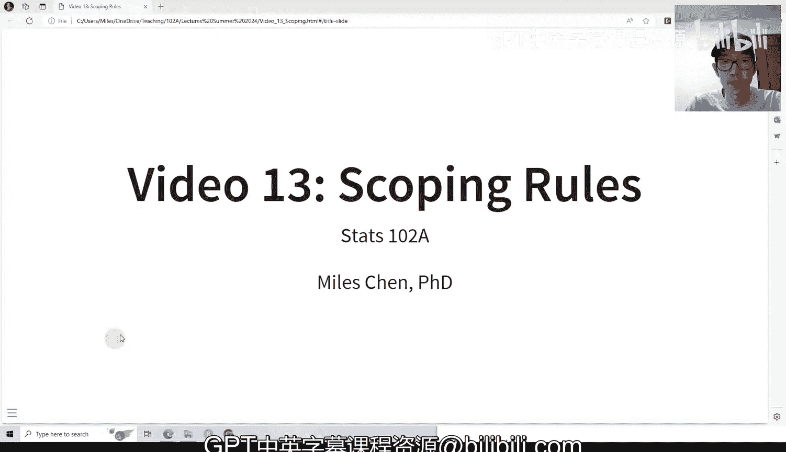

Okay， let's cover scoping rules。Here's some related reading。

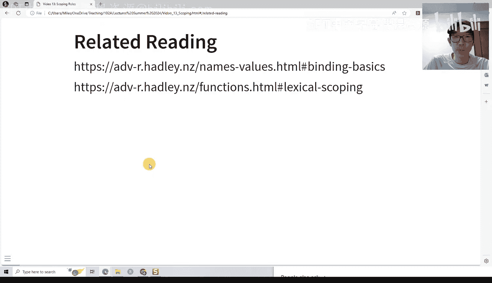

So scoping and binding are the way R looks up。Objects and names。

So all objects that you create and store in our session are stored in what's known as the workspace or the global environment。

 so you know when you create a vector and you assign it to say the name X。

It creates an object and it's held in the global environment。When when you run a function， however。

 a function creates what's known as a local environment。

 okay so it's kind of like a separate little sandbox and within that function you might create function values you might create other objects and things like that。

 those things exist only in that little sandbox sandbox and you objects created locally in that sandbox don't appear in the global environment。

And then as R is looking for values， okay， basically the values that exist inside the local environment take precedence over values or objects with the same name in the global environment。

 so that's called object masking so if you have a vector X in the global environment。

 but then within the function there's also another vector named X。

 okay that object inside the function will mask okay， meaning whenever somebody calls for the name X。

It takes place over what exists in the global environment， okay so yeah。

 the object name within the function will reference the local object instead of the global one。

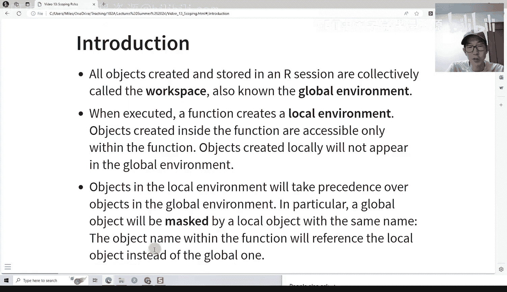

So yeah let's just look at this very simple line of code where I create a vector， 1，2。

3 and I store it as x， so the way we often think of this is that we're creating an object X and that object X contains the values 1。

2，3。But technically， the way this works， okay， is that。嗯。This object with the the vector，1，2。

3 is created somewhere in memory， okay， creates a vector with the values 1，2。

3 somewhere in memory and then。The name X， okay， is bound to that object or the object is bound to the name X。

 The assignment operator just associates the name X to that object。 And so therefore when。

You ask R to find the object X， it looks up that。It sees that name。

 that name points to the location in memory， okay？And it。

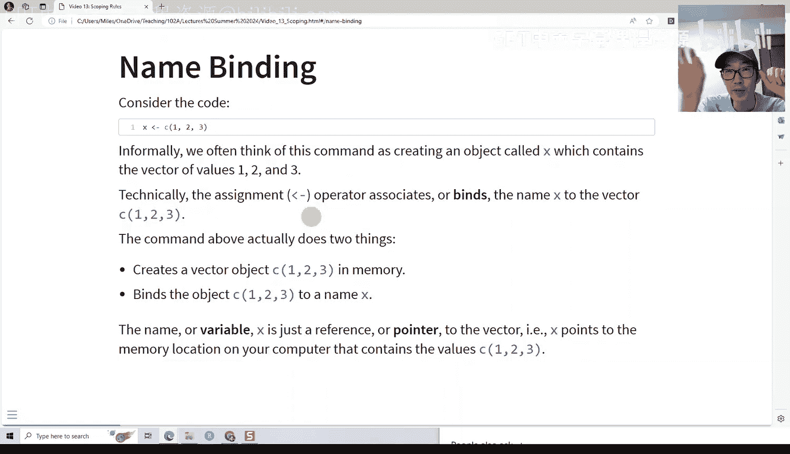

And it then gets the values  one， two， three from the location memory。So then what happens here。

 Okay， so here I create the object  one， two， three。Okay， and I assign it to x。

 or I bind the name x to that object。Then I bind the name Y to the object X。

Over here we create a vector 123 and we bind the name Z here so what's the difference between y and Z when you ask R for what is y it's going to output 12。

3， when you ask R for what is z， it's going to output 12。

3 but technically these are two separate objects。Okay。诶。One is one，2，3。

 and the name X is associated to that object and the name Y is associated to the same object Okay。

 then we have a separate。Vectctor， 1，2，3 and the name Z points to this object that has the values 1。

2，3。So y and x are pointing to the same object that we first created。

 it's a vector containing the values 123， and then that third line of code creates another object with the vector 123。

 but it binds the name z to it。And then。You know， if you say remove an object or something。

 delete things， then R has its own kind of garbage collector and it manages memory on its own。

 so it's something you don't have to worry about versus you know other languages like and see where you know you create objects and then you have to kind of get rid of them also otherwise。

你的逼。These things take up more and more memory， okay？

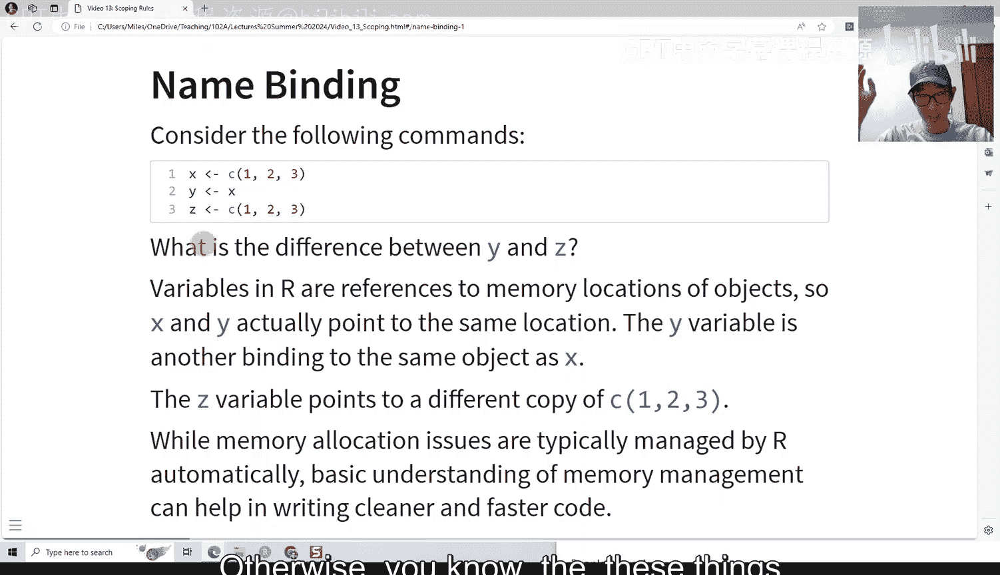

What one thing that R does though is it has copy on modify syntax， okay。

 meaning let's look at what happens here。We create a vector， 1， two，3 in memory。

 we bind the name X to it。I bind the name Y to x， so y and x are both pointing， so I've got x。

 it's pointing to this， I've got Y， it's pointing to the same object。But then on line three。

 I say take the third value and Y。And basically put four in there right so we are going to modify the value of the third object or the third element in y to4。

 And what this does is when R Cs that we're changing the value of y。

 it creates a copy so as soon as when when R sees this line， a bunch of stuff happens under the hood。

 it creates a copy of the object， so x is still pointing through the first thing that has1，2，3。

 but then y gets modified and now it says 1，2，4。Okay。

 so y now points to a different object where the third value has been changed to four。

 so x still shows  one，2，3， but y shows 1，2，4。

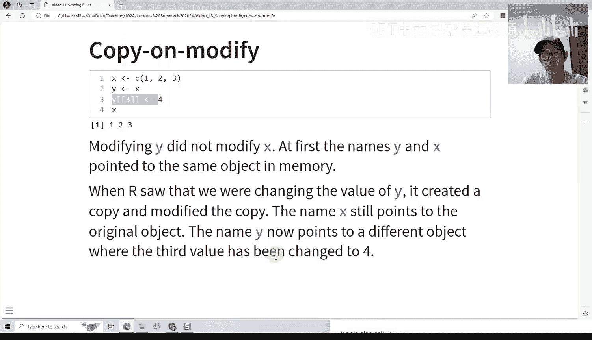

So。Assignment is the idea of binding the name to a value。

 Soping is finding the value associated with the name。

 The scope of a variable is the region of the code where that variable is defined where when you ask for an object X。

 it's able to find it and return the thing right if R can't find it。

 it says you know object X not found。And the basic scoping rules are pretty simple in that it's going to。

Look for the thing and if it can't find it it searches in a higher scope so let let's take a look at this and remember objects within a function are created in a local environment and those take precedence over the global environment so what happens here so what is going to be the output of G of3 so we have y in the global environment gets one okay is bound to the value1？

Inside G， we create a function， it's a function of x， meaning when we run G of 3。

 x is going to get the value 3。Inside the function， y gets the value 2， and then the function。

 the very last line of the function， it returns the value x plus y。

So what we're going to get back is3 gets passed in as the value for x and then when it looks for what is the value of y it finds the value 2 inside the functionss local environment so we're going to have 3 plus 2 and it's going to return the value 5 so names defined inside the function mask the names outside so when we get y gets bound to the name2 here in the local environment it's going to find that value 2 in the current local environment so yeah G of 3 returns5 okay and that's all explained here。

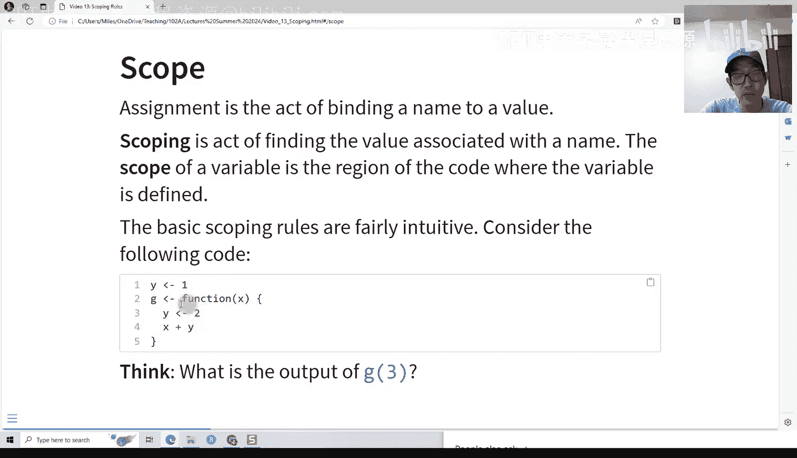

G is3 is passed in as the argument x function returns x plus y x has the value 3 and the value of y finds 2。

This value of y being one in the global environment is irrelevant as far as the operation of this function。

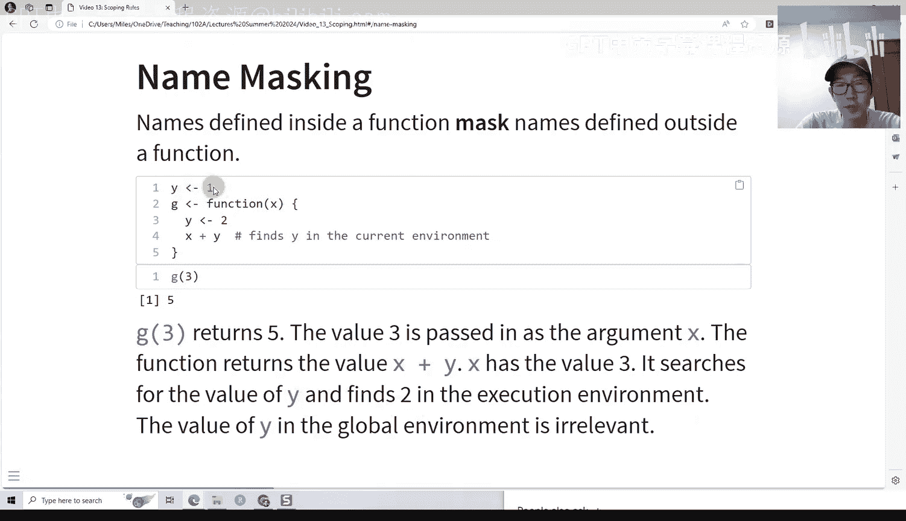

Okay。The main scoping rule in R is lexical scoping， and that is basically if R can't find。

A variable in the function body scope， it will look for it in the next higher scope。

And so on and in general， when you write functions。

You don't want to have to use Rs lexical scoping rules rely on it all the time。

 so it's generally considered poor technique to reference objects or values that are not defined inside the function。

 but R is，Was designed for statistics first and then you know programming secondary so R does not require good kind of programming habits and so you can do stuff like reference values that are not defined inside the function and R will just try to do its best okay and and so that's kind of the how r works R tries to do its best in a lot of situations and in a lot of times it does pretty well but again it's better to try to avoid these things and have good practice but anyway let's make sure we understand the lexical scopeoping rules Okay so here we're going to pretend we have we're going clear everything out of our environment we've got we're going to bind。

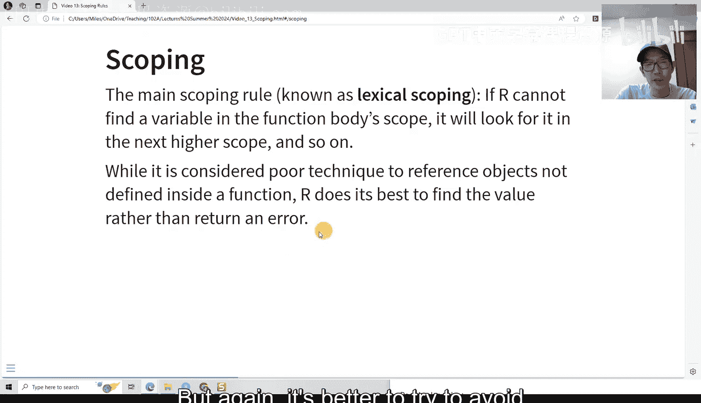

The value one to the name Y， okay， and now we're going to have a function。Of F of x function of x。

 and this function is going to search for x plus it's going to return x plus y。 So when we run f of3。

The way it's going to execute is 3 gets passed in is x， so when it runs line 3。

 we have x has the value 3 because that's what it gets passed in at this function， and then it says。

 okay， I need y， there's no y inside the local environment of F so when it can't find it inside the local sandbox。

 it searches the higher scope and it finds one in the global environment so it's going to return 4。

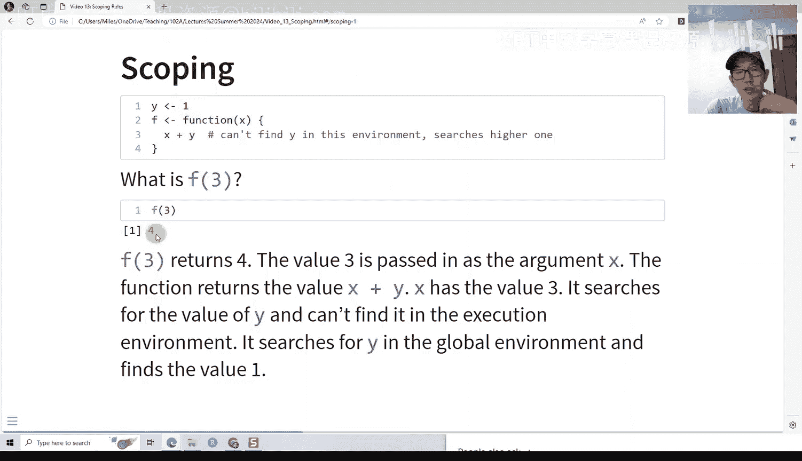

So again variables defined within a scope only exist in that scope and only for the duration of that scope。

 if variables exist with the same name outside the scope。

 those variables and those objects are separate and don't interact with the variables or objects inside the scope。

 they're not overwritten， they're not modified okay。

So you just have to remember a function is its own separate environment and really the only way functions communicate with say the quote outside world or the global environment is via the arguments that go into the function when you call it and then the object that gets returned goes out so that's really the only way。

The function interacts with the outside world， so what happens inside the function pretty much stays inside that function。

So for example， if inside the function， you decide to run this command RN list equals LS。

 which basically deletes all of the objects okay you delete only the objects that have been defined inside the function this is something you should never do because basically when you call the function and you pass arguments all of those arguments get created inside the function then RM list equals LS would delete all of those things so you've lost them all but that just illustrates that it only affects basically the local sandbox。

 the local sandbox okay there is a assignment operator known as super assignmentsign。

 it's this kind of double arrow and that basically searches and assigns things to the higher scope it's a dangerous operator and I recommend not using it I will cover how it works and I think it's important that you understand how it works but in general。

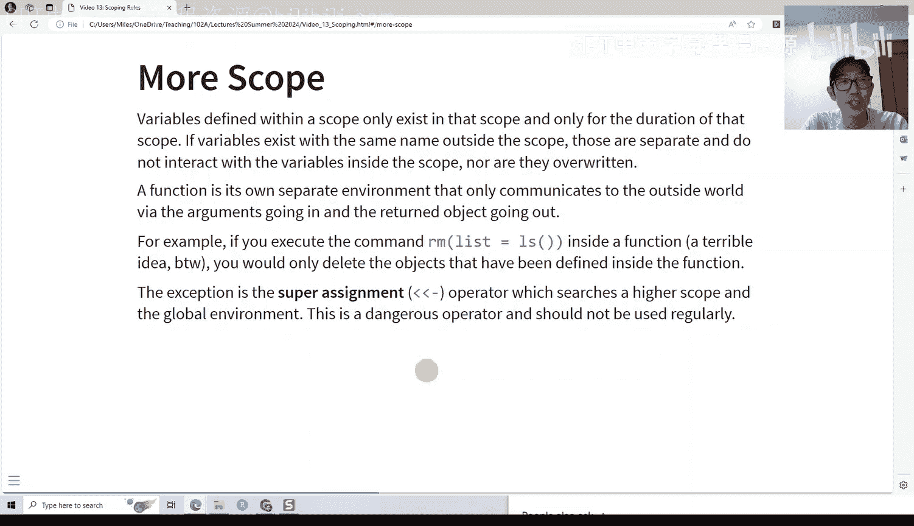

You shouldn't be using it， okay？Allright， lets let's take a look at a couple examples。

 So here I create X， Y and Z。 They all have the values1 in the global environment。

 and then I create a function F F is defined inside the global environment and then。Look at this。

 we're going to create G inside of F okay， within F。

 we create a value2 and it gets assigned to the name Y。And then within F， we create a function G。

Okay， and then within inside G3 gets assigned to the the name Z gets bound to the value 3。

And G is going to return x plus y plus z and then meanwhile， F， it returns what G returns。

 so it calls G and it returns whatever G returns。So if we run F， what is it going to return？

And then after running F， what are the values of x， y and z in the global environment。

 so let's think about this。So when I run F， I'm going to assign 2 to y。And then basically。

 I'm going to。I'm going to create G， but not run it， but then when I run the last line at line 10。

 I'm going to execute G， okay I call G， so now I go and I execute G。And we assign z to 3。

 and G is going to return x plus y plus Z， so it looks for x at first。Looks for x。

 it doesn't find it inside the local scope of G， so it searches the higher scope which is now inside the function F。

 it doesn't find z there， so it goes to the global environment and finds z is 1。

Then we look for y I'm sorry x it finds x is 1 and the glmer， then we look for y。

 and it looks for y inside of G doesn't find it， goes to the higher scope， it finds y is 2。

 so it's going to take the two and put that there。And then lastly。

 it looks for Z and it finds z in the local thing， so we're going to have one plus2 plus3。

 G is going to return 6， so that gets put here and now F returns6。

So F is going to return the value 6 after running f， what are the values of x， Y， and z。

 they're going to remain 1，1 and1 in the global environment because none of these assignment operators affect anything in the higher scopes so we have F is 6 and x。

 Y， and z are 11 and 1。

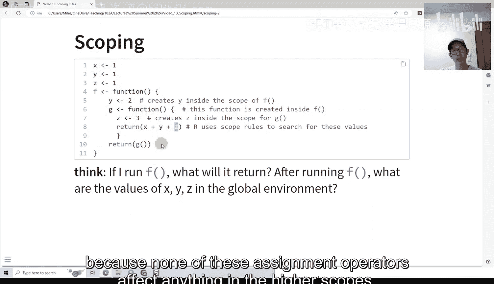

Okay， let's talk about super assignmentign。

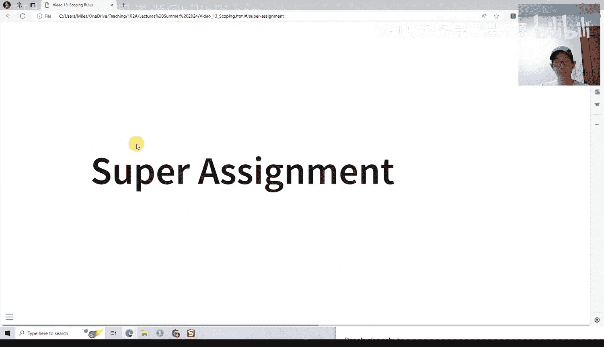

So regular assignment operator always creates objects inside the local environment。

 Super's assignment never creates a variable in the current environment。

 but instead what it tries to do is it modifies an existing variable found in the parent environment。

If that superas operator doesn't find an existing variable in the parent environment。

 what it does is it climbs kind of the scoping ladder until it finds the variable that it's looking for eventually if it reaches the global environment without finding the variable。

 then it's going to create that variable in the global environment。As a kind of guideline。

 you should avoid super assignments， you know， like in homework too。

 as you're thinking about your things that you might be like， oh。

 it would be so tempting to use super assignment because sometimes you think， oh。

It can make my problems easier and sometimes it can。

 but then also it can also make things a lot harder to debug， so just be careful。

 just be mindful of that。

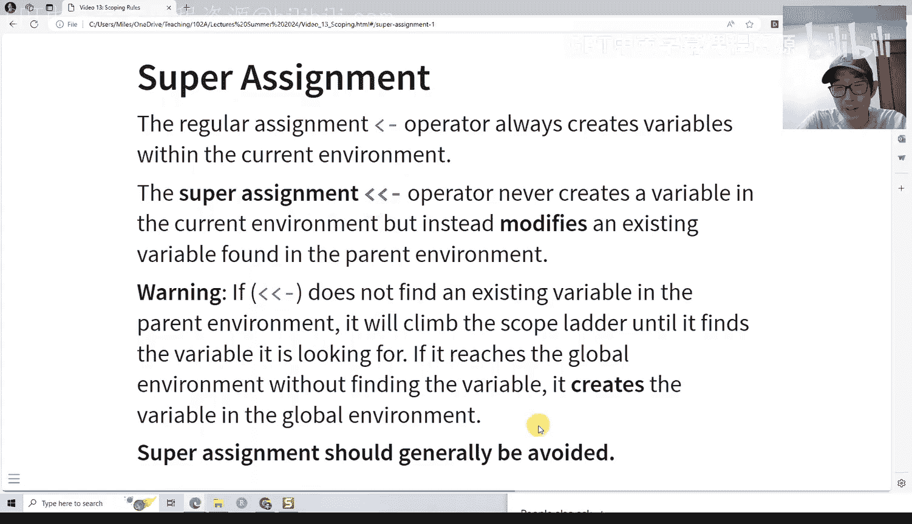

Okay， so let's take a look， so I'm going to create X， Y。

 and z to get the values one in the global environment。And then。

I create a function F and inside the function F I use the super assignmentsign operator。

 we're going to bind3 to the name Y， and so what this does is it does not create Y inside the local environment。

 but it immediately goes to the higher environment。

And it does that and we're going to then return the value y so when we run this。

So when I run lines1 through five here， it creates x。

 Y and z in the global environment and it assigns it creates the function F。

 but it hasn't executed it yet， so if I ask for what are x， Y and z right now they are1 then。

I call F when I call F， then it runs these lines of code。

 and so now y gets modified to be 3 in the global environment。

And then it returns y and when it looks for Y， it's not going to find why in the local environment because y is not。

Created in the local environment， okay， but it will find y in the global environment and it's going to get the value 3。

 so F is going to return the value 3， and when we check what our x。

 Y and z in the global environment， we can see Y now has the value 3。

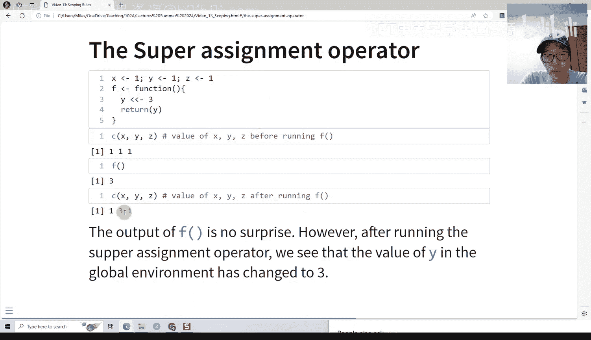

Okay， so let's take a look at this function in a function business here， so first we create x。

 Y and z to get the values1 in the global environment。Then， we have。The function F。

 we modify the value of y。In the higher scope， Okay， so when we what。When F gets executed。

Why in the global environment will take on the value too， okay？And then。

And then F is going to return G so when we execute G。

 what is it going to do G is going to look for3 or Z。

 it's going to try to modify Z in the higher scope， it doesn't find it inside the scope of F。

 so it climbs a higher scope and eventually finds Z in the global environment。

 and so it modifies the Z in the global environment to be3。Then it uses。

 then it returns x plus y plus z， it looks for x， doesn't find it inside of the local environment of G。

 doesn't find it in the local environment of F， finds it in the global environment gets the value 1。

Then it looks for Y， doesn't find it in the local environment of G。

 does not find it in the local environment of F， because remember this doesn't create it in F it modifies it。

 so it goes to the global environment， and it finds that by this time y has been modified to the value 2 in the global environment。

And then lastly， it looks for Z， doesn't find it in G， doesn't find it in F。

 goes to the global environment and finds that Z has the value 3 because it got modified when it ran this。

 so it's going to return six and then when we check for what our x Y。

 and z in the global environment， it has the values 1，2， and 3。

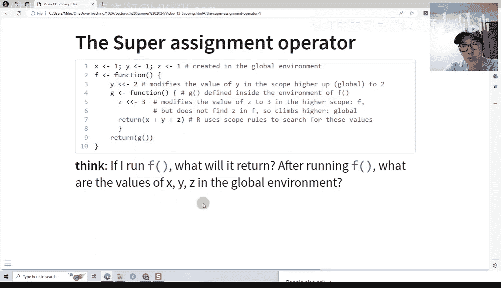

Okay， so make sure you understand the difference between this this line of code， this set of code。

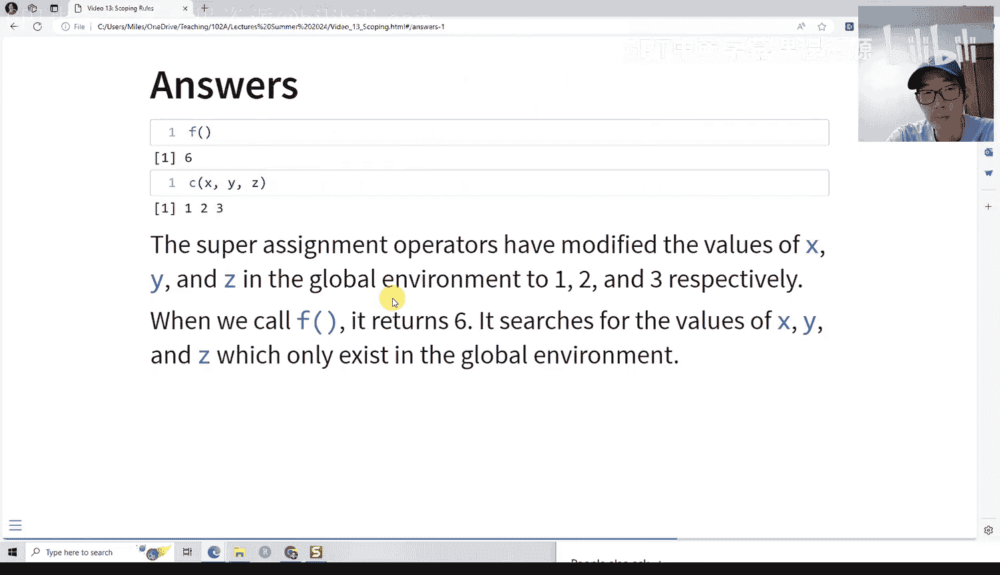

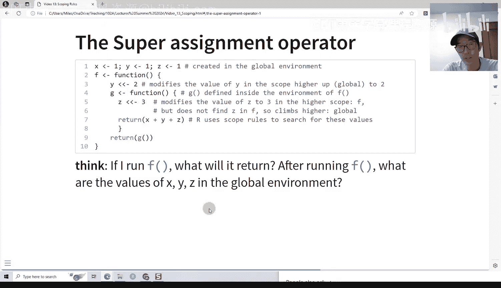

And this thing， which are very， very similar， okay， the way they're written。

 it's just we've changed basically the operator here to be super assignment and the operator here to be super assignments。

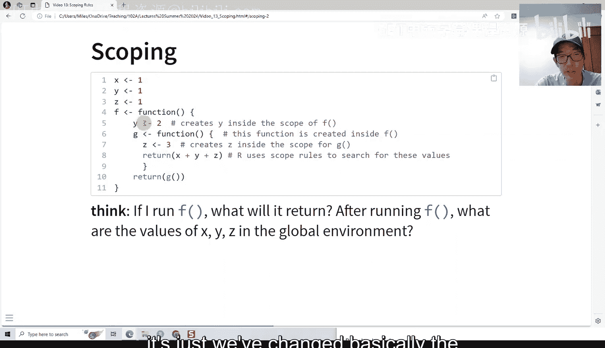

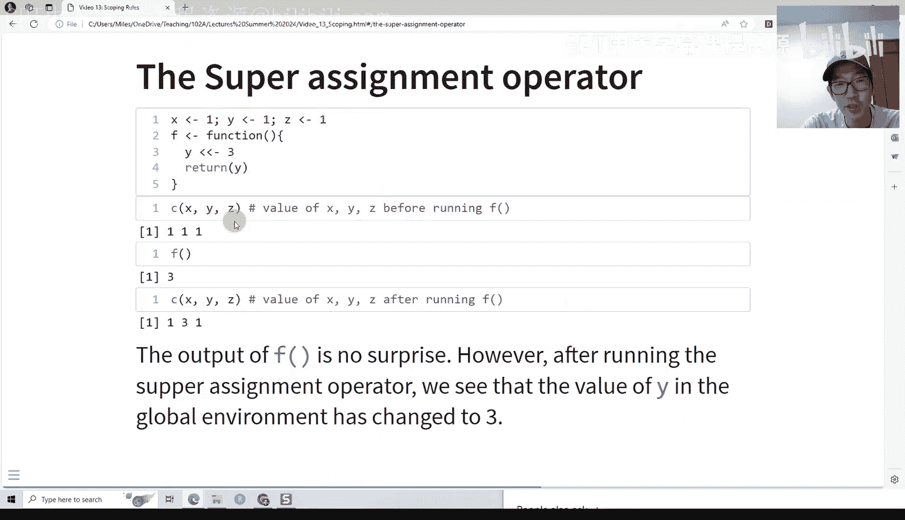

Over here， and then the result is that we get one， two， and three in the global environment。

After G gets executed。

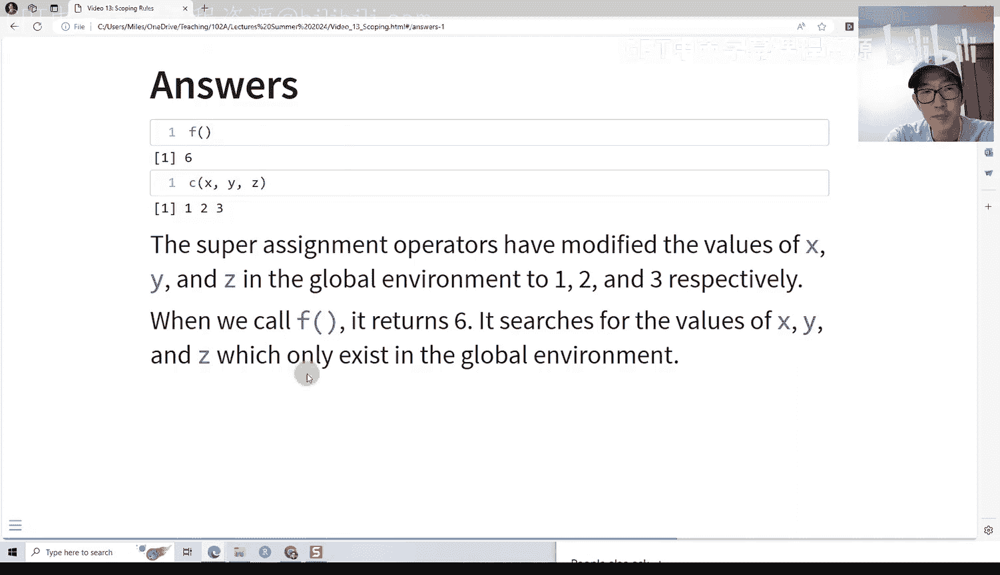

A few things can happen though and supersignment can be tricky right so here note this is just bad practice so you shouldn't do this intentionally。

 but you might do this unintentionally and then confuse yourself， so I'm going to create x。

 Y and z in the global environment that each get the value1 where you're going to create a local variable Y inside the function F。

And then we use super assignment which will modify the value y， but in the higher environment。

 which will be up here in the global environment， so y is going to get the value 4 in the global environment okay we modify Z looks is going to get changed to three in the global environment。

Okay， so now we' are going to return X， Y， and z。We look for x， doesn't exist in G。

 doesn't exist in F， finds it in the global environment， x has1。

Now we look for y doesn't exist in the local environment of G。

 but it does exist in the local environment of F， so we're going to take that y is going to get the value2。

Then we look for Z。Doesn't exist in the local environment of G。

 doesn't exist in the local environment of F， we find it in the global environment it has the value for。

2。So Z has the value  three。

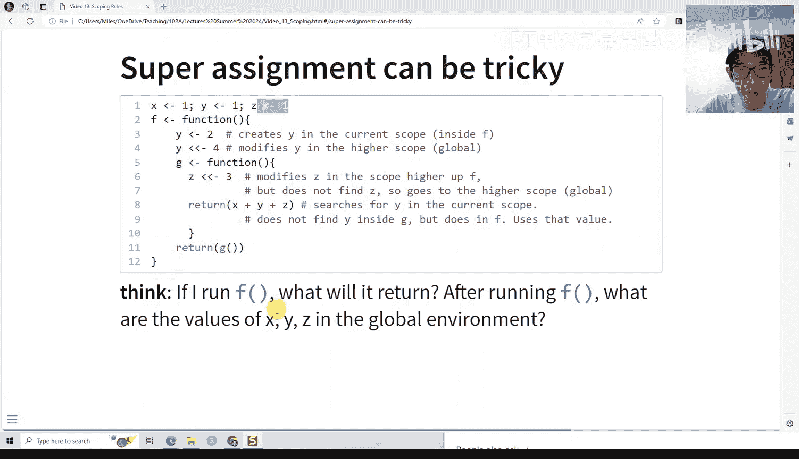

So when we check F returns the value 6 and x， y， and z have the values 1，4， and3。

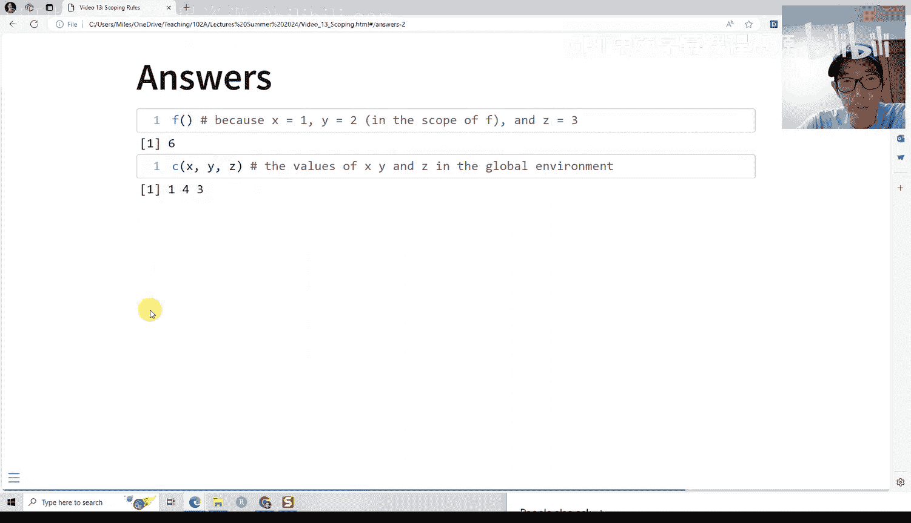

Okay， so let's。Let's let's look at this again。 Okay， so now I have X。

 Y Z in the global environment has the values1 I create a local。Value of y in F2。

 local value of z in 10 gets 10 and F and then we modify y in the higher scope， y gets the value 4。

And then。And then when G gets executed， then。This。This supersign is going to modify the3。

 the z in the higher scope， it finds it in F， and so this is going to get modified to3。

And it doesn't touch the global environment Z。So now when we return x y and z。

 it's going to look for x， not in G， not in f finds it in the glO， x has 1。When we look for y。

 it's not in G， but we find it in F gets the value2。Then when we look for Z。It's not in G。

 but we find it in F， and F the z inside f has been modified to the value 3。

 so again we get 1 plus 2 plus 3， it returns 6， so when we execute F it's going to return 6 when we ask what is x。

 y and z in the global environment x has the value 1。Y has been modified to4。And Z remains one。

 it was never touched by this supersign operator， so we're going to get6 and one41。

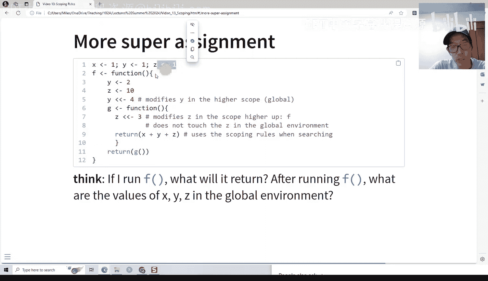

嗯。This is why I say you should avoid using super assignment， okay。

 because sometimes things get confusing， so let's say。You want to。Run and kind of take the output of。

 let's say you have。Argument fo or whatever， Okay， and you want to add a squared thing。

 so we're going to take in some some object and then we're going to kind of append。

The value of x squared to it， so we're going to take P， we're going to append x squared to it。

And super assign that back to Fu。So here I start off with F being two。Then I run this function。

 I'm going to do F and5。And then so when we do this， okay， it passes the value 2 into fu， okay。

 then it takes x， which is5， it squares at 5，25。Creates a vector with two combines 2 and 25 together。

 and it superigns that back to F。 Allright， and so when I ask， hey， what is the value of fo。

 we get 225， so this kind of seems like it works。

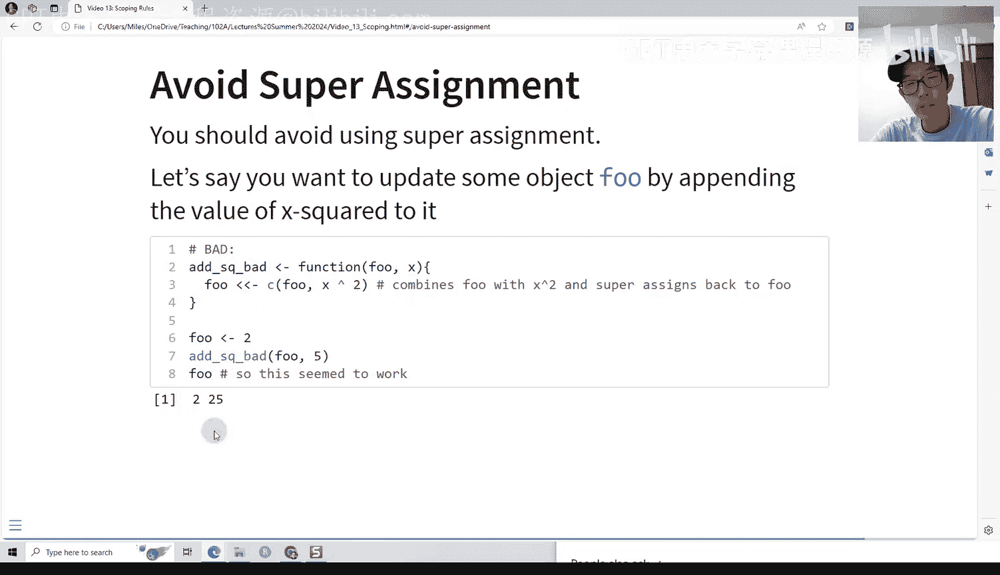

All right， all right， let's try this now I have an argument bar 10 okay。

And we're going to run the same function bar and six。Based on the way we've written it。

 we're expecting it to be the value 10。With the value 36 appended okay。

 but that's not what happens bar remains 10。 and instead F has been changed to 10 and 36 Okay F has been changed to 10 36 because what happened when you look at this。

 this super assignment Okay， it takes the name F here。

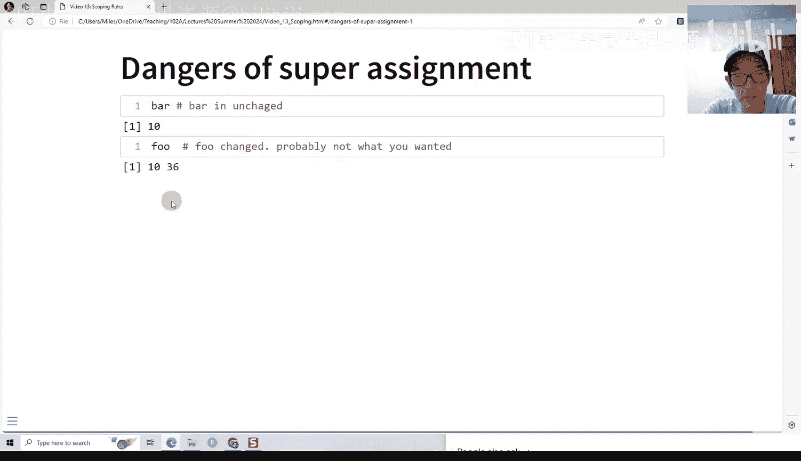

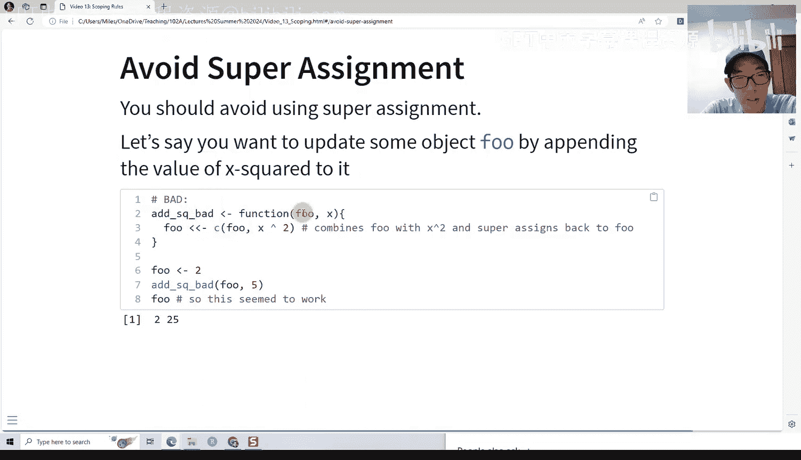

Okay， so this time the value 10 got passed in right。

 and it gets passed in here so we get 10 and x is 6 and it gets 10 and 36。

 but then it super assigns it back to。

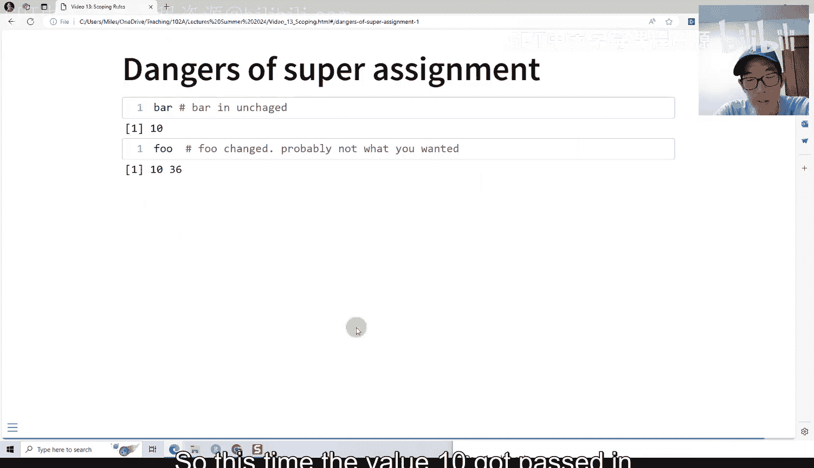

Foo in the global environment， it's not the local fo。It's the food in the global environment。

 so the food in the global environment ends up getting the values 10， 36， okay？

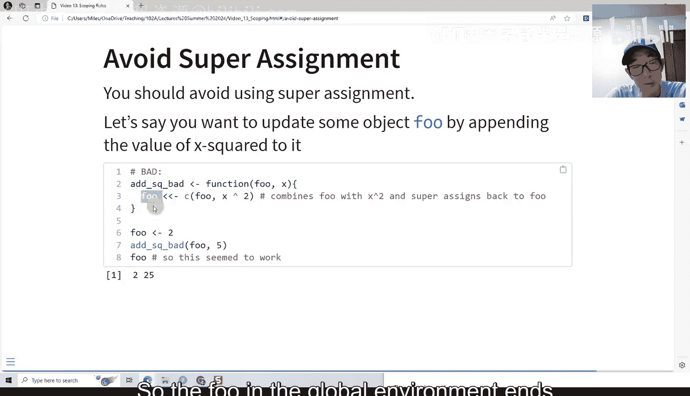

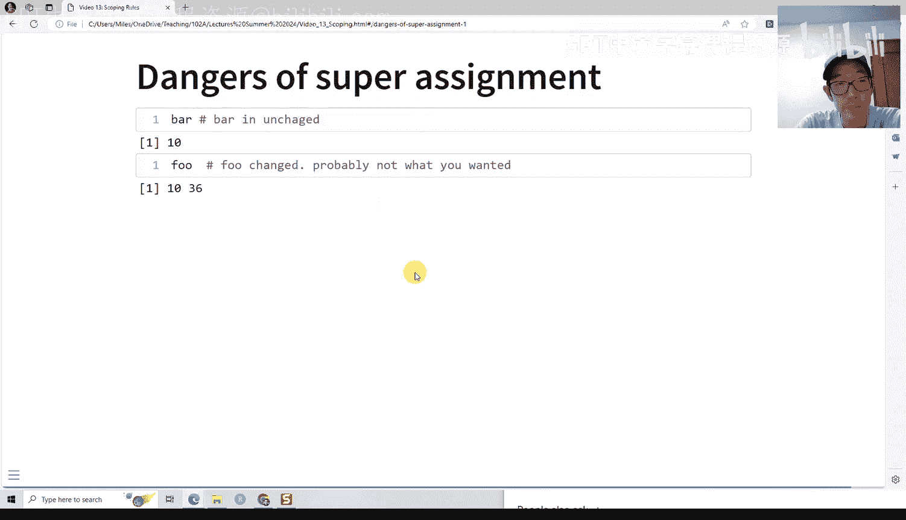

So a better way to handle this okay， is just to have the argument， have it return。

You know here I've got bas and x squared okay and then you just have to explicitly assign it。

 So here I'm going to take two。 we're going to do F and 5， and then we ask for what is F。

 It gives me 2 and 25 here I have bars is 10 I do bar and 5 and it returns 10 and 25 okay the key difference here is I have to use the super I have to use the regular assignment。

 So after running the function I have to make sure I capture that output by assigning it back to bar okay whereas you know super assignment。

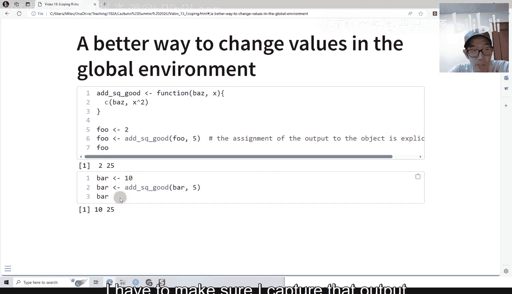

You didn't need to do that， you can just run through and then。

Call the function and it modifies it okay but。

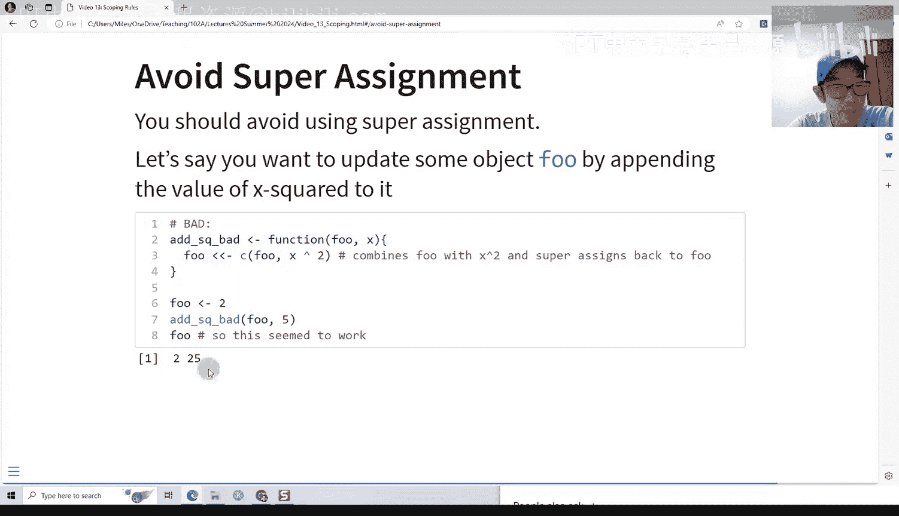

Again， this kind of stuff can lead to kind of confusing results because this is always going to modify the object food so you can't really put in other kinds of names or objects there。

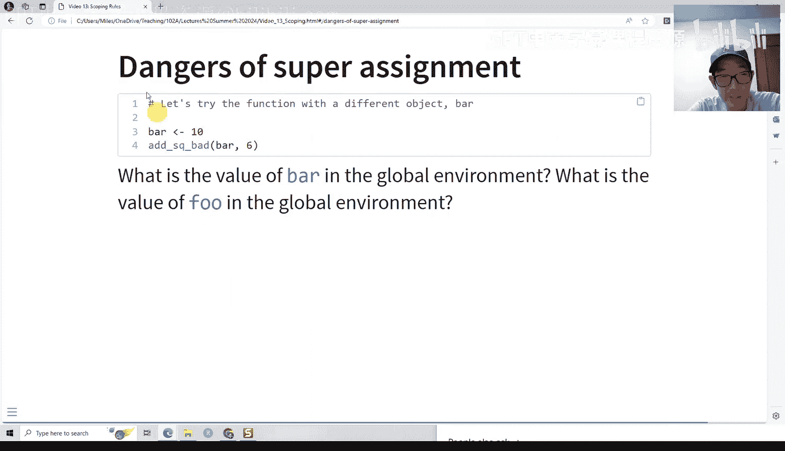

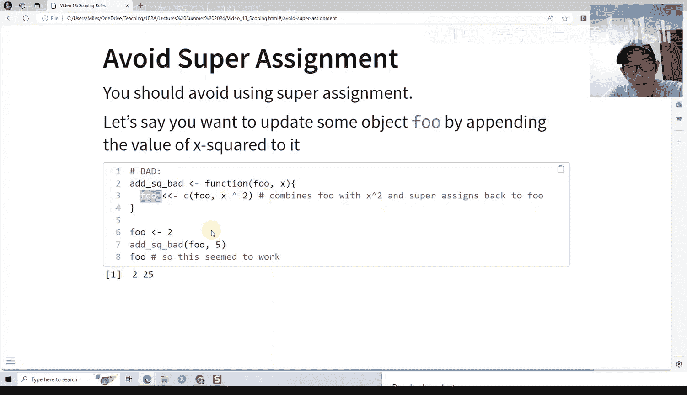

Okay， so in general。Try to avoid using super assignment。

 but you do sometimes read other people's code and you do see super assignment being used and so it is important to still know that it exists and know how it works。

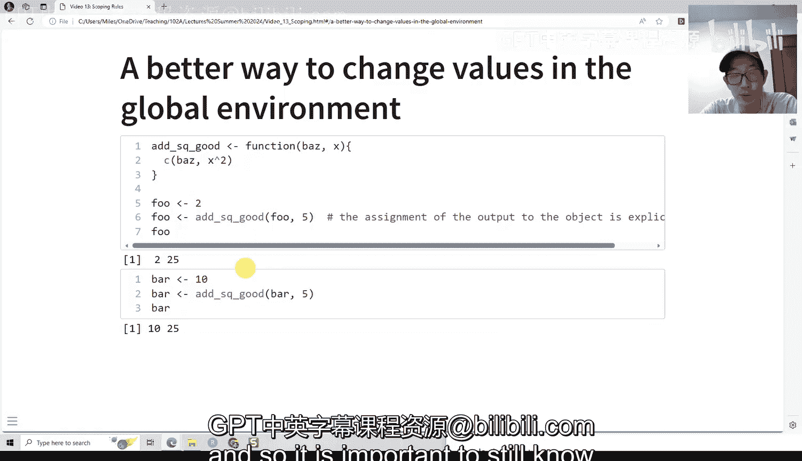