# UCLA《计算统计学｜Stats 102A - Computational Statistics with R 2024 Summer》中英字幕 p14 [14]Stats 102A - 2024 Summer - Video 14 - Environments in R.zh_en [BV1jizNBrEm2_p14]

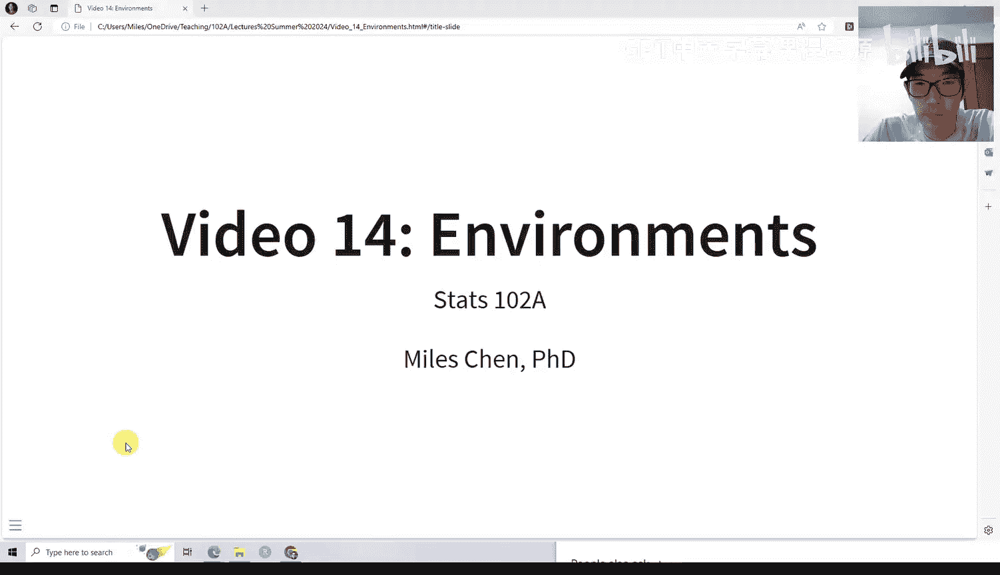

All right let's talk some more about environments， so we talked about environments in the context of you know a local environment and the global environment。

 there's a little bit more to it， so let's get into some of the details there。

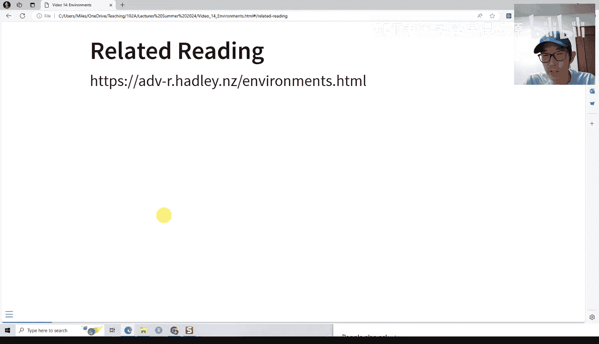

The environment is actually itself a data structure。

 it's the data structure that powers scoping basically the job of an environment is to bind names to values you can think of an environment as basically like a bag of names where each name in that environment then points to an object stored in memory so the computer you keeps values in whatever stored in memory and then the way you access those values is by using the name that's pointing to that object and memory and those names are stored inside the environment and so the data structure for that is the environment so you can actually create your own environment using the function new dot environment and so here we're going to create a new environment called E and within E we're going to have the names A B。

 C and D now they don't have to be one letter obviously。have names like。You know， you know。

 function name， whatever it is， right， you know some vector or whatever that you want to call it。

 but here a gets bound to an object with the value false。

 the vector with the value false and B gets bound to a character vector C gets bound to a numeric type double vector and D gets bound to an integer vector。

 and these names exist inside this gray box which represents the environment okay。

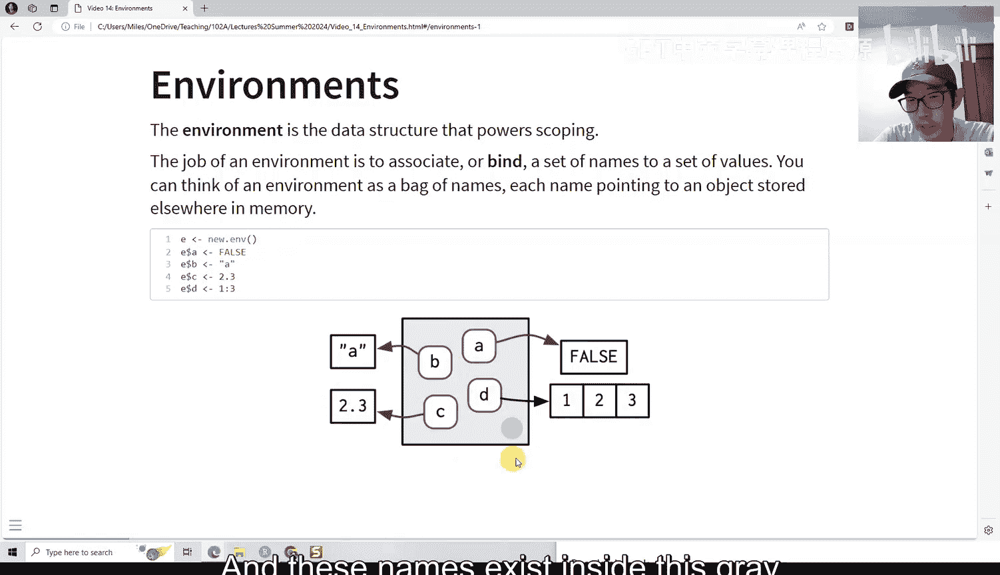

So as with everything in our environments themselves are also objects。

 the syntax to work with the environment is similar to a list and that you can use double bracket。

 double square bracket or the dollar sign to get the values so you can ask type of E and that we say it's an environment you get the values by using E dollar sign C dollar sign notation or E double square bracket and then you put the name in quote D inside double square bracket does that however。

 environments are inherently unordered so you cannot say hey give me the first item right in a list you can say hey。

 give me the first item， double square bracket one and it will give you the first item environments are like bags if you go into your backpack and I say get get the third item in your backpack it's kind of a nonsense question because if things are just kind of floating around in your backpack which one's the third which one's the third item？

If you have like a bunch of。I don't know， erasers or tennis balls or something in your backpack and I say。

 hey， get the third item。It doesn't quite make sense， okay。

 so you can't use ordered operations there。

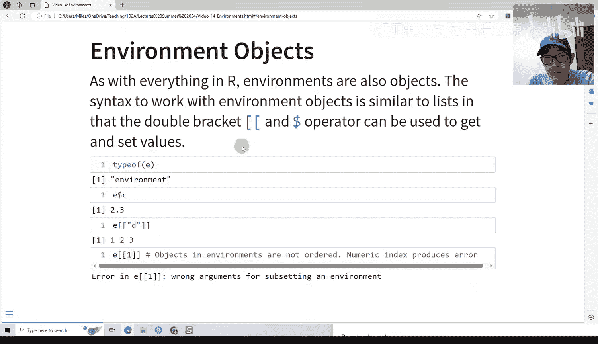

🤧。You can take a look at what kind of what the names are you have in your environment by using the LS function。

 so LS， often we use that in the global environment it lists off all of the objects inside the global environment。

 but if you have a specific environment like environment E。

 you can do LSE and it will give you the names inside that environment and then there's another function Ls。

 STR and that will give you a little bit more detail basically on the structure within the environment。

 okay similar to how you can get the structure of a list and things like that。

 basically you get more details on the environment itself。Okay， again。

There are similarities between environments and lists， but again。

 environments themselves are unordered and there are some major differences in that you can't use a single square bracket with an environment and then if you set an object to null in an environment。

 it does not actually remove the environment it just sets that value to be the null object if you want to remove an object from an environment you have to use the RM function so this is kind of how we delete objects in the global environment you just do like RMD or if you have it within the environment you do RMD comma and then you specify the environment that you want and so here we can see that setting null to E dollar sign D D is still there。

 however using RM on D gets rid of that。

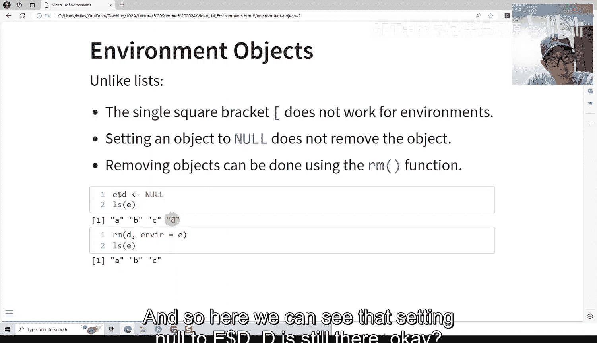

Every environment has a parent environment which is basically another environment okay in these diagrams this blue circle points to the parent environment okay the parent isn't used to implement lexical scoping that is if R can't find an object and the current environment can't find the name of the current environment。

 it looks into the parent environment and so on okay and so you know you imagine just kind of a chain of a bunch of environments until it reaches the top levelve environment。

 this is the only environment that doesn't have a parent and that is the empty environment okay。

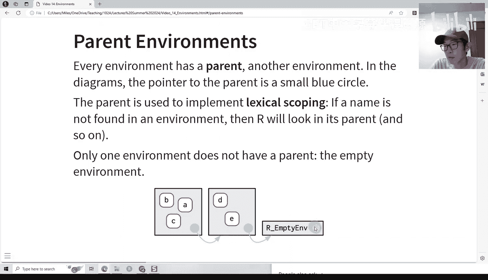

So there are kind of four special environments or I guess three in the environment is always just the current environment when you ask for global environment that's going to be the global environment or your workspace this is basically the environment that you normally work and when you start up R and you create vectors and stuff it all goes into the global environment the global environment has a parent and it's a little bit odd to think about but the parent of the global environment is whatever library is attached last okay the most recently attached library is the parent of the global environment I'll explain that it's all part of the search path okay。

You also have what's known as the base environment。

 it is the environment of the base package that's kind of the when R gets loaded。

 it first loads base package， then it loads a bunch of other packages like stats and things like that。

The parent of the base environment is the empty environment。

 the empty environment is the ultimate ancestor of all environments。

 it's like the parent of the parent of the parent of the parent until the very end。

 and it is the only environment without a parent okay。And then finally， yeah。

 the environment is just the current environment， whichever one you're working in。

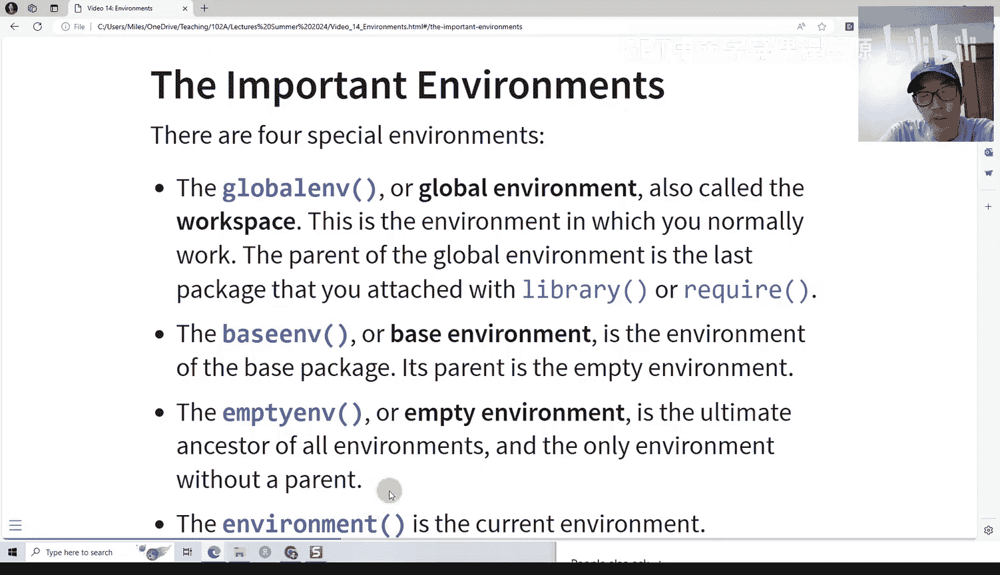

So you can ask for the search path okay by typing in search parentheses and that will list all of the parents of the global environment。

 this is called the search path because when R can't find something in the global environment。

 it starts searching for that thing up the search path， so for example， when you start up R。

 you never create a function called standard deviation okay you never create a function called SDD。

 but you can ask for SD， you can ask for the standard deviation of a set of numbers or something like that。

And the way and it finds that， I believe in package stats I want to say。

 but then other functions like the function you use to create a list。

That shows up underb okay other things there's data sets and graphics and things like that here when I knit things it loads up a package or I think I loaded a package there so this is the search environment so。

The last package I loaded was knitter and that's actually the only package I think I loaded as far as creating these slides go。

 but then these ones all kind of get automatically loaded when you start R and so the very first thing is base。

 this is going to be things like has the function C that we use to create vectors and then we have other things I think methods contains functions for like creating factorss and stuff I think don't quote me on that and then you have functions like LM that exist inside package stats okay。

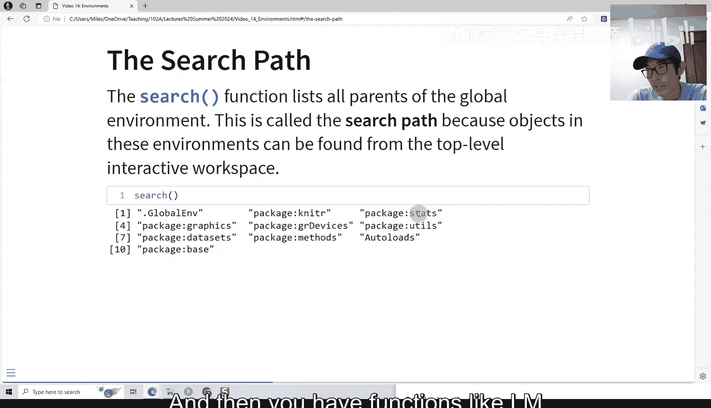

So this is how the search path looks or you can visualize it this way。

 you have your global environment， whichever package gets loaded， comes in here。

 it keeps going up until you reach the base environment and then the base environment has the empty environment as its parent okay when you call library and load another。

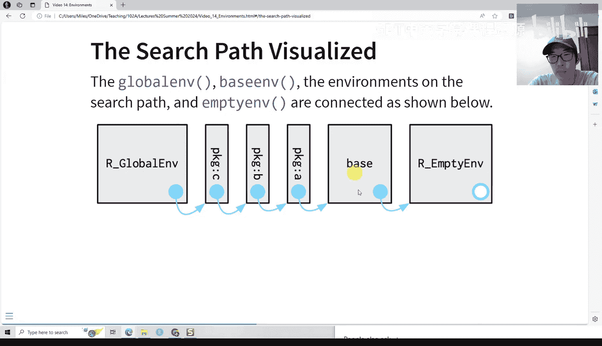

Function or load another package Okay， so let's say you call library on say G plot。

 okay that's going to contain functions like G plot。

I guess the library is Gplot2 contains functions like GGplot and that gets in here and so that way you can call an R you can ask for GGplot and it creates a thing and it will find it inside this package that you load it if you don't load it and you're back here in GGplot2。

 the library is not loaded and you ask R hey， I want to create a function with GGplot it's going to say hey。

 that's not found because it's not in the search path so you need to load that library now finds now it's in the search path and it's able to use that。

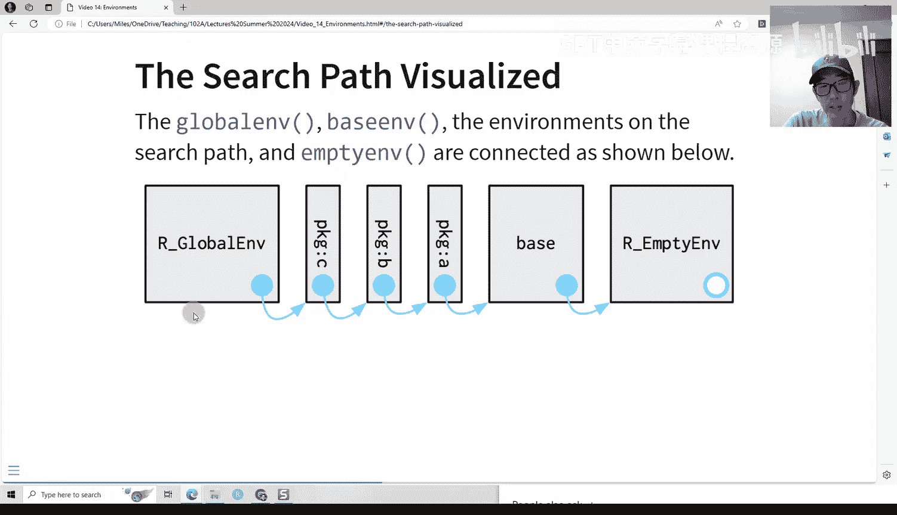

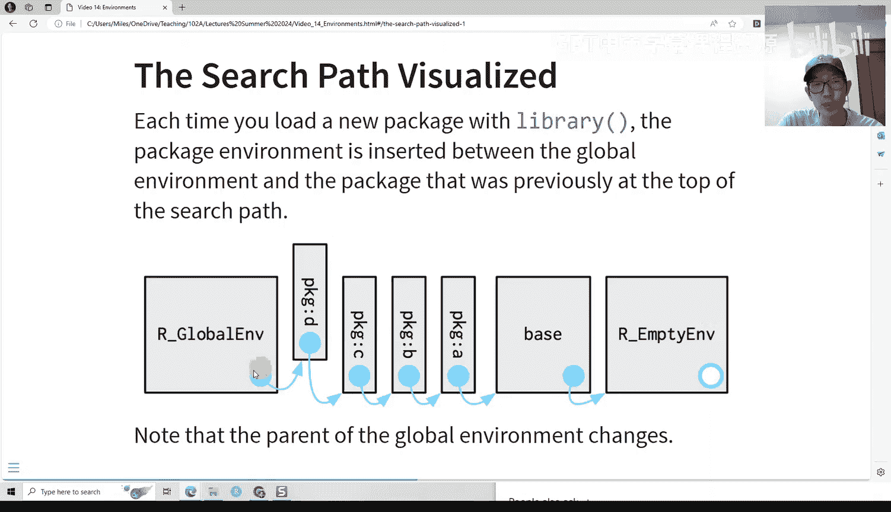

Okay。We talked a little bit about this already but we'll visualize it here as well。

 so a lot of the environments that you end up dealing with are created as a consequence of using functions okay every function has four types of environments associated with it。

 you have an enclosing environment a binding environment and execution environment and a calling environment okay the enclosing environment is the environment where the function was created every function has just one and only one inclo environment as far as the three other types of environments that is binding execution calling there could be zero1 or possibly multiple environments associated with each one binding a function to a name with the assignment operator defines the binding environment that's where the name of the function exists。

Calling a function， when you execute it creates a temporary execution environment that stores the variables created during the execution。

And then every execution environment is associated with a calling environment。

 and that one tells you where the function was called。

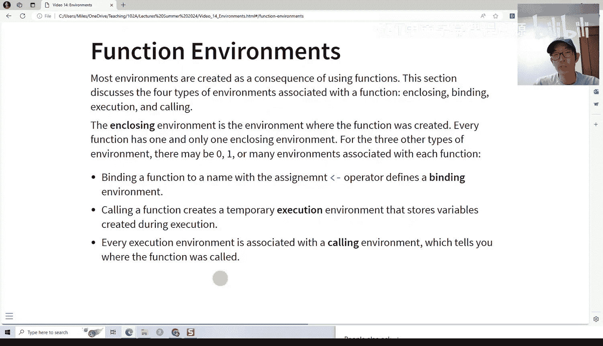

All right it sounds like a lot of stuff， let's just kind of work through an example in a moment here okay so when you create a function and you write it。

 that gains a reference to the environment where it was made。

 this is the enclosing environment and that's used for lexical scoping then when you name the function。

 the environment where the name exists is the binding environment and most of these cases。

 the inclosing environment and the binding environment is going to be the same environment okay。

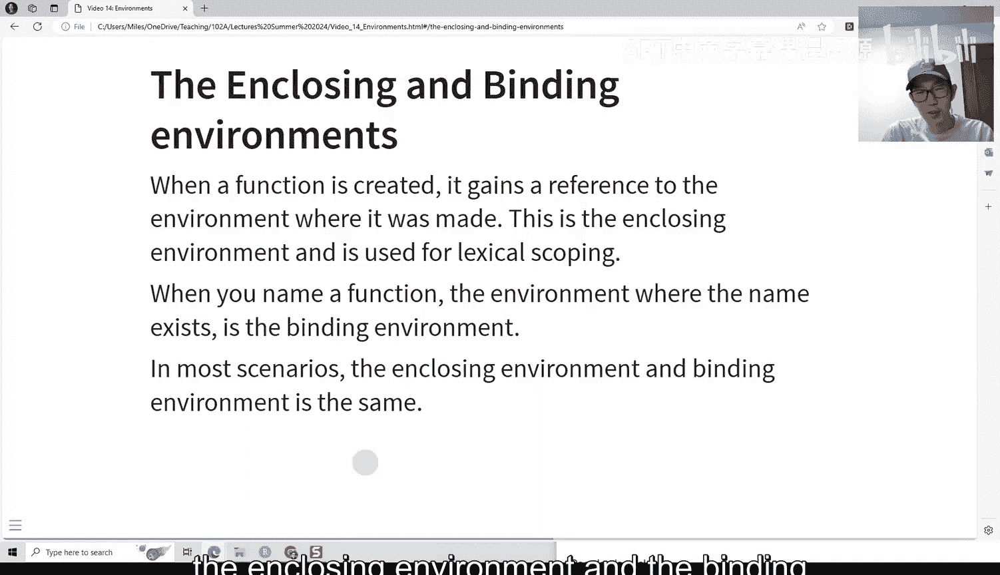

So here。In the global environment， y gets the value 1 the name Y is associated with the value1 in memory。

 and then the name F。Is associated with this function that gets created， this function。

 it's a function of x， and it's going to return x and Y。And we can ask， hey， where is the F located。

 which environments located in the global environment。

 so the function is created in the global environment， so that's the closing environment。

 the name F exists in the global environment， so that's also the binding environment。

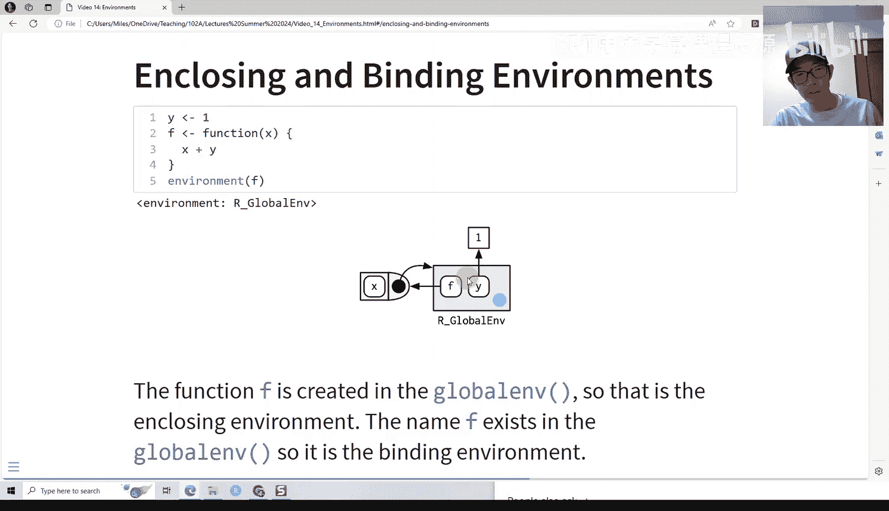

Okay。嗯。In the search path， however， we see that the parent environment of a package varies kind of based on what other packages have been loaded and in what order they've been loaded。

 Okay， so does that mean the package。Would end up finding different functions if they're loaded in a different order。

 Okay， so if you think about right， because if if the parent environment。

 the order of the parent environments are different， right， if you have a， let's say。You know。

 let's say there's multiple you can think about it kind of like different friend groups or something。

 and there might be multiple people named Joe okay and if the order in which you're searching for Joe differs right。

 you have friend group one friend group two and friend group 3 and you change the order of them when we ask for Joe and you search for it in a different order you might end up picking out different things and we run into that same kind of problem in R well the way R handles this is it uses basically what's called namespaces okay so if you look at the standard deviation function。

 the standard deviation function is actually defined in terms of the variance function so first basically when you call for the standard deviation of a vector or something R is going to try to calculate the variance of it and then it's going to return the square root of it okay so。

How do we make sure that we're going to use the correct variance function or something that later on。

 if I were to create another function called Var， which not a good idea。

 but you there's no rules against it， okay if I create another function var or I load another package that has a function var。

 is this going to affect how things work okay？

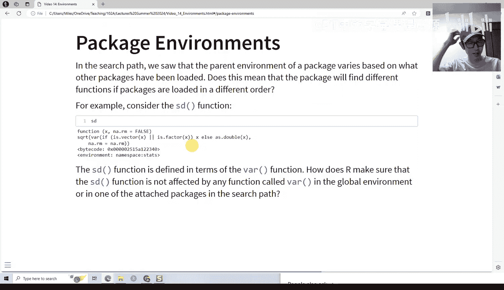

And this is how namespaces are used for package creation and kind of making sure package packages work right。

 so the distinction between the enclosing and the binding environments is important for functions inside packages so to kind of make sure that every package works the same way。

 regardless of what other packages are attached by the user in what order they're attached。

 packages require an internal environment called the namespace in which the package functions are defined。

 so the package functions are defined inside the namespace。

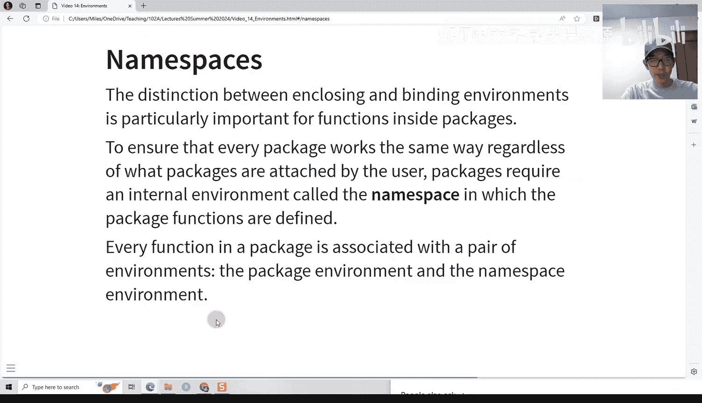

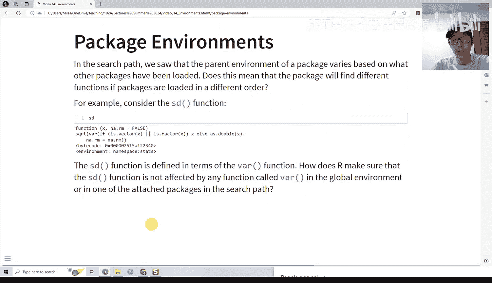

In that way， when we're looking for。The inclo environments itself stuff。

 it's always going to find the correct name。 Okay， so every function in a package is associated with basically the package environment and the namespace environment。

 and it's going to find the name of the function in the search path。 Okay。

 that's going to be kind of your binding environment。 It's going to find the names that way。

 But then the。Functions themselves are defined in the namespace， and that's where。

That's how it keeps the references to the other packages correctly or other functions correctly。

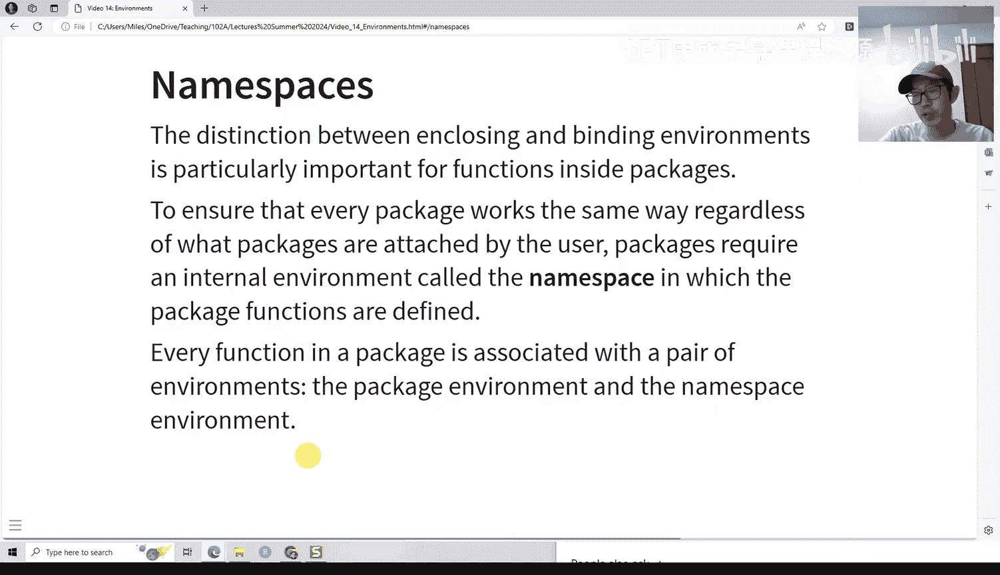

We have the double colon operator， the double colon operator is used to kind of access a function directly from a package。

 so the package environment is the external interface to the package so this is the environment that are uses to find a function okay and it's。

And the parent， the packaging environment is determined by the search path， okay？And so。If。

If you load your packages in a different order， okay the most if one of those packages has functions that have the same name as other functions in the package。

 the one that gets most loaded most recently is the one whose name is going to be found first so there is a function mean in the base package。

 okay there's also a function mean in the mosaic package。

 so normally if you start R and you ask for the mean of something。

It's going to find and you don't have any other packages loaded。

 it's going to find the mean function in the base package。 Okay， however。

 if you load the mosaic package， okay， that's going to get become the new parent environment of the global environment。

 And then when you ask for the mean。It's going to find the mean function in the mosaic package and so that will mask the mean function in the base package and it will R will use the mean that's in the mosaic package。

 Now let's say you want to use the mean in the base package okay the way you can do that is the double colon operator and you say base colon and colon mean and that will refer to the mean function in the base package and you'll access it directly。

呃。And not in the order okay so it's kind of like using someone's first and last name right so if you have multiple people named Joe okay and you are very kind of aware of like the order of your friend groups and stuff and you know。

In your current friend group you're talking about Joe。

 you'd think about the Joe that's in your kind of current circle that might be in the present room。

 but if you want to talk about a different Joe you might use their last name right and you'll say Joe Joe Thompson and you go okay that's not the Joe that's in our current friend group that's the Joe Thompson that's over there that we're also familiar with but we are referring to that and that's basically what we're doing we're basically using the name of the function。

And it's kind of package name to do that。 Okay， so that's the double colon notation that allows you to access。

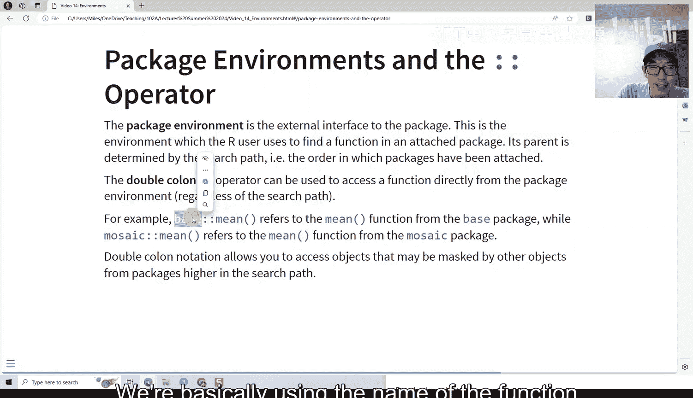

Objects that might be masked by other things。

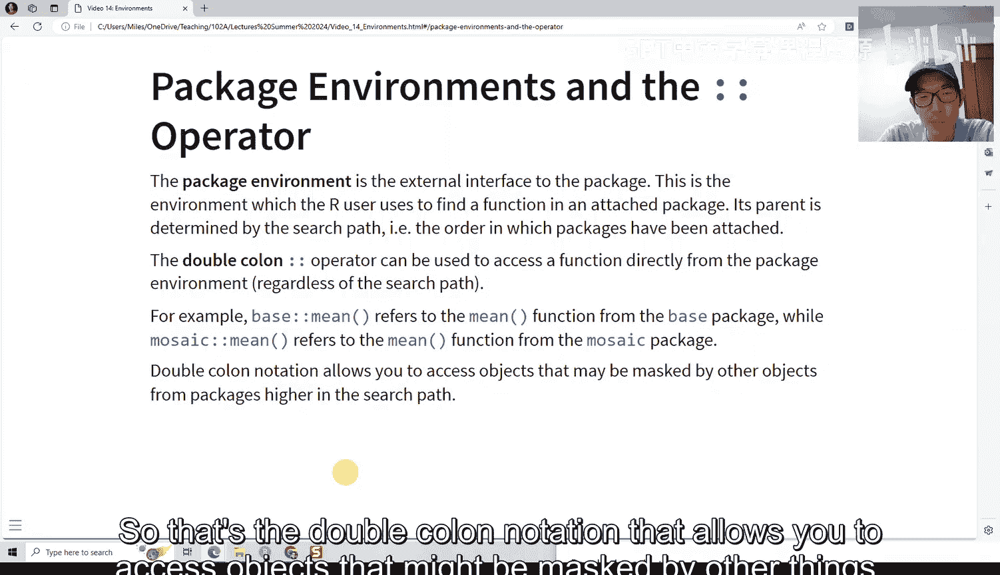

Okay， the namespace environment is the internal interface to the package。

This package controls how we find the function， the namespace controls how the function finds its variables。

When the namespace environment of a package often contains internal or non exported variables。

 bindings that allow internal implementation details to be hidden from the user， basically， you know。

 when we call standard deviation， okay？R finds it using the binding environment。

 finds standard deviation and says， okay， here's the function。 Okay。

 but this function makes reference to the variance function and and it's going to use。

The lexical scoping as defined by the namespace。

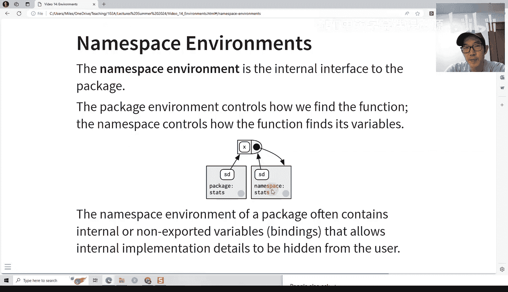

Okay， so let's。Let's just take a look at a very simple function and let's talk about how this works every time you call a function。

 a new environment is created to host the execution。

 the parent of the execution environment is going to be the enclosing environment of the function。

And once you the function is done， this execution environment is thrown away。

 So here we have a simple function H， okay， inside H。

 so H is a function of x and H is inside H we assign the value the name two to get the value the name A to get the value 2 and then we get。

It returns x plus a， and so we're going to call H。Pass the value1 as into the argument X。

 and then whatever it returns， we're going to assign to Y。 So how does this work。 So when we call H。

With the value 1 as x here。It creates an execution environment okay this is the execution environment。

 the x gets the value 1， so this is just what happens basically we're running this very first line of code when you run H of1。

 it just runs the very first line of code and it just basically assigns it creates an execution environment。

 it assigns the name X to the value1。Okay，The next line is going to then assign a to the net number two。

 so a gets boundd to the value 2， and then the last line here。

 it's going to add x and a and it's going to return that value 3 as soon as it returns that value 3。

This execution environment proof it disappears， okay， it disappears。

And then it assigns that value 3 to y， okay？And so this is now the global environment。

 global environment has value y， which gets the value 3， and then H still points to this function。

 it' a function of x， but the execution environment that was here disappears。

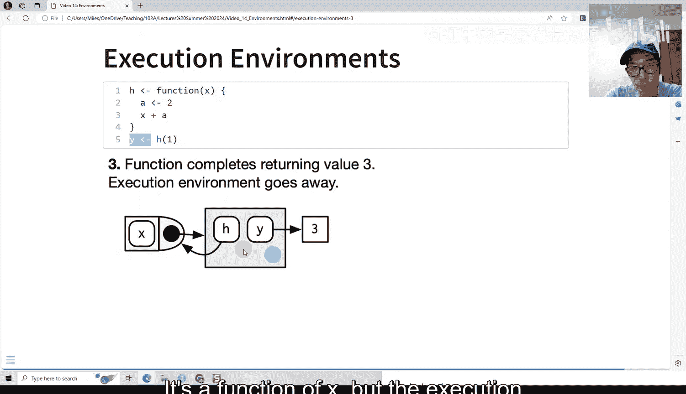

Okay， when you。When you call a function， it creates that execution environment。

 the execution environment has two parent environments， okay， it has the enclosing environment。

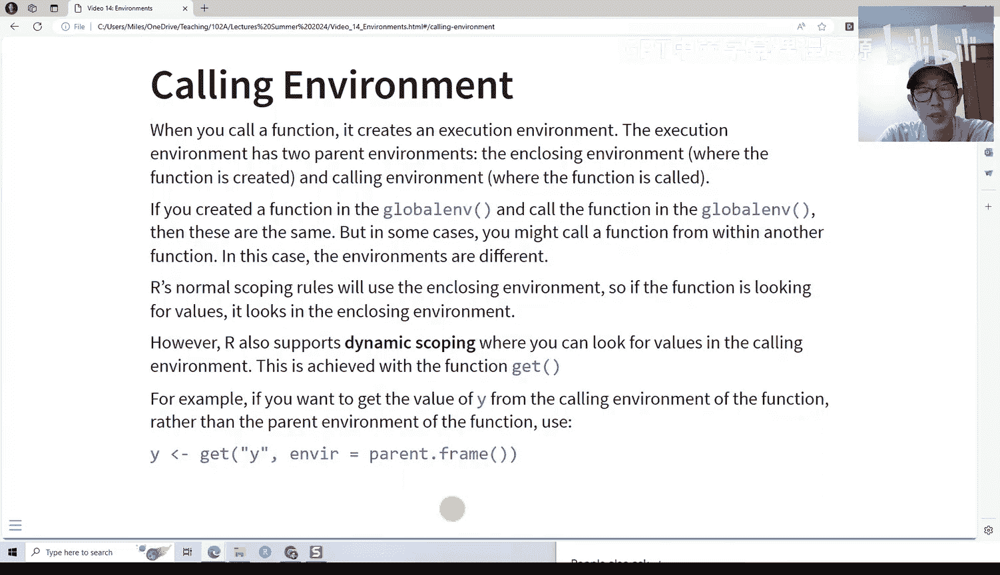

And it has the calling environment， okay so this。This execution environment。

 when it looks for things like a and whatever， it comes from the。

The enclosing environment okay so if you create a function in the global environment and you call the function in the global environment。

 then the enclosing environment and the calling environment are the same。

 but sometimes you call a function from inside another function and in that case the calling environment and the enclosing environment are different。

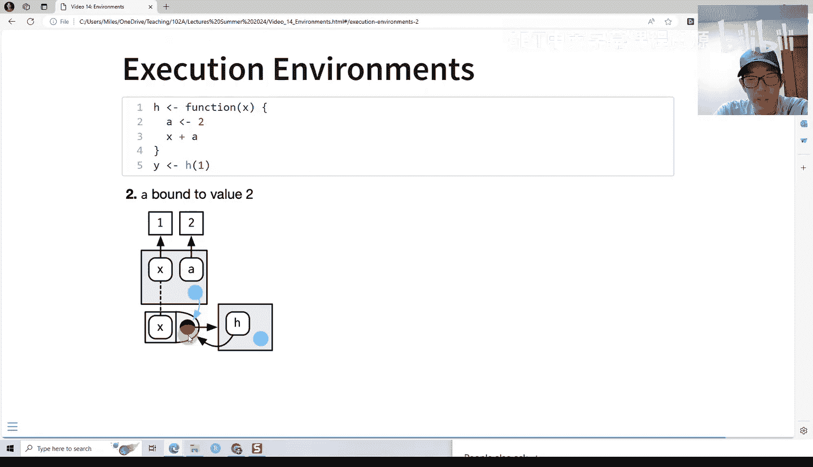

The normal scoping rules in R use the enclosing environment。

 so if the function is looking for values， it uses the enclosing environment where that function is defined okay。

R， however， also supports dynamic scoping。Or you can then look for values in the calling environment。

 okay and you get you achieve that by using the function get So for example。

 if you want to get the value Y。From the calling environment of the function。

 rather than the parent or the enclosing environment of the function。

 you can use get Y and you get it from the parent frame and that will use the calling environment。

And I'll show you an example of that in the next video。

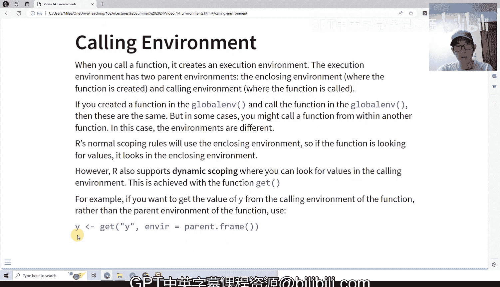