# UCLA《计算统计学｜Stats 102A - Computational Statistics with R 2024 Summer》中英字幕 p15 [15]Stats 102A - 2024 Summer - Video 15 - Scoping Self Quiz.zh_en [BV1jizNBrEm2_p15]

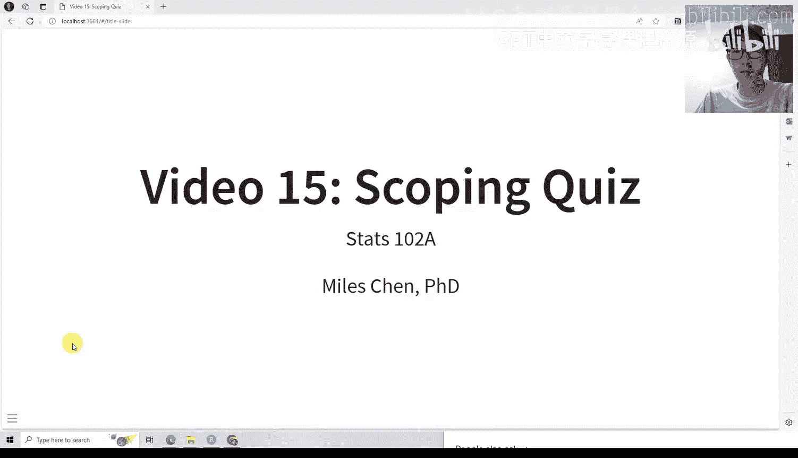

All right， here's a little quiz on scope。So why don't you read through this code here。

 pause the video and see if you can answer the question of what will F return when we call the function F？

So pause the video。

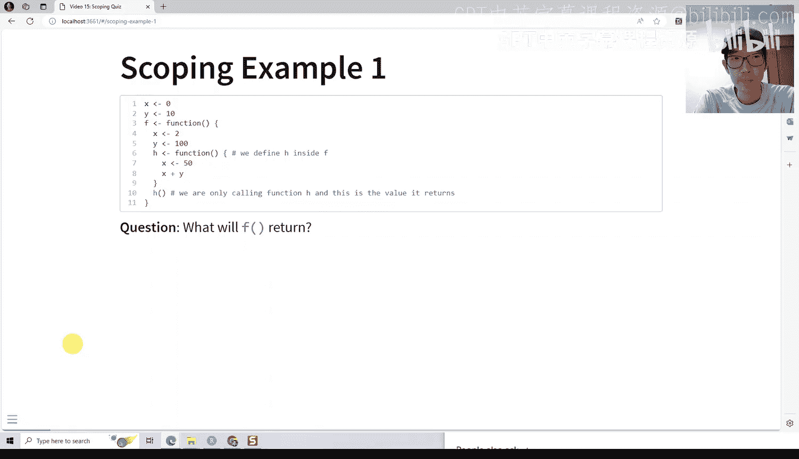

Okay， let's go over the answer。So what we see is x and Y get the value 0 and 10 in the global environment F is defined in the global environment and we will call F when we call F。

 we create the values 2 and 100 inside the local environment of F。

 we also create a function H inside the local environment of F and what F returns is the last line of code where it executes H when H gets executed。

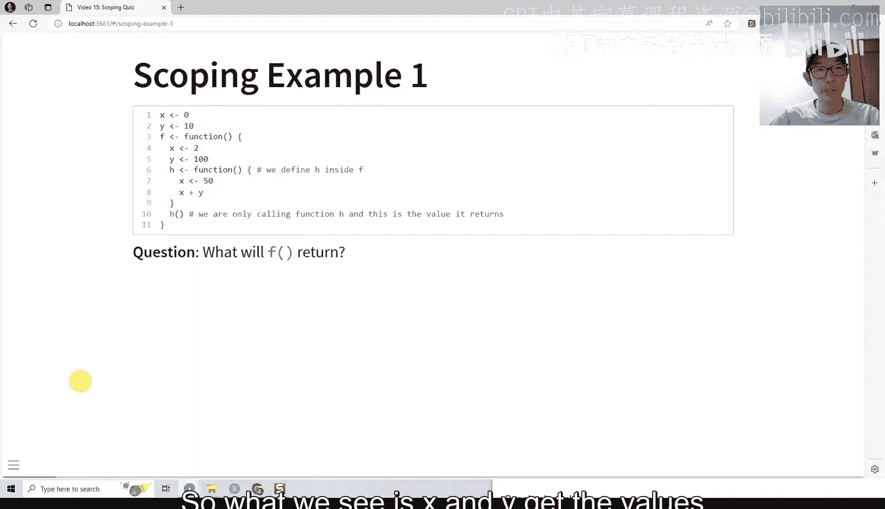

It defines 50 as x in the local environment of H。 H returns x plus y。

 When it searches for the value of x， it finds the value of 50 in its local environment。

 when it searches for the value of y， it doesn't find it in the local environment of H。

 so it searches its parent or its enclosing environment， which is the environment of F。

 the execution environment of F inside there we find the value 100 So it's going to take 50 for x100 for y and return 150 H returns 150。

 which is going to be the value that F returns and it returns 150 as the output。

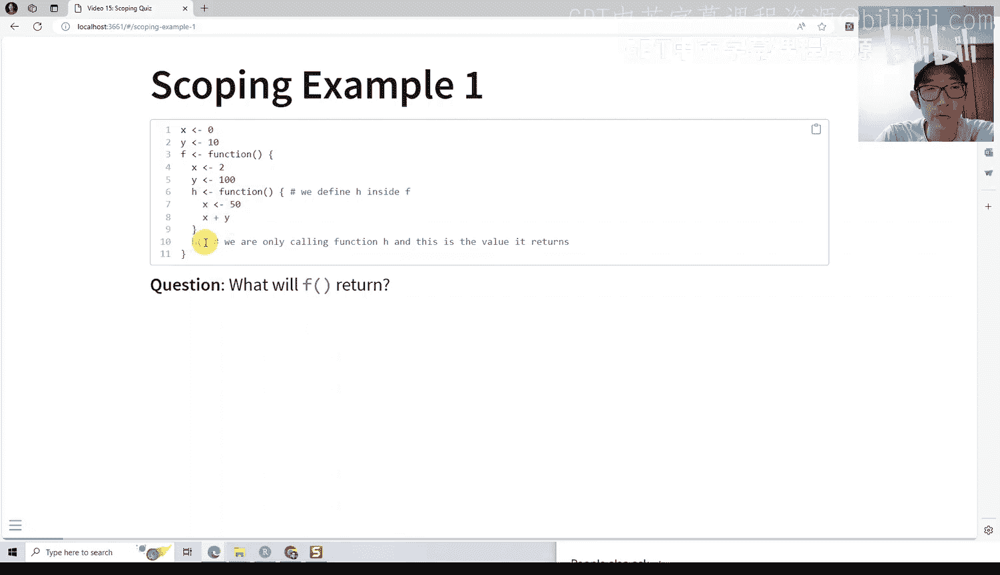

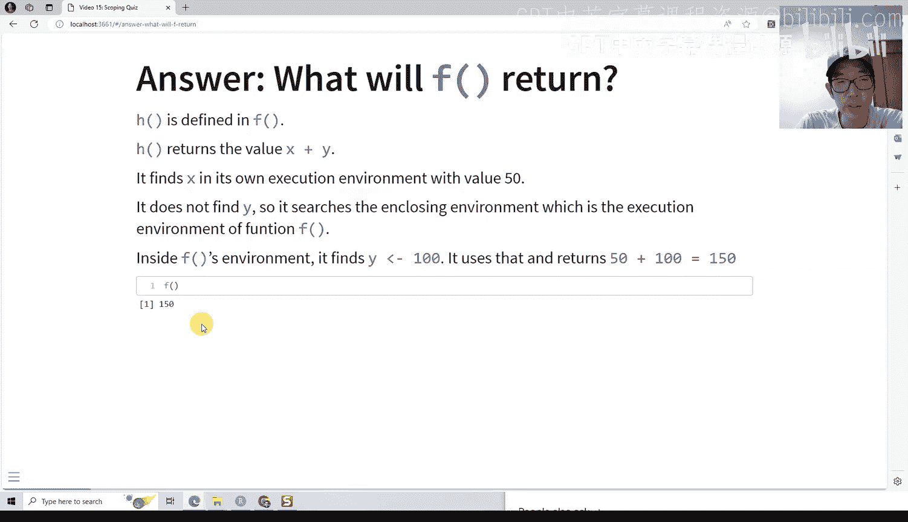

Okay， here's another example， go ahead and pause the video and see if he can answer what H will return and what G will return。

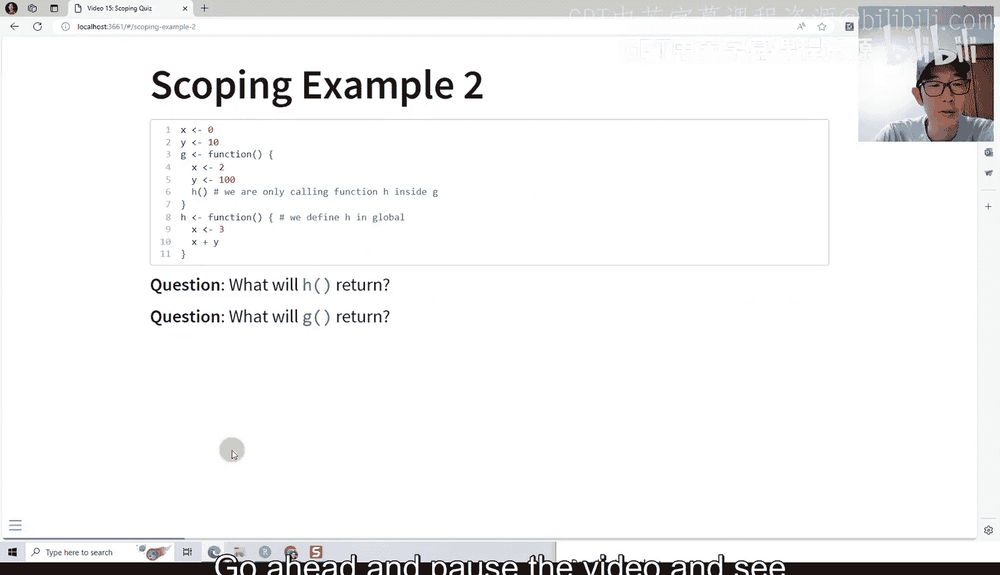

Okay， let's go over the answer。Here。We will execute H。 H is defined in the global environment。

 when H executes the local environment inside the local environment。

 we define x and it gets the value 3。 H is going to return x plus y， So it returns 3 plus Y。

 We need to find a value for Y。 Y is not inside the local environment of H。

 so we search its enclo environment， which is the global environment in the global environment。

 Y gets the value 10。 So it will return 3 plus 10 and it returns 13。

What will G return when G executes？Inside its local environment。

 x gets the value2 Y gets the value 100 G then calls H。It calls H。

 and so H gets executed when H gets executed， it defines。

Creates x and gets the value 3 in the execution environment of H。H returns a value x plus y。

 it searches for x， it finds a value 3 in its local environment， it searches for the value y。

 it can't find y in the local environment of H， so it should searches the enclosing environment of H。

 which is the global environment， the global environment has y equal to 10。

And so y gets the value 10， and it returns 3 plus 10， and it returns 13， so when G gets executed。

 it also returns 13 because it's calling H。 the fact that x is 2 and y is 100 inside G is irrelevant because those are not passed into as arguments to H and H does not。

The enclosing environment of H is the global environment， not G。

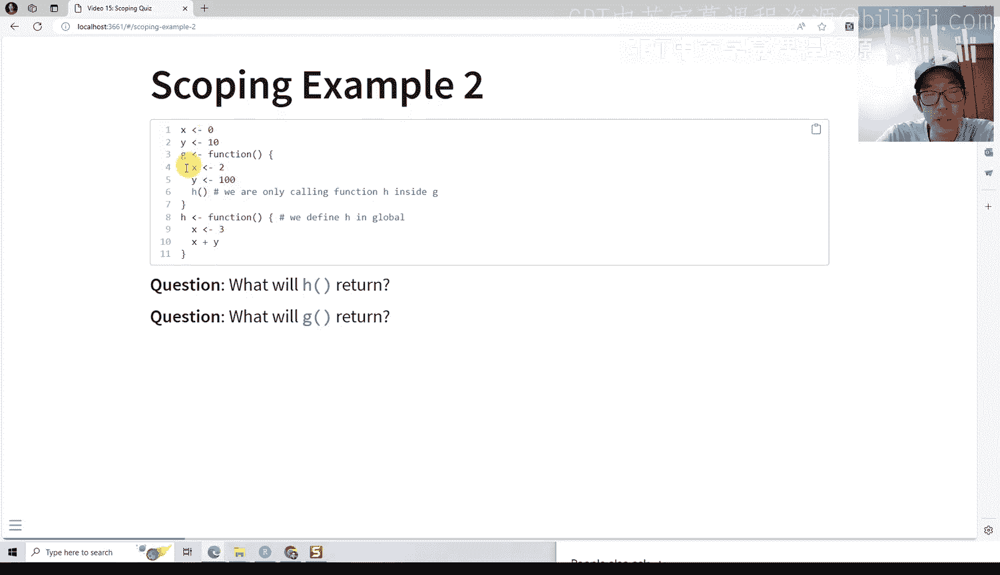

So H returns 13。

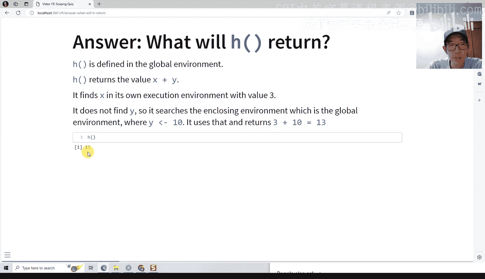

And G returns 13， these slides are there， so when you review the notes on your own。

 you can kind of read through it。

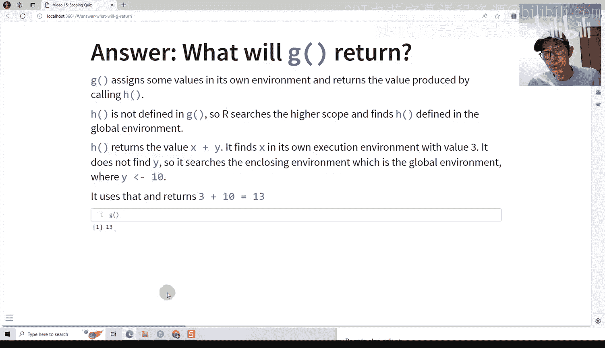

Here's an example of dynamic scoping okay， this is the first time I'm showing you this I'm not it's not a quiz yet so here。

X and y get 0 and 10 in the global environment。 P is defined in the global environment。

 and we call P。 When we call P， it performs dynamic scoping。

 The first line is that we want to get a value of y。 we use the function get Y from the parent frame。

 It finds y in the calling environment。 the calling environment because P was called in the global environment。

It searches the calling environment， which is the global environment。

 and it gets 10 for the value of y， so y has the value 10。

That's now in the local environment of P x has the value 3 in the local environment P。

 it returns x plus y。

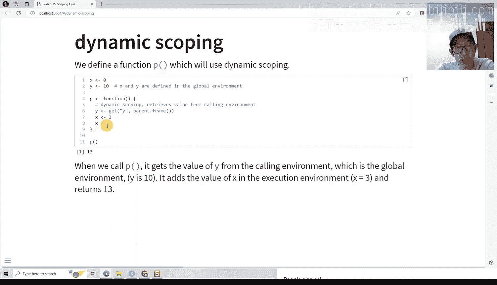

And it returns 13。Here we are going to have another function R inside the function R。

 x gets the value 2 and y gets the value 100 in the execution environment of R。

We call P from inside the execution environment of R when P gets executed here。

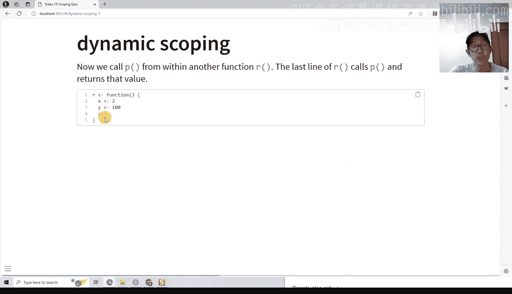

It's going to get the value of y from its calling environment， so it's going to get the value 100。

 it's going to get the value 100 so now y has the value 100 in the local environment of P x has the value 3 in the local environment of P local execution environment of P it's going to return 3 plus 100103 so when we execute R。

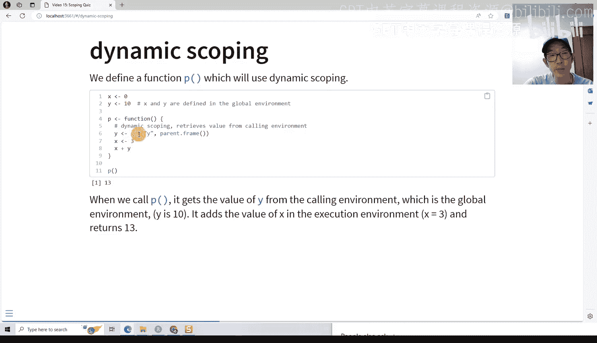

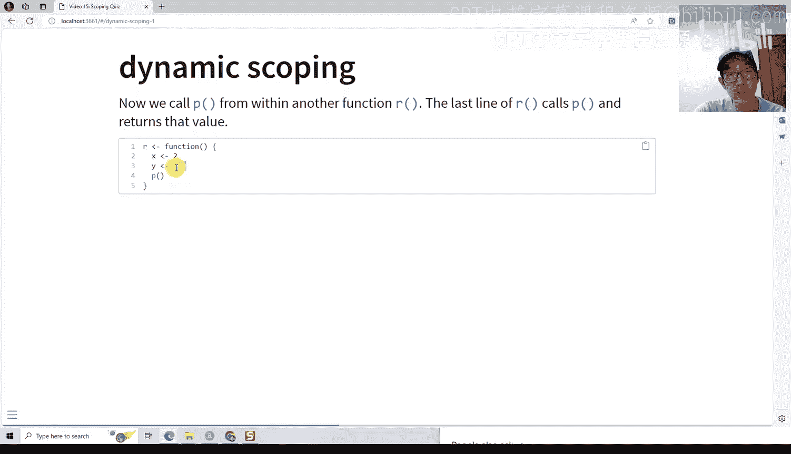

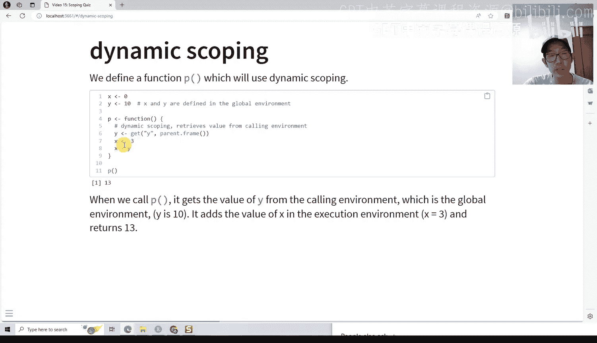

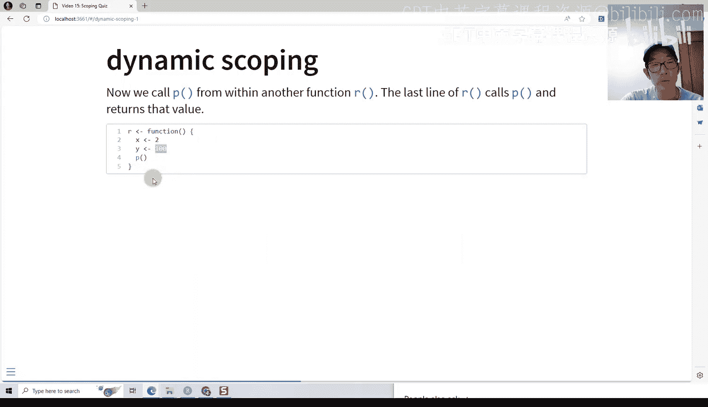

We get 103。

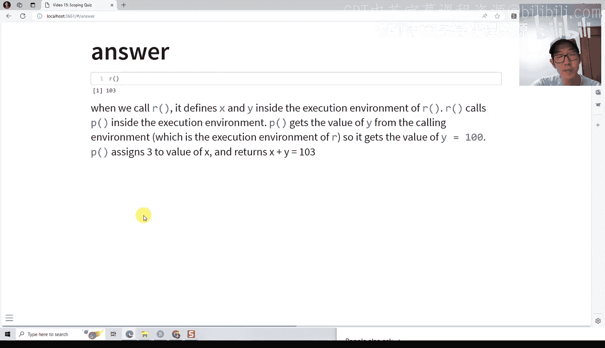

Okay， try pausing the video here and solving this one。

Okay this one was pretty simple A and B get the values 1 and 2 in the global environment。

 the function L prints out the values of A and B， and it can't find A and B in the local environment so it searches the enclosing environment of L finds a is 1。

 can't find B in the local environment， so searches the enclosing environment。

 the global environment and finds B is 2， and it will print out1 and 2。

So this prints out one and two。

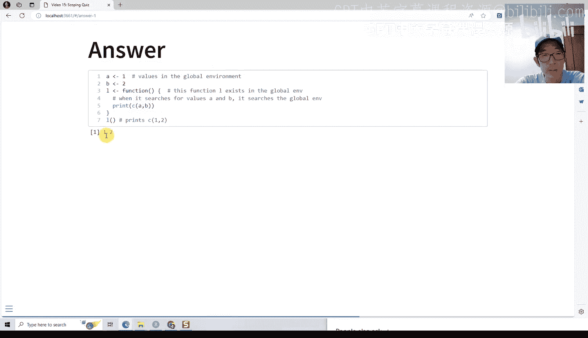

O。So keeping in mind that function L is defined still in the global environment where it prints out A and B。

Here's another function M。Where it does this， and so go ahead and pause the video。

And answer this question。

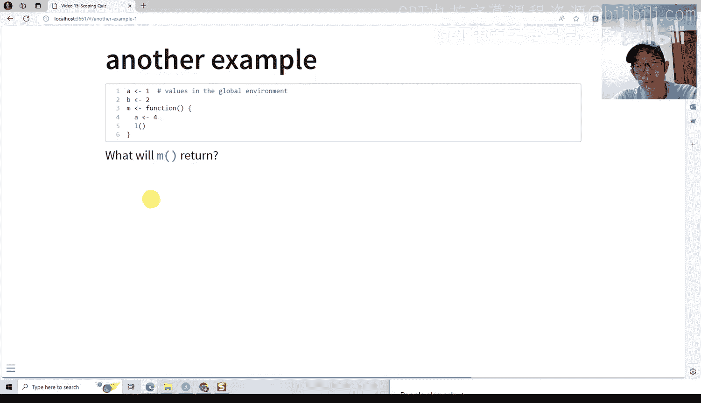

Okay， I'm going to go over the answer， so now when M gets executed。

 okay a gets the value 4 inside locally inside M。We execute L again。

 because L is defined in the global environment。When L gets executed。

 it searches for a and it searches for B， when it searches for a。

 it searches the global environment where A has the value 1 and B has the value 2。

 and so this will also output 1 and 2。

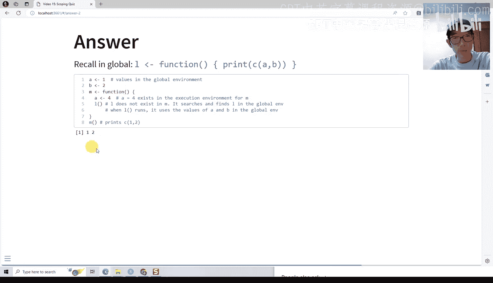

Look at this example and pause and solve。Okay， I'll go over the answer。

So here we define a function N within the function N， we define the function L， and we execute L。

When N gets executed。All， we define a to get the value4 locally。

The enclosing environment of L here is going to be the environment of n。So when it searches for a。

 it finds4 locally or not locally in L， it searches the enclosing environment of L。

 which is the execution environment of n finds4。Searches for B。

 it's not in the local environment of L， not in the local environment of N。

 but define finds it in the glow environment and so B gets 2， so this is going to output 4 into 2。

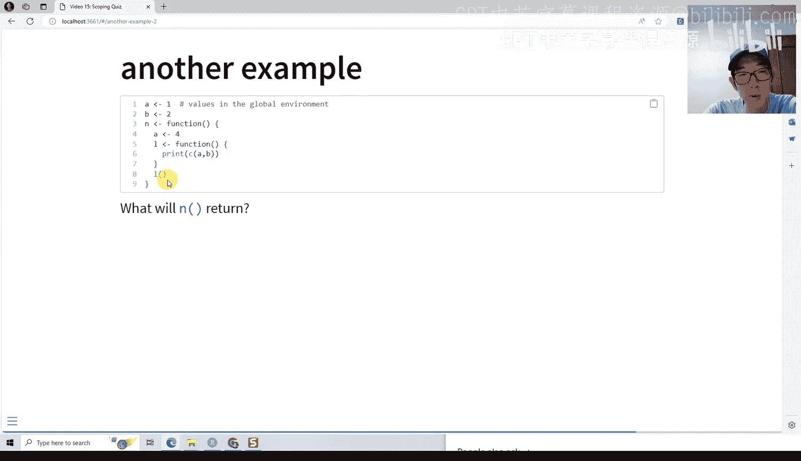

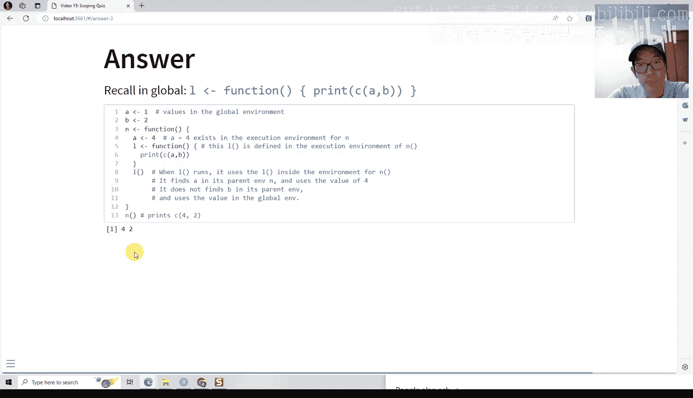

All right， here's another one。Okay， I'm going to go ahead and go over the answer if you're not ready to just pause the video so you can figure this out on your own。

In the global environment， we have one and two for A and B in the global environment。

And we define O within O， we set a to be4， and then we call L。We call L the first time we call L。

L is not defined inside O， so it searches for L and it finds it in the global environment。

 remember in the global environment， L just looks for A and B so it's going output it's find it calls L in the global environment and it's going to output one and 2。

 it's going to print one and 2 to the screen。Then we define。L inside of O。

Now that L is defined inside of O， when we execute line 9 here。

It's going to use the L that was defined here， and it's going to print A And B。

 the enclosing environment of this thing， it's going to find。The A here。

 and it's going to print out four， it can't find a B。

So it looks for the global environment and it takes two， so it's going to output 42。

 so this one's going to output12， then it defines L and this one's going to output 42 and then the next line of code defines B as 5。

 and then so when we execute L again， it's going to find both A and B inside the environment of O and it's going to output 45。

 so it's going to output 12。

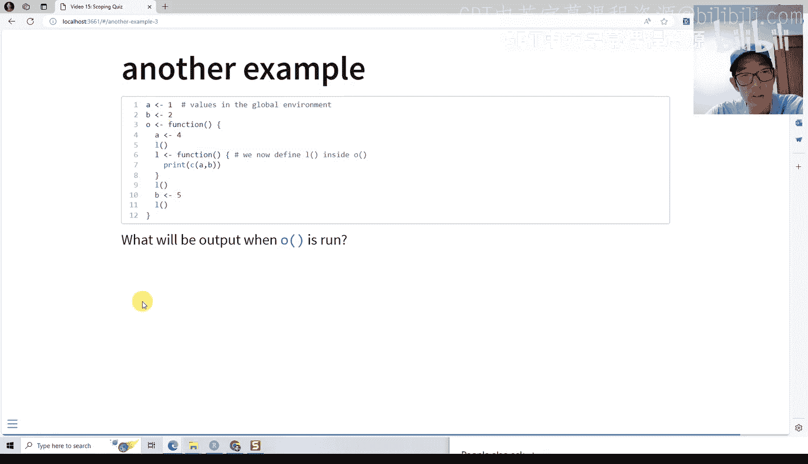

Then4，2， then 4，5。And that's exactly what we get here。Okay， if you got all of those examples right。

 then you have a pretty good idea of how scoping works and how the order of execution of code works。

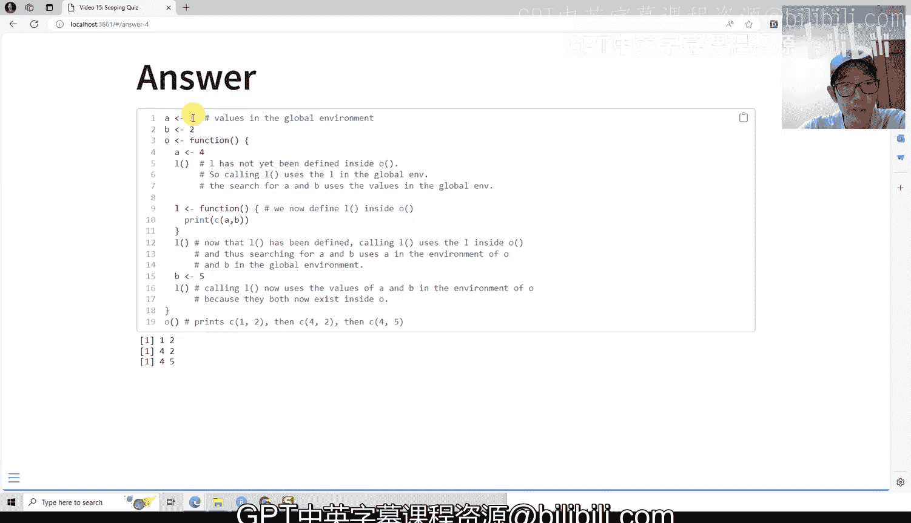