# UCLA《计算统计学｜Stats 102A - Computational Statistics with R 2024 Summer》中英字幕 p16 [16]Stats 102A - 2024 Summer - Video 16 - Importing _ Exporting _ Lubridate.zh_e [BV1jizNBrEm2_p16]

Okay， let's talk a little bit about importing and exporting data into R。

So basic commands to read in a file， you have things like read docsv。

 which I think many of you are familiar with， but related to that you have read dot table and read line。

Sometimes readdot CSv will bring in strings as factors。

 I think the default is set strings as factors equals false。

But it's I like to still kind of input that for good measure there。

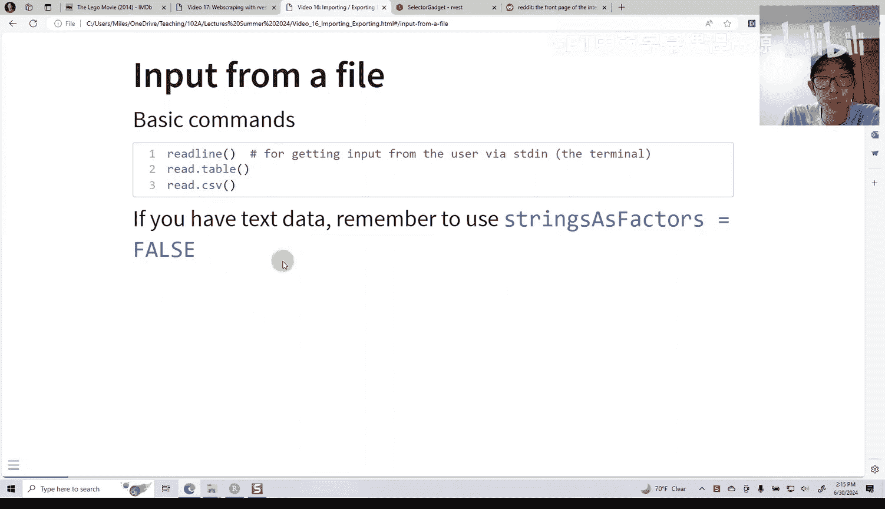

There's a bunch of other packages and instead of using readdot CSsv， which works fine in base R。

 I prefer using Readar which is part of the tidyverse。

You can read about Readar in the Tidyverse and that brings in Read underscore CSV and it's generally faster and more efficient there's a few other packages so if you want to bring in Excel files you can use load the library read Excel。

And then there's also Haven， which allows you to import files from say Sta。

 SPSSS or SAS if you're using a different statistical software program。

 there's another package called Data dot table and that is designed to work very quickly and it handles really large files pretty well。

 so if you are dealing with a really large file on the order of hundreds of thousands or millions of rows。

 I would say data dot table is the way to go。

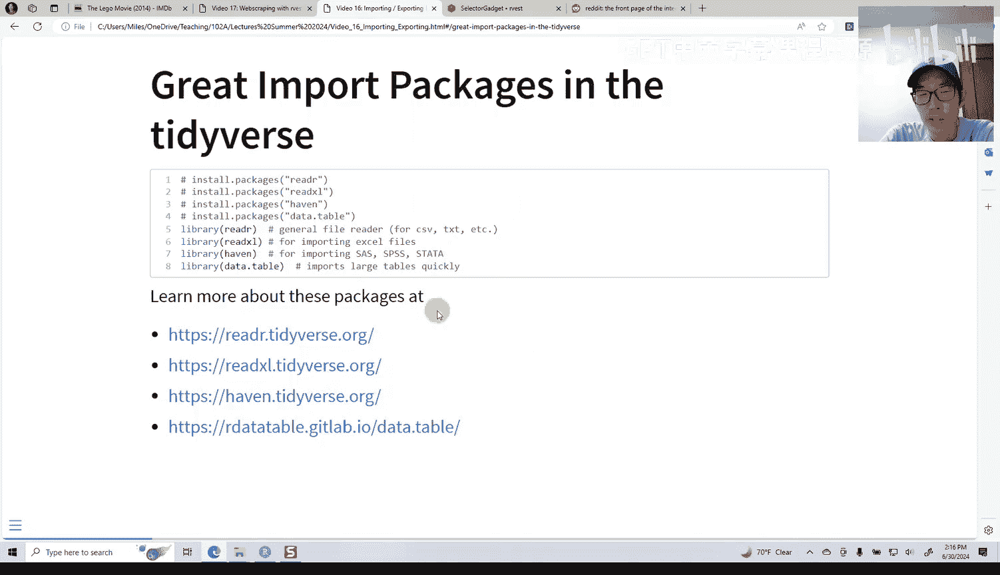

If you load up readR， then probably the most common function you'll use is read underscore CSV。

 which will load up comma separated values， separated files， which is probably the most common form。

 it's a text file and it just kind of has the。The data right there in text format。

 but then you have other kind of things that are able to read it in so you have tab separated files。

 delimed files fixed with files， and you can read the help files for each of these different functions。

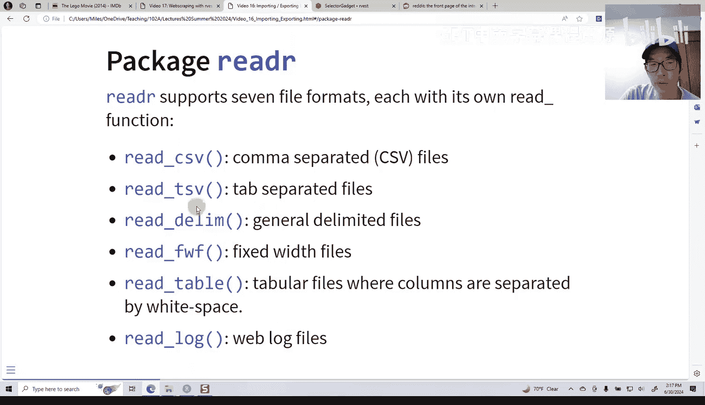

Just a little bit about data dot table， it's designed for the fastest performance and again if you have a massive data file。

 load up data dot table and use FRead fast Reader okay which operates very similar to Read underscore CSV but will be fast and I'll just kind of skip over this slide。

 but basically it says。

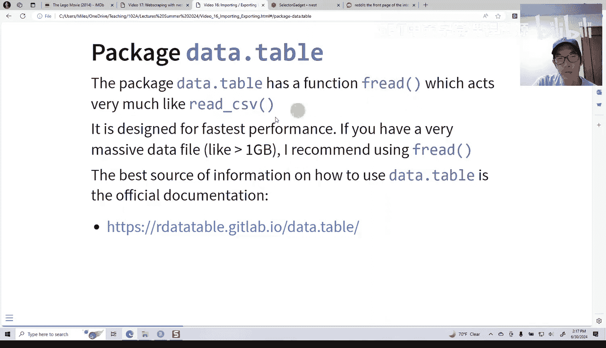

And it's a comparison of read underscore CSV from Read and FRead from data table。

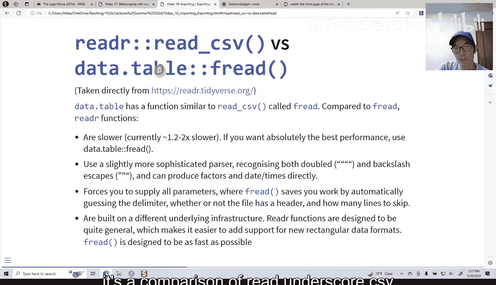

There's a little bit of text there。Okay， if you're going to use an Excel file。

You'll load up read Excel and you can just load in the first worksheet by whatever your Excel file is。

 datas。exlS or whatever it is， if you have other multiple worksheets in your Excel file because Excel supports that you can specify the sheet with by name or the sheet by number and that will work there。

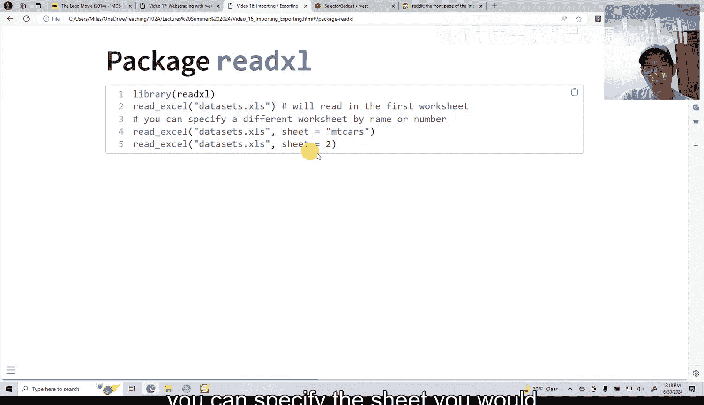

Sometimes you want to load data or whatever that's found online or and this is especially useful if you want to give your script to a colleague or a you know a classmate and rather than having to also give the script and the data file。

 that data might be。Uploaded somewhere on GiHub or some some public place where you can get the you can download the thing and so rather than having to say all right。

 please go to this website and then download the thing and put it into your working directory you can just include those instructions for downloading the data in your R script and then so when they run the R script it will download the data and load it up for them so。

So there is a native download file function。 however。

 this was this is an old function from dating back to the early days of the internet where things were much less secure Now almost every website uses HTTPS as their protocol their secure protocol。

 and download that file just doesn't run very well with that。 So there's a package called downloader。

 you might need to install it， but you just load it up library downloader。

And then you run the function download So here there is a URL。 you can see it's a secure URL HttPS。

 and it's just from Github and and Github kind of posts some of their stuff。

 So here I uploaded the irris CSv data set to Github and the address of the。

CSV file directly is right here。And then I can call download。Put in the URL。

 where do I want to download it to， I'll specify that file name file is iris。

csv and so this is going to get saved to my working directory and now that the file is saved to my working directory。

 I can then call read underscore CSsv to load it up and store that into IIS so this is a handy little way of basically putting into your script instructions for downloading the file。

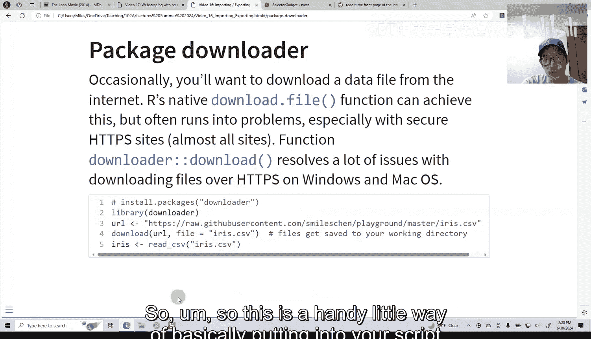

If you want to export your objects so that you can load them up in another program or you know use them later or something like that。

 there's a few ways you can do this one is you can store them into just in dot R data file and so this will work if you're going to load up the data and the package or data and the objects back into R。

 so you just say you know these are the objects I want and then you click file equals whatever you specify where you want to store them and you click save。

ok。If you want to save some some like an atomic vector as plain text。

 you can also specify that using right so you can do right and then you put in the object name。

 you know some kind of like the atomic vector， you put in the name of the file number of columns and it will just。

Create you know a column of values for you right if you have a data frame and you want to store it as a cv file。

 then you can do write do csv right docsv， you specify the name of your data frame and then you say I want to store it to you know data frame。

 CSsv or whatever it is the default behavior is that it includes row names and I don't personally I don't like that so I recommend including the option row dot names equals false。

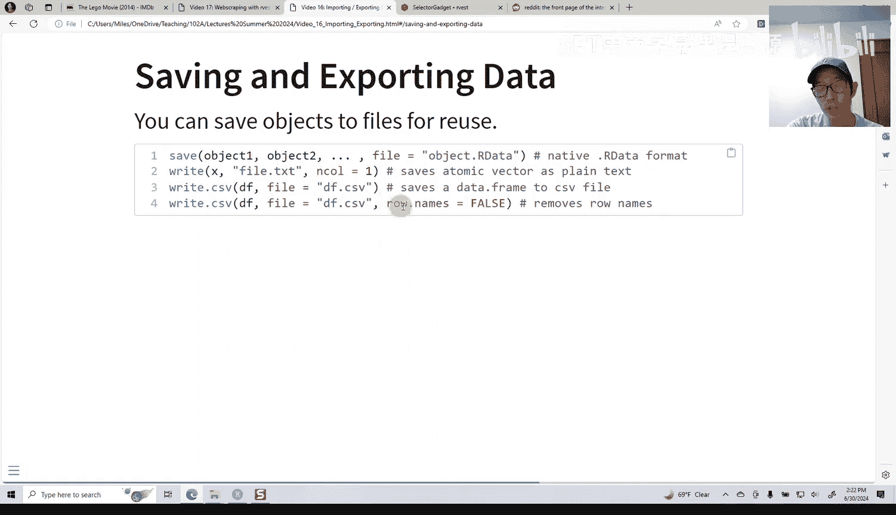

Okay。😊，All right， and so that's how you would export data。

I want to draw special attention to a package called Lubra date。

 which allows you to work with date information， so a lot of times when you download a CSV file from out in the wild and you want to bring it into R it might have date information and dealing with date information in R can be super tedious and annoying。

 but lubra date really kind of cleans this up and。And as far as I know。

 we don't have a similar package to lubriate in Python。

 and so this is like one of these packages that really is amazing to work with an R as far as I know with Python you still have to kind of go through this annoying formatting system so the annoying formatting system looks like this。

 you have to use like this percent B percent D percent y and it's very， very。

 very picky because if you mess one of these things up so here。

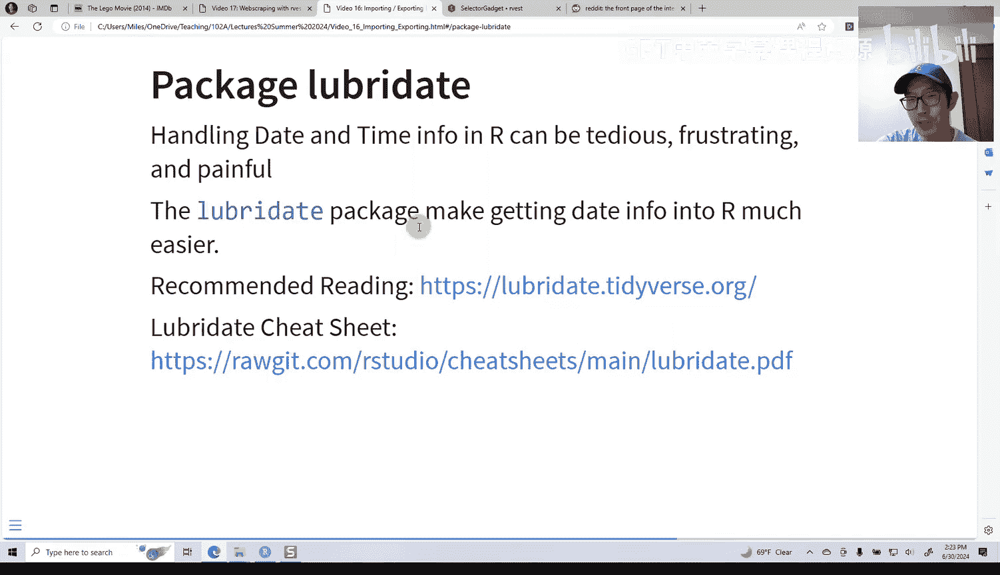

The date is coming in as a string January 15 come in 1999。

 if you mess that up and you don't include the comma。

It can't it doesn't understand okay here there's dashes December 15， 2001。

 if you leave out the dashes， it crashes， it doesn't work so。So it's annoying， okay， and this。

 you know， again， if you have a mix of formats， it just doesn't work。

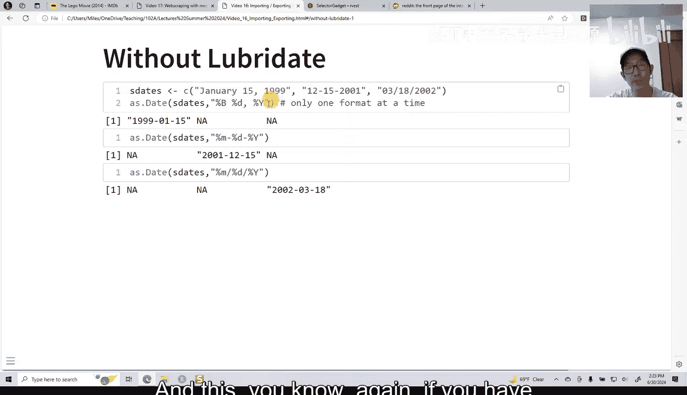

With lubri date you can have a mix of formats and all you have to do is you say， hey。

 these are stored in month day year， month day year and poof， it understands all of it right。

 whether it's January 15， 1999 spelled out that way 1215-2001 or 03 slash 18 slash2002 all of these things work out okay so luber date is super great。

 super awesome it just it does require you to specify the order of the field So if you have 0304 or 5。

 that's a bit ambiguous because that could be year month day， 2003， April 5。

 it could be monthday year， that would be March 4，2005 it could be day month year okay the April 3。

 2005 or something like that okay if you try to say like monthday year and you give it something like the 25th month。

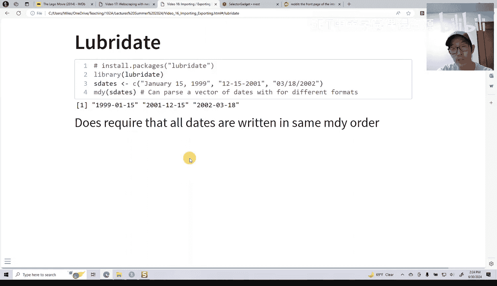

Then that's not going to work okay， then it will return it any if it can for it。

 but anyway that's a luber date， I highly recommend it if you think you're going to have to deal with date information。

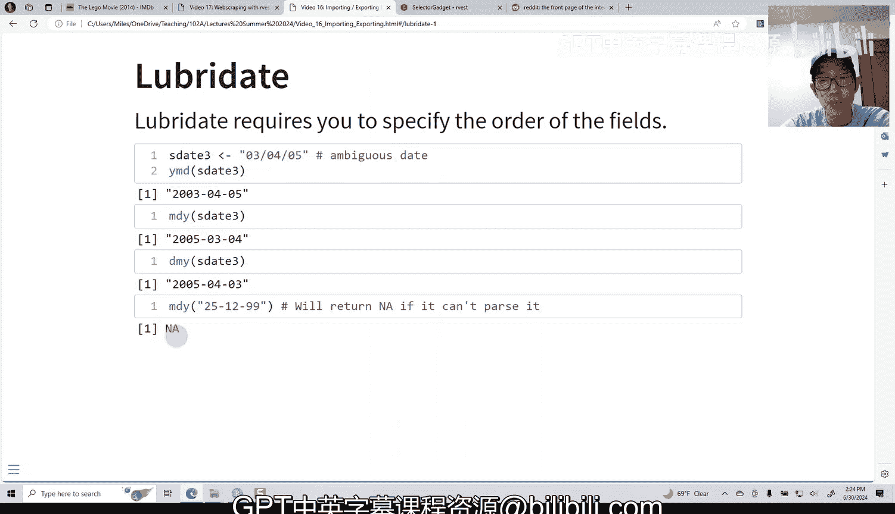