# UCLA《计算统计学｜Stats 102A - Computational Statistics with R 2024 Summer》中英字幕 p18 [18]Stats 102A - 2024 Summer - Video 18 - tidyverse tibbles.zh_en [BV1jizNBrEm2_p18]

Okay I want to introduce the tidyverse， the tidyverse is an important set of packages that we will make use of Ar you know I introduced Ar earlier Ar is actually part of the Tidyverse and it makes use of you know Tibbles and whatnot。

 so we'll introduce the Tidyverse and we'll introduce the Tibbles data structure。

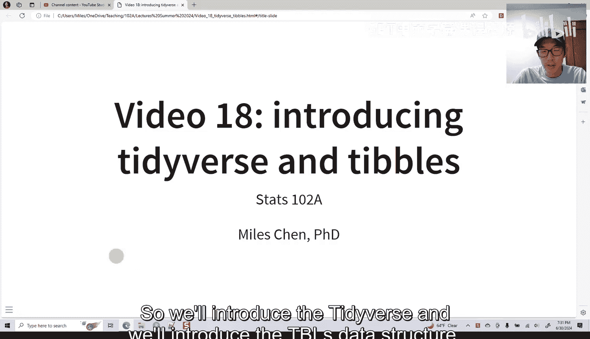

One recommended resource is this book are for data science。

 you are able to read it for free in your browser if you want you can also purchase the textbook。

You know， from wherever you want， but the textbook is authored by Hadley Wickb。

 who is basically the creator of the Teedddyverse as well as Garrett Goldmand who's also a good teacher on the subject。

 okay？

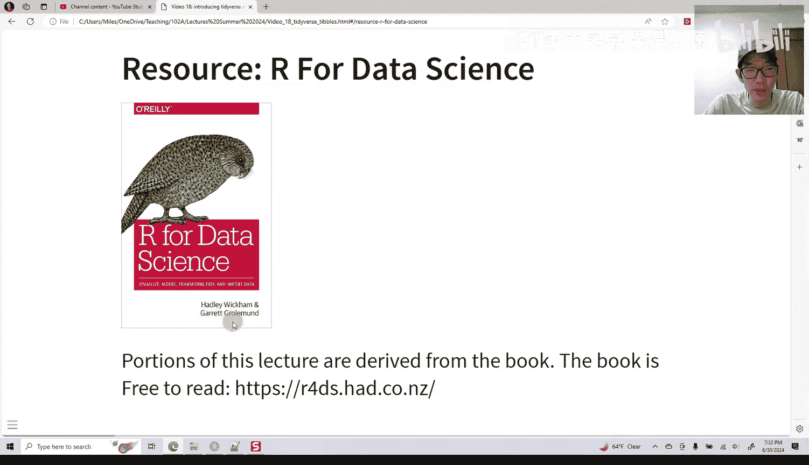

The tidyverse describes itself as an opinionated collection of our packages designed for data science all of the packages share in underlying design philosophy。

 grammar and data structure these are the core packages that get loaded when you call library tidyverse now you can load any of these packages individually such as。

D plier or GGPloot2， but you can also just load them all with tidyverse you're probably already familiar with GGPot2 or maybe not。

 but I will have a lecture on GGPloot2 as well。We will look at Tibbles in this video and we'll also cover tiDR and D plier。

 I've already covered ReadR and later I will cover stringingR。

 there's also per and forecasts which I don't know if I'll get to。

 but these are all very useful packages and I highly recommend exploring them and reading the documentation for each of these packages。

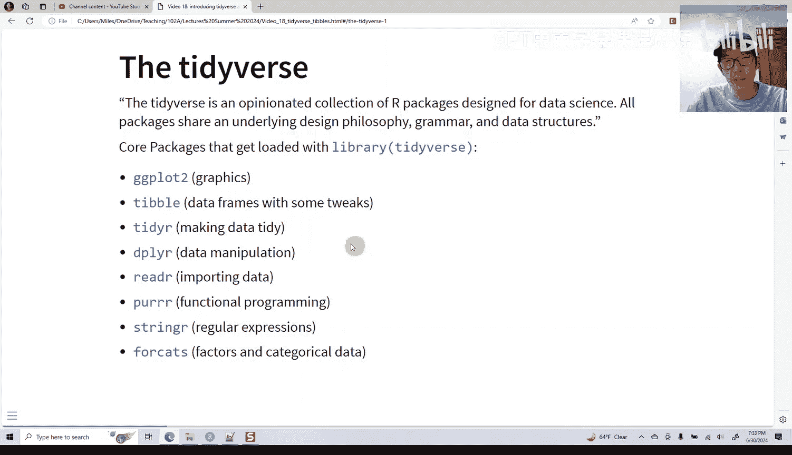

So the tidyverse， its central data structure is the Tbble， it is very much like a data frame。

 in fact Tbbles are data frames， but they add a few tweaks so that they are you more useful are is an old language it's been around for decades and some of the things that made are useful as far as kind of handling certain data types and the way it did things from memory。

 you know were useful 10 or 20 years ago but now they kind of get in your way。

And the kind of base R people are are reluctant to making a whole bunch of changes because when you do it it often breaks existing code and so a lot of innovation is being done in packages and and kind of the caveat there is you know when you load a package you need to be prepared to update your code and things that have been around for a while so so that's what we have okay so one thing is that Tbbles have this print method so that。

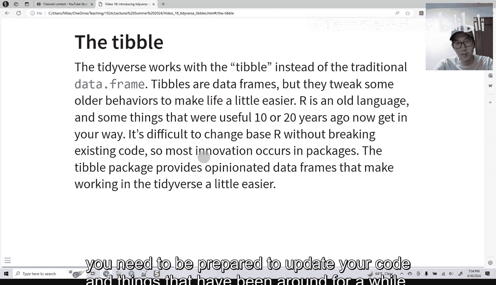

It only shows， say， around the first 10 rows。and prints only kind of the columns that fit on the screen and so this makes it a lot easier to kind of work with large data and in addition to its name。

 each column reports its own type kind of the data type so you know without having to call STR structure you can kind of see the types of values that you have in there so here we're going to just create a Tbble。

 Tbble called X there's going to be five columns， the first column A will be just some。

Kind of date time stuff will have the date with some random number of days。

Added we'll have just some integers， some random values and some character data okay and this is kind of what it looks like so the first thing is a date time object and so we have the dates with some random times kind of here we have random dates。

 we have integers， we have type double， we have type character and you can see it just kind of prints out the first 10 rows and it says 990 more rows and it gives you information it says a Tbble 1000 rows by five columns and it kind of gives you a quick little summary here okay。

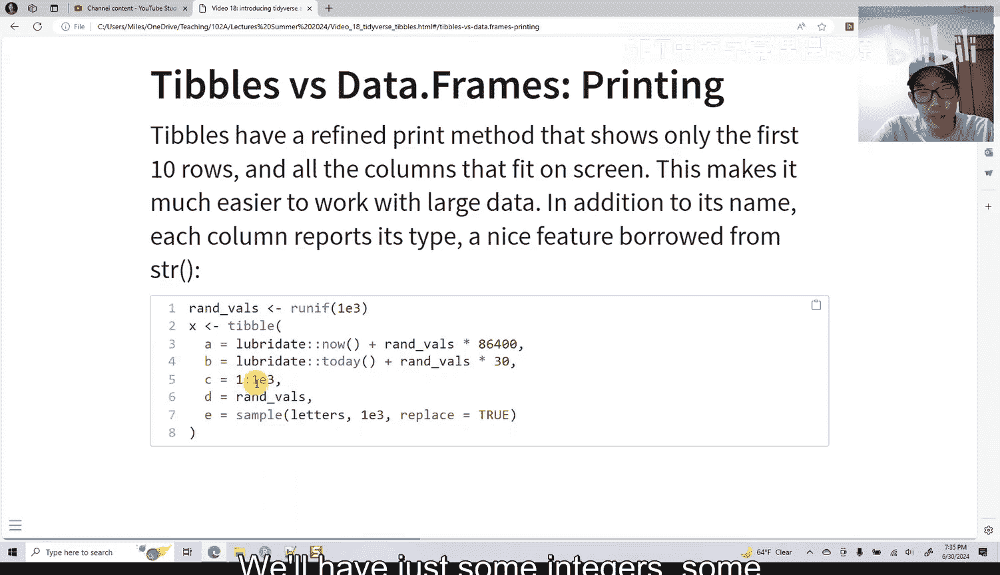

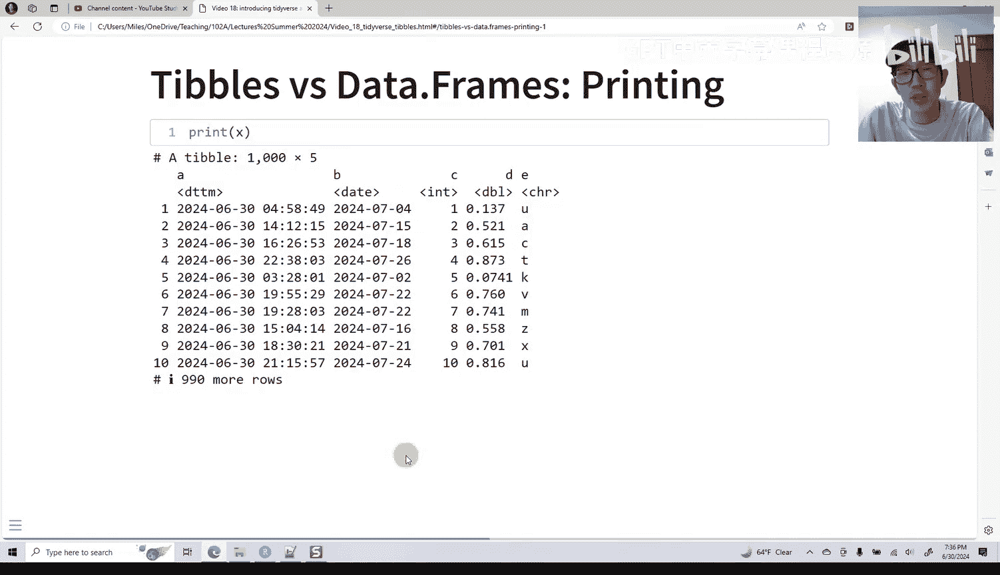

When you use a single square bracket with Tbbles， one thing is that it will always return a tibble unless you explicitly use the drop argument so so here I have a simple Tbble two columns X and Y and here I subset to just the first column I do from the Tbble just select the first column X and it does this whereas you know with a data frame if you select something where it's just going to be kind of one column a lot of times it will simplify it down to。

A vector， you can simplify a tibble down to a vector by calling adding the argument drop equals true。

 but by default， using a single score bracket will always return a Tbble。

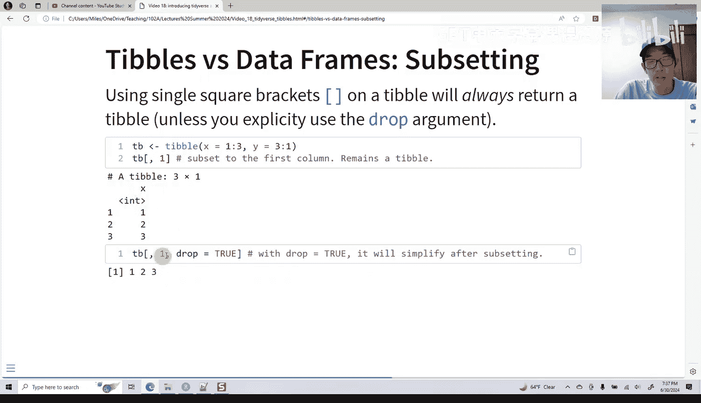

Okay。嗯。Here with a data frame you can see when I subset the data frame to just the first column it automatically simplifies to a vector and that is different behavior for a tibble okay。

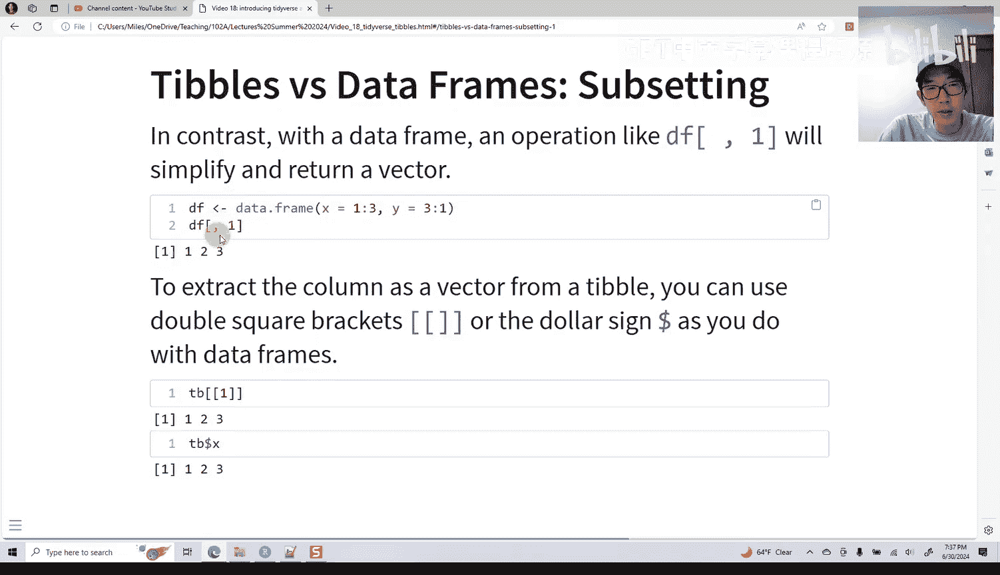

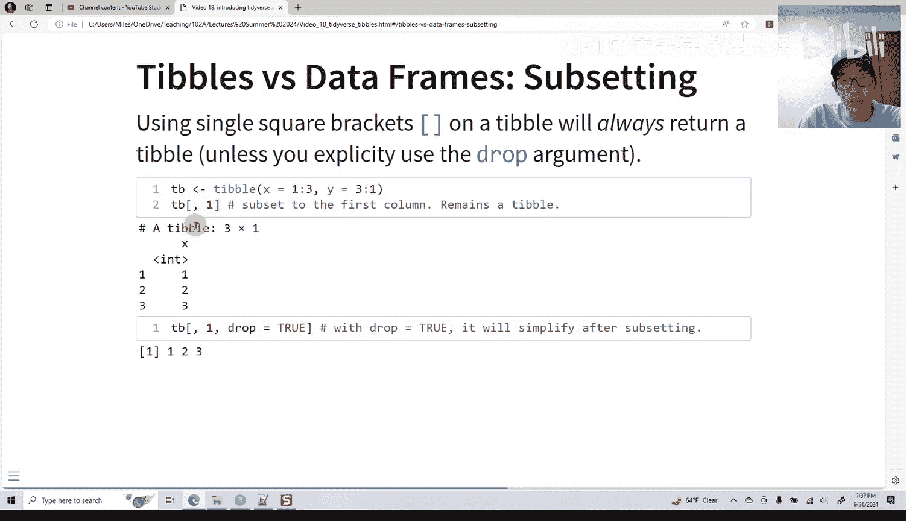

If you do want to extract the column as a vector， you can use double score brackets that will extract it as a vector。

 you can also use dollar sign notation and that will extract it as a vector so these are just things to be aware of regarding the behavior of but Tbble so the authors of you the tidy verse Tbble say hey。

 you know what it's a little bit strange that when you use single score brackets。

 sometimes it reduces down to a vector and sometimes it remains a data frame and so here they've chosen that single score brackets will always return a data frame unless you specifically or explicitly ask for it to reduce the structure down to a vector creating a tibble is pretty easy。

 you can just create it just like you would a data frame you give it the column name equals and then you put in the values the vector of values that goes go into that column。

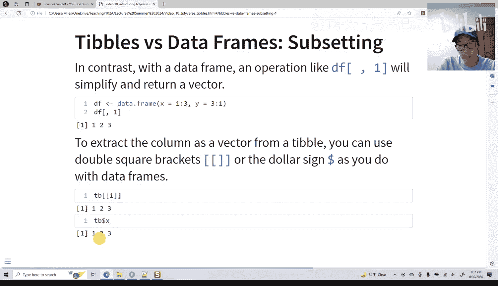

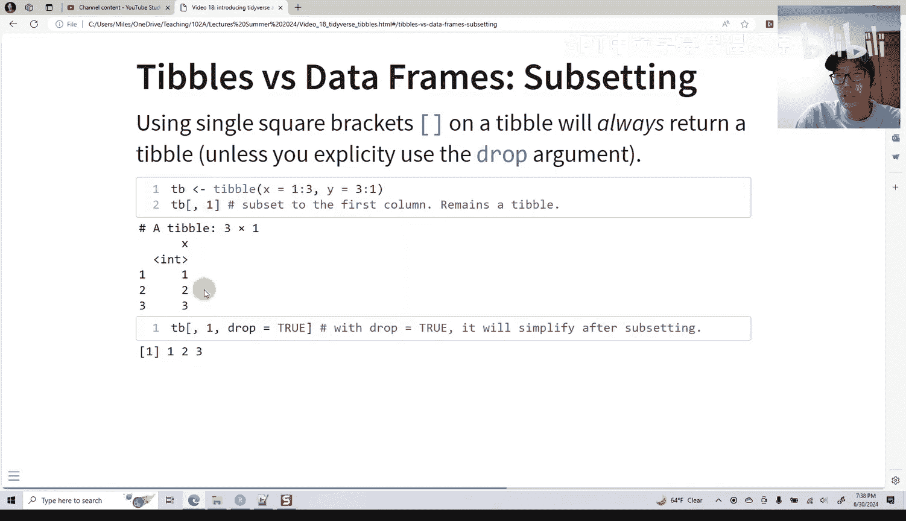

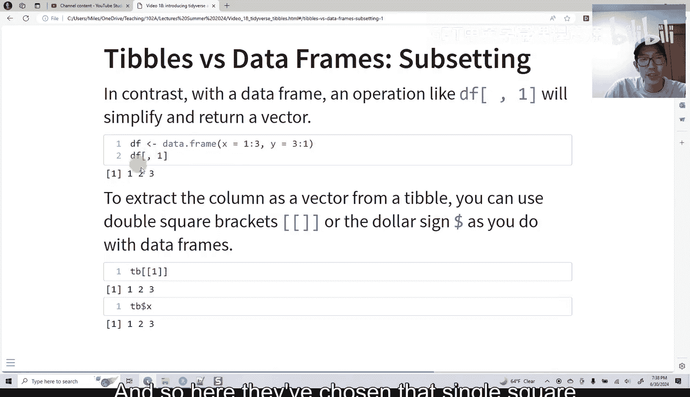

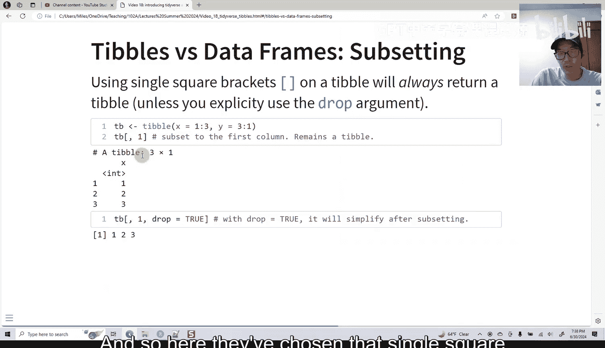

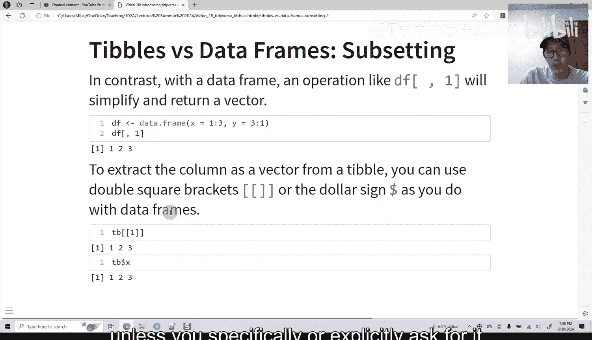

Okay， another thing is you can just take an existing data frame like MT cars and then just wrap it with the Tbble。

 just throw Tbble around it and that will automatically convert the existing data frame into a Tbble。

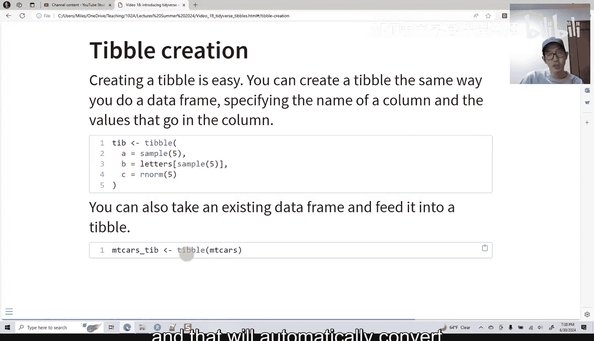

You can also create a Tbble row wise so that a person reading your code can kind of。

Have an easy time seeing the values in each row and this is done by calling triple the R and Tbble is for row wise。

 so here's Tib R you name the first column you know tilda column A， tilde column B。

 this is how you name the columns and then what are the values you put in character A and one for the first row character B and2 and character C and3 and so on and so forth and then when you do that it creates a Tbble and it was drawn you know row wise okay versus here you specify you know the column A has this column B has that column C has that。

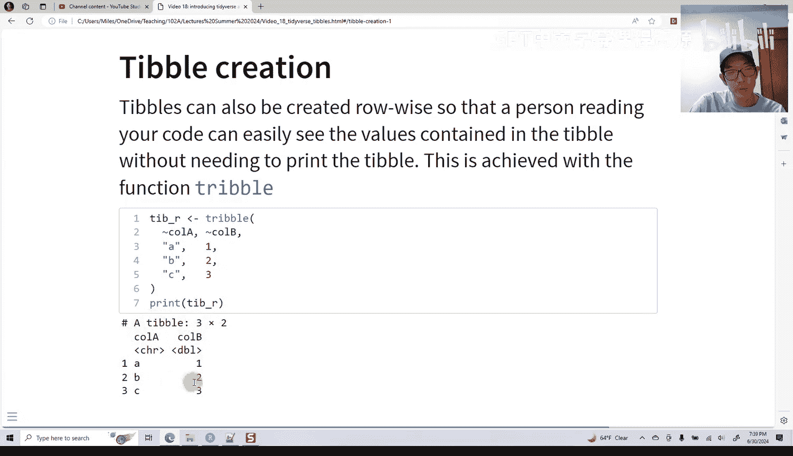

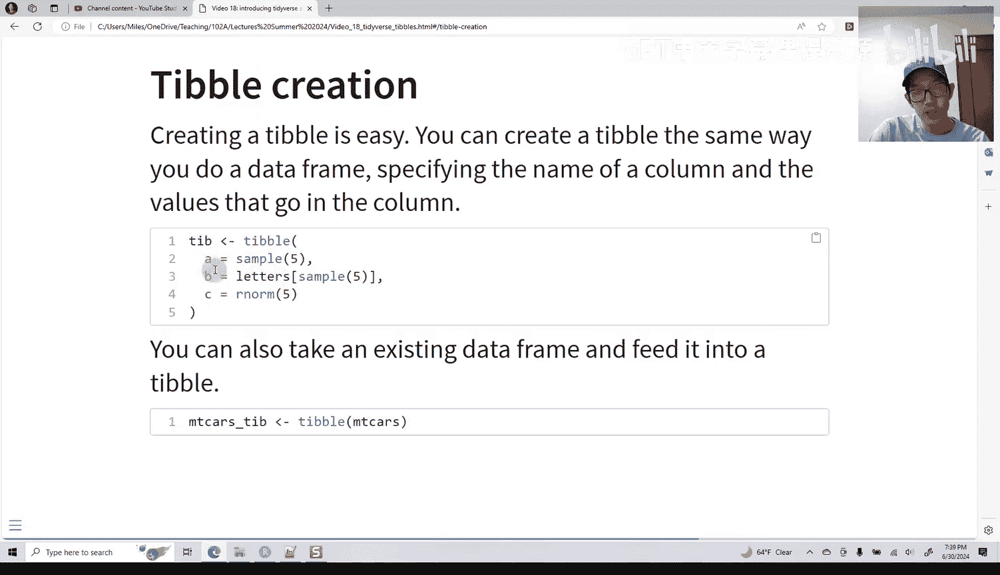

嗯。In order to kind of fit as many columns as possible。

Tibs have a tendency to just display only one or two places after a decimal point。

 This is just in the display it's not。It keeps all of the figures。Internally stored。

 it's just when it's being displayed， it rounds it okay so here I'm creating a tablebble with just one row column A has the value 9。

8765432 column B has 1。1234567。And so when just kind of by default in order to kind of。

Keep the columns pretty narrow， it just rounds them and displays you know only kind of like three significant figures。

 two places after the decimal things like that if you're like I want to see all of them you can specify that you can specify options and you can say this is how many significant figures I want pillar。

 sigfiig equals 5 will' display5 significant figures so you get 9。8765。Or here 1。

1235 again internally， the values are there， it's not truncating or rounding the values internally when you extract out the value。

 it will have all of the decimal places there， it's just for display to kind of keep things compact this is what what a Tbble does okay。

This。Sometimes students don't like this just because they're accustomed to the way R kind of displays like the whole number。

But but again。You're not losing any of the information， it's all there。

 it's just as far as being displayed， it's rounding it off。

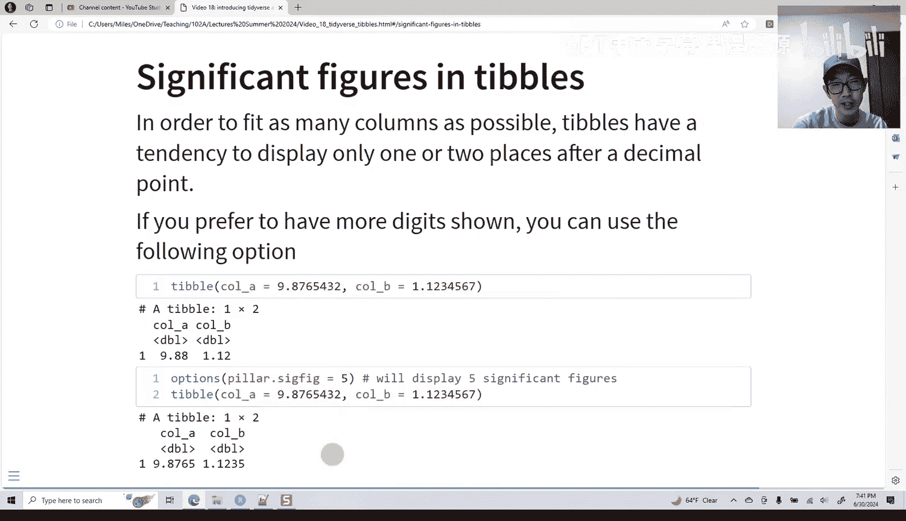

OkayBy default， when you ask a Tbble to print， so here I took empty cars and I said make a Tbble out of it and want to print it by default it only kind of print the the first 10 rows and it says 22 more rows。

 Tbble is 32 by 11 that's the default nature if you want to print more additional rows you can do that you just call print and you give it the argument n equals however many rows you want to print so here if I want to print all 32 rows I'm going to say print empty cars T which is the name of the Tbble and then I'm going to specify n equals 32 and so here we get all 32 rows printed out。

And all of that information is there it includes all of the information there one thing is that you might notice is that there are no row names。

 so Tbbles do not。Kind of use row names so the empty Cars data frame actually has row names each row kind of corresponds to the。

 I guess the vehicle model。Make and model and Tibbles don't。

Discourage the use of row names as a way to store information。

 So if you want to kind of store data or values， it requires that you put it into a column rather than the row names。

 So when you print out a table it doesn't include any row names so so make sure you kind of。

If you wanted to do something with empty cars， you should probably take all of the names from MT cars。

 the row names that is， and then make sure they go into a column because otherwise that information is kind of lost。

So so Tibles do not encourage or discourage the use of row names and I would be in agreement with that kind of。

Design choice， okay？All right， so that's the introduction to Tibbles。

 which we will see very frequently of because we will be working quite a bit with the tidy verse。

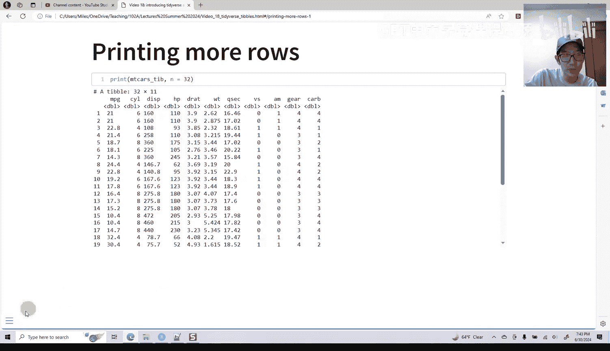