# UCLA《计算统计学｜Stats 102A - Computational Statistics with R 2024 Summer》中英字幕 p19 [19]Stats 102A - 2024 Summer - Video 19 - Pivoting Data with tidyr.zh_en [BV1jizNBrEm2_p19]

All right， let's look at pivoting tables with tiDR。So this section is all about pivoting data。

 pivoting data is the idea of。Kind of either turning columns into rows values that are in columns into rows or values that are in rows into columns the philosophy of the tidy verse is that these are kind of the rules that make data tidy every column is its own variable。

 every rows its own observation and every cell is a single value seems pretty simple and straightforward。

 but sometimes you are given datas where this is not the case and sometimes you want to try to tidy your data by turning you know trying to get them to obey these principles here。

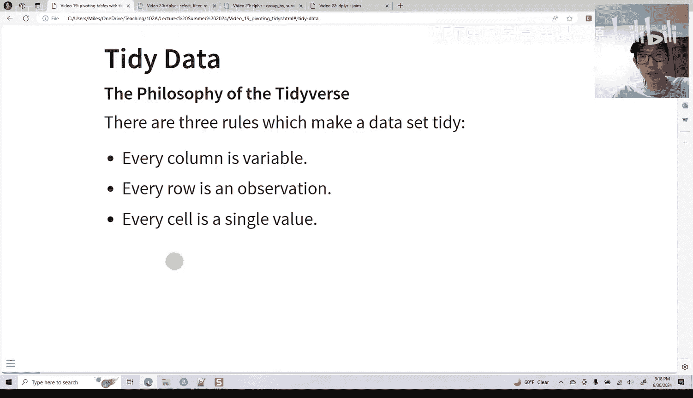

So here is an example data frame。Where it called storms and we have one column storms。

 a column for wind， column for pressure， column for date， and this is tidy。

 each variable gets its own column， each row represents a storm and it gets its own row Okay so here the different columns。

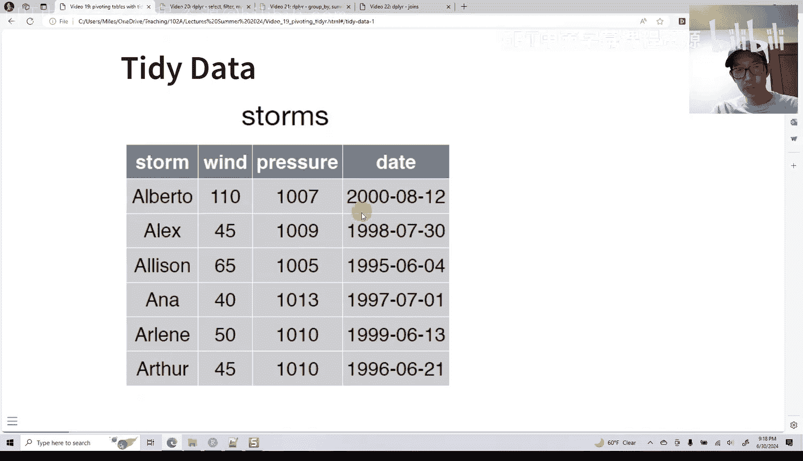

Are different variables， so we have storm wind speed air pressure and date and and that's that okay here is an example of data that is not tidy or。

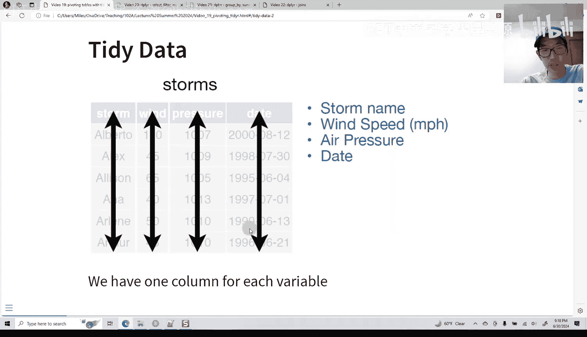

I mean， one could argue it is， but in this case， if we think about what our variables are。

 our variables are the country。The year and the number of cases。And in that case。

We don't have tidy data because our。

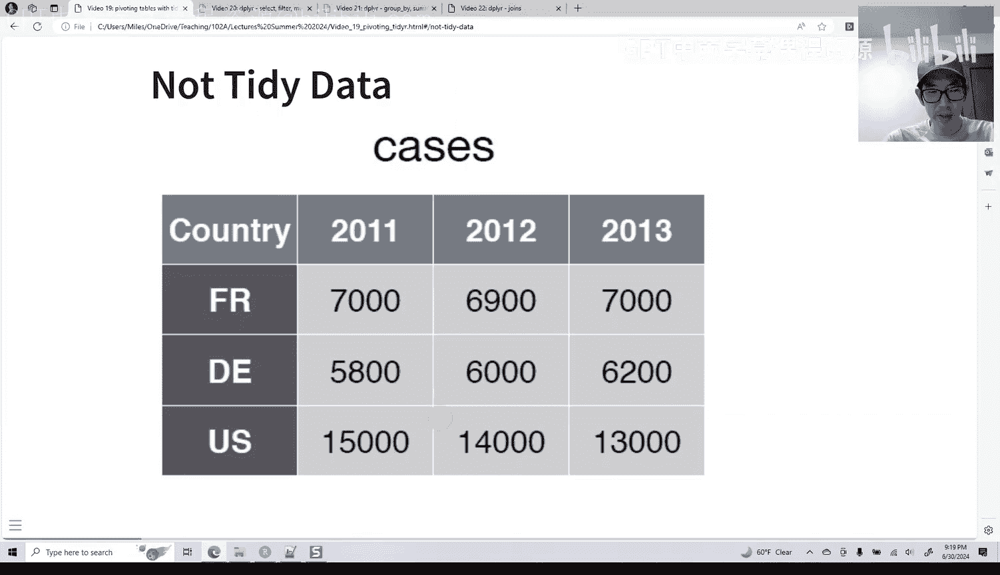

Are variable， okay？The variable for country sure appears in this column。

 but then the variable for year are column headings， rather than a column for year。

 and then the count is kind of spread around across all of these things so all of these columns which makes it difficult to deal with。

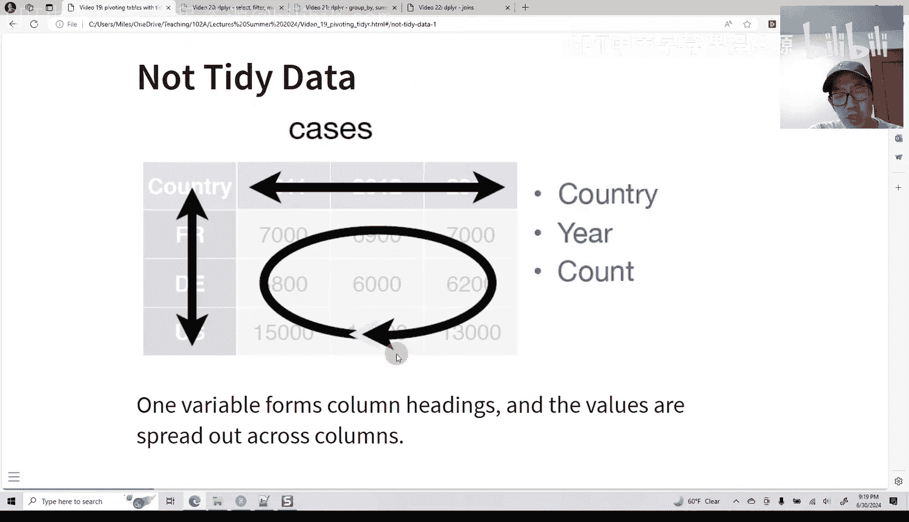

Here's another example here if we think about what our variables are。I mean， sure。

 we have these columns city particle size and amount， okay， but we have New York， large。

 New York small， London， large， London small， and I would say the variables are things like the city。

The number of large particles and the number of small particles， and if you think about that。

 all of the values are in one column and if you wanted to you'd have to kind of。

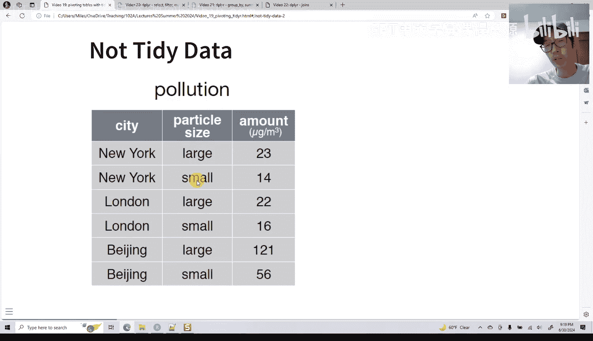

If you want the number of large particles you have to kind of go to every other row。

 if you want the number of small particles， you have to kind of go to every other row。

 so it's a little bit difficult to deal with okay these data sets。

 these little toy little data frames are available here on GitHub at these addresses and so we'll load them up。

Okay， so here is our。Our tidy data frame where we have storms and we have wind pressure and date and one nice thing about data when it's tidy is that you can use vectorized operations so if I wanted to calculate a ratio between pressure and wind speed that is I'm going to do the pressure divided by the wind speed。

 I can just define a new column okay storms dollar sign ratio。

And I can assign the calculation storm's dollar sign pressure divided by storm's dollar sign wind speed or dollar and wind。

 and so that will just take the pressure divide by the wind and it's going to do it for each row。

 so 1007 divided by 110 is 9。15 1009 divided by 45 is 22。4， 1005 divided by 65 is 15。

5 so on and so forth。We have each row， we have we calculate the ratio， it's vectorized。

 it's very quick， it's very kind of handy and nice。All right。

 let's take a look closer look at this table， the cases table， so here we have the country， France。

 Germany， the United States， okay， Germany is DE Deutsland。And then the years， okay。

 our column headings， we have the column 2011， 2012， 2013。

 and then we have some fictional number of cases of some disease， I guess okay。So。

What we want to do is we want to create a data frame where we have a column for a country。

 a column for year， and a column for the number of cases so the variables being country。

 year and cases。

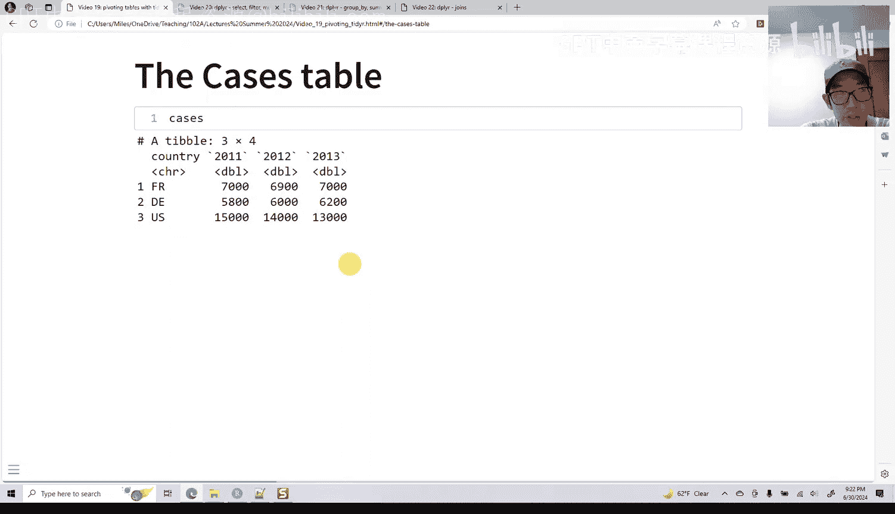

Pause for a moment and think if we restructure the data in this way， column for country。

 column for year， column for the count of cases。How many columns will we have well that I think that's going to be three。

 but how many rows will we have？Well， we will have one row for each observation and here we have nine different values。

 so we're going to end up with nine rows and this is what。

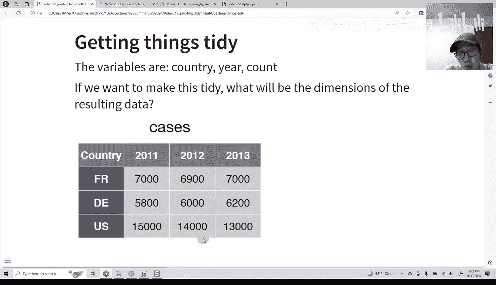

That the resulting data will look like， okay？Here we'll get basically a row for France 2011 with 7。

000。And the final data it's actually arranged by column country first and then year。

 and then we got row for France 2012 with 6900 row for France 2013 with 7。

000 a row for Germany and 2011 with 5800， so on and so forth we're going to have nine rows。

 so how do we reshape or pivot。The data that's currently in what we would call wide form into long form。

 okay， it's long because basically this data frame is longer。So the operation here。

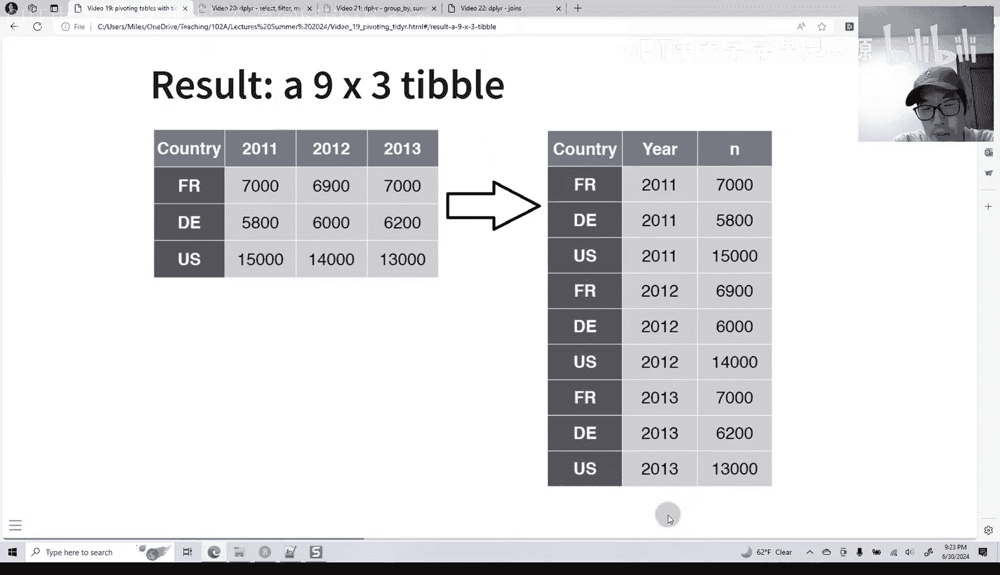

Is pivot longer okay pivot longer so because we are taking data from wide and we want to make it long so what we want to do is we want to take the values that are currently spread across the columns 2011 through 2013 so the values are currently in the columns 2011 20122013。

 so I'm specifying that by saying go to columns 2011 through colon 2013。

 so we're taking the cases table and we're pivoting it longer。

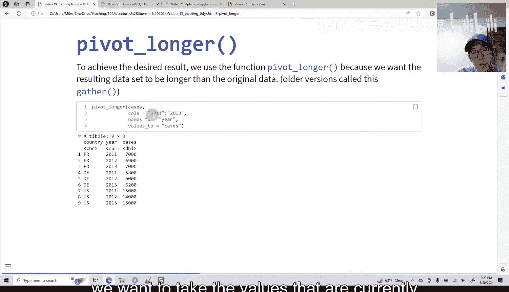

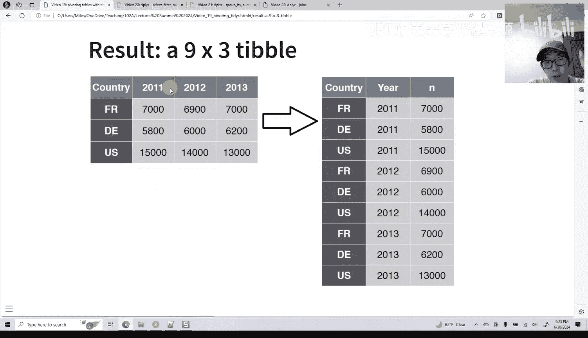

And what it's going to do is it's going to take the column names。

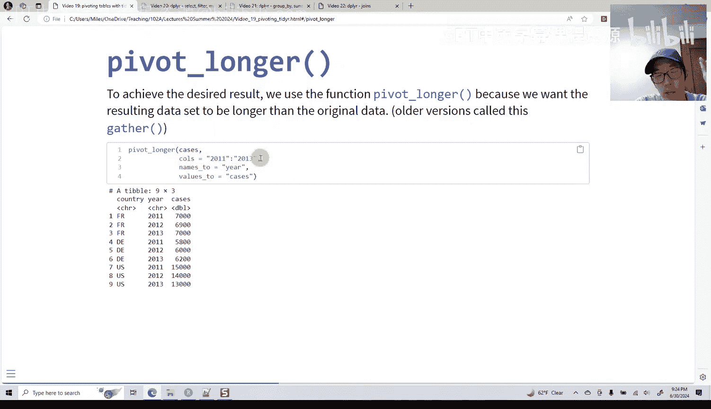

And put those column names 20112012， 2013 into its own column What is that column going to be called。

 we say the names go to a column titled year this is it。

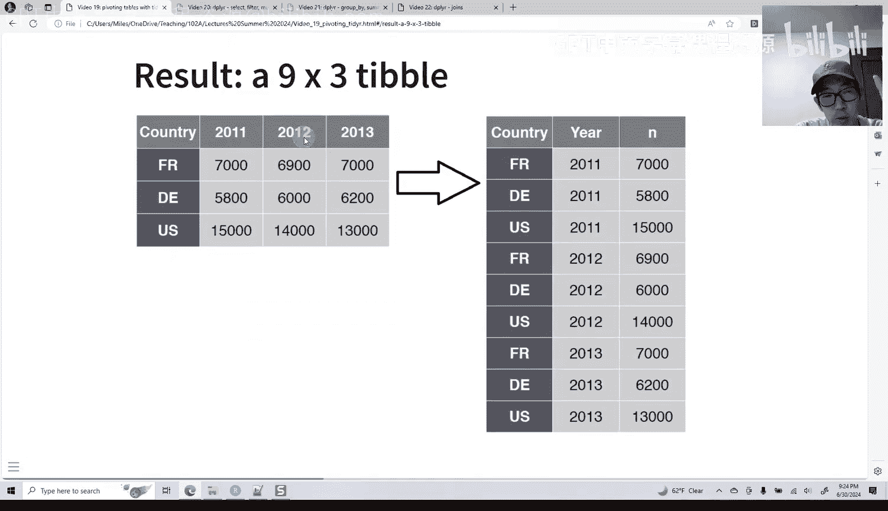

The title of our choice， so we're saying that those column headings。

 2011 20 12 2013 get put into the column year and then the values。

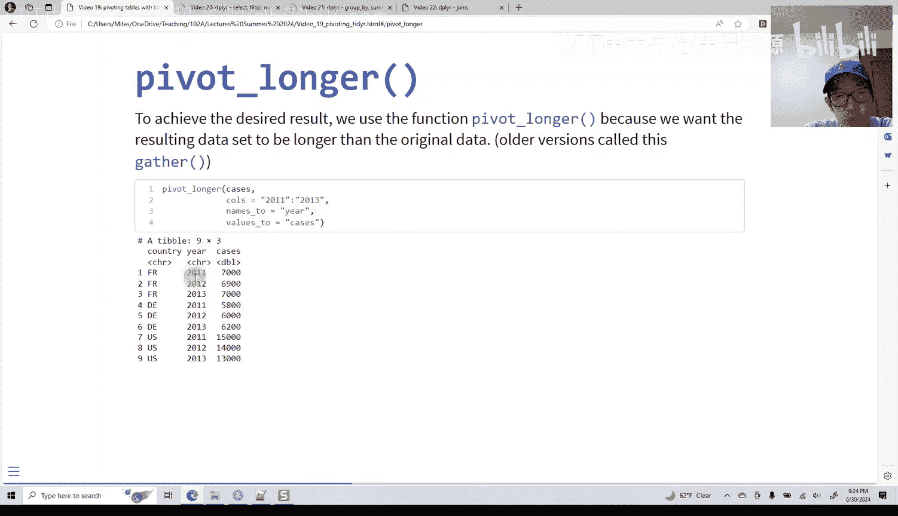

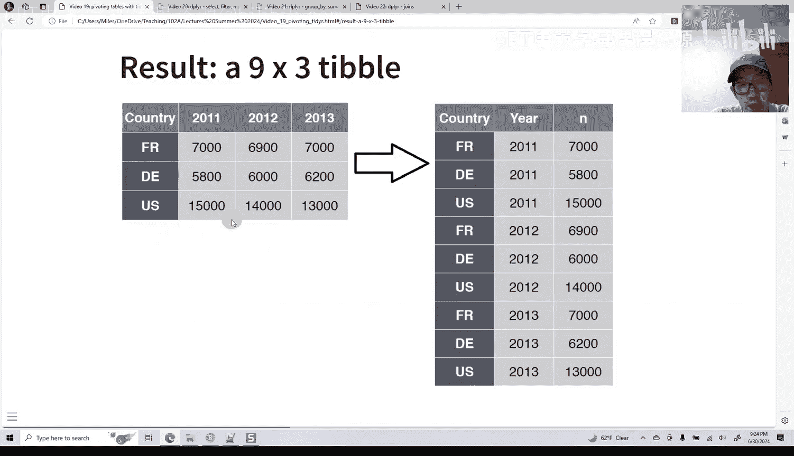

These values， these nine values here， we want them to be kind of pivoted into one long column。

Where did those values go， they're going to go into another column and we give it。

That that column is going to be titled cases， so we say values to cases， and so now we have。ATbble。

 nine rows， three columns， column for country， column for year， column for the number of cases。

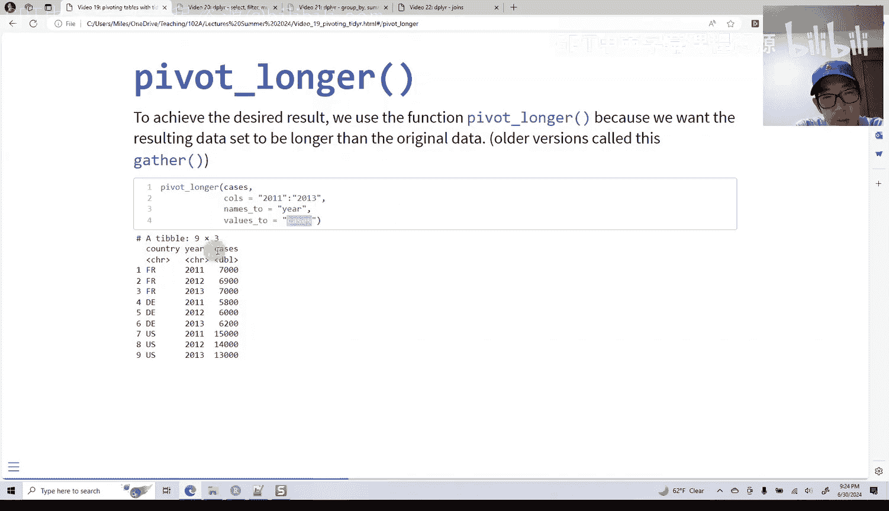

So this is just the pivot longer function in detail， it takes four arguments。

 data is the name of the data frame or tablebble that you want to pivot。

 columns are the names of the columns that will be pivoted in this case we wanted the columns 2011 through 2013。

Names two is a character string for what the resulting column of names is going to be called and values2 is a character string that's going to be the name of the column where the values go to okay。

The names are arbitrary， so you know， year and cases make sense， but there's no。

Rule that says it has to be year or it has to be cases or anything like that， you can specify。

You know arbitrary names so here I could say names to when it happened and now I have a column called when it happened just needs to be character string here I'm going to take the number of cases and I'm going to call it how many which is a character string and that becomes that now it's not it's recommended that you do not put spaces into your column names because if you do that you have to surround the column with back ticks okay and also recommended you don't start your column names with numbers otherwise they have to start with backtics which is the case when we had。

Column headings with the names 2011，2012 and 2013。 They' are surrounded by back ticks because they started with a number。

 But but yeah the。The name， this character string is just arbitrary。

 you can choose whatever you want。Okay， let's ask what would happen if I only pivot the columns 2012 and 2013。

 so if I say pivot longer cases， but then the columns I'm pivoting are only 2012 and 2013 what will the resulting dimensions be there well if we look at these two columns there's really only six values so the resulting table will have six values okay？

These two columns， 2012 and 2013。We'll get pivoted into two columns。

 one column will be called names and it will be filled with 2012 and 2013s and then the other column will basically be the values。

 which will be the number of cases and this so the names to go to year and cases well happens to see the other columns country in 2011 will remain and they get duplicated so any column that does not get pivoted just gets duplicated。

So。Basically。France 7，000， France 7，000 gets duplicated， Germany 5800， Germany 5800， US 15，000 US 15。

000， the other columns 2012。And 2013 get pivoted into the year column and then the cases get pivoted here it feels strange to see 2011 being duplicated 707。

50，805800， but that's just what tiDR does if the column is not pivoted。

TidD R isn't going to throw it away， it just duplicates it， right。

When we didn't pivot the country column， those countries got duplicated for every kind of entry here and so any other column that doesn't get pivoted just gets duplicated here it's just the 2011 country but you could imagine if we had a column for capital okay then we would expect Paris to be duplicated and then Berlin and then Washington to get duplicated across these rows。

 so that's what happens if the columns aren't pivoted they're duplicated。

What happens if I try to pivot all of the columns if I try to pivot country so I say let's pivot country all the way through 2013。

 we're going to try to pivot all four things okay then it's going to treat all of these values not just the number of cases but also France。

 Germany US as values to be pivoted so the result is going to be two columns。

 one column for the names and one column for the values now initially if you try to do this you get an error because it says the country values are characters and these are doubles and so you know columns have to all be of the same type and it says you know I can't do that I can't combine country which is character along with you know the column 2011 with a double so it errorss out。

But we can try to。Force convert this， and so I'm going to just convert everything into a character。

Okay， and then we're going to。诶。Pivott all of the columns country all the way through 2013 names to name values to value。

 and so now I get a column for names， column for value， and then so we get country， France 2011。

70002012 6900 country to Germany and something like that right so it looks funny this is not recommended we don't really want this。

 but that's what would happen if you try to pivot。Too many columns。Okay。

 let's take a look at the pollution table， which kind of has the opposite problem right now。

 we have a column for the size of the particle and a column for the amount of the particle。

 but we might want to change this so that we have a column for large particle amount and a column for small particle amount so how do we do that Okay。

 so if we wanted to make this tidy and we wanted to have the column city。

 large particle amount and small particle amount。How do we do that so what we want to do is we want to kind of do the opposite operation。

And if we do this， the resulting dimensions is we're going to have one column for city。

 large particle， small particle。 If we're going to have three columns。 How many rows will we have。

 We will have one row for New York， one row for London， one row for Beijing。

 So the resulting table will be。

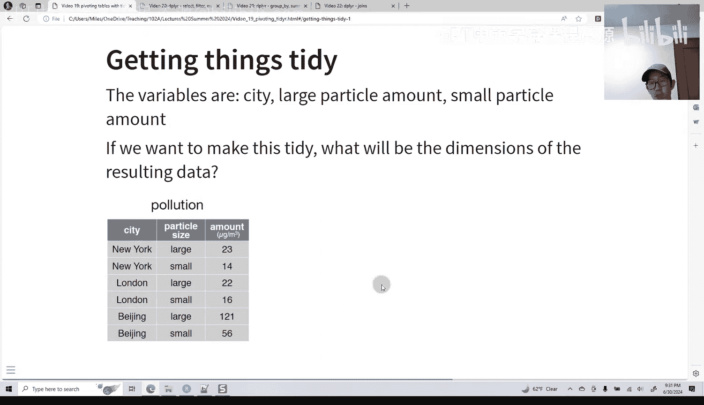

Three rows and three columns， so this is going to be the result there okay。

So here we've got data in long form and we want to create data in wide form。

 so this is going to be called pivot wider， pivot wider， so we're going to pivot the pollution table。

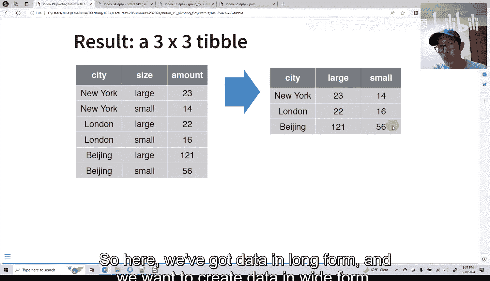

And we're going to say get the names that is the column names。

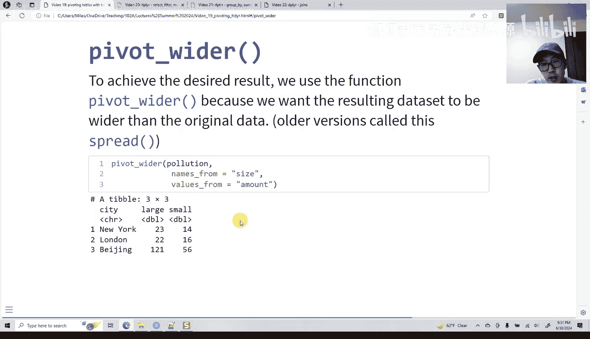

Right here， large and small they're going to come from the size column。

 so the names are going to come from the size column。

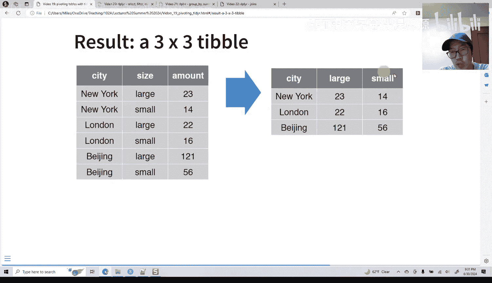

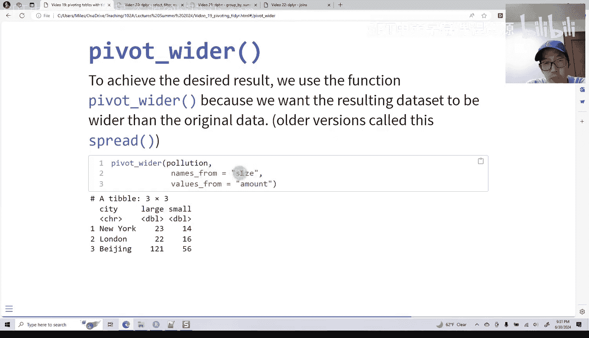

The values that get populated into the cells are going to come from the amount column。

 so we're going to say names from size， values from amount。

 and this is the resulting table which is exactly what we wanted。

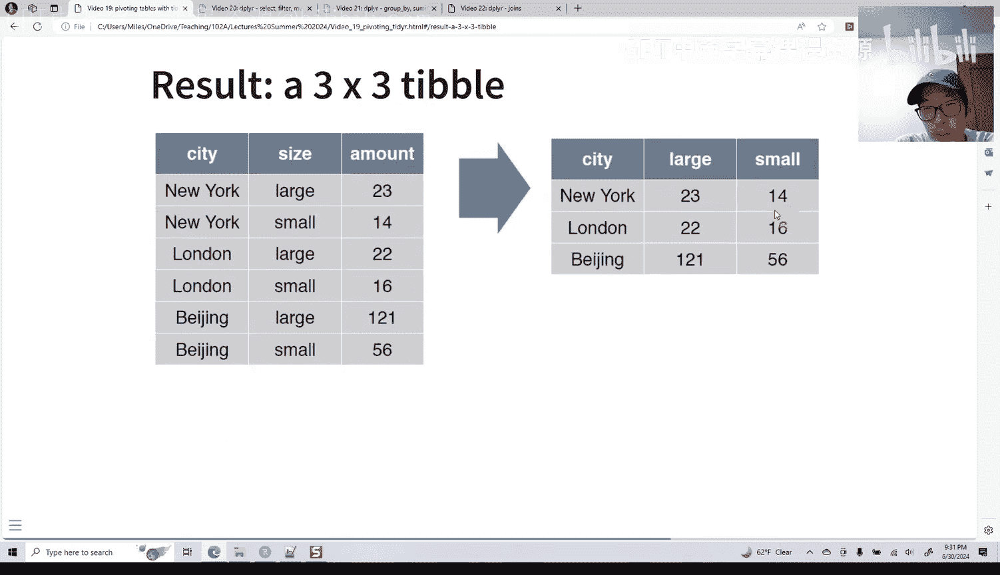

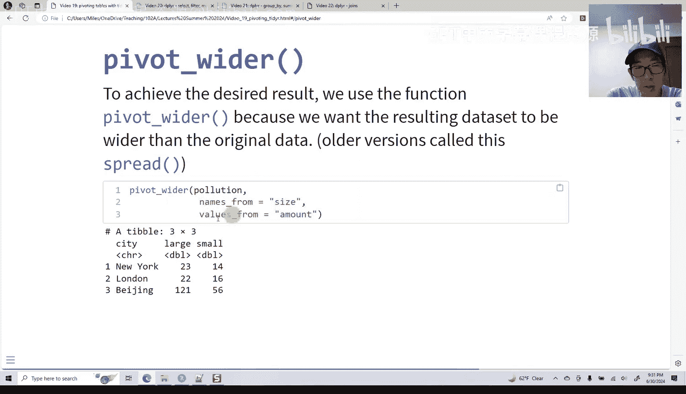

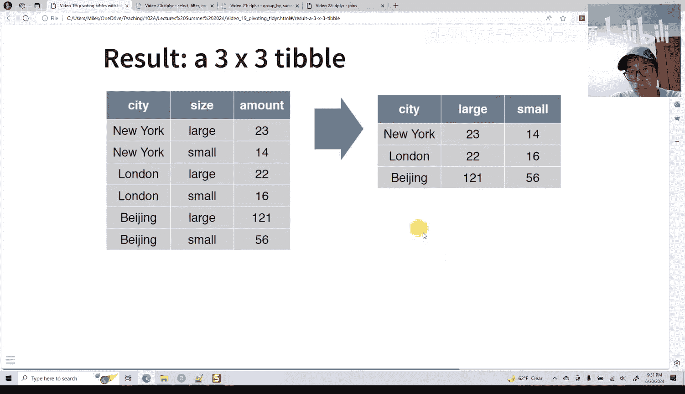

So that's pivot wider。So these are the arguments for pivot wider。

 data is the name of the data frame or Tbble， names from is the name of the column that has the names that will become column headers and values from is in the name of the column that has the values。

Pivt wider is case sensitive and spelling sensitive。

 so what would happen here here I changed the city name for the first one to NYC for New York City okay？

And and so what would happen if I say let's pivot this wider names are going to come from the size column。

 amount is going to come from， I mean， the values are going to come from the amount column okay。

 well， how many unique rows will we have？We're going to have a row for Beijing， a row for London。

 we're going to have a row for New York， and we're also going to have a row for NYC。

 so we're going to end up with four rows。Okay， we'll have two columns。

 a column for large and a column for small。Okay， and what happens is。Where we don't have a value。

 an NA gets populated okay so here we have New York City large 23。So the 23 goes here。

 but we don't have an NYC small， so we get an NA。We have a New York。Small 14 that gets populated。

 but we don't have a New York large， so that gets filled with an NA so if you pivot wider and it can't find it。

It populates it， it fills those things with NAs。嗯。You can use the argument values fill。

 so instead of NAs， if you want to put in fill it with a particular value。

 you can say fill it with zero or fill it with one or a million or whatever you want。

And it will do that as well。Okay。Here。I've fixed the spelling， so we have New York， New York， London。

 London， Beijing， Beijing， but I've changed large into all caps large and again。

 pivot wider is sensitive to spelling differences and case differences and so if I say take。

Take this data frame and pivot wider， names are coming from the size column。

 values coming from the amount， what is the result？Well， we will have three rows。

One row for New York， one row for London， one row for Beijing how many columns will we have Well we're going to have a column for each unique value in the size column。

 so we're going to have a column for all caps large。

 a column for small and a column for lowercase large here so we're going to end up with three columns when we can't find a match they get filled with NAs。

So this is the result。New York， with all caps large， gets a 23。New York with small gets 14。

 New York with lowercase large。That's not an original table， so we get an NA。Okay London。

 all caps largege doesn't exist in the original table so that gets filled with an N NA。

 London with small gets filled with a 16， London with lowercase large， 22， Beijing。

 small and large get filled in， Beijing all caps large doesn't exist that gets filled with an NA。

PivP longer and pivot wider are inverse operations， so here is our pollution table。

And I can pivot this wider and we get this。And I've called this table W。And if I take W and I say。

 hey， pivot it longer so that we are going to basically pivot the columns large and small together。嗯。

Then it will do that so I can pivot， take W， and I can say pivot it longer。

 pivot the columns large and small into a column called size and the values into an amount。

 and we get back this thing so this is the result of pivoting longer and we can see that is equivalent to the original pollution table。

Here's the cases table， we pivoted it longer from wide form into long form， okay。

 I'm going to call this thing L。And I can take L。And I can say pivot it wider if I wanted to okay and so I can say hey。

 get the names from the year column， get the values from the count column and it pivots it wider and so that reflects back the original table as well so pivot longer and pivot wider our inverse operations and depending on your situation。

Perhaps you actually might want the data in this wider form。

 perhaps you want to calculate how much did things change from 2011 to 2012 and you can do 2 2012 minus 2011 to get a difference column 2013 minus 2012 to get a difference column or something and in that case having the data in wide form could be useful。

So that is。Using TIDR to pivot your data longer or wider， TIDR has other features as well。

 I think this is probably one of the most useful features。

 just being able to master these two functions， pivot longer and pivot wider。

 I think is highly applicable and you are likely to encounter some situations at some point in your future where you'll want to pivot your data。

Okay， that's it for this video。

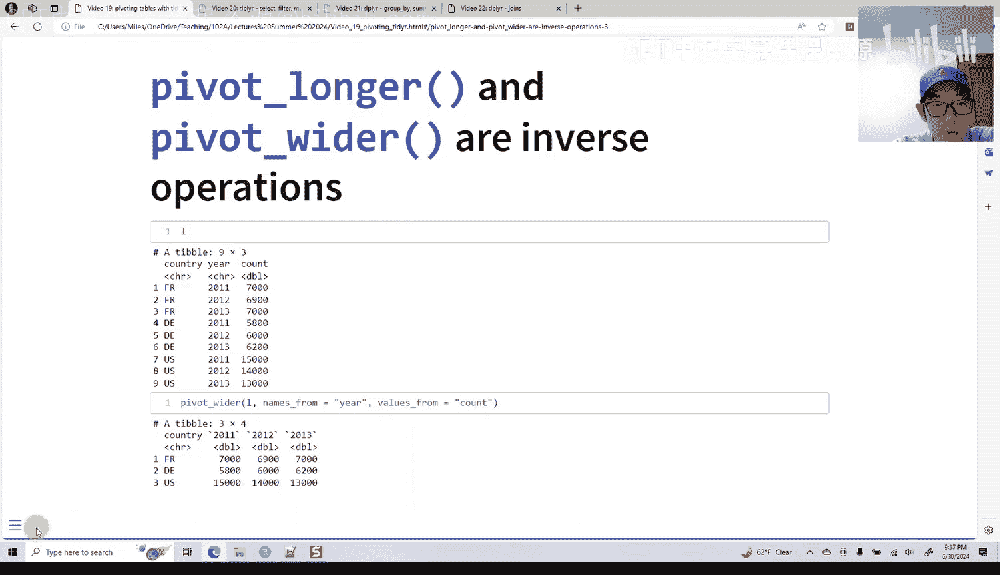