# UCLA《计算统计学｜Stats 102A - Computational Statistics with R 2024 Summer》中英字幕 p20 [20]Stats 102A - 2024 Summer - Video 20 - dplyr - select, filter, mutate.zh_en [BV1jizNBrEm2_p20]

All right， another very important package in the tidyverse is Dpler and Dpler allows us to do a lot of data manipulation tasks and I would say this is probably。

 in my opinion。

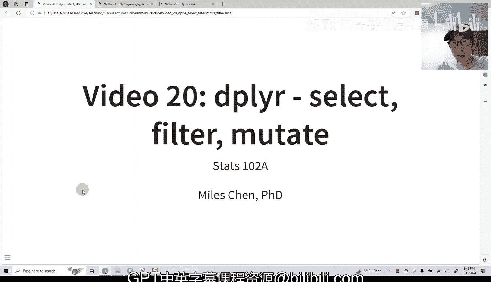

Perhaps the single most important package in the tidyverse， this in Gigi plot2， I mean。

 all of the tidyverse depends on a bunch of the things。

 but this might be the single most important package in the tidyverse perhaps in base R as well。

Granted all of the operations I'm going to show you in DPer can be done in other ways in Rs you know in base R it can all be done。

 you can use apply and T apply and all sorts of things， but I find DPer， the syntax and the language。

 very useful and so this I guess my personal opinion。One of the most important packages。Okay。

 you can load up Dpler by calling library Dlier or library Tidyverse。

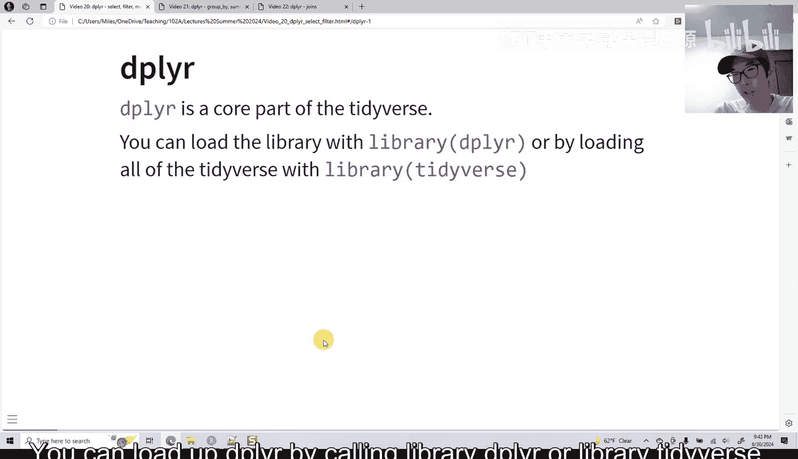

And the idea behind D per is that it gives you kind of a limited number of verbs， okay。

 it says it constrains your options and it helps you to think about data manipulation as you know。

kindind of linking together certain basic operations okay it says when working with data。

 you must figure out what you want to do， describe those tasks in the form of a computer program and execute the program and D makes these steps fast and easy so。

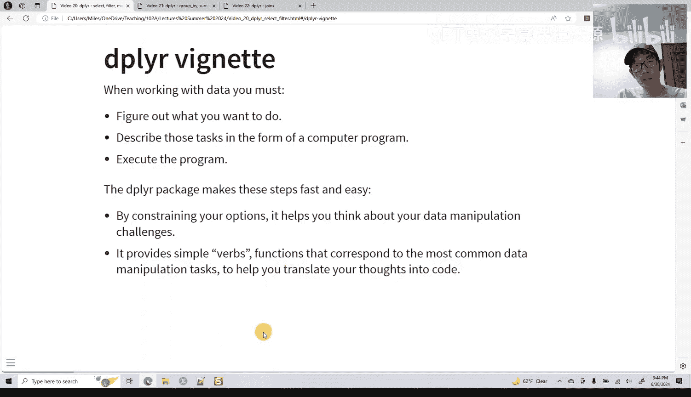

The important verbs， there's more verbs than this in Der。

 but I would say the important ones within Dpler are select， which we use to pick our variables。

 basically select columns filter picks the cases which is used for rows， so select for columns。

 filter for rows that's going to be the important thing for you to remember select the columns filter the rows mutate creates new columns or new variables。

Arrange changes the ordering of the rows and summarize。Calculates summary statistics。

 it reduces the multiple values down into a single value。

 like calculating the mean of a set of numbers， takes multiple values。

 boils it down to a single summary value， the mean all of these are also paired with another variable or verb called group by and you can form groups and it's going to calculate or do these operations for。

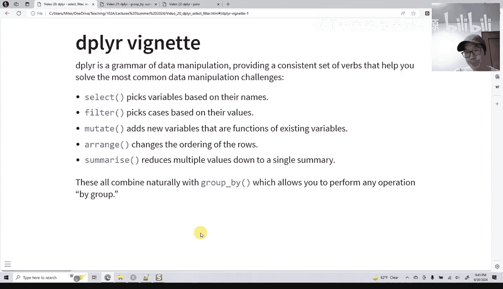

For different groupings in your data frame。Okay， but let let's talk about some of the。

Select and filter verbs and that's what we're going to do this is a there's a cheat sheet available very handy I recommend you download it。

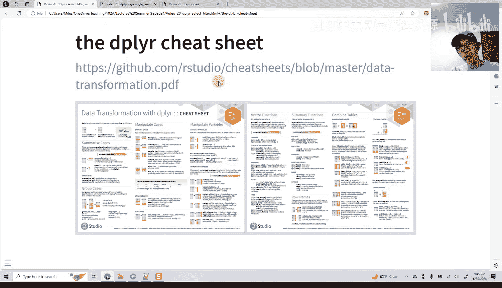

Let's take a look at some examples here， so we're going to work through this Star Wars and dataset okay this data was created after the seventh movie before the eighth and ninth movie so there are nine movies in the Skywalk or saga this data frame was created between the seventh and eighth movies。

 and so includes information about different characters okay so we have the name of the character。

 some physical attributes， their height， their mass information about their hair color， skin color。

 their eye color， their birth year which is measured in。はい。I guess years before the Battle of Yavin。

 which is when。Which I guess is a canon event happened。At the end of the first。

 I guess episode4 where the Death star blows up that is the Battle of the Avin and I guess Luke Skywalker was 19 when that happened because he was born 19 years before the Battle of Yvin。

 anyway， sex， their gender。Other things， their homew world， their species。

 the films that they appear in along with the vehicles that they've used in any starships that they've commanded。

 okay， so we have that kind of information all right。

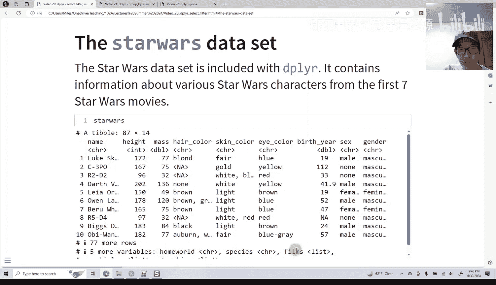

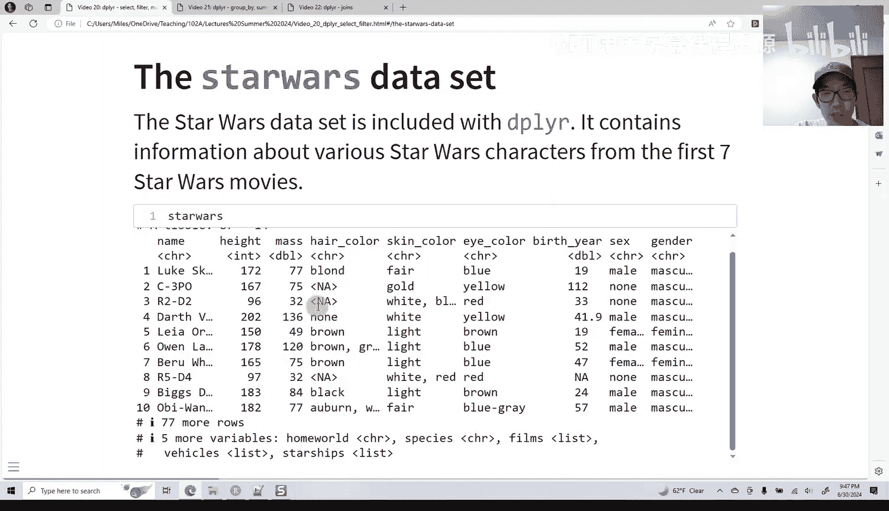

We can so here， as an example， we can select columns using select。

 so here I'm going to say select from the Star Wars。

Data frame or Tbble select the columns name home world species and films and so we select those columns name home world species films Luke Skywalker is a human from tattooing C3 POs aroroid from tattooing R2 T2 is aroid from Nabu so on and so forth。

The films within films， we have a vector。Of， I guess。If we select this。

 it would be a vector of the five films that Luke Skywalker had appeared in。

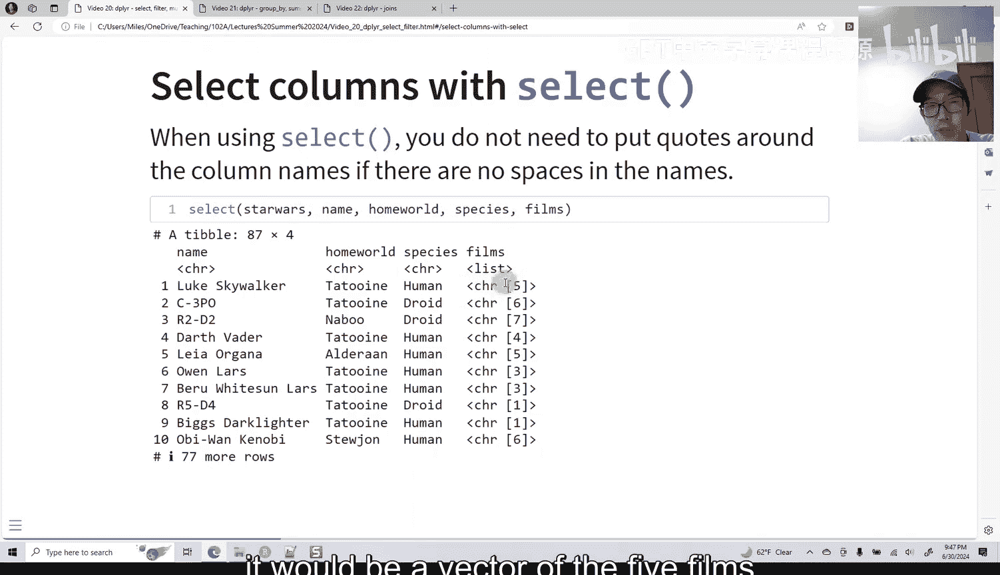

嗯。We have an operator called the pipe， okay， the pipe operator is percent greater than percent and what it does is it takes。

Whatever value you have in front of the pipe and inserts it into the。

Function as the first argument into the function that comes after the pipe。

 so if you have x pipe f of y， that is equivalent to writing f of x comma y so we're basically piping the X into the first argument of F。

So the previous slide had select from Star Wars name Homew World speciesies Films。

This can also be written as takeSt Wars， pipe into select and select name Homeold species films。

And and I'm going to be using this pipe syntax because you can chain pipes。

 so the result of calling Star Wars and then select gives me this Tbble。

I can then pipe this Tbble into another operation which will then kind of work with this result。

 and so it kind of does a step by step， you know， first do this， take that result， and then do this。

 take that result and then do this okay and so that's a nice way to kind of writerer commands using pipes。

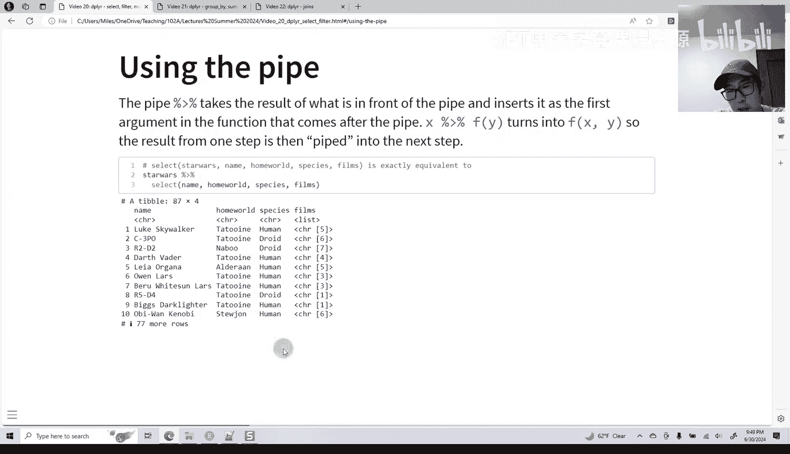

R， the base R liked the idea of the pipe that was introduced in the tidyverse so much that they implemented the native pipe。

 the native pipe is found by taking a vertical bar and doing the greater than sign the functionality of the native pipe is identical。

 almost identical to the pipe that's part of the tidyverse。

 you can find a little bit more information about that at this link here。嗯。So you can do that。R。

 I believe， will insert the pipe kind of automatically using a shortcut keyboard shortcut command shift M or control shift M。

 will insert the pipe so you don't have to constantly be typing percent greater than percent。

 but you can just hit control shift M and it will insert the pipe for you。

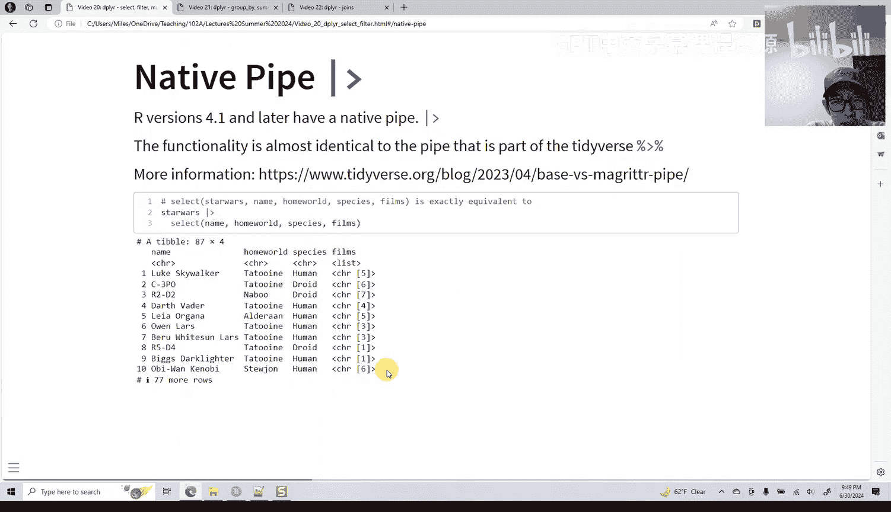

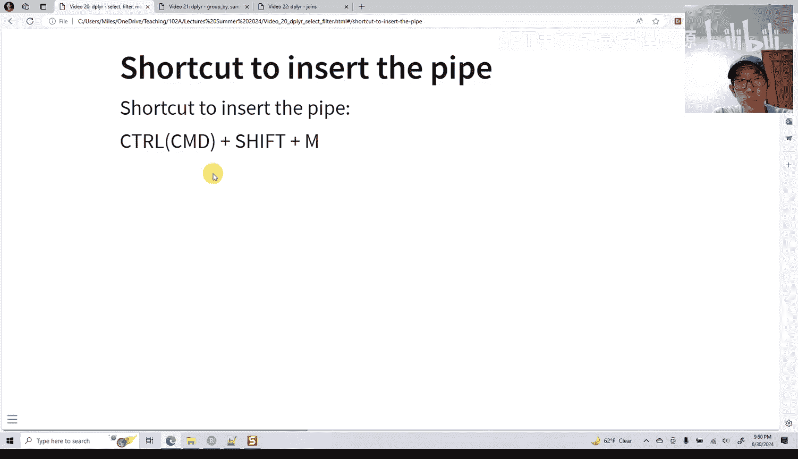

All right， so as far as select goes， you can also put a negative sign in front of columns you don't want。

 so here I can say from Star Wars select the columns other than name。

 eye color and birth year and so it will drop to those column names and the s that we have I can then pipe that result and just say head three and it only give me just the first three rows of that resulting table。

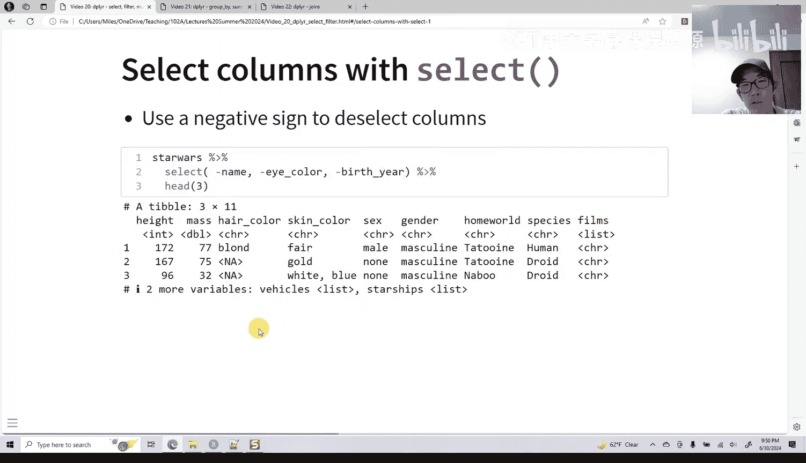

Here's another example of select where I can kind of specify a range。

 I can say from name through eye coloror， so kind of you know， traditionally with the colon operator。

 we give it integer values and we create a range of integers。

 but here we can also kind of use it with column names and I can say I just want these columns name through eye color and selects height mass。

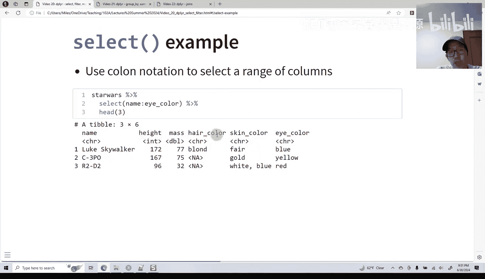

Hair color， skin color， by color。We also have some selector functions， okay helper functions。

 so we have things like contains starts with， ends with matches， everything numeric range。

 you can also just ask for help on the select helpers and the ti select and so contains will basically you put in a string and it will select any column that contains that string。

 you can starts with will be columns that start with a particular character string or ends with a particular character string。

If you want to use regular expressions， you can select the column names that match a regular expression。

 everything will select all the columns numer range， sometimes you have。

Columns named like x1 x2 x3 x4 and you can select the columns you know that fit some kind of pattern there All right so here's a few examples I can say from Star Wars select all the columns that ends with color along with name okay so we got name and then we get hair color skin color eye color here is a regular expression。

 a very simple regular expression， it says matches S dollar sign。

 this just means it's going to end with the character S and so we get select name but also mass and species films vehicle starships because these are the columns that end with the character S or match this regular expression。

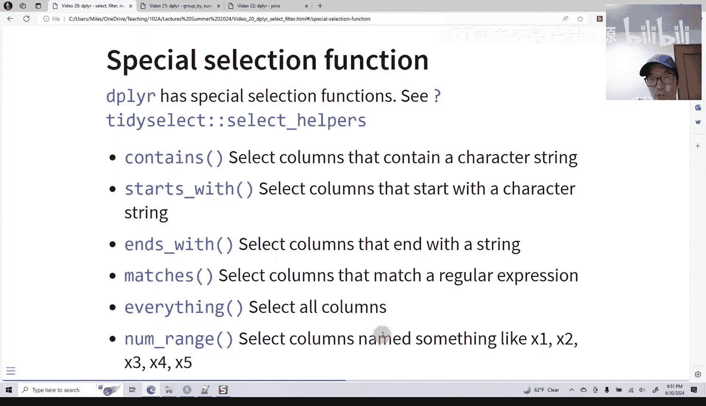

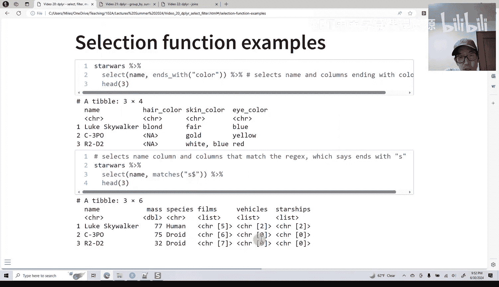

嗯。Sometimes you you're in a situation where you build a vector of the names you want to select， okay。

 so it seems。So sometimes you want to select。呃。These columns， name， mass and height and those。

Column names or the names that you want to select are stored in this vector vase Okay。

 so if you want to select those， you can't just do Star Wars select and you put in vrs okay because because then。

Dlier is going to look for a column called varrs。 and it's going to say， I couldn't find it。

 But what you do is you throw vrs into。The function all of or any of， okay？

And it will select the columns。It will look at this vector。

 turn those into basically the understand that these are column names that you want to select and then we'll select those column names so here we select name。

 mass and height。

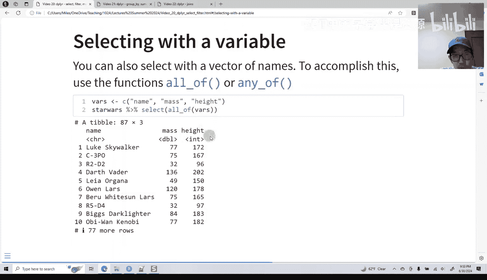

Filter filter is used to filter down your rows， you specify rows using filter select is for selecting columns filter is for specifying the rows as far as the filtering your rows。

 basically you give it some kind of。Lo vector okay and it will return the rows for which that logical vector is true。

 so here I'm going to say Star Wars filter and I give it the logical vector name equals equals R2D2 basically that name column is compared to R2D2 it's going to be false anytime the name is not R2D2 it's true only when it is R2D2 and therefore it returns only that one row where the name is equal to R2D2。

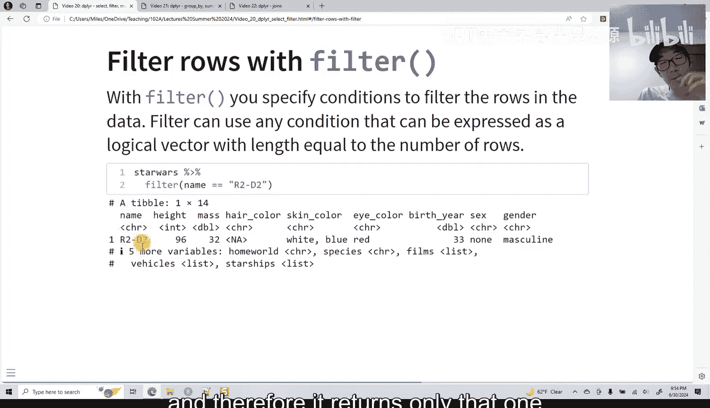

Certainly there's many other things， so for example， you can。

Apply multiple conditions and that's equivalent to using an and so here I have。This condition。

 this is going to be a true false vector， a logical vector where we're going to say species is in human or droid okay。

 now it's important。That you do not use species equals equals human commroid。

 because if you did species equals equals human commroroid。

 what that will do is it will take that vector， human commroroid， and it will recycle it。

 so first row it will be human secondroidroid， third row human fourth roadd， and then humandroid。

 humand。And then you will only get a match if。You have human in an even row or droid in an odd row。

 okay？And if you have a human in an I'm sorry， human in an oddro or droid in an even row if and if you have something kind of the other way right。

 then it won't match so if you want to kind of say species is basically one of human or droid。

Then you use percent in percent and that will select。

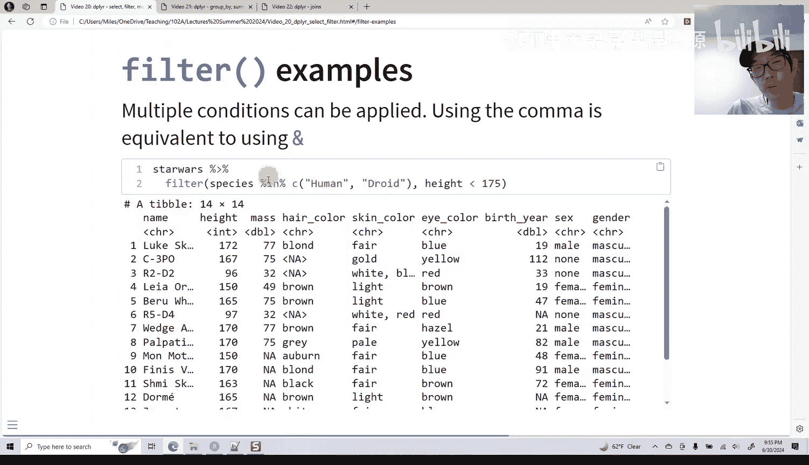

You know basicallysically where this species is either human or droid。

 regardless of its role position。

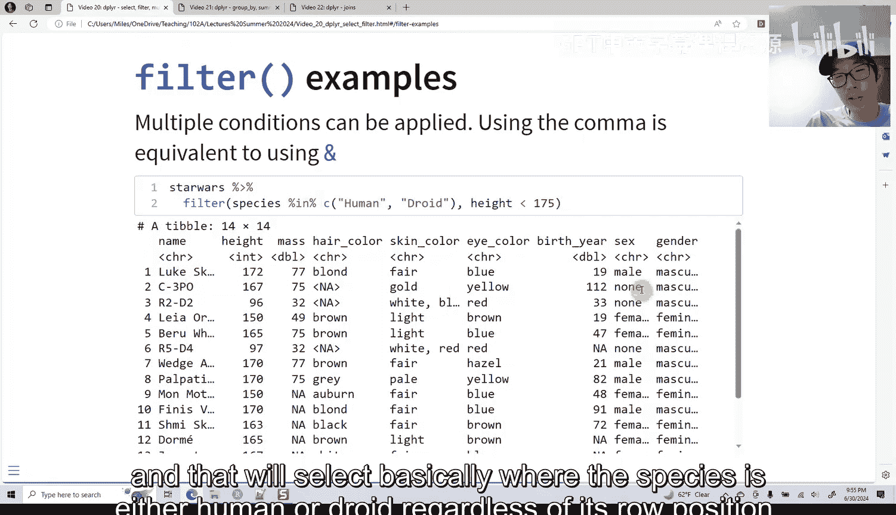

You can also specify height less than 175 or some other condition。

 this is a logical condition and it will impose that limitation here。

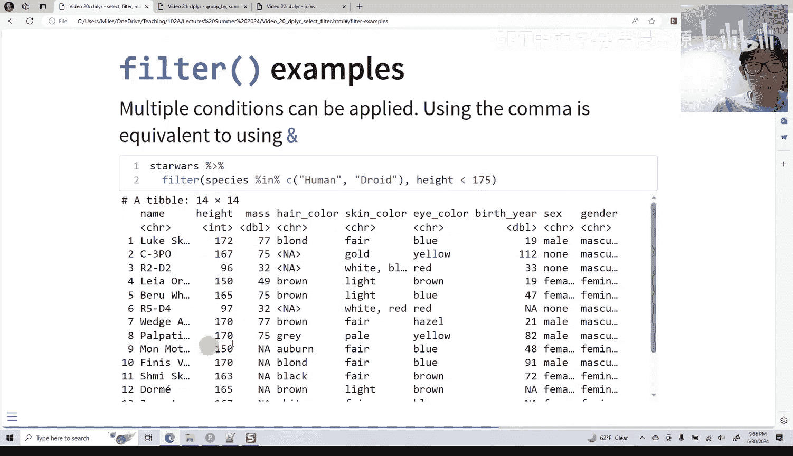

Filter is very powerful when you pair them with regular expressions。

 I haven't taught you regular expressions yet， but you know there is。

A function called string detect this will return a logical vector of true or false value and so you can say filter and here I'm going to I pick name and this means begins with F so I'm going to say detect this regular expression and if it detects that regular expression as true or false。

 I mean if it does it will return true and so we're going to filter down to the rows where it begins with the character capital F and we get these two rows。

 we have f something， somebody I don't know who that is and f I believe is。From the seventh movie。

 I guess the later trilogy movies 78 and9。And so we have that。

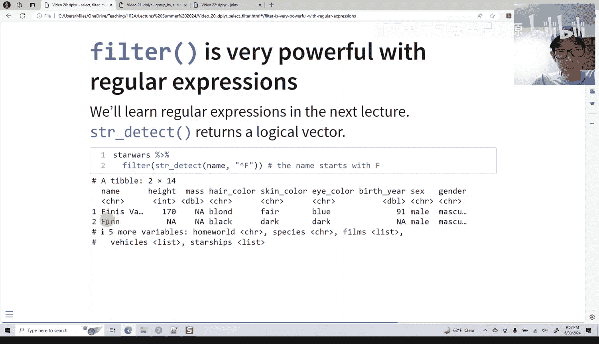

Okay， we have。So the D plier functions work well with the pipe okay you can also use or the vertical ore operator to kind of get vectorized ore operator so we can say star Wars I want hair color to be none or eye color to be black to select our to filter our rows and then after that I just want to select the columns。

 name species homeward homeworld hair color and eye color。

 and so here I get dart evader who has hair color none eye color is yellow。

 we have Grido hair color missing， eye color is black IG88。

 hair color none so on and so forth and we get。We get these characters from the movie。

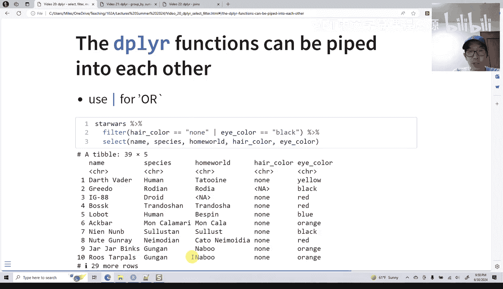

Once you have characters or once you have things done， you might want to arrange。

Your results arrange the rows and so here I'm going to say from Star Wars。

 basically I'm not filtering any of the rows but I'm going to just select these columns name birth year height and Mas and with those results I want to arrange in descending order by birth year and then break any kind of ties based on mass so the oldest character in this data set is Yoda born 896 years before the battlettle of Yevin then we have Jaba the hut。

 I guess 600 years before then Chibaka born 200 years etc etc。

 we have a tie between these two characters， Key Adddimunundi and Kaigon Jin。

 and so that tie is broken by mass because mass is specified without the descending modifier its smaller values get ranked before others so key Adddiundi with a mass of 82 comes before Quaaigon Jin with a mass of 89。

I guess that other character with the capital with Finn Venal Loum， but I don't know who that is。

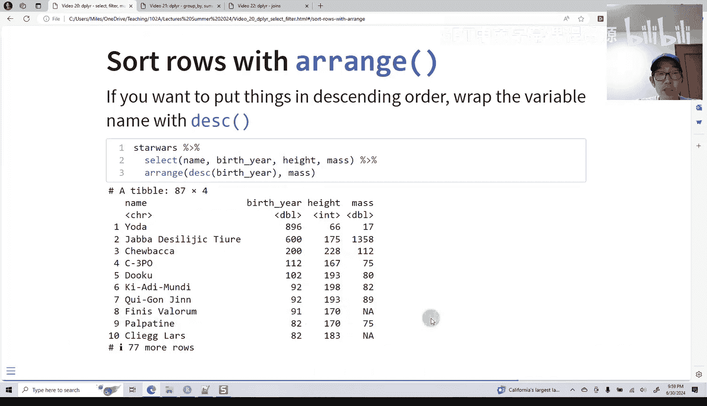

嗯。Another operator is slicee， this is just kind of you can select rows based on their position so you can say I want rows5 through 10 and so we get those six rows and then you know basically it renumbers them from two rows one through six。

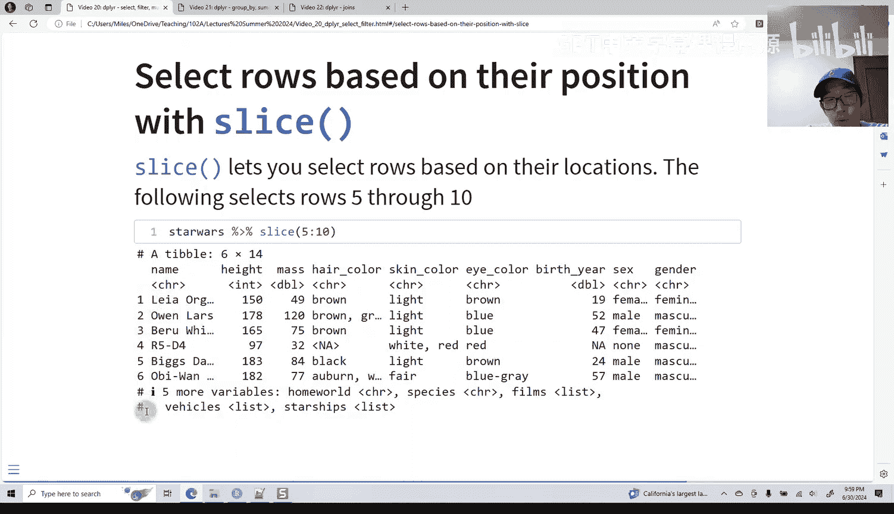

Slice sample will select rows at random Okay so you know a lot of times so you might wonder like why would I want to select rows at random well sometimes you need to do some random sampling and it's useful in that case。

 but sometimes you just kind of want to check to see if your calculations are going well or you know how they're working and things like that and so。

A lot of times you just kind of want to take a look at the data frame after you've performed some kind of operation。

Oftentimes， kind of the。To kind of take a peek at the data frame， we might use head， okay。

 so after doing some operation I might do like head of the data frame and that will give me the first you know 6。

10， however many rows I want。However， sometimes we're in a situation where。

The operation you want works successfully for the first few rows because， you know。

 maybe there's a certain condition that applies to the first few rows， but then later on。

That the operation was no longer successful and if you only use head。

 you only get the top few rows and you might not detect that something went wrong so by doing slice sample you're going to get a random selection of rows and that will give you a better sense of whether your operation was successful across the data set okay across the multiple rows。

 it's not a guarantee so you could slice sample n equals 100。

 you get a random selection of 100 rows and you might not detect any problem but it's possible that you know problems still do exist and you just don't detect them。

 but you know slice sample might give you a better sense of kind of what your data frame looks like and not just the top few rows when you use head。

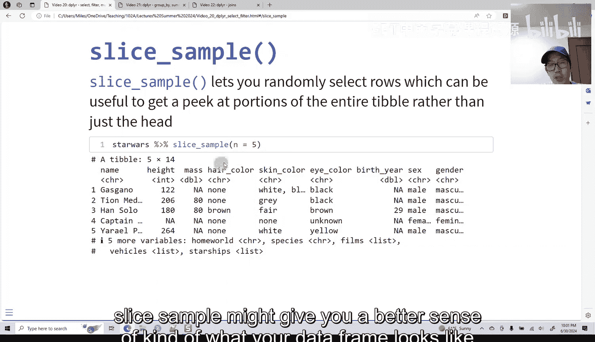

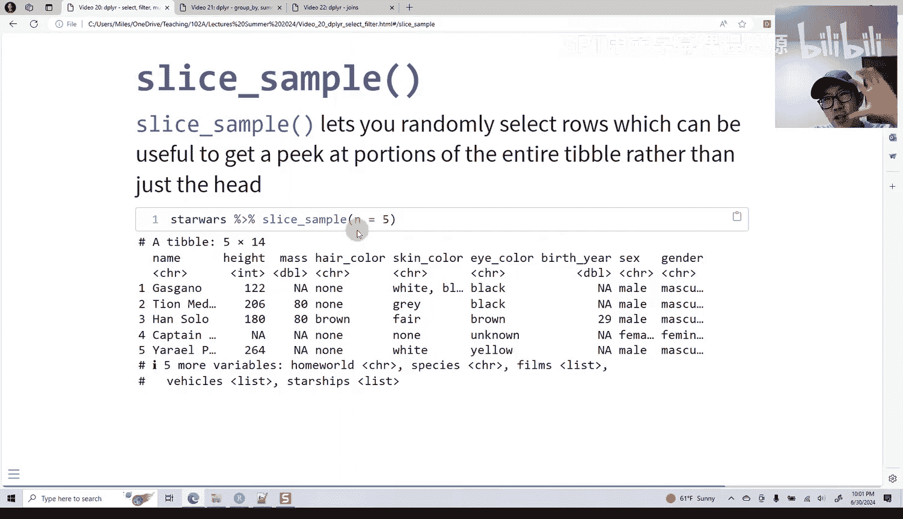

You can also do slice min and slice Max。This is kind of like doing a range and then slice okay or and then head。

 so for example， slice max mass and equals3， it's going to basically select the three individuals with the highest mass Okay slice min would select the individuals with the lowest mass and so on and so forth。

 So it's kind of like taking a range to put them in order and then selecting the top few rows。

 so it's just a little shortcut not critical you could do this yourself without the thing。

 but it's handy to have。

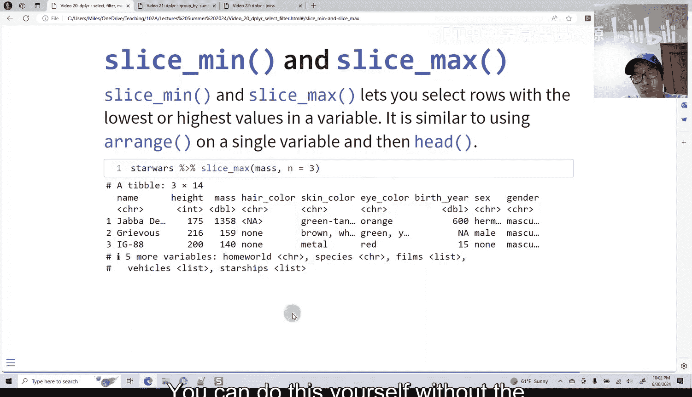

Mutate， mutate。Will create new variables。 So， for example， we can take the。

Column height and perhaps which is currently reported in centimeters and perhaps I want to report it in inches。

 so I would take the column height and divide by 2。54。And it calculates that now one。

Issue is that when you create a new column。It always puts that column in the last position。

 the rightmost position and so in this case because the way Tibbles work。

 it doesn't print any columns beyond what is visible on the screen so height and inches you know just doesn't appear on my thing so here I'm going to mutate and then I'm going to select just the columns name height and height and inches and then I'm going to select that top row so we see Luke Skywalker is 67。

7 inches around 5 foot8。

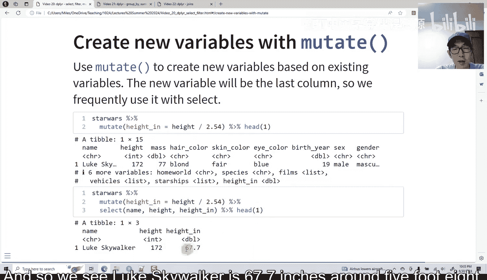

Now， when you use mutate， it is important that the number of values produced by mutate this new variable that you are creating because it's creating a new column。

 it needs to have the same number of rows。As as the data frame， okay。

 so if I used something like mean。With mutate， it's going to end up just kind of taking the mean value and then just duplicating it across a whole bunch of rows。

 which is probably not what I want to do cumulative mean is kind of a。

A silly operation when we're dealing with the mass of characters， cumulative mean。

 any of these cumulative functions work best with time series operations。

 and it's kind of like over time this is the running mean。

But you know cumulative mean would be kind of like what is the mean of the values we've seen so far so we begin with 77 after we see 75。

 our mean so far is 76， after we see 32， the mean of the three people or three characters drops down to 61。

3 after we see 136 and then it bumps up to 80 and so that's what we get with cumulative mean again doesn't really make sense to apply and this data set works much better with kind of a time series and you'll say you know。

You know， on the first day it was here and then as we saw more and more values， you know。

 the the overall mean is you know， approaching this。Perhaps asymptotic value or something。

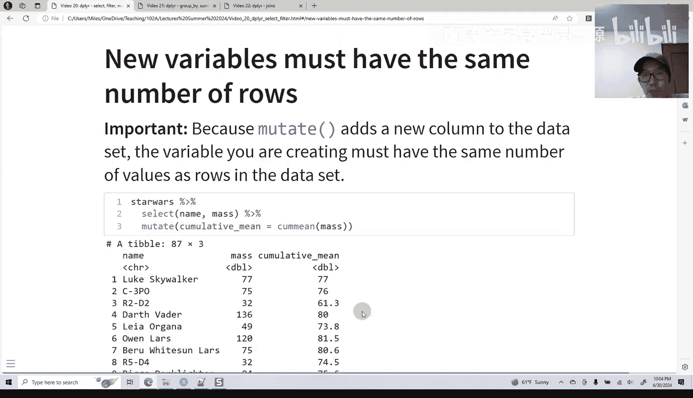

Values that are useful for mutate or functions that are useful for mutate， we have P min。

 Pmax element wise min and max， cumulative min， cumulative max。

 cumulative sum cumulative product between which will return a true false value。

 cumulative mean we also have lead and lag， and then you can do n tile which will basically bin the values into n different buckets。

 and then you can use it as some kind of categorical variable。

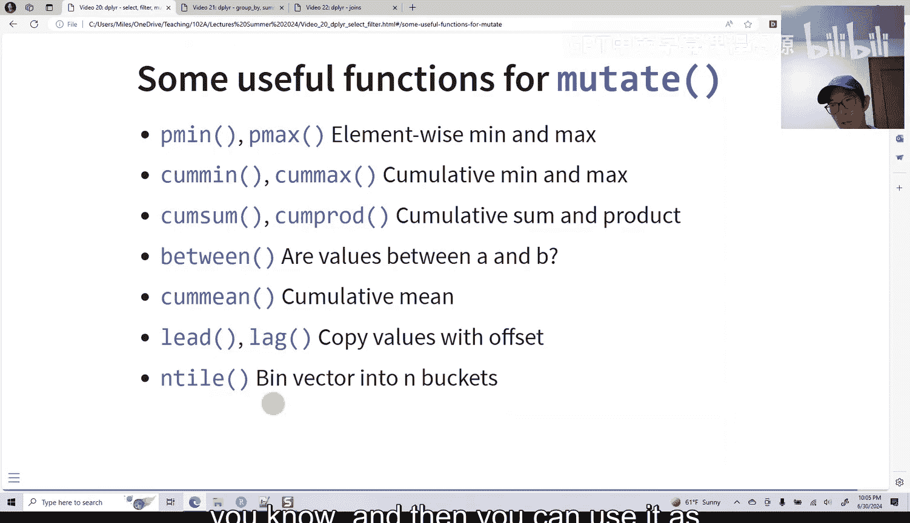

I'm going to show you some examples of these functions again。

 doesn't quite make sense to use on this particular data set。

 but you'll just kind of get a sense of how this works so the original data I'm just going to look at the name。

 the mass and the birth year。And then we're going to mutate these additional variables。 And they。

 again， anytime you create new variables， they just kind of get tagged on。

 So cumulative minimum mass is basically。Of the values we've seen so far。

Which one is the lowest value we've seen so we start off with 77 so that so far is the smallest value we've seen then we see encounter 75 so that takes the new champion spot of the smallest values 75。

 then we see R 2D2 which is even smaller at 32 then we see 136 which is not lower than 32 and none of these other values are lower than 32 so the minimum mass that we've seen so far remains 32 if later on we encounter value like 31 or 29 or 7 or whatever then that will become the new cumulative minimum mass again cumulative functions generally makes most sense for time series things。

The ratio you can kind of just do a calculation here I'm doing mass divided by the mean of mass。

 so here I would calculate the mean of mass， which is going to be the same for everybody。

 I'm going to do NA to R equals true so that we don't if somebody's mass is an NA we're not going to get an NA。

And so， you know， whatever the average mass is， which I think is。Just under 100 kilograms then。

 you Darth Vaadder of 136 is 1。4 times the average mass， Luke Skylar with a massive of 77 is 0。

791 times the average mass or something like that okay？

P min is elementwise minimum doesn't really make sense to do this。

 but we're going to do between the mass and the birth year which one is smaller so between 77 and 19 element wise which ones smaller than 19。

 between 75 and 112， which ones smaller 75， between 32 and 33， which ones smaller 32。

 between 136 and 41。9， which one's smaller， 41。9， so that's P min and you have P max as well。

And then lag all that does is it just takes one of the columns here。

 I'm going to take masssier P in and it will offset it by two so it will just lag those values by two。

 the opposite of lag is lead， and so then it would shift values up。So that's what you get。Okay。

 so those are just some examples of things you can do with mutate。

 and I show you examples of select and filter， and these are some of the basic and important functions within the Dlier。

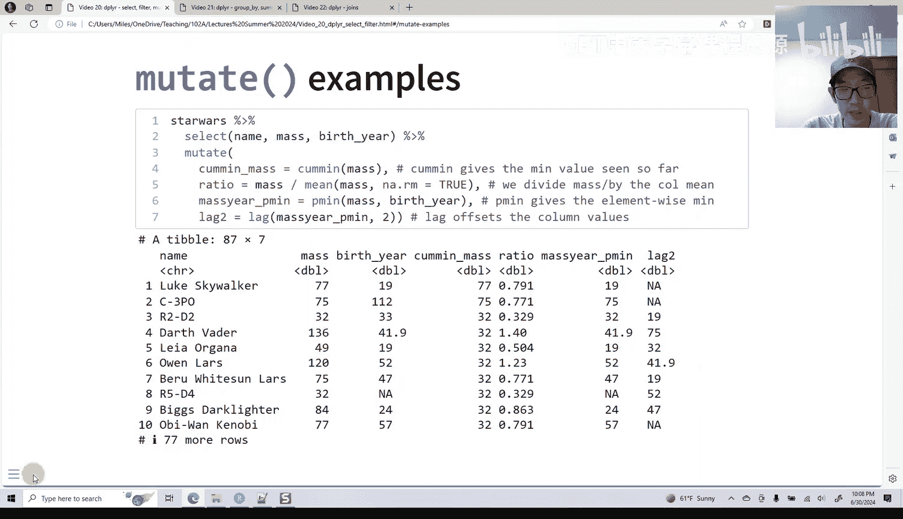