# UCLA《计算统计学｜Stats 102A - Computational Statistics with R 2024 Summer》中英字幕 p21 [21]Stats 102A - 2024 Summer - Video 21 - dplyr - group_by and summarise.zh_en [BV1jizNBrEm2_p21]

All right， I want to continue our discussion of D per covering group by and summarize which。

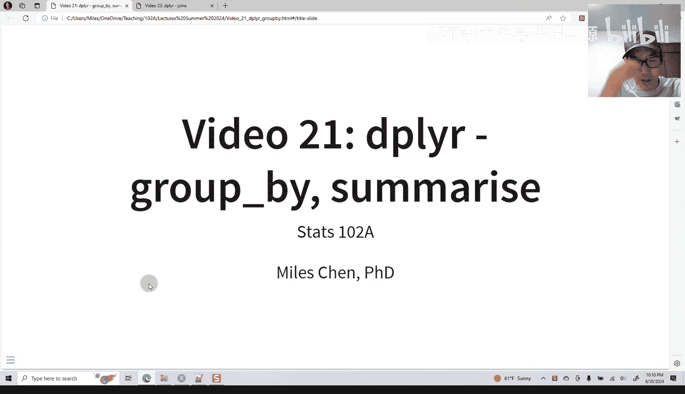

There some of the。

Great。I guess unleashes the power in my opinion of。

Of the Deer okay so summarize is spelled with a S this is Hadley Wickham。

 the author of the tidy verse comes from New Zealand that's how they spell summarize later they added summarize with the Z it had the exact same functionality I'm accustomed to using the original function with the S so I continue to type it out that way it's not wrong to use it with the Z though。

Okay， so when you call summarize， it will calculate summary values。

 so summary functions are things that take multiple values and。Redduce them to one。

 so you have a set of 100 values， you ask for the mean， you get one mean， you ask for the meeting。

 you get one meeting， you ask for the variance， you get one variance okay。

 and so these are some examples and what we're going to do is we're going to take the entire data frame。

Okay， the entire data frame of。Star Wars and I forget how many characters there were。

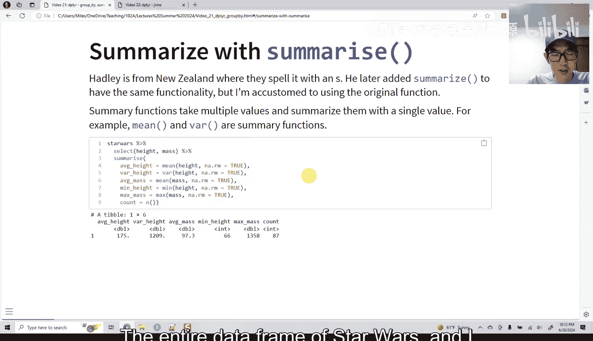

那你呢。😔。

Where they go。Under selecting filter， how many？

the original okay 87 rows， okay with 87 rows， it boils them all down to one odds right here in count 87 rows。

 it boils them down to one， and it seems a little bit silly that we would go through the bo trouble of writing all of this when I can just。

As or not even Dlier I can just ask R take the column height and calculate the mean right I could just do Star Wars Do sign height and then throw that into mean and I have to do any to RM equals true because if there's a missing value and the column then the entire mean becomes missing so we're just going to say ignore the missing values。

 any to RM equals true。And and do that Okay， so the way you know it works is you do Star Wars。

 you know， select filter， whatever you want to do to get the rows that you want or columns that you want and here I'm going to just say summarize all right and then I specify basically columns that I want。

So the one thing a column I want is average height。

 so I'm going to do average height that's going to be mean of height， variance of height， var height。

 I'm going to call var on height， average mass， mean mass， minimum height， maximum mass。

 and then another summary function is the count of values that got summarized 87。

And so it calculates all of these things， again， D plier has a tendency or Tibbles have a tendency to kind of just display only a few significant figures。

 there are likely many decimal points after this， they're just kind of hidden from view。

 but they do exist if you kind of extract it out。

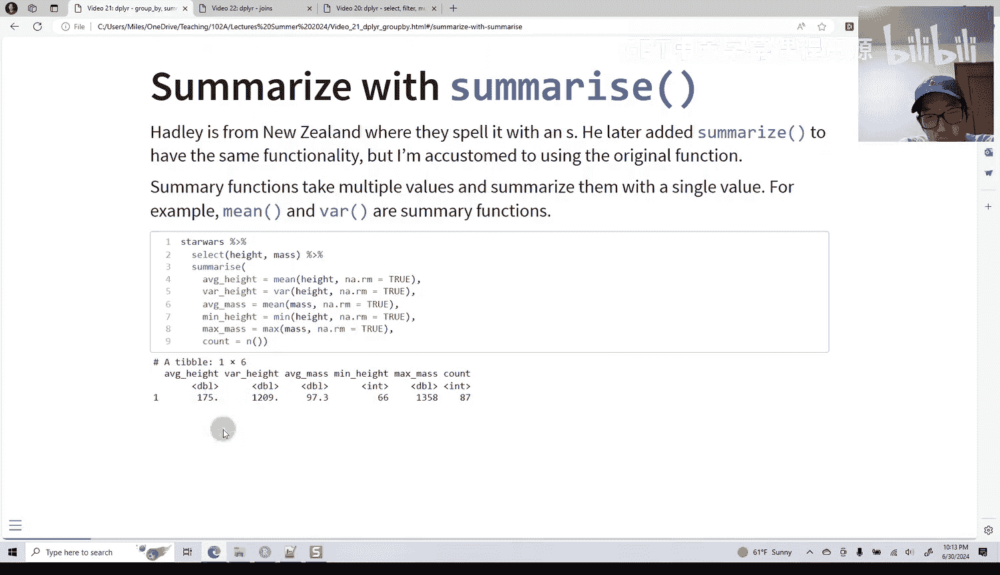

嗯。So summarize does that and it kind of boils it down to one row fine。

 but the power of summarize is really unleashed when you pair it with a function group by okay with group by it forms group based on a categorical variable so here I have a categorical variable called species okay and we have things like humans and droids and then you know chubbaca is a wie and。

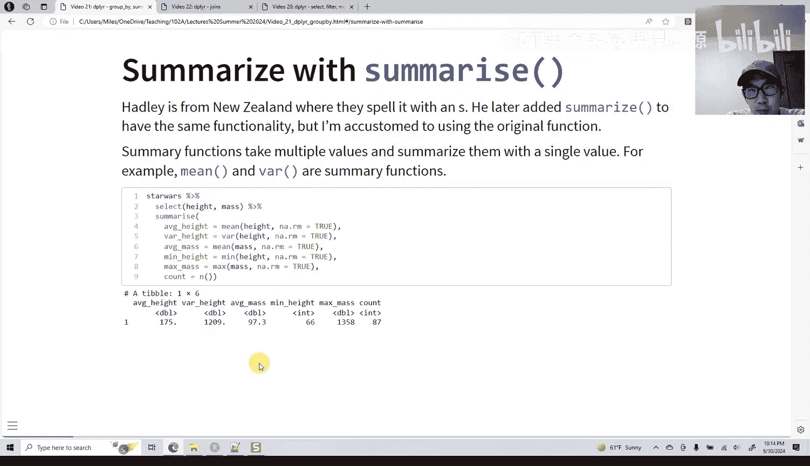

What other species are there， you know， I don't know。

 gunungs and you know different species in the universe and we can form groups for each species。

After we form the groups， we can then select the columns or whatever we want。

And this doesn't look all that different than if I just did Star Wars Select， right， I just said。

 you know select the name height mass species and we get that， there's only a subtle difference。

And it just says groups， species 38， meaning there are 38 unique species in our data set。

And it has established groups on that。 but we haven't really asked theer to do anything with those groups。

 So it just kind of has that group information。 It's kind of just like putting a little。

I guess star next to each of these， I guess the grouping variable here species， okay？

But now if I call group by with summarize， okay， I'm going to say Star Wars。

 basically it's very much similar to this thing， this command， but I've thrown in a group by。

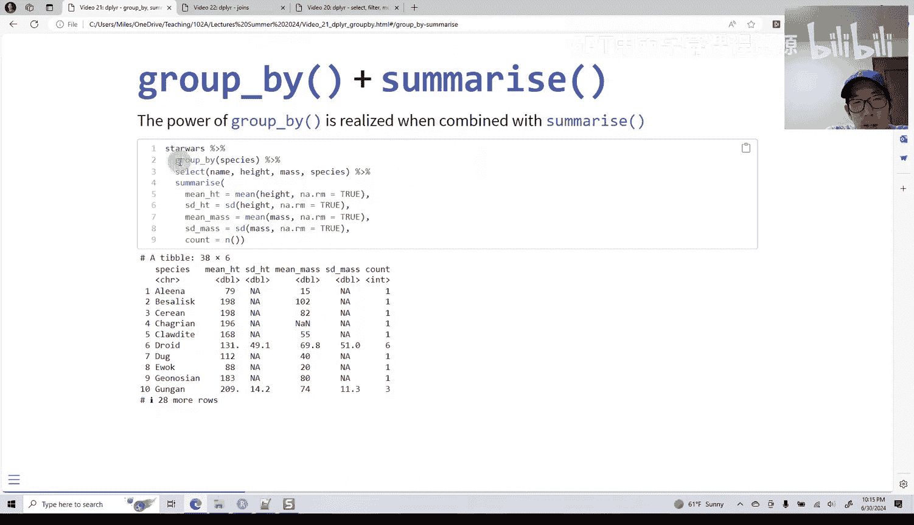

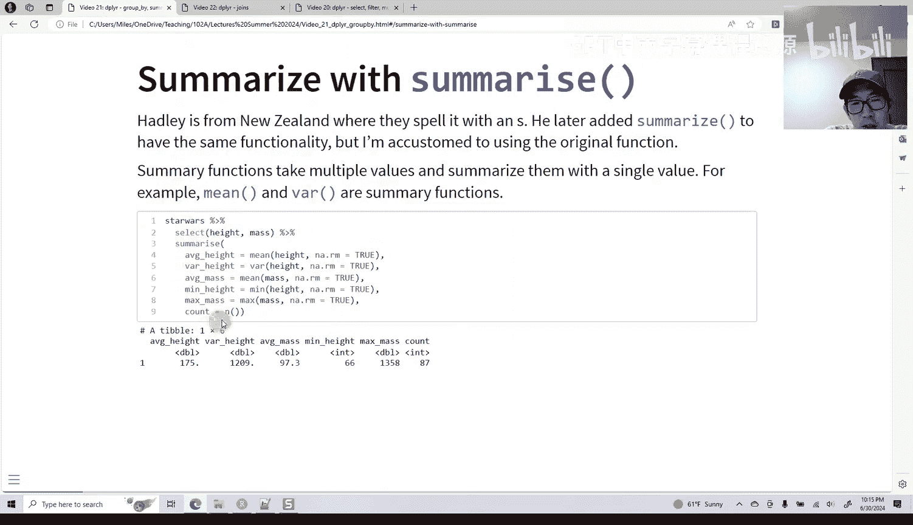

Okay， as I said， group by species， select these columns and then summarize them。

So we're going to say summarize we want the mean height， standard deviation height， mean of mass。

 standard deviation mass and the count， then we get all of these things okay。

 so here because we had 38 unique species as indicated here by group species。

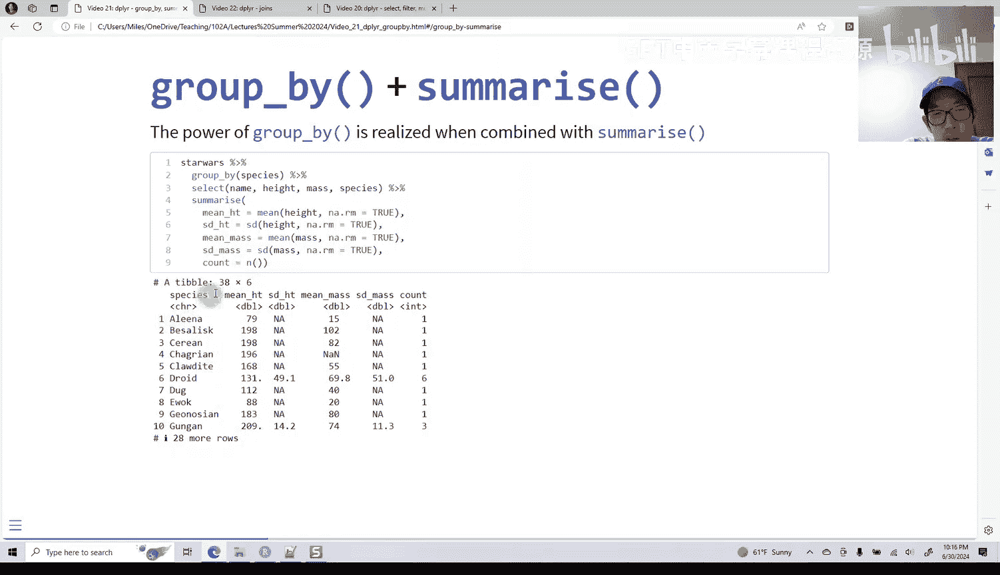

We're going to get 38 rows， one row for each group okay so we have one row for each group and so there is an Elina species and there was only one individual so it's mean is 79 mean height was 79 and mean mass is 15 but you know no standard deviation because there's only one individual we have six droids in our data set。

 the mean height of the six droids is 131 the standard deviation of the height is 49。

1 mean mass and standard deviation of the mass is this we have three guns in our data set and this is you know their mean and standard deviation and so on and so forth so we are getting the results where it has calculated these summary values for each of our different groups。

Okay。Now we might look at that and say， you know what。

 it's not really useful to calculate the mean or the standard deviation when I only have a count of one so I can take this entire table。

And so I've got a Star Wars group by select sum and these are these things。

 and then I'm going to add a further couple operations I'm going to pipe those results。

 so this previous table I'm going to say filter to where count is greater than one so we're going to have this table we're going to just filter to only where the count is greater than one。

 and then I'm going to arrange them in descending order by count。

And then I'll just ask for the first six rows。So here we have humans。

 there are 35 humans in our data set， mean standard deviation mean standard deviation there。

 we have six droids， this is their mean and standard deviation deviation。

 we have four of unknown species okay this is their mean and standard deviation， three guns。

 two Cammino ones， two myria lungs， and this is their information so here it has done the summary things。

 but it has applied them to groups and we get one row for each group in our summary table。

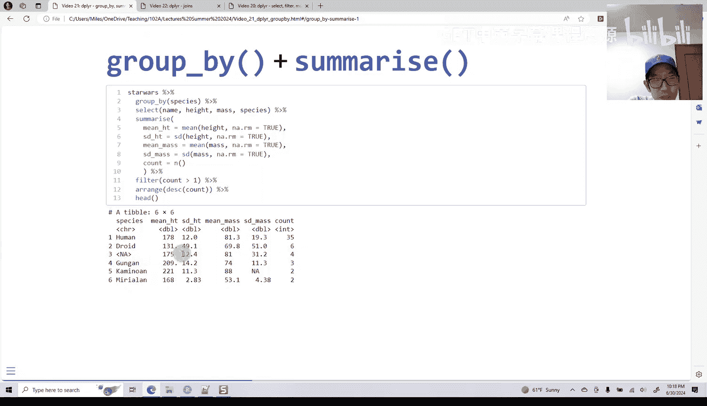

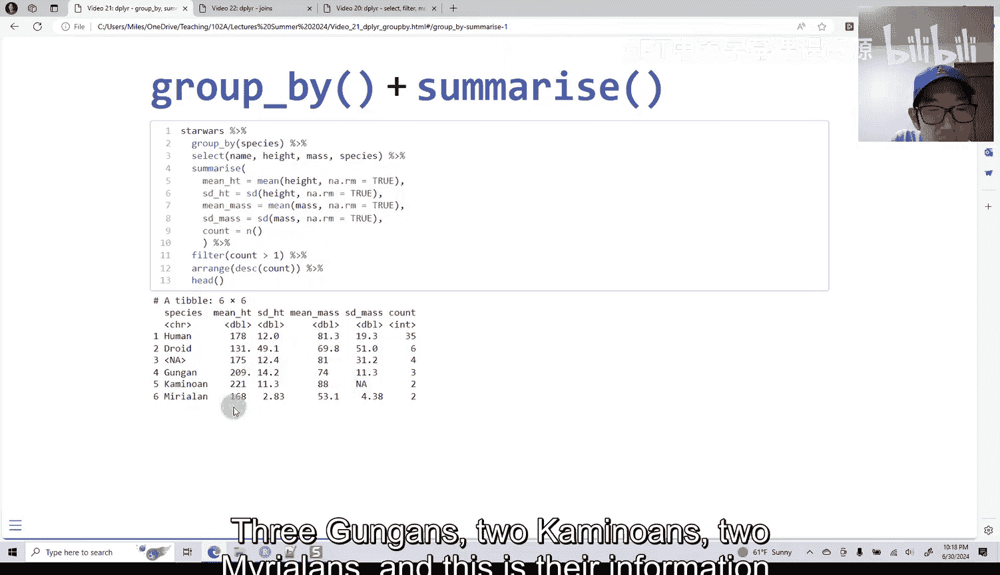

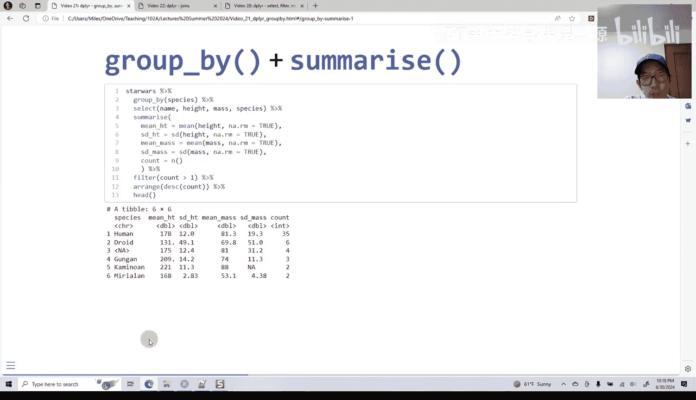

You can also do group by and mutate and when you calculate the mutate。

 it's going to do the calculations by group， so here I'm going to say let's just filter to humans and droids。

Okay， so filter species is either human and or species is unknown， okay？And then。

I said select the name species in height， name species in height group by this species。

And then I want it to calculate z scores for height。

And we're going to add that and so what this is going to do is it's going to calculate height minus the mean height divided by the standard deviation of height。

Okay so height minus the mean divided by standard deviations， that's how we calculate a z score。

 but because I've applied group by， it's going to calculate the mean of height for each species and the standard deviation of height for each species。

 so notice here。Bluke Skywalker。Has a height of 172， but his z score4 height is negative 0。498。

C3PO is aroroid with a shorter height of 167， but has a positive z score。

 and that is because if I go to the previous slide。

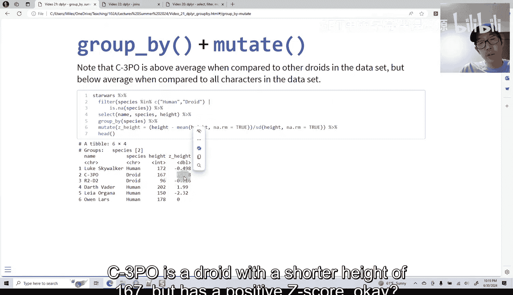

The mean height for humans is 178 and the mean height for droidids is 131。

 the standard deviation of height for humans is 12 standard deviation of heights for droidids is 49。

 so when we look at see Luke Skywalker， he is below average。Okay， below the mean for the humans。

 right his height is 172， the average height of humans is 178。

So he has a z score that's negative C3PO。

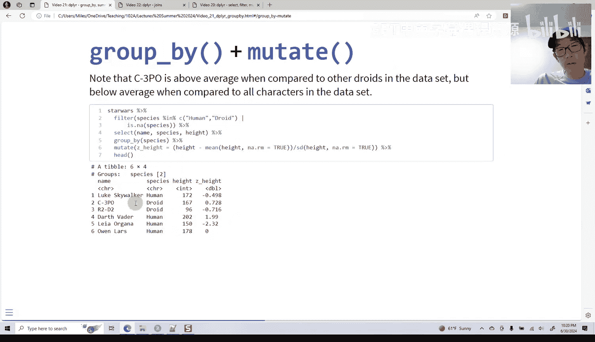

AndThe average height of droids is 131 C3PO。

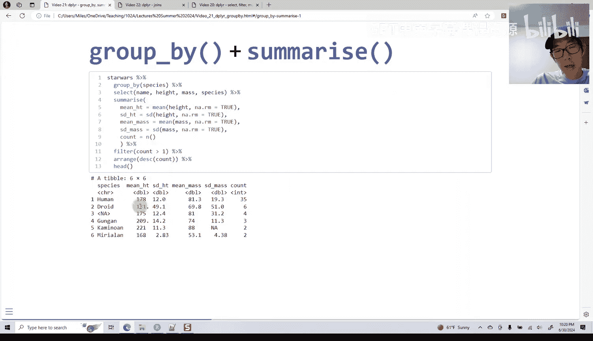

Is above the average height of droidids， so he has a positive Z score。

And so so these Z scores for height are calculated by group， okay。

 so we have two groups of species and when we said calculate you know Z scores and things and we have means and standard deviation deviations。

 it does it by group， okay？If I get rid of this one line group by species okay all I do is I just comment it out right so this is one nice thing about using pipes and putting each operation on its own line is you can kind of comment out you know just one operation at a time if you want to so it's the exact same thing and I just comment out that one line here I get rid of group by species and now。

It's comparing everybody on the same scale and so Luke Skywalker。Has a height of 172 which is。

 I guess ever so slightly above average， C3PO has a height of 167。

 which is a little bit below average， and so we get a z score of negative 018 for C3PO。

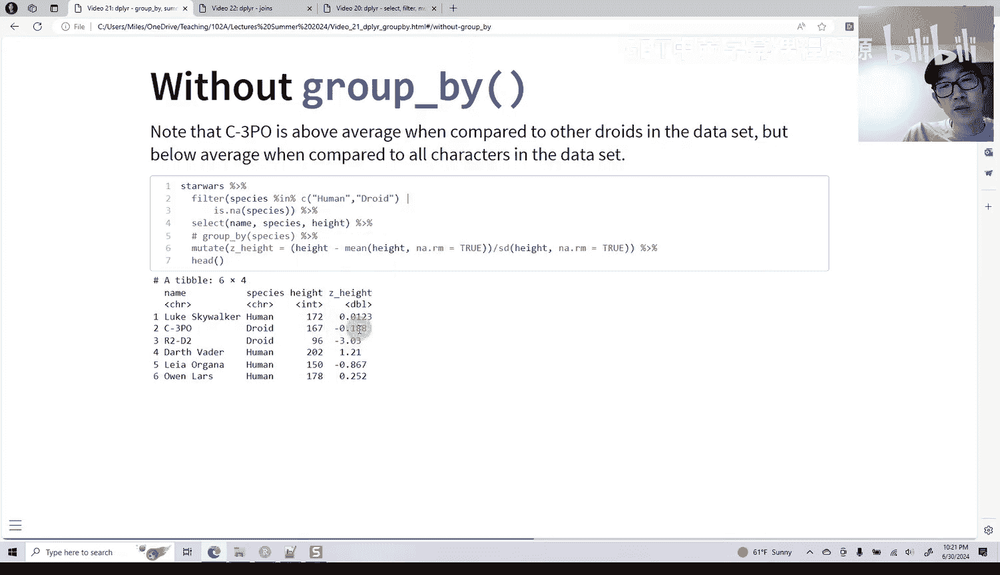

O。嗯。You can continue to apply multiple groupai so here is some toy data。 we have countries。

 Afghanistan， Brazil， China， ABC。We have years 1999， 2000， we have sex， female and male。

 and at least in this data set in cases 1111，22223333。

 so just some toy data just to kind of illustrate how kind of group by can work here。

You can have multiple。

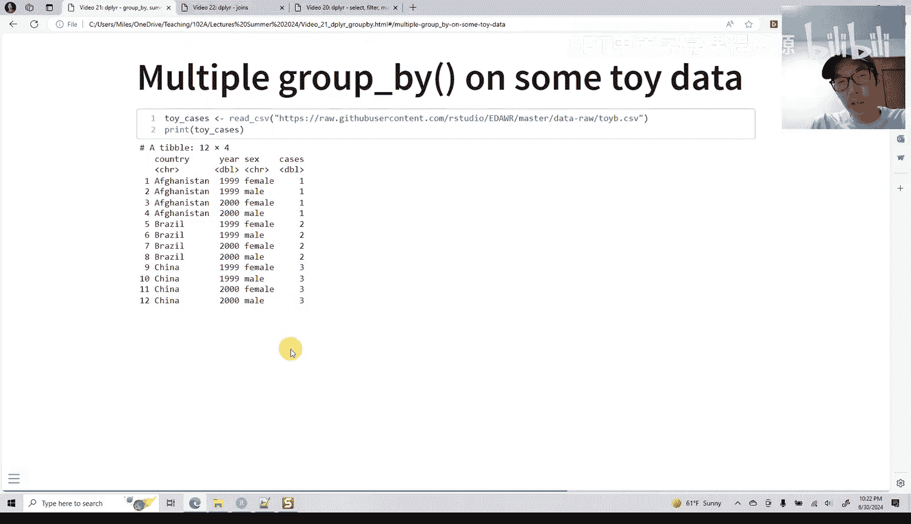

Values or multiple variables in the group by so we're going to take this and I'm going to first group by country and year。

And we're going to just take the total sum of the cases， so if I group by country and year。

 okay we're going to get Afghanistan 99， Afghanistan 2000。

 there were a total of two cases is Afghanistan 99。

 basically it just added the one and the one and Afghanistan 2000， added the one to the one。

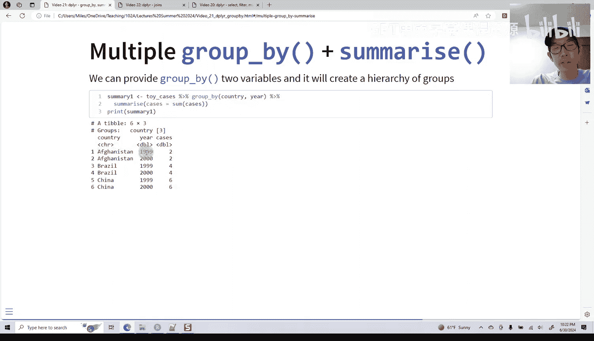

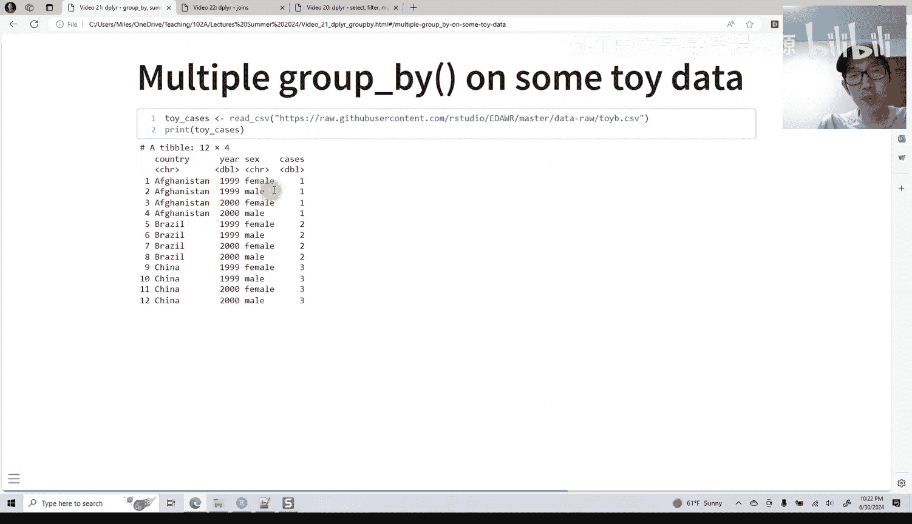

Brazil 99， Brazil 2000 gets four for China 99， China in 2006 and6。

嗯。I can call summarize again， okay， so here it's grouped by country and year。

If I call summarize again， it's going to。Just group by the country， the first order of groups， okay？

So then we get the sum there， Afghanistan and Brazil and China。

 and then if I call summarizerise again on that， then it just gives me the total 24 so the first thing we have when we first do group by country in year。

 we have six groups and that's why we get six rows， but within this we have three subgroups。

 by country， Afghanistan and Brazil China， and we get that and then if I call summarize I get that。

 no more groups， if I call summarizeise one more time， I get a summary of 24。

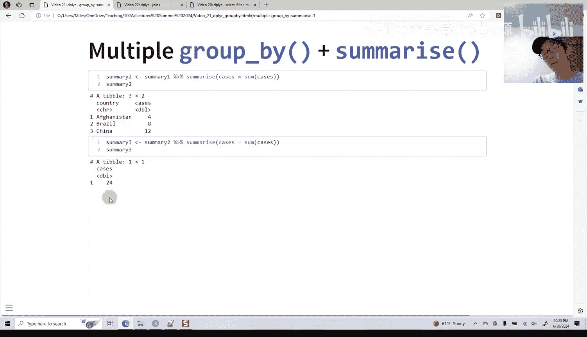

Here， if I change the order of the multiple groups。

 I'm going to group by year then country notice what happens I get year then country。

 I still have a total of six groups， okay， 1999， Afghanistan 99， Brazil， 99 China， 2000， Afghanistan。

 200 Brazil， 2000 China， you can see by。Grouping by year first then country， year yet priority。

 so it sorts by 991st， then 2000， and then it sorts by country。How many subgroups do we have here。

 it gives us an information， says there's two groups by year， so if I call summarize on this table。

Then we get two groups 1999 in 2012 and 12， and then if I call summarize one more time。

 I get 24 in total。So you can do group by， you can group by multiple variables and it will you know figure out how many kind of unique groups it needs to do and it will also keep the hierarchy as well if you can get a handle of group by and summarize in D plier there is quite a bit that you can do so you'll have some exercises and homework number three that challenges you to do some grouping group buys and summarizes there。

