# UCLA《计算统计学｜Stats 102A - Computational Statistics with R 2024 Summer》中英字幕 p22 [22]Stats 102A - 2024 Summer - Video 22 - dplyr joins.zh_en [BV1jizNBrEm2_p22]

Okay， another feature of the plier that I want to cover is dealing with joins and joining two tables or tibbles together and so we have。

The joint operations。

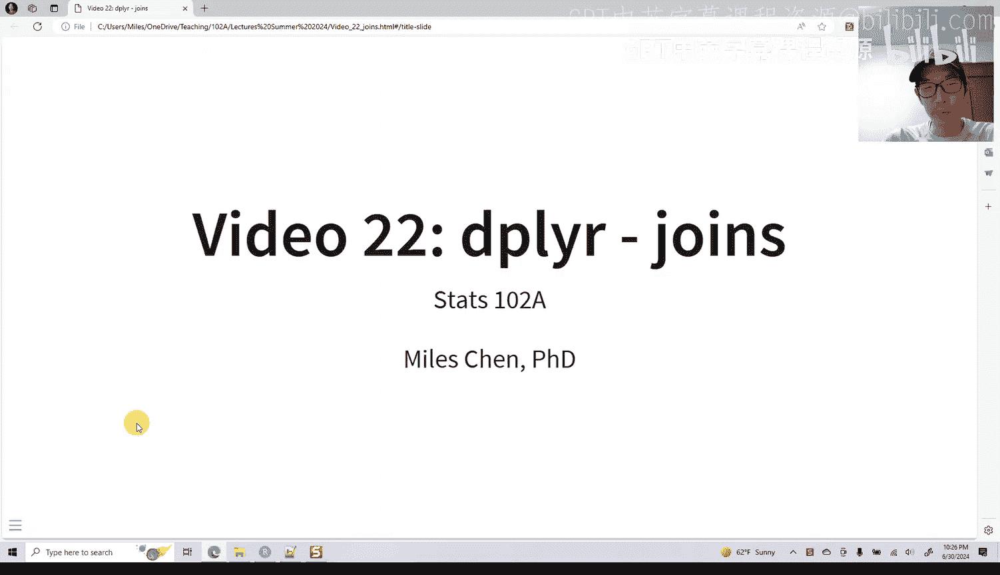

If you've ever done join operations in SQL， this will be very familiar。

 if you've never done a join operation in SQL， then hopefully this will serve as a good introduction to doing joins。

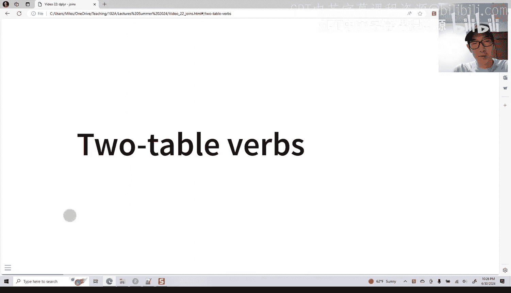

So Der comes with these two table verbs that allow you to kind of combine the tables， these joins。

Add new variables from one table， from matching rows and another table， Okay。

 you can read more at this link here。You have filtering joins。

 filter observations from one table based on whether or not they match an observation in the other。

 and then set operations basically combine the observations in the data sets as if they were set operations so this is just a lot of text's let's just do a simple example so here I have two tables I have the people table and the states table or I guess these are Ts okay and people I have Adam Betty Carl and Doug four rows。

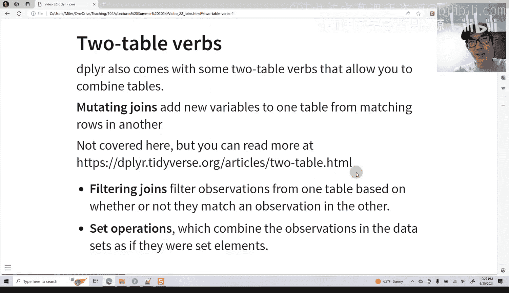

And their states， California， California， New York， Texas， or CACA， NYTx。

Then I have another Tbble of abbreviations， CA NYWA， and these correspond to the state names。

 California and New York， Washington。

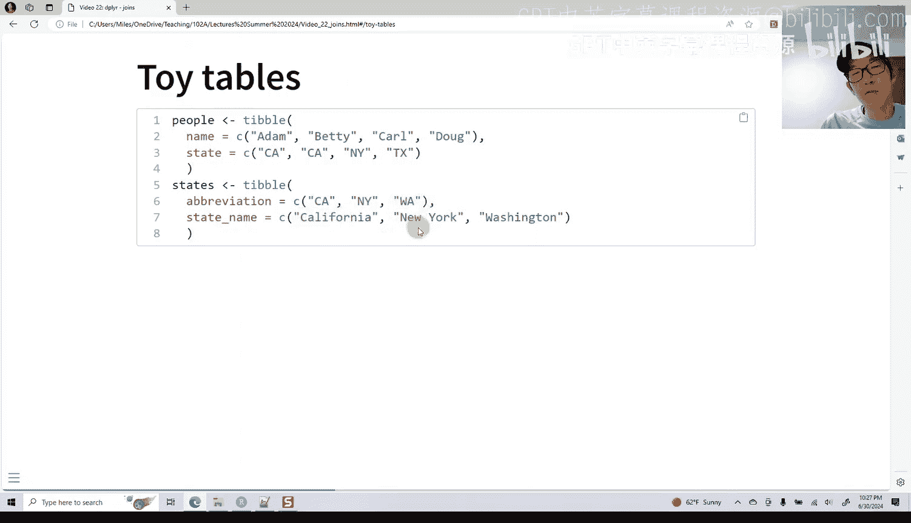

So。If I do a left join。The left join takes all of the values in the left table。

 adds values from the right table that match by matching values。

I'm sorry it takes all of the matching values in the right hand table， so I'm going to take people。

 this will be the left hand table because it comes before the join。

 so I'm going to left join which means keep all of the values in the left table， the people table。

 Adam Betty Carl and Doug and then find matches， so we're going to say match by taking the column state in the people table。

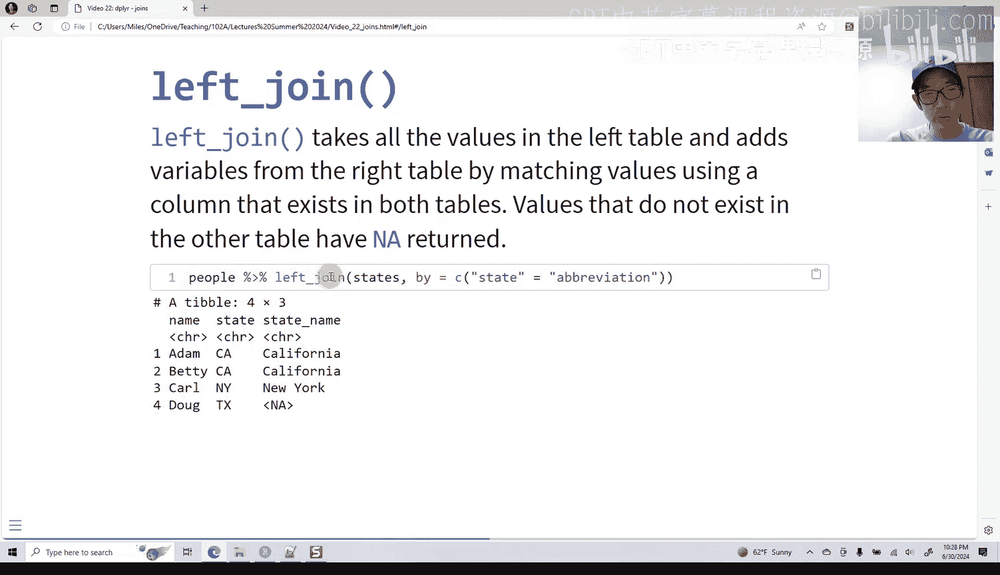

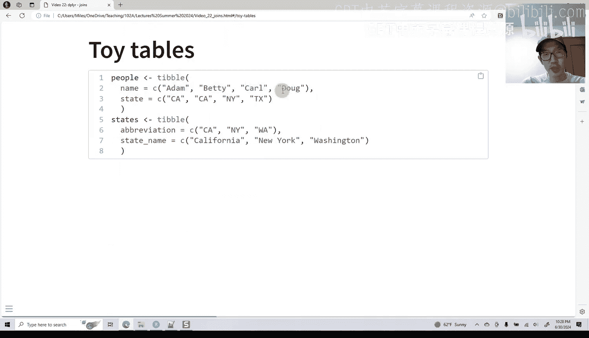

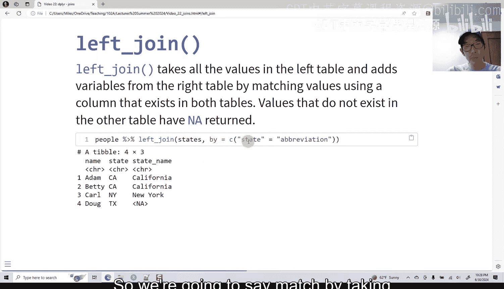

Okay， which has CAA NYTx。And find matches with the abbreviation in the states table and match the state name to or state to abbreviation。

 so we're going to say match state to areviation and give me the columns that match so here。

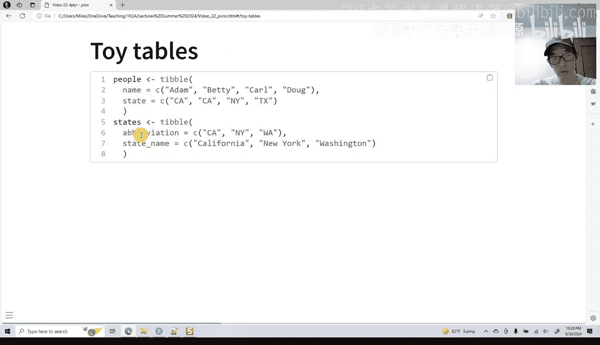

It finds CA。Okay， and it says， okay， C it gives me California。

CA gives them California NY gives me New York， it looks for TX。

 TX for whatever reason doesn't exist in the state's table with the abbreviation。

 no abbreviation for TX here， so it gives me an NA。

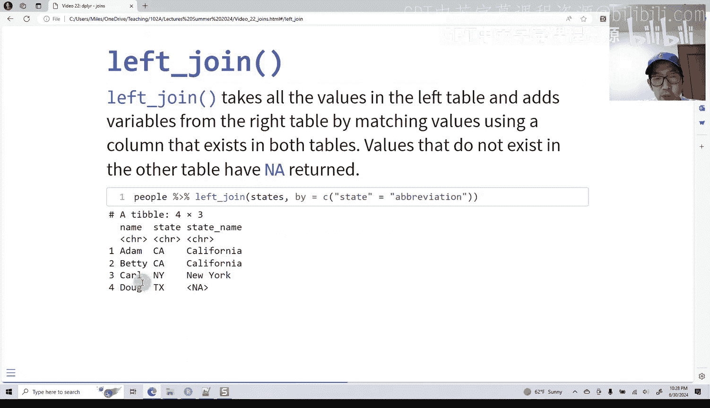

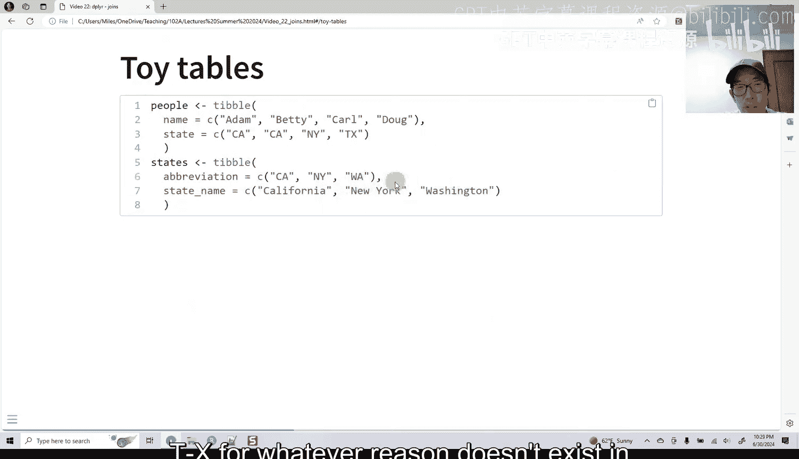

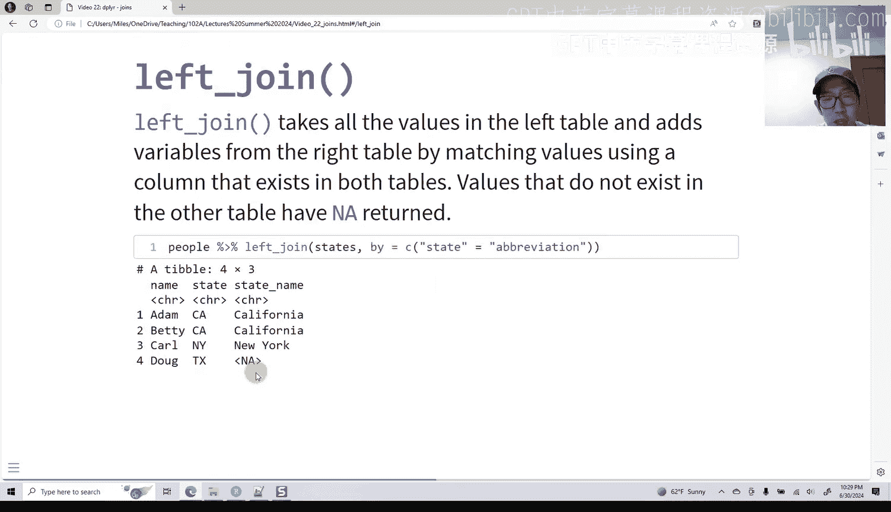

The right join is kind of the opposite， we do people right join to states and so here it gives me all of the entries in the right side table which is states because it's coming。

The first table is the left table， the right table。

 you know this next table over here is the right side table。And so here。

It's going to take all of the entries in the state table， which has California， New York， Washington。

 and it gives us entries that match in the left table。

 so CA has a match with Adam and a match with Betty because Adam and Betty have CA。

New York has a match with Carl。Washington has no match。

And so it appears the right join gives us all of the entries in the right table。

 but we're going to get an any over here and because Doug came from Texas TX。

 and there was no entry in the right side table here， the states table that they are not included。

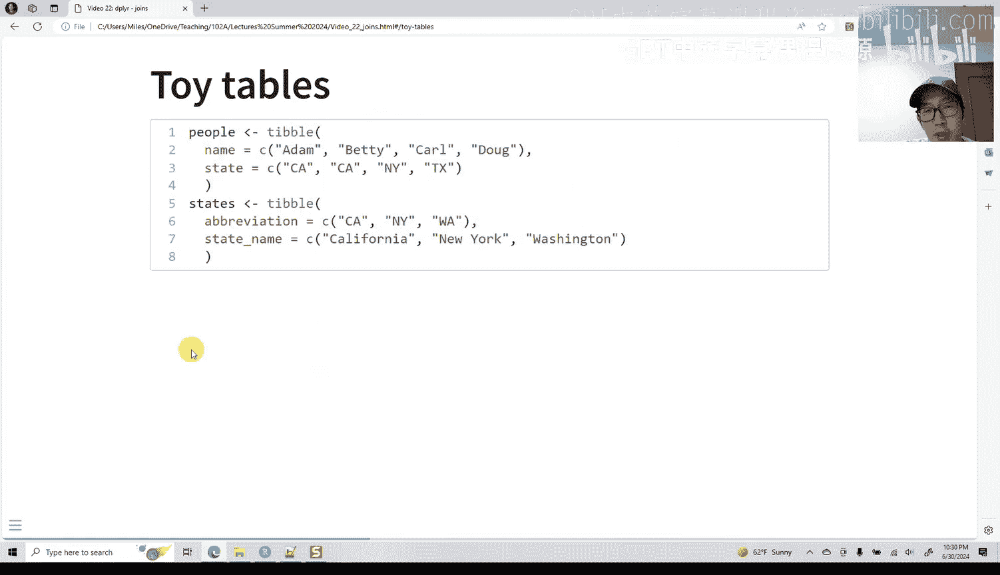

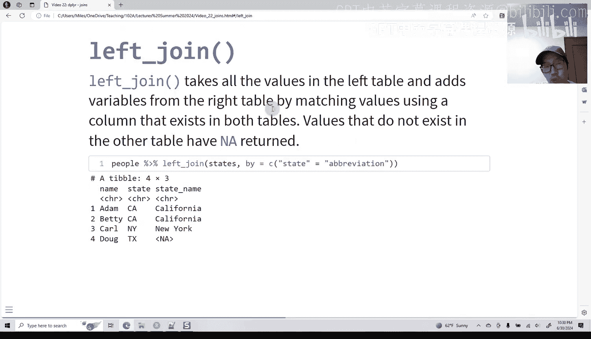

OkayIn joinin is like the intersection， so only if it finds a match。

 so we only get Adam Betty and Carl because the only entries that match are CA and NY。

 and we get California and New York okay。

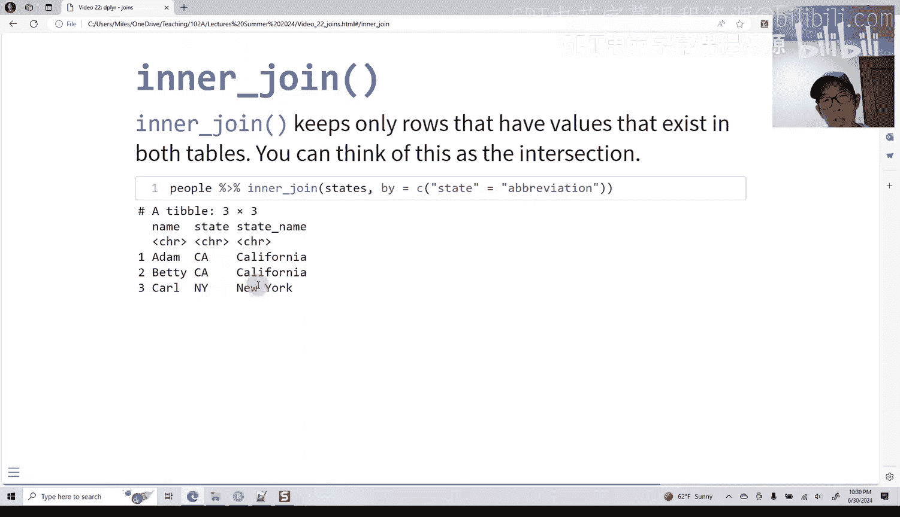

And then full join。Is like the Union okay so here we get Adam， Betty and Carl。

 CA and NY Doug comes from Tx and we couldn't find a matching state name so we get an NA Washington and WA。

 we couldn't find any person in the people table with a match that we just get an NA there。

So that's the full join。 All right， so this is kind of how you join them。

 you specify how the columns get matched up using the by operator you put in。Basically。

A vector where you say this， you know， the left。The left table column name matches the right table column name there。

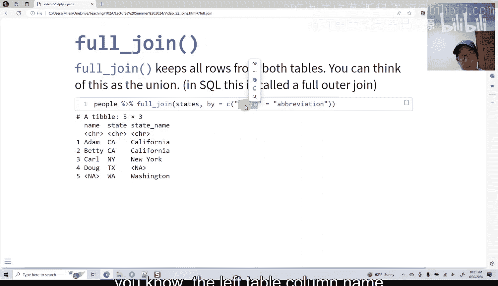

So yeah， this is how we've done it by is equal to do this。

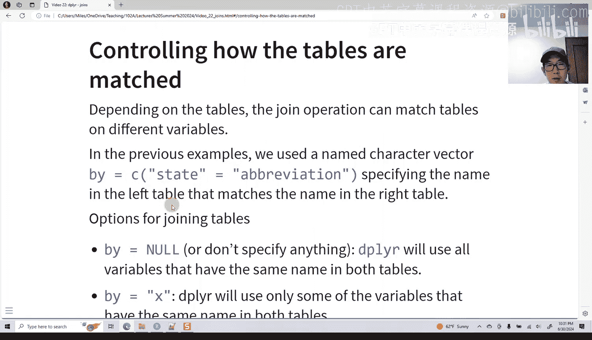

If if you don't specify anything， then DPtter will just kind of use all of the variables that happen to have the same name in both tables。

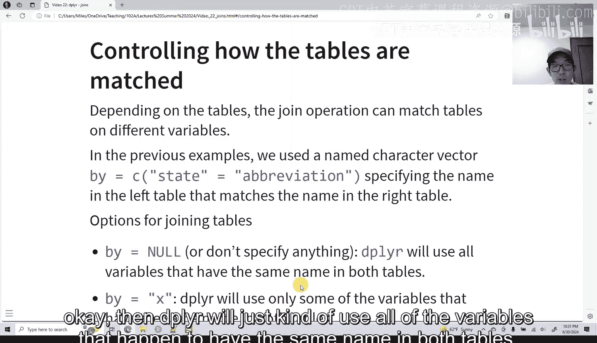

Some of the tables have the same name。 so like if you have。

A state column over here and a state column over there。

 you can just do pi equals state and it will just kind of match the column that has matching names there。

Okay so that's just a quick introduction Certainly you can read more in the documentation on how to do joins but it is a handy thing and you if you have fairly clean data it's easy to do joins if you don't have clean data then joins can be one of the most frustrating things because in order to find matches。

 you kind of need to make sure all of the entries， you know if you have a column over here and a column over here and you want to match them。

 you have to kind of make sure they all kind of match so you know sometimes a very frustrating thing that can happen is you know you have names and they're like first and last names joins together itll be like last comma first and that's the text string and then you might have another table。

Where the column is last name and then you have column thirstty name and then trying to match that can become very frustrating because then you'd have to probably do some text processing to split。

The name column from， you know， last columna first into a column of last names and a column of first names。

 and then you can have。You know， column of last name， column of first name。

 but then maybe people spell their first name a little bit differently like when one thing they put in Jonathan then and the other table to put in John or you know some kind of entry like that where you don't have perfect matches and in that case it's really frustrating because it's almost impossible to get all of your data to match up because it requires some kind of manual cleaning up and manually processing there。

But if you do have clean data， so if you have like in a SQL database generally the keys and whatnot with tables are done properly。

 then doing joins will be a smooth operation so joins and your success with them will be highly dependent on how clean your data are okay but if you have to do it。

 good luck。

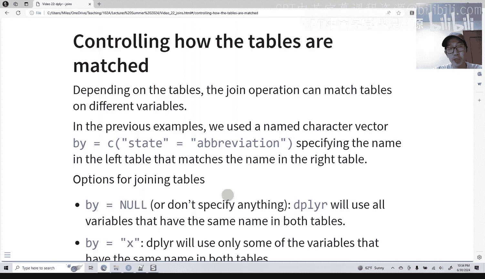