# UCLA《计算统计学｜Stats 102A - Computational Statistics with R 2024 Summer》中英字幕 p23 [23]Stats 102A - 2024 Summer - Video 23 - working with strings in R.zh_en [BV1jizNBrEm2_p23]

Okay， today， we're going cover strings and string R。

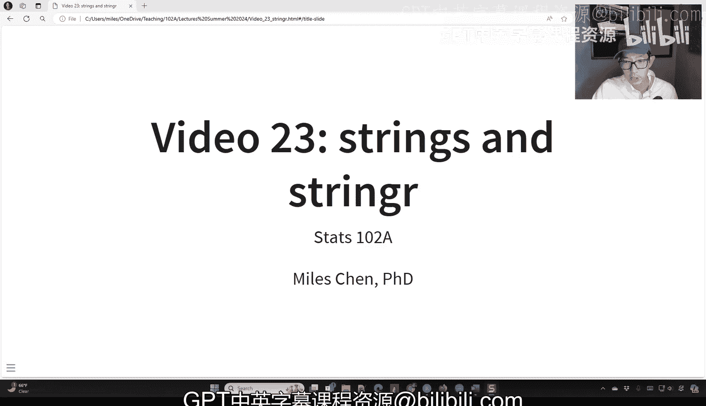

And I will also introduce regular expressions in the next video。

So a lot of our computation and computational methods have so far been working with numeric data。

But more and more importantly， it's important to be able to work with text。

 and there are entire areas of statistics and machine learning devoted to interpreting。

 know text based data。 There's natural language processing and text mining and all kinds of stuff。

 and there's lots of resources out there。 We're not really going to be able to get into a lot of details in text based analysis in this class。

 but we will cover some basic text manipulation， especially with regular expressions。

 which will be important。

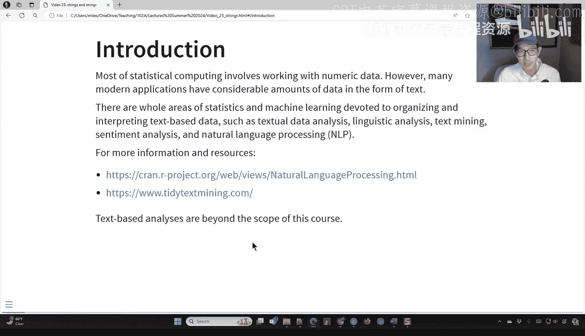

Here's just some additional resources that I recommend and so you should check those out。

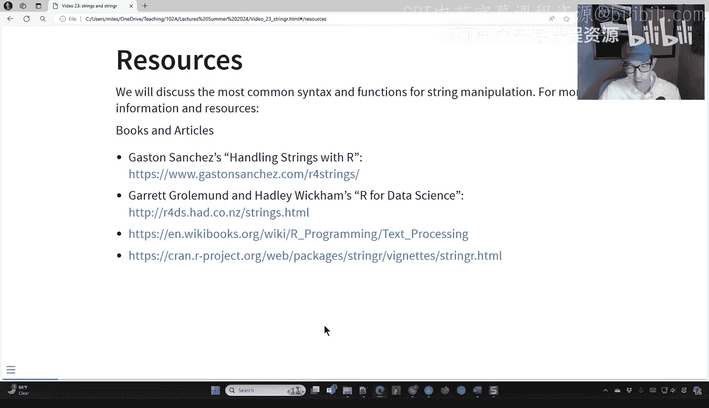

Okay， let's talk about characters and strings in R。

 as this is how we work with text and character data。

So a string is a character variable that contains one or more characters。

 but we will often use kind of the terms character and string interchangeably。

Values that are stored as characters have base type character。And when you print them out in R。

 they get printed out with quotation marks。 So here if I store the character string hellello world into a variable name X。

 And then I ask X later， it gets printed out with Hello world。

And the type of data on this is character type。

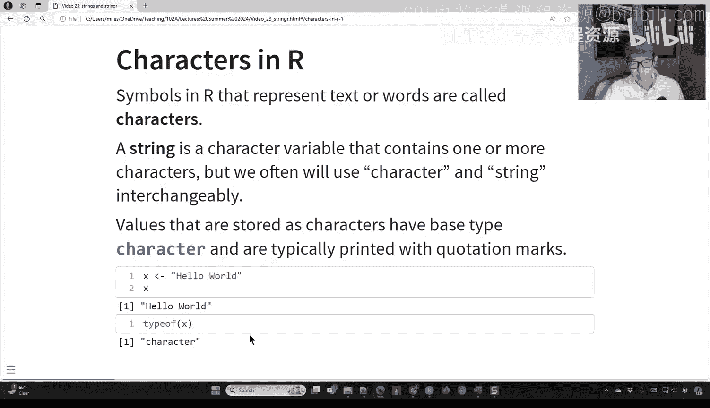

You can create character strings by using quotes， either single or double quotation marks。

 single quotation marks can be used within double quotation marks and vice versa。

 but you can't insert single quotation marks within single quote marks or double quote。

Marks within double quotes。 So here I have the character string is defined with a double quotation mark。

 And within that， I put a single quotation mark， and that's fine。Here I have a single quotation mark。

 And within that， I put double quotation marks and I close it off with a single quotation mark and。

The way that gets interpreted is it opens and closes with a double quotation mark。

 and then the quotation marks that are inside get escaped with a back slash。

If I try to write this quotation mark， this is an error。 and then I put quote in here。

 and then I try to put surround error with double quotation marks。 Then I get an error。

 It's says unexpected symbol in this。 And that's because。Here we just are interprets this。

 this portion as the ending of the character string and then the E。 it encounters that。

 So you have to， if you want to include quotation marks within。A character string。

 you have to escape the。 escape it with a backslash。

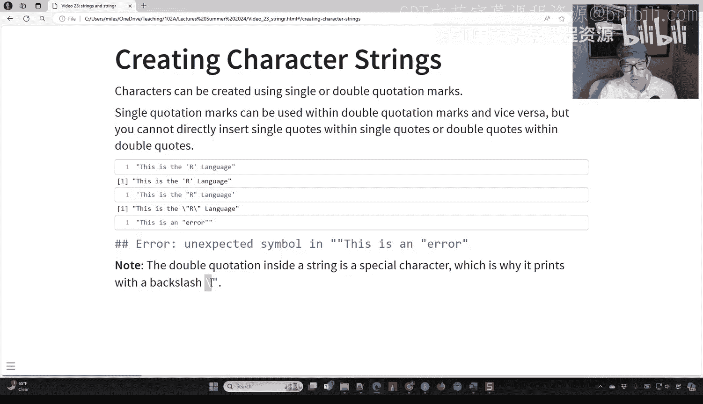

When you call just character， character creates a character vector of a certain length。

 And then the default value in each element of the vector is the empty character。

 which is basically just open and close quotes， there's no character inside。

 this would be the empty character。 So when you call character 5。You get quote quote， quote， quote。

 quote， okay。The this empty character here。Okay， is not the same as character 0。 Okay。

 character 0 is a character vector of length 0。If you just have a single empty character here。

 that would be identical to character1， length one character vector of empty characters。

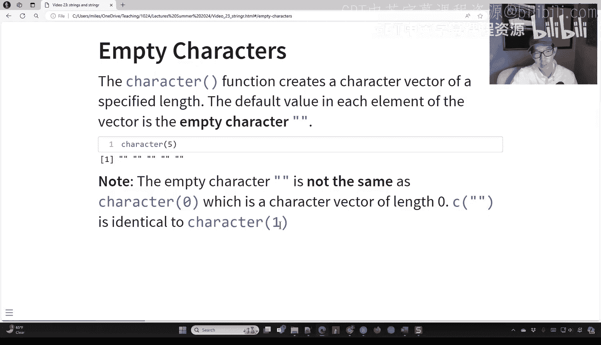

We have additional。Functions that allow us to handle character data and one of the kind of most important ones is the paste function。

 The paste function basically takes one or more objects converts them into character and then kind of concatenateates or paste them together to form one or additional several character strings。

 So the basic syntax is paste and then you put in multiple arguments here。

 and then you have a couple arguments。 The separator and the collapse argument。

The separator argument specifies what， what to be used as a separator between the characters after pacing。

 The default is just a single space， okay。The collapse argument specifies whether the characters specifies characters to kind of separate the result if you want to kind of。

Either create， you know， a vector of values or whatnot。There's a related function called paste 0。

 It's exactly the same， except the default separator is the empty character， Basically nothing there。

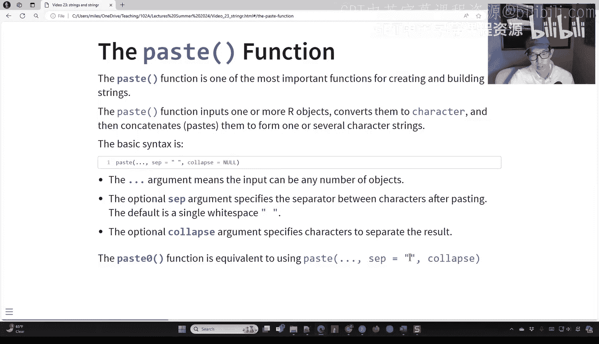

So let me just show you how this works here。 right， So here I'm going to paste together。

The character string， I ate some。 And then we're going to put in pi， which is a numeric constant。

 and it's going to get converted into character。And then at， and it was delicious。 Now。

 the default separator here is the space。 So it's going to be Iate some， and then inserts a space。

 converts pie into character， inserts a space， and then pasts， and it was delicious， okay。😊。

Here I have bears。 I have beets， and I have battlestar Galacta as。Different。

 I have three separate character strings here。And then I'm going to， as my separator。

 use a comma space。 And so now I get one character string and its bares comma space beats comma space Bastar Galact together。

Here I'm going to paste the character H to a vector containing the。Letters， characters， A， E and I。

 The separator is nothing。 And so it pasts H A。H E and H I。 And this is a vector of length 3。

 a vector of length 3， okay。Here I'm going to provide two vectors。 This is a vector of length 3， ABC。

I have another vector of length 3，1，2，3。And then we're going to say paste。 And here。

 the separator is the empty character。 Nothing is going to get pasted。

 So it's going to paste them element wise。 We get A 1， B gets matched with 2。

 and C gets matched with 3。 And this is a vector of length 3。If I take basically something similar。

 but I specify the collapse argument。 Okay， what this will do here， I just provided a vector A。

 And then here's the vector 1，2，3。 It's going to recycle a So it's going to do a 1， a 2 and a 3。

It separates the a and the one with nothing。 Okay， the separator thing A。

 A and2 is has no the empty character separating them。

 And a and 3 have have basically nothing separating them。 However。

 those rather than returning a vector of length 3 here， like it did here。

 It will collapse collapse the the results into one character。And the entries， a 1， A2。

 A3 are separated with a comma space。Okay， so that is that。

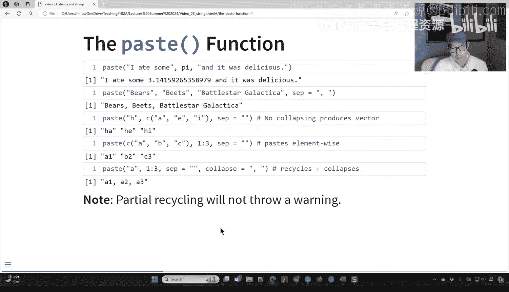

We have。A couple functions or few functions for outputting strings。

 Print is our generic print function， and cat is for concatenation。 And then there's also another。

A function called format。 And it's kind of， for， I guess， pretty printing with special formatting。

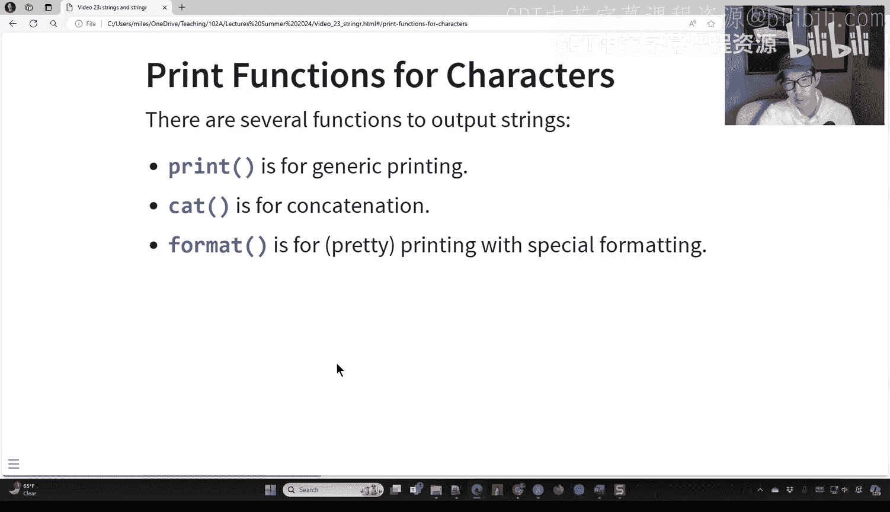

So the print function， okay I guess technically it's the print default。

 has an optional logical quote argument that specifies whether to print characters with or without quotation marks。

 So remember back here we defined X is just hello world。

 and the default print we'll put surround hello world with quotes here。

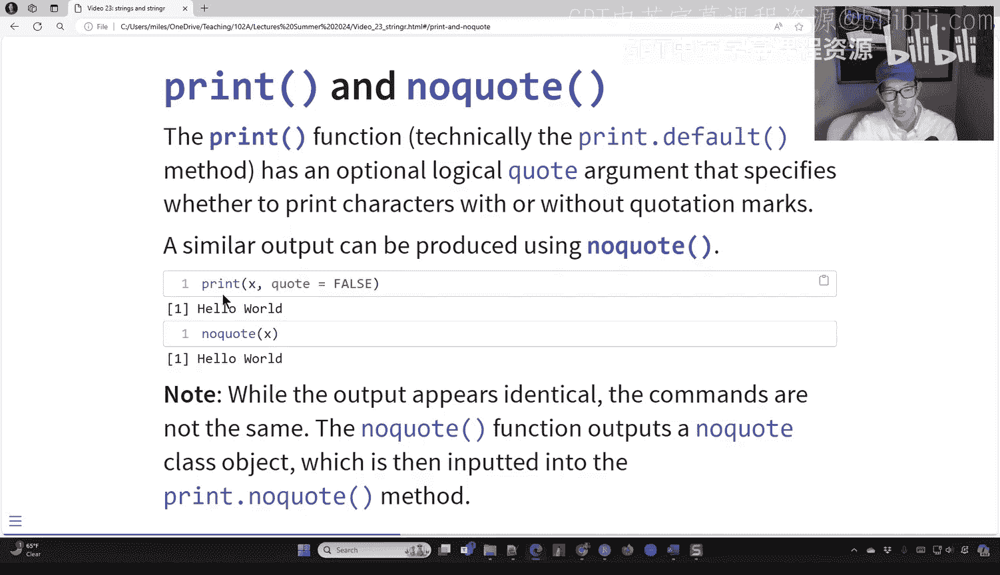

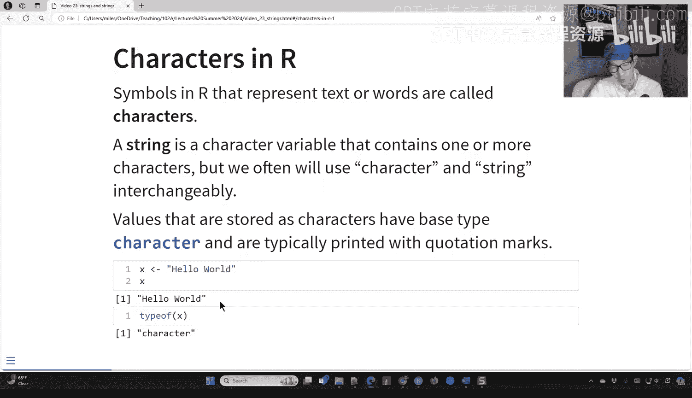

You could specify quote equals false， and it will print it out without quotes。

 you can also call no quote on X， and it will print it out without quotes as well。 Okay。

 and although these two things look identical， the commands are not the same。

 the no function outputs a no class object。Which is then input into the print no quote method。

 So if you， if we were to store this something， as say， why。

 then why will' forever get kind of get printed out as a no object。 It's it's a character string。

 but but it kind of carries the attribute that it's a no quote so that whenever it gets printed out it doesn't include quote marks。

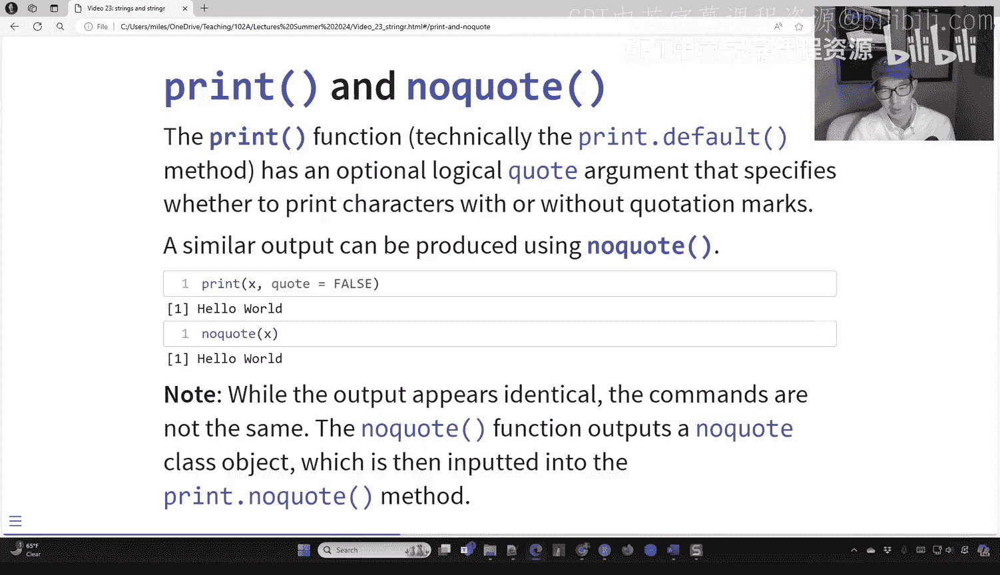

The cat function concatenates multiple character vectors into a single vector and then adds a specified separator and outputs the result without quotation。

 So here I'm going to put cat X comma， hello universe。 These are the two things。

 The separator is going to be a comma space。 And so it prints out hello world comma space。

 Ho universe。 The printing is slightly different from that of no quote。

 So you'll notice no quote is preceded by score bracket 1 indicating that the result is a vector。

 whereas the cat kind of returns nothing， it returns an invisible null。

 So if you tried to store the output of cat to a variable Y or Z nothing would get stored in there。

 whereas the output of print or the output of no can get stored into an object to。

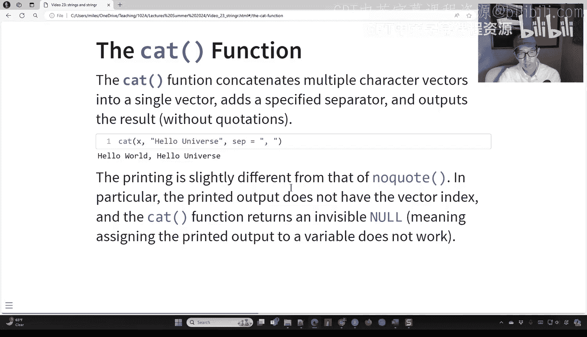

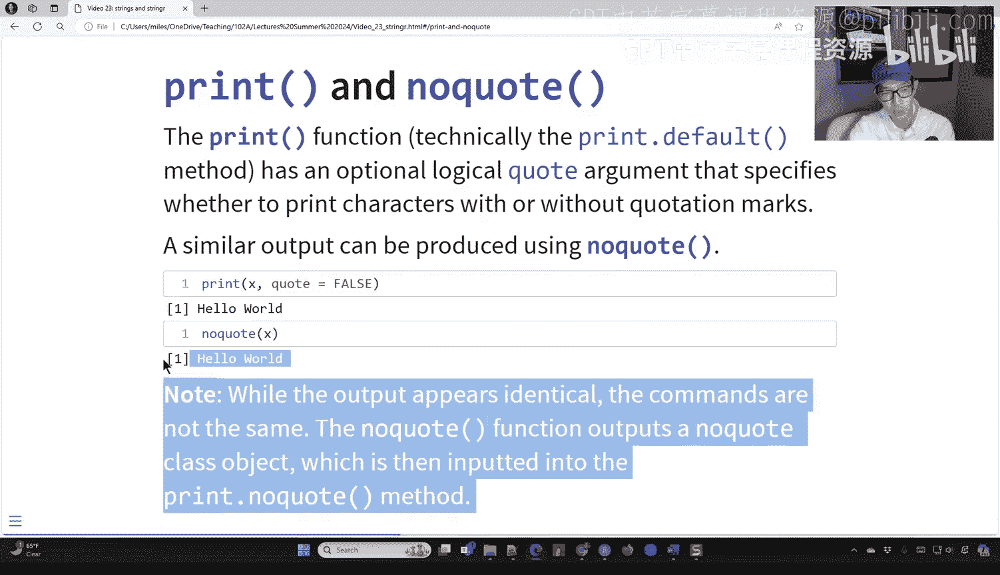

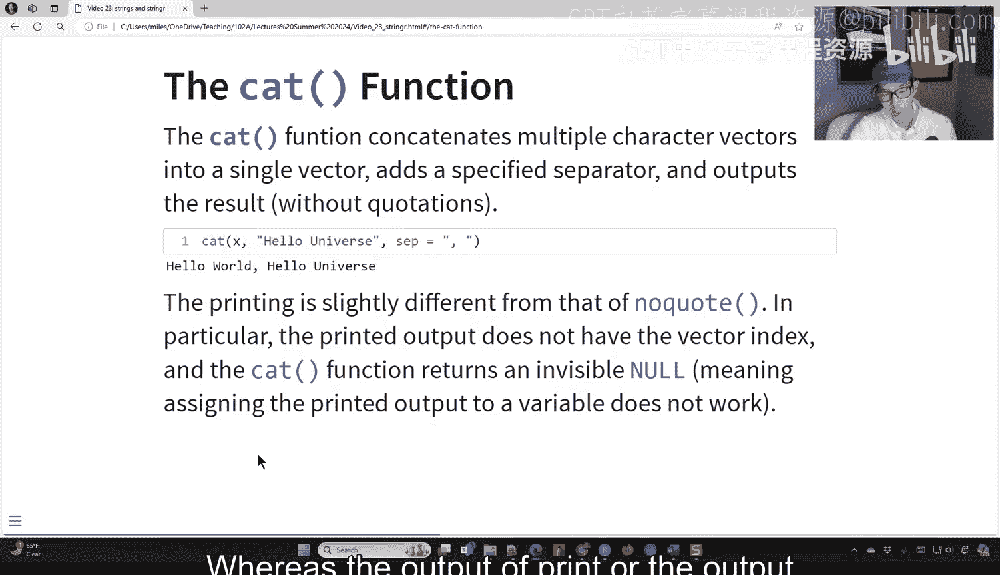

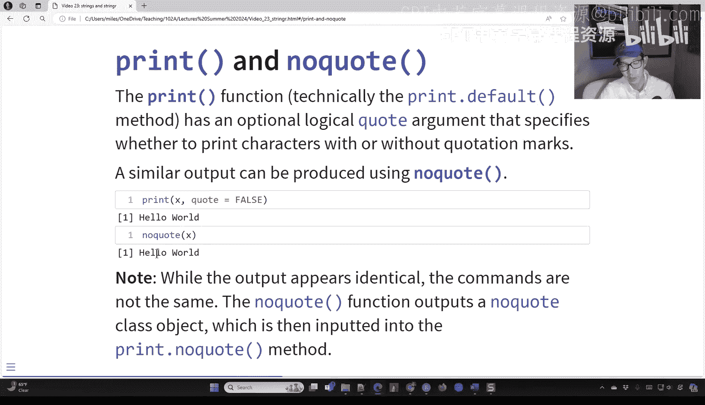

Be kind of retrieved later。one benefit of using CA is that the printed output can be saved to an external file using the file argument。

 so here I can do cat X hello universeverse separator comma space file equals hello。

 Txt and what this will do is it will create a file。

 hello do TxT where the output which would have been hello world comma space hello universe as would get saved to that to that file。

 so when the file is specified， there is another optional logical argument called append and that will determine whether the results should be appended to or overwrite the existing file。

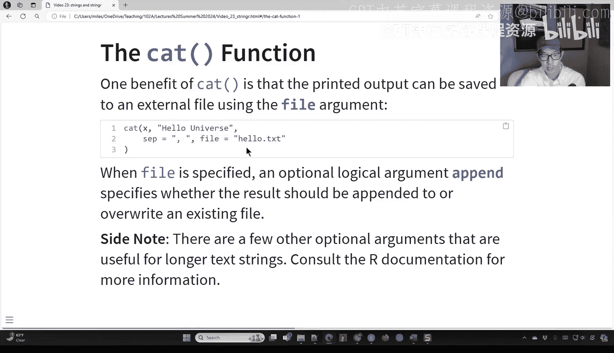

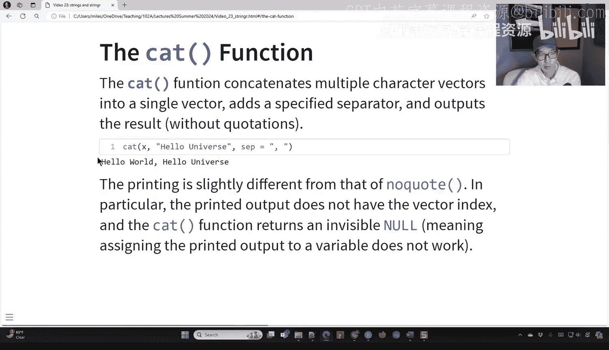

And I guess there are a few other optional arguments that are useful for longer text strings and you should check out the R documentation for that。

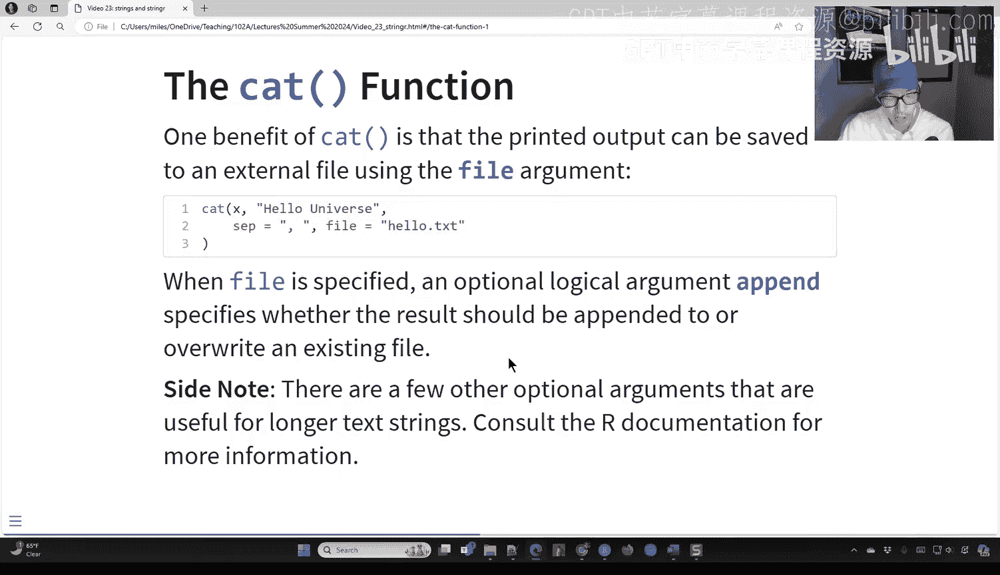

The format function okay takes our objects and formats them for pretty printing so a couple some of the useful arguments that you use with format are things like width specifies the minimum width of the strings that will be produced。

 trim will decide whether there should be padding with spaces。

 justify controls how padding takes place for the strings and your options are left right center or none and then when it comes to numbers。

 you can do things like specify the number of significant digits or N small specify the minimum number of digits to the right of the decimal place or scientific notation whether that should be used or not so here。

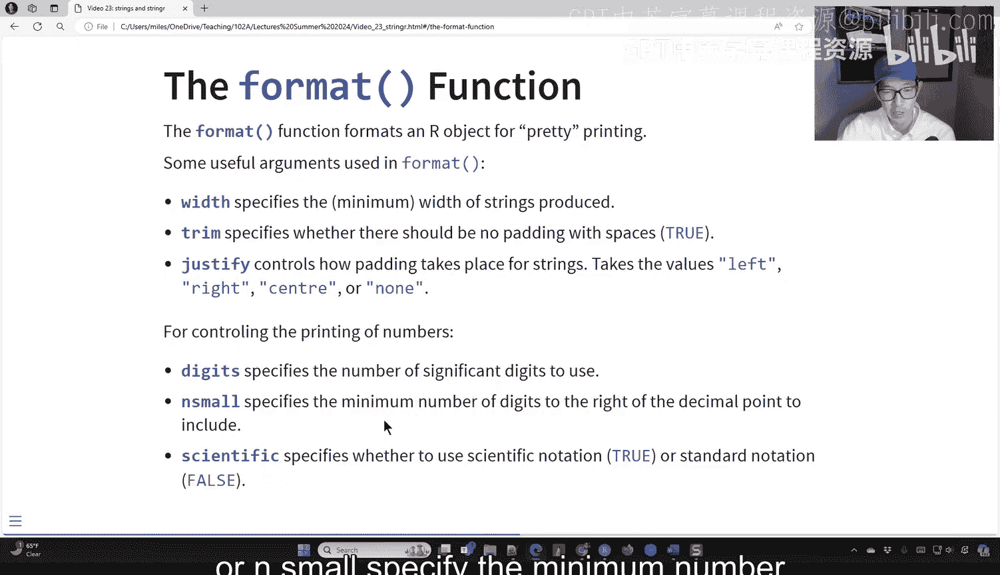

We're going to take one divided by 1，2，3，4， and5， and I'm going to call format digits 2。

 and so you can see1 over 1 is 1。00。One half gets printed out as 0。50，1 third is 0。33，1 quarter， 0。

2515，0。20， okay。Here， I can specify scientific equals true。

And all of these things get put out output as scientific notation。Okay， with two significant digits。

Here， if I'm taking text， I can do hello world Ho universe as a vector。 and I'm going to say。

 I want the output of each of these things to be with 10。And I want them left justified。

 And so we will get hello， and then it will basically pat on zero spaces so that the output of each of these things is a total of 10 characters long。

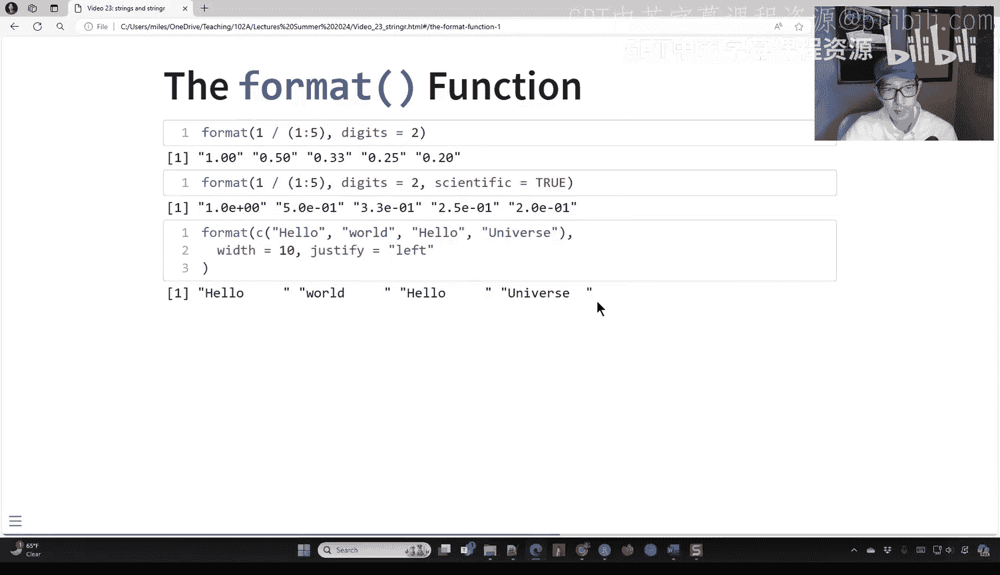

A couple things that we can do as far as working with strings， we have a few basic functions。

 so one is just we can count how many characters there are and that's N car okay number of characters we have to lower and to upper which will convert everything to lowercase or uppercases we have a character translation。

 we have substring and we have strings split。

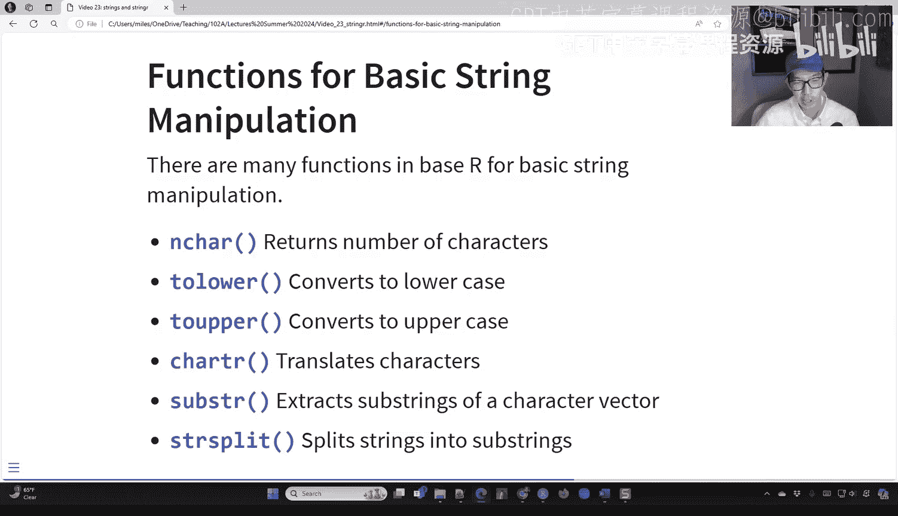

So if you call an end car on a vector of。Of character strings， It will tell you， okay， Ho has five。

 World has five。 Ho has five characters。 and universe has8 characters。 Okay。

 to lower makes everything lowercase to upper makes everything uppercase。

 So I think that's pretty straightforward forward。 Ho world hellello universe， all lowercase， hell。😊。

And this is all uppercase。

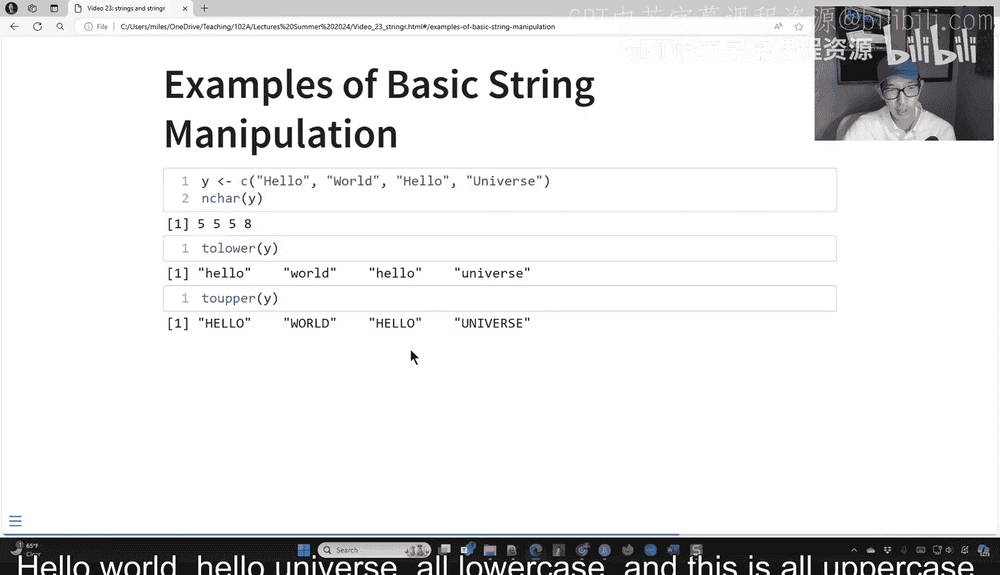

Okay。Character translation， okay， basically just says， hey， anytime you encounter a capital H。

 replace it with a Y。 So hello world hello universe。

 the H is get capital H is get replaced with lowercase Y。 You can provide a longer string。

 and this will basically say anytime you encounter the letter E replace it with the number 3。

 Anytime you encounter the letter L， replace it with the number1。

 and I gets replaced with exclamation point and O gets replaced with a 0。 And so hello becomes H31。

10， world becomes you know W 0 r 1 D， and then universe becomes U and exclamation point V3 R S3。

 so this is just character translation just from one character gets translated to another character。

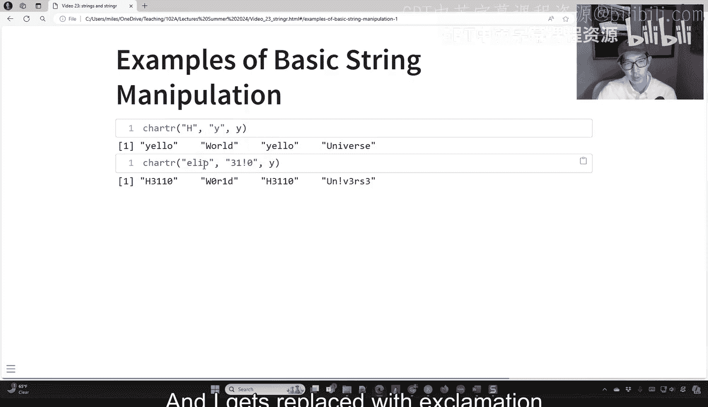

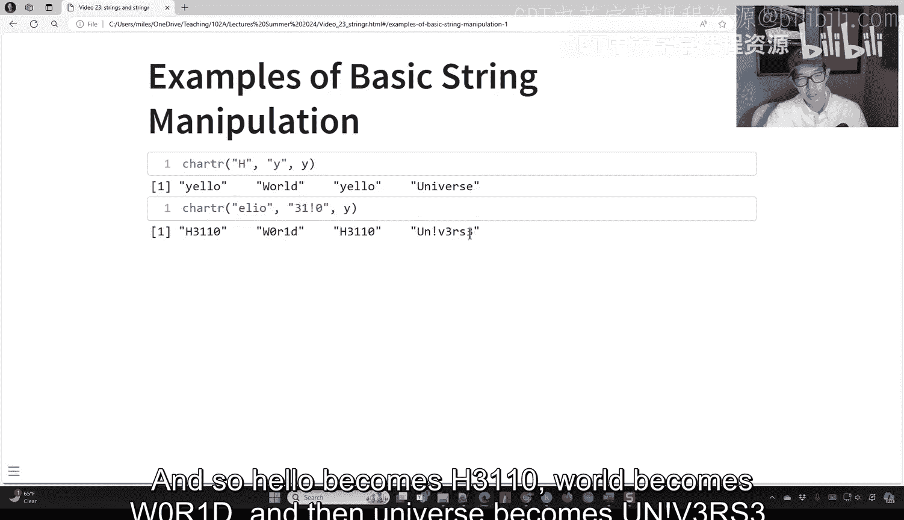

As far as substr goes。 So if we take the longer string Hello world。

 it says just cut starting at the second and end at the 9。 Okay，9 characters。

 you can call string split。 and you specify where you want to split。

 We're going to split on the space。 So Ho world gets split into hello。

And then world split at the space。 here， I can say split at the O。

 And then so hello world becomes hell。 and then the O gets split。 and then we have a space W。

 and then the O in the world gets split。 and then we have R least and this returns a vector of length 3。

 the result itself is a list， because this argument X could be a vector。

 say if you had a vector of length 3。 Then you would get a list of length 3。

 where each of those elements in that vector gets becomes a vector in its own right。

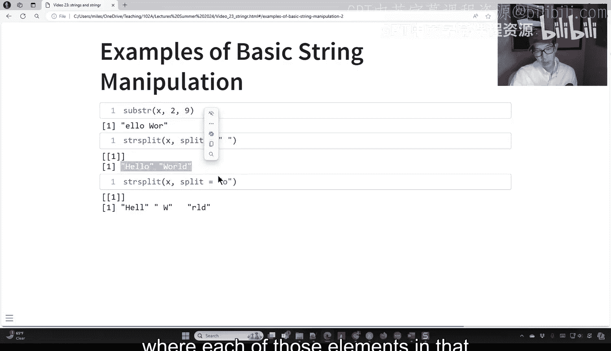

And now I will introduce stringinger， Stringer is another package， it's part of the tidy verse。

 and it makes working with strings， in my opinion， easier。

 and it will be especially useful when we use regular expressions， which will be coming up next。

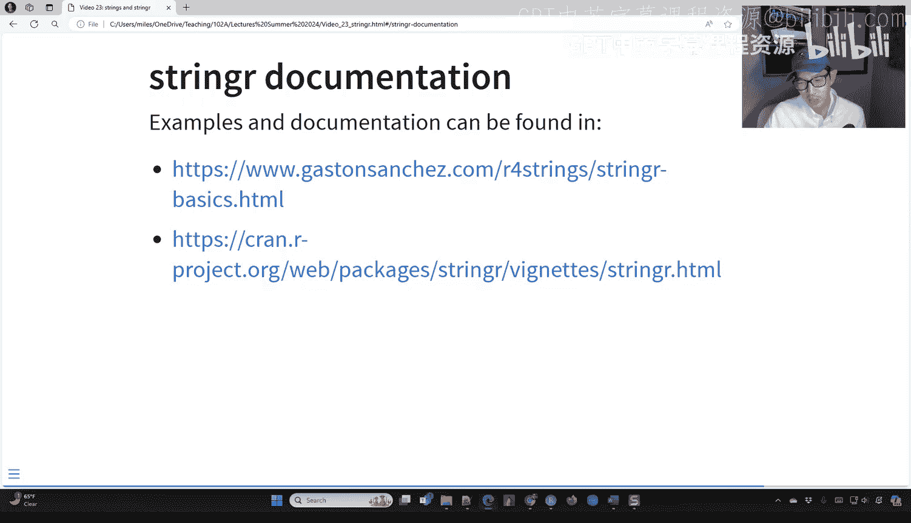

So the functions and stringer， it says are intended to make ours string functions more consistent。

 simpler and easier to use， and the primary way it does this is function argument names are consistent。

 all functions deal with nas and zero length characters appropriately and the output data structures from each function matches the input data structure of other functions so。

The previous functions are all part of base R and stringer functions basically does。

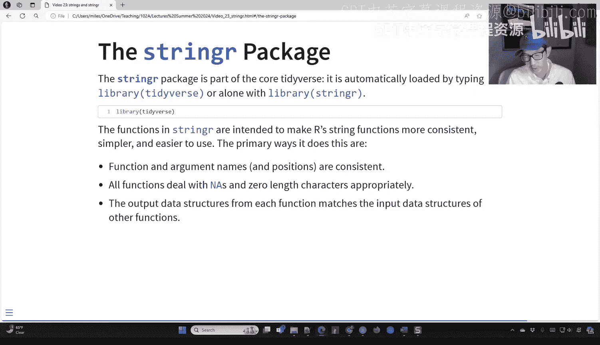

Duplicates some of these things， but tries to do it in a consistent manner。 So you have kind of。

String， string underscore C， which is similar to paste， string underscore length。

 which is similar to N characters， string sub， which is similar to substr。

 And then you have a few other things string， duop， string， trim， string， pad， string， wrap， string。

 trim。 And these will either remove duplicates or pad the strings or wraps a string into paragraphs or things like that。

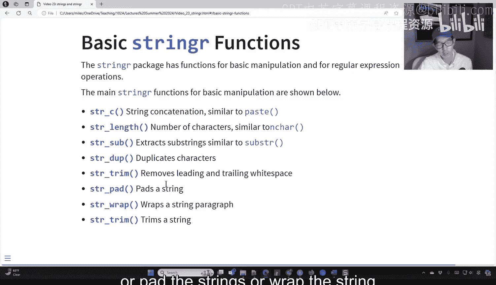

Let me just show you a couple examples。 So here we have paste。And we have string underscore C。

 So one thing about paste is if you provide it。If， you know。You give it0 length vectors。

 Pae will go through， and kind of。Use them。 So if you have x and null and character 0 in hello universe。

 it will kind of paste these things together。 Okay， whereas string underscore C will say。

 you know what， we've got these zero length things。 and it， it won't return these things。 Okay， so。

That's something just to be aware of。 And it won't， won't allow you to kind of。

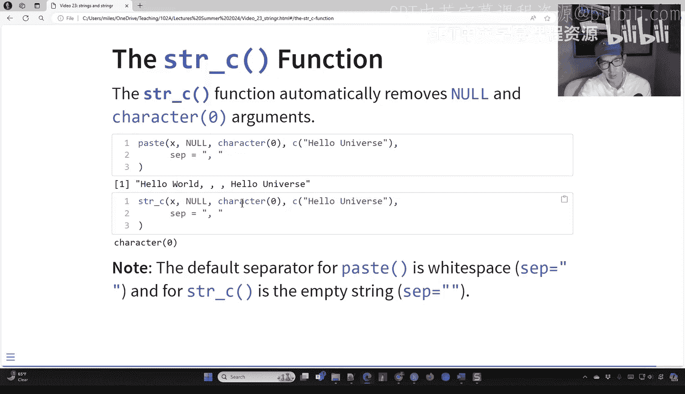

Mix these things together。String length will work with， say factors。Whereas n character does not。

 so if you have， say factors， and character will say that requires a character vector whereas string length on a factor works just fine。

And and that's that。 Okay， so that's just kind of an introduction to some of the basic stringer functions。

 And then in our next video we will cover start introducing regular expressions。

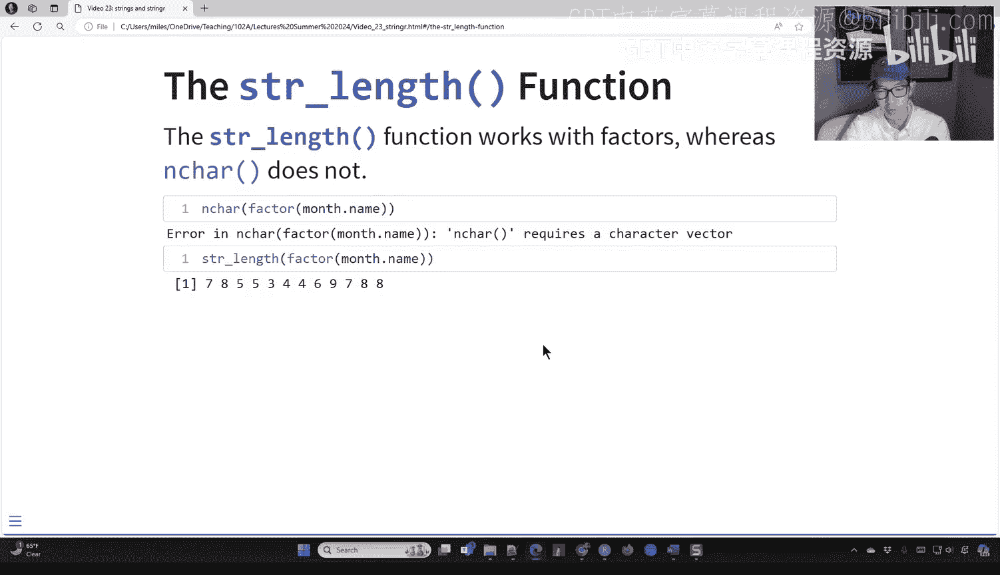

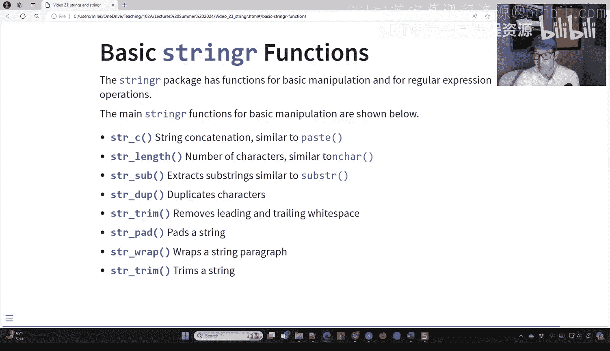