# UCLA《计算统计学｜Stats 102A - Computational Statistics with R 2024 Summer》中英字幕 p24 [24]Stats 102A - 2024 Summer - Video 24 - Regular Expressions_ Character sets an [BV1jizNBrEm2_p24]

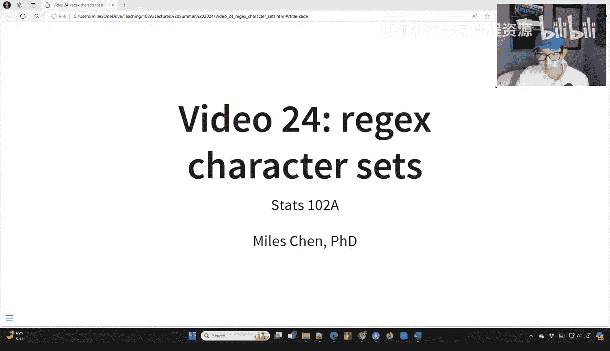

Okay， let's introduce regular expressions。

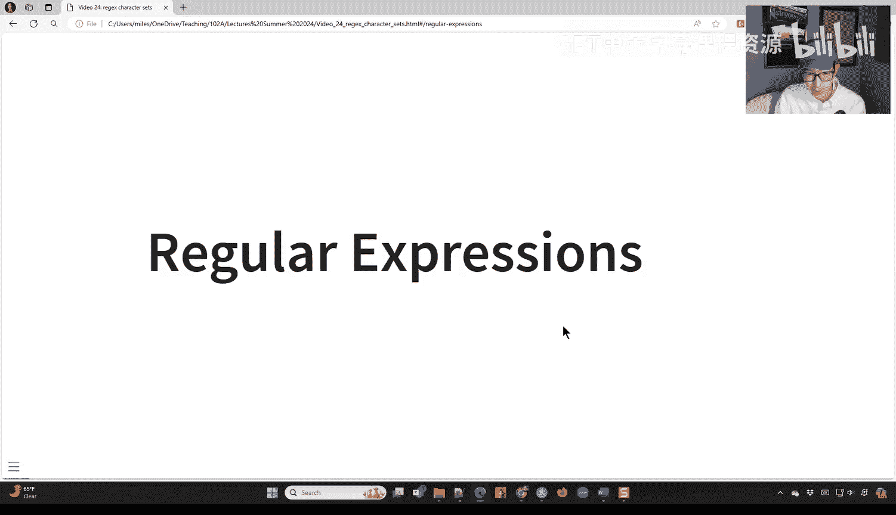

So additional resources here for regular expressions。

 I find these sites especially for testing out your regular expressions to be very helpful and these cheat sheets on regular expressions also to be very helpful。

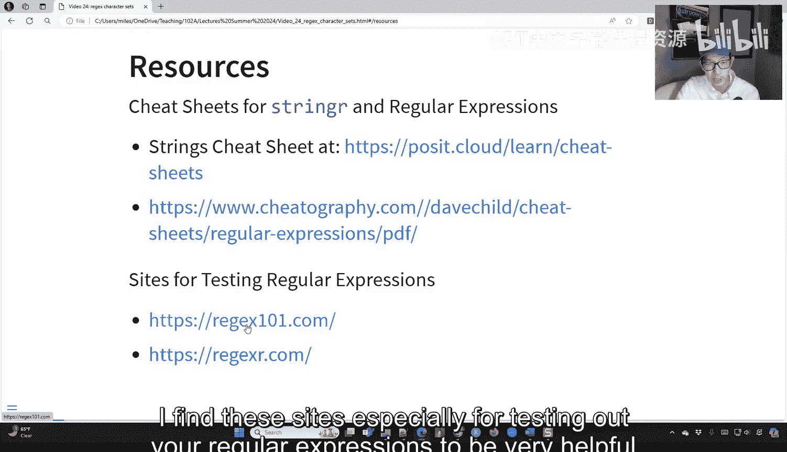

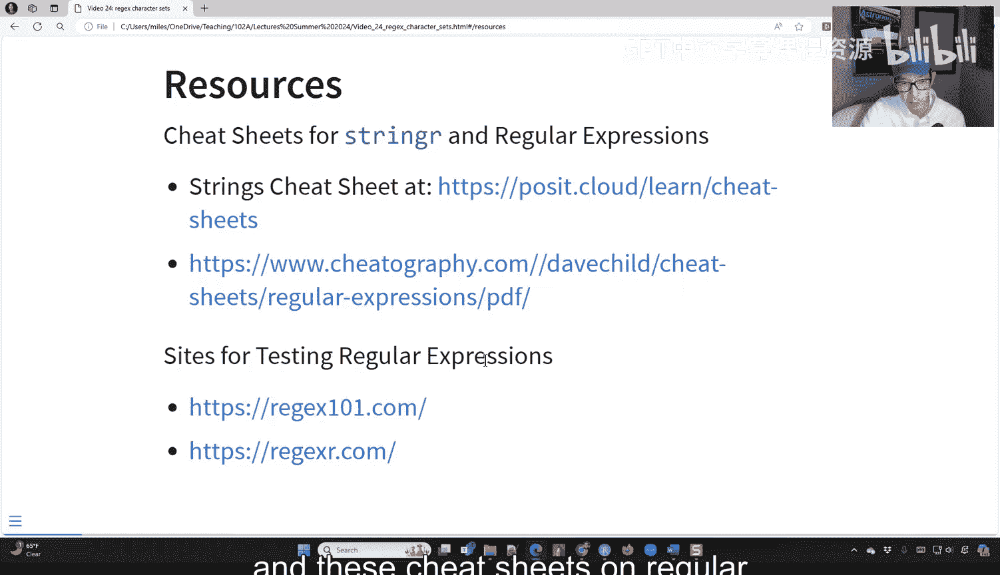

So one of the big applications of string manipulation is pattern matching。 Okay。

 finding patterns in text are useful for data validation， data scraping， text parsing， et cetera。

 And regular expressions often called Reg X is a set of symbols that describe a text pattern More formally。

 a regular expression is a pattern that describes a set of strings。

 Reg expressions themselves are a formal language in the sense that the symbols have a defined set of rules to specify the desired patterns。

And the best way to kind of practice and learn the syntax is just to kind of practice。

 So there's going to be a lot that we're going to introduce and it will feel a little bit overwhelming in the beginning。

 but just the more you use regular expressions， the better you will get with them。

 and there's simply a lot that you can do。

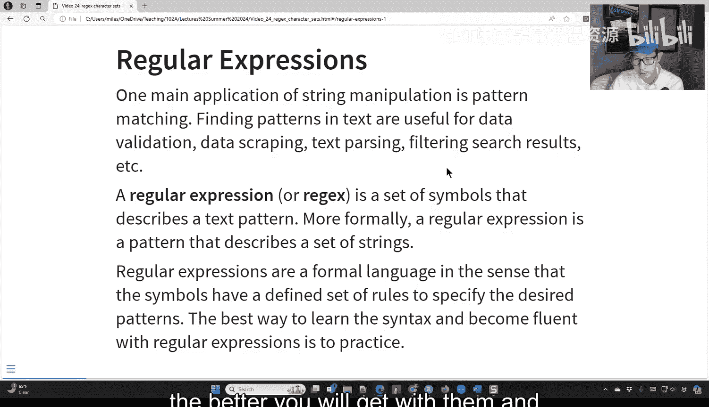

So these are just some of the things that you can do with the regular expression。

 you can kind of test if a phone number has the correct number of digits。

 see if dates follow specific format， look for kind of， you know， alternate spellings。

 things like that， okay？

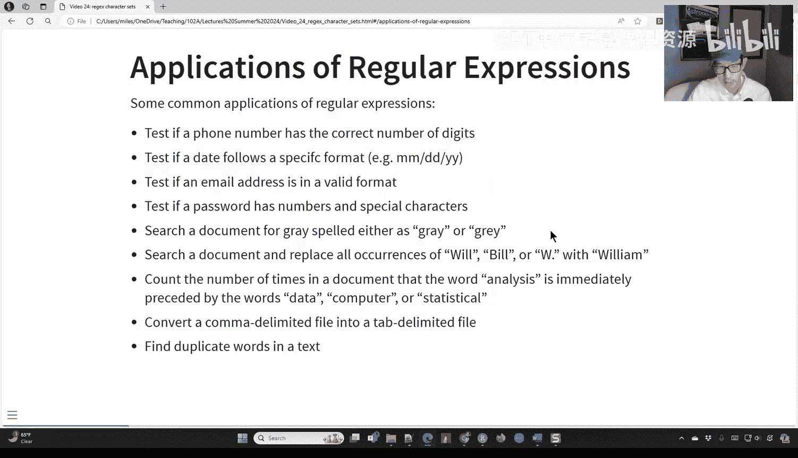

We have a bunch of functions within stringer that allows for working with regular expressions。

 and they all kind of we have string detect， string， locate string， extract， string。

 match and string split。And basically they all kind of take in a string and then take in some kind of regular expression pattern and then what it will do。

 string detect will return basically true or false to see if it detects a pattern within detects the pattern within the string string locate will search for the pattern within the string and it will return basically the start and end of the pattern matches string extract will extract the text corresponding to the first match to the pattern string match will extract capture groups formed by parentheses there and then string split。

Will' split the string into pieces and return a list of character vectors as well。

 And all of these things also come with an underscore all version。 So you have string， detect all。

 string， locate all string， extract all。 And that will allow it to kind of match more than one occurrence because as they are defined here。

 it will just kind of search for the first match or first occurrence of the pattern。And the。

 this will allow it to search for a kind of multiple。

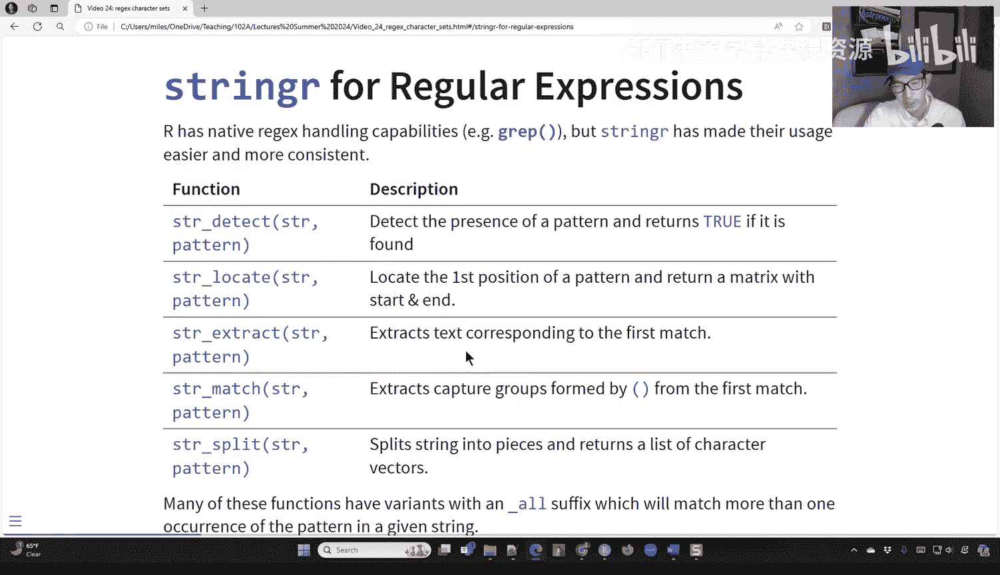

So the kind of most basic type of regular expression that you can search for is the literal character。

 which are character matches that match themselves。

 So if you say character R that matches the character R。 okay。

 this type of match is the most basic type of regular expression and it's just matching plain text。

 So you know， I you've probably used this feature on， say word or。On a web page。

 you can generally hit command or control F and then you can search for text and it will match kind of those characters exactly。

 so all the letters and digits in the English alphabet， so you have the 26 letters。

 I guess 52 if you count lowercase and uppercase are considered literal characters and then you also have the digits 0 through 9。

 and they will all kind of match themselves。

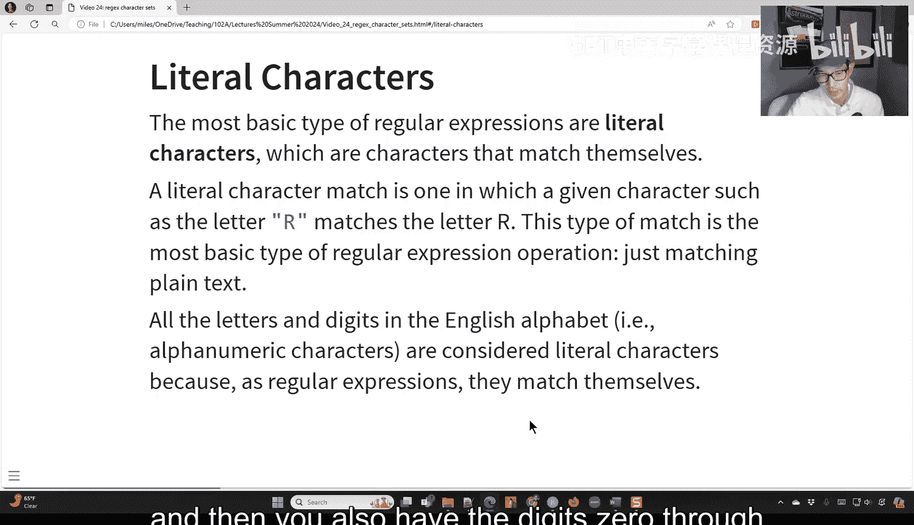

So here we can just start off with the string I love stats。

 And the pattern that we are going to try to match is the literal character string， S T A T。

 And so we are going to find a match right here。 And what string locate will do is it'll return。

The character where it starts and ends。 So I love stats，1，2，3，4，5，6，7，8。 S is the  eighth character。

 And so the start is 8。 This is 9，10，11。 This T is the 11th character。 And so the end is 11。Here。

 if I say I love stats， but stats here has a capital S。

 and I say I want to look for a lowercase S T A T。 We are not going to find a match。

 So our start and end is N A and N A。Sting locate only returns the first occurrence of a match to find all of the matches。

 You'll use string locate all。 So here I've got I love statistics comma。 So I am a stats major。

 So here we're going to say search for ST T A T。 If I do string locate， it only finds the first one。

 which will be the eighth character through the 11th character。

 But we also have another match way down here。 And so if I do string locate all。We will get。

The 8 and 11 right here。And then apparently， this is also the 30th through the 33rd character。

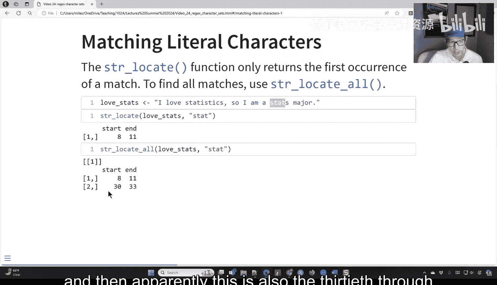

To to get， to get that match there。So beyond the literal characters now we want to introduce meta charactersact。

 Okay， any character that's not a literal character， which would be these symbols here。

 these are meta charactersacters and the power of regular expressions come from the ability to use these special meta charactersacters that modify how the pattern matching is performed and so。

These are the different meta charactersers。 We've got the dot， the dollar sign the star， the plus。

 the question mark， and then all of these braces， curly braces， square braces。

 curved braces or parentheses。 We also have the back slash and the vertical line。

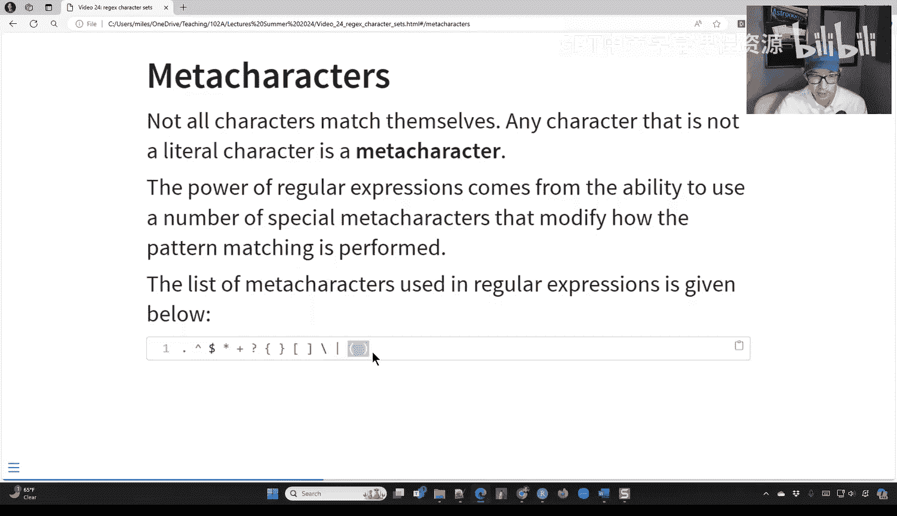

Okay， so the dot or the period is the wild meta characteract， some kinds called the wild card。

 This is used to just match any single character except a new line。 So it could be a。

Another letter as symbol a space， any character other than a new line character。

 So here I have a vector。Of of characters for， I've got not note。K and O T and N U T。

 And here we're going to say string detect N， wild card， any character followed by T。

And so here it's going to detect n， any character T， yep， and any character T right there。

 and any character T and N any character T。 So we're going to get to true， true， true， true there。

 okay。If I say search for N0 any character， okay， we'll get a match here， a match here， a match here。

 but no match here。 So we will get true， true， true false。 true， true， true false， Okay， All right。

 what about this， I've got 5 dot 0，0，5，1，0，0，5 dash，00， and 5 space 0，0，4 entries。

 And if I say 5 dot 0，0， string detect this， what do you guys think that will return， Okay。

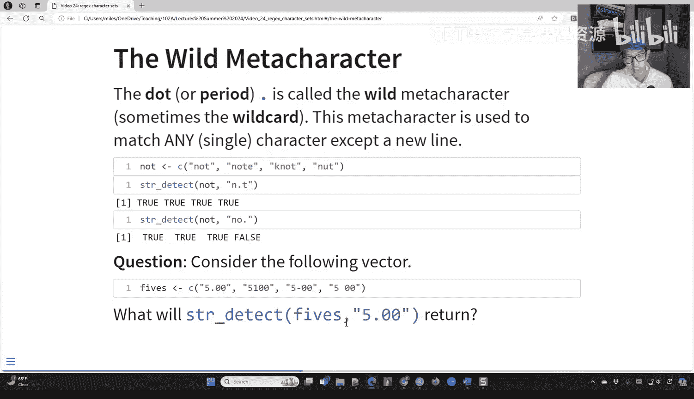

We'll go over the answers， in just a moment。Okay， so because of these special characters。

 meta charactersacters cannot be matched directly as literal characters， if you do want。

To do a literal match， you have to escape the meta character by adding a back slash。 And however。

 an R， because the back slash itself is a meta characteracter for normal strings。

 We actually end up having to do a double back slash。 This is kind of unique to R。

 whereas if you do regular expressions and say another language or from the command line generally。

 you would just use one backslash。 So here I have the string ABC square opening square bracket D。

 E F。 And let's say I want to search for the opening square bracket。 If I enter it like this。

 then it gets it gets confused。 It says missing closing bracket。On a bracket expression。

 if we want to match the literal opening square bracket， I have to do a double back slash。

And this will match the opening square bracket， and we'll get true here。

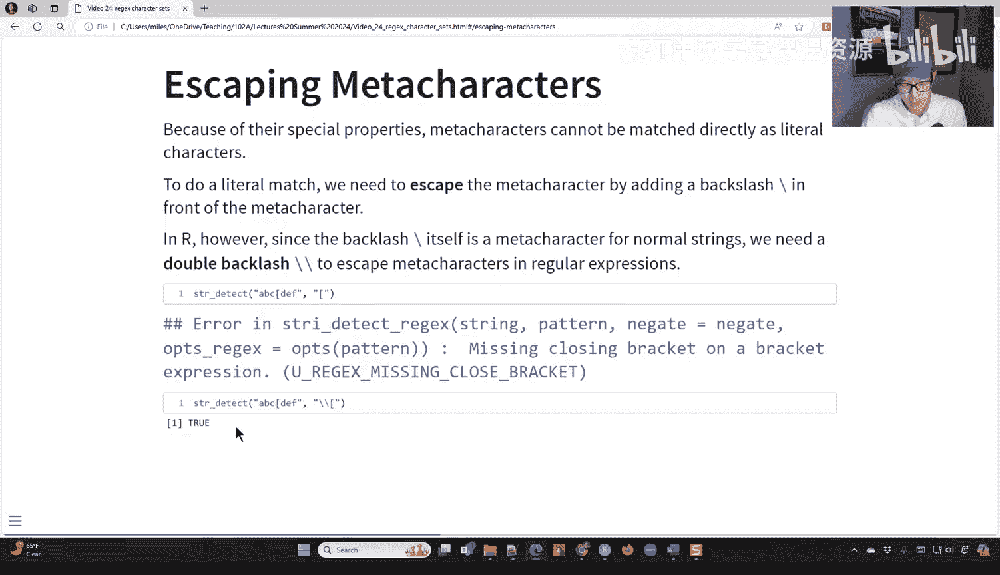

Okay， so going back to this， when I said， hey， these are the entries。 and I say， look for 5 do 0，0。

 This dot is a wild card。 And so it is going to match this and the this and that and that。

 because the dot will match any of the characters。 So we get true， true， true。

 If we only want to match 5 dot 0，0， the literal， then I have to use。

Double back slash dot to get to get an exact match of the dot character。

 And then we will get a match here for 5 dot 0，0。 And then no match is false， false。

 false for the other things which are not 5 dot 0，0。

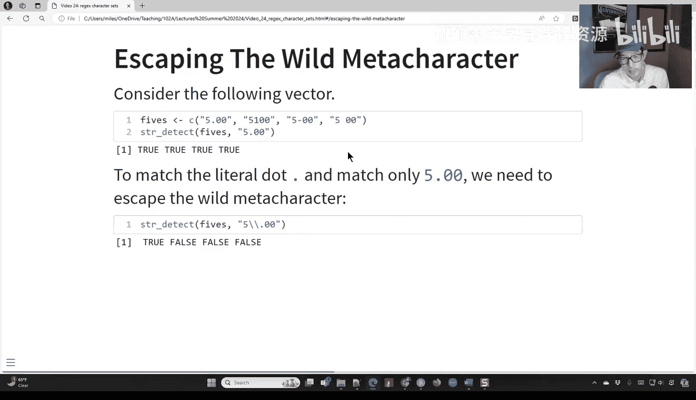

Square brackets indicate a character set。 Okay， character sets will match any one of the characters that are inside the set。

 And it's also important to remember that a character set will match only one character。

The order of the characters inside the set does not matter。 So， for example。

 the character set defined by A E I O U will match any one lower case vowel。 So here I have。P A N。

 pan， pen， pin， P 0， N， P， dot N P， A U， N P， W， N 3D and happiness， H， A P， P， I， N， E， S， S。

 And we are saying， search for the pattern P。Character set one of A E， I。

 O or U followed by the letter N。 So what are we going to get a match， We will get a match for pan。

 So the results will be a match for pan because we get P A N， a match for pen。 because we have P， E。

 N true P I N， also P， I， N。 that's true。P 0 N returns false because 0 is not one of A E I O U。 Okay。

 P dot N Also false because dot is not one of A E I O U。 right。

 So when dot is in the string that you're matching， this is a literal dot。

 When you put a dot in the character pattern that you're searching， then it's a wild card。

 but here we're only searching for one of A E I O U。 here we have P A U N here I have two characters。

 Okay， even though both of those characters are in here， the character set only matches one。

 So we have P A， and then it's not followed by an n， it's followed by you。

 So we're not going get a match there。 That's this false。

The P W N 3D also false because the W here is not one of the Ae I O U。 Okay。

 but we do get a match with the P I N here。 So that returns true。 Happiness does match。

 We'll match P I N there。

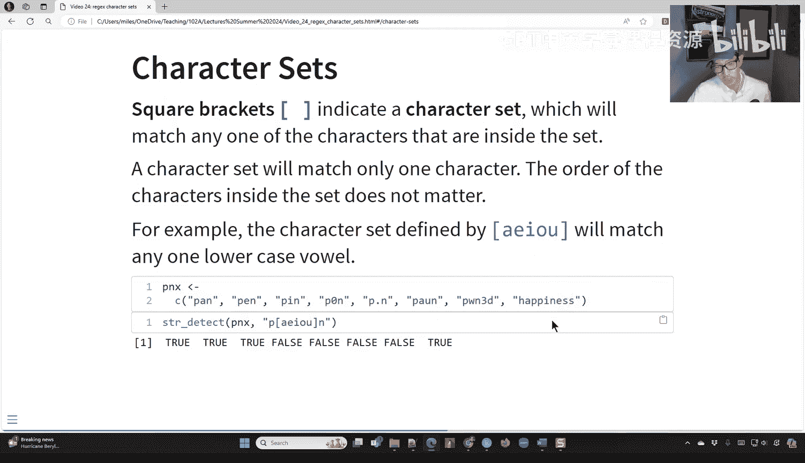

Okay， character ranges。 so if you want to match all of the capital letters in the English alphabet。

 you can define the character set ABC D E all the way up through Z。

But that is kind of long and inconvenient。 So we do have the dash meta character。

 and that can be used to indicate a range of characters。 So if you want to get a through Z。

 you can just type in A through Z。 Or if you just want a certain range。

 you can do a through Q or capital A through Q if you want all 52 askI letters。

 you can do little a through Z in capital A through Z。

 and it will recognize that you can also do it for digits and you can do 0 through 7 or 0 through 9 however you want to do it。

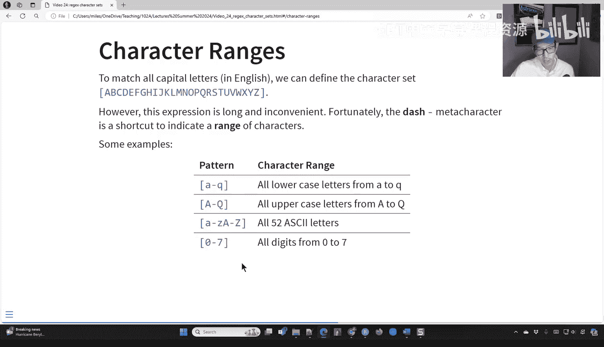

So。Let's say we want to consider this vector here。Now I've got 1，2，3， ABC， ABC， smiley face， A B 1，2。

 A， and A 8，9，0，8， A B。 And what pattern can we use to match three adjacent digits， okay。Well。

 what I can do， Allright， is I can do this pattern，0 through 9 and square brackets。

0 through 9 square brackets and 0 through 9 square brackets。 And this will match3 adjacent digits。

 So we'll get a match for 1，2，3。We won't get a match here， here， here。

We also do not get a match here because I only have two adjacent digits。Okay。

 but I do get a match here because it will， as it reads left to right， it will find 8，9，0。

 and that will match the 8， the 9， the0。 We will get a match as far as three adjacent digits go。

Similarly， if you wanted three adjacent characters， adjacent lowercase letters。

 you can do square bracket Az， square bracket A's through z， square bracket A through Z。

 and that will match three adjacent lowercase letters。

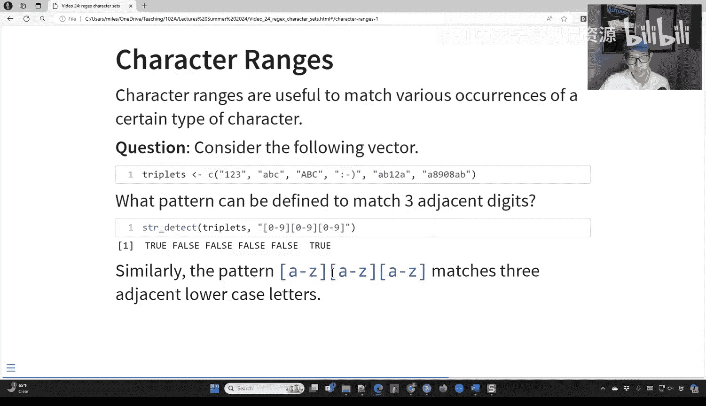

Sometimes you want to have not match certain characters。 And so you can have negative character sets。

 Okay， so it will it will match any one character that is not part of the negative character set。

 So you use a carrot， okay， this cart meta characteract to create a negative character set。 So here。

You put it in the first position of the character set。

 and that means negations kind of like the minus sign。 So here， this pattern， square bracket。Carrot。

 A E I O U means any character that is not。A E I O U lower case。

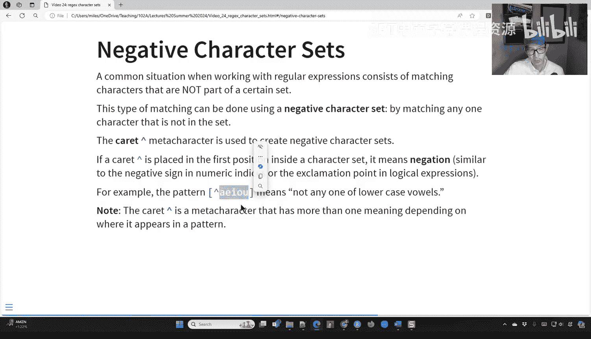

Okay。So that's what we have there。嗯。Here， this will be match any character as long as it is not。

A capital letter A through Z。 So we're basically going to match this。 Yes， match this。 Yes。

 this will not match， but it will match this， this and this。So we're going to get true， true。

 false for the capital A， but true everything else。Okay， the carrot。Has to be kind of the。嗯。

When you want a negative character set， the carrot is the first character inside the character set。

 Otherwise， it will not be used treated as negation。

 and then it will be just treated as a character itself。

 So this will be matching the cart met characteract。 So here， if I say detect this。

 Now it will't detect anything。 It will will get a false here， a false here。

 because now it's matching。A capital letter A through Z or the carrot met character。

 So we will get a match for the capital A， and we'll get a match for the carrot character。

 and we will get falses for the other ones。 So we get false， false， true， false， false， true， okay。

If you want to say match anything， except the carrot。

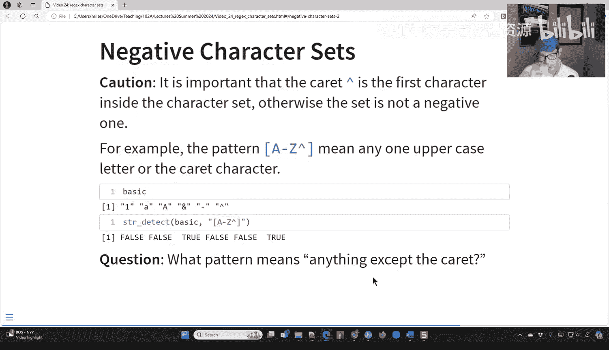

Then you could use this pattern， carrot。Slash back slash back slash carrot。 Okay， and technically。

 these back slashes are redundant because once you put， put it inside a character set。

Meta charactersacters are are translated as literal。 but here we say this match any character。

 except。The literal characters。Character。 and so now we will get trues for all of these。

 and we will get a false for this one because we're saying match anything except。So， this is not。

This literal character there。Okay。Okay， if you put a meta character inside a character set。

 it will be treated as if it were escaped。 So again。

 it is technically not necessarily necessary to include the double back slashes here。

 So here revisiting this。 I've got pan pen pin upon P0 N P dot N P U N P W N3D。

 And here we are going to say match Ae literal dot I O or U followed by N。 So we get a match for pan。

 Yes， pen pin， not for P0 N， that's the false P dot n， yes， that's a match。

 No match here and no match there。

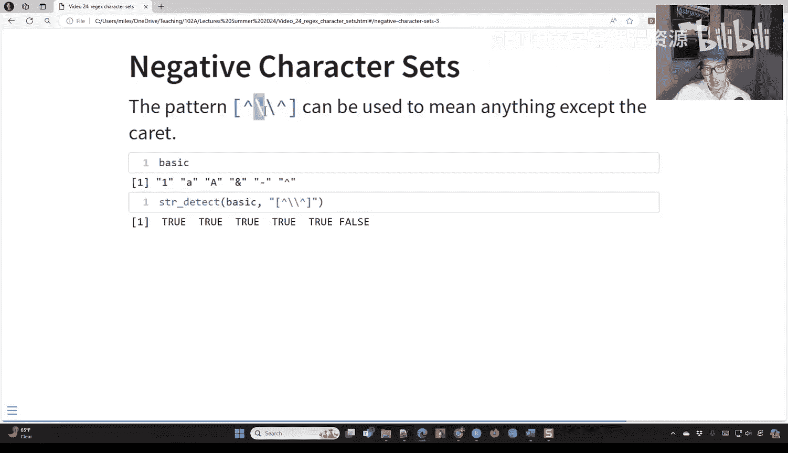

Okay， so the dot inside the character set now represents the literal dot character rather than the wild card character。

 again， not all metacharacters become literal characters when they appear inside a character set and the exceptions are the square bracket and the dash。

 the carrot， if it's in the front， and then the backslash but basically all other metacharacters will become literals inside a character set。

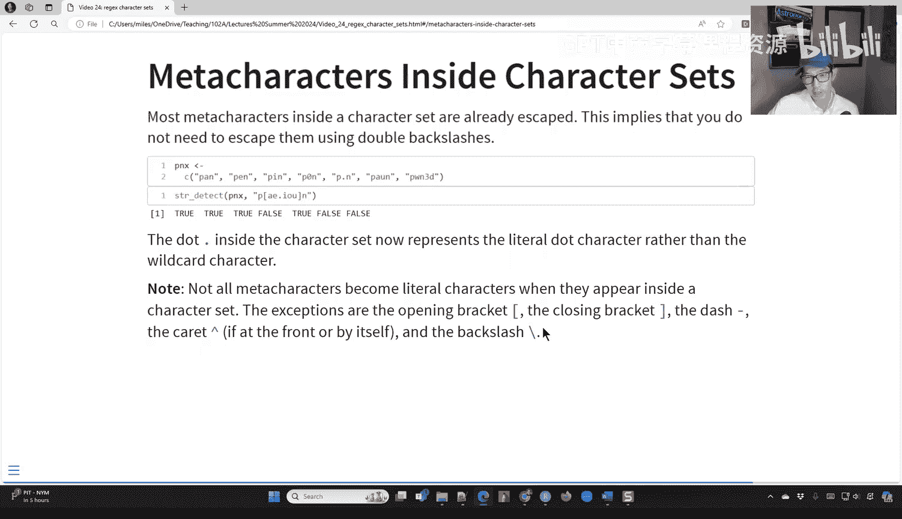

We also have character classes。 character classes are basically shortcuts for common character sets。

 Okay， so if you do back slash。D， that's going to match any digit。

 And it's the equivalent of writing score bracket 0 through 9 square brackets。

 So the character set that defines all digits can also just be done using back slash D。 Now， in R。

 we have to do double back slash。 So double back slash lowercase D will match any any digit。

 now the pattern is the lowercase letter will match that thing。

 the capital letter will not match that thing。 Okay。

 so back back slash lowercase D will match digits。Backslash capital D will match nondits。

 So anything but 0 through 9。 Okay， Lowcase W is a word character。

 Word characters are basically things that you could use and say like a user name for website or something。

 basically the letters， A through Z lowercase and uppercase。

 the digit0 through 9 as well as underscores。 So those are word characters。

 backslash capital W is anything that's not a word character。 Okay。

 so pretty much all other punctuation， other than you know， other than the underscore。

 but basically spaces and all other punctuation。Backslash S。

 little S will be any white space character。And back slash capital S will be anything that's not a white space character。

 All white space characters are things like spaces。

 but also tabs and non breaking spaces and things like that， okay。

So these are these character classes are just basically shortcuts for these character sets。

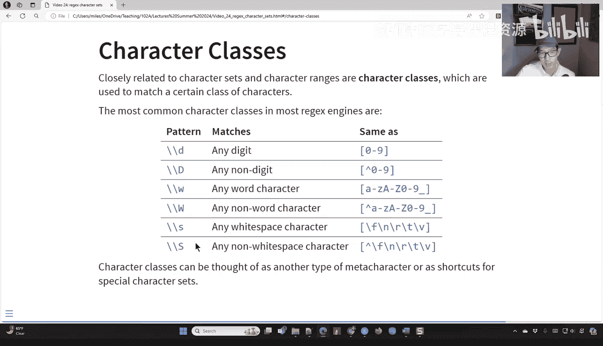

So white space， you know， you have spaces， you also have a form feed。

 which will be like a page break， a new line， carriage return tab， vertical tab。

 I'm not quite sure what vertical tab is， but。嗯。When you hit enter on your keyboard。

 it is often broken up into two parts。 a form feed and a carriage return。

 That's kind of a carryover from the days of working with a typewriter。

 So if you've seen like an old movie where somebody's using a typewriter they're typing chi and and actually what's happening is they're typing and the characters keys are the letters are being put out there。

 And then the paper itself moves across。 So the paper moves over， characters are being added。

 And then when it hits the end， you hear a ding and then the person。

Hits enter and it rolls up the paper。 It goes up a line。

 but then they have to slide the carriage all the way back to reset it。 Okay。

 so sliding up the paper， that's the form feed。 and then sliding the carriage all the way back so they can start typing in the thing。

 you know， the paper ding。 That's the carriage return。

 So that's a slash F slash R or slash R slash F。嗯。But but anyway， all of these German things。

 these are kind of often done invisibly inside a in your text document。

 you also have spaces and non breaking spaces and a way to kind of just specify anything that's white space。

 you can just do backslash a little less。

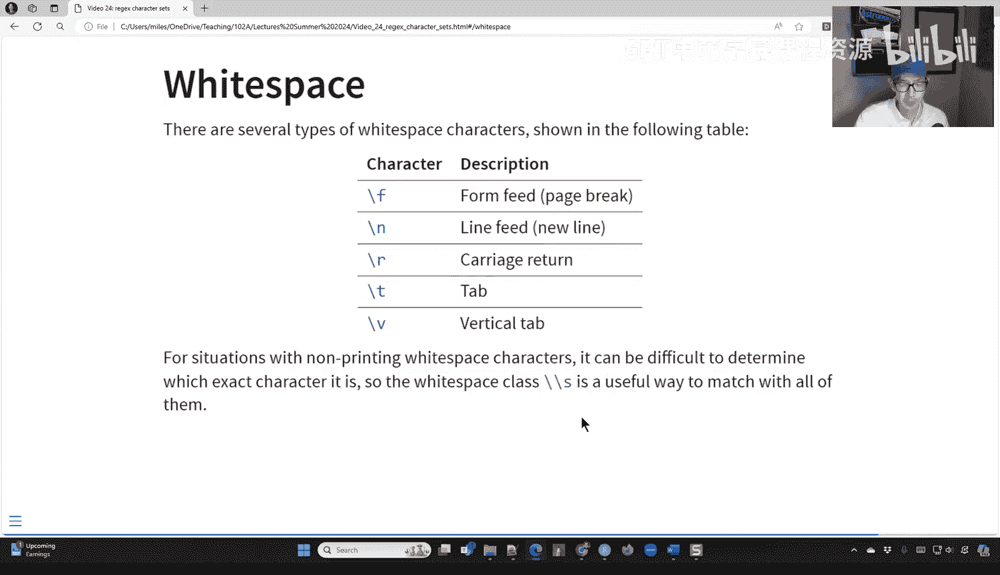

Okay， so here we're going to say detect P followed by a digit backslash little D。

 and so we're basically going to get a match only on p0 n。

 Nothing else is P followed by a lowercase D。 So we'll get false false false true for the P0 n。

 false， false false for the other whoops。For the other things here。P。

 followed by a non digit is going to be P back slash capital D。

 And so then it'll just be kind of the opposite of this。 We'll get trues for everything， except。P0 n。

Okay。Here this is P followed by a non word character， non word character。

 So the only thing that would be a non word character will be the dot here， P dot n。

 So so we'll get it true for the P dot n， but。Basically。

 everything else is P followed by a a word character。

 zeros are digits are considered word characters okay。

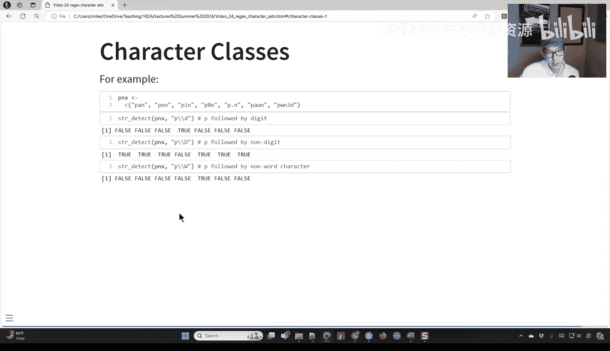

We also have Posss classes and these are just another kind of other ways to do short shortcuts for certain character sets。

 so you can do Al nu for alpha numeric okay， but you can also do square bracket alpha and that will just be the letters。

 square bracket digits， square bracket lower， square bracket upper and these are just I guess little shortcuts for。

For these character sets， although， you know， I I don't know if this is any much of a shortcut compared to this。

 okay。But they might be easier to remember， so， you know。Square bracket。

 space or square bracket punctuation。 This could be helpful。

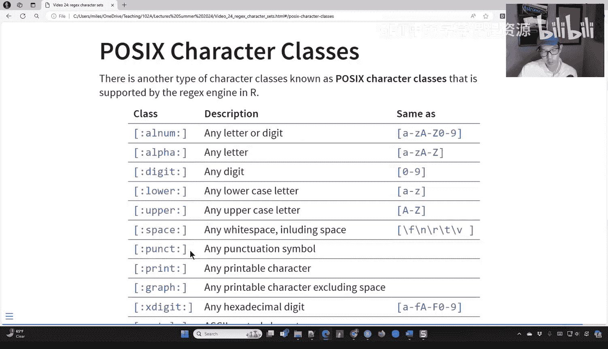

So here。Oh， and then again， another weird quirk of Rs。

 you have to do double score brackets for the the Poss classes。

 So here you can do look for anything with it。And a letter。Okay， and that's all of them。 Okay。

 look for anything that has a digit， and that will just be the P0 n and the Pw N3D。

 So we'll get true for those。And then no matches for anything else。Okay。

 so that is just a very brief introduction to character sets and character classes in regular expressions。

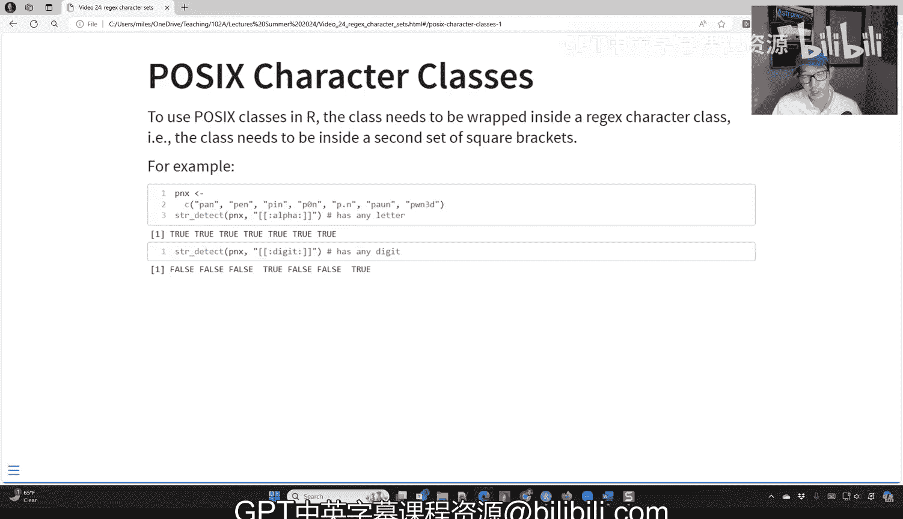