# UCLA《计算统计学｜Stats 102A - Computational Statistics with R 2024 Summer》中英字幕 p25 [25]Stats 102A - 2024 Summer - Video 25 - Regular expressions regex anchors and [BV1jizNBrEm2_p25]

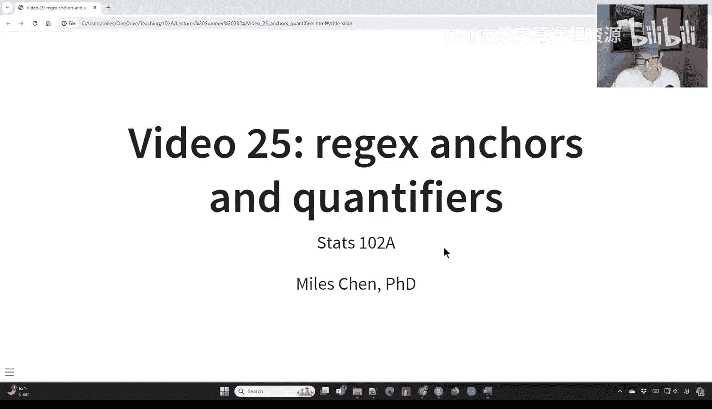

Okay， another important aspect in Regx is our anchors and quantifiers。

Anchs are part of the pattern that doesn't match a character， but rather a position。

 either before after or between characters， anchors are used to kind of anchor a match of the pattern to a certain position。

 so you have the carrot and the dollar sign here， which means start of the string or alternative to the carrot would be backslash capital A or an R would be double backslash capital A or backslash capital Z for the end of the string。

We also have backslash a little B for a word boundary and back slash capital B for not a word boundary。

 So let me just show you this here。 I'm going to have the the text here。

 The quick brown fox jumps over the lazy dog dog。

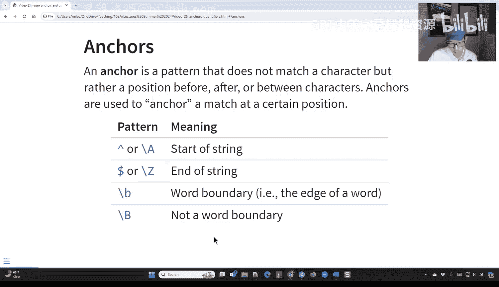

And here I'm going to say match， or we're going to do string replace all。 Okay。

 we're going to say replace any instance of T H E。With a dash， okay。

 And so it's going to find the T H E here， the T H E here。 There's no anchors in this pattern。

 So it's going to match。 it's going to replace any instance of T H E with a dash。 Hence we get dash。

 Quick brown fox jumps over dash lazy dog dog。Here I'm going to put carrot。 okay。

 carrot means only at the start of the string。Match T H E， okay。

 so it will not no longer match the The E over here because this is not at the start of the string。

 So itll replace this one， but not the other T H E。

 So this gets replaced with dash and we'll get quick broze f jumps over the lazy dog dog here。

 if I do back slash back slash capital A。 It's the exact same thing as this。

 And so we'll get the exact same results。Here I say do THE dollar sign。

 Do sign is at the end of the string。 There is no match here。 Okay。

 the end of the string is dog DO O G end of the string。

 so here nothing will get replaced with the dash okay， so nothing gets replaced there。嗯。

Here we're going to say replace dog anywhere。 So here， D O G will get replaced with a dash。

So we get quick brown fox jumps over the lazy dash dash。Here I have Do dollar signs。

 so this will only replace the DOG at the end of the string。

So quick round Fox jumps over the lazy dog space dash here。

 So it replaces the DOG at the end of the string。Here， these are word boundaries， Okay。

 word boundaries。 So here I'm going to say we are looking for allright。Basically。

 anything with a word boundary， we're going to replace with a dash。 Okay， so this says。

Look for a word boundary。And any character that comes after the word boundary。Replace with the dash。

 or this is the or symbol。诶。Any character followed by a word boundary。 Okay。

 so here the text is words jump， jumping umpire pump，umpinth and lumps。

 And so it's going to detect a word boundary at the W。 Okay， right before the W。

 So this will get replaced with the dash。 The S will get replaced with the dash because that's a word boundary。

The space is also at a word boundary because there is a word boundary between the S and the space。

 There's basically a word boundary between the S and the space。

 a word boundary between the space and the J and jump， A word boundary between the P and the space。

 word boundary between the J and the space or space and the J。 So basically。

 at the edges of words is where the word boundaries are。So basically the W and then the S。

The space is。You know， is surrounded by word boundaries。 The J is preceded with a board boundary。

 U and M are not preceded by word boundary。 So they。

 they precedeed or followed by word of boundaries， but P is followed by word boundary。

So that's going to get replaced with that。 And so this kind of shows you where all of the work boundaries are。

Okay， so this is going to do the opposite replace， it needs to be preceded by a non word boundary。

Any character followed by non word boundary。 So it's going to basically look for things that's not a word boundary。

 So you don't have a word boundary between W and O。 No word boundary between O and R。

 no word boundary between R and D， No word boundary between D and S。

 but then you do have a word boundary after S， a word boundary before the J。

 no word boundaries between J and U， U and M， M and P。

And so we're going to replace basically characters that are surrounded by non word boundaries with the dash。

 And so it's going to replace all of the internal letters of each word。

 So we get O R D gets replaced， U M and so on and so forth。

 So it's basically this where all everything that's not at the start or end of the word gets replaced with the dash。

 So these are examples of boundary word boundaries and non word boundaries。So。

Let's take a look at this。 Here。 I've got words， jump， jumping， umpire， pump，umpins and lumps。

 So here we're saying word boundary。U MPP replace word boundary， U MP with a dash。

 So we're basically looking for U MP at the beginning of words。 So I've got U MP。

 but it's preceded by J， not a word boundary。 Okay， however，umpire is at the beginning of the word。

 So U MP here is preceded by word boundary。 Sam thing withumpeenth。

 U MP is preceded by word boundary。 So basically， we're looking for U MP at the start of a word。

 So we're going replace theump andumpire and the ump andumpth。

Here we're going to say we're looking for U MP preceded by a non word boundary。

 So we're looking for U MPP not at the beginning of the word。

 So we'll get theump and jumps and jumping andump and。Pump and theump and lumps。 Okay， so those。

 those will get replaced。 Okay， whereas umpire and umpth， they are preceded by word boundaries。

 so they will not be。 They will not match this pattern。So the UP and jump， UP and jumping。

And then the U MPP and pump and the U MPP and lumps right here gets replaced with a dash。Okay。

 here we're saying， look for U MPP followed by a word boundary。 U MPP followed by word boundary。

 So we're going to get U MPP in jump。And UMP and pump。

 And I think those are the only two instances of UP followed by word boundary。Jump and pump。Here。

 I've got U MP followed by a non word boundary。 Okay， so non word boundary that will be jumping。

 This piece is followed by a non word boundary。 Uire is not followed。

 The U MPP here is not followed by word boundary。tieenth is not followed by a word boundary and lumps is not followed by word boundary。

 so。We will get those。

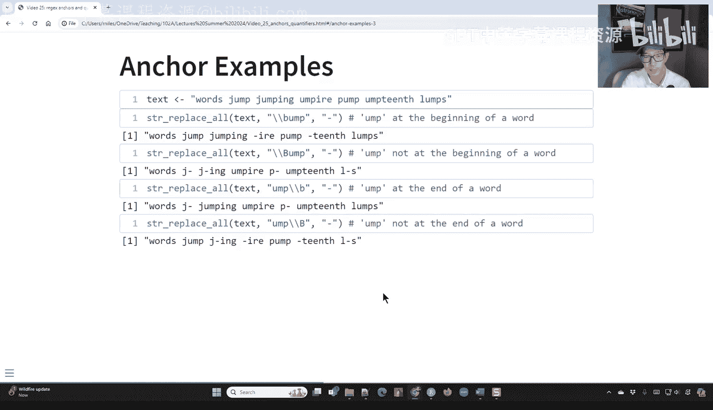

Okay， let's revisit this with the carrot。 Okay， so here I've got carrot score bracket 0，9。

Square bracket carrot 0 through 9 and 0 through 9 carrot。

 And what's the difference between each of these things。 Okay， well。

 here with the carrot at the front， this indicates an anchor started the string。

 So we're looking going to match a digit 0 through 9 at the start of a string。This is negation。

 So this will say match any character that is not a digit 0 through 9。 And this is a character set。

 And this is going to play the literal character。 So this will match a digit or the literal cart。

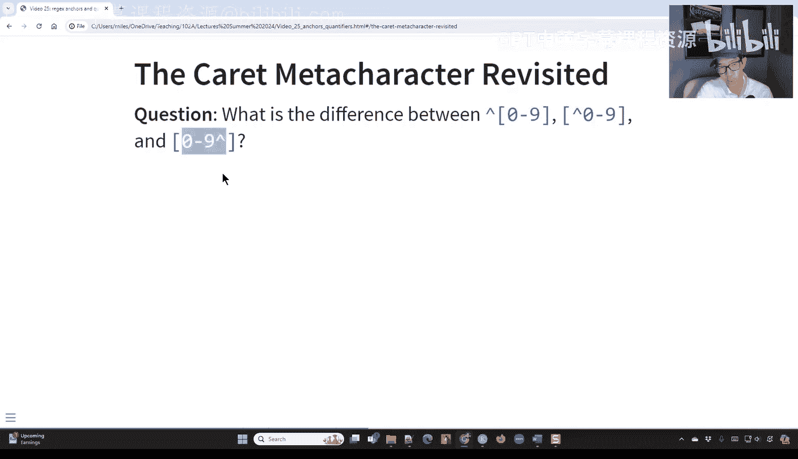

Okay， so this will match strings that begin with a digit。

This will match characters that are not a digit， and this will match a character that is a digit or the carrot。

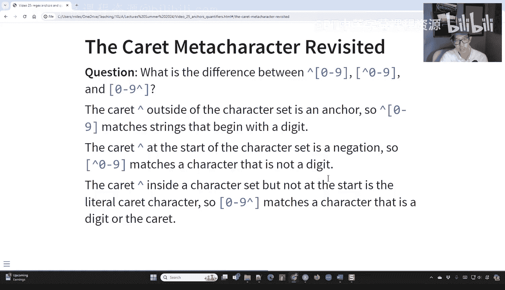

Al right， another thing that we have are quantifiers。 Quaifiers are attached to literal characters。

 character classes or character sets or groups to match repeats。

You can have a star which will match zero or more。A plus will match one or more。

 A question which it matches 0 or 1。 Or you can say I want to match exactly 3。

 I want to match exactly 3 or more， or say 3，4， or 5，3， through 5。

 And you use curly braces to specify ranges of quantifiers。

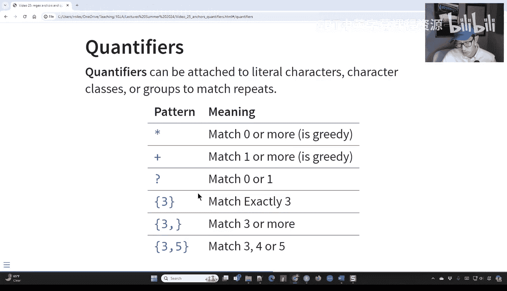

So how does this work？ Okay， so here I'm going to say basically match any white space。

And replace it with a dash。 So we're going to just go through and replace any white space characters。

With a dash， okay， here， no quantifiers。 we're going to say replace all white space with a dash。

 And so basically， everything that's this white space gets replaced with a dash。Here。

 I'm going to say match anything that's not white space capital S back slash capital S replace with the dash。

 so。Basically， everything that's not white space gets replaced with a dash。

 And so everything just gets replaced with dashes， but it preserves the original white space。

 So WR RDS get all get replaced with dashes。 We have a space space， space here。

 these spaces remain the commas get replaced with a dash。 Everything gets replaced with the dash。

Here， I'm going to say one or more non white space， one or more non white space。

 And it reads left to right。 So when it goes through this， it's going to say， okay。

 that's not white space。 And that's not white space。 That's not white space。 That's not white space。

 That's not white space。 Here's white space。 So it's going to detect this as a match for one or more white space characters。

All of WO RD S will match。 And so that entire W RD S is replaced with a single dash。

Then we have a space which doesn't match the pattern。 Then we match the O and the R。 And it says。

 okay， that's not white space。 And that's one or more。 not white space characters。

 And then it detects an O。 a space here。 says says， okay， that's the end of the pattern。 This is。

This is as far as the pattern matches。 the O R， the O R gets replaced with the dash。 Okay， going on。

 all of numbers matches this as non white space and that gets replaced with a single dash。

 So basically。All the adjacent non white space characters， okay。

 which we're all replaced with dashes here。 Everything that's adjacent will just get replaced with a single dash。

So this is the result here。 So I have  one，2，3，4，5，6，7，8，8 groups of adjacent dashes。

 and they'll just get replaced with a single dash each。Here。

 we're going to say replace one or more word characters with a dash。 Okay， so very kind of similar。

 This is a word character， word character， word character。

 So that's one or more word characters that will get replaced with a single dash。

 Sam with all of these things。 Okay， here's where it's going to make a difference。

 The 9 is a word character。And that's one or more word characters。 But the comma is not。

 So it's going to match the 9。 It won't match the comma。 So the 9 will get replaced with the dash。

 K 8，7，6 also match one or more word characters。 And so that will get replaced with the dash。

And this is all matches a word character。 So that will get replaced with a single dash。 So basically。

 it's almost exactly the same with the exception of the comma here。And it's going to replace。

 this will become dash comma dash rather than a single dash here。Okay。

 here it says replace any digit with a dash。 So basically everything that's a digit，1，2，3，1，2，3，4。

 the 9， the 8，7，6。 those get replaced with the dash。

And here I can say anything that's not a digit gets replaced with a dash。

 So that's going to be all the letters， the spaces， the comma。

 everything that's not a digit will get replaced with a dash。Okay。And if I say， hey。

 replace one or more digits， D slash D plus one or more digits with a dash。Okay， basically。

 we look at this， basically anything that's where you have one or more adjacent to these dashes here that will get replaced with a single dash here。

And then similarly， replace one or more non digits。 Okay。

 so these are all kind of adjacent non digits， One or more adjacent non digits。

It's going to get replaced with a single dash。All right， so here。We're going to say。

 look for a digit， and we want exactly three of them。 We want exactly three of them。

 It reads left to right。 So we're going to say when you find exactly 3 digits。

 replace it with a dash。 So it's going to read this。 It's going to encounter 1，9，9。

 says that's a match for three adjacent digits， replaces with the dash。 Then it encounters the6。

 and it doesn't doesn't match。 So keeps going 3，1，0。 That's a match replaces with the dash，1，2，3。

 That's a match replaces with the dash ，1，2，3，4，1，2。

3 here is 3 digits that gets replaced with the dash， the4 will get left alone。

 The single digit 5 doesn't match the pattern that gets left alone。So this is what we have。 dash 6，1。

9，9 gets replaced，3，10 gets replaced，1，2，3， gets replaced。1，2，3 here gets replaced with the dash。

Here I say anything from two to four characters。And so it will replace 1，9，9。

6'ca that's four characters。 This is three characters。 This is3，4 characters。

 It will not replace the five because that is just one digit and it won't match the pattern of 2 to 4。

Okay， here's an example of the question mark。 Question mark means 0 or one。

 Quetion mark means 0 or one。 So here。We want capital M replaced with。An A or an O。

 I here not replaced with followed by A or O character set。 Okay， because my words are mama， M， O。

 M M， A， Mama， M， A M， A， Mama， M， A， M， M， A， mommy， M， O， M， M， Y， mom， M， O， M and mother M， O， T。

 H， E， R。 And so we're going to say we want an M， followed by either an A or an O。

 followed by1 or2 Ms。

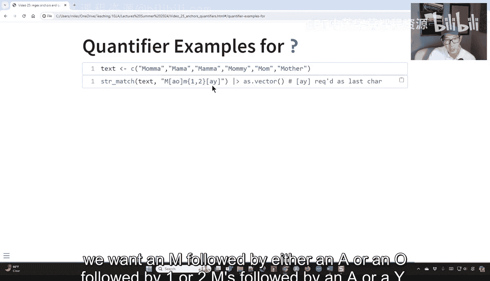

Followed by an A or a Y。So， this will match。Mama。M， O， M，2 Ms a。This will match Mama M， M A M A 1 M1。

 A。 This will also match M A， M M A。M。1， a 2 Ms and an a。 This will match the mommy M， followed by O。

 M。2 M's and a y。 It will not match M because we've got an M followed by an O， followed by an M， but。

It mom does is not followed by an A or Y。 Okay， so the string match。We'll say， all right， what。

 what did it match， It match Mama， Mama， mama， mommy， but no match for mom and no match for mother。

 So we get Ns for those。Here， I'm using the。The pipe to。To to make these things vectors。 Okay。

 when I put a question mark here， question mark basically says 0 or 1，0 or1。

 So makes this thing optional。 Okay， so now it will match the mom because I'm going to get M followed by O。

 followed by one or two M's。And then the A Y with a question mark。

 the question mark makes it optional， basically， a 0 or a 1，0 or 1 matches。

So now we get a match for mom Okay， all of the other things are matched because yeah if we want to match one。

 we can， but also if we're given the choice to matching 0， we can also match 0。 Okay。

 mother still not a match because we have an M O， but the Ms here are required as part of the pattern and mother does not have one or two M's there。

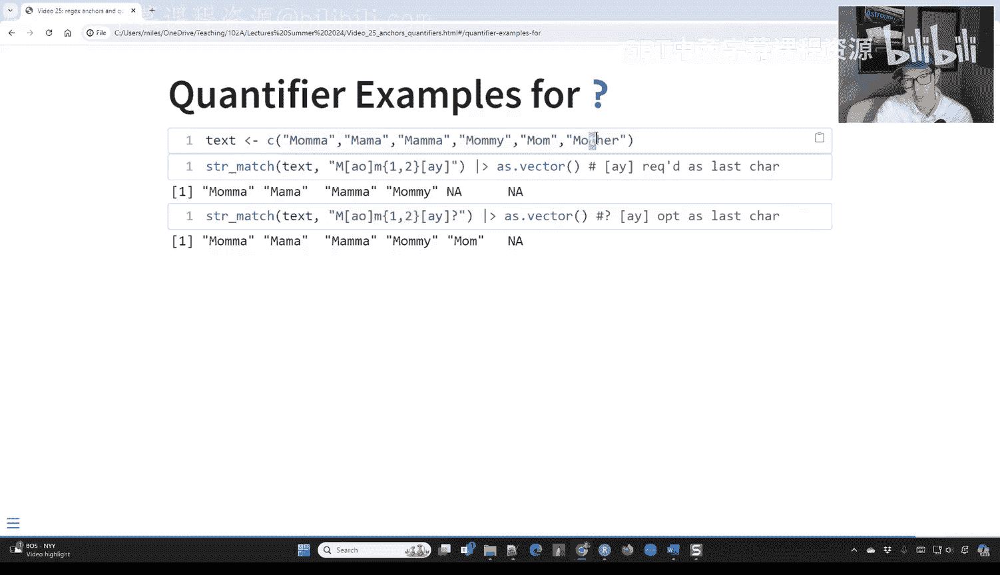

Okay。um。The question mark can also make。The star or the plus quantifiers ungreedy。

 So quantifiers are greedy by default in that they will try to match the longest match。

 They will return the longest match。 When you add a question mark to a quantnifier。

 it makes the match ungreedy or lazy。 So it returns the shortest match。

 So here I've got Peter Piper picked a peck of pickled peppers。We're going to search for capital P。

And then any character，0 or more of them ending with an R。Okay， so when I say string extract。

 it's going to find like basically the match。 and it's going to start with the capital P。

 and it's going to go any character， any character。

 any character as long as it ends with an R So this。It goes Peter Tr， and it says， okay。

 that's a match。 But it says， I can keep going Any character， any character。

 any character ending with an R。 I can go to Piper， Peter Piper。 I can also go any character。

 including spaces， any character， any character， any character。1 or more ending with an R。

 And I can get up to here。 Peter Piper picked a peck of pickled pepper。 Okay。

 and that will be the match。 so that that's going to be the what gets extracted here is that's the longest possible match where we have a capital P ending with an R。

OkayHowever， if I put the question mark here。Then it becomes ungreedy。 Okay， ungreedy。

 Now it starts with the capital P， E， T， E， R， and it says， now I'm done。

And we just get a match for Peter。 So the question mark says。Find the match。 But then， you know。

 as soon as you find a match and it ends， just stop there。 Okay， don't keep going。

 Don't try to be greedy and get the biggest possible match that you can get。

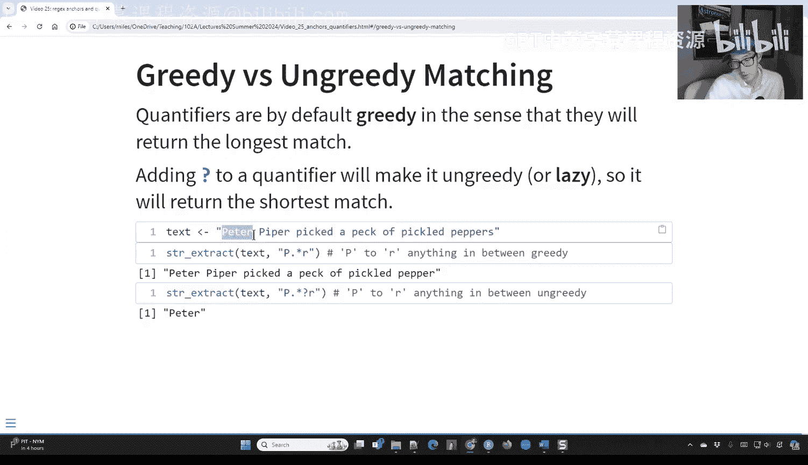

Here I can also do string extract all， string extract all。

 I will get the capital P E T E R for Peter， and then it will try to find additional matches。

 then we'll get capital P for Piper P I P E R。 We'll get a match， and I think that will be it。

 There's no more capital P's here。So， we have Peter Piper。If I do capital P or lowercase P。Followed。

By one or more wild card characters， Okay， but ungedy ending with an R。We'll get Peter。

We'll get a match repeater。Then we'll get a match for Pir。 It reads left to right。

 So it's going to say， okay， capital P。I PER， Okay， that's a match。 Then we get。Lowercase， P，t。

Up to here。 So we're going get Peter Piper and then picked a peck of pickled pepper。

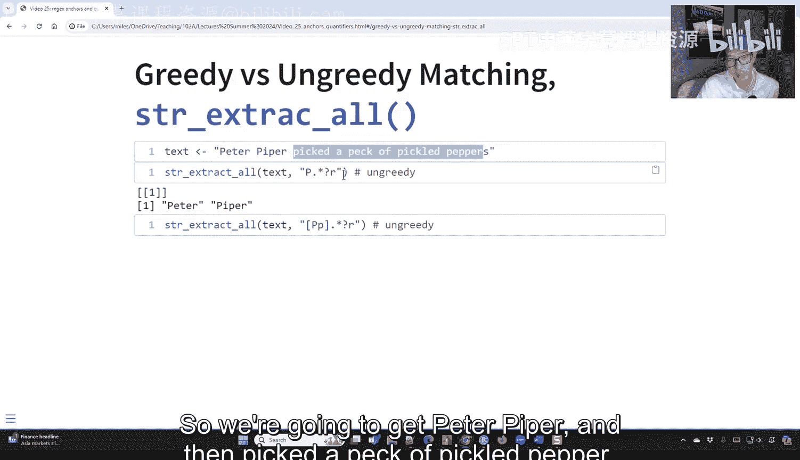

Okay， Peter Piper， reading left to right， capital P， lowercase P all the way to the right。

 it't it doesn't start with the R and then work backwards and says， oh。

 this is the shortest thing I can find P E R。 It just says， okay， what's a match。

 capital P R going up to R and then ends there and says， so as soon as it encounters this thing。

 the lowercase P。And it keeps going until it finds something that can end it。Okay， so that is。

That's a little bit on the modifiers there。And the quantifiers。

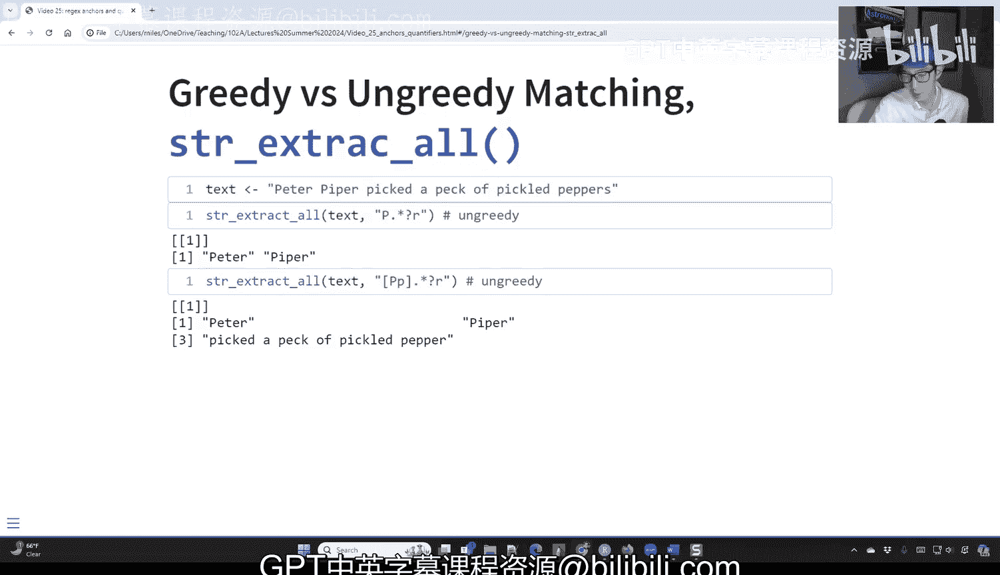