# UCLA《计算统计学｜Stats 102A - Computational Statistics with R 2024 Summer》中英字幕 p26 [26]Stats 102A - 2024 Summer - Video 26 - Regular expressions regex - capture gr [BV1jizNBrEm2_p26]

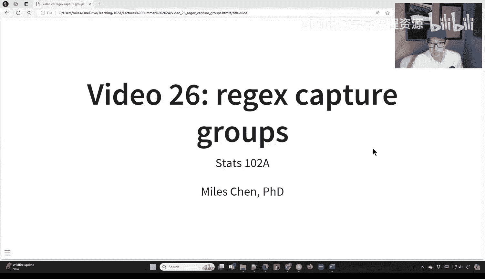

All right， let me cover regx capture groups so you can use parentheses to define a group that groups together parts of a regular expression。

 So besides grouping part of regular expression together parentheses also create numbered capture group。

 So any matches to the part of the pattern defined by the parentheses can then be referenced by group number。

 either for modification or replacement， if you include a question mark colon after the opening parentheses。

 then this becomes a noncap group， So if you have this pattern parentheses ABC， then parentheses DF。

 and thenses question colon GH， the pattern ABC creates a capture group1 DF is capture group 2 in GHI is a group。

 but it's not captured。 and then you use groups in conjunction would string match or string match all and string are to get the kind of capture groups。

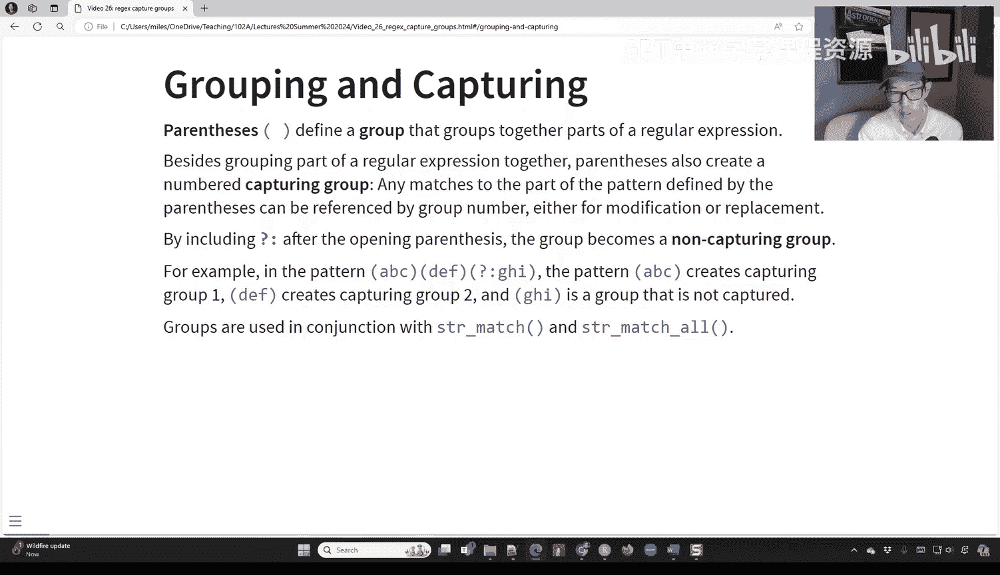

So here are some example patterns if you have A and then parentheses， B C D。

It will look for a match of ABC D， the entire pattern。

 and it will capture the text in group in that group B， C。 Okay。

 and you're not limited to just literal characters you can put in meta charactersacters anywhere here。

 Okay， here， if you create。Put in a question mark colon that will be a non capture group here。

 I've got ABC in parenthees D EF， and then in parenthees GHI。 Okay。

 that will match group ABC and GHI， but it has to match the entire pattern here okay。

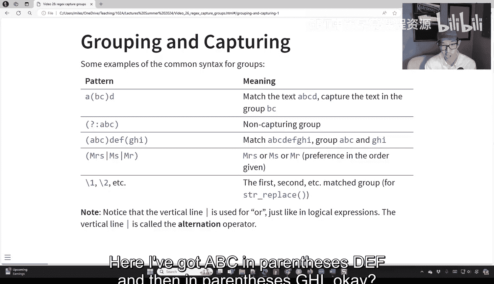

Here within groups you can also put in vertical bars。

 this is how you kind of do the or's okay and it reads left to right so it's going to look for MRS or M or MR。

 with preference in that order and then later on， if you want to refer back to a capture group that you have。

 you can use backslash 1， backslash 2， and you can use say example for string replace or something like that okay。

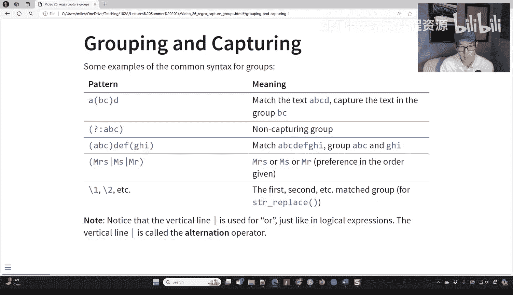

Okay， so here the pattern is B， D EF question mark colon GHI。

 This says GHI has to be part of the pattern， but don't capture it。 And so I've got ABC D E E FG。

 H I J， K L and it will capture。The entire pattern， B， D， E， F， GHI， and then using string match。

 it extracts out the groups that we've specified in this case， B， C and D， E F。Here if I have ABC D。

 E FGH， and I as capital， now we no longer have a match。And so we get N's here。

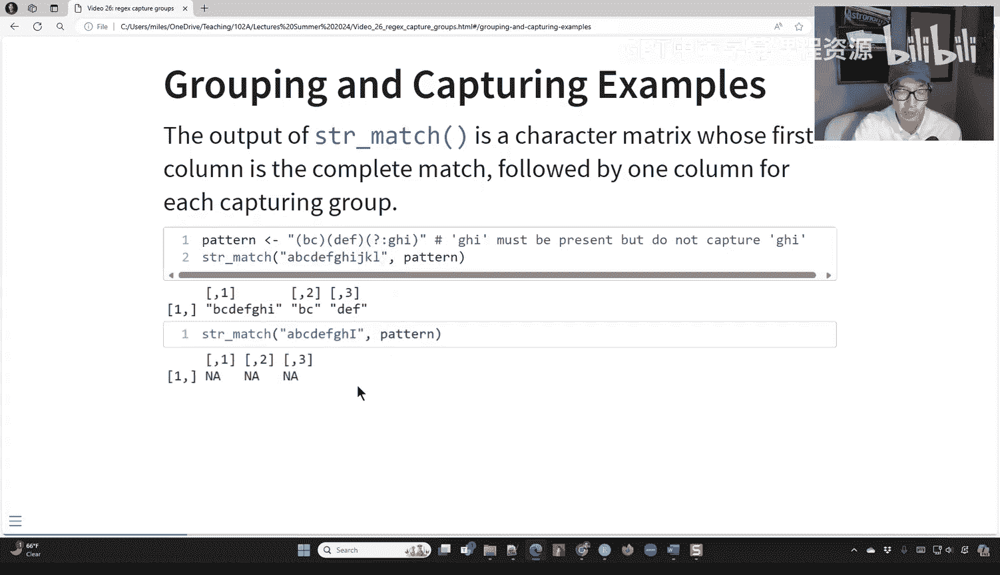

Okay， so let's do something a little bit more than just literal characters Here。

 I've got a group with。M S or M， S or M R。 And my text is Mr。 Dot Smith， Missus Dot Lee。Coma space。

 Miz dot space Garcia。And so as we read from left to right， we're going to get a match for MR。Okay。

 then we get a match for MRS， and then we get a match for M S。And so these are。

 it could be either MRS， M or M， Okay as as matches。 So that's there。

If I put this in the wrong order， however， because it reads left to right。

 giving the order in in its preference and says， okay， I find a match here。 Okay。

 watch what happens here。 If I do M R followed by M R S or M R S or M。 S here。 it's going to say。

 okay， I've got a match for M R for Mr。 Smith， then I get a match for M R。For Missus Lee， okay。

 MRS dot Lee， it just， it says， oh， I got a match for M。 We're good。 Okay， and it moves on。

 and then it matches M S for Miss Garcia。 So here you want to kind of specify your things in the correct order。

Here's another thing you could。 you could also just do M followed by an optional R。

 R 0 or1 and00 or 1 ss。 And that would also match M， MRS and M。

 This will also match just capital M by itself。 So maybe that's。Maybe that's not what we want， okay。

Here we can say capture the group， the the title， MRS or M S or M， followed by a literal period。

 followed by a space。Followed by one or more word characters。 Okay， and this is in a captured group。

So。We'll match the entire。 will match the entire pattern。

 and then we will extract out the two capture groups。So。We get a match with MR dot Space Smith。 Okay。

 that matches this pattern。 And so thats that is what here appears here。

The first capture group corresponds to the title M。

 and then os the second capture group corresponds to the last name， Smith。Same thing here。

 Next thing， we get a match with MRS dot Lee space Lee， and then。This part matches the title。

 and then this is the。Last knee that gets extracted there。 Okay， we got M Garcia and oh。

 I threw in there here Andy Hope。 that doesn't get matched because we don't have a match with the MRRSMS or MR。

 Okay， so now we can extract out last names from this kind of text string because we have a cap capture group and we can just say。

 hey， I just want this kind of column over here。Here by putting in question mark colon here。

 this is a non capture group。Okay， and so the result here is it matches the same patterns before。

 but then it's not worried about the title。 It's a non capture group。

 So it's not going to be one of the the columns that gets extracted here。

 So you can compare this where the title is part of the capture group。

With this where the title is not part of the capture group。Is a non captured group。

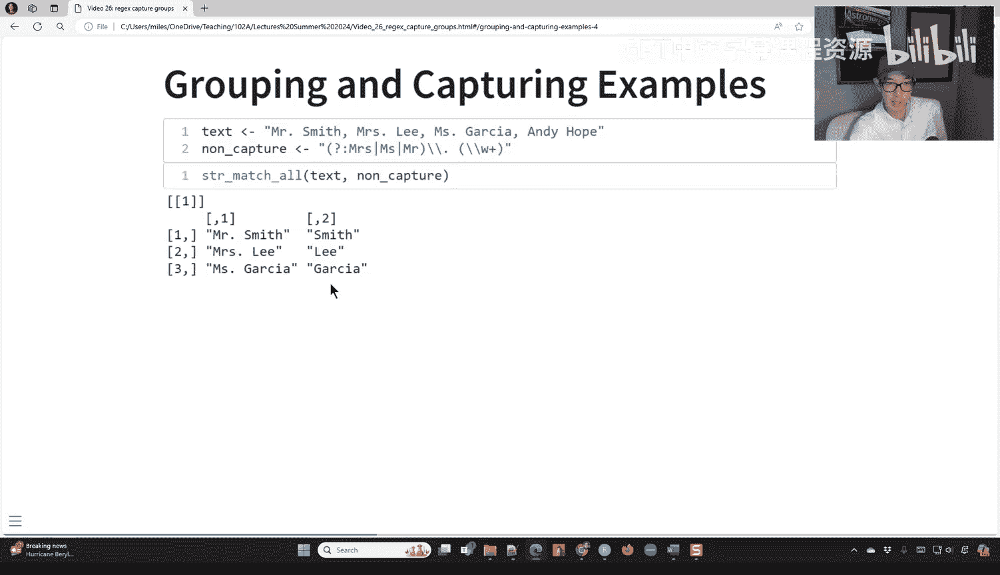

With back references， okay？The first group will become back slash 1。

 and the second group will become back slash 2。 So here I'm saying。

 look for one or more word characters followed by a space and then one or more word characters。

 So basically， we're doing like first name， space， last name。

 And then I'm going to say followed by an optional comma。 match all of these things。

 So we're going get match for George Washington， John Adams， Thomas Jefferson。

And then the capture groups are George， John Thomas， for the first capture group。

 Washington and Adams， Jefferson， for the second capture group。

 the basically the first names and the last names。And now with this。

 I can kind of run a string replace all I can say， take this text， take the pattern。

 But then when you find a match for the pattern， replace it。With backslash 2。

 comma space backslash 1， semicolon。Okay， so what's going to happen there。

 We're basically going to replace this pattern George Washington comma with second column。

 Washington comma Space， first column， George or first capture group， George Semilon。

 And so my original text was George Washington comma space， John Adams comma space， Thomas Jefferson。

 and that is going to get replaced with Washington comma， George semilon， Adams comma John semilon。

 Jeffersona Thomas， Semilon。 So I've basically rewritten this in order。By basically， last name。

 first name。

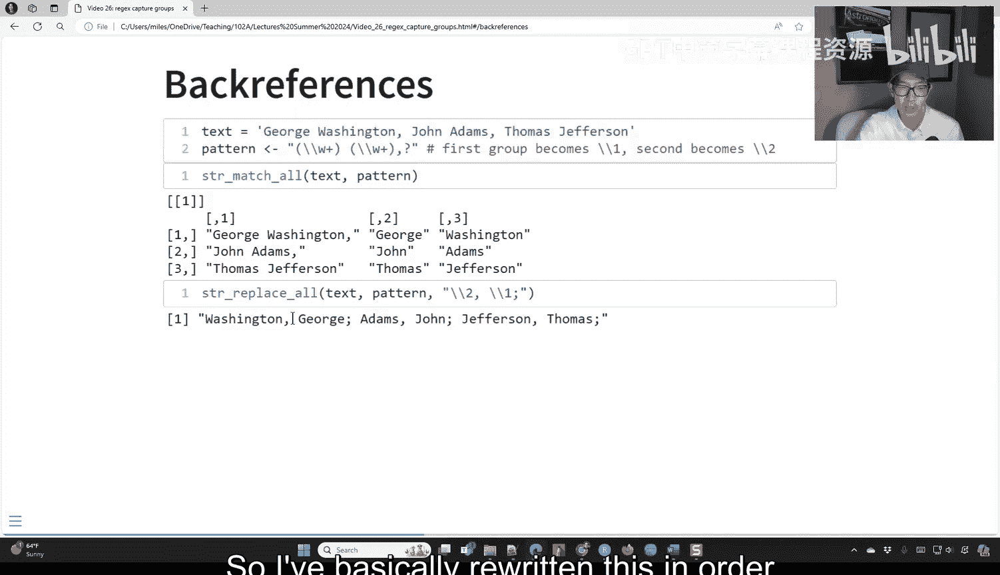

Allright， so here is an example here。 I've got the quick Ron Fox jumps over the the lazy dog。

And what does this say， this says。The pattern we're going to look for is back slash B， word boundary。

Followed by a capture group of one or more word characters， followed by one or more spaces。

Followed by。Back slash 1， basically， the group of texts that was captured earlier in this capture group。

 followed by a word boundary。So what this is going to do is basically。

 it's going to search for duplicated words。 So in this case， it was going to find the space the Okay。

 in that here。Because in this text， we have over the the。Lazy dog。

 we have basically a word that got repeated。 And so this will go through and detect anything where words get repeated。

And。And identify that。 so that could be useful in terms of like cleaning up text。

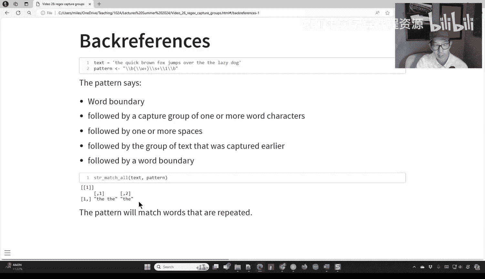

Here is an example。 It's a little bit more complicated， but this will extract a regular expression。

 Ex a phone number。 This is going to search for an optional， literal opening parentheses。Okay。

 we put a question mark to make it optional。Then we have a capture group。

Where the we have a digit between two and9， so in the US。Area codes cannot start with a 1 or0。

 So area codes。I have three digits。 so we're going to have a digit between 2 and 9。

 followed by two digits to any two digits。 Okay， and then a closing parentheses， which is optional。

And then we have a character set。Either a dash is space or a dot， Okay， but and that's optional。

And then。Basically， the phone number， which is going to be a digit between 2 through 9。

2 additional digits， an optional character of dash space or dot。

It's optional because of the question mark， and then four digits。

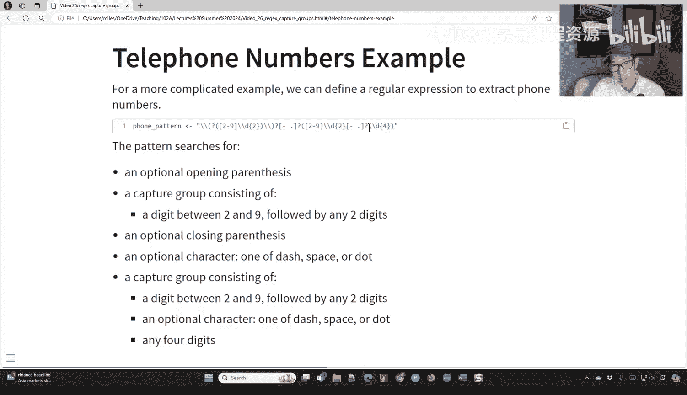

And that's a capture group right there。So we can try testing it out。 I've got text， Apple 1，878，6，13。

10， space2，0，9， 1，6，2，6，3，1，0 dot2，08 dot 0，4，4，8，3，0，0，82，5，8，4，3，0， work， Col space 3，2，3，2，2，4，2。

6，1，1， Semi me colon home。 So you could imagine somebody， you know， having a web form where you say。

 enter your phone number。 And then people are just typing in all kinds of crazy stuff here。 Kate。

 we'll try running our pattern。 we'll see what we get。 Okay， we get no match for Apple。

For the 800 number， we get this extracted for this thing， we get that extracted。For whoops， for this。

 we get this matching。 this also gets matching there as far as the it just matches the first one。

 So we just get the 3，2，3 there。 And then this is not a phone number because it starts off with a one。

 So there's no match there。喂。If I do string extract all， okay。Basically。

 we get the same results here。 Okay， except for the Ns， We get a character 0。

 And then right here where we have two phone numbers listed， it's going to extract both of them。

 It gets the the work number。嗯。And then it gets， it gets this， okay。It gets this one as well。 Okay。

 so it gets both of those。Okay， so。Here we'll just do a string match。 And with string match。

 it uses the capture groups。 So it says， okay， I match this and I match this and I matched。Okay。

 I matched these things and it pulls out the air code， 800310310310323。

 and it pulls out the phone number down here。So we're able to pull those out。

 string match all basically does the same thing， except when you have multiple。

 you get one for each row。So you get a list with all of these things。

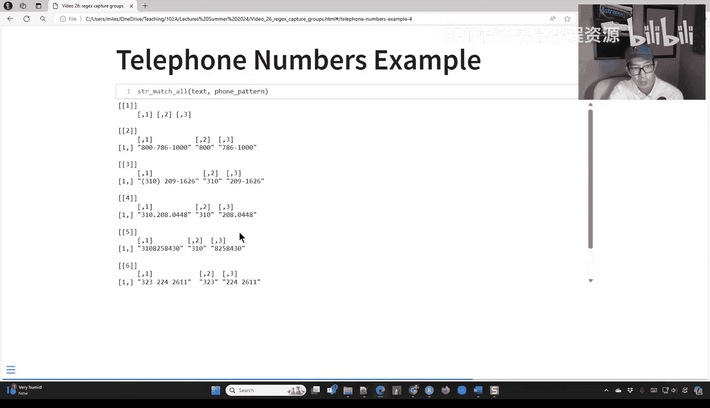

Okay， so。I can kind of work through everything there。From this previous thing，1，2，3，4。

 so I'm going to say it。 I want to go through basically all of the entries in here。

Using string match， all will go through the entire kind of。

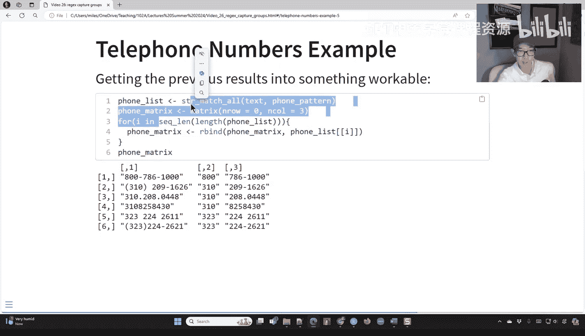

AList here， and then we'll make a matrix out of it。

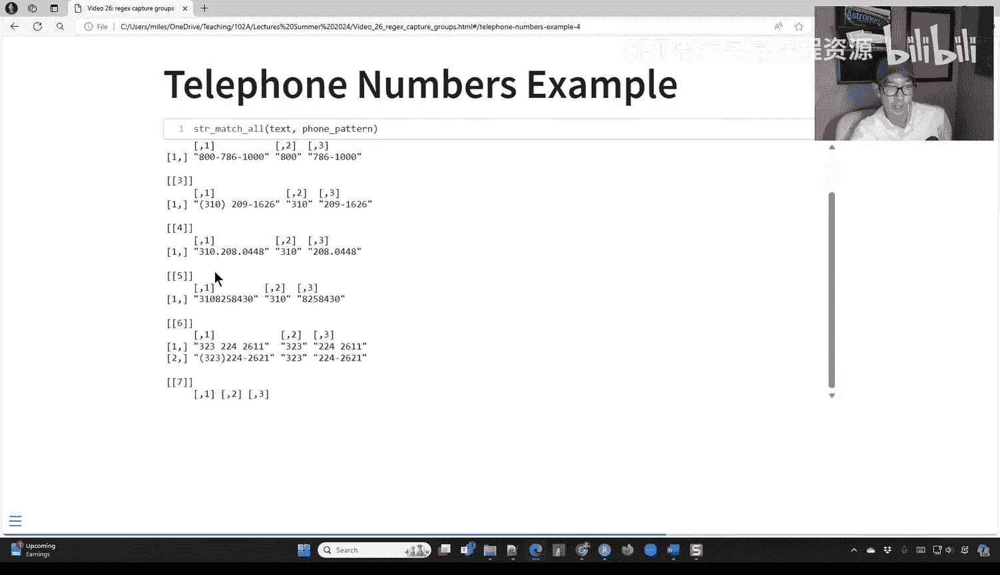

And so this is here I'm using the regular expression。

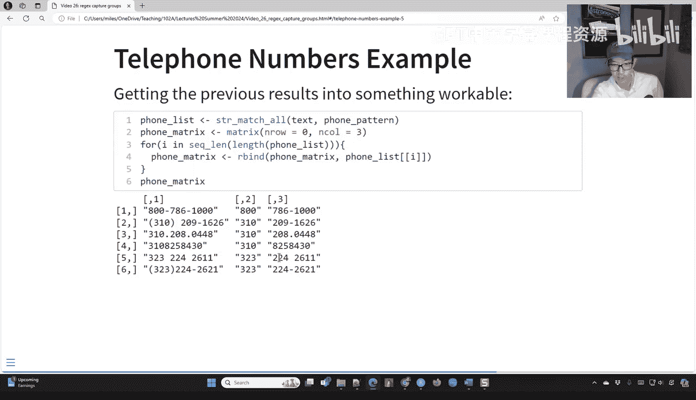

Okay， for matching the phone number。And then if I want to do some cleaning up， I can do that， right。

 So I can say， hey， you know what， I don't really like how all of these things they' are written。

 You know， some have dashes， Some have dots， Some don't put spaces there。 Some have spaces。 And。

 and maybe I want to clean this up。 So I can say， all right， let's look at this。 We've got。

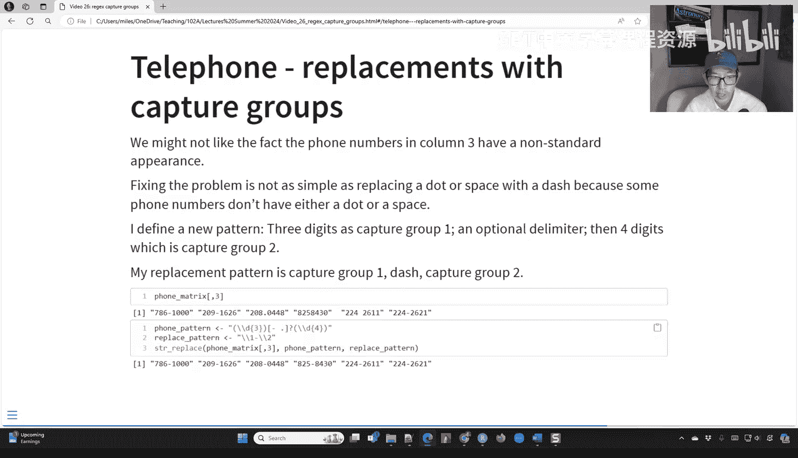

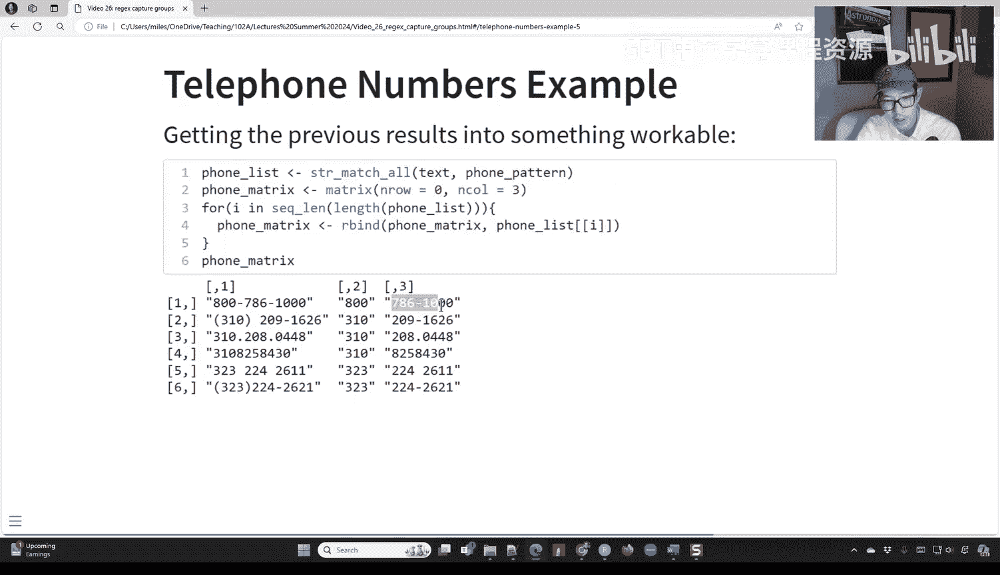

3 net digits。And then a dash a spacer dot， which is optional。 And four digits， this is going to be。

The pattern and what I want to I want to clean them up。

 but I just want to take the first capture group and then I want to put in a dash and I want the second capture group so I'm going to take this text and I'm going to clean it up using the string replace using kind of my capture groups in the back references and so these things the I got 208 dot 0448 and then I put in a dash here oops。

Here I have 8，2，5，8，4，3，0。And that gets cleaned up 82，5 dash，84，3，0。

 The space gets replaced with a dash。And everything looks a little bit cleaner here。

So you can kind of process through text using regular expressions to kind of clean things up。

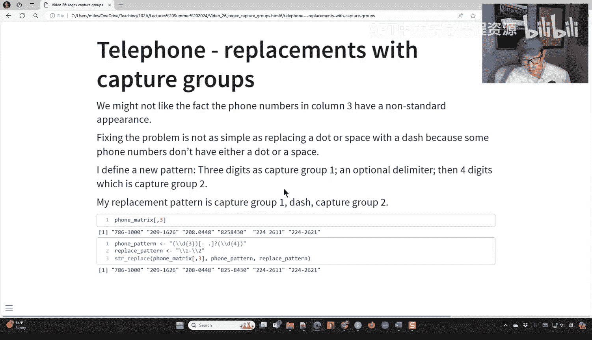

Okay， the last bit we'll take a look at our lookarounds， okay？

Sometimes we want to match characters that have a certain pattern before or after it。

 And these statements are called look aheads or look behind or look arounds because they look ahead or behind a pattern to check if another pattern does or doesn't exist。

 So you have the positive look ahead。 the negative look ahead and you have the positive look behind and the negative look behind。

 okay。嗯。You aren't allowed to use stars or pluses in look behinds。

 They have to have a bounded length。

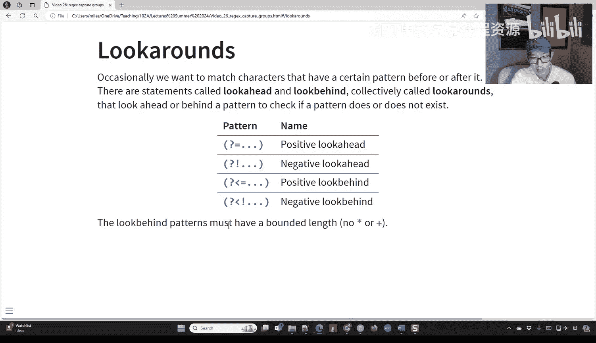

So let's say here， Okay， So a positive look ahead looks ahead of the current match to ensure that basically the sub pattern。

 whatever you put in here， matches。 So here it says I put a gray hat on my gray greyhound。

 and we're going to say we only want to match the gray。😊，The word gray。

 if it's followed by the word hound here。 Okay， so this is gonna to be a positive look ahead。

 So we only want want where basically the gray where it's followed by grayhound。 Okay。

 so hound is not part of the match。 Okay， so when you say， hey， locate it。 It's just going to be G。

 R E Y。 It's 29th to the 32nd character。 The hound itself is not part of the the match。 Okay。

 but it just， it's there to kind of make sure that we're getting gray followed by hound here。

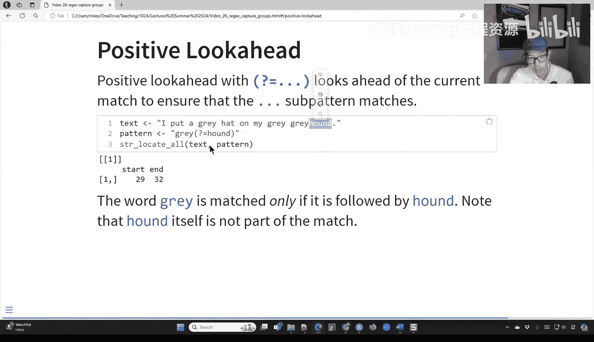

Okay。Negative basically， is the opposite。 We want gray where it's not followed by hound。 Okay。

 so we get a match for gray。 We get a match for this gray。

 and we don't get a match for the gray hound。 Okay。

 so the word gray only if it is not followed by hound。

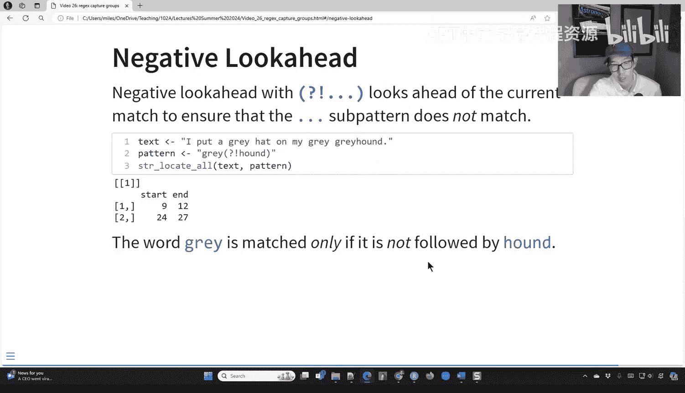

Okay， positive look behind， basically。Says， okay， we have to have something if it's immediately preceded by something。

 So here I say I withdrew $101 bills，$25 bills and 5$20 bills。 Okay， and so we might say， hey。

 I want anything that's a digit， one or more digits here。

 But I really only want to get the ones that are correspond to the denominations of the bills。

 So the ones， the fives in the 20s。 I don't actually want。

 I don't want the 100 or the 20 or the five here， I want the $1 bill， the $5 bill or the $20 bills。

 So how do we do that。 We're going to make sure that where it's preceded。

 This is the negative the positive look behind。 Okay， question mark。Less than equals， Okay。

 And then the pattern that we want to match is the literal dollar sign。 Okay， so then we'll say。

 okay， what has， what's preceded by a literal dollar sign。 that's， that's the 1，5 and the 20。

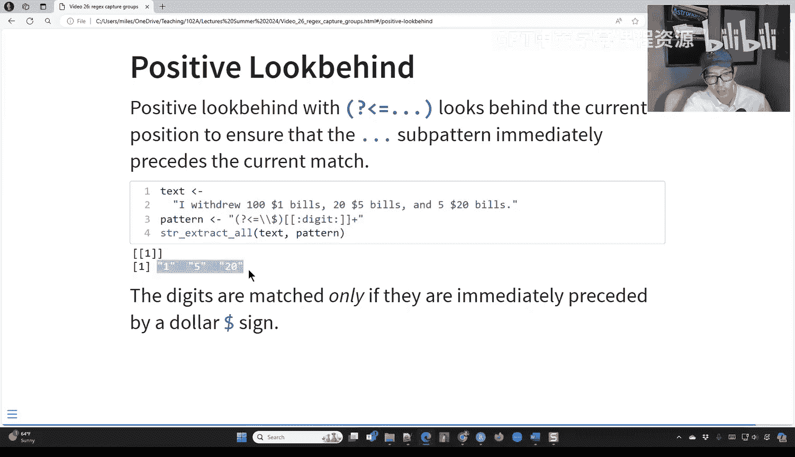

And then the negative look behind is just kind of the the opposite where we say， hey。

 only if it's not preceded by a dollar sign。 So we'll get the 100， the 20。We get the five。

 and then we also get this 0 from $20 bills， so。You know。

 what would we do if we want to kind of clean this up and make sure。

We're not going to pick up something like this。 Okay， maybe you throw in， say。

 like a word boundary or something to kind of ensure that you're not going to get something like that。

Okay， we'll go ahead and and there that's that for look aheads and look arounds。

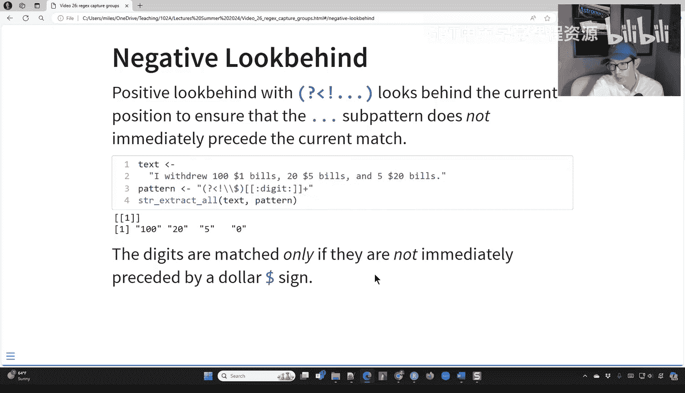

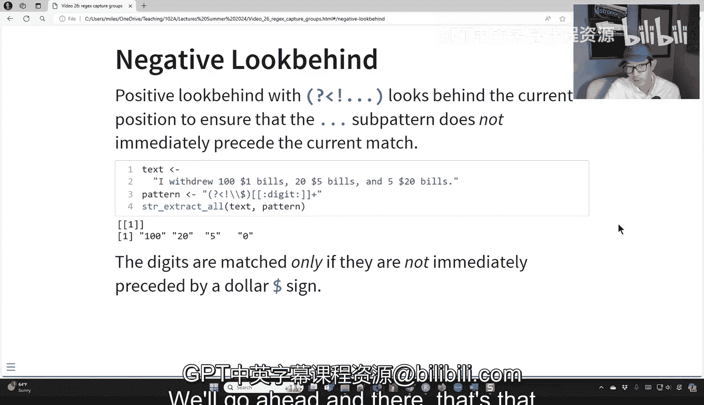