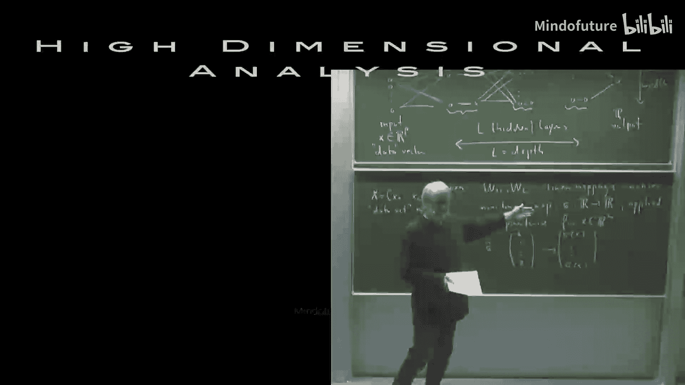
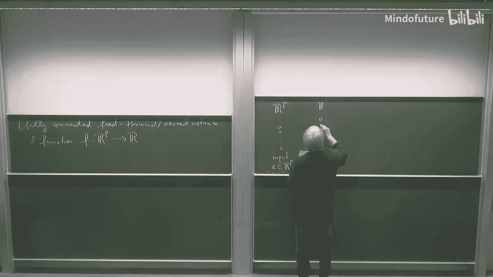
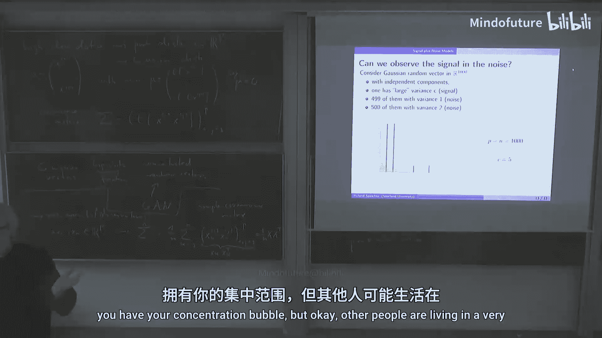

# 001：引言与概览

在本节课中，我们将要学习高维分析的基本概念，特别是随机矩阵理论及其在机器学习中的应用。我们将从理解神经网络的基本结构开始，探讨高维数据带来的挑战与机遇，并介绍如何利用概率分布和随机矩阵理论来分析和处理这些数据。

## 神经网络的基本结构

上一节我们介绍了课程的整体目标，本节中我们来看看神经网络的基本构成。神经网络本质上是一个从高维空间到实数集（或更高维空间）的特定形式的函数。

具体来说，我们通常研究的是全连接前馈神经网络。这是一个函数 **F**，它从一个高维空间（例如 **R^P**）映射到实数 **R**。这里的 **P** 代表数据的维度，通常非常大，这也是高维现象发生的关键所在。

神经网络并非任意函数，它具有特定的结构。以下是其核心组成部分：

*   **输入层**：输入是一个 **P** 维向量 **X ∈ R^P**，代表数据点。
*   **隐藏层**：输入通过一系列“层”进行变换。每一层包含两个操作：
    1.  **线性变换**：通过一个矩阵 **W** 进行映射。例如，第一层矩阵 **W1** 将数据从 **P** 维映射到 **M** 维。
    2.  **非线性激活**：对线性变换后的向量的每个分量，应用一个固定的非线性函数 **σ: R → R**（例如 ReLU 函数）。这个操作是逐分量进行的。
*   **输出层**：经过 **L** 层隐藏层后，最后一个线性变换 **W_{L+1}** 将 **M** 维向量投影到一维实数 **R**，作为最终输出。

因此，整个网络函数由参数（所有矩阵 **W1, ..., W_{L+1}**）和固定的非线性激活函数 **σ** 决定。**L** 是网络的深度，**M** 是网络的宽度。

## 机器学习的目标与挑战

上一节我们定义了神经网络的结构，本节中我们来看看如何用它解决实际问题。在机器学习中，我们的目标是用神经网络来表征或区分不同的数据集。

例如，我们可能有一个包含猫和狗图片的数据集。每张图片可以表示为一个高维向量（**P** 很大）。我们希望训练一个神经网络函数 **F**，使得对于猫的图片输出接近1，对于狗的图片输出接近0。

然而，我们并不知道如何显式地定义这个函数。传统的编程方法是告诉计算机识别猫狗的规则，但这通常效果不佳。现代机器学习的方法是：我们只提供大量示例（数据），让计算机通过调整网络参数（即那些矩阵 **W**）来自动“学习”这个函数。这个过程称为训练。

一个令人惊讶且尚未完全解开的谜题是：神经网络通常被严重过度参数化（参数数量远大于训练样本数）。根据经典学习理论，这容易导致“过拟合”，即模型只记住了训练数据而无法泛化到新数据。但事实上，深度神经网络在这种过度参数化的情况下依然表现出优秀的泛化能力。

## 高维数据的概率建模

为了从数学上分析神经网络的行为，我们需要对输入数据本身进行建模。由于真实数据（如图片）的分布非常复杂，我们通常用概率分布来描述它们。

在高维空间中，高斯分布（正态分布）是一个特别有用的模型，因为我们可以对其进行大量精确计算。一个均值为0的 **P** 维高斯向量 **X** 完全由其协方差矩阵 **Σ** 决定，其中 **Σ_{ij} = E[X_i X_j]**。

虽然真实数据很少是完美的高斯分布，但一个关键的数学洞察是：如果我们从一个高斯向量出发，对其施加李普希茨连续函数的变换，所得到的新向量虽然不再是高斯分布，但它会保留高斯分布的一个重要性质——**集中性**。这意味着许多函数在这个新向量的分布下，其值会高度集中在平均值附近。这种“集中随机向量”可能更接近真实数据的特性。

## 从样本中估计协方差矩阵

在实际应用中，我们并不知道真实的概率分布，只能通过有限的观测样本来推断。假设我们有 **n** 个独立的 **P** 维观测样本 **X_1, ..., X_n**。

我们想要估计真实协方差矩阵 **Σ**。一个自然的估计量是样本协方差矩阵 **Ŝ**：

**Ŝ = (1/n) Σ_{k=1}^{n} X_k X_k^T**

在经典统计学中，我们固定维度 **P**，让样本量 **n** 趋于无穷。此时，样本协方差矩阵 **Ŝ** 会收敛到真实协方差矩阵 **Σ**。

## 高维比例渐近框架

然而，在大数据时代，我们面临的往往是另一种情况：数据维度 **P** 和样本量 **n** 都很大，并且处于同一数量级（例如 **P/n → 常数**）。在这种“高维比例”框架下，**Ŝ** 不会收敛到 **Σ**。

但令人振奋的是，我们仍然可以在这个新的框架下进行严格的数学分析。当 **P, n → ∞** 且比例固定时，样本协方差矩阵 **Ŝ** 的特征值分布会收敛到一个确定的极限分布（如马琴科-帕斯图分布），而这个极限分布可以通过真实协方差矩阵 **Σ** 计算出来。这为我们理解高维数据提供了新的强大工具。

## 高维空间中的集中现象

高维空间既带来“维数灾难”，也带来“维数福音”。福音的核心就是**集中现象**。

考虑一个简单的例子：一个 **P** 维标准高斯随机向量。当 **P** 增大时，其欧几里得长度会越来越集中在理论平均值 **√P** 附近。同样，两个独立高斯随机向量之间的夹角余弦（内积）会越来越集中在0附近，意味着它们在高维空间中几乎总是近似正交的。

这种集中现象不仅限于高斯向量，也适用于更广泛的“集中随机向量”。对于神经网络这类复杂函数，当输入是高维集中随机向量时，其输出行为也可能变得更加可预测和稳定，这或许是深度学习成功的一个数学基础。

## 随机矩阵理论的应用实例：信号检测

随机矩阵理论在高维统计中有一个经典应用：信号检测中的“尖峰”模型。

假设我们的数据由一个强信号分量和大量噪声分量组成。真实协方差矩阵的特征值包含一个大的“信号”特征值和许多小的“噪声”特征值。当我们从有限样本计算样本协方差矩阵 **Ŝ** 时，在经典框架下（**n** 很大，**P** 固定），大特征值应该能被清晰识别。

但在高维比例框架下（**P, n** 都大且成比例），情况不同了。噪声特征值的分布会散开成一个连续的谱。只有当信号强度足够大，超过某个明确的阈值（由噪声谱的边缘决定）时，它才会在样本特征值分布中表现为一个可分离的“尖峰”。如果信号强度低于这个阈值，它就会淹没在噪声谱中而无法被检测到。随机矩阵理论可以精确地描述这个阈值和“尖峰”的位置。

本节课中我们一起学习了高维分析课程的概览。我们介绍了神经网络的基本数学形式，讨论了在高维数据中利用概率模型和随机矩阵理论进行分析的动机。我们看到了从经典统计到高维比例渐近框架的转变，并初步领略了高维集中现象的威力及其在信号检测等领域的应用。这些概念和工具将为我们后续深入理解机器学习的数学原理奠定基础。