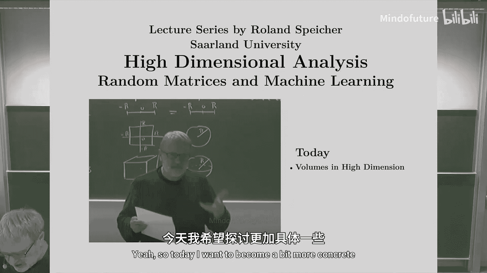

# 002：高维空间中的体积 📐

在本节课中，我们将要学习高维空间中体积的基本概念，特别是超球体和超立方体的体积行为。我们将看到，随着维度的增加，体积会表现出一些反直觉的特性，例如“集中”现象。

上一节我们介绍了课程的整体目标，即理解高维数据及其上的函数。本节中，我们来看看如何衡量高维集合的“大小”，这通常通过体积或概率分布来实现。

## 体积与概率分布

我们考虑一个高维空间中的集合，例如一个数据集。衡量其大小的最简单方法是计算其体积。在概率论的语境下，如果我们考虑集合上的均匀分布，那么某个子集的概率就是其体积与整个集合体积的比值。

以下是定义体积的数学公式：

\[
\text{vol}(A) = \int_{A} d\mathbf{x} = \int_{\mathbb{R}^p} \mathbb{1}_A(\mathbf{x}) \, d\mathbf{x}
\]

其中，\(\mathbb{1}_A\) 是集合 \(A\) 的指示函数，\(\mathbf{x} = (t_1, \ldots, t_p)\) 是 \(p\) 维向量。

## 核心几何对象：球体与立方体

为了具体理解体积行为，我们研究两个基本几何对象：超球体和超立方体。

### 超立方体

\(p\) 维超立方体 \(C_p(R)\) 定义为：

\[
C_p(R) = \{ \mathbf{x} \in \mathbb{R}^p : |t_i| \leq R, \, \forall i = 1, \ldots, p \}
\]

其体积计算非常简单，是各边长的乘积：

\[
\text{vol}(C_p(R)) = (2R)^p
\]

特别地，当 \(R = 1/2\) 时，我们得到单位立方体，其体积为 1。

### 超球体

\(p\) 维超球体 \(B_p(R)\) 定义为：

\[
B_p(R) = \{ \mathbf{x} \in \mathbb{R}^p : t_1^2 + \ldots + t_p^2 \leq R^2 \}
\]

其体积可以通过积分计算。首先，体积随半径 \(R\) 的缩放关系为：

\[
\text{vol}(B_p(R)) = R^p \cdot \text{vol}(B_p(1))
\]

因此，关键在于计算单位球体 \(B_p(1)\) 的体积。

## 单位球体体积的计算

通过极坐标变换和递归关系，我们可以推导出单位球体体积的精确公式。

以下是递归推导的核心步骤。我们通过积分最后两个变量（使用极坐标）来建立递归关系：

\[
\text{vol}(B_p(1)) = \frac{2\pi}{p} \cdot \text{vol}(B_{p-2}(1))
\]

迭代这个关系，并区分维度 \(p\) 为奇数或偶数，我们得到最终公式。

对于偶数维度 \(p = 2k\)：

\[
\text{vol}(B_{2k}(1)) = \frac{\pi^k}{k!}
\]

对于奇数维度 \(p = 2k+1\)：

\[
\text{vol}(B_{2k+1}(1)) = \frac{2^{k+1} \pi^k}{(2k+1)!!} \quad \text{其中} \quad (2k+1)!! = (2k+1)(2k-1)\cdots 3 \cdot 1
\]

这两个公式可以统一用伽马函数 \(\Gamma\) 表示：

\[
\text{vol}(B_p(1)) = \frac{\pi^{p/2}}{\Gamma\left(\frac{p}{2} + 1\right)}
\]

## 高维下的渐近行为

为了理解高维下的体积行为，我们使用斯特林公式来近似伽马函数。

斯特林公式指出，对于大的 \(s\)：

\[
\Gamma(s+1) \sim \sqrt{2\pi s} \left( \frac{s}{e} \right)^s
\]

将其应用于单位球体体积公式，我们得到对于大的维度 \(p\)：

\[
\text{vol}(B_p(1)) \sim \frac{1}{\sqrt{\pi p}} \left( \frac{2\pi e}{p} \right)^{p/2}
\]

从这个近似中，我们可以得出几个关键结论。

### 结论一：固定半径球体的体积趋于零

对于任何固定的半径 \(R\)，当维度 \(p \to \infty\) 时，球体体积趋于零：

\[
\lim_{p \to \infty} \text{vol}(B_p(R)) = 0
\]

这与低维的直觉相反。

### 结论二：保持单位体积所需的半径

如果我们希望球体的体积与单位立方体（体积为1）相当，那么半径 \(R\) 必须随维度增长而增大。具体来说，\(R\) 需要按 \(\sqrt{p}\) 的尺度增长：

\[
R \sim \sqrt{\frac{p}{2\pi e}}
\]

## 高维体积的集中现象

上述计算引出了高维几何中几个著名的“集中”现象。以下是三个核心观察：

1.  **体积集中在球面附近**：在高维球体中，绝大部分体积都集中在靠近球表面的一个薄壳内。
2.  **体积集中在赤道附近**：对于任意选定的“北极”方向，绝大部分体积都集中在垂直于该方向的赤道平面附近。
3.  **向量几乎正交**：在高维单位球体中随机选取两个向量，它们几乎总是近似正交的。

这些现象在低维空间中并不明显，但在高维空间中成为主导特性。它们对于理解高维数据分析和机器学习中的许多现象至关重要。

## 总结

本节课中我们一起学习了高维空间体积的基本计算。我们推导了超球体和超立方体的体积公式，并利用斯特林公式分析了其在高维下的渐近行为。我们发现，固定半径的球体体积在高维下会收缩至零，而要保持体积恒定，半径需按 \(\sqrt{p}\) 增长。最后，我们介绍了高维体积的集中现象，这将是后续课程中深入探讨随机向量行为的基础。下一节，我们将使这些集中现象的表述更加精确，并开始证明它们。