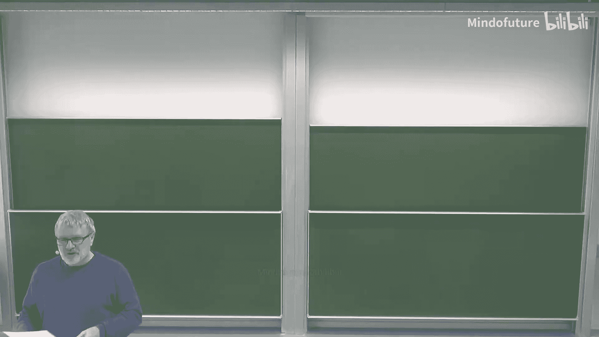

# 003：体积的集中现象




在本节课中，我们将要学习高维空间中一个非常有趣的现象：体积的集中。具体来说，我们将探讨在一个高维球体中，其体积（或质量）是如何高度集中在球体表面附近、赤道附近，以及随机向量之间是如何几乎正交的。我们将把这些直观的描述转化为精确的数学陈述和证明。

## 体积集中在表面附近

上一节我们介绍了高维空间中的体积概念。本节中，我们来看看第一个集中现象：体积集中在球体表面附近。

这意味着，如果我们观察一个高维单位球体，其大部分体积都位于一个非常薄的“外壳”中，这个外壳距离球体表面非常近。为了精确描述这一点，我们考虑一个随机向量 **x** 均匀分布在 **P** 维单位球中。我们关注其范数接近1的概率。

设 **ε** 是一个小的正数。我们想要计算随机向量 **x** 的范数大于 **1 - ε** 的概率。这个概率等于满足该条件的向量体积与整个单位球体积的比值。

根据体积公式，我们可以直接计算这个概率：
```
P(||x|| > 1 - ε) = 1 - (1 - ε)^P
```
当维度 **P** 趋于无穷大时，对于任何固定的 **ε**，**(1 - ε)^P** 项会趋于0。因此，概率趋于1。这严格证明了在高维空间中，几乎所有的点都位于距离表面 **ε** 以内的薄壳中。

为了更直观地理解这个薄壳有多薄，我们可以让 **ε** 随 **P** 变化。如果我们希望薄壳内的体积保持一个常数比例（例如大约63%），那么 **ε** 应该按 **1/P** 的比例缩放。具体来说，当 **ε = 1/P** 时，我们有近似关系：
```
P(||x|| > 1 - 1/P) ≈ 1 - 1/e ≈ 0.632
```
这意味着，在一个厚度仅为 **1/P** 的极薄外壳中，集中了超过60%的体积。

为了得到更精确的不等式估计，我们可以使用以下引理：对于任意 **P ≥ 1** 和 **ε ∈ (0, 1)**，有：
```
(1 - ε)^P ≤ e^{-εP}
```
利用这个不等式，我们可以得到概率的下界估计：
```
P(||x|| > 1 - ε) ≥ 1 - e^{-εP}
```
这是一个典型的指数型集中不等式，明确显示了维度 **P** 和容差 **ε** 如何共同影响集中速度。

## 体积集中在赤道附近

上一节我们看到了体积如何集中在球体表面。本节中，我们探讨第二个现象：体积集中在任何一个赤道附近。

在高维球体中，“赤道”是指与某个给定方向（例如“北极”方向）垂直的超平面。由于赤道本身是 **P-1** 维的，其 **P** 维体积为零。因此，我们讨论的是在赤道的一个 **ε** 邻域内的体积。

具体来说，我们固定最后一个坐标轴方向为北极方向。那么，赤道由所有最后一个分量为零的向量构成。我们关注的是最后一个分量绝对值小于 **ε** 的向量集合的概率。

这个概率可以通过积分计算。设 **x = (x1, ..., xP)**，我们想要计算 **P(|xP| < ε)**。通过迭代积分和利用球体体积公式，我们可以将这个概率表达为：
```
P(|xP| < ε) = [Γ(P/2 + 1) / (√π Γ((P-1)/2 + 1))] * ∫_{-ε}^{ε} (1 - t^2)^{(P-1)/2} dt
```
虽然这个表达式看起来很复杂，但我们可以通过渐近分析来理解其行为。利用斯特林公式处理伽马函数，并对积分进行变量替换 **t = s / √(P/2)**，我们可以证明，对于任何固定的 **ε > 0**，当 **P → ∞** 时，有：
```
lim_{P→∞} P(|xP| < ε) = 1
```
这意味着，在高维空间中，几乎所有的点都位于任何一个选定赤道的附近。

更重要的是，我们可以控制集中的速度。通过更精确的估计（这将是课后作业的一部分），可以证明存在如下不等式：
```
P(|xP| < ε) ≥ 1 - e^{- (P-1) ε^2 / (2π)}
```
这个不等式再次显示了指数级的集中。它告诉我们，为了使这个概率保持在一个常数值，**ε** 应该按 **1/√P** 的比例缩放。也就是说，高维球体中一个随机向量的任何一个特定分量，其典型大小约为 **1/√P**。

由于对称性，这个结论对每一个坐标分量都成立。因此，高维球体中的向量，其所有分量通常都非常小，约为 **1/√P**。即使我们同时考虑多个不同的赤道（即多个坐标方向），只要数量有限，体积仍然会高度集中在所有这些赤道的交集附近，这在低维空间中是难以想象的。

## 随机向量几乎正交

上一节我们讨论了向量分量集中在零附近的现象。本节中，我们将其推广，看看两个独立随机向量之间的关系。

第三个集中现象是：从高维单位球中随机选取的两个向量，它们几乎总是近似正交的。精确地说，我们考虑两个独立的随机向量 **x** 和 **y**，都均匀分布在单位球中。我们关注它们之间夹角余弦值（即归一化内积）很小的概率。

我们希望估计概率 **P(|<x, y>| / (||x|| ||y||) < ε)**。由于问题的旋转对称性，我们可以固定其中一个向量 **y** 而不失一般性。特别地，我们可以选择 **y = (0, 0, ..., 0, 1)**，即最后一个分量为1的单位向量。

在这种情况下，内积 **<x, y>** 就是 **x** 的最后一个分量 **xP**。因此，我们的问题简化为估计：
```
P( |xP| / ||x|| < ε )
```
为了控制这个比值，我们需要同时控制分子 **|xP|** 和分母 **||x||**。我们引入一个中间参数 **η**，使得 **η / (1 - η) = ε**（对于小的 **ε**，**η ≈ ε**）。

然后，我们可以利用前两节的结果：
1.  **控制分量**：**P(|xP| < η) ≥ 1 - e^{- (P-1) η^2 / (2π)}**
2.  **控制范数**：**P(||x|| > 1 - η) ≥ 1 - e^{-Pη}**

如果事件 **A = {|xP| < η}** 和事件 **B = {||x|| > 1 - η}** 同时发生，那么根据 **η** 的定义，有 **|xP| / ||x|| < ε**。

利用概率论的基本不等式（并集概率小于等于概率之和），事件 **A ∩ B** 的概率满足：
```
P(A ∩ B) ≥ 1 - [e^{- (P-1) η^2 / (2π)} + e^{-Pη}]
```
由于 **A ∩ B** 是 **{|xP| / ||x|| < ε}** 的一个子集，后者的概率至少和 **P(A ∩ B)** 一样大。因此，我们得到了两个随机向量几乎正交的概率下界。

这个估计表明，随着维度 **P** 增大，两个随机向量夹角接近90度的概率会以指数速度趋近于1。其中一项要求 **η ~ 1/√P**，另一项要求 **η ~ 1/P**，最终占主导地位的项决定了收敛速度。

## 总结

本节课中我们一起学习了高维球体中体积集中的三个核心现象：

1.  **表面集中**：体积高度集中在球体表面一个极薄的壳层内。概率下界由 **1 - e^{-εP}** 给出。
2.  **赤道集中**：体积高度集中在任何一个赤道（即与某坐标轴垂直的超平面）附近。一个随机向量的任一特定分量以高概率小于 **ε**，其概率下界约为 **1 - e^{-P ε^2}**，这意味着典型分量的幅度为 **O(1/√P)**。
3.  **向量正交**：随机选取的两个向量几乎总是近似正交的。我们可以通过结合前两个现象的估计，得到其概率的下界。

这些现象通过精确的数学公式和不等式得以体现，例如使用 **(1 - ε)^P ≤ e^{-εP}** 进行指数估计。它们揭示了高维几何与低维直觉的深刻差异，并为理解后续更复杂的随机结构（如高斯随机向量）的集中性质奠定了基础。在下一讲中，我们将把注意力转向高斯分布，看看类似的集中现象如何在那里体现。