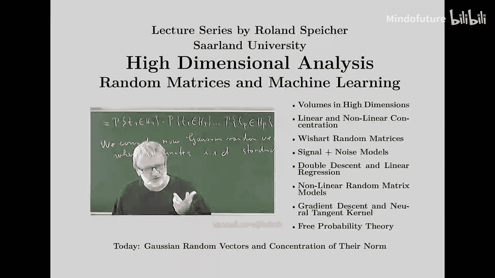
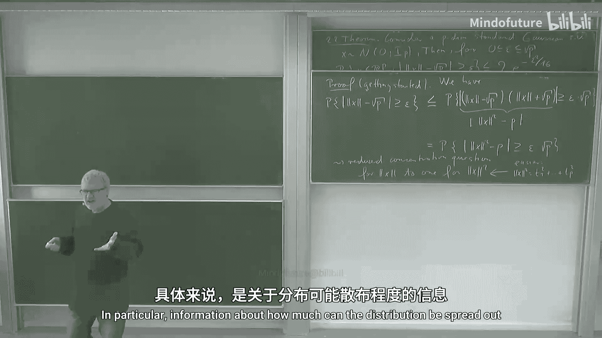

# 004：高斯随机向量及其范数的集中性



## 概述

在本节课中，我们将学习如何描述和分析高维空间中的函数，特别是当数据点服从高斯分布时。我们将重点探讨高斯随机向量的性质，并研究其范数（长度）的集中性现象。这意味着，在高维空间中，随机向量的长度会以极高的概率集中在一个特定的值附近。我们将从线性函数的集中性开始，介绍马尔可夫不等式和切比雪夫不等式等基本工具，并最终为高斯向量范数的集中性提供一个证明思路。

## 高斯随机向量

上一节我们讨论了单位球上的均匀分布。本节中，我们将转向数学上更易处理、也更常见的数据模型：高斯随机向量。

### 定义与密度函数

我们考虑一个随机向量 **x** ∈ ℝ^p，其分量是独立同分布的。每个分量都服从标准高斯分布（均值为0，方差为1）。这样的向量称为**标准高斯随机向量**。

其概率密度函数可以明确写出。由于各分量独立，联合密度是各分量密度的乘积。每个分量 T_i 的密度为：
```
ψ_i(t_i) = (1/√(2π)) * exp(-t_i² / 2)
```
因此，整个向量 **x** = (T_1, ..., T_p) 的联合密度函数为：
```
ψ(x) = ψ(t_1, ..., t_p) = (1/(2π)^(p/2)) * exp(-||x||² / 2)
```
其中 `||x||² = t_1² + ... + t_p²` 是向量 **x** 的欧几里得范数的平方。


我们记作：
```
x ~ N(0, I_p)
```
其中 `0` 是零向量（均值），`I_p` 是 p×p 的单位矩阵（协方差矩阵）。

### 期望计算

我们首先计算一个简单但重要的量：向量范数平方的期望值。
```
E[||x||²] = E[t_1² + ... + t_p²] = Σ_{i=1}^p E[t_i²]
```
由于每个 `t_i ~ N(0,1)`，其方差 `E[t_i²] = 1`。因此：
```
E[||x||²] = p
```
这个结果很直观：在高维空间中，随机向量的“典型”长度平方大约是维度 p。我们期望其范数 `||x||` 则集中在 `√p` 附近。

## 集中性现象与证明目标

从数值模拟（如第一次作业中的直方图）中，我们观察到高斯向量的范数确实集中在 `√p` 附近。现在，我们希望从理论上证明这一点。

具体来说，我们希望证明以下形式的集中性不等式：对于重新标度后的向量 `x̃ = x / √p`（其期望范数约为1），存在某个常数 C，使得对于任意 ε > 0，有：
```
P( | ||x̃|| - 1 | > ε ) ≤ 2 * exp(-C * p * ε²)
```
这个不等式表明，偏离典型值 `1` 超过 ε 的概率随着维度 p 的增加而呈指数级衰减，这就是高维集中性的核心。

为了证明这一点，我们首先需要一些概率论工具。

## 基本概率不等式

在深入证明之前，我们需要回顾两个基础但强大的一般性概率不等式。它们不依赖于分布的具体形式，适用于任何随机变量。

### 马尔可夫不等式

马尔可夫不等式适用于非负随机变量。它用期望值来界定随机变量取大值的概率。

**定理（马尔可夫不等式）**：设 Y 是一个随机变量（或随机向量），`F(Y)` 是一个非负可测函数。则对于任意 α > 0，有：
```
P( F(Y) > α ) ≤ E[F(Y)] / α
```

**证明思路**：将期望 `E[F(Y)]` 的积分区域分解为 `{F(Y) > α}` 和其补集。在 `{F(Y) > α}` 上，用常数 α 下界估计 `F(Y)`，然后移项即可得到结论。

马尔可夫不等式非常通用，但它要求函数非负，并且对于控制围绕均值的偏差不太直接。

### 切比雪夫不等式

切比雪夫不等式利用方差来量化随机变量偏离其均值的程度。



**定理（切比雪夫不等式）**：设 `F(Y)` 是一个随机变量，其期望 `E[F(Y)]` 和方差 `Var(F(Y))` 有限。则对于任意 ε > 0，有：
```
P( | F(Y) - E[F(Y)] | > ε ) ≤ Var(F(Y)) / ε²
```

**证明思路**：将切比雪夫不等式转化为马尔可夫不等式的形式。考虑非负函数 `G(Y) = (F(Y) - E[F(Y)])²`。注意到 `E[G(Y)] = Var(F(Y))`。然后对 `G(Y)` 和阈值 `ε²` 应用马尔可夫不等式即可。

切比雪夫不等式给出了偏差概率的一个上界，但这个上界是 `1/ε²` 量级的，衰减速度不如我们期望的指数衰减快。

## 应用于高斯向量范数平方

现在，让我们尝试将切比雪夫不等式应用于我们的问题，看看能得到什么。

我们考虑函数 `F(x) = ||x||²`。我们已经知道 `E[F(x)] = p`。接下来需要计算方差 `Var(F(x))`。

由于 `||x||² = Σ_{i=1}^p t_i²`，且 `{t_i}` 独立，方差具有可加性：
```
Var(||x||²) = Σ_{i=1}^p Var(t_i²)
```
每个 `t_i ~ N(0,1)`。计算 `Var(t_i²) = E[t_i⁴] - (E[t_i²])²`。标准高斯分布的四阶矩 `E[t_i⁴] = 3`，二阶矩 `E[t_i²] = 1`。因此：
```
Var(t_i²) = 3 - 1² = 2
```
所以：
```
Var(||x||²) = p * 2 = 2p
```

现在，我们想用切比雪夫不等式来估计 `||x||²` 偏离其期望 `p` 的概率。回顾我们之前的目标，对于范数本身，我们关心的是 `| ||x|| - √p | > ε`。通过简单代数变换（两边乘以 `||x|| + √p`），可以将其关联到：
```
P( | ||x|| - √p | > ε ) ≤ P( | ||x||² - p | > ε * √p )
```
因此，我们对右边应用切比雪夫不等式，其中 `ε' = ε√p`：
```
P( | ||x||² - p | > ε√p ) ≤ Var(||x||²) / (ε√p)² = (2p) / (ε² p) = 2 / ε²
```

这个结果 `2/ε²` 是一个不依赖于维度 p 的常数上界。虽然它确实表明偏差概率是有界的，但并没有显示出我们期望的、随着 p 增大而指数衰减的集中性。它比我们目标中的指数型上界 `2 * exp(-C p ε²)` 要弱得多。

## 总结与展望

本节课中，我们一起学习了：

1.  **高斯随机向量**的定义及其概率密度函数。
2.  高斯向量范数平方的期望值 `E[||x||²] = p`，这暗示其范数应集中在 `√p` 附近。
3.  两个基础概率不等式：
    *   **马尔可夫不等式**：用期望控制大值概率。
    *   **切比雪夫不等式**：用方差控制偏离均值的概率。
4.  将切比雪夫不等式应用于高斯向量范数平方，得到了一个 `O(1/ε²)` 的概率上界，但这不足以证明强烈的指数集中性。

切比雪夫不等式只利用了二阶矩（方差）的信息。为了得到更紧的、指数衰减的界，我们需要利用分布的所有矩的信息，或者利用高斯分布和独立性的特殊结构。这引导我们走向更强大的工具，例如**切尔诺夫界（Chernoff Bound）** 或利用矩母函数的方法。

下一节课，我们将沿着这个思路，通过考虑随机变量的矩母函数，并利用独立性和高斯分布的特性，来证明高斯向量范数（以及更广泛的李普希茨函数）的指数型集中不等式。这将使我们能够完成本节开头所陈述定理的证明。