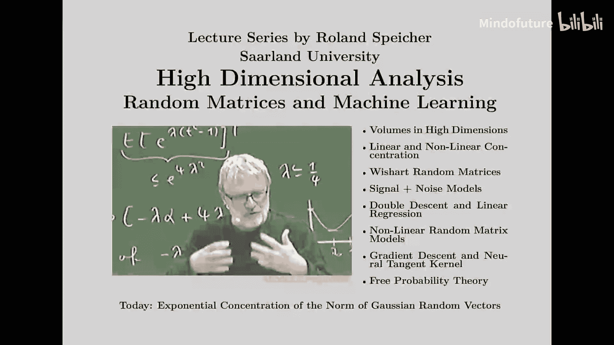
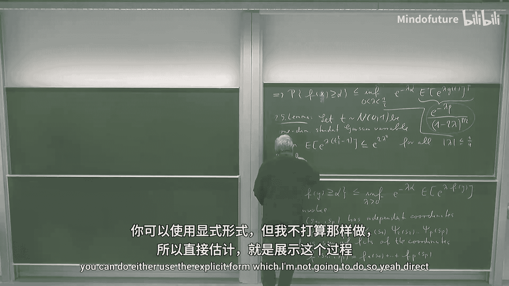

# 005：高斯随机向量范数的指数集中性




在本节课中，我们将学习如何证明高斯随机向量的集中现象。目前，我们正尝试为其线性函数证明这一点。首先，让我们回顾一下将要证明的内容，并发展一些更通用的工具。

具体来说，我们想要证明以下情况。我们观察一个具有正态分布的P维高斯随机向量。这是最简单的情况，即均值全为0，协方差矩阵是单位矩阵。这意味着我的P维向量的所有分量都是独立的，且每个分量都服从标准高斯分布。

我们想要证明，这样一个向量的范数会集中在期望值附近。这个期望值是P。具体来说，我们想要证明，对于满足范数与期望值距离较大的向量，其概率可以被指数形式地估计。

更精确地说，我们想要证明以下不等式对于介于0和某个较小值之间的ε成立。这里“较小”是指相对于期望值而言。我们也可以将其重写为缩放后的版本，这样ε可以是一个很小的量，因为维度P很大时，指数衰减会非常快。

## 从范数到范数平方

上一节我们介绍了要证明的目标，本节中我们来看看证明的第一步。为了处理方便，我们不是直接处理x的范数，而是处理x的范数平方，因为范数平方是独立分量的和，这更容易控制。

我们可以通过以下关系将范数的集中性问题转化为范数平方的集中性问题：
```
概率( | ||x|| - √P | > ε ) ≤ 概率( | ||x||² - P | > ε√P )
```
因此，如果我们能证明范数平方的集中性，也就证明了范数的集中性。关键在于，||x||² 是各分量平方的和，而各分量是独立的。因此，我们面对的是一个独立随机变量之和的函数，这可以利用集中性工具来处理。

## 一般性工具：马尔可夫与切比雪夫不等式

在深入具体证明之前，我们先回顾一些一般性的概率不等式，它们是构建更高级工具的基础。

马尔可夫不等式告诉我们，对于一个非负随机变量，其期望值如何限制其取大值的概率。如果随机变量只取正值，并且我们知道其期望值，那么它不可能以高概率取非常大的值，否则会拉高期望值。

基于马尔可夫不等式，我们有切比雪夫不等式，它利用方差来提供概率界限。然而，仅仅使用期望和方差（二阶矩）可能不够。为了获得更精确的集中性界限，我们需要考虑更高阶的矩。

## 矩生成函数与切尔诺夫界

上一节我们提到了高阶矩，但直接处理矩很复杂。更好的方法是使用矩生成函数，它本质上类似于傅里叶变换，将所有矩的信息打包到一个函数中。由于指数函数的性质，它能很好地处理独立性。

设Y是我们的随机向量，f(Y)是我们感兴趣的标量函数。我们定义其矩生成函数为：
```
M(λ) = E[ exp(λ f(Y)) ]
```
其中λ是一个我们稍后会优化的参数。对指数函数进行幂级数展开：
```
exp(λ f(Y)) = Σ_{k=0}^{∞} (λ f(Y))^k / k!
```
取期望后，我们得到：
```
M(λ) = Σ_{k=0}^{∞} (λ^k / k!) * E[ f(Y)^k ]
```
可以看到，矩生成函数包含了f(Y)的所有矩的信息。通过选择不同的λ，我们可以调整不同阶矩的权重。

现在，我们想估计概率 P( f(Y) > α )。利用指数函数的单调性（当λ>0时），我们可以将这个概率转化为对矩生成函数的估计。具体步骤如下：
1.  因为当 f(Y) > α 时，有 exp(λ f(Y)) > exp(λ α)。
2.  因此，P( f(Y) > α ) = P( exp(λ f(Y)) > exp(λ α) )。
3.  对正随机变量 exp(λ f(Y)) 应用马尔可夫不等式：
    ```
    P( exp(λ f(Y)) > exp(λ α) ) ≤ E[ exp(λ f(Y)) ] / exp(λ α)
    ```
4.  这给出了对于任意λ>0都成立的界限：
    ```
    P( f(Y) > α ) ≤ exp(-λ α) * E[ exp(λ f(Y)) ]
    ```
5.  为了得到最紧的界限，我们对所有λ>0取右边表达式的最小值（下确界）：
    ```
    P( f(Y) > α ) ≤ inf_{λ>0} { exp(-λ α) * E[ exp(λ f(Y)) ] }
    ```
这个不等式非常强大，但需要我们知道矩生成函数 E[ exp(λ f(Y)) ] 的具体形式或上界。

## 应用于独立和的情况

上一节我们得到了一个通用不等式，本节中我们来看看当函数f具有特殊形式——即独立随机变量之和时，情况如何简化。

现在，我们引入更具体的信息。假设随机向量Y的分量是独立的。并且函数f是各分量函数的和：
```
f(Y) = f1(Y1) + f2(Y2) + ... + fP(YP)
```
在我们的具体问题中，Y就是高斯向量x，而f(x) = ||x||²，即每个fi(Yi) = Yi²。

由于分量独立，且指数函数将和转化为积，矩生成函数可以因子化：
```
E[ exp(λ f(Y)) ] = E[ exp(λ Σ_i fi(Yi)) ] = E[ Π_i exp(λ fi(Yi)) ]
```
利用独立性，乘积的期望等于期望的乘积：
```
E[ Π_i exp(λ fi(Yi)) ] = Π_i E[ exp(λ fi(Yi)) ]
```
因此，问题简化为计算或估计每个单项的期望 E[ exp(λ fi(Yi)) ]。在我们的设定中，所有fi相同（都是平方函数），所有Yi的分布也相同（标准高斯）。所以我们需要估计：
```
E[ exp(λ (T² - 1)) ]
```
其中T ~ N(0,1)，并且我们减去了1，因为我们要处理的是 ||x||² - P = Σ_i (Xi² - 1)。



## 估计高斯平方的矩生成函数

现在我们需要具体计算或估计 E[ exp(λ (T² - 1)) ]。直接计算这个积分是可行的。

我们有：
```
E[ exp(λ (T² - 1)) ] = e^{-λ} * E[ exp(λ T²) ]
```
而 E[ exp(λ T²) ] 可以通过积分计算。经过计算（完成平方等技巧），我们得到：
```
E[ exp(λ T²) ] = 1 / √(1 - 2λ)， 对于 λ < 1/2
```
因此：
```
E[ exp(λ (T² - 1)) ] = e^{-λ} / √(1 - 2λ)， 对于 λ < 1/2
```
当λ ≥ 1/2时，该期望值为无穷大。所以我们的参数λ必须限制在(0, 1/2)区间内。

然而，这个显式表达式在后续优化中不太直观。我们更希望有一个形如 exp(C λ²) 的上界，因为这样更容易处理。可以证明以下引理：

**引理**：对于标准高斯变量T，当 0 ≤ λ ≤ 1/4 时，有
```
E[ exp(λ (T² - 1)) ] ≤ exp(2 λ²)
```
（注：常数2可能因证明细节而异，可能是4或其他常数，但这不影响指数衰减的本质。）

这个引理的证明可以通过直接分析上述显式函数，或者通过矩估计来完成。一种方法是先估计 (T² - 1) 的矩，然后利用矩生成函数是矩的级数这一事实。

以下是利用矩估计的思路概要：
1.  估计 E[ |T² - 1|^k ]。
2.  利用 |T² - 1|^k ≤ 1 + |T|^{2k} 等放缩，将其与高斯变量的 2k 阶矩联系起来。
3.  高斯的 2k 阶矩是 (2k-1)!!（双阶乘）。可以将其放缩为 C^k * k! 的形式。
4.  将矩的界代入矩生成函数的级数展开式：
    ```
    E[ exp(λ (T² - 1)) ] = Σ_{k=0}^{∞} (λ^k / k!) E[ (T² - 1)^k ]
    ```
5.  利用矩的估计 E[ (T² - 1)^k ] ≤ C^k * k!，我们得到：
    ```
    E[ exp(λ (T² - 1)) ] ≤ Σ_{k=0}^{∞} (C λ)^k = 1 / (1 - C λ)， 对于 Cλ < 1
    ```
6.  进一步地，1/(1-Cλ) ≤ exp(C‘ λ) ≤ exp(C’‘ λ²) 对于小λ成立。

通过这样的论证，我们可以得到形如 exp(C λ²) 的上界。

## 完成高斯范数的集中性证明

现在，我们拥有所有工具来完成主要定理的证明。我们想要证明：
```
P( | ||x|| - √P | > ε ) ≤ 2 exp( -ε² / 8 )
```
（常数可能是8或16，取决于之前的细节。）

回顾一下，我们已经将其转化为：
```
P( | ||x|| - √P | > ε ) ≤ P( | ||x||² - P | > ε√P )
```
而右边绝对值事件是两个单边事件的并：
```
P( | ||x||² - P | > ε√P ) = P( ||x||² - P > ε√P ) + P( ||x||² - P < -ε√P )
```
由于分布的对称性，这两个概率相等。因此，我们只需要估计其中一个，比如 P( ||x||² - P > ε√P )，然后乘以2。

设 α = ε√P。我们应用切尔诺夫界：
```
P( ||x||² - P > α ) ≤ inf_{λ>0} { exp(-λ α) * (E[ exp(λ (T² - 1)) ])^P }
```
这里我们用了因子化： (E[ exp(λ (T² - 1)) ])^P。

利用引理，当 0 ≤ λ ≤ 1/4 时，有 E[ exp(λ (T² - 1)) ] ≤ exp(2 λ²)。代入得：
```
P( ||x||² - P > α ) ≤ inf_{0≤λ≤1/4} { exp(-λ α) * exp(2P λ²) } = inf_{0≤λ≤1/4} exp( -λ α + 2P λ² )
```
现在，我们需要找到指数函数内部二次函数的最小值。令：
```
g(λ) = -λ α + 2P λ²
```
对λ求导并令其为零：
```
g'(λ) = -α + 4P λ = 0  =>  λ* = α / (4P)
```
我们需要检查 λ* 是否在 [0, 1/4] 区间内。由于我们考虑 ε 相对于 √P 较小（这是定理的条件），所以 α = ε√P，从而 λ* = ε / (4√P) 确实是一个小量，在条件范围内。

将 λ* 代回 g(λ)：
```
g(λ*) = -(α²/(4P)) + 2P * (α²/(16 P²)) = -α²/(4P) + α²/(8P) = -α²/(8P)
```
再将 α = ε√P 代入：
```
g(λ*) = - (ε² P) / (8P) = -ε² / 8
```
因此，我们得到：
```
P( ||x||² - P > ε√P ) ≤ exp( -ε² / 8 )
```
考虑到另一边以及从范数到范数平方的转换，最终得到：
```
P( | ||x|| - √P | > ε ) ≤ 2 exp( -ε² / 8 )
```
这就完成了证明。

## 总结与展望

本节课中我们一起学习了如何证明高斯随机向量范数的指数集中性。我们主要步骤如下：
1.  将问题从范数转化为范数平方。
2.  回顾并应用了基于矩生成函数的切尔诺夫界这一通用工具。
3.  利用随机变量分量的独立性，将矩生成函数因子化。
4.  具体估计了高斯平方随机变量 (T² - 1) 的矩生成函数，得到了形如 exp(C λ²) 的上界。
5.  通过优化切尔诺夫界中的参数λ，得到了最终的指数概率界。

我们所证明的实际上是更广泛现象的一个特例：对于独立随机变量之和，如果每个变量满足其矩生成函数有指数平方上界（即属于**次指数分布**），那么和就会表现出指数集中性。高斯变量的平方就是一个次指数分布的例子。

这种基于矩生成函数的方法非常强大，是证明许多集中不等式（如霍夫丁不等式、伯恩斯坦不等式）的基础。然而，目前我们处理的是线性函数（或可化为独立和）。对于机器学习，我们经常需要处理非线性函数。下一次，我们将探讨更一般的集中性不等式，例如利普希茨函数的集中性（通过塔尔格兰不等式等），这可以应用于更广泛的非线性场景。

---
**本节课中我们一起学习了：**
1.  高斯随机向量范数集中在√P附近的概率界限。
2.  利用切尔诺夫界和矩生成函数证明集中性的通用框架。
3.  如何通过因子化和矩估计处理独立随机变量之和。
4.  次指数分布的概念及其在集中性中的作用。