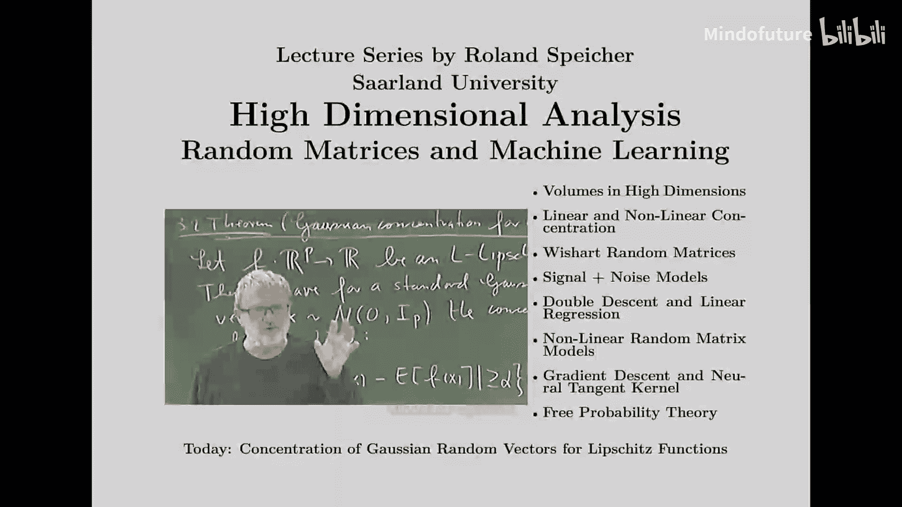
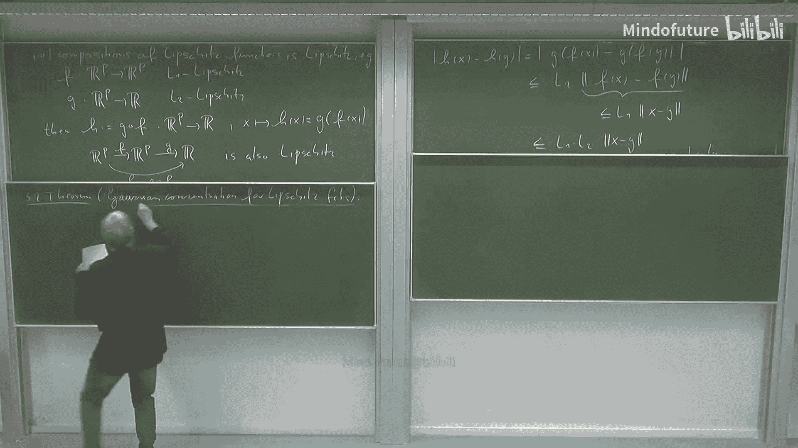

# 006：利普希茨函数下高斯随机向量的非线性集中性



在本节课中，我们将要学习高斯随机向量在更一般的非线性函数下的集中性。上一节我们讨论了线性函数的集中性，本节中我们来看看当函数满足利普希茨条件时，如何证明类似的集中不等式。

## 概述

我们考虑一个从 **R^p** 映射到 **R** 的函数 **f**。我们假设 **f** 是 **L-利普希茨** 的，这意味着对于所有 **x, y ∈ R^p**，有：
```
|f(x) - f(y)| ≤ L * ||x - y||
```
其中 **L** 是利普希茨常数。我们将研究当输入 **x** 是一个 **p** 维标准高斯随机向量（即各分量独立且服从标准正态分布）时，函数值 **f(x)** 在其期望值附近的集中现象。

## 利普希茨函数简介

首先，我们需要明确什么是利普希茨函数及其性质。利普希茨条件保证了函数不会变化得太快。

### 定义与基本性质

一个函数 **f: R^p → R** 被称为 **L-利普希茨** 的，如果存在常数 **L ≥ 0**，使得对于所有 **x, y ∈ R^p**，都有：
```
|f(x) - f(y)| ≤ L * ||x - y||
```
常数 **L** 被称为该函数的利普希茨常数。如果 **L=1**，则称函数为 **1-利普希茨**。

以下是关于利普希茨函数的一些关键点：

*   **与连续性的关系**：利普希茨函数一定是（一致）连续的。
*   **与可微性的关系**：如果一个可微函数 **f** 的梯度范数处处有界，即 **||∇f(x)|| ≤ L** 对所有 **x** 成立，那么 **f** 是 **L-利普希茨** 的。反之，可微的利普希茨函数其梯度范数也以 **L** 为界。
*   **非可微的例子**：在神经网络中常用的 **ReLU** 激活函数 **σ(t) = max(0, t)** 是 **1-利普希茨** 的，尽管它在 **t=0** 处不可微。

### 运算下的封闭性

在构建复杂模型（如神经网络）时，我们经常组合简单的函数。利普希茨性质在两种基本操作下是封闭的。

**1. 逐分量应用**

假设我们有 **p** 个利普希茨函数 **f_i: R → R**，每个的利普希茨常数都为 **L**。我们定义一个新函数 **F: R^p → R^p**，其第 **i** 个分量为 **f_i(x_i)**。那么 **F** 也是 **L-利普希茨** 的。重要的是，常数 **L** 不随维度 **p** 增大而变差。



**2. 函数复合**

假设 **f: R^p → R^m** 是 **L1-利普希茨** 的，**g: R^m → R^n** 是 **L2-利普希茨** 的。那么复合函数 **h = g ∘ f: R^p → R^n** 是 **(L1 * L2)-利普希茨** 的。特别地，如果 **f** 和 **g** 都是 **1-利普希茨** 的，那么 **h** 也是 **1-利普希茨** 的。

## 高斯集中不等式定理陈述

现在，我们可以陈述本节课的核心定理。

**定理（高斯向量的利普希茨集中性）**：设 **f: R^p → R** 是一个 **L-利普希茨** 函数。令 **X ∼ N(0, I_p)** 为一个 **p** 维标准高斯随机向量。那么，对于任意 **α > 0**，有：
```
P( |f(X) - E[f(X)]| ≥ α ) ≤ 2 * exp( -α² / (2L²) )
```
这个不等式表明，**f(X)** 以高概率集中在它的期望值附近，偏离超过 **α** 的概率随着 **α** 呈指数级衰减。

## 证明思路与简化

我们将概述定理的证明。一个完整的证明会用到一些技巧，但思路非常优雅。首先，我们可以对问题做一些简化。

**简化1：中心化**
我们可以定义新函数 **g(x) = f(x) - E[f(X)]**。函数 **g** 的期望为0，且利普希茨常数不变。因此，我们只需证明当 **E[f(X)] = 0** 时，有 **P( f(X) ≥ α ) ≤ exp( -α²/(2L²) )**。通过同样处理 **-f**，并利用概率的并集界，就能得到带因子2的绝对值的界。

**简化2：处理单边估计**
如上所述，我们集中证明 **P( f(X) ≥ α )** 的上界。

**简化3：光滑化近似**
我们可以将一般的利普希茨函数用光滑的利普希茨函数来逼近。因此，在证明中我们可以**假设 f 是可微的**。这样，利普希茨条件就等价于梯度范数有界：**||∇f(x)|| ≤ L** 对所有 **x** 成立。

### 证明的起点：矩生成函数与马尔可夫不等式

和上一讲证明线性集中性时类似，我们通过矩生成函数和马尔可夫不等式来开始。对于任意 **λ > 0**，有：
```
P( f(X) ≥ α ) = P( e^{λ f(X)} ≥ e^{λα} ) ≤ E[ e^{λ f(X)} ] / e^{λα}
```
这里我们应用了马尔可夫不等式。我们的目标是证明 **E[ e^{λ f(X)} ] ≤ e^{λ² L² / 2}**（或类似形式），这样代入上式后，通过优化选择 **λ**，就能得到形如 **exp(-α²/(2L²))** 的界。

### 关键技巧：引入独立副本与詹森不等式

直接估计 **E[ e^{λ f(X)} ]** 是困难的。一个巧妙的技巧是引入一个与 **X** 独立同分布的副本 **Y ∼ N(0, I_p)**。首先，注意到由于 **E[f(X)] = 0**，根据**詹森不等式**（因为指数函数是凸函数），我们有：
```
E[ e^{-λ f(Y)} ] ≥ e^{-λ E[f(Y)]} = e^0 = 1
```
因此，**1 ≤ E[ e^{-λ f(Y)} ]**。我们可以利用这个不等式来“乘以1”：
```
E[ e^{λ f(X)} ] = E[ e^{λ f(X)} ] * 1 ≤ E[ e^{λ f(X)} ] * E[ e^{-λ f(Y)} ]
```
由于 **X** 和 **Y** 独立，两个期望的乘积等于乘积的期望：
```
E[ e^{λ f(X)} ] * E[ e^{-λ f(Y)} ] = E[ e^{λ (f(X) - f(Y))} ]
```
于是，问题转化为估计 **E[ e^{λ (f(X) - f(Y))} ]**。

### 核心观察：路径积分与高斯旋转不变性

现在，我们处理 **f(X) - f(Y)**。由于我们假设 **f** 是可微的，我们可以用路径积分来表示这个差值。考虑连接 **Y** 和 **X** 的路径：
```
Z(θ) = cos(θ) * Y + sin(θ) * X,   θ ∈ [0, π/2]
```
当 **θ=0** 时，**Z(0)=Y**；当 **θ=π/2** 时，**Z(π/2)=X**。根据微积分基本定理：
```
f(X) - f(Y) = ∫_{0}^{π/2} (d/dθ) f(Z(θ)) dθ
```
计算导数：
```
(d/dθ) f(Z(θ)) = ⟨∇f(Z(θ)), (d/dθ)Z(θ)⟩ = ⟨∇f(Z(θ)), -sin(θ)Y + cos(θ)X ⟩
```
这里 **⟨·,·⟩** 表示内积。现在，关键的高斯性质出现了：

*   **X** 和 **Y** 是独立的标准高斯向量。
*   对于每个固定的 **θ**，**Z(θ)** 和 **W(θ) = -sin(θ)Y + cos(θ)X** 都是高斯向量的线性组合。
*   更重要的是，可以验证 **Z(θ)** 和 **W(θ)** 是**独立的**，并且都服从标准高斯分布（协方差矩阵为单位阵）。这是高斯分布特有的**旋转不变性**。

此外，由利普希茨条件（可微时等价于梯度有界），我们有 **||∇f(Z(θ))|| ≤ L**。

### 完成证明

利用上述观察，我们可以将 **f(X)-f(Y)** 表示为一个关于 **θ** 的积分，其中被积函数是两个独立标准高斯变量的内积，其中一个因子（梯度）的范数以 **L** 为界。通过计算这个积分的矩生成函数，并利用高斯变量的性质（例如，两个独立标准高斯内积的分布），最终可以证明存在常数 **c**（例如 **c=2/π²**），使得：
```
E[ e^{λ (f(X) - f(Y))} ] ≤ e^{c * λ² L² / 2}
```
将此结果代回最初的马尔可夫不等式：
```
P( f(X) ≥ α ) ≤ e^{c * λ² L² / 2 - λα}
```
现在，选择 **λ** 来最小化这个上界，即令 **λ = α / (c L²)**。代入得到：
```
P( f(X) ≥ α ) ≤ exp( -α² / (2c L²) )
```
这就给出了单边估计。结合对 **-f** 的同样处理，就得到了定理中形式的集中不等式（常数可能略有不同，但指数衰减的形式一致）。

## 总结

本节课中我们一起学习了：
1.  **利普希茨函数**的定义与性质，它是描述函数“光滑性”和“变化幅度”的重要工具。
2.  利普希茨函数在**逐分量应用**和**复合运算**下具有良好的封闭性。
3.  对于**高斯随机向量**，任何利普希茨函数的值都以其期望为中心呈指数级集中。这就是**高斯利普希茨集中不等式**。
4.  定理的证明运用了多个关键思想：**中心化简化**、通过**矩生成函数和马尔可夫不等式**转化问题、引入**独立副本**并利用**詹森不等式**、以及通过**路径积分**和**高斯分布的旋转不变性**来利用利普希茨条件。这个证明展示了处理非线性函数集中性问题的强大技巧。

这个定理是理解高维统计和机器学习中许多现象的基础，它告诉我们，即使是非常复杂的非线性函数，只要其变化不太剧烈（利普希茨常数控制），在高维高斯输入下，其输出也会表现出强烈的确定性。