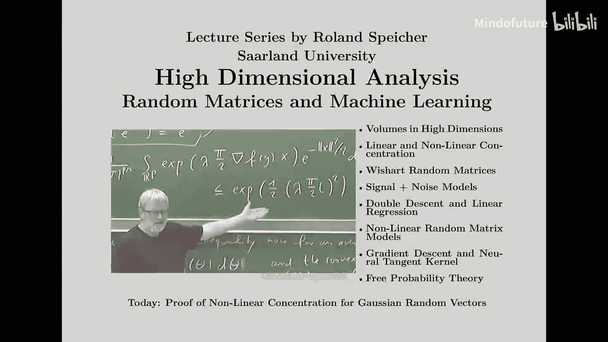
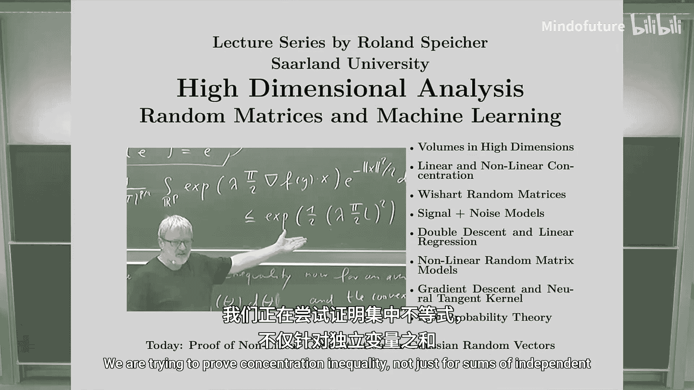

# 007：高斯随机向量非线性集中性的证明 🧮

在本节课中，我们将学习如何证明高斯随机向量在非线性函数作用下的集中性不等式。我们将看到，即使函数不是简单的线性组合，只要它满足利普希茨条件，其取值也会高度集中在期望值附近。

## 概述

我们将证明一个核心定理：对于一个利普希茨函数 `f` 和一个标准高斯随机向量 `X`，其函数值 `f(X)` 偏离其期望 `E[f(X)]` 的概率可以被一个高斯型尾部所控制。具体来说，我们将证明对于任意 `t > 0`，有：
`P(|f(X) - E[f(X)]| ≥ t) ≤ 2 exp(-t² / (2L²))`
其中 `L` 是函数 `f` 的利普希茨常数。

## 证明思路与设定

上一节我们介绍了集中性不等式的概念以及证明此类不等式的一般策略——利用马尔可夫不等式对矩生成函数进行估计。本节中，我们将具体针对高斯分布和利普希茨函数来执行这一策略。

我们的设定如下：
*   设 `f: R^p → R` 是一个利普希茨函数，其利普希茨常数为 `L`。这意味着对于所有 `x, y ∈ R^p`，有 `|f(x) - f(y)| ≤ L ||x - y||`。
*   设 `X` 是一个 `p` 维标准高斯随机向量，即 `X ~ N(0, I_p)`，其各分量独立且服从标准正态分布 `N(0,1)`。
*   为简化证明，我们可以不失一般性地假设 `E[f(X)] = 0`（否则考虑 `f(x) - E[f(X)]`）。同时，我们可以假设 `f` 是光滑的（可通过逼近得到），因此其梯度 `∇f` 存在且满足 `||∇f(x)|| ≤ L`。

我们的目标是证明：
`P(f(X) ≥ t) ≤ exp(-t² / (2L²))`
通过对称性，即可得到包含绝对值的完整不等式。

## 证明步骤

### 第一步：矩生成函数的初步估计

证明的核心是估计矩生成函数 `E[exp(λ f(X))]`，其中 `λ > 0` 是一个待优化的参数。我们引入一个与 `X` 独立同分布的副本 `Y`（即 `Y` 也是 `N(0, I_p)`）。

利用詹森不等式，我们可以进行第一次估计：
`E[exp(λ f(X))] ≤ E[exp(λ (f(X) - f(Y)))]`
这是因为 `E[f(Y)] = 0`，且指数函数是凸函数。

### 第二步：利用微积分基本定理展开差值

现在，我们处理差值 `f(X) - f(Y)`。由于 `f` 是光滑的，我们可以沿着连接 `X` 和 `Y` 的路径进行积分。我们选择如下参数化路径：
`X(θ) = cosθ * Y + sinθ * X`，其中 `θ ∈ [0, π/2]`
当 `θ=0` 时，`X(0)=Y`；当 `θ=π/2` 时，`X(π/2)=X`。根据微积分基本定理：
`f(X) - f(Y) = ∫_{0}^{π/2} (d/dθ) f(X(θ)) dθ`
`= ∫_{0}^{π/2} <∇f(X(θ)), X‘(θ)> dθ`
其中 `X‘(θ) = -sinθ * Y + cosθ * X`，`<·, ·>` 表示内积。

### 第三步：关键引理——旋转不变性

以下是证明中的一个关键引理，它利用了高斯分布特有的旋转不变性。

**引理**：对于任意固定的角度 `θ`，由 `X(θ)` 和 `X‘(θ)` 组成的 `2p` 维随机向量，仍然是一个由 `2p` 个独立的标准高斯随机变量组成的向量。特别地，`X(θ)` 和 `X‘(θ)` 是相互独立的 `p` 维标准高斯随机向量。

**简要证明**：将 `(X, Y)` 视为 `R^{2p}` 中的一个向量。从 `(X, Y)` 到 `(X(θ), X‘(θ))` 的变换是一个正交（旋转）变换。高斯分布在正交变换下保持不变，因此变换后的向量 `(X(θ), X‘(θ))` 的分布与 `(X, Y)` 相同，即各分量独立且服从 `N(0,1)`。

这个性质是证明仅适用于高斯分布的核心原因。

### 第四步：再次应用詹森不等式

现在，我们将第一步的估计与第二步的积分形式结合：
`E[exp(λ f(X))] ≤ E[exp(λ ∫_{0}^{π/2} <∇f(X(θ)), X‘(θ)> dθ)]`
为了将指数移到积分内部，我们对积分（视为一个期望）再次应用詹森不等式。注意 `∫_{0}^{π/2} dθ` 的总测度为 `π/2`，我们将其归一化为概率测度。
`≤ E[ (2/π) ∫_{0}^{π/2} exp( (λπ/2) <∇f(X(θ)), X‘(θ)> ) dθ ]`
`= (2/π) ∫_{0}^{π/2} E[ exp( (λπ/2) <∇f(X(θ)), X‘(θ)> ) ] dθ`

### 第五步：利用独立性与梯度界进行估计

根据关键引理，对于每个固定的 `θ`，`X(θ)` 和 `X‘(θ)` 独立。我们先固定 `X(θ)`（即固定了 `∇f(X(θ))` 这个向量），然后对 `X‘(θ)` 求期望。
对于固定的 `X(θ)`，内积 `<∇f(X(θ)), X‘(θ)>` 是独立标准高斯变量的线性组合，因此它本身服从一个一维高斯分布，其方差为 `||∇f(X(θ))||²`。
根据利普希茨条件（光滑版本），我们有 `||∇f(X(θ))|| ≤ L`。因此，该高斯分布的方差不超过 `L²`。
对于一个方差为 `σ²` 的高斯变量 `Z`，其矩生成函数为 `E[exp(sZ)] = exp(s²σ²/2)`。应用到这里：
`E[ exp( (λπ/2) <∇f(X(θ)), X‘(θ)> ) | X(θ) ] ≤ exp( ( (λπ/2)² L² ) / 2 )`
由于这个上界与 `X(θ)` 的具体值无关，所以对 `X(θ)` 求期望后，上界保持不变。又因为这个上界与 `θ` 无关，所以对 `θ` 的积分只是乘以因子 `π/2`，与之前的 `2/π` 相消。
最终我们得到：
`E[exp(λ f(X))] ≤ exp( (λ² π² L²) / 8 )`

### 第六步：应用马尔可夫不等式并优化参数

现在我们有了矩生成函数的界，可以应用马尔可夫不等式来估计尾部概率：
`P(f(X) ≥ t) = P(exp(λ f(X)) ≥ exp(λ t)) ≤ E[exp(λ f(X))] / exp(λ t)`
`≤ exp( (λ² π² L²)/8 - λ t )`
对于任意 `λ > 0` 都成立。为了得到最紧的界，我们选择 `λ` 来最小化指数部分 `(λ² π² L²)/8 - λ t`。
令其关于 `λ` 的导数为零：
`(λ π² L²)/4 - t = 0` => `λ* = (4t) / (π² L²)`
将 `λ*` 代回不等式：
`P(f(X) ≥ t) ≤ exp( - (2t²) / (π² L²) )`

### 第七步：得到最终形式

通过对称性（考虑 `-f`），我们可以得到双边不等式：
`P(|f(X) - E[f(X)]| ≥ t) ≤ 2 exp( - (2t²) / (π² L²) )`
虽然常数 `2/π²` 不是最优的（最优常数是 `1/(2L²)`，可通过其他更复杂的证明得到），但它清晰地展示了尾部概率以 `exp(-O(t²/L²))` 的形式衰减，这正是高斯型集中性的特征。

## 总结

本节课中我们一起学习了高斯随机向量非线性集中性不等式的证明。我们回顾并运用了以下核心技巧：
1.  **矩生成函数方法**：通过马尔可夫不等式将概率估计转化为对矩生成函数的分析。
2.  **对称化与副本技巧**：引入独立副本 `Y`，将问题转化为处理函数差值。
3.  **路径积分与微积分**：利用微积分基本定理将函数差值表示为梯度沿路径的积分。
4.  **高斯分布的特有性质**：关键引理利用了高斯分布在正交变换下的不变性，这是证明的核心。
5.  **参数优化**：通过选择最优的 `λ` 来得到最紧的概率上界。

这个证明展示了如何将针对线性函数（如霍夫丁不等式）的集中性分析，通过巧妙的数学工具推广到满足利普希茨条件的非线性函数上，揭示了高斯分布在高维几何和分析中的优美性质。