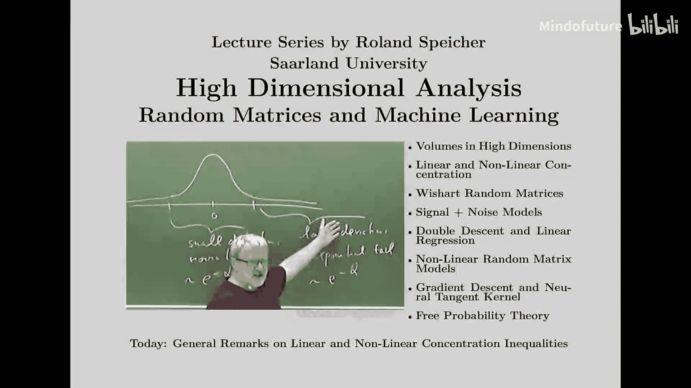
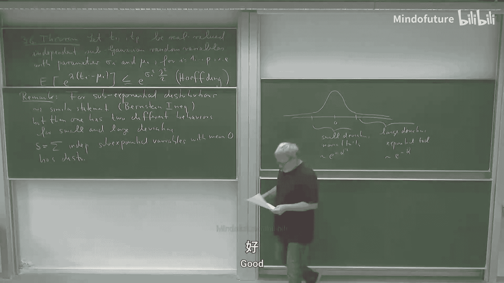

# 008：线性与非线性集中不等式的一般性评述

在本节课中，我们将对集中不等式进行一般性评述，总结其核心形式、适用条件，并探讨如何从高斯分布推广到更广泛的分布类别。我们还将介绍子高斯和子指数分布的定义，并简要讨论非线性情况下的推广。

## 集中不等式的核心形式

上一节我们介绍了集中不等式的具体应用，本节中我们来看看其一般性框架。

集中不等式通常具有以下形式。我们有一组输入变量，这些变量是独立的，并服从某种分布。然后，我们考虑这些变量的函数，得到输出。我们的目标是控制这个输出，即函数值，使其表现出某种集中性。输入通常是独立变量，并且到目前为止，我们主要考虑这些变量服从高斯分布的情况。当然，我们希望将结论推广到更一般的情形。

对于函数，我们主要考虑过两种情况。以下是这两种情况：
*   **线性函数**：即独立变量之和。
*   **非线性函数**：更一般的函数，我们通常要求其满足利普希茨条件。

在输出方面，集中性本质上意味着函数值在其期望值附近集中，其尾部衰减类似于高斯分布，即形如 `e^{-t^2}`。通常，维度也会以某种形式出现在指数中，以体现高维下的集中现象。

## 从高斯分布到更一般的分布

问题是，当我们离开高斯分布时，结论还能在多大程度上成立？在**线性情况**下，结论确实可以推广。在我们之前的所有方法中，核心是控制量 `E[e^{λ f(x)}]`。这本质上依赖于马尔可夫不等式，然后我们需要控制这个期望。

在线性情况下，控制这个量最终归结为控制输入分布的矩母函数。这意味着，如果输入分布的矩母函数行为与我们证明所需的行为相似，那么结论仍然成立。最理想的情况是，输入分布也具有类似高斯的尾部行为，那么这种性质会传递到输出（至少在线性情况下）。具有这种性质的分布非常重要，它们被称为**子高斯分布**。

此外，我们可能还会遇到尾部衰减稍慢，仅为指数衰减（形如 `e^{-t}`）的分布，这类分布被称为**子指数分布**。这是两个主要的分布类别。

## 子高斯与子指数分布的定义

让我们正式定义这些分布。这里讨论的是**一维**随机变量的性质。当我们考虑多变量函数时，要求每个独立变量都具有特定的分布性质，即子高斯性或子指数性。

### 子高斯分布

设 `X` 是一个一维随机变量。为简化起见，我们假设其均值为零。`X` 或其分布被称为**子高斯**的，如果以下两个等价性质之一成立（这里给出两个主要性质）：

1.  **尾部性质**：存在常数 `C > 0`，使得对所有 `α > 0`，有：
    `P(|X| > α) ≤ 2 exp(-α^2 / C)`
2.  **矩母函数性质**：存在常数 `C' > 0`，使得对所有 `λ ∈ R`，有：
    `E[e^{λX}] ≤ exp(C' λ^2)`

这两个性质是等价的。子高斯分布在高斯集中不等式的证明中行为类似。

### 子指数分布

`X` 被称为**子指数**的，如果以下两个等价性质之一成立：

1.  **尾部性质**：存在常数 `C > 0`，使得对所有 `α > 0`，有：
    `P(|X| > α) ≤ 2 exp(-α / C)`
2.  **矩母函数性质**：存在常数 `C' > 0`，使得对所有满足 `|λ| ≤ 1/C'` 的 `λ`，有：
    `E[e^{λX}] ≤ exp(C' λ^2)`

注意，在子指数分布中，矩母函数的估计只在一个区间内成立，而不是对所有 `λ` 成立。这比子高斯条件要弱。

## 例子与关系

以下是几个重要的例子和关系：

*   **子高斯蕴含子指数**：显然，子高斯分布也是子指数分布，因为子高斯的矩母函数性质对所有 `λ` 成立，自然在某个小区间内也成立。
*   **高斯分布**：正态分布是子高斯的。
*   **卡方分布**：如果 `X` 服从标准正态分布，则 `X^2 - 1` 是子指数的，但不是子高斯的。我们在证明向量范数的集中不等式时计算过它的矩母函数，它只在有限区间内存在。
*   **有界随机变量**：任何有界随机变量都是子高斯的。这是一个重要的结论，意味着对于有界随机变量之和，我们也能得到高斯型的集中不等式。

## 线性情况的推广定理

对于独立随机变量之和，我们可以处理相当广泛的分布类别。以下是子高斯情况下的一个典型定理（通常称为 Hoeffding 型不等式）：

设 `T1, ..., Tp` 是独立的实值随机变量。每个 `Ti` 都是子高斯的，具有参数 `(σ_i, μ_i)`。这意味着对于所有 `λ`，有：
`E[e^{λ (T_i - μ_i)}] ≤ exp(σ_i^2 λ^2 / 2)`
那么，对于所有 `α > 0`，有：
`P(|∑_{i=1}^p (T_i - μ_i)| > α) ≤ 2 exp(-α^2 / (2∑_{i=1}^p σ_i^2))`

这个定理表明，子高斯随机变量的和仍然是子高斯的。

对于**子指数分布**，也有类似结论（通常称为 Bernstein 型不等式），但行为更复杂。它给出两种不同的估计：
*   **小偏差**：当偏差 `α` 较小时，尾部行为类似于 `e^{-α^2}`（子高斯型）。
*   **大偏差**：当偏差 `α` 较大时，尾部行为类似于 `e^{-α}`（子指数型）。

这意味着，即使输入是子指数的，其和在小偏差范围内也能表现出更好的子高斯集中性，而在大偏差范围内则反映出输入本身的子指数特性。

## 非线性情况的推广

我们之前为高斯分布证明了利普希茨函数的集中不等式。然而，该证明无法直接推广到更一般的分布。要将定理推广到非高斯输入，需要额外的假设，其中最主要的假设是**凸性**。

以下是 Talagrand 不等式的一个基本版本（针对有界变量）：

设 `T1, ..., Tp` 是独立随机变量，且存在常数 `K`，使得对所有 `i`，有 `|Ti| ≤ K`。设函数 `f: R^p → R` 是 `L`-利普希茨的，并且是凸函数。那么，存在通用常数 `C1, C2 > 0`，使得对于所有 `α > 0`，有：
`P(|f(T1,...,Tp) - E[f(T1,...,Tp)]| > αK) ≤ C1 exp(-C2 α^2 / L^2)`

这个定理表明，对于有界、独立变量，凸的利普希茨函数仍然表现出子高斯型的集中性。需要注意的是，凸性条件是必要的，存在反例表明非凸的利普希茨函数可能不具备这种集中性。这对于神经网络等应用场景是一个需要注意的限制，因为神经网络的函数通常利普希茨但不一定凸。而在高斯输入的情况下，我们不需要凸性假设，这显得更为优越。

## 总结

本节课中我们一起学习了集中不等式的一般框架。我们回顾了集中不等式的核心形式，并探讨了如何从高斯输入推广到更一般的子高斯和子指数输入。在线性情况下，我们得到了明确的推广定理。在非线性情况下，我们看到了 Talagrand 不等式，它通过引入凸性假设，将结论推广到了有界独立变量的情形。这些工具为我们接下来分析更复杂的对象，如随机矩阵，奠定了重要的基础。