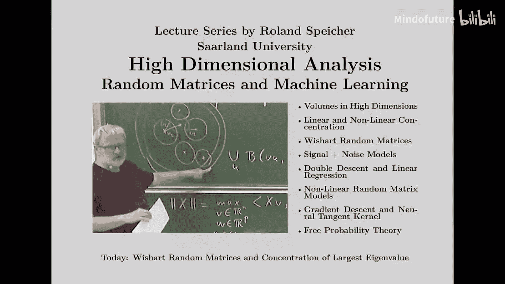
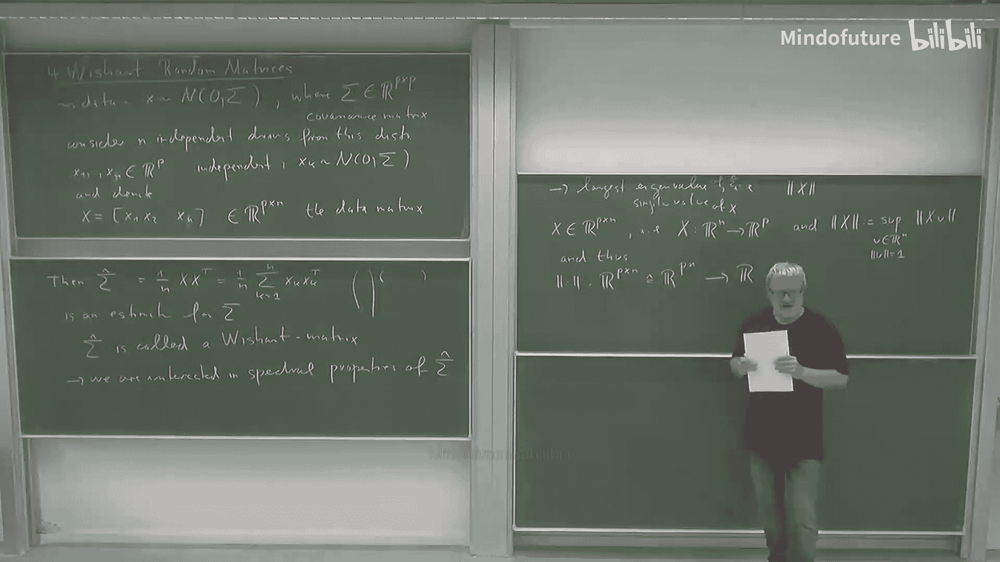
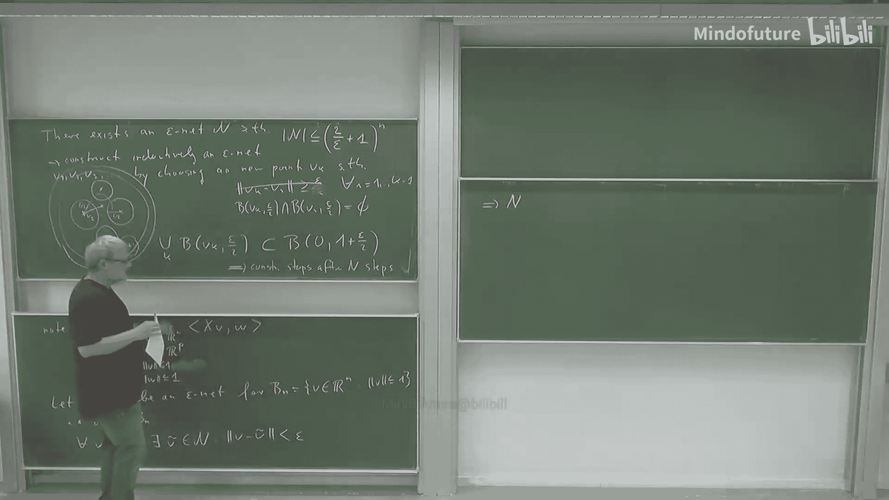

# 009：Wishart随机矩阵及最大特征值的集中性 🧮

在本节课中，我们将要学习Wishart随机矩阵，并探讨其最大特征值（或矩阵范数）的集中性现象。我们将看到，如何利用高斯集中不等式和ε-网（epsilon-net）技术，将涉及无限多个条件的矩阵范数估计问题，转化为有限个条件的控制问题。

## Wishart随机矩阵

我们考虑的随机矩阵通常被称为Wishart随机矩阵。在统计学的背景下，数据矩阵通常不是对称的，甚至不是方阵，这与Wigner或高斯随机矩阵不同。Wishart矩阵由统计学家Wishart引入，在统计问题中尤其相关。

在我们的设定中，数据通常被建模为随机向量。假设我们有一个p维随机向量X，服从正态分布，其协方差矩阵为Σ。在统计问题中，我们通常有n个独立的观测值，即独立地从该分布中抽取向量。我们可以将这些p维观测向量排列成一个p×n的数据矩阵X，其中每一列是一个观测向量。

为了从观测中估计未知的协方差矩阵Σ，一个经典的估计量是样本协方差矩阵：
\[
\hat{\Sigma} = \frac{1}{n} X X^T = \frac{1}{n} \sum_{k=1}^{n} X_k X_k^T
\]
这个估计量\(\hat{\Sigma}\)就是一个Wishart矩阵。当观测数量n趋于无穷时，它会收敛到真实的Σ。然而，在现代高维数据中，特征维度p和观测数量n通常是可比的，因此我们需要理解其谱性质。

## 矩阵范数与集中性

我们特别感兴趣的是矩阵的谱行为，例如特征值。一个重要的量是最大特征值，它等于矩阵的算子范数（operator norm）。对于矩阵X，其算子范数定义为：
\[
\|X\| = \sup_{\|v\|=1} \|X v\|
\]
其中v是n维单位球面上的向量。这个范数也等于\(X X^T\)的最大特征值，即X的最大奇异值。

我们希望理解这个范数的典型行为及其波动。算子范数可以看作是从矩阵空间（可视为\(\mathbb{R}^{p \times n}\)）到实数的一个函数。这个函数是Lipschitz连续的，且Lipschitz常数为1，因为它满足：
\[
|\|X\| - \|Y\|| \leq \|X - Y\| \leq \|X - Y\|_F
\]
这里\(\|\cdot\|_F\)是Frobenius范数（即所有元素平方和的平方根）。这个性质不依赖于维度p和n。

## 应用高斯集中不等式

如果我们假设数据矩阵X的所有元素是独立的标准高斯随机变量（即均值为0，方差为1），那么将整个矩阵视为一个\(p \times n\)维的高斯随机向量，其协方差矩阵是单位阵。对于这个高斯向量，算子范数作为一个Lipschitz函数，满足高斯集中不等式：
\[
P(|\|X\| - \mathbb{E}[\|X\|]| \geq t) \leq 2 e^{-t^2/2}
\]
这个不等式告诉我们，矩阵范数高度集中在其期望值附近。然而，它并没有告诉我们期望值\(\mathbb{E}[\|X\|]\)具体是多少。计算这个期望值通常需要其他工具。

## 通过ε-网控制范数

为了更深入地理解范数的行为，我们可以利用其定义。算子范数等价于：
\[
\|X\| = \max_{\|v\|=1, \|w\|=1} \langle w, X v \rangle
\]
这里v和w分别来自n维和p维的单位球面。对于每一对固定的(v, w)，内积\(\langle w, X v \rangle\)是矩阵元素的一个线性组合，因此它本身是一个高斯随机变量，我们对其有很好的控制。

问题在于我们需要对无限多对(v, w)取最大值。解决这个问题的关键思想是使用ε-网。我们可以用有限个点来覆盖单位球面，使得球面上的任何一点都与网中的某个点距离不超过ε。

以下是构造ε-网的核心思路：
*   我们希望在单位球内放置尽可能多的、半径为ε/2且互不相交的小球。
*   所有这些小球都必须包含在一个半径为1+ε/2的大球内。
*   通过比较体积，我们可以得到网中点数量的上界。具体地，存在一个ε-网，其基数（点的数量）最多为\((2/\epsilon + 1)^n\)（对于n维球）和\((2/\epsilon + 1)^p\)（对于p维球）。

利用ε-网，我们可以将算子范数与网中有限个点上的最大值联系起来。具体推导如下：设v和w是使得范数达到最大值的向量，v‘和w’分别是它们在对应ε-网中的近似点（距离≤ε）。那么：
\[
\langle w, X v \rangle = \langle w', X v' \rangle + \langle w-w', X v' \rangle + \langle w, X (v-v') \rangle
\]
利用范数的性质和三角不等式，可以证明：
\[
\|X\| \leq \frac{1}{1 - 2\epsilon} \max_{v' \in \mathcal{N}, w' \in \mathcal{M}} \langle w', X v' \rangle
\]
其中\(\mathcal{N}\)和\(\mathcal{M}\)分别是n维和p维单位球的ε-网。如果我们选择ε=1/4，那么系数为2。这样，我们就把控制无限多个高斯变量最大值的问题，转化为了控制有限个（尽管数量随维度指数增长）高斯变量最大值的问题。对于有限个高斯变量，我们可以利用联合界（union bound）等技术来估计其最大值的概率行为。

## 总结

本节课中我们一起学习了Wishart随机矩阵的背景和定义，它是样本协方差矩阵，在高维统计中至关重要。我们关注其算子范数（最大特征值），并证明了它作为矩阵元素的函数是Lipschitz连续的，从而满足高斯集中不等式。为了更细致地分析范数，我们引入了ε-网的技术，将无限维的优化问题转化为有限维问题，为后续定量分析其期望值和尾概率界奠定了基础。下一节，我们将利用这个框架，推导出矩阵范数更具体的概率估计。