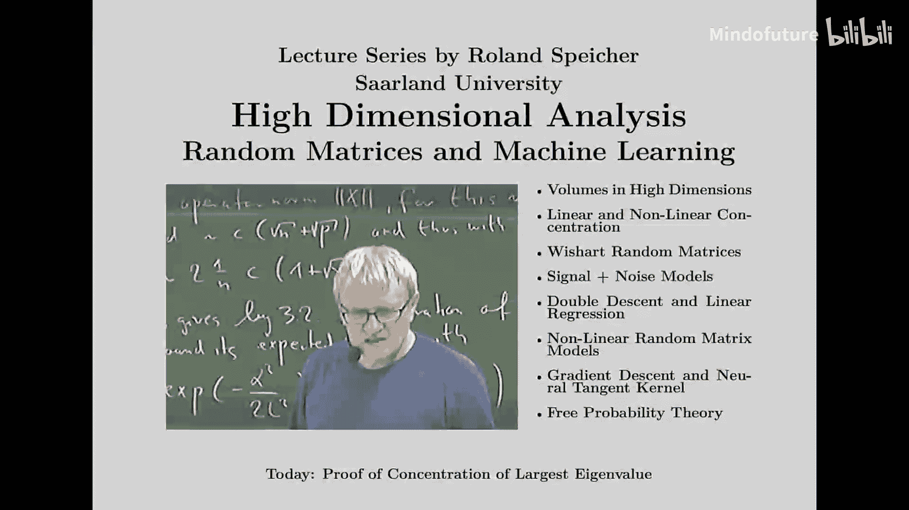
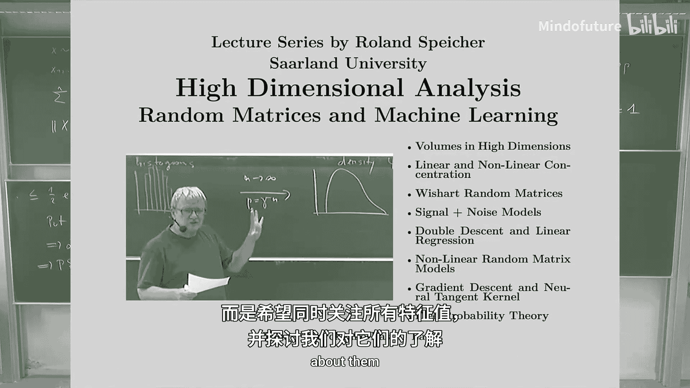

# 010：最大特征值集中性的证明

在本节课中，我们将学习如何证明随机矩阵最大特征值（或算子范数）的集中性。我们将从一个具体的随机矩阵模型出发，利用ε-网和概率论工具，推导出最大特征值以高概率集中在某个值附近。

## 概述

我们目前正在研究随机矩阵。我们已经从随机向量过渡到随机矩阵，并希望理解特征值的集中性，以及在有意义的范围内特征值的分布情况。

具体设定如下：我们讨论的是随机矩阵。假设数据服从高斯分布，即 **X ~ N(0, Σ)**，其中 Σ 是 R^p 中的协方差矩阵。我们假设有从这个分布中独立抽取的样本，即我们有该向量的独立副本：**X1, X2, ..., Xn**，每个都是 R^p 中的向量。

我们将这些向量放入一个数据矩阵 **X** 中，其中这些向量是矩阵的列。因此，我们得到一个 **p × n** 的矩阵。从这个矩阵可以形成一个重要的方阵，即协方差矩阵的估计量，我们称之为 **Σ̂**，其定义为：

**Σ̂ = (1/n) * X * X^T**

或者写成向量形式：

**Σ̂ = (1/n) * Σ_{k=1}^{n} X_k * X_k^T**

这是一个 **p × p** 的矩阵。根据大数定律，当 n → ∞ 且 p 固定时，它会收敛到 Σ。然而，我们感兴趣的不是这个范围。

## 最大特征值的集中性

我们首先关注的是这个矩阵的特征值，特别是最大特征值。我们想了解它是否围绕其期望值集中，以及期望值是多少。

最大特征值实际上是矩阵的一个 Lipschitz 函数，这意味着我们可以利用高斯测度下 Lipschitz 函数的集中现象。问题在于，我们通常不知道期望值的确切表达式。对于像随机矩阵特征值这样的非线性函数，计算期望值并不容易。

上一节我们开始探讨如何解决这个问题。关键在于，最大特征值（即矩阵的算子范数）与矩阵 **X** 的范数有关。我们想要理解的是 **X** 的范数，也就是矩阵的最大奇异值。

根据定义，算子范数有一个公式表示。它是衡量矩阵 **X** 能多大程度上增加向量长度的最大值。具体可以写成：

**||X|| = max_{||v||≤1, ||w||≤1} <Xv, w>**

这里 **v ∈ R^n**, **w ∈ R^p**。这是一个在无限多个点上的最大值，直接处理很困难。

## 利用ε-网进行有限近似

为了解决无限最大值的问题，我们引入ε-网的概念。思路是，我们可以用有限个点组成的集合（ε-网）来覆盖整个球体，使得球内任何一点都与网中的某个点距离在 ε 以内。这样，我们只需要在有限个点上控制这个量，就能近似整个最大值。

我们证明了以下不等式：

**||X|| ≤ (1/(1-2ε)) * max_{v∈N_ε, w∈M_ε} <Xv, w>**

其中 **N_ε** 是 R^n 中单位球的 ε-网，**M_ε** 是 R^p 中单位球的 ε-网。我们可以控制这种网的大小。例如，选择 **ε = 1/4**，则网的大小满足 **|N_ε| ≤ 9^n**, **|M_ε| ≤ 9^p**。

现在，我们想得到 **||X||** 大于某个值 **α** 的概率上界。如果 **||X|| > α**，根据上述不等式，意味着存在网中的点 **v** 和 **w**，使得 **<Xv, w> > α * (1-2ε)**。

因此，事件 **{||X|| > α}** 被包含在所有形如 **{<Xv, w> > α(1-2ε)}** 的事件的并集中。根据概率的次可加性，并集的概率小于等于各个事件概率之和：

**P(||X|| > α) ≤ Σ_{v∈N_ε, w∈M_ε} P( <Xv, w> > α(1-2ε) )**

## 分析内积项的分布

现在，我们分析内积项 **<Xv, w>**。矩阵 **X** 的条目 **X_ij** 是独立的标准高斯随机变量。内积可以展开为：

**<Xv, w> = Σ_{i=1}^{p} Σ_{j=1}^{n} X_ij * v_j * w_i**

对于固定的 **v** 和 **w**，这是一个独立高斯变量的线性组合，因此它本身服从高斯分布，均值为0，方差为：

**σ² = Σ_{i,j} (v_j * w_i)² = (Σ_j v_j²) * (Σ_i w_i²) = ||v||² * ||w||²**

由于 **v** 和 **w** 来自单位球的ε-网，它们的范数小于等于1，因此方差 **σ² ≤ 1**。

一个方差为 **σ² ≤ 1** 的高斯变量超过阈值 **t** 的概率有一个标准的上界：

**P( Gaussian > t ) ≤ (1/2) * exp( -t² / 2 )**

在我们的情况下，阈值 **t = α(1-2ε)**。代入 **ε = 1/4**，得到 **t = α/2**。

因此，对于网中任意一对固定的 **(v, w)**，有：

**P( <Xv, w> > α/2 ) ≤ (1/2) * exp( -α² / 8 )**

## 综合概率估计

将上述估计代入我们的求和式中：

**P(||X|| > α) ≤ |N_ε| * |M_ε| * (1/2) * exp( -α² / 8 )**

代入网的大小估计 **|N_ε| ≤ 9^n**, **|M_ε| ≤ 9^p**，并注意到 **9 < e³**，我们可以进一步放缩：

**P(||X|| > α) ≤ (1/2) * exp(3n) * exp(3p) * exp( -α² / 8 ) = (1/2) * exp( 3n + 3p - α²/8 )**

为了使这个概率随着维度增长而变小（即得到有意义的集中性），我们需要 **α²/8** 的增长速度超过 **3n + 3p**。这提示 **α** 的量级应为 **√n** 和 **√p**。

为了更清晰地看出集中点，我们令：

**α = √(24) * (√n + √p) + u**

其中 **u** 是一个额外的偏差项。将 **α** 代入概率上界，经过计算（利用 **(a+b)² ≥ a² + b²**），可以得到：

**P( ||X|| > √(24)(√n + √p) + u ) ≤ (1/2) * exp( -u² / 8 )**

这个结果告诉我们，矩阵 **X** 的范数以高概率不会超过 **√(24)(√n + √p)** 太多，偏差 **u** 被指数概率 **exp(-u²/8)** 所控制。因此，**√(24)(√n + √p)** 给出了算子范数（即最大特征值）期望值的一个量级估计。特别地，当 **n** 和 **p** 同阶时，最大特征值的量级是 **O(√n)**。

## 总结

本节课中，我们一起学习了如何证明随机矩阵最大特征值的集中性。

1.  我们从一个由独立高斯向量列构成的数据矩阵 **X** 出发。
2.  我们关注其算子范数 **||X||**，它等于最大奇异值，也与协方差估计矩阵的最大特征值相关。
3.  为了处理范数定义中的最大值，我们引入了 **ε-网** 技术，将无限维的最大值问题转化为有限个点上的控制问题。
4.  通过概率的并集上界（次可加性），我们将矩阵范数大的概率，转化为有限多个高斯二次型大的概率之和。
5.  我们分析了每个内积项 **<Xv, w>** 的高斯分布性质，并利用其尾概率估计。
6.  综合网的大小和高斯尾概率，我们最终推导出集中性不等式：**P( ||X|| > √(24)(√n + √p) + u ) ≤ (1/2) exp(-u²/8)**。
7.  这个结果表明，最大特征值以高概率集中在量级为 **O(√n + √p)** 的值附近，为理解随机矩阵的谱性质奠定了基础。

下一节，我们将不再局限于最大特征值，而是尝试同时研究所有特征值，探索它们的整体分布规律。