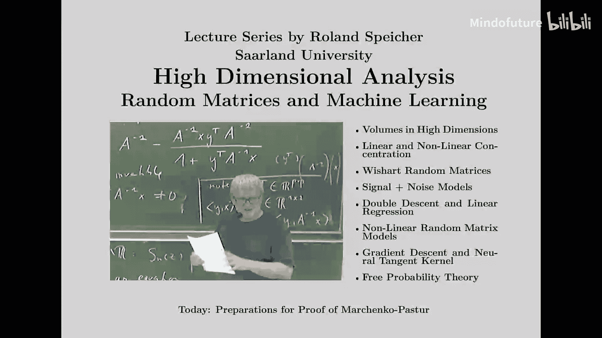

# 012：Marchenko-Pastur定律证明的准备工作

在本节课中，我们将学习如何证明Marchenko-Pastur定律。该定律描述了高维随机矩阵的特征值分布。我们将通过一系列准备工作，将复杂的特征值问题转化为更易处理的矩阵迹问题，并引入关键的工具和公式。

## 核心目标与设定

我们关注的是Wishart随机矩阵的渐近特征值分布。具体设定如下：

*   设 **X** 是一个 **P × N** 的随机矩阵，其所有元素独立同分布，服从标准高斯分布（均值为0，方差为1）。
*   我们研究对应的样本协方差矩阵（Wishart矩阵）：**Σ̂ = (1/N) X Xᵀ**。这是一个 **P × P** 的对称矩阵。
*   我们考虑一个渐近区域：**P** 和 **N** 都趋于无穷大，但它们的比值 **P/N → γ**，其中 **γ ∈ (0, 1)**。

Marchenko-Pastur定律指出，在此极限下，矩阵 **Σ̂** 的特征值经验分布收敛到一个确定的概率密度函数，即Marchenko-Pastur密度 **ρ_MP(t)**：

**ρ_MP(t) = (1/(2πγt)) √((t - γ₋)(γ₊ - t))**

其中，**γ₊ = (1 + √γ)²**，**γ₋ = (1 - √γ)²**，且 **t ∈ [γ₋, γ₊]**。

## 证明策略：从特征值到Stieltjes变换

直接证明特征值直方图的收敛性很困难，因为我们无法直接控制特征值。因此，我们采用一个等价但更易处理的方法：证明特征值的平均函数收敛。

具体来说，对于任意“足够好”的函数 **f**，我们希望证明：
**(1/P) Σ_{i=1}^{P} f(λ_i) → ∫ f(t) ρ_MP(t) dt**

然而，特征值 **λ_i** 难以直接处理。一个关键技巧是，对于某些特殊的函数，我们可以将特征值的和转化为矩阵的迹，从而回到矩阵元素本身。

上一节我们介绍了证明的核心思路，本节中我们来看看具体如何实现这一转化。

我们将重点研究一类特殊的函数：**f_z(λ) = 1/(λ - z)**，其中 **z** 是一个不在实轴上的复数。这个函数的优势在于，它对矩阵 **A** 的作用可以明确写为矩阵的逆：
**(1/P) Σ_{i=1}^{P} 1/(λ_i - z) = (1/P) Tr[ (A - z I_P)^{-1} ]**

这里，**Tr** 表示迹运算，**I_P** 是 **P×P** 单位矩阵。这个量被称为矩阵 **A** 的 **Stieltjes变换**，记作 **S_A(z)**。

因此，证明Marchenko-Pastur定律等价于证明：对于Wishart矩阵 **Σ̂**，其Stieltjes变换 **S_n(z)** 在 **n→∞** 时，收敛到Marchenko-Pastur分布的Stieltjes变换 **S_MP(z)**。

由于随机矩阵的集中性，我们只需研究其期望值 **E[S_n(z)]** 的极限即可。

## 关键工具：Sherman-Morrison公式

为了推导 **S_n(z)** 满足的方程，我们需要一个处理矩阵微小扰动的有力工具：Sherman-Morrison公式。

该公式描述了如何计算一个矩阵加上一个秩-1矩阵后的逆。

**公式陈述**：
设 **A** 是一个可逆的 **P×P** 矩阵，**x** 和 **y** 是 **P** 维列向量。如果 **1 + yᵀ A⁻¹ x ≠ 0**，则矩阵 **A + x yᵀ** 也可逆，且其逆矩阵为：
**(A + x yᵀ)^{-1} = A⁻¹ - (A⁻¹ x yᵀ A⁻¹) / (1 + yᵀ A⁻¹ x)**

**公式推导思路**：
证明的核心是利用几何级数（Neumann级数）展开。我们将 **A + x yᵀ** 写成 **A(I + A⁻¹x yᵀ)**，然后对 **I + M** 的逆进行形式上的级数展开。在展开过程中，注意到 **yᵀ A⁻¹ x** 是一个标量，可以提取出来，最终级数求和得到一个简洁的封闭形式。

这个公式及其推论将在后续步骤中起到至关重要的作用，它允许我们将包含第 **N** 个数据向量的矩阵与不包含它的矩阵联系起来。

## 另一个关键引理：高斯向量的二次型期望

在应用Sherman-Morrison公式后，我们会遇到形如 **E[ xᵀ B x ]** 的项，其中 **x** 是标准高斯向量，**B** 是一个与 **x** 独立的矩阵。

以下是关于这个期望值的一个简单而重要的引理。

**引理**：
设 **x ~ N(0, I_P)** 是标准高斯随机向量，**B** 是一个 **P×P** 矩阵（可以是随机的），且 **B** 与 **x** 独立。那么有：
**E[ xᵀ B x ] = Tr[ E ]**

**证明**：
我们将二次型展开为分量求和形式：
**xᵀ B x = Σ_{i,j=1}^{P} x_i B_{ij} x_j**
对其取期望，并利用 **B** 与 **x** 的独立性：
**E[ xᵀ B x ] = Σ_{i,j} E[ B_{ij} x_i x_j ] = Σ_{i,j} E[ B_{ij} ] E[ x_i x_j ]**
由于 **x** 的分量独立且 **E[x_i x_j] = δ_{ij}**（当 **i=j** 时为1，否则为0），上式简化为：
**Σ_{i=1}^{P} E[ B_{ii} ] = E[ Σ_{i=1}^{P} B_{ii} ] = E[ Tr(B) ] = Tr[ E ]**
证毕。

这个引理使得我们可以将涉及随机向量的复杂期望，转化为熟悉的矩阵迹的期望。

## 总结与下步展望

本节课中，我们一起为证明Marchenko-Pastur定律做好了核心的理论准备：

1.  **明确了证明目标**：将特征值分布问题转化为证明Stieltjes变换的收敛性 **E[S_n(z)] → S_MP(z)**。
2.  **引入了核心工具**：**Sherman-Morrison公式**，用于处理由单个数据向量引起的秩-1矩阵扰动。
3.  **证明了关键引理**：关于高斯向量二次型期望的引理，它将随机二次型与矩阵的迹联系起来。

在下一节课中，我们将把这些工具结合起来。具体步骤是：将Wishart矩阵 **Σ̂** 分解为前 **N-1** 个数据向量的和加上最后一个数据向量的秩-1扰动。然后，应用Sherman-Morrison公式将 **S_n(z)** 用 **S_{n-1}(z)** 表示，并利用独立性和高斯向量的性质进行化简。最终，我们将导出一个关于极限 **S(z)** 的方程，并验证 **S_MP(z)** 是该方程的唯一解，从而完成证明。