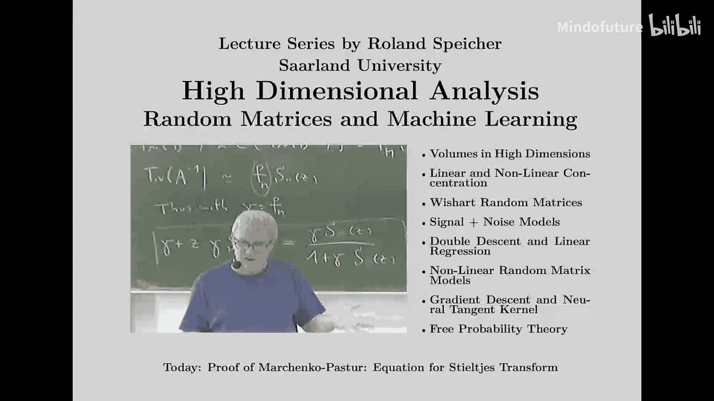
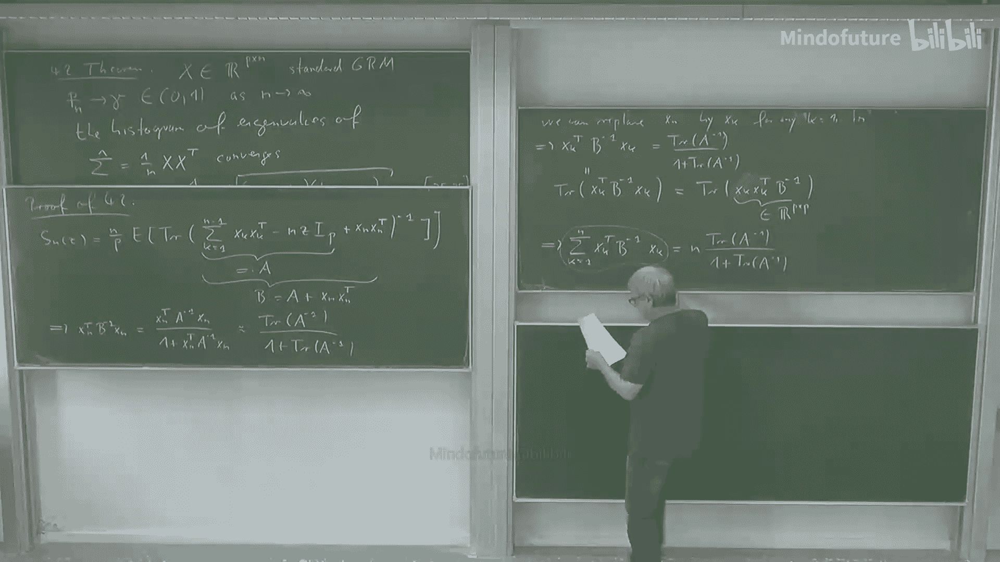

# 013：Stieltjes变换的Marchenko-Pastur方程证明

## 概述
在本节课中，我们将学习如何利用Stieltjes变换来证明Marchenko-Pastur定律。我们将整合之前学到的工具，通过一系列代数变换和渐进论证，最终推导出Stieltjes变换所满足的方程。

## 证明思路与初始设定
上一节我们介绍了Stieltjes变换和秩一摄动公式。本节中，我们将利用这些工具来推导Marchenko-Pastur方程。

我们的目标是控制样本协方差矩阵的Stieltjes变换。设样本矩阵为 \( X \in \mathbb{R}^{p \times n} \)，其列向量为 \( x_1, \dots, x_n \)。样本协方差矩阵为：
\[
S_n = \frac{1}{n} \sum_{k=1}^{n} x_k x_k^T
\]
我们考虑其Stieltjes变换：
\[
s_n(z) = \frac{1}{p} \operatorname{Tr} \left[ (S_n - zI_p)^{-1} \right]
\]
为了证明方便，我们考虑未归一化的矩阵 \( B = \sum_{k=1}^{n} x_k x_k^T - n z I_p \)，其Stieltjes变换与 \( s_n(z) \) 密切相关。

证明的核心思想是对矩阵 \( B \) 进行分解，并应用秩一摄动公式。

## 关键分解与秩一摄动
我们首先将矩阵 \( B \) 分解为两部分：一个包含前 \( n-1 \) 个样本的矩阵 \( A \)，以及最后一个样本的秩一摄动。
\[
B = A + x_n x_n^T
\]
其中：
\[
A = \sum_{k=1}^{n-1} x_k x_k^T - n z I_p
\]
根据矩阵求逆引理（秩一摄动公式），我们有：
\[
(B^{-1})_{nn} = \frac{x_n^T A^{-1} x_n}{1 + x_n^T A^{-1} x_n}
\]
这里，\( (B^{-1})_{nn} \) 表示在由 \( x_n \) 张成的子空间上的投影。由于 \( x_n \) 独立于构成矩阵 \( A \) 的其他样本，根据大数定律和集中性，量 \( x_n^T A^{-1} x_n \) 会接近其期望值，即 \( \operatorname{Tr}(A^{-1}) \)。

因此，我们可以近似得到：
\[
x_n^T B^{-1} x_n \approx \frac{\operatorname{Tr}(A^{-1})}{1 + \operatorname{Tr}(A^{-1})}
\]

## 对称性与求和技巧
上述推导是针对最后一个样本 \( x_n \) 进行的。然而，由于样本的独立同分布性质，我们可以对任何一个样本 \( x_k \) 进行相同的分解和论证，结论在渐进意义下是相同的。

因此，对于任意 \( k = 1, \dots, n \)，我们都有：
\[
x_k^T B^{-1} x_k \approx \frac{\operatorname{Tr}(A_k^{-1})}{1 + \operatorname{Tr}(A_k^{-1})}
\]
其中 \( A_k \) 是移除了第 \( k \) 个样本后的矩阵。在渐进极限下，所有 \( \operatorname{Tr}(A_k^{-1}) \) 都趋于相同的值。

现在，我们考虑对所有 \( k \) 求和：
\[
\sum_{k=1}^{n} x_k^T B^{-1} x_k \approx n \cdot \frac{\operatorname{Tr}(A^{-1})}{1 + \operatorname{Tr}(A^{-1})}
\]

## 迹的线性性质与矩阵重组
接下来，我们处理求和式的左边。利用迹的线性性质和循环置换性质，我们可以重写每一项：
\[
x_k^T B^{-1} x_k = \operatorname{Tr}(x_k^T B^{-1} x_k) = \operatorname{Tr}(x_k x_k^T B^{-1})
\]
因此，求和式变为：
\[
\sum_{k=1}^{n} \operatorname{Tr}(x_k x_k^T B^{-1}) = \operatorname{Tr}\left( \left( \sum_{k=1}^{n} x_k x_k^T \right) B^{-1} \right)
\]
注意到 \( \sum_{k=1}^{n} x_k x_k^T = B + n z I_p \)。将其代入上式：
\[
\operatorname{Tr}\left( (B + n z I_p) B^{-1} \right) = \operatorname{Tr}(I_p) + n z \operatorname{Tr}(B^{-1}) = p + n z \operatorname{Tr}(B^{-1})
\]

## 推导渐进方程
现在，我们将左右两边联系起来。我们有：
\[
p + n z \operatorname{Tr}(B^{-1}) \approx n \cdot \frac{\operatorname{Tr}(A^{-1})}{1 + \operatorname{Tr}(A^{-1})}
\]
两边同时除以 \( n \)，并引入比例系数 \( \gamma_n = p/n \)：
\[
\frac{p}{n} + z \operatorname{Tr}(B^{-1}) \approx \frac{\operatorname{Tr}(A^{-1})}{1 + \operatorname{Tr}(A^{-1})}
\]
回忆Stieltjes变换的定义。对于矩阵 \( B \)，其（未归一化的）Stieltjes变换与 \( \operatorname{Tr}(B^{-1}) \) 相关。更精确地说，在渐进意义下，当 \( n, p \to \infty \) 且 \( \gamma_n \to \gamma > 0 \) 时，我们有：
\[
\operatorname{Tr}(B^{-1}) \approx \gamma \cdot s(z)
\]
\[
\operatorname{Tr}(A^{-1}) \approx \gamma \cdot s(z)
\]
其中 \( s(z) \) 是极限Stieltjes变换。

将上述近似代入方程，我们得到关于极限Stieltjes变换 \( s(z) \) 的方程：
\[
\gamma + z \gamma s(z) \approx \frac{\gamma s(z)}{1 + \gamma s(z)}
\]
两边同时除以 \( \gamma \)（假设 \( \gamma > 0 \)），我们得到Marchenko-Pastur方程的核心形式：
\[
1 + z s(z) = \frac{s(z)}{1 + \gamma s(z)}
\]

## 总结
本节课中，我们一起学习了如何证明Marchenko-Pastur定律的Stieltjes变换方程。我们通过以下关键步骤完成了证明：
1.  将样本协方差矩阵分解为主部分和一个秩一摄动。
2.  应用矩阵求逆引理和样本的独立性，将涉及随机向量的二次型近似为矩阵的迹。
3.  利用样本的对称性，对所有样本求和，从而将问题转化为对矩阵迹的控制。
4.  巧妙地利用迹的线性性质和循环置换，将求和式重组为包含目标矩阵 \( B^{-1} \) 的迹的形式。
5.  在渐进极限 \( n, p \to \infty, p/n \to \gamma \) 下，推导出极限Stieltjes变换 \( s(z) \) 所满足的方程：
    \[
    1 + z s(z) = \frac{s(z)}{1 + \gamma s(z)}
    \]

这个方程是一个关于 \( s(z) \) 的二次方程，求解它即可得到Marchenko-Pastur分布的Stieltjes变换的显式表达式，进而通过Stieltjes反演公式可以恢复出特征值的极限谱密度。整个证明过程融合了矩阵分析、概率论和渐进分析的思想，是随机矩阵理论中的一个经典范例。