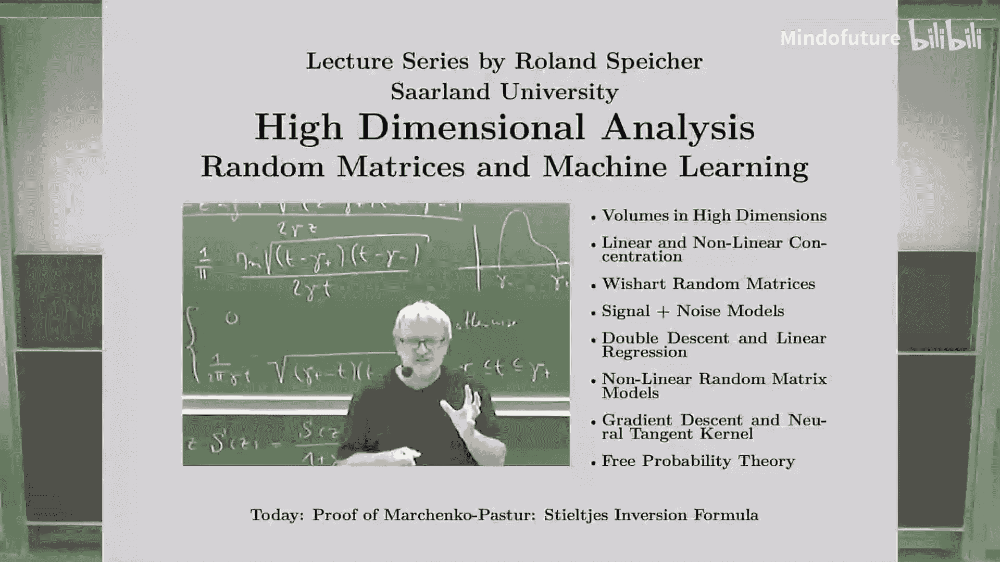

# 014：Marchenko-Pastur定律与Stieltjes反演公式的证明 🧮

在本节课中，我们将学习如何证明Marchenko-Pastur定律，该定律描述了Wishart矩阵的渐近特征值分布。我们将使用Stieltjes变换，并通过Stieltjes反演公式，从变换的解析表达式中推导出具体的概率密度函数。

## 概述

我们考虑一个Wishart矩阵，其定义为 **W = (1/n) X X^T**。其中，**X** 是一个 **p × n** 的矩阵，其列向量是独立同分布的高斯随机向量，均值为0，协方差矩阵为单位矩阵 **I**。这意味着 **X** 中的所有元素都是独立且服从标准正态分布。

我们关注当 **n** 和 **p** 以相同速率趋于无穷大时的渐近情况，即 **p/n → γ**，其中 **γ** 介于0和1之间。我们的目标是证明，在此极限下，Wishart矩阵的经验谱分布收敛于Marchenko-Pastur分布。

## Stieltjes变换与关键方程

上一节我们介绍了Stieltjes变换作为分析特征值分布的工具。对于我们的矩阵 **W**，其Stieltjes变换定义为：

**S_n(z) = (1/p) E[ Tr( (W - zI)^{-1} ) ]**

其中，**z** 位于复平面的上半平面，**I** 是 **p×p** 的单位矩阵。

通过比较具有 **n** 个观测值和 **n-1** 个观测值的矩阵，我们推导出了 **S_n(z)** 满足的近似方程。在 **n, p → ∞** 且 **p/n → γ** 的极限下，该方程变为极限Stieltjes变换 **S(z)** 的精确方程：

**1 + z S(z) = S(z) / (1 + γ S(z))**

这是一个关于 **S(z)** 的二次方程。将其重写为标准二次形式：

**γ z S(z)^2 - (1 - z - γ) S(z) + 1 = 0**

## 求解Stieltjes变换

我们可以解这个二次方程。其解为：

**S(z) = [ (1 - z - γ) + √( (z + γ - 1)^2 - 4γ z ) ] / (2γ z)**

由于Stieltjes变换在复平面上半平面的 **z** 处取值也必须在上半平面，我们选择了根号前的正号（“+”），以确保结果的虚部为正。

至此，我们得到了Marchenko-Pastur分布的极限Stieltjes变换的显式表达式。

## Stieltjes反演公式

为了从Stieltjes变换 **S(z)** 中恢复出概率密度函数 **ρ(t)**，我们需要使用Stieltjes反演公式。

以下是Stieltjes反演公式的表述：
设 **ρ(t)** 是一个连续的概率密度函数。其Stieltjes变换 **S(z)** 在复平面上半平面有定义，并且可以连续延拓到实轴。那么，密度函数可以通过以下极限得到：

**ρ(t) = (1/π) lim_{ε→0⁺} Im[ S(t + iε) ]**

其中，**Im[·]** 表示取复数的虚部。

这个公式的直观理解是，表达式 **(1/π) Im[ S(t + iε) ]** 在 **ε → 0** 时，会收敛到狄拉克δ函数与密度函数 **ρ** 的卷积，从而在极限下精确给出 **ρ(t)**。

## 应用反演公式推导密度

现在，我们将反演公式应用于我们求得的 **S(z)**。我们将 **z** 替换为 **t + iε**，并取 **ε → 0** 的极限。关键在于分析平方根项 **√( (t + iε + γ - 1)^2 - 4γ (t + iε) )** 在实轴上的行为。

定义两个关键点：
**γ₊ = (1 + √γ)²**
**γ₋ = (1 - √γ)²**

可以验证，平方根内的表达式在实轴上为：
**(t - γ₊)(t - γ₋)**

以下是分析结果：
*   当 **t** 在区间 **[γ₋, γ₊]** 之外时，**(t - γ₊)(t - γ₋) > 0**。平方根是实数，因此 **S(t)** 的虚部为零。根据反演公式，**ρ(t) = 0**。
*   当 **t** 在区间 **(γ₋, γ₊)** 之内时，**(t - γ₊)(t - γ₋) < 0**。平方根是纯虚数（**i** 乘以一个正实数）。此时 **S(t)** 具有非零虚部。

计算此区间内的虚部，我们得到密度函数：

**ρ(t) = (1/(2πγ t)) √( (γ₊ - t)(t - γ₋) )， 对于 t ∈ [γ₋, γ₊]**

这正是Marchenko-Pastur定律所描述的密度函数。

## 总结与拓展

本节课中，我们一起学习了证明Marchenko-Pastur定律的完整流程：
1.  我们为Wishart矩阵的Stieltjes变换建立了一个方程。
2.  在渐近极限下求解该方程，得到了Stieltjes变换的显式解。
3.  我们介绍了Stieltjes反演公式，它建立了Stieltjes变换与概率密度函数之间的联系。
4.  最后，我们将反演公式应用于我们的解，直接推导出了Marchenko-Pastur密度函数。

这种方法具有普适性。例如，对于著名的Wigner矩阵（其元素为独立同分布的随机变量），可以采用类似的思路推导出其特征值的渐近分布——Wigner半圆律。此外，对于协方差矩阵不是单位矩阵的更一般Wishart矩阵，虽然导出的方程可能更复杂（非二次），无法获得显式解，但依然可以通过数值迭代方法求解其Stieltjes变换，进而研究其谱分布。这些拓展练习将帮助你更深入地掌握高维随机矩阵的分析技巧。