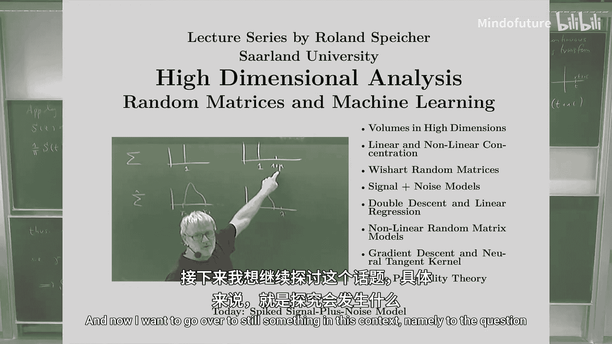

# 015：尖峰信号加噪声模型

在本节课中，我们将要学习一种重要的统计模型——尖峰信号加噪声模型。我们将探讨当协方差矩阵在单位矩阵基础上增加一个“信号”方向时，对应的Wishart矩阵的特征值会发生什么变化，以及我们如何从观测数据中检测到这个信号。

上一节我们介绍了标准的Marchenko-Pastur分布，它描述了当数据向量各分量独立同分布时，样本协方差矩阵的特征值分布。本节中我们来看看，如果我们在背景噪声中加入一个特定的信号方向，情况会发生怎样的变化。

## 模型设定

考虑一个随机向量，其协方差矩阵不再是简单的单位矩阵，而是在一个特定方向上进行了增强。具体形式如下：

**公式**：
\[
\Sigma = I_p + \mu u u^T
\]

其中：
*   \( I_p \) 是 \( p \times p \) 的单位矩阵，代表背景噪声。
*   \( \mu > 0 \) 是一个正数，代表信号强度。
*   \( u \) 是一个 \( p \) 维的单位向量 (\( \|u\|=1 \))，代表信号的方向。
*   \( u u^T \) 是一个秩为1的矩阵。

这个模型被称为“尖峰模型”或“信号加噪声模型”。核心问题是：当我们观测由这种分布生成的样本协方差矩阵（即Wishart矩阵）时，我们能否从其特征值谱中检测到这个额外的信号 \( \mu \)？

## 直观理解与核心问题

我们回顾一下标准情况（\( \Sigma = I_p \)）。此时，样本协方差矩阵的特征值服从Marchenko-Pastur分布，其支撑集为 \( [\gamma_-， \gamma_+] \)，其中 \( \gamma_\pm = (1 \pm \sqrt{\gamma})^2 \)，\( \gamma = p/n \)。在有限样本下，特征值会紧密地集中在这个支撑集附近，最大特征值非常接近 \( \gamma_+ \)。

现在，我们加入一个尖峰信号。直观上，如果 \( \mu \) 足够大，我们期望在样本协方差矩阵的特征值谱中，除了看到代表噪声的Marchenko-Pastur“主体”分布外，还会在 \( \gamma_+ \) 的右侧看到一个孤立的“离群”特征值。这个离群值就对应着隐藏的信号。

以下是核心问题：
1.  信号强度 \( \mu \) 需要多大，这个离群特征值才会出现？
2.  这个离群特征值的位置 \( \lambda \) 与原始信号强度 \( \mu \) 之间有什么关系？

## 主要定理

对于上述模型，在渐近 regime（\( n， p \to \infty \)， \( p/n \to \gamma \in (0， \infty) \)）下，样本协方差矩阵的最大特征值 \( \lambda_{\max} \) 的行为由以下定理描述：

**定理**：
*   如果 \( \mu > \sqrt{\gamma} \)，那么最大特征值 \( \lambda_{\max} \) 会脱离Marchenko-Pastur分布的主体，并收敛到：
    \[
    \lambda \to 1 + \mu + \frac{\gamma \mu}{1 + \mu}
    \]
*   如果 \( \mu \leq \sqrt{\gamma} \)，那么最大特征值 \( \lambda_{\max} \) 仍然收敛到Marchenko-Pastur分布的右端点：
    \[
    \lambda \to \gamma_+ = (1 + \sqrt{\gamma})^2
    \]

这个转变点 \( \mu = \sqrt{\gamma} \) 被称为 **BBP相变**（Baik， Ben Arous， Péché）。当 \( \mu \) 跨越此临界值时，可检测的离群特征值突然出现。

## 理论推导思路

我们的目标是求解形如 \( S = \frac{1}{n} X X^T \) 的矩阵的特征值，其中 \( X \) 的每一列服从 \( N(0， \Sigma) \) 分布，且 \( \Sigma = I + \mu u u^T \)。

以下是推导的关键步骤：

**步骤1：转化为标准Wishart矩阵**
我们可以将 \( X \) 写作 \( X = \Sigma^{1/2} Y \)，其中 \( Y \) 的每一列服从 \( N(0， I) \)。于是样本协方差矩阵变为：
\[
S = \frac{1}{n} \Sigma^{1/2} Y Y^T \Sigma^{1/2}
\]
这里 \( \frac{1}{n} Y Y^T \) 就是一个协方差为单位矩阵的标准Wishart矩阵，其特征值服从Marchenko-Pastur分布。

**步骤2：建立特征方程**
我们寻找一个特征值 \( \lambda \)，它位于Marchenko-Pastur支撑集之外（即 \( \lambda > \gamma_+ \)）。这满足特征方程：
\[
\det(S - \lambda I) = 0
\]
将 \( S \) 的表达式代入，并利用 \( \Sigma \) 可逆的性质，可以将方程转化为：
\[
\det\left( \frac{1}{n} Y Y^T - \lambda \Sigma^{-1} \right) = 0
\]

**步骤3：利用Sherman-Morrison公式**
由于 \( \Sigma = I + \mu u u^T \) 是单位矩阵的秩1扰动，其逆矩阵有显式公式（Sherman-Morrison公式）：
\[
\Sigma^{-1} = I - \frac{\mu}{1+\mu} u u^T
\]
将此式代入特征方程。

**步骤4：分离出已知部分**
经过代数整理，特征方程可以写为：
\[
\det\left( \frac{1}{n} Y Y^T - \lambda I \right) \cdot \det\left( I + \frac{\lambda \mu}{1+\mu} \left( \frac{1}{n} Y Y^T - \lambda I \right)^{-1} u u^T \right) = 0
\]
因为我们假设 \( \lambda \) 不是标准Wishart矩阵 \( \frac{1}{n} Y Y^T \) 的特征值（它在支撑集外），所以第一个行列式非零。因此，方程简化为第二个行列式为零：
\[
\det\left( I + c \cdot \left( \frac{1}{n} Y Y^T - \lambda I \right)^{-1} u u^T \right) = 0， \quad c = \frac{\lambda \mu}{1+\mu}
\]

**步骤5：应用Sylvester行列式恒等式**
上式中，矩阵 \( A = c \left( \frac{1}{n} Y Y^T - \lambda I \right)^{-1} u \) （\( p \times 1 \) 矩阵）和 \( B = u^T \) （\( 1 \times p \) 矩阵）的乘积构成了一个秩1矩阵。Sylvester恒等式指出：
\[
\det(I_p + A B) = \det(I_1 + B A)
\]
左边是 \( p \times p \) 矩阵的行列式，右边是 \( 1 \times 1 \) 矩阵（即一个标量）的行列式。应用此恒等式，我们的方程神奇地简化成了一个标量方程：
\[
1 + \frac{\lambda \mu}{1+\mu} \cdot u^T \left( \frac{1}{n} Y Y^T - \lambda I \right)^{-1} u = 0
\]

**步骤6：联系到Stieltjes变换**
注意到 \( u^T ( \frac{1}{n} Y Y^T - \lambda I )^{-1} u \) 这一项，当 \( n， p \) 很大时，根据遍历性，它近似等于矩阵 \( \frac{1}{n} Y Y^T \) 的**Stieltjes变换** \( m(\lambda) \) 在点 \( \lambda \) 的值。对于Marchenko-Pastur分布，其Stieltjes变换有已知的解析形式。

**步骤7：求解最终方程**
将Marchenko-Pastur分布的Stieltjes变换公式代入上述标量方程，我们得到一个关于 \( \lambda \) 和 \( \mu \) 的方程。解这个方程，并注意到解存在的条件（\( \lambda \) 为实数且 \( > \gamma_+ \)），最终就能推导出定理中给出的关系：
\[
\lambda = 1 + \mu + \frac{\gamma \mu}{1 + \mu}， \quad \text{当且仅当} \quad \mu > \sqrt{\gamma}
\]
而当 \( \mu \leq \sqrt{\gamma} \) 时，该方程在 \( \lambda > \gamma_+ \) 范围内无解，意味着最大特征值仍位于 \( \gamma_+ \)。

---

本节课中我们一起学习了尖峰信号加噪声模型。我们了解到，并非任何微弱的信号都能从高维噪声中被检测到。只有当信号强度 \( \mu \) 超过一个由数据维度比 \( \gamma \) 决定的临界值 \( \sqrt{\gamma} \) 时，它才会在样本协方差矩阵的谱中产生一个可观测的离群特征值，其位置由 \( \lambda = 1 + \mu + \frac{\gamma \mu}{1 + \mu} \) 给出。这一现象被称为BBP相变。推导过程巧妙地将一个复杂的矩阵行列式计算问题，通过Sylvester恒等式简化为了一个标量方程，展示了随机矩阵理论中代数技巧的强大力量。