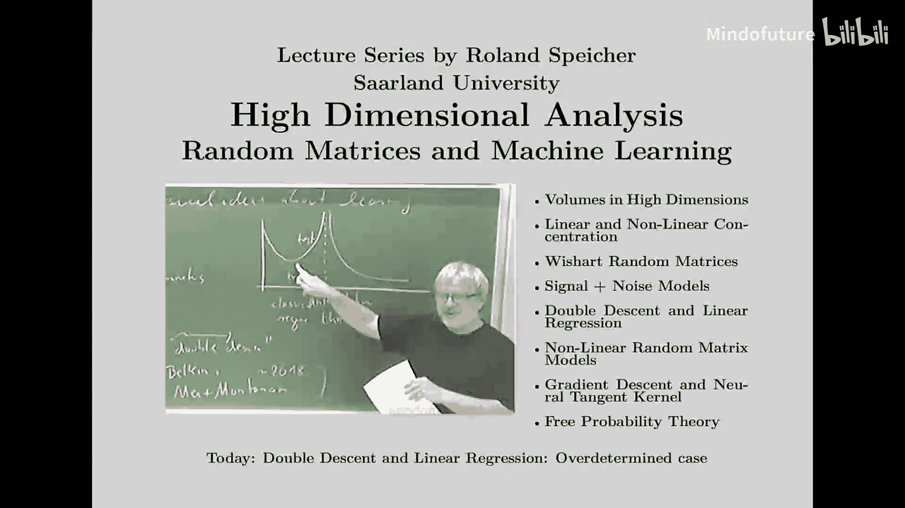
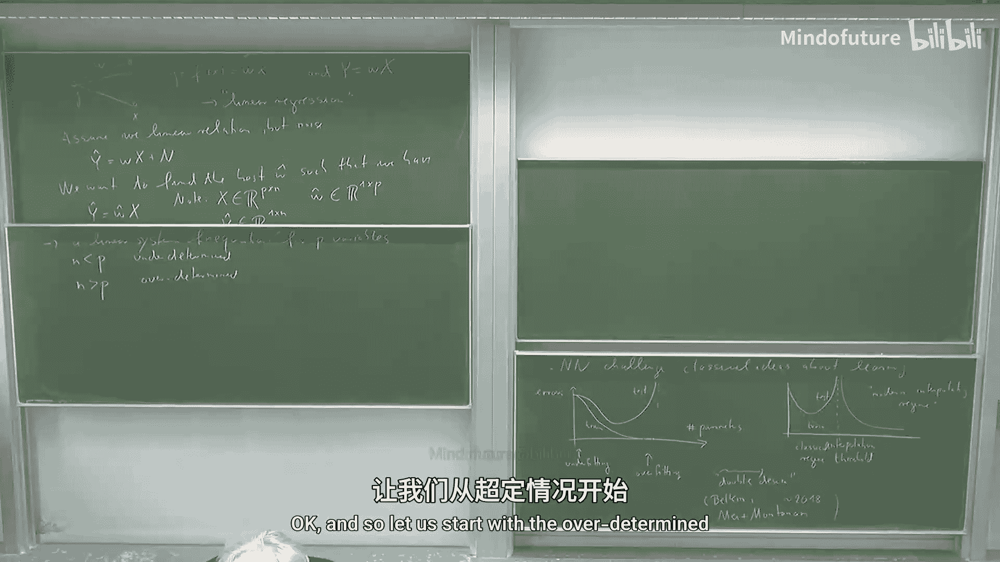

# 017：双下降与超定情况下的线性回归 🧠📉



在本节课中，我们将探讨神经网络与随机矩阵的联系，并聚焦于一个现代机器学习中的重要现象——“双下降”。我们将从一个最简单的神经网络模型——线性回归入手，分析其在数据过参数化与欠参数化情况下的表现差异。

上一节我们介绍了随机矩阵的基本理论，本节中我们来看看如何将其应用于理解机器学习模型，特别是线性回归中的“双下降”现象。

## 神经网络简介

神经网络是一种特殊形式的高维函数。它通常将高维空间映射到实数空间，其结构由一系列线性映射（矩阵）和特定的非线性函数（逐元素作用）组合而成。

一个典型的神经网络函数 **F** 可以表示为：
```
F(x) = w_L · σ( W_{L-1} · σ( ... σ( W_1 · x ) ... ) )
```
其中：
*   **x** 是输入向量（维度为 P）。
*   **W_1, W_2, ..., W_{L-1}** 是权重矩阵（线性映射）。
*   **σ** 是非线性激活函数，逐元素作用于向量。
*   **w_L** 是最后一层的权重向量（线性映射至实数输出）。

当处理多个数据样本时，我们将输入向量堆叠成矩阵 **X**（P × N），输出堆叠成向量 **y**（1 × N）。此时，网络的作用可以类似地表示为矩阵运算。

关于神经网络，主要有两类数学问题：
1.  **固定网络的分析**：给定一个网络（固定所有权重），研究输入 **X** 的统计特性与输出 **y** 的统计特性之间的关系。在权重随机且网络宽度（即中间层维度 M）趋于无穷的极限下，随机神经网络会收敛于高斯过程。
2.  **网络的构建（训练）**：给定训练数据集 (**X**, **y**)，如何选择权重参数，使得网络函数 **F** 能够很好地拟合这些数据，并且能够泛化到未见过的数据。这是应用中的核心问题。

传统学习理论认为，模型参数过多（过参数化）会导致过拟合，从而损害泛化能力。然而，现代神经网络的成功挑战了这一观点，它们在过参数化时依然表现优异，甚至出现“双下降”现象。

## 经典学习理论与双下降现象

以下是经典学习理论与现代观察（双下降）的对比：

*   **经典学习理论曲线**：
    *   **训练误差**：随着模型复杂度（参数数量）增加，训练误差持续下降，最终在参数足够多时可以完美拟合（插值）训练数据。
    *   **测试误差**：随着复杂度增加，测试误差先下降后上升。在模型刚好能完美拟合训练数据的“插值阈值”处，测试误差达到峰值。这对应了**过拟合**。
    *   **最佳点**：通常在测试误差最低点选择模型，此时模型复杂度适中，既不过拟合也不欠拟合。

*   **双下降现象（现代观察）**：
    *   在神经网络中，当模型复杂度**超过**插值阈值，进入**过参数化区域**后，测试误差会**再次下降**，形成第二个下降区域。
    *   这意味着过参数化不仅无害，反而可能有益，这与经典理论相悖。

为了理解这一现象的数学本质，我们分析最简单的“神经网络”——线性回归模型。

## 线性回归模型设定

我们考虑一个没有隐藏层和非线性激活函数的模型，即简单的线性回归：
```
y = w · x
```
其中 **w** 是一个 P 维行向量，**x** 是一个 P 维列向量。

给定 N 个训练样本，输入数据矩阵为 **X**（P × N），观测到的输出向量为 **ŷ**（1 × N）。我们假设真实的输入输出关系是线性的，但观测受到噪声干扰：
```
ŷ = w · X + n
```
这里 **w** 是真实的未知权重向量，**n** 是噪声向量（假设服从均值为0、协方差为 σ² **I_N** 的高斯分布）。

我们的目标是：根据观测数据 (**X**, **ŷ**)，找到一个估计的权重向量 **ŵ**，使得 **ŵ · X** 尽可能接近 **ŷ**。这等价于求解线性方程组：
```
ŷ = ŵ · X
```
这个方程组有 N 个方程（样本数），P 个未知数（权重维度）。解的性质取决于 N 和 P 的关系。

## 过定情况下的线性回归



当 **N > P** 时，方程组是**过定的**（方程数多于未知数）。通常，不存在精确解 **ŵ** 使得等式严格成立。

### 最小二乘解

我们转而寻找最小二乘解，即最小化误差的平方和：
```
min_ŵ || ŷ - ŵ · X ||²
```
该问题的解由**正规方程**给出：
```
ŵ · (X X^T) = ŷ · X^T
```
由于 **X X^T** 是一个 P × P 的矩阵，并且在数据（假设为高斯随机矩阵）满秩的情况下通常是可逆的，我们可以解得：
```
ŵ = ŷ · X^T · (X X^T)^{-1}
```

### 估计误差分析

我们关心估计权重 **ŵ** 与真实权重 **w** 之间的误差。将 **ŷ = w · X + n** 代入 **ŵ** 的表达式，经过推导，可得误差主要来源于噪声：
```
w - ŵ ≈ - n · X^T · (X X^T)^{-1}
```
计算该误差的期望平方范数（对噪声求平均）：
```
E[ || w - ŵ ||² ] = σ² · Tr( (X X^T)^{-1} )
```
这里 **Tr** 表示矩阵的迹。

### 渐近分析与随机矩阵

假设输入数据 **X** 的每个元素是独立同分布的标准高斯随机变量。那么，**S = (1/N) X X^T** 就是一个维希矩阵（Wishart matrix）。在大维极限下，令 N, P → ∞，且其比值 **P/N → γ**（0 < γ < 1，因为 N > P）。

此时，归一化的误差可以表示为：
```
(1/P) * E[ || w - ŵ ||² ] → σ² · γ · s(0)
```
其中 **s(0)** 是维希矩阵的 **S** 变换（Stieltjes变换）在 0 点的值。

对于 Marchenko-Pastur 分布，其 **S** 变换满足方程：
```
1 = s(z) / (1 + γ s(z)) - z s(z)
```
令 **z = 0**，解得：
```
s(0) = 1 / (1 - γ)
```
因此，在过定情况下，归一化估计误差的渐近极限为：
```
(1/P) * E[ || w - ŵ ||² ] → σ² · γ / (1 - γ)
```

### 结果解读

这个结果清晰地展示了经典过拟合区域的行为：
*   当 **γ = P/N → 0**（即数据量 N 远大于参数 P），误差趋于 0，估计很好。
*   当 **γ** 增大（即数据量相对减少），误差逐渐增大。
*   当 **γ → 1**（即 **N ≈ P**，达到插值阈值），误差 **爆炸式增长 (→ ∞)**。这对应了经典理论中测试误差的峰值点，即过拟合最严重的区域。

本节课中我们一起学习了双下降现象的背景，并通过分析过定情况下的线性回归，从数学上验证了经典学习理论中测试误差在插值阈值处恶化的结论。这对应于双下降曲线第一个上升段的峰值。

下一节，我们将分析**欠定情况（N < P）**下的线性回归。我们将看到，通过选择适当的正则化或优化准则（如最小范数解），在过参数化区域，测试误差可以**再次下降**，从而在数学上揭示双下降现象的成因。