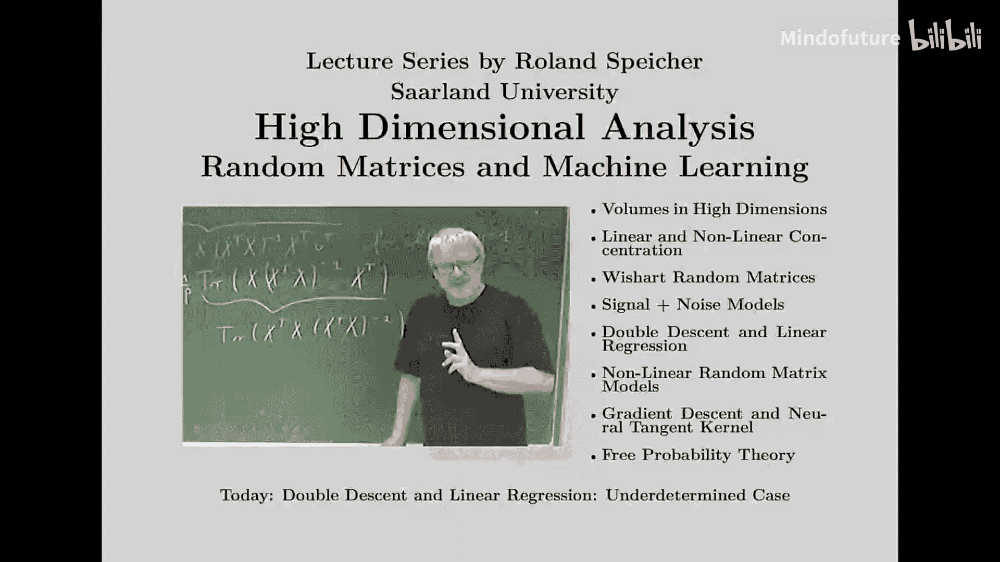
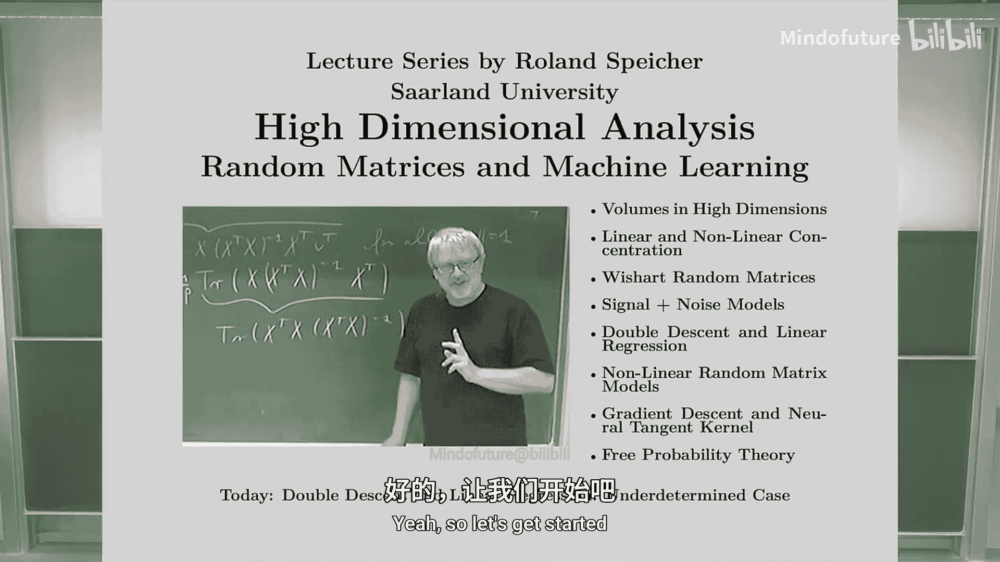

# 018：双下降与欠定情况下的线性回归

在本节课中，我们将学习线性回归模型在“欠定”情况下的表现，即当参数数量多于观测数据量时。我们将看到，这与上一节讨论的“过定”情况有显著不同，并最终会得到一个被称为“双下降”现象的理论曲线。

我们从最简单的神经网络——线性回归开始。这个模型没有隐藏层，也没有非线性激活函数，但它能帮助我们理解高维情况下的核心现象，特别是过参数化与欠参数化之间的差异。

线性回归模型的形式如下：输入为 `x`，输出为 `y`，它们之间通过一个线性权重矩阵 `W` 连接。我们建模的函数形式为 `y = Wx`。

我们考虑一个带有噪声的线性关系模型：`y = Wx + n`。其中 `n` 是噪声。我们已知观测数据 `x` 和带噪声的输出 `Y_hat`，目标是找到一个线性关系 `W_hat`，使其能最好地描述数据。

这本质上是一个线性方程组。我们有两个关键参数：`P` 是向量 `x` 的维度，`N` 是观测数量。矩阵 `X` 是 `P x N` 维的。根据 `P` 和 `N` 的大小关系，我们得到过定或欠定的方程组。

上一节我们讨论了过定情况（`N > P`），即方程多于变量，通常没有精确解。我们通过最小二乘法寻找最佳近似解，其解为 `W_hat = Y_hat * X^T * (X * X^T)^(-1)`。我们计算了估计误差，在 `N, P` 趋于无穷且比例 `γ = P/N` 固定的极限下，平均误差为 `σ² * γ / (1 - γ)`，其中 `σ²` 是噪声方差。当 `γ` 接近 1 时，误差会爆炸式增长。

本节我们将探讨相反的情况，即欠定或过参数化情况。

## 欠定情况

现在考虑 `N < P` 的情况，即观测数量少于未知参数数量。这意味着在一般情况下，方程组有无穷多解。我们假设矩阵 `X` 具有最大秩 `N`，以确保方程相容。

我们的方程是 `Y_hat = W_hat * X`。我们希望从无穷多解中找到一个“最好”的解。通常，我们选择具有最小范数（最小长度）的解。

这个最小范数解可以用一个与过定情况类似的公式表示，只需将逆运算替换为伪逆。具体而言，`W_hat` 可以写为：
`W_hat = Y_hat * X^T * (X * X^T)^(+)`
其中 `(+)` 表示伪逆。

然而，我们可以通过调整公式，再次得到一个包含常规逆的表达式。实际上，最小范数解等价于：
`W_hat = Y_hat * (X^T * X)^(-1) * X^T`
注意，这里 `(X^T * X)` 是一个 `N x N` 矩阵，在最大秩假设下是可逆的。而之前过定情况下的 `(X * X^T)` 是 `P x P` 矩阵。

为了确认这个公式确实给出了最小范数解，我们引入一个引理。

以下是关于线性方程组解的引理。

考虑线性方程组 `A * x = y`（记作方程 `*`），其中 `A` 是 `N x P` 矩阵（`N < P`），`x` 是 `P` 维向量，`y` 是 `N` 维向量。假设 `A` 具有满秩 `N`，这意味着 `A * A^T` 是一个可逆的 `N x N` 矩阵。

那么，向量
`x0 = A^T * (A * A^T)^(-1) * y`
是方程 `*` 的一个解，并且是所有解中欧几里得范数最小的解。

**证明**：
1.  **验证是解**：将 `x0` 代入方程，`A * x0 = A * A^T * (A * A^T)^(-1) * y = y`。成立。
2.  **验证最小范数**：设 `x` 是任意其他解，即 `A * x = y`。考虑内积 `<x - x0, x0>`。
    利用 `x0` 的表达式：
    `<x - x0, x0> = (x - x0)^T * [A^T * (A * A^T)^(-1) * y]`
    将 `A^T` 移到左侧（利用内积性质 `u^T * v = v^T * u`）：
    `= [A * (x - x0)]^T * (A * A^T)^(-1) * y`
    因为 `A*x = y` 且 `A*x0 = y`，所以 `A*(x - x0) = 0`。因此上述内积为 0。
    这表明 `x - x0` 与 `x0` 正交。
    由勾股定理，`||x||² = ||x - x0||² + ||x0||²`。
    由于 `||x - x0||² ≥ 0`，所以 `||x||² ≥ ||x0||²`，等号成立当且仅当 `x = x0`。证毕。

将这个引理应用到我们的线性回归问题（`Y_hat = W_hat * X`），对其转置得到 `X^T * W_hat^T = Y_hat^T`。这里 `A = X^T`，`x = W_hat^T`，`y = Y_hat^T`。应用引理并转置回来，就得到了之前所述的最小范数解公式：
`W_hat = Y_hat * (X^T * X)^(-1) * X^T`

这个解精确地拟合了所有数据点 `Y_hat`，包括其中的噪声。接下来我们评估这个估计的误差。

## 误差分析

我们想要计算真实权重 `W` 与估计权重 `W_hat` 之间的误差。将 `W_hat` 的表达式和真实模型 `Y_hat = W * X + n` 代入：

`W - W_hat = W - [ (W*X + n) * (X^T * X)^(-1) * X^T ]`

展开并整理：
`= W - W * X * (X^T * X)^(-1) * X^T - n * (X^T * X)^(-1) * X^T`

我们可以证明，上式中的前两项（与 `W` 相关的部分）和最后一项（与噪声 `n` 相关的部分）是相互正交的。因此，误差的平方范数可以分解为两部分之和：

`||W - W_hat||² = ||W * [I - X*(X^T*X)^(-1)*X^T] ||² + || n * (X^T*X)^(-1)*X^T ||²`

在统计学习中，这两部分通常分别称为 **偏差（Bias）项** 和 **方差（Variance）项**。

### 方差项计算

方差项包含噪声 `n`。我们假设噪声 `n` 是均值为零、方差为 `σ²` 的高斯随机向量，并对其取期望。

`E[ || n * (X^T*X)^(-1)*X^T ||² ] = σ² * Tr( (X^T*X)^(-1) )`

这里 `Tr` 表示迹（trace）运算。这与上一节过定情况下的方差项形式完全对称，只是 `X` 和 `X^T` 的角色互换，相应地 `N` 和 `P` 的角色也互换了。

在过定情况下，方差项极限为 `σ² * γ / (1 - γ)`，其中 `γ = P/N < 1`。
在欠定情况下，经过变量替换（`γ -> 1/γ`），我们得到方差项的极限为：
`σ² * (1/γ) / (1 - 1/γ) = σ² / (γ - 1)`
其中现在 `γ = P/N > 1`。

### 偏差项计算

偏差项不依赖于噪声。我们计算其平方范数：
`||W * [I - X*(X^T*X)^(-1)*X^T] ||²`

经过代数运算（展开并利用迹的循环性质），并假设数据矩阵 `X` 的分布是旋转不变的（如高斯分布），我们可以证明，对于任何单位范数的权重向量 `W/||W||`，以下二次型的结果都相同：
`(W/||W||) * X * (X^T*X)^(-1) * X^T * (W/||W||)^T`

由于旋转对称性，这个值等于对所有标准正交基向量取该二次型的平均值，即等于 `(1/P) * Tr( X * (X^T*X)^(-1) * X^T )`。

再次利用迹的循环性质，`Tr( X * (X^T*X)^(-1) * X^T ) = Tr( (X^T*X)^(-1) * X^T * X ) = Tr( I_N ) = N`，其中 `I_N` 是 `N x N` 单位矩阵。

因此，偏差项可以化简为：
`||W||² * [1 - N/P] = ||W||² * (1 - 1/γ)`

## 最终结果与双下降现象

综合偏差项和方差项，在 `N, P` 趋于无穷且 `γ = P/N` 固定的极限下，线性回归在欠定情况 (`γ > 1`) 下的平均估计误差为：

`误差 = ||W||² * (1 - 1/γ) + σ² / (γ - 1)`

现在，我们可以将两种情形的结果总结在一起：

*   **过定情况 (`γ < 1`)**：误差 = `σ² * γ / (1 - γ)`
*   **欠定情况 (`γ > 1`)**：误差 = `||W||² * (1 - 1/γ) + σ² / (γ - 1)`

如果以 `γ` 为横轴，误差为纵轴绘图，我们会观察到典型的“双下降”曲线：
*   当 `γ` 从 0 增加到 1 时，误差随着 `γ` 接近 1 而急剧上升至无穷大（过拟合区域）。
*   当 `γ` 超过 1 后，误差从无穷大下降。其中方差项 `σ²/(γ-1)` 随着 `γ` 增大而衰减，偏差项 `||W||²*(1-1/γ)` 则从 0 开始上升并渐近趋于 `||W||²`。两者之和形成一个先下降后可能缓慢上升的“U”形谷，构成了误差曲线的第二个下降区域。

本节课中我们一起学习了线性回归在欠定情况下的理论分析。我们推导了最小范数解，并将其估计误差分解为偏差和方差两部分。通过计算这两部分在高维极限下的表达式，并与过定情况的结果对比，我们从理论上解释了“双下降”现象的产生机制：在参数数量刚好等于数据数量 (`γ=1`) 的临界点附近，模型表现最差；而当模型进入过参数化区域 (`γ>1`) 后，性能反而可能得到改善。这为理解现代复杂机器学习模型（如深度神经网络）在过参数化下的良好表现提供了经典的理论视角。